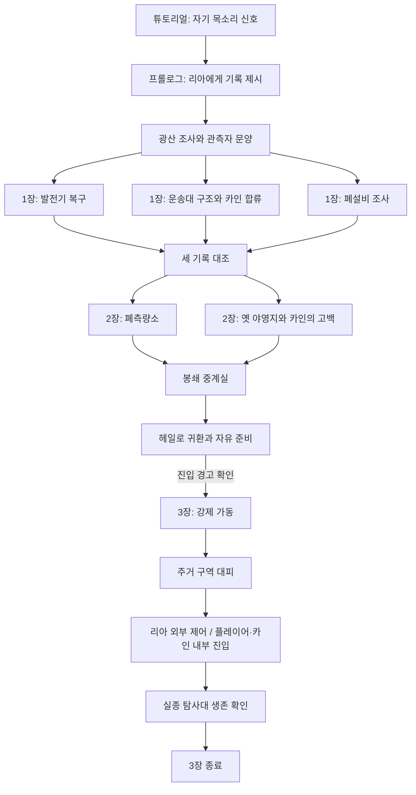

# SimpleGame 게임 개발 통합 문서

통합일: 2026-10-14  
기준 브랜치: `iss01_actor_scene_render` · 기반 커밋: `41316a5` · 광산 전환은 이후 작업 폴더 변경 기준

게임 컨셉, 세계관·스토리, 향후 구현 명세, 현재 플레이, 코드·클래스 구조, 개발 규칙,
성능 분석, 모니터링, 검증 기록을 관리하는 단일 문서다. 이후 문서 변경과 개발 진도는 이 파일에 반영한다.

## 문서 읽는 기준

- **현재 구현:** 도시 도입부 → 전망대 조사·하강 → 리아에게 신호 기록 제시 → 도시 수신망 확인 → 리아와 바이크 이동 → 광산 구조 신호 조사 → 좌표 확보·헤일로 귀환.
- **향후 기획:** 광산 이후 메인 스토리 1~3장, 정식 장비·동료 관계 확장, 영구 저장·복원, 오픈 월드 스트리밍.
- **검증 상태:** 광산 전환의 C++ 구문 검사와 독립 게임 규칙 테스트를 수행했다. 게임 전체 빌드·실제 화면·플레이·FPS 실측 및 기존 스택 오버플로 수정의 게임 실행 확인은 별도다.
- **내용 우선순위:** 현재 구현과 조작은 1·6·7절을 따른다. 2~5절의 장기 기획·서사·명세는 구현 완료를 뜻하지 않는다.
- 기존 격리 구역의 작업장 4곳·협업 NPC 20명·성장 목표·전체 미니맵·펄스 공격은 제거했다. 같은 진입 구간을 광산 프롤로그로 교체했다.
- 중복 MD/TXT 사본은 통합했다. 초기 기획, 서사 확장안, 퀘스트 명세의 서로 다른 세부 내용은 보존했다.
- 서사 문서에서 차량 조종을 요구하지 않는다는 문구는 해당 본편 명세의 범위다. 별도로 구현한 바이크 이동 스테이지와 구분한다.
- 바닥의 8×8 렌더링 캐시는 오픈 월드의 데이터 로딩·스트리밍 구현을 뜻하지 않는다.

## 목차

1. [현재 개발 현황과 확인 대기 사항](#status)
2. [게임 정체성과 장기 개발 원칙](#principles)
3. [초기 게임 기획과 제작 단계](#design)
4. [메인 스토리 서사 확장안](#story)
5. [메인 스토리 1~3장 구현 명세](#story-spec)
6. [현재 콘텐츠와 모델·이동 확장](#content)
7. [튜토리얼·전투·성장·NPC 상세](#gameplay)
8. [코드·클래스·Scene 구조](#architecture)
9. [코드 작성과 개발 협업 규칙](#conventions)
10. [렌더링 최적화와 성능 분석](#performance)
11. [로컬 게임 모니터와 JSON 데이터](#monitoring)
12. [통합 출처와 유지 관리](#sources)

<a id="status"></a>

## 1. 현재 개발 현황과 확인 대기 사항

### 광산 프롤로그 전환 — 2026-10-14

이전 격리 구역은 기술 시험 구간으로 종료하고, 바이크 목적지를 광산으로 교체했다.

| 분야 | 현재 반영 |
|---|---|
| 진행 | 신호 기록 제시 → 도시 수신망 확인 → 리아 합류·광산행 → 전력 우회·격벽 개방 → 유적 구조 신호 → 관측자 문양 → 중계 좌표 → 헤일로 귀환 |
| 맵 | 64×64, 입구·주 갱도·갈림길·폐쇄 격벽·지하 유적을 연결한 고정 구조. 시드는 적 배치를 바꾼다. |
| 어둠 | 커서 방향 플래시라이트, 제한된 근접 시야, 고정등과 탄환 주변만 밝힌다. 벽·닫힌 격벽이 빛을 차단하며 후처리 뒤에 어둠을 적용한다. |
| 전투 | Weapon → Firearm → Pistol. 권총 12발, 사격 간격 0.2초, 재장전 1.4초, 연사 탄퍼짐 누적·시간 경과 회복, 벽에서 멈추는 발광 탄환 |
| 적 | 고장 난 채굴 드론 30기, 플레이어 추적·공격, 처치 후 15초 재출현. 스토리 완료 후 반복 사냥 가능 |
| 구조 | 광부 2무리·고립 전투원 2무리, 각 3명. F 스캔으로 대략적 방위·거리 확인, E 구조 시 입구로 보행 |
| 동료 | 바이크 출발 시 companion.ria_joined 활성화, 광산에서는 리아가 실제 경로를 따라 동행 |
| 모니터 | mine 지역·퀘스트·명시적 플래그·탄창·탄퍼짐·스캐너·구조 무리·철수 인원 표시. 시험 작업장 제거 |
| 검증 | C++ 구문 검사, 독립 규칙 테스트, 30개 시드의 경로 연결, 모니터 JS 구문·JSON·프로젝트 등록 검사 |
| 실행 확인 | 게임 전체 빌드·실제 렌더링·플레이·성능은 사용자 확인 대상 |

퀘스트·성장·탄창·구조 성과는 같은 실행에서 도시 왕복 시 유지한다. 프로그램 종료 후 영구 저장은 아직 없다.
광산 조사를 완료해도 구조와 사냥을 계속할 수 있으며, 구조 인원이나 처치 수가 필수 스토리 진행을 막지 않는다.

### 이전 확장 기록 — 2026-10-14, 광산 전환 이전

다음 표는 기반 커밋의 과거 기록이다. 격리 구역·작업장·시험 NPC 관련 항목은 위 광산 전환으로 대체되었다. 모델·바이크·렌더링 기반은 이어서 사용한다.
향후 작업 진도는 이 통합 문서에 날짜별로 이어서 기록한다.

#### 광산 전환 이전에 반영되었던 범위

| 분야 | 진도 |
|---|---|
| 게임 기반 | 싱글 플레이 SF·코스믹 호러 RPG, 쿼터뷰 2.5D, 한글 UI, WASD 및 상호작용 |
| 객체 구조 | Actor와 Scene Graph를 통한 객체 배치·계층·컬링·표시 순서 제어 |
| 전투·성장 | 플레이어 공격, 드롭 획득, 회복 키트, 경험치·레벨·자동 스탯 반영 |
| 격리 구역 | 연결된 랜덤 64×64 맵, NPC 20명, 몹 정원 72기와 재출현 |
| 렌더링·성능 | RenderQueue 배칭, 정적 메시·재질·모델 캐시, 발광·후처리, CPU/GPU 계측과 초당 통계 |
| 모델 확장 | 차량·캐릭터·건물 각 5종, 형태와 body/accent/emission 색 분리, 캐시 버전 3 |
| 차량 수정 | 전면 헤드라이트·후면 추진기, 후방 배기, 색상 연동 불티, 교통 이동 속도 증가 |
| 튜토리얼 확장 | 대형 전망대 외관·관측 데크, 신호 조사, 하강 후 개인용 제트 바이크 탑승 |
| 이동 스테이지 | 바이크 조종·가감속·부스트, 다층 시차 스크롤, 잔해 회피, 격리 구역 도착 전환 |
| NPC 협업 | 작업장 4곳의 실제 보급·수리·엄호 전투·치료·구조 및 회복 |
| 로컬 모니터 | 500ms JSON 상태 수신, 지역·NPC·몹·주행·작업장·성능 표시, 검색·필터·JSON 저장 |
| 모델 도감 | /models.html에서 실제 캐시 15종과 독립 색상을 비교하는 형태 미리보기 |

메인 스토리 1~3장 전체 진행, 영구 퀘스트/지역/NPC 상태 저장·복원은 아직 구현 완료로 보지 않는다.
분위기는 현재 상태에서 도출하고 소문·성향은 설정 정보다. 소문 전파 시뮬레이션은 미구현이다.

#### 확인한 내용

- 생성 모델의 폴리곤/유리 면 214개, 조명·노즐 장착점과 부품 수를 수치 검토했다.
- 퀘스트 지점 접근 좌표, 전환 분기, 호출 인터페이스, 프로젝트 파일 등록을 정적으로 확인했다.
- 브라우저 JavaScript 구문, HTML 연결, JSON 필드와 프로파일러 항목 연결을 확인했다.
- 검토 중 발견한 면적 0 차량 후면, 차체 밖 헤드라이트, 액세서리만 표시되는 탑승자,
텍스트 자원이 포함된 바닥 캐시, NPC 초기 행동 대상 좌표 문제를 소스에서 수정했다.

- 이 내용은 실제 게임 렌더링·플레이 검증이나 60FPS 달성 확인을 의미하지 않는다.

#### 사용자 보고 오류와 수정 상태

사용자가 SimpleGame.exe의 0xC00000FD(Stack overflow) 예외를 보고했다.
약 238KiB 모델 라이브러리를 지역 변수와 값 반환으로 중복 복사하는 경로를 확인해 수정했다.

- 라이브러리는 std::unique_ptr로 힙에 보관한다.
- Generate/GenerateVehicle/GenerateCharacter/GenerateBuilding은 저장 공간에 직접 생성한다.
- 캐시 로딩·저장은 실제 Library 크기를 사용하며 기존 버전 3 형식은 유지한다.
- 손상된 캐시를 읽은 뒤 재생성할 때는 새 저장 공간을 사용한다.

상태: 수정 적용 및 소스 확인 완료, 재빌드·재실행으로 오류가 해소되었는지는 확인 대기.
예외 주소만으로 실제 발생 호출 경로를 확정한 것은 아니며, 재발 시 디버거 호출 스택을 확인한다.

#### 당시 확인 계획 (광산 전환 이후에는 7.6절 사용)

1. 사용자 재빌드 후 시작 및 모델 캐시 로딩/생성이 정상인지, 스택 오버플로가 재발하는지 확인.
2. 차량·캐릭터·건물 5종과 전후 장착점·불꽃 색/방향을 실제 렌더링에서 확인.
3. 전망대 진입 → 측정 → 하강 → 바이크 → 격리 구역의 전체 흐름 및 일시정지·초기화를 확인.
4. NPC의 보급·수리·방어·치료, 몹 재출현, 플레이어 경험치 분리와 모니터 일치를 확인.
5. 프로파일링 로그로 FPS·드로우 콜·협업·길 찾기·JSON 생성 비용을 확인.

빌드와 실행 결과 확인은 특별한 상황이 아니면 사용자가 직접 진행한다.
당시 기록 작성 시에는 미커밋 상태였으며, 통합 기준 커밋 41316a5에는 해당 변경이 반영되어 있다.

<a id="principles"></a>

## 2. 게임 정체성과 장기 개발 원칙

이 문서는 `SimpleGame` 프로젝트의 장기 개발 기준이다. 향후 기능, 구조, 콘텐츠를 추가할 때 이 문서의 방향성을 기본 틀로 유지한다. 명시적인 변경 합의 없이는 아래 원칙을 바꾸지 않는다.

### 1. 프로젝트 정체성

- **형태:** 싱글 플레이 실시간 렌더링 기반 게임
- **장르:** 쿼터뷰 2.5D 오픈 월드 RPG
- **핵심 경험:** 미지의 SF 세계를 탐험하며 동료와 유대를 쌓고, 인간의 통제를 벗어난 우주적 공포와 상실을 마주한다.
- **현재 기술 기반:** Windows C++, OpenGL, GLEW, FreeGLUT

초기에는 단색 사각형 렌더링 기반에서 시작했으며, 현재 구현 범위는 1절에 정리한다. 이후의 코드는 일회성 예제보다 게임 기능을 지속적으로 추가할 수 있는 구조를 우선한다.

### 2. 표현 및 공간 원칙

게임 세계는 2D 타일 좌표를 중심으로 관리하고, 화면에는 쿼터뷰(등각투영에 가까운 대각 시점)로 표시한다.

기본 월드 좌표 변환은 다음을 기준으로 한다.

```text
screenX = (worldX - worldY) * tileWidth / 2
screenY = (worldX + worldY) * tileHeight / 2 - worldZ * heightUnit
```

- `worldZ`는 높이를 나타내며 화면상으로는 위쪽으로 이동시킨다.
- 카메라, 좌표 변환, 월드 타일, 오브젝트 정렬은 렌더러에서 분리된 명확한 계층으로 설계한다.
- 오브젝트는 화면상 아래쪽에 있는 대상이 나중에 그려지도록 정렬해 자연스러운 가림을 구현한다.
- 2.5D 표현을 위해 타일·지형·구조물·캐릭터의 높이와 겹침을 일관되게 처리한다.

### 3. 오픈 월드 구조 원칙

월드 전체를 한 번에 메모리에 올리거나 그리지 않는다.

- 월드는 청크 단위로 나눈다.
- 카메라 주변 청크만 로드·업데이트·렌더링한다.
- 월드 데이터는 타일, 정적 오브젝트, 동적 엔티티, 이벤트 상태로 구분한다.
- 저장·로드와 스트리밍을 고려해 지역 간 상태를 독립적으로 유지할 수 있게 한다.

초기 코드 구조는 다음 역할 경계를 지향한다.

```text
Game       : 게임 루프, 상태 전환, 입력, 게임 규칙
World      : 청크, 타일 맵, 오브젝트 배치, 저장·로드
Entity     : 플레이어, 동료, NPC, 몬스터, 아이템의 상태와 행동
Renderer   : 카메라에 보이는 타일·엔티티의 실시간 렌더링
Resource   : 텍스처, 셰이더, 사운드 등 리소스의 로딩과 캐싱
```

### 4. 세계관과 분위기

#### 기본 세계관

인류는 성간 문명권을 이룬 미래에 살며, 고대 선행 문명이 남긴 성간 관문망을 완전히 이해하지 못한 채 사용한다. 관문망은 단순한 이동 수단이 아니라 우주 밖 존재의 관측을 막기 위해 만들어진 거대한 장막의 일부다.

관문을 무분별하게 재가동한 결과 장막이 약해지고, 변방 행성에서는 통신 두절, 시간 오차, 생태계 변이, 집단 실종, 공간 왜곡이 발생한다. 중앙 권력과 기업, 비밀 연구 조직은 진실을 은폐하거나 이를 이용하려 한다.

#### 분위기 변화

1. **초반 — 경이와 개척:** 아름다운 외계 풍경, 활기 있는 정착지, 탐험과 거래.
2. **중반 — 불안과 의심:** 폐쇄 구역, 실종 기록, 달라지는 기억, 왜곡된 유적.
3. **후반 — 공포와 무력감:** 공간 붕괴, 시간 반복, 인간의 이해를 거부하는 존재의 흔적.
4. **결말 — 선택과 대가:** 진실·안전·힘 중 무엇을 택할지 결정.

코스믹 호러는 적이나 괴물을 과도하게 설명하는 방식보다, 인간의 이해와 통제가 닿지 않는 현실을 체감시키는 방식으로 표현한다. 우주 밖 존재는 끝까지 명확히 규정하지 않는다.

### 5. 동료와 상실

이 게임은 싱글 플레이어 경험이다. 동료는 전투 보조 수단이 아니라 플레이어가 세계를 해석하고 감정을 나누는 핵심 인물이다.

- 동료마다 세계관을 보는 서로 다른 신념, 역할, 개인 퀘스트를 부여한다.
- 이동·전투·캠프·무전 대화를 통해 유대를 장기적으로 쌓는다.
- 상실은 플레이어의 명백한 실패에 대한 처벌이 아니라, 최선의 노력으로도 막을 수 없는 불가항력과 사고를 통해 발생할 수 있다.
- 결정적인 상실은 드물게 사용하되, 발생 후에는 일회성 컷신으로 끝내지 않는다.
- 사라진 동료의 장비, 로그, 미완의 퀘스트, 정착지의 반응, 파티 기능의 공백, 다른 동료의 관계 변화가 월드에 지속적으로 남아야 한다.
- 일부 동료는 사망 외에도 이탈, 변질, 적대 등 다른 형태로 상실될 수 있다.

동료 상실은 플레이어가 모든 사람을 구할 수 없음을 깨닫게 하고, 후반의 우주적 선택에 감정적 무게를 부여해야 한다.

### 6. 메인 퀘스트 1편: 《침묵하는 관문》

#### 개요

첫 번째 이야기는 변방 행성 `에르마`의 개척 도시 `헤일로`에서 시작한다. 플레이어는 오래전에 실종된 탐사선이 보낸 구조 신호를 조사하며, 성간 관문과 우주적 존재의 첫 흔적을 발견한다.

#### 흐름

1. **프롤로그 — 낙하한 신호**
- 인근 광산에서 수신된 오래된 탐사선의 구조 신호를 조사한다.
- 현지 정비사 `리아`가 첫 동료로 합류한다.
- 지하 유적에서 플레이어와 닮은 관측자 문양을 발견한다.

2. **1장 — 빛나는 개척지**
- 헤일로와 주변 지역을 탐험하며 발전기, 실종 운송대, 약탈자 문제를 해결한다.
- 전 탐사대 경비원 `카인`이 합류한다.
- 모든 이상 현상이 폐쇄된 관문 `N-0`과 연결되어 있음을 알게 된다.

3. **2장 — 돌아오지 않은 사람들**
- 관문 주변의 시간·공간 왜곡 지역을 탐사한다.
- 탐사대 로그와 과거의 흔적을 통해 관문이 장막의 일부임을 추론한다.
- 카인은 과거 탐사대를 두고 후퇴했다는 사실을 드러낸다.

4. **3장 — 관문이 열리는 밤**
- 비밀 연구 조직 `심연 관측국`이 관문을 강제로 재가동한다.
- 헤일로가 왜곡에 휘말리고, 플레이어와 동료들은 시민 대피와 관문 정지 작전을 수행한다.
- 실종 탐사대가 죽은 것이 아니라 관측되지 않는 공간에 갇혔음을 발견한다.

5. **4장 — 닫히는 문**
- 관문을 닫기 위해 내부와 외부에서 동시에 제어 장치를 유지해야 한다.
- 리아는 외부 제어를 맡고, 플레이어와 카인은 관문 내부의 핵을 파괴한다.
- 관문 붕괴로 리아는 도시 일부와 함께 현실에서 사라진다. 시신과 확정적인 죽음의 증거는 남지 않는다.

6. **에필로그 — 빈 채널**
- 헤일로는 살아남지만 지역 일부가 사라지고, 리아의 장비와 로그만 남는다.
- 플레이어는 장막 붕괴가 은하 전체에서 시작됐음을 알게 된다.
- 다음 이상 신호는 미확인 행성 `네레우스`에서 수신되며, 발신자는 리아다.

### 7. 구현 우선순위

향후 기술 작업은 다음 순서를 기본으로 한다.

1. 안정적인 렌더링 루프, 오류 처리, 리소스 수명 관리
2. 카메라와 쿼터뷰 좌표 변환
3. 타일 맵과 화면 정렬
4. 플레이어·동료·NPC 엔티티 기반 구조
5. 청크 로딩과 월드 저장 상태
6. 텍스처, 애니메이션, UI, 사운드
7. 전투, 퀘스트, 대화, 스토리 이벤트

새 기능은 가능하면 위의 책임 경계를 넘지 않게 구현하며, 렌더링 코드에 월드 규칙이나 스토리 규칙을 직접 섞지 않는다.

<a id="design"></a>

## 3. 초기 게임 기획과 제작 단계

초기 기획의 제안과 제작 단계다. 단계별 항목이 모두 구현된 것은 아니며 현재 상태는 1절을 따른다.

작성일: 2026-09-09 · 버전: 0.1 · 프로젝트: SimpleGame · 게임 정식 명칭: 미정

본 문서는 지금까지 합의한 요구 사항과 `이 문서의 장기 개발 원칙 절`를 게임 경험, 콘텐츠, 제작 범위로 구체화한 초기 기획서다. 기본 방향과 메인 퀘스트 1편의 골격은 유지한다. 새롭게 제시하는 세부 시스템과 제작 범위는 제안이며, 구현 완료를 의미하지 않는다.

### 1. 게임 개요

| 항목 | 기획 기준 |
|---|---|
| 플레이 형태 | 싱글 플레이 |
| 장르 | 오픈 월드 RPG |
| 화면 표현 | 실시간 렌더링 기반 쿼터뷰 2.5D |
| 세계관 | 성간 문명이 형성된 먼 미래의 SF |
| 분위기 | 신비와 경이로 시작해 탐험이 깊어질수록 어두워지는 코스믹 호러 |
| 정서적 중심 | 동료와의 유대, 갑작스럽고 피할 수 없는 상실, 그 이후의 삶 |
| 현재 개발 기반 | Windows, C++, OpenGL, GLEW, FreeGLUT |
| 1편 이야기 | 《침묵하는 관문》 — 변방 행성의 사고 조사에서 시작되는 장막 붕괴 |

플레이어는 아름답고 낯선 개척 행성을 동료들과 탐험한다. 작은 구조 요청과 지역 문제를 해결할수록 세계를 지탱하던 기술에 대한 믿음이 흔들리고, 결국 인간을 적으로 여기기조차 하지 않는 거대한 현상과 마주한다.

중심 질문은 “모든 것을 구할 수 없는 세계에서, 누구와 무엇을 위해 계속 살아갈 것인가?”이다.

### 2. 핵심 경험과 설계 원칙

#### 탐험하고 싶은 세계

초반부터 공포를 전면에 내세우기보다 외계 풍경, 정착지의 생활, 유적의 아름다움으로 호기심을 만든다. 탐험에는 장비와 자원뿐 아니라 인물의 사정, 새로운 길, 세계를 다르게 이해하게 하는 정보가 보상으로 주어진다.

#### 일상으로 쌓이는 동료 관계

함께 이동하고, 사소한 부탁을 해결하고, 위험에서 도움을 받는 경험을 반복한다. 동료에게는 개인 목표와 취향, 플레이어 없이도 이어지는 관계가 있다. 죽음을 예고하기 위한 인물로만 소비하지 않는다.

#### 성장해도 사라지지 않는 공포

성장은 전투와 탐험의 선택지를 늘린다. 그러나 우주적 존재 자체를 체력 수치와 최종 공격으로 정복하지는 않는다. 국지적 적은 싸워 이길 수 있어도, 큰 현상 앞에서는 이해·회피·봉쇄·구조가 목표가 된다.

#### 상실 이후에도 이어지는 플레이

갑작스러운 상실은 충분한 관계 축적 뒤에 발생한다. 사건 직후의 슬픔뿐 아니라 대화의 침묵, 비어 있는 작업대, 달라진 탐험 습관을 통해 부재를 오래 느끼게 한다. 동시에 플레이어에게 애도하고 다른 사람을 돕고 앞으로 나아갈 행동을 남긴다.

### 3. 시간적 배경과 세계관

시대는 인류가 성간 문명을 이룬 뒤 수백 년이 흐른 미래다. 정확한 연도는 미정이다. 인류는 여러 행성에 정착했으나 장거리 이동은 선행 문명의 관문망에 의존한다. 기술을 운용할 수 있다는 자신감과 그 원리를 모른다는 취약성이 공존한다.

개발자 관점의 기본 진실은 관문망이 우주 밖 존재의 관측을 차단하는 장막의 일부라는 것이다. 인류의 재가동이 장막을 약화시킨다. 다만 게임 속 기록과 인물의 설명은 불완전하며, 존재의 기원·의도·전체 모습까지 확정적으로 설명하지 않는다.

| 시대 구분 | 사건과 현재에 남긴 영향 |
|---|---|
| 선행 문명 시대 | 장막과 관문망 건설. 문명 소멸의 정확한 경위는 불명 |
| 인류 확장기 | 관문 발견과 이용, 성간 정착지 확장 |
| 현재 이전 | 변방에서 탐사대 실종과 통신·시간 이상 누적 |
| 게임 시작 | 에르마에서 오래된 탐사선의 구조 신호 수신 |

생활 공간에는 수리한 장비와 익숙한 인간 문화가 존재한다. 그 바깥에는 설명할 수 없는 규모의 구조물과 생태계가 놓인다. 사람의 생활감이 있어야 이후의 붕괴가 구체적인 상실로 다가온다.

### 4. 월드 구성과 자유도

장기 목표는 오픈 월드다. 초기 제작 범위는 에르마의 헤일로와 연결된 주변 지역으로 제안한다. 은하 규모의 설정이 곧 다수 행성을 초기부터 구현한다는 뜻은 아니다. 네레우스는 1편 이후의 이야기 연결점으로 둔다.

| 지역 | 플레이 역할 | 분위기와 변화 |
|---|---|---|
| 헤일로 | 대화, 거래, 정비, 동료 관계의 거점 | 활기 있는 도시에서 사고와 부재의 흔적이 남은 도시로 변화 |
| 초원·사막과 이동로 | 자유 탐험, 운송대 수색, 지역 의뢰 | 외계의 아름다움 속에 드문 이상 징후 |
| 광산·폐광 | 도입부 구조 신호 조사, 기본 전투·상호작용 | 산업 시설 아래 드러나는 고대 유적 |
| N-0 외곽 | 기록 조사, 우회 경로, 공간 퍼즐 | 지형과 기억이 맞지 않는 불안 |
| 관문 내부 | 정지 작전과 이야기의 절정 | 별과 공간 자체가 관측하는 듯한 공포 |

지역 의뢰와 탐험 순서는 가능한 범위에서 자유롭게 둔다. 핵심 이야기의 전환은 조사 진척과 사건 조건으로 연결한다. 단서는 여러 경로로 얻을 수 있도록 설계하되, 주요 사건의 인과는 유지한다.

월드 상태는 퀘스트 전후에 달라진다. 대피시킨 주민, 복구한 시설, 발견한 기록 등이 이후 대화와 지역 상태에 반영되도록 한다. 구체적인 분기 수는 제작 규모에 맞춰 결정한다.

### 5. 기본 플레이 순환

```text
정착지에서 준비·대화
→ 동료와 지역 탐험
→ 전투·조사·구조·장치 조작
→ 자원과 단서 획득
→ 귀환·정비·관계 변화
→ 월드와 이야기에 변화 발생
→ 새로운 탐험
```

실시간 렌더링은 확정 사항이다. 전투 방식은 아직 확정하지 않았으며, 실시간 액션·전술 일시정지 등은 별도 결정한다. 초기에는 이동, 상호작용, 한 가지 공격과 동료 보조 행동으로 기본 재미를 확인하는 방안을 제안한다.

| 시스템 | 초기 설계 방향 | 미정 사항 |
|---|---|---|
| 이동·카메라 | 쿼터뷰 공간 탐색, 지형 충돌, 플레이어 추적 | 키보드·마우스 조작 방식, 회전·줌 |
| 조사 | 신호·로그·유적·환경 흔적을 연결 | 스캔 장비와 퍼즐의 상세 규칙 |
| 전투 | 지역의 위협에 대응하고 동료와 협력 | 전투 시간 방식, 무기, 조준, 난이도 |
| 성장 | 장비와 기술로 탐험·전투 선택지 확대 | 레벨·클래스·스킬 트리 유무 |
| 동료 | 동행 행동, 상황 대화, 개인 사건 | 동시 동행 인원, 명령 UI, 관계 수치 노출 |
| 퀘스트 | 지역 문제와 메인 미스터리 연결 | 분기 규모와 반복 의뢰 여부 |
| 저장 | 탐험·퀘스트·동료·월드 상태 지속 | 자동·수동 저장 정책과 전투 패배 처리 |

### 6. 주요 인물과 세력

| 대상 | 역할과 서사 기능 |
|---|---|
| 플레이어 | 구조 신호와 개인적인 연결을 지닌 인물. 유적의 관측자 문양과 닮아 있음. 출신·과거·이름·커스터마이징은 미정 |
| 리아 | 현실적이고 밝은 현지 정비사. 정비와 일상 대화를 통해 개척지에 대한 애착을 형성하는 첫 동료 |
| 카인 | 실종 탐사대의 전 경비원. 과거 동료를 두고 후퇴한 기억을 숨기며 생존과 죄책감의 갈등을 보여 줌 |
| 헤일로 주민 | 플레이어가 지키려는 삶의 구체적인 모습. 의뢰와 사건 이후 반응을 통해 세계의 변화를 전달 |
| 심연 관측국 | 현상을 이해하고 통제할 수 있다고 믿는 비밀 연구 조직. N-0 강제 재가동의 주체 |
| 중앙 권력·기업 | 은폐와 이해관계를 만드는 배경 세력. 1편의 직접 개입 범위는 미정 |

리아와의 관계는 수리, 탐험 중 대화, 헤일로의 일상으로 쌓는다. 카인과의 관계는 공동 생존과 과거에 대한 반응으로 형성한다. 상세 개인 퀘스트는 추후 작성한다.

### 7. 메인 퀘스트 1편 — 《침묵하는 관문》

| 구간 | 목표와 주요 플레이 | 드러나는 사실·감정 변화 |
|---|---|---|
| 프롤로그: 낙하한 신호 | 리아와 광산의 구조 신호 조사. 이동·전투·상호작용 습득 | 오래전 실종 탐사선의 신호는 지하 유적에서 송출됨. 관측자 문양 발견. 호기심 형성 |
| 1장: 빛나는 개척지 | 발전기 복구, 운송대 수색, 관문 시설의 약탈자 조사. 카인 합류 | 사건들이 N-0과 연결됨. 생활과 관계를 충분히 경험한 뒤 이상 징후 확대 |
| 2장: 돌아오지 않은 사람들 | 왜곡 지역 탐사, 과거·현재 흔적 비교, 탐사대 로그 수집 | 관문이 장막 일부라는 가설. 카인의 후퇴 사실 공개. 경이에서 불안으로 전환 |
| 3장: 관문이 열리는 밤 | 강제 재가동으로 뒤틀린 헤일로에서 시민 대피. 리아는 외부 제어, 플레이어와 카인은 내부 진입 | 심연 관측국의 개입. 실종 탐사대가 관측되지 않는 공간에 갇혔음을 발견 |
| 4장: 닫히는 문 | 내외부 제어를 유지하며 관문 핵 파괴. 붕괴 속 탈출 | 공간이 플레이어를 인식하는 흔적. 탈출 직전 리아와 도시 일부가 현실에서 잘려 나감 |
| 에필로그: 빈 채널 | 살아남은 헤일로 방문, 유품·로그 확인, 카인과 대화 | 지역 사건은 수습되지만 리아는 부재. 은하의 장막 붕괴와 네레우스발 신호로 다음 이야기 연결 |

리아의 마지막 무전 초안은 “여긴… 아직 빛이 있어.”다. 마지막 연결 신호는 네레우스에서 오며, 발신자는 리아, 수신 시각은 관문 붕괴 이후 17일이다. 신호의 진위와 리아의 생존 여부는 확정하지 않는다.

1편은 헤일로의 즉각적인 위기를 수습하는 지역 이야기로 마무리한다. 전체 게임의 결말 후보로 논의한 관문망 정지, 진실 공개, 존재와 접촉, 장막 계승은 후속 기획 대상이며 1편에서 구현할 확정 분기가 아니다.

### 8. 동료 상실 연출과 플레이어의 영향력

리아의 실종은 현재 이야기 골격상 불가항력 사건이다. 유대 수치나 숨겨진 정답 부족으로 발생한 벌처럼 보이게 하지 않는다. 플레이어와 동료들이 합리적인 계획을 실행해도 예측할 수 없는 공간 붕괴가 탈출을 끊는 인과를 전달한다.

이를 위해 구할 수 없는 상황에서 구출 성공을 암시하는 거짓 선택지나 실패 판정용 시간제한을 두지 않는 방향을 제안한다. 대신 시민 구조, 시설 보호, 기록 확보처럼 실제로 결과를 바꿀 수 있는 행동에 선택의 무게를 둔다.

상실 이후에는 다음 흔적을 남긴다.

- 이동 중 익숙했던 대사와 무전 응답의 부재.
- 비어 있는 정비 공간, 남은 도구와 개인 기록.
- 헤일로 주민과 카인의 반응 변화.
- 리아에게 의지하던 탐험·지원 행동의 변화.
- 미완의 부탁을 플레이어가 이어갈 여지.

동료 기능의 공백은 체감시키되 메인 진행이 영구적으로 막히지 않도록 대체 경로를 설계한다. 다시 수신되는 목소리는 상실을 즉시 취소하는 보상이 아니라 애도와 의심을 동시에 일으키는 단서로 사용한다.

### 9. 시청각 방향

초반은 외계 자연의 빛과 인간 거점의 따뜻한 생활음을 중심으로 한다. 깊은 지역에서는 익숙한 형태에 작은 불일치를 추가하고, 후반에는 공간·빛·소리의 관계가 무너지도록 한다. 어두움은 단순히 화면 밝기를 낮추는 것에 한정하지 않는다.

| 단계 | 화면 | 소리 |
|---|---|---|
| 경이 | 개방된 지형, 발광 식생, 유적의 규모감 | 환경음, 주민 대화, 동료의 자연스러운 반응 |
| 불안 | 반복되는 구조물, 기록과 다른 흔적, 빛의 불일치 | 지연된 응답, 출처가 불명확한 신호 |
| 공포 | 불가능한 연결, 사라진 지형, 관측당하는 연출 | 응답 없는 채널, 낯익은 목소리의 부조화 |
| 상실 이후 | 익숙한 공간의 빈자리와 사고 흔적 | 이전에 있던 특정 대화와 작업음의 부재 |

쿼터뷰에서는 캐릭터와 상호작용 대상의 식별을 유지하고, 큰 구조물이 플레이어를 가릴 때 표시 방식을 마련한다. 공간 왜곡은 길 찾기 규칙과 단서를 갖추어 버그로 오해되지 않게 한다. 최종 아트 스타일, 해상도, 자산 제작 방식은 미정이다.

### 10. 기술 및 데이터 설계 방향

월드 좌표와 화면 좌표를 분리하고 타일 기반 쿼터뷰 투영을 적용한다. 높이는 별도로 관리한다. 가림 순서는 화면의 아래쪽 대상이 나중에 그려지는 원칙에서 시작하되, 구조물 크기와 높이를 고려해 확장한다.

청크를 사용해 주변 월드를 로드하고 보이는 대상을 렌더링한다. 멀리 있는 지역도 퀘스트 결과와 영구 상태는 보존해야 하므로, 화면 밖이라는 이유로 세계의 사건 상태를 잃지 않도록 한다.

| 영역 | 책임 |
|---|---|
| Game | 입력, 업데이트와 렌더링 흐름, 상태 전환, 규칙 |
| World | 청크, 지형, 배치, 지역 변화, 저장 상태 |
| Entity | 플레이어·동료·NPC·적·아이템의 상태와 행동 |
| Renderer | 카메라, 투영과 가림 처리, 화면 출력 |
| Resource | 셰이더·텍스처·사운드 로딩과 캐싱 |
| 서사 데이터 | 대화 조건, 퀘스트 단계, 동료 상태, 사건 후 변화 |

장기 개발에서는 콘텐츠를 추가할 때 렌더링 코드를 수정하지 않아도 되는 구조를 지향한다. 기존 렌더러의 오류 처리, 경로 의존성과 리소스 수명은 기능 확장의 기초 정비 대상으로 둔다.

### 11. 단계별 제작 범위 제안

#### 단계 A: 탐험 기반

작은 쿼터뷰 맵에서 플레이어가 이동하고 카메라가 따라오며 충돌·가림·상호작용이 일관되게 작동하는 상태를 만든다. 인접 청크 이동과 기본 상태 저장을 확인할 수 있는 범위를 목표로 한다.

#### 단계 B: 첫 플레이 가능 구간

프롤로그의 축소 구간으로 헤일로 일부, 광산 이동로, 유적의 한 공간을 연결한다. 리아 한 명, 짧은 대화, 단일 전투 유형, 장치 조작, 신호 발견과 귀환을 넣는다. 탐험과 동료 동행이 재미있는지 확인하는 단계이며, 리아의 상실 사건은 아직 포함하지 않는다.

#### 단계 C: 관계와 월드 반응

지역 의뢰와 카인 합류, 동료 상황 대화, 퀘스트 결과에 따른 주민 반응을 추가한다. 이동·전투뿐 아니라 인물과 거점에 애착이 생기는지 확인한다.

#### 단계 D: 1편 완성

왜곡 지역, 대피 작전, 관문 내부, 리아 실종과 에필로그를 연결한다. 사건 후 월드 변화와 저장 복원까지 포함한다. 충분한 유대 축적 없이 상실 장면만 먼저 완성하는 것을 목표로 삼지 않는다.

초기 범위에는 멀티플레이, 은하 전체 탐험, 우주선 조종, 대규모 절차 생성, 모든 퀘스트의 다중 결말을 포함하지 않는 안을 제안한다. 제작 일정과 목표 플레이 시간은 인력·자산 제작 속도 및 기본 플레이 검증 이후 산정한다.

### 12. 초기 기획 당시의 미결정 사항

1. 전투 시간 방식과 기본 조작: 현재 프로토타입은 실시간 권총 전투와 WASD 이동을 구현했다. 본편 확장은 별도 결정한다.
2. 플레이어의 정체성과 구조 신호의 개인적 연결.
3. 동시 동행 인원과 동료 명령 방식: 현재 광산에서는 리아가 퀘스트에 따라 합류한다. 카인 합류와 동료 명령은 후속 구현 대상이다.
4. 그래픽 제작 방식과 캐릭터·타일의 기준 크기.
5. 성장·장비·패배·저장의 기본 규칙: 현재 경험치 성장과 입구 회복은 구현되어 있으며 본편 장비·영구 저장은 후속 대상이다.
6. 1편의 지역 규모, 목표 분량, 제작 인력과 일정.

### 13. 개발 협업 원칙

장르, 시점, 세계관의 분위기, 동료와 상실이라는 기본 틀은 유지한다. 세부 제안은 해당 기능을 구현하기 전에 구체화하며, 새로운 제안을 확정 요구 사항으로 취급하지 않는다.

특별한 상황이 아니면 빌드와 실행 결과 확인은 사용자가 직접 수행한다. Codex는 요청 범위의 분석·문서화·코드 수정을 진행하고 확인이 필요한 사항을 전달한다. 별도 빌드 검증이 꼭 필요한 경우에는 먼저 이유를 설명한다.

본 문서 작성에 따른 빌드·실행 검증은 수행하지 않는다. 기존 게임 개발 지침과 충돌이 생기면 사용자의 최신 합의를 기준으로 관련 문서를 함께 정리한다.

<a id="story"></a>

## 4. 메인 스토리 서사 확장안

《침묵하는 관문》
메인 스토리 확장안 — 도시 도입부에서 3장까지

기준 자료: 2절 장기 개발 원칙 / 3절 초기 기획 / 6절 도시 도입부·7절 광산
작성 범위: 튜토리얼과 광산 프롤로그의 연결, 메인 1~3장, 지역 변화와 후속 확장 접점.
문서 성격: 기존 이야기 골격을 유지한 서사 초안. 아래의 개별 사건·대사·시설·보조 인물 설정은 신규 제안이며, 구현 완료나 확정 시스템을 뜻하지 않는다.

### 0. 이어지는 출발점 — 주거 구역 07, 낙하한 신호

에르마의 개척 도시 헤일로는 황야 끝에 덧붙인 임시 거점처럼 보이지 않는다. 고가 선로 위로 자기부상 차량이 지나고, 높은 건물의 창문에는 서로 다른 시간에 불이 켜진다. 도시 밖에는 발광 식생의 띠가 이어지고, 그 너머로 오래전에 폐쇄된 N-0 관문의 윤곽이 보인다. 사람들은 관문이 멈춰 있다는 사실에 익숙하다. 도시의 일상은 그 거대한 침묵을 배경으로 계속된다.

플레이어는 아파트 단말의 메시지를 확인하고 주거 구역으로 나온다. 집 근처의 정비사 리아와 인사를 나누고, 원한다면 광장의 마라를 도와 동쪽 전력 장치를 복구한다. 창문들이 따뜻한 빛을 되찾는다. 리아는 전력이 돌아온 건물 중 하나를 가리킨다.

“저 집은 불이 들어오면 꼭 창부터 열어. 밖에서 자기 집이 어떻게 보이는지 궁금한가 봐.”

전망대의 GATE SIGNAL 단말에서 플레이어 자신의 목소리가 돌아온다. 녹음한 기억도, 송신한 기록도 없다. 음성은 문장이 되기 전에 끊기지만, 마지막 숨소리까지 자신의 것임을 알아볼 수 있다. 이 서사 초안은 신호 조사를 튜토리얼의 끝으로 삼았다. 현재 구현에서는 전망대 하강과 바이크 주행을 마친 뒤 튜토리얼이 완료되며, 선택 의뢰 상태는 유지된다.

이후 리아에게 이상 신호의 기록을 보여주면 본편 조사가 시작된다. 리아는 곧바로 관문을 열자는 대신 도시 수신망의 중계 기록을 살핀다. 관문 방향에서 들어온 것으로 표시된 신호에, 인근 광산의 오래된 통신선 주소가 겹쳐 있다. 광산 관리소에도 같은 시각 구조 요청이 접수되었다. 발신 식별자는 오래전에 실종된 탐사선의 것이다.

“장비가 거짓말할 수는 있어. 그래도 어디서부터 틀렸는지는 찾아봐야지.”

리아는 현장 조사를 위해 첫 동료로 합류한다. 튜토리얼의 고정 NPC 상태에서 동행으로 넘어가는 시점이다. 두 사람은 광산의 끊긴 전력을 우회하고, 폐쇄 구획의 위협을 넘어 지하 유적에 도달한다. 인간이 설치한 통신선은 유적 외벽에서 끝나는데, 구조 신호는 벽 안쪽에서 계속 들린다. 벽에는 플레이어와 닮은 관측자 문양이 있다.

리아는 문양과 플레이어를 번갈아 바라보다 먼저 기록 장치를 내린다.

“닮았다는 것하고, 널 가리킨다는 건 다른 얘기야. 아직은.”

유적을 조사하면 짧은 중계 좌표를 확보한다. 음성의 주인이나 플레이어의 정체는 밝혀지지 않는다. 귀환한 두 사람은 같은 좌표가 도시 전력망의 오래된 시설 목록에도 남아 있음을 발견한다. 그 시설은 폐쇄된 N-0 관문의 외곽 설비다.

이 연결은 도시의 자기 목소리와 광산의 탐사선 신호를 하나의 조사선으로 묶되, 두 신호가 같은 발신자에게서 왔다고 확정하지 않는다.

### 1장. 빛나는 개척지

장 중심: 헤일로에서 살아가는 사람들을 알고, 흩어진 생활 문제가 N-0으로 이어진다는 사실을 발견한다.
주요 공간: 주거 구역 07, 정비 구역, 초원 이동로, 사막 운송로, 관문 외곽의 폐설비.

#### 1-1. 도시를 움직이는 것들

광산 조사 보고를 마친 다음 날에도 헤일로는 분주하다. 상인은 새로 들어올 화물을 기다리고, 주민들은 전력 사용 시간을 두고 다툰다. 도시 관리 부서는 오래된 탐사선 식별자가 검출되었다는 사실보다 반복되는 정전과 운송 지연에 먼저 반응한다. 리아 역시 작업대에 밀린 수리품을 보고 한숨을 쉰다.

플레이어는 도시 발전기 복구, 실종 운송대 수색, 폐설비의 약탈자 조사에 참여한다. 세 현장에 접근하는 순서는 자유롭다. 각각은 주민의 당장 필요한 문제로 시작하며, 광산의 기록은 조사 중 발견하는 단서를 비교하는 기준이 된다.

발전기에서는 고장이 아닌 전력 유출이 확인된다. 사용 중지된 선로가 일정한 간격으로 전력을 가져간다. 리아가 선로를 분리하자 기계는 정상으로 돌아오지만, 멈춘 계기판의 바늘 하나는 같은 간격으로 계속 움직인다. 리아는 계기판을 두드리다가 손을 멈춘다. 대신 주민들에게 전력이 돌아왔다고 알린다.

일을 마친 뒤 플레이어가 정비소에 남으면 리아의 작은 부탁을 받을 수 있다. 오래된 휴대용 조명을 함께 고치는 일이다. 리아는 값비싼 유물보다 직접 수리해 다시 쓸 수 있는 물건을 좋아한다. 조명이 켜지면 둘은 그것을 야외 작업에 가져간다. 이후 캠프에서도 같은 조명이 놓이고, 반복 방문에 따라 자연스러운 대화가 쌓인다.

#### 1-2. 도착하지 않은 운송대

초원에서는 발광 식물이 바람의 방향을 따라 밝아진다. 리아는 지름길을 알고 있다며 길을 벗어나지만, 아름다운 경치를 보여주려는 핑계였다는 사실을 곧 들킨다. 플레이어가 찾는 운송대는 사막 경계의 말라붙은 수로에 갇혀 있다. 약탈 흔적은 거의 없다. 운전자들은 해가 지기 전에 출발했는데 얼마 가지 않아 다시 같은 표지판을 보았다고 말한다.

현장에는 전 탐사대 경비원 카인이 먼저 와 있다. 그는 길을 찾는 대신 차량마다 사람 수를 적고 있다. 무전으로는 여섯 명이 대답하는데 눈앞에는 다섯 명뿐이다. 여섯 번째 응답은 끊어진 차량 수신기에서 나온다.

카인은 수신기를 부수지 않고 천으로 감싼다.

“대답이 온다고 그쪽으로 가면 안 됩니다. 먼저 여기 있는 사람부터 옮기죠.”

플레이어는 생존자들을 데리고 측량 표식이 이어진 우회로를 확보한다. 무전 속 사람을 확인하려는 조사도 가능하지만, 그 신호를 따라가는 것이 구조의 정답인 것처럼 제시하지 않는다. 확인할 수 있는 것은 앞선 교신의 일부가 지금 다시 재생되고 있다는 점뿐이다.

구조가 끝나면 카인은 광산에서 확보한 기록을 보고 표정이 굳는다. N-0 주변에서 근무한 경험이 있다며 동행을 제안한다. 세부 이유는 말하지 않는다. 합류 후 그는 이동로의 위험을 짚고 주민들의 짐을 나르지만, 관문을 바라보는 자리에는 앉지 않는다.

#### 1-3. 버려진 시설의 새 부품

관문 외곽의 약탈자들은 폐설비에서 중계 부품을 빼내 판매하고 있다. 전투로 제압하거나 거래 내역을 확인해 물러나게 할 수 있다. 이들은 이상 현상의 설계자가 아니다. 최근 들어 정체불명의 구매자가 특정 부품에만 높은 값을 제시했고, 그 뒤 시설에 새 전원이 들어왔다고 증언한다.

남은 장부에는 발주처가 삭제되어 있다. 대신 광산 좌표와 발전기에서 확인한 전력 유출 주기, 운송대의 통신 이상 시각이 같은 설비 번호 아래 기록되어 있다. 어느 현장을 먼저 조사했든 마지막에는 세 기록을 대조하는 짧은 귀환 장면으로 연결한다.

헤일로의 불빛이 켜지는 시간, 멀리 보이는 N-0 외곽에도 작은 빛이 순서대로 들어온다. 도시 당국은 관문 자체의 가동 기록이 없다고 답한다. 리아는 그 말을 부정하지 않는다.

“문이 안 열렸다는 건 맞을 거야. 문 주위에서 아무 일도 없었다는 뜻은 아니고.”

카인은 예전 탐사대가 사용한 외곽 진입로를 지도에 표시한다. 지도에 있는 다리는 현장에서 사라졌지만, 그 아래로 지나던 수로는 아직 남아 있을 것이라고 말한다. 출발 전 캠프에서 그가 인원 수를 다시 세는 소리가 들린다.

#### 1장 완료 후 남는 변화

발전기를 복구한 구역은 조명과 정비 시설이 안정된다. 마라의 튜토리얼 의뢰를 마쳤다면 주민들은 플레이어를 알아보고 공동 작업에 참여한다. 미완료라면 부탁은 유지되며, 완료 시점에 맞는 대사로 이어진다.

구조한 운송대는 거래와 이동로 안내를 재개한다. 남겨진 운송 차량을 회수하고 수리하는 선택 의뢰도 열린다. 폐설비에서 구매자 추적에 필요한 상세 장부까지 확보하면 장비를 구매한 조직을 추적하는 선택 의뢰가 열린다. 사건 해결은 도시를 실제로 살기 좋게 만들지만, 관문 외곽의 불빛은 꺼지지 않는다.

### 2장. 돌아오지 않은 사람들

장 중심: 관문을 이동 장치로만 이해할 수 없음을 깨닫고, 카인의 후퇴와 실종 탐사대의 흔적을 마주한다.
주요 공간: N-0 외곽 수로, 폐측량소, 탐사대 야영지, 봉쇄된 중계실.

#### 2-1. 지도에 없는 귀환로

외곽의 풍경은 처음부터 흉측하지 않다. 맑은 물 위로 유적의 기둥이 비치고, 낮에도 잔광이 남는 식생이 수로를 덮는다. 불안은 돌아가는 길에서 시작된다. 건너온 기둥에는 반대쪽에서만 보았던 균열이 있고, 멀리 놓인 차량의 경고등은 소리보다 먼저 깜박인다.

리아는 일정한 간격으로 작업용 조명을 설치하고, 카인은 지형 대신 사람이 남긴 표식을 따라가자고 제안한다. 플레이어는 폐측량소와 옛 야영지를 원하는 순서로 조사하며 귀환로를 확보한다. 왜곡된 길에는 표식·설비 반응·반복되는 환경음 등 확인 가능한 단서를 둔다. 세계는 이해하기 어렵지만, 플레이어가 근거를 가지고 길을 찾는 행동은 유효하다.

측량소의 최근 보고서에는 폐쇄된 시설을 정상 운용한 것처럼 쓴 점검 기록이 있다. 야영지에는 훨씬 오래된 탐사대의 식사 흔적이 남아 있다. 포장재는 낡았는데 컵의 물은 아직 따뜻하다. 카인은 손을 대려던 리아를 제지하고, 잠시 뒤 자신이 그 컵의 주인을 알고 있다고 털어놓는다.

#### 2-2. 후퇴한 사람

야영지 기록의 마지막 구간에는 후퇴 명령과 서로 어긋나는 위치 보고가 들어 있다. 카인은 자신이 실종 탐사대의 경비원이었음을 밝힌다. 이상 현상이 발생했을 때 그는 남은 사람들을 데리고 철수하라는 명령을 받았다. 점호 때마다 숫자가 달라졌고, 바로 뒤에서 들리던 동료의 발소리가 벽 안으로 이어졌다.

그는 후퇴했다. 남겨 둔 동료가 있다는 것을 알면서도 돌아서지 않았다. 이후 자신이 실제로 누구를 보았고 누구의 목소리만 들었는지 확신할 수 없게 되었다. 공식 보고서에는 철수 경로와 시각만 적었다.

“돌아가면 찾을 수 있을 거라고 생각했습니다. 그때는 길이 없어질 수도 있다는 걸 몰랐습니다.”

플레이어는 카인의 선택을 이해하거나, 숨긴 사실을 비판하거나, 지금 할 수 있는 일을 묻는다. 어느 반응도 그를 즉시 치유하거나 자동으로 이탈시키지 않는다. 이후 카인이 먼저 상황을 공유하는 정도와 캠프 대화가 달라진다. 리아는 그를 대신 변호하지 않고, 현재의 지도 위에 돌아올 길을 함께 표시한다.

“이번엔 모르는 걸 모른다고 말해 줘. 그래야 같이 정하지.”

이후 카인은 길을 안내하기 전에 자신의 기억과 기록이 다르다는 사실을 먼저 알린다. 관계의 변화는 긴 고백 한 번보다 이런 작은 습관에 남는다.

#### 2-3. 문이 아니라 가림막

두 조사 지점의 기록을 대조하면 봉쇄된 중계실로 접근할 수 있다. 그곳의 선행 문명 도식에는 N-0이 목적지를 연결하는 선보다, 넓은 빈 영역의 가장자리를 유지하는 형태로 그려져 있다. 탐사대는 가동 때마다 통신 범위가 확장되는 동시에 주변 현실의 불일치가 증가했다고 기록했다.

리아는 광산의 신호와 도식을 겹쳐 본다. 신호가 이동한 경로라고 생각했던 선들이, 특정 구역을 비워 두기 위한 경계일 수도 있다. 카인은 관문이 열릴 때마다 탐사대가 무언가를 더 많이 보게 된 것이 아니라, 그쪽에서 이곳을 찾기 쉬워진 것 아니냐고 묻는다.

“그럼 이건 문이 아니라…”
리아는 말을 끝내지 못하고 화면의 빈 공간을 손으로 가린다.

일행은 관문망이 일종의 장막일 수 있다는 가설에 도달한다. 무엇의 관측을 막는지, 누가 왜 만들었는지는 모른다. 문서의 개발자 관점에서 확정된 진실과, 인물들이 이 시점에 추론할 수 있는 범위를 구분한다.

중계실의 인간용 장비에서는 심연 관측국의 내부 문서를 발견한다. 관측국은 N-0의 출력을 올려 끊어진 탐사 구역을 다시 고정하려 한다. 실종자를 되찾고 현상을 통제한다는 명분 아래, 도시 전력망을 시험에 사용했다. 연구 기록 일부에는 확대 가동을 중지하자는 반대 의견이 있으나 승인 문서에서는 삭제되어 있다.

#### 2-4. 돌아갈 수 있을 때

헤일로로 돌아오자 광장의 상인은 며칠 전에 인사를 나눴다고 말한다. 플레이어가 외곽에 머문 시간과 맞지 않는다. 마라는 자신이 틀린 날짜를 적었을 수도 있다며 웃다가, 장부에서 같은 물품을 두 번 산 기록을 발견한다. 이상은 도시 전체를 즉시 공포에 빠뜨리는 대신 익숙한 일상 사이로 번진다.

일행은 관리 부서에 확보한 기록을 넘긴다. 그러나 관측국은 사고 예방을 위한 승인된 조정이라며 접근을 막고, 관문 시설 주변의 경계를 강화한다. 일행은 추가 경고 전송과 비상 전력 점검, 우회 대피로 확보를 준비한다. 이 구간에서는 자유 탐험과 남은 의뢰를 계속할 수 있다.

3장으로 넘어가는 사건은 현실 시간이나 선택 의뢰의 지연으로 발동하지 않는다. 핵심 증거를 보고하고, 관측국의 가동을 저지하기 위해 외곽 차단 설비로 출발하는 메인 목표를 수락하면 진행된다. 출발 전에는 리아가 당분간 도시의 이동과 거래가 제한될 수 있음을 알려 준비할 기회를 준다.

#### 2장 완료 후 남는 변화

N-0 외곽에는 안전 표식이 남아 재방문 경로가 열린다. 기록을 확보한 장소에는 후속 조사 의뢰를 붙일 수 있다. 도시에서는 일부 시설의 제한 운영과 실종 신고가 시작되지만, 주민의 생활과 상점 이용은 이어진다.

카인의 개인 의뢰는 실종자들의 마지막 위치를 정리하고 남겨진 물건을 가족에게 전하는 일로 연결된다. 물건의 발견을 사망 확정으로 처리하지 않는다. 리아의 정비 활동은 공동 비상 전력망 구축으로 확장된다. 두 의뢰는 관계와 구조 여건을 바꾸며, 메인 진행의 필수 수집 과제가 되지는 않는다.

### 3장. 관문이 열리는 밤

장 중심: 익숙한 도시를 구하며 인간의 개입 한계를 체감하고, 실종자들의 현재에 도달한다.
주요 공간: 외곽 차단 설비, 뒤틀린 주거 구역 07과 이동로, 외부 제어소, 관문 내부의 진입 구획.

#### 3-1. 저지되지 않은 가동

일행이 차단 설비에 도착하면 관측국은 이미 독립 전원으로 전환하고 있다. 도시 전력망을 끊는 것만으로 시험을 중지할 수 없다. 현장 책임자는 실종 탐사대의 생체 신호를 제시한다. 대기하면 신호를 다시 잃고, 지금 가동하면 공간을 고정해 사람들을 데려올 수 있다고 주장한다.

플레이어는 2장의 기록을 근거로 경고하고 현장 설비를 차단한다. 일부 장비와 인원은 멈출 수 있지만, 앞서 관문 내부로 전달된 가동 절차는 지속된다. 책임자는 예상과 다른 응답을 받고 나서야 상부에 중단을 요청한다. 돌아오는 것은 승인도 거절도 아닌 자신의 요청 음성이다.

관문에 섬광이 일지 않는다. 그 너머에 있어야 할 밤하늘이 가까워진다. 헤일로의 창문마다 같은 별의 배열이 비치기 시작한다. 방향도 건물의 높이도 관계없다. 잠시 뒤 주거 구역의 계단 하나가 광산의 통로로 이어지고, 고가 선로는 원래 있던 역을 지나도 끝나지 않는다.

카인이 도시 쪽을 돌아본다.

“관문으로 가기 전에, 저 사람들부터.”

#### 3-2. 불이 켜진 집들

주거 구역 07로 귀환하면 튜토리얼에서 걸었던 길이 대피 구역이 되어 있다. 아파트는 여전히 보이지만 집으로 곧장 이어지던 도로는 다른 구역의 벽과 맞닿아 있다. 마라는 광장에 주민을 모으고 있다. 리아는 어디에 사람이 살았는지 기억하며 건물을 가리키고, 카인은 확인한 인원과 아직 응답이 없는 집을 분리해 기록한다.

대피는 하나의 긴 추격 장면보다 여러 현장 과제로 진행한다. 닫힌 통로를 열고, 다친 사람을 이동시키고, 전력이나 통신을 연결한다. 국지적 위협은 교전·우회·장치 조작으로 해결할 수 있다. 하늘에 생긴 현상 자체를 공격 대상으로 제시하지 않는다.

동쪽 전력 장치를 복구했다면 따뜻한 창문 빛과 비상등이 집결지의 기준이 된다. 아직 복구하지 않았다면 리아가 휴대 조명을 설치하고 수동 개방 경로를 안내한다. 이전 도움은 더 수월한 대피와 추가 물자 확보로 이어지지만, 선택 의뢰를 건너뛴 것이 곧 주민의 확정 사망으로 환산되지는 않는다.

1장에서 구조한 운전자들은 대피 안내에 합류한다. 이후 차량 회수·수리 의뢰까지 마쳤다면 차량으로 부상자와 물자를 나른다. 수리하지 않았다면 도보 이동로를 확보하는 현장 과제가 추가되고 운전자들이 운반을 돕는다. 차량은 주민 대피 연출과 지원으로 사용하며 탑승 조작을 새 필수 시스템으로 요구하지 않는다. 약탈자들의 장비 거래망을 밝혀 두었다면 예비 전원 창고를 쉽게 찾는다. 미확보 상태에서도 현장 단서를 통해 접근할 수 있다.

플레이어는 대피소의 보조 전력과 도시 수신기의 기록 보존 중 어느 쪽에 예비 자원을 먼저 배정할지 결정할 수 있다. 우선 배정한 곳은 즉시 안정되고, 다른 곳은 수동 작업이나 추후 복구가 필요하다. 필수 인원 대피와 진행에 필요한 정보에는 공통 경로를 남긴다. 선택의 결과는 남은 기록의 분량, 물자 상태, 주민의 후속 부탁에 반영한다.

한 집 앞에서 주민이 안쪽의 가족에게 문을 열라고 말한다. 안에서는 그 주민의 목소리가 같은 말을 반복한다. 카인이 거리를 확보하는 동안 리아가 측면 통로를 열어 실제 거주자를 밖으로 데려온다. 그 사람이 구조된 뒤에도 닫힌 문 안에서는 대화가 계속된다. 일행은 소리의 정체를 확인하러 되돌아가지 않는다.

#### 3-3. 바깥에 남는 손

주요 대피 지점을 연결하고 귀환로를 마련하면 관문 정지 작전을 시작한다. 관측국의 현장 기술자는 가동 설비를 중지했는데도 관문이 반응하고 있다고 털어놓는다. 인간용 장비는 작동을 요청했을 뿐이며, 현재 현상을 유지하는 것은 내부의 다른 구조다. 기술자는 외부 제어소의 도면을 제공하지만 완전한 해법을 알지는 못한다.

리아는 도면과 자신이 확인한 실제 배선을 대조한다. 내부로 들어간 일행이 돌아올 연결을 유지하려면 외부에서 지속적으로 조정해야 한다. 그녀는 그 작업을 맡겠다고 한다. 플레이어와 카인은 내부를 조사하고 정지 가능한 핵심 구조를 찾는다.

이 역할 분담은 희생 선언이 아니다. 제어소에는 대피를 마친 지원 인력이 있고, 예비 전원과 철수 순서를 확보한다. 통신이 끊겼을 때의 복귀 기준도 합의한다. 리아는 작전이 끝나면 미뤄 둔 수리를 마쳐야 한다며 자신의 작업 장갑을 다시 조인다.

“들어가서 본 걸 그대로 말해 줘. 이해는 돌아와서 같이 하자.”

카인은 먼저 들어가려다 플레이어를 기다린다. 이번에는 혼자 판단하지 않겠다는 뜻이다. 두 사람은 리아의 무전을 들으며 N-0 내부의 진입 구획으로 향한다.

#### 3-4. 아직 끝나지 않은 점호

내부에는 광활한 다른 행성 대신 외곽 야영지의 일부가 놓여 있다. 천막은 잘린 지면 끝에 서 있고, 그 아래에는 멀리 있어야 할 헤일로의 불빛이 보인다. 기록 속에서만 들었던 점호 소리가 가까이서 들린다.

실종 탐사대원들이 있다. 그들에게는 철수 직후의 짧은 시간이 지났을 뿐이다. 카인의 낡아진 장비와 얼굴을 알아보지 못하던 대원이 그를 이름으로 부른다. 카인은 무릎을 굽히고 대원의 눈높이에서 대답한다.

“늦었습니다. 지금은 여기 있습니다.”

처음에는 과거 영상처럼 보이지만 대원은 플레이어가 새로 떨어뜨린 표식을 집어 들고, 방금 외부에서 보낸 질문에도 응답한다. 리아의 장비에는 비어 있는 공간으로 표시되는데 현장에서는 물건을 주고받을 수 있다. 독립된 반응과 접촉이 겹치며, 일행은 적어도 눈앞의 실종자들이 단순한 녹화물이 아니라 현재 살아 있는 사람들임을 확인한다.

그러나 돌아가는 통로에 다가가면 외부 좌표가 이들을 잡지 못한다. 시험용 표식은 건너가도, 대원이 붙들고 이동하면 양쪽 기록이 끊기며 출발점으로 돌아온다. 시도는 안전선을 둔 조사로 보여 주고 반복적인 사망 실험으로 연출하지 않는다. 이들은 죽은 것으로 처리되어 온 시간 동안, 정상 공간에서 관측되지 않는 구역에 갇혀 있었다. 이것이 다른 모든 실종 사건에도 해당하는지는 알 수 없다.

내부 단말에는 연결을 유지하는 핵심 구조와 내외부 제어점이 함께 표시된다. 이를 멈추면 헤일로의 확대 붕괴를 저지할 가능성이 있지만, 현재 열린 경로도 유지되지 않을 수 있다. 리아는 외부에서 먼저 대피 구획을 고정하고, 일행이 내부의 제어 조건과 탈출 경로를 확인하자고 제안한다. 완전한 폐쇄에는 양쪽의 동시 작업이 필요하다는 사실만 여기서 드러난다.

리아가 다음 조정을 알리기 전에 같은 음성이 다른 채널에서 먼저 들린다. 잠시 뒤 실제 무전이 도착한다. 두 음성은 마지막 단어만 다르다. 누구도 어느 쪽이 미래인지, 다른 공간의 응답인지 설명하지 못한다.

플레이어가 돌아서자 통로 벽의 관측자 문양이 보인다. 광산에서 본 것과 닮았지만 이번에는 일행이 방금 서 있던 방향을 향한다. 그것이 움직이는 순간은 아무도 보지 못했다.

카인은 탐사대원들의 이름을 다시 묻기 시작한다. 리아는 바깥에서 하나씩 받아 적는다. 헤일로의 대피소에는 불이 남아 있고, 관문 안에서는 아직 끝나지 않은 점호가 이어진다.

3장 종료. 다음 장의 목표는 ‘내외부 제어를 유지하고, 관문을 닫을 방법을 실행한다’로 연결된다. 핵 파괴, 최종 탈출, 리아의 실종은 이 장에서 발생하지 않는다.

### 4. 오픈월드에 남기는 결과와 사이드퀘스트 연결

각 지역은 메인 진행 단계와 개별 의뢰 결과를 함께 반영한다. 도시가 위기에 들어갔다고 모든 이전 결과를 덮어쓰지 않는다. 재방문과 저장·불러오기 이후에도 구조 인원, 복구 시설, 확보 기록, 동료와의 대화 이력이 유지되는 것을 기획 기준으로 삼는다.

주거 구역 07
일상: 마라의 전력 의뢰, 주민 인사, 아파트 귀환.
불안: 같은 구매 기록과 어긋난 날짜, 비상 물품 준비.
위기: 광장 집결지, 바뀐 통로, 복구 여부에 따른 유도등.
연결 의뢰: 대피한 주민의 집 확인, 약과 생활 물품 회수, 임시 거처 연결. 3장 중에는 건물 일부를 접근 불가로 두되 영구 소멸은 확정하지 않는다.

초원·사막 이동로
일상: 운송대 구조, 발광 식생 관찰, 정비 물자 운반.
불안: 측량 표식과 맞지 않는 거리, 반복되는 무전 조사.
위기: 구조한 운송대의 지원, 확보한 우회로의 대피 활용.
연결 의뢰: 운송 재개, 남겨진 화물의 주인 찾기, 왜곡 구간의 안전 표식 보수. 각 구간별 안전 여부를 따로 남겨 전체 황야가 한꺼번에 닫히지 않게 한다.

광산·폐광
일상: 구조 신호의 최초 조사 현장.
불안: 발견했던 문양과 달라진 기록을 비교하는 재조사.
위기: 도시와 비정상적으로 연결된 통로, 작업자의 이동 확인.
연결 의뢰: 현장 기록 사본 회수, 광부들의 교대 시간 대조. 신규 단서는 기존 신호의 의문을 넓히되 플레이어 정체의 확정 답으로 쓰지 않는다.

N-0 외곽
일상: 폐설비 조사와 부품 거래 추적.
불안: 표식으로 확보한 길, 카인의 옛 야영지, 관측국 문서.
위기: 외부 제어소와 지원 거점. 앞서 확보한 장비가 예비 전력으로 쓰인다.
연결 의뢰: 남겨진 탐사 장비의 소유자 확인, 연구 중단 의견을 남긴 인물 추적. 관측국 인물 모두를 동일한 신념의 적으로 고정하지 않는다.

관문 내부
3장에서는 진입 구획과 실종자 체류 공간만 공개한다. 도시와 직접 오가는 자유 탐험은 작전 상황에 맞춰 제한하고, 진입 전 제한을 알린다. 4장 전까지 안전하게 확보한 구획에서 재정비와 대화를 할 수 있다.
연결 의뢰: 실종자에게 가족의 근황 전하기, 서로 다른 시간의 물건 대조. 가족이나 물품 의뢰는 재회·탈출 성공을 보장하는 약속으로 쓰지 않는다.

사이드퀘스트 운영 원칙
미완료 의뢰는 재난 이후 목적을 바꿔 이어갈 수 있다. 예컨대 ‘전등 수리’는 ‘대피소 전원 확보’, ‘화물 배달’은 ‘보관한 물품의 주인 확인’으로 연결된다. 이미 완료한 일의 보상과 인물 반응은 보존한다. 메인 사건에 들어가기 전 가능한 준비를 알리되, 숨겨진 완료율로 동료의 운명을 판정하지 않는다.

### 5. 장기 확장을 위한 경계

이번 3장 안에서 확인하는 것
도시와 광산의 이상이 N-0 조사로 이어진다. 카인은 과거 탐사대에서 후퇴했다. 심연 관측국이 위험한 강제 가동을 수행한다. 관문망이 장막이라는 가설을 얻는다. 관문 안에서 만난 실종 탐사대원들이 살아 있으며 정상 공간에서 관측되지 않는 구역에 갇혀 있음을 확인한다.

후속 이야기로 남기는 것
플레이어의 목소리가 돌아온 이유와 관측자 문양의 관계, 선행 문명의 소멸, 우주 밖 존재의 성격, 관측국의 전체 조직과 후원 세력은 미해결로 둔다. 중앙 권력과 기업의 개입은 문서와 거래 흔적 수준에서 확장할 수 있으며, 이번 사건의 책임이 불명확해질 만큼 새 흑막을 겹치지 않는다.

기존 4장·에필로그와의 연결
4장에서는 리아가 외부 제어를 유지하고 플레이어와 카인이 내부 핵을 파괴하는 기존 흐름을 따른다. 이후 예측 불가능한 붕괴로 리아와 도시 일부가 사라지는 사건은 유지한다. 3장의 준비 결과는 시민·시설·기록의 보존에 영향을 주며, 리아를 구할 숨겨진 정답으로 바뀌지 않는다.

리아의 마지막 무전 “여긴… 아직 빛이 있어.”와 관문 붕괴 이후 17일에 수신되는 네레우스발 신호는 에필로그용으로 남긴다. 3장에 미리 사용하거나 생존 확정의 증거로 제시하지 않는다. 후속 신호는 부재를 즉시 취소하지 않고, 남겨진 사람들이 다시 움직일 이유가 된다.

확장 단위
후속 지역은 ‘그곳의 일상과 사람들 → 독립적인 지역 문제 → 관문망과의 접점 → 해결 후 남는 지역 변화’의 구조로 추가한다. 헤일로에서 얻은 지식은 새 지역을 이해하는 출발점이 되지만 모든 현상을 설명하는 정답은 아니다. 동료의 관계와 미완의 부탁은 지역을 넘어 이어지고, 새 행성 방문이 이전 도시의 상처와 복구 상태를 초기화하지 않도록 한다.

제작 범위
이번 서사의 중심은 에르마의 기존 지역 재방문과 변화다. 신규 행성 탐험, 우주선 조종, 차량 탑승, 우주적 존재와의 보스전은 요구하지 않는다. 동료가 함께 등장하는 서사 장면은 유지하되, 동시 동행 인원과 본편 전투 확장은 별도 기획 결정을 따른다. 초기 제작에서는 각 장의 핵심 사건과 대표 지역 변화부터 구현하고, 사이드퀘스트와 상황 대화를 같은 연결점에 순차적으로 추가할 수 있다.

— 끝 —

<a id="story-spec"></a>

## 5. 메인 스토리 1~3장 구현 명세

다음은 프롤로그와 본편 1~3장의 구현 명세다. 프롤로그의 신호 조사·리아 합류·광산·귀환은 7절 방식으로 구현했다. 1~3장과 영구 저장·복원, 장기 관계 시스템은 후속 대상이다. 현재 플래그는 같은 실행에서 유지되며 파일에 저장되지는 않는다.

> 기존 프로젝트에 추가하기 위한 Codex 작업 지시 문서다. 현재 프로젝트의 구조·명명 규칙·데이터 형식을 먼저 확인하고 그 형식에 맞춰 구현한다. 이 문서는 특정 엔진, 클래스명, 파일 구조를 새로 강제하지 않는다.

### 1. 구현 목표

튜토리얼 `HALO: 주거 구역 07` 이후부터 메인 스토리 3장 종료까지 플레이 가능한 퀘스트 흐름을 추가한다.

- 튜토리얼의 불가능한 자기 음성을 광산 구조 신호 조사로 연결한다.
- 리아를 첫 동료로, 카인을 1장 중반에 합류하는 동료로 구현한다.
- 초반의 개척지 경이감이 2장의 불안, 3장의 코스믹 호러로 점진적으로 바뀌게 한다.
- 메인 진행과 선택 의뢰 결과가 지역 외형, NPC 대사, 대피 방식에 남도록 한다.
- 3장은 N-0 내부에서 실종 탐사대를 확인하고 내외부 동시 제어의 필요성을 발견하는 지점에서 끝낸다.
- 리아의 실종, 관문 핵 파괴, 네레우스 신호는 4장 이후를 위해 보류한다.

### 2. 변경 금지 사항

- 게임은 싱글 플레이 쿼터뷰 2.5D 오픈 월드 RPG를 유지한다.
- 우주 밖 존재의 정체·형태·의도를 확정하거나 설명하지 않는다.
- 코스믹 호러 현상을 체력형 보스나 처치 가능한 적으로 만들지 않는다.
- 선택 의뢰 미완료를 리아의 실종이나 주민의 자동 사망 조건으로 사용하지 않는다.
- 플레이어의 음성, 관측자 문양, 실종 탐사선 신호가 같은 원인이라고 확정하지 않는다.
- 심연 관측국 구성원 전원을 악인으로 묘사하지 않는다.
- 3장에서는 차량 조종, 우주선 조종, 신규 행성, 관문망 전체 구현을 요구하지 않는다.

### 3. 권장 데이터 모델

프로젝트에 이미 퀘스트·대화·월드 상태 시스템이 있으면 아래 개념만 기존 형식으로 매핑한다. 없다면 최소한 다음 상태를 저장·복원할 수 있게 구성한다.

#### 퀘스트 상태

`locked`, `available`, `active`, `completed`, `failed`를 기본으로 사용한다. 이 시나리오의 필수 퀘스트에는 시간 초과 실패를 두지 않는다.

#### 영구 플래그

| 플래그 | 의미 |
|---|---|
| `tutorial.gate_signal_heard` | 전망대에서 자기 목소리 신호 확인 |
| `side.mara_power_restored` | 마라의 동쪽 전력 장치 복구 완료 |
| `main.mine_relay_coordinate_found` | 광산 유적에서 중계 좌표 확보 |
| `companion.ria_joined` | 리아 동료 합류 |
| `main.city_generator_restored` | 도시 발전기 복구 |
| `main.convoy_survivors_rescued` | 운송대 생존자 구조 |
| `companion.kain_joined` | 카인 동료 합류 |
| `main.scrapper_ledger_found` | 폐설비 기본 장부 확보 |
| `side.scrapper_detail_ledger_found` | 구매자 추적용 상세 장부 확보 |
| `side.convoy_vehicle_repaired` | 운송 차량 회수·수리 완료 |
| `main.survey_station_investigated` | 폐측량소 조사 완료 |
| `main.old_camp_investigated` | 옛 야영지 조사 완료 |
| `main.kain_retreat_revealed` | 카인의 과거 공개 |
| `choice.kain_response` | `understand`, `criticize`, `focus_present` 중 하나 |
| `main.veil_hypothesis_found` | 관문망이 장막이라는 가설 발견 |
| `main.observatory_documents_found` | 심연 관측국 내부 문서 확보 |
| `side.emergency_grid_ready` | 리아의 공동 비상 전력망 의뢰 완료 |
| `side.missing_belongings_delivered` | 카인의 유류품 전달 의뢰 완료 |
| `main.chapter3_committed` | 3장 진입 경고 확인 후 출발 |
| `choice.evacuation_priority` | `shelter_power` 또는 `signal_records` |
| `main.halo_evacuation_complete` | 필수 대피 현장 완료 |
| `main.gate_entry_reached` | N-0 내부 진입 |
| `main.missing_expedition_confirmed_alive` | 실종 탐사대 생존 확인 |
| `main.chapter3_complete` | 3장 종료 |

#### 지역 단계

| 지역 | 단계 값 |
|---|---|
| 주거 구역 07 | `normal` → `uneasy` → `evacuation` |
| 초원·사막 이동로 | `open` → `marked_anomaly` → `evacuation_route` |
| 광산·폐광 | `signal_site` → `altered_records` → `cross_connected` |
| N-0 외곽 | `dormant` → `investigation` → `active_crisis` |
| N-0 내부 | `locked` → `entry_zone` |

지역 단계와 개별 의뢰 플래그는 분리한다. 메인 단계가 바뀌어도 완료한 선택 의뢰와 NPC 반응을 덮어쓰지 않는다.

### 4. 전체 진행 흐름



### 5. 프롤로그 — 낙하한 신호

#### `MQ00_SIGNAL_FALLEN`

**선행 조건:** `tutorial.gate_signal_heard == true`

**시작:** 전망대 조사 이후 리아와 상호작용한다.

**목표 순서:**

1. 리아에게 신호 기록을 보여 준다.
2. 도시 수신망에서 광산 통신선 주소와 겹치는 중계 흔적을 확인한다.
3. 리아와 광산으로 이동한다. 이때 `companion.ria_joined = true`.
4. 끊긴 전력을 우회하고 폐쇄 구획을 통과한다.
5. 지하 유적에서 구조 신호와 관측자 문양을 조사한다.
6. 중계 좌표를 확보하고 헤일로로 귀환한다.

**필수 대사:**

- 리아: “장비가 거짓말할 수는 있어. 그래도 어디서부터 틀렸는지는 찾아봐야지.”
- 문양 조사 후 리아: “닮았다는 것하고, 널 가리킨다는 건 다른 얘기야. 아직은.”

**완료 결과:**

- `main.mine_relay_coordinate_found = true`
- N-0 외곽 설비가 지도에 표시된다.
- 1장의 세 메인 목표가 개방된다.
- 신호들의 동일 발신 여부는 퀘스트 로그에 `미확인`으로 남긴다.

### 6. 1장 — 빛나는 개척지

세 퀘스트는 원하는 순서로 진행한다. 장 완료 조건은 세 퀘스트 완료다.

#### `MQ01A_CITY_POWER`

도시 발전기를 조사해 고장이 아니라 폐쇄 선로로의 주기적인 전력 유출임을 확인한다. 선로를 분리하면 정상 조명과 정비 시설이 복구되지만, 정지한 계기판 하나는 같은 주기로 움직인다.

**완료:** `main.city_generator_restored = true`

**선택 연결:** 리아와 휴대용 조명을 고치는 `SQ_RIA_PORTABLE_LIGHT`를 연다. 완료하면 캠프 소품과 관련 대사를 활성화한다.

#### `MQ01B_MISSING_CONVOY`

사막 경계의 반복 구간에서 운송대 생존자들을 찾는다. 현장 인원은 5명이지만 무전에는 6명이 응답한다. 여섯 번째 응답은 과거 교신의 반복이며 구조 대상으로 확정하지 않는다.

카인은 다음 대사와 함께 안전한 우회로 확보를 우선한다.

> “대답이 온다고 그쪽으로 가면 안 됩니다. 먼저 여기 있는 사람부터 옮기죠.”

**완료:**

- `main.convoy_survivors_rescued = true`
- `companion.kain_joined = true`
- 거래와 이동로 안내 재개
- `SQ_CONVOY_VEHICLE_RECOVERY` 개방

#### `MQ01C_ABANDONED_RELAY`

관문 외곽 폐설비를 점거한 약탈자를 조사한다. 전투 또는 거래 기록 제시로 해결할 수 있다. 두 방식 모두 핵심 진행과 기본 장부 확보가 가능해야 한다.

**필수 발견:** 광산 좌표, 전력 유출 주기, 운송대 이상 시각이 같은 설비 번호에 연결되어 있다.

**완료:** `main.scrapper_ledger_found = true`

**선택 결과:** 상세 장부를 찾으면 `side.scrapper_detail_ledger_found = true`와 구매자 추적 의뢰를 개방한다.

#### `MQ01D_COMPARE_RECORDS`

세 퀘스트 완료 후 헤일로에서 자동 개방한다. 기록을 대조한 뒤 N-0 외곽 조명이 순차적으로 켜지는 연출을 재생한다.

**대사:** 리아: “문이 안 열렸다는 건 맞을 거야. 문 주위에서 아무 일도 없었다는 뜻은 아니고.”

**완료 조건:** 2장 외곽 수로 개방. 카인이 과거 탐사대의 진입로를 지도에 표시한다.

### 7. 2장 — 돌아오지 않은 사람들

#### `MQ02A_RETURN_ROUTE`

N-0 외곽에서 폐측량소와 옛 야영지를 자유 순서로 조사한다. 공간 왜곡은 무작위 순간이동이 아니라 조명 표식, 설비 반응, 반복 환경음으로 해독 가능하게 만든다.

**폐측량소 결과:** `main.survey_station_investigated = true`. 폐쇄 시설을 정상 운용한 것으로 기록한 최근 보고서를 얻는다.

**옛 야영지 결과:** `main.old_camp_investigated = true`. 낡은 포장재와 따뜻한 물, 과거 탐사대 점호 기록을 발견한다.

#### `MQ02B_KAIN_RETREAT`

옛 야영지 조사 중 카인이 과거 탐사대 경비원이었으며 동료를 남겨 두고 철수했다고 밝힌다.

**선택지:**

1. 이해한다 → `choice.kain_response = understand`
2. 숨긴 일을 비판한다 → `choice.kain_response = criticize`
3. 지금 할 일을 묻는다 → `choice.kain_response = focus_present`

선택은 후속 캠프 대사와 카인의 정보 공유 태도에만 영향을 준다. 즉시 이탈, 퀘스트 실패, 전투 능력 패널티를 만들지 않는다.

**필수 대사:**

- 카인: “돌아가면 찾을 수 있을 거라고 생각했습니다. 그때는 길이 없어질 수도 있다는 걸 몰랐습니다.”
- 리아: “이번엔 모르는 걸 모른다고 말해 줘. 그래야 같이 정하지.”

#### `MQ02C_VEIL_RELAY`

두 조사 지점 완료 후 봉쇄 중계실을 연다. 선행 문명 도식과 탐사 기록을 조합해 N-0이 이동 장치인 동시에 어떤 관측을 막는 장막의 일부라는 가설을 얻는다.

인간 장비에서 심연 관측국 문서를 발견한다. 문서에는 실종 구역 고정이라는 가동 목적, 도시 전력망을 이용한 시험, 확대 가동 반대 의견의 삭제 흔적이 있어야 한다.

**완료:**

- `main.veil_hypothesis_found = true`
- `main.observatory_documents_found = true`
- 주거 구역 07을 `uneasy` 단계로 변경

#### 2장 귀환 및 3장 진입

헤일로에서 날짜와 구매 기록의 불일치를 NPC 대사로 보여 준다. 자유 탐험, 상점, 남은 선택 의뢰는 유지한다.

3장 진입은 실제 시간 경과로 자동 발생시키지 않는다. 플레이어가 외곽 차단 설비 출발을 선택할 때 다음 경고를 표시한다.

> “출발하면 헤일로 일부 지역의 이동과 거래가 제한됩니다. 준비되지 않은 선택 의뢰는 사건 이후 다른 형태로 이어질 수 있습니다.”

확인 시 `main.chapter3_committed = true`.

### 8. 3장 — 관문이 열리는 밤

#### `MQ03A_FORCED_ACTIVATION`

심연 관측국은 독립 전원으로 N-0을 가동한다. 플레이어가 설비 일부를 차단해도 이미 내부로 전달된 절차가 계속된다. 현장 책임자가 상부에 보낸 중단 요청은 잠시 뒤 동일한 목소리로 되돌아온다.

**필수 환경 변화:**

- 관문 너머의 밤하늘이 물리적으로 가까워 보인다.
- 방향이 다른 모든 창문에 동일한 별 배열이 비친다.
- 주거 구역 계단 하나가 광산 통로와 연결된다.
- 고가 선로 차량이 원래 역을 지나도 돌아오지 않는다.

카인의 “관문으로 가기 전에, 저 사람들부터.” 이후 대피 퀘스트로 전환한다.

#### `MQ03B_HALO_EVACUATION`

주거 구역 07을 `evacuation` 단계로 바꾼다. 최소 3개의 현장 목표를 제공한다.

1. 닫힌 통로 개방
2. 부상자 이동
3. 전력 또는 통신 연결

**이전 선택 반영:**

| 조건 | 3장 반영 |
|---|---|
| `side.mara_power_restored` | 따뜻한 창문 빛과 비상등이 집결지 유도선이 됨 |
| 미완료 | 리아가 휴대 조명과 수동 개방 경로 제공 |
| `side.convoy_vehicle_repaired` | 차량이 부상자·물자 운반 연출에 등장 |
| 차량 미수리 | 도보 이동로 확보 목표 추가, 운전자들은 운반 지원 |
| `side.scrapper_detail_ledger_found` | 예비 전원 창고 위치를 즉시 확인 |
| 상세 장부 미확보 | 현장 단서를 조사해 같은 창고에 접근 |
| `side.emergency_grid_ready` | 대피소 전력 안정 시간이 늘고 보조 작업 감소 |

예비 자원의 우선 배정 선택지를 제공한다.

- 대피소 보조 전력 → `choice.evacuation_priority = shelter_power`
- 도시 수신 기록 보존 → `choice.evacuation_priority = signal_records`

두 선택 모두 메인 진행과 필수 구조를 보장한다. 차이는 에필로그의 물자 상태, 보존 로그, 후속 주민 의뢰에 남긴다.

**공포 연출:** 주민이 닫힌 집 안의 가족에게 문을 열라고 말하면 안에서 그 주민 자신의 목소리가 같은 문장을 반복한다. 실제 거주자를 측면 통로로 구조한 뒤에도 문 안의 대화는 계속된다. 조사 목표를 추가하지 않는다.

완료 시 `main.halo_evacuation_complete = true`.

#### `MQ03C_OUTSIDE_HAND`

관측국 기술자가 외부 제어소 도면을 제공한다. 리아는 외부에서 귀환 연결을 유지하고, 플레이어와 카인은 내부 핵심 구조를 조사하기로 한다.

역할 분담은 희생 선택처럼 연출하지 않는다. 지원 인력, 예비 전원, 철수 순서, 통신 두절 시 복귀 기준이 준비되었음을 대사나 오브젝트로 보여 준다.

**필수 대사:** 리아: “들어가서 본 걸 그대로 말해 줘. 이해는 돌아와서 같이 하자.”

진입 시 `main.gate_entry_reached = true`.

#### `MQ03D_UNFINISHED_ROLL_CALL`

관문 내부 `entry_zone`에는 외곽 야영지의 일부와 잘린 지면 아래 보이는 헤일로를 배치한다. 실종 탐사대원에게는 철수 직후의 짧은 시간만 흐른 것으로 설정한다.

다음 세 상호작용으로 이들이 녹화 영상이 아닌 살아 있는 사람임을 확인한다.

1. 탐사대원이 플레이어가 방금 떨어뜨린 표식을 집는다.
2. 방금 보낸 질문에 독립적으로 응답한다.
3. 현장에서는 접촉 가능하지만 리아의 외부 장비에는 빈 공간으로 표시된다.

통로 횡단 시험에서 물건은 건너가지만 탐사대원은 좌표가 끊기며 출발점으로 돌아온다. 실패 과정에서 탐사대원을 죽이지 않는다.

**필수 대사:** 카인: “늦었습니다. 지금은 여기 있습니다.”

**마지막 연출:**

- 내부 단말에서 내외부 동시 제어가 필요함을 확인한다.
- 리아의 실제 무전보다 먼저 거의 같은 음성이 다른 채널에서 재생된다.
- 두 음성의 마지막 단어만 다르다.
- 관측자 문양이 일행이 방금 서 있던 방향을 향하지만 움직이는 순간은 보여 주지 않는다.
- 카인이 탐사대원의 이름을 묻고 리아가 외부에서 받아 적는다.

**완료:**

- `main.missing_expedition_confirmed_alive = true`
- `main.chapter3_complete = true`
- 다음 메인 목표를 “내외부 제어를 유지하고 관문을 닫을 방법을 실행한다”로 등록

### 9. 선택 의뢰와 사건 이후 변환

미완료 선택 의뢰를 삭제하지 말고 사건 이후 목적을 변환한다.

| 사건 전 의뢰 | 사건 이후 연결 |
|---|---|
| 전등 수리 | 대피소 전원 확보 |
| 운송 차량 회수 | 남겨진 화물과 소유자 확인 |
| 탐사 장비 회수 | 실종 대원의 가족 또는 소유 기록 확인 |
| 광산 기록 조사 | 바뀐 기록 사본 비교 |
| 구매자 추적 | 관측국 내부의 가동 반대 인물 추적 |

이미 완료한 의뢰의 보상과 NPC 인지는 유지한다. 변환 의뢰는 4장 이후에도 이어갈 수 있게 데이터상 별도 ID를 사용한다.

### 10. 분위기와 표현 규칙

- 프롤로그와 1장: 넓은 시야, 발광 식생, 생활 소리, 동료의 자연스러운 대화.
- 2장: 기존 자산의 작은 불일치, 지연된 소리, 기록과 다른 지형. 화면을 단순히 어둡게 만들지 않는다.
- 3장: 불가능한 공간 연결과 익숙한 목소리의 부조화. 상호작용 대상과 이동 경로는 명확히 표시한다.
- 왜곡 길 찾기는 플레이어가 버그로 오해하지 않도록 반복되는 시각·음향 규칙을 제공한다.
- 모든 화면 텍스트와 대사는 한글로 표시하고 프로젝트의 UTF-8 처리 규칙을 따른다.

### 11. 구현 순서

1. 영구 플래그, 퀘스트 단계, 지역 단계의 저장·로드 연결
2. 프롤로그와 리아 동료 전환
3. 1장의 세 자유 순서 퀘스트와 합류 지점
4. 카인 합류와 동료 상황 대화
5. 2장의 두 조사 지점, 공간 퍼즐, 카인 선택 대화
6. 심연 관측국 문서와 3장 진입 경고
7. 3장의 월드 상태 전환과 대피 목표
8. 이전 선택 의뢰 결과의 대피 반영
9. 외부 제어소, N-0 내부 진입 구획, 실종 탐사대 장면
10. 저장 후 재진입, 지역 상태 복원, 미완료 의뢰 변환 검증

### 12. 완료 기준

- 튜토리얼 완료 데이터가 있으면 프롤로그를 정상 시작할 수 있다.
- 1장의 세 메인 퀘스트를 어떤 순서로 완료해도 같은 장 종료 지점에 도달한다.
- 리아와 카인의 합류 상태가 저장·불러오기 후 유지된다.
- 2장의 조사 순서가 바뀌어도 중계실이 올바르게 개방된다.
- 카인 선택 대화가 진행 차단 없이 후속 대사에 반영된다.
- 3장 진입 전 경고가 표시되고, 진입 후 지역 단계가 일관되게 바뀐다.
- 선택 의뢰 완료 여부에 따라 대피 방식과 대사는 달라지지만 메인 진행은 막히지 않는다.
- 대피 우선순위 두 선택 모두 3장 완료가 가능하다.
- 3장 종료 시 리아는 살아 있고 외부 제어소에 남아 있다.
- 리아 실종, 관문 핵 파괴, 네레우스 신호가 3장에 조기 노출되지 않는다.
- 저장·불러오기 후 퀘스트, NPC, 지역 외형, 접근 경로가 같은 상태로 복원된다.

### 13. 후속 구현을 위해 남겨 둘 연결점

- 4장: 리아의 외부 제어, 플레이어와 카인의 내부 핵 파괴, 예측 불가능한 공간 붕괴.
- 에필로그: 리아의 부재가 정비소, 장비, 대화, 지원 기능에 지속적으로 반영됨.
- 관문 붕괴 17일 후 네레우스에서 리아 명의의 신호 수신.
- 마지막 무전 후보: “여긴… 아직 빛이 있어.”
- 플레이어의 목소리, 관측자 문양, 선행 문명의 소멸, 우주 밖 존재는 장기 미스터리로 유지.

<a id="content"></a>

## 6. 현재 콘텐츠와 모델·이동 확장

### 모델 형태와 색상

| 구분 | 타입 | 형태의 차이 |
|---|---|---|
| 차량 | Coupe, Shuttle, Hauler, Patrol, JetBike | 승용 차체, 긴 셔틀, 화물 적재부, 경비 장비, 좌석과 핸들이 드러나는 개인용 바이크 |
| 캐릭터 | Explorer, Engineer, Guard, Medic, Researcher | 탐사 장비, 공구·정비 장비, 방호·무장, 의료 표식, 관측 장비 |
| 건물 | Habitat, Terraced, Workshop, Dome, Observatory | 경사 지붕 주거동, 층별 테라스, 공방, 돔, 큰 관측 돔과 관측 장비 |

타입은 형상을 정하고 Palette는 몸체(body)·장식(accent)·발광(emission) 색을 정한다.
동일한 타입에도 다른 팔레트를 지정할 수 있다. 생성된 형상은 기존 파일 캐시로 저장하고,
캐시 버전 3과 크기·체크섬 검증을 통과한 경우 다음 실행에서 읽어 사용한다.
약 238KiB인 라이브러리는 힙에 보관하며 생성·로딩·반환 중 스택 복사를 만들지 않는다.
차량·캐릭터·건물 생성 함수도 참조로 받은 저장 공간에 직접 채운다.
타입별 GPU 메시는 팔레트를 포함한 키로 구분한다.

차량의 기본 전방은 로컬 +X다. 헤드라이트는 앞쪽, 추진기 노즐은 뒤쪽에 있으며
불꽃은 노즐에서 로컬 -X로 뻗는다. 반대 방향 차량은 차체·노즐·헤드라이트·불꽃을 함께
반전한다. 추진기 셰이더는 emission 색을 사용하며, 주 불꽃 주변의 튀는 불꽃과
가속에 따른 길이 변화를 표현한다.

게임 실행 중 http://127.0.0.1:17707/models.html 에서 실제 모델 캐시의 15개 타입과
독립 색상 배치를 확인할 수 있다. 형태의 유한 좌표, 투영된 다각형의 볼록성,
노즐·헤드라이트의 앞뒤 배치는 데이터 검증 대상으로 포함한다.
브라우저의 형태 미리보기에는 실제 머터리얼·후처리·그림자·불꽃의 최종 합성이 포함되지 않는다.

수치 검토 결과: 차량·캐릭터·건물의 폴리곤/유리 면 214개에서 오목한 면이나 면적 0인 면은 없었다.
헤드라이트 중심 10개와 선 끝점 20개는 차체 면 내부/경계에, 추진기 앵커 10개는 노즐 면에 위치한다.
최대 파츠 수는 68개(용량 96개)다. 이 검토는 형상 데이터와 투영 좌표 검사이며 실제 렌더링 검증과는 별개다.

### 도시 도입부에서 광산으로

집 단말 → 리아 → 전망대 관측 → 하강 → 리아에게 기록 제시 → 도시 수신망 단말 →
리아 합류·바이크 탑승 → 주행 회랑 → 광산 입구로 이어진다.

도시 수신망은 광장 남쪽 (월드 좌표 0, -2)에 배치했다. 전망대 신호 기록을 리아에게 먼저 보여 주어야
광산 통신선과 겹치는 중계 흔적을 확인할 수 있다. 도시의 마라 선택 의뢰는 그대로 유지한다.
신호들의 동일 발신 여부와 플레이어의 정체는 확정하지 않는다.

바이크 조작은 W·S 측면 이동, D 가속, A 감속, Space 부스트다. 1800 거리의 회랑에서 잔해를 피한다.
도착 시 광산의 도보 조사·총기 전투로 전환한다. 1 키는 앞부분을 생략하는 개발용 광산 진입이며 정상 퀘스트 동선은 아니다.

### 광산 프롤로그와 기존 시험 구간의 교체

옛 격리 구역의 수리팀·보급팀·작업장 순환은 삭제했다. 광산에는 구조 요청을 보내는 실제 NPC 무리와
전력 우회 장치·폐쇄 격벽·구조 신호·관측자 문양·중계 단말을 둔다. 세부 규칙과 조작은 7절을 따른다.
차량·캐릭터·건물 각 5종과 모델 캐시 버전 3은 유지한다.

<a id="gameplay"></a>

## 7. 광산 조사·총기 전투·구조 상세

### 7.1. 진행 단계와 플래그

| 순서 | 행동 | 상태 |
|---|---|---|
| 1 | 전망대에서 돌아와 리아에게 E로 신호 기록 제시 | main.signal_record_shown |
| 2 | 도시 수신망 단말에서 광산 통신선과 겹치는 흔적 확인 | main.mine_trace_confirmed |
| 3 | 리아와 바이크 출발, 주행 후 광산 도착 | companion.ria_joined |
| 4 | 주 갱도 끝 비상 배전반을 E로 조작해 전력 우회 | main.mine_power_bypassed |
| 5-a | 열린 격벽 너머 유적의 구조 신호 조사 | main.mine_signal_investigated |
| 5-b | 신호 옆의 플레이어와 닮은 관측자 문양 조사 | main.observer_glyph_investigated |
| 6-a | 유적 안쪽 단말에서 중계 좌표 확보 | main.mine_relay_coordinate_found |
| 6-b | 입구에서 E로 헤일로 귀환·보고 | main.mine_returned_to_halo |

퀘스트 ID는 `MQ00_SIGNAL_FALLEN`에 해당한다. `MineQuest`가 순서를 검사하며 앞 단계를 건너뛴 상호작용은 진행시키지 않는다.
좌표 확보 뒤 귀환해야 완료되며, 중간에 도시로 돌아와도 조사 상태는 유지된다.
전력 우회 전에는 격벽이 이동·시야·탄환을 막고 유적으로 가는 우회 경로는 없다.
이후 1장의 세 본편 퀘스트는 아직 구현 대상이며, 완료 안내에서 다음 조사 대상을 제시한다.

### 7.2. 조작

| 입력 | 동작 |
|---|---|
| WASD | 화면 방향 이동 |
| 마우스 이동 | 조준 십자선·권총·플래시라이트 방향 |
| 왼쪽 버튼 | 사격, 누르면 사격 간격마다 연속 발사 |
| R | 재장전 |
| F | 구조 스캐너 |
| E | 조사·구조·물품 회수·입구 귀환 |
| Q | 체력 45를 회복하는 키트, 최대 체력이면 미소모 |
| Esc | 일시정지·복귀 |
| 일시정지 중 R | 광산 조사·맵 배치·성장·구조를 처음부터 다시 시작 |
| 일시정지 중 Q | 종료 |
| 도시/주행 중 1 | 광산 시험 진입 |

광산 재시작은 앞선 도시 준비 단계를 시험용으로 충족하고 광산의 전력 우회 단계부터 시작한다.
마우스 좌표는 레터박스와 창 크기를 반영해 1280×800 내부 화면으로 변환한다.
창 밖·레터박스·일시정지·지역 전환에서는 사격 입력을 해제한다. 재진입 시 눌린 상태의 자동 사격을 이어 가지 않는다.

### 7.3. 광산과 조명

64×64 바위 격자 안에 입구, 주 갱도, 가지 갱도, 폐쇄 격벽, 지하 유적을 배치한다.
성장 시험용 넓은 집결지·작업장 4곳과 전체 지도 미니맵은 사용하지 않는다.
스토리 지형은 고정이며 시드에 따라 적 배치 순서가 달라진다. 벽과 맵 외곽은 충돌 영역이다.

입구와 광부 랜턴, 배전반, 일부 유적 설비 주변만 고정등이 밝힌다.
플래시라이트는 커서 방향의 원뿔과 거리 감쇠를 사용하고 벽·격벽에 막힌다.
플레이어 발밑의 제한된 근접 시야는 후진 이동을 돕는다. 총구와 탄환 궤적도 잠깐 주변을 밝힌다.
화면 전체의 어둠을 블룸 이후, HUD 이전에 적용해 가려진 방의 발광·이름표가 노출되지 않게 한다.
현재 조명은 CPU 가시성 계산과 16픽셀 간격의 보간 마스크이며 물리 기반 3D 조명은 아니다.

### 7.4. 권총과 반복 전투

`combat::Weapon`은 무기의 공통 수명·갱신·발사·재장전 인터페이스,
`Firearm`은 탄창·연사 간격·재장전·탄퍼짐,
`Pistol`은 권총의 설정과 표시 이름을 담당한다. 새 총기는 Firearm을 상속하고 별도 설정을 제공한다.

| 항목 | 권총 설정 |
|---|---|
| 탄창 | 12발 |
| 기본 피해 | 18, 레벨마다 +4 |
| 사격 간격 | 0.2초 |
| 재장전 | 1.4초 |
| 탄속·사거리 | 월드 기준 38/초, 최대 24 |
| 탄퍼짐 | 최소 0.008rad, 발사마다 +0.033rad, 최대 0.16rad |
| 회복 | 초당 0.09rad 감소 |
| 예비 탄창 | 반복 탐사·사냥이 막히지 않도록 무제한 |
| 빈 탄창 | 다음 사격 시 자동 재장전, R로 수동 재장전도 가능 |

조준은 화면 좌표를 쿼터뷰 월드 방향으로 역변환한다. 탄퍼짐은 화면 조준각에 적용한다.
탄환을 이동 구간의 작은 단위로 검사해 저프레임에서도 벽·적을 통과하지 않게 하며 가장 먼저 닿은 대상에서 멈춘다.
빛나는 궤적과 총구 섬광은 월드 위에 출력하고 같은 어둠 마스크를 적용한다. 십자선 간격은 탄퍼짐에 따라 넓어진다.

고장 난 채굴 드론은 정원 30기, 체력 40, 공격력 10이다. 플레이어를 연결된 갱도를 따라 추적하며
처치 15초 후 입구·플레이어·밝은 곳을 피한 유효 바닥에 재출현한다.
처치마다 경험치 20, 매 세 번째 처치는 키트, 나머지는 부품 하나를 드롭한다.
드롭 최대 128개, 키트 999개, 부품 9999개 상한을 유지한다.

레벨 L 필요 누적 경험치는 30×(L-1)×L, 최대 레벨 100이다.
최대 체력은 100+(L-1)×20, 권총 피해는 18+(L-1)×4, 방어력은 2+(L-1)×2다.
피해는 max(1, 적 공격력-방어력), 레벨 상승 시 체력이 회복된다.
쓰러지면 입구에서 체력을 회복하고 3초 보호를 받으며 조사·구조·보유품·경험치는 유지한다.
입구 반경 4는 적의 플레이어 추적·피해로부터 보호한다. 레벨 3 달성 시험 목표는 제거했다.

### 7.5. 실제 구조 요청과 스캐너

광부 2무리·고립 전투원 2무리, 각 3명을 서로 다른 갱도에 배치한다.
NPC들은 실제 구조 요청의 출처이며 유적의 실종 탐사선 신호와 구분한다.

F 스캔은 2.8초 동안만 HUD의 원형 펄스를 표시하며 재사용 대기는 6초다.
범위는 월드 42, 방위는 22.5도 단위, 거리는 6 단위 구간으로 근사한다.
스캔 시 플레이어 위치를 기준으로 한 기록이므로 이동하면 현재 상대 위치와 달라질 수 있다.
정확한 좌표나 전체 지형·적 위치는 게임 HUD에 표시하지 않으며, 범위 밖의 구조 신호는 이동 후 다시 찾아야 한다.
이미 구조한 무리는 다시 스캔되지 않는다.

무리 중심 가까이에서 E를 누르면 3명 모두 구조되고, 열린 갱도의 BFS 경로로 광산 입구를 향해 걸어간다.
구조된 NPC는 적의 공격 대상이 아니며, 플레이어와 충돌하지 않는다.
최소 4만큼 걸은 뒤 화면에서 가로 240/세로 200픽셀 이상 벗어난 상태가 1.2초 지속되면 개체를 제거한다.
아직 화면에 보이거나 입구가 화면 안에 있는 경우에는 즉시 제거하지 않는다.
`returned_people`는 화면 밖에서 귀환을 이어 가도록 추상화한 인원이며 도시 도착 애니메이션의 관측 수는 아니다.

리아는 출발 시 합류하며 광산에서 독립적인 경로로 플레이어를 따라온다. 시험 동행 토글과 카인 배치는 제거했다.
동료 관계·명령·전투 지원과 본편 카인 합류는 이후 이야기에서 별도로 구현한다.

### 7.6. 검증과 사용자 확인

독립 검사 `tests/MineGameplayTests.cpp`는 게임 창이나 OpenGL 없이 실제 게임 규칙 소스를 연결한다.

- 무기 상속, 발사 간격, 탄창 소진, 자동·수동 재장전, 사격 차단, 탄퍼짐 누적·회복.
- 퀘스트 순서·중복 진행 방지와 리아 합류 플래그.
- 30개 시드의 필수 조사 지점·생존자 귀환로·전체 유효 바닥 연결 및 폐쇄 격벽 차단.
- 쿼터뷰 조준 방향, 앞뒤 조명, 벽 너머 빛·탄환 차단, 실제 명중·경험치·드롭.
- 스캐너 제한 시간·쿨다운, 중복 구조 방지, 보행 후 화면 밖 개체 제거.
- 좌표 확보·도시 귀환 완료 및 재입장 상태 유지.
- 실제 모니터 스냅샷 출력 및 JSON 해석.

Visual Studio x64 개발자 명령 프롬프트에서 독립 검사를 다시 실행할 수 있다.
게임 프로젝트에 테스트의 main을 포함하지 않으며, 테스트 산출물은 x64/MineChecks에 둔다.

```bat
if not exist x64\MineChecks mkdir x64\MineChecks
cl /nologo /EHsc /std:c++17 /utf-8 /Y- /I SimpleGame /Fo:x64\MineChecks\ /Fe:x64\MineChecks\MineGameplayTests.exe tests\MineGameplayTests.cpp SimpleGame\LevelOne.cpp SimpleGame\LevelOneMap.cpp SimpleGame\MineQuest.cpp SimpleGame\MineVisibility.cpp SimpleGame\Weapons\Firearm.cpp SimpleGame\Weapons\Pistol.cpp SimpleGame\JetTravel.cpp SimpleGame\Actor\Actor.cpp SimpleGame\Scene\Scene.cpp SimpleGame\Scene\SceneGraph.cpp SimpleGame\Monitoring\WorldSnapshot.cpp
x64\MineChecks\MineGameplayTests.exe x64\MineChecks\snapshot.json
```

게임 실행에서는 다음 순서로 확인한다.

1. 전망대 조사 → 하강 → 리아 기록 제시 → 도시 수신망 확인 전후로 바이크 탑승 제한 확인.
2. 출발 시 리아 합류, 주행 후 광산 진입, 입구·갈림길·고정등·조사 안내 확인.
3. 창 크기·비율을 바꿔 커서·십자선·권총·플래시라이트 방향이 일치하는지 확인.
4. 어두운 방·벽 너머·블룸·NPC 이름표가 빛이 없는 곳을 노출하지 않는지 확인.
5. 연사 탄퍼짐, 12발 소진·R 재장전, 벽과 가까운 적에서 탄환이 멈추는지 확인.
6. F 펄스·충전·범위 밖 요청, 네 구조 무리 발견과 E 구조·귀환 보행·화면 밖 제거 확인.
7. 전력 우회 전 격벽 차단, 우회 후 개방, 신호 → 문양 → 좌표 → 헤일로 귀환 확인.
8. 중간 귀환·재입장·사망·일시정지·재시작에서 입력과 퀘스트가 일관적인지 확인.
9. 완료 후에도 사냥·남은 구조를 계속할 수 있고, 모니터 상태가 실제 게임과 일치하는지 확인.

<a id="architecture"></a>

## 8. 코드·클래스·Scene 구조

### 8.1. 주요 클래스와 상태

| 타입·모듈 | 책임과 소유 관계 |
|---|---|
| `game::Actor` | 이름, 부모·자식 관계, 로컬/월드 위치, 경계, 표시·갱신 여부, 레이어·깊이와 출력 콜백. 복사 불가이며 SceneGraph 계층이 소유한다. |
| `game::SceneGraph` | Actor 검색·추가·삭제·부모 변경, 순환 방지, 계층 갱신, 경계 캐시, 컬링과 출력 정렬. |
| `game::Scene` | BeginPlacement → Place → EndPlacement로 기존 배치 데이터를 지속적인 Actor와 동기화. 사라진 배치만 제거한다. |
| `tutorial::WorldSceneKind` | 실내·도시·전망대·제트 주행·주행 배경·광산·배경·HUD 장면을 구분한다. WorldScene 모듈이 Scene 수명을 관리한다. |
| `tutorial::TutorialState` | 튜토리얼 퀘스트, 실내·전망대·주행 상태, 입력, 위치, 카메라와 도시 배치. 전역 인스턴스는 `g_state`. |
| `levelone::State` | 광산 맵, 플레이어 성장, 적·드롭, 총기·탄환, 구조 무리, 길 찾기와 광산 퀘스트. 전역 인스턴스는 `g_level`. |
| `RescueNpc / RescueGroup` | 실제 구조 요청의 출처와 구조 여부, 귀환 경로·이동·화면 밖 삭제. |
| `jettravel::State` | 바이크 거리·속도·측면 이동·부스트·장애물·충돌 및 도착 상태. |
| `Renderer` | 장면 FBO, 후처리·이펙트, 그래픽 자원 수명. TutorialRenderer가 소유한다. |
| `renderqueue::Mesh` | 공용 GPU 메시. `MeshPtr`는 공유 소유이며 RenderQueue가 배칭·출력을 담당한다. |
| `models::Library` | 공용 모델 데이터. 힙에서 보관하고 `models::Get()`으로 불변 참조를 제공한다. |
| `profiling::Scope / GpuScope` | CPU 범위와 비동기 GPU 구간의 수명 기반 계측. |

클래스 계층과 게임플레이 상태는 아직 별도다. Actor 위치 오프셋 변경만으로 충돌이나 전투 좌표가 바뀌지 않는다.

### 8.2. 파일별 역할

| 파일 | 책임 |
|---|---|
| `SimpleGame.cpp` | 창·그래픽·모니터 초기화, 키보드·마우스·타이머 콜백 등록 |
| `Tutorial.cpp / TutorialState.h` | 도시·실내·전망대·주행 상태, 입력, 레터박스 보정, 이동과 카메라 |
| `TutorialGameplay.cpp` | 도시 대화·선택 의뢰·전망대·수신망·바이크 출발 조건 |
| `TutorialRenderer.cpp / TutorialGraphics.h` | 배경 → 장면 → 후처리 → 광산 어둠 → HUD |
| `TutorialDrawing.cpp / TutorialDrawing.h` | 좌표 투영, 기본 도형·문자·인물·모델 출력 |
| `TutorialWorldRenderer.cpp` | 도시 원경·관문·교통·건물 등 공용 표현 |
| `TutorialHud.cpp` | 도시 목표·안내·일시정지 화면, 광산/주행 HUD 분기 |
| `MineQuest.h / MineQuest.cpp` | 광산 프롤로그 단계·순서 검사·동료 합류·목표 문구 |
| `LevelOne.h / LevelOne.cpp` | 현재 광산 상태·진입/귀환·총기 사격·탄환 충돌·성장·구조·리아 동행 |
| `LevelOneMap.cpp` | 갱도·방·격벽 생성, 이동·시야·BFS 경로와 구조 배치 |
| `MineVisibility.cpp` | 고정등·플래시라이트·궤적의 거리 감쇠와 벽 차단 |
| `MineLighting.cpp` | 후처리 이후의 어둠 마스크 출력, mine_lighting 계측 |
| `Scene/MineScene.cpp` | 광산 지형·벽·램프·조사 지점·NPC·적·권총·탄환 궤적 배치 |
| `LevelOneRenderer.cpp` | 광산 목표·체력·탄창·스캐너·조준 십자선 HUD |
| `Weapons/Weapon.h` | 추상 무기 인터페이스 |
| `Weapons/Firearm.h / Firearm.cpp` | 탄창·재장전·발사 간격·탄퍼짐·탄환 설정 |
| `Weapons/Pistol.h / Pistol.cpp` | 권총 구현과 설정 |
| `JetTravel.cpp / JetTravelRenderer.cpp` | 광산행 주행 상태·조종·부스트·장애물·시차 스크롤 |
| `Actor/Actor.h / Actor.cpp` | 출력 객체의 공통 제어·경계 |
| `Scene/SceneGraph.h / SceneGraph.cpp` | 소유권·계층·경계 캐싱·컬링·정렬 |
| `Scene/Scene.h / Scene.cpp` | 기존 배치를 지속적인 Actor로 동기화 |
| `Scene/WorldScene.h / WorldScene.cpp` | 실내·도시·전망대·주행·광산·배경·HUD 수명과 어댑터 |
| `Scene/TutorialScene.cpp / ObservatoryScene.cpp` | 도시·집·전망대 장면 |
| `Renderer.h / Renderer.cpp` | FBO·블룸·색 보정·비네팅·노이즈·이펙트와 GPU 자원 |
| `RenderQueue.h / RenderQueue.cpp` | 삼각형 배칭·VBO·메시·조건부 인스턴싱 |
| `RenderCache.h / RenderCache.cpp` | 지형·모델 GPU 메시 캐시. 전체 지도 미니맵 캐시는 제거 |
| `ModelLibrary.cpp / ModelVariants.cpp / ModelRenderer.cpp` | 공용 모델 파일 캐시·형상·팔레트·출력 |
| `AssetCache.cpp / RenderAssets.cpp` | 파일 검증·재질·캐릭터 아틀라스·한글 텍스처 LRU |
| `Profiler.h / Profiler.cpp` | CPU/GPU 시간·드로우 콜·메모리·JSONL |
| `Monitoring/GameMonitor.cpp` | 모니터 수명·500ms 발행 |
| `Monitoring/WorldSnapshot.cpp` | 실제 퀘스트·광산·구조·총기 상태를 JSON으로 변환 |
| `Monitoring/LocalMonitorServer.cpp` | loopback HTTP·정적 파일·최신 JSON |
| `Monitoring/ModelCatalog.cpp` | 실제 캐시 모델 15종 도감 |
| `monitor/` | 한글 대시보드·NPC 필터·구조 무리·모델 도감 |
| `tests/MineGameplayTests.cpp` | GPU 없는 광산·총기·스토리 규칙 검사 |
| `tests/SceneGraphTests.cpp / RenderQueueSmokeTests.cpp` | 기존 그래프·배칭 독립 검사 |

옛 `LevelOneNpc.h/.cpp`, `LevelOneNpcRenderer.cpp`, `Scene/HuntingScene.cpp`는 삭제했다.
`levelone` 네임스페이스와 LevelOne 파일명은 기존 진입점·성장 상태의 연결을 유지하며 실제 역할은 광산이다.
공용 모델 파일은 버전 3, 크기·버전·체크섬 검증과 쓰기 실패 시 메모리 대체를 유지한다.
기존 SolidRect 셰이더 파일은 보존하고 후처리·이펙트는 Renderer.cpp 내장 소스를 사용한다.

### 8.3. Actor·Scene API와 제한 사항

Actor / Scene 1차 분리

#### 1. 파일 역할

SimpleGame/Actor/Actor.h, Actor.cpp
Actor 이름, 부모, 위치 오프셋, 투영 경계, 표시/갱신 여부, 출력 순서.
Update를 재정의할 수 있다. 소유권은 SceneGraph에만 있다.
OpenGL이나 튜토리얼 전역 상태에 의존하지 않는다.
SimpleGame/Scene/SceneGraph.h, SceneGraph.cpp
Actor 등록/검색/하위 트리 삭제/부모 변경, 순환 관계 방지.
부모 이동 상속, 하위 경계 합산, 변경된 계층의 경계 캐싱.
화면 영역과 겹치지 않는 하위 트리 제외, 표시 Actor만 레이어/깊이/생성 순 정렬.
SimpleGame/Scene/Scene.h, Scene.cpp
기존 게임 데이터와 Actor를 이름으로 동기화한다.
매 프레임 Actor를 다시 생성하지 않는다. 사라진 배치만 제거한다.
SimpleGame/Scene/WorldScene.h, WorldScene.cpp
실내/도시/전망대/주행/주행 배경/광산/배경/HUD Scene 수명 관리와 기존 렌더러 연결 어댑터.
8x8 월드 셀 단위 그룹, 카메라와 무관한 쿼터뷰 투영 경계 계산.
SimpleGame/Scene/TutorialScene.cpp
실내 소품/벽/바닥, 도시 건물/주민/차량/그림자/장치/표식 배치.
SimpleGame/Scene/MineScene.cpp
광산 타일/벽/적/아이템/플레이어/불꽃/귀환 표식 배치.

#### 2. 출력 흐름

기존 게임 상태 → Scene 배치 동기화 → 경계 갱신 → 그룹/Actor 컬링
→ 보이는 Actor만 정렬 → 기존 그리기 콜백 → 기존 후처리 → HUD.
배경과 HUD는 월드 컬링과 분리된 화면 공간 복합 Actor이다.
도형 한 개가 아니라 논리적 객체 하나를 Actor로 취급한다.
예: 차량의 몸체/창/불빛은 차량 Actor 내부의 기존 표현이다.

#### 3. API와 좌표 규칙

GetWorldScene(kind).GetGraph().Find(name)으로 등록된 Actor에 접근한다.
SetVisible(false)는 하위 트리 전체를 감추지만 갱신은 멈추지 않는다.
SetEnabled(false)는 하위 트리의 Actor::Update를 멈춘다. 표시는 별도이다.
SetPosition은 카메라 독립 투영 공간의 로컬 이동 오프셋이다.
현재 월드 어댑터에서는 게임 상태의 기존 위치에 이 오프셋을 더해 출력한다.
Reparent는 로컬 오프셋을 유지하며, 월드 위치 보존 방식은 아니다.
CollectVisible 결과는 다음 수집/삭제/Clear 전까지만 유효하다.
순회/그리기 콜백 안에서는 노드를 추가·삭제·재부모화하지 않는다.
SetDrawCallback에는 값을 캡처하고 임시 변수의 참조를 저장하지 않는다.
아이템 이름은 벡터 인덱스가 아닌 고유 actorId를 사용한다.

#### 4. 이번 단계의 경계

최초 Actor/Scene 분리는 렌더러를 보존했으며 이후 배칭/GPU 캐시가 추가되었다.
현재 렌더링 및 프로파일링 설명은 이 문서의 렌더링·성능 분석 절를 참조한다.
전투/퀘스트/충돌 상태는 기존 TutorialState/LevelOne::State를 유지한다.
따라서 Actor의 출력 오프셋 변경은 게임플레이 충돌 좌표를 변경하지 않는다.
기존 플레이어/적 시뮬레이션은 종전 코드에서 갱신하며 화면 컬링으로 정지하지 않는다.
Scene 동기화는 기존 배치 데이터를 매 프레임 방문한다. 정적 배치의 증분 동기화는 아직 없다.
경계는 보수적 AABB이며 오클루전 컬링/LOD는 구현하지 않았다.
RenderQueue는 출력 순서가 연속된 동일 단일 범위 메시만 조건부 인스턴싱한다.
부모 변환은 현재 2D 이동만 지원한다. 회전/스케일은 향후 Render 분리와 함께 확장한다.

#### 5. 확인 항목 (사용자 빌드/실행)

집 → 도시 → 광산 → 도시 이동 및 초기화.
카메라 가장자리의 높은 건물, 그림자, 차량, 이름표, 공격 이펙트가 조기에 사라지지 않는지.
적 사망/리스폰, 여러 아이템 중간 항목 획득 후 남은 아이템 표시.
그래프의 부모 숨김/이동, 순환 재부모화 거부, 하위 트리 삭제.
SceneGraph::GetStatistics로 방문 노드/제외 하위 트리/표시 Actor 수 확인.
tests/SceneGraphTests.cpp에 렌더러 없이 실행 가능한 독립 단위 테스트를 제공한다.
게임 프로젝트에는 테스트 main을 포함하지 않는다.
Visual Studio Developer Command Prompt에서 저장소 루트 기준:

```bat
cl /nologo /EHsc /std:c++17 /utf-8 /Y- /I SimpleGame tests\SceneGraphTests.cpp SimpleGame\Actor\Actor.cpp SimpleGame\Scene\SceneGraph.cpp SimpleGame\Scene\Scene.cpp SimpleGame\Profiler.cpp /Fe:SceneGraphTests.exe /link /LIBPATH:SimpleGame\Dependencies\x64 glew32.lib opengl32.lib psapi.lib
set "PATH=%CD%\SimpleGame\Dependencies\x64;%PATH%"
SceneGraphTests.exe
```

이번 작업에서는 빌드와 테스트 실행을 하지 않았다.

<a id="conventions"></a>

## 9. 코드 작성과 개발 협업 규칙

1. 루트 .clang-format(Microsoft 기반)을 적용한다.
들여쓰기 4칸, 줄 길이 110자, 제어문 중괄호 필수, 짧은 함수도 줄을 나눈다.

2. 헤더에는 자료형·상수·함수 선언을 두고, 구현과 상태 정의는 .cpp에 둔다.
3. 타입·열거형·함수는 PascalCase, 변수·필드는 lowerCamelCase를 사용한다.
상수는 k 접두사, 공유 상태 정의는 g_ 접두사, Renderer 멤버는 기존 m_ 규칙을 따른다.

4. 상태나 객체 종류는 숫자 코드 대신 enum class를 사용한다.
반복되는 게임 규칙 수치는 이름 있는 constexpr 상수로 관리한다.

5. 입력·전투/성장·맵 생성·화면 출력·캐시 저장의 책임을 분리한다.
화면 출력 함수는 게임 상태를 변경하지 않는다.

6. .cpp 첫 include는 stdafx.h로 유지한다.
GLEW는 FreeGLUT보다 먼저 포함하고, Windows 매크로와 충돌하는 함수 이름을 피한다.

7. 소스는 UTF-8, 화면 문구는 한글을 사용한다. 빌드는 기존 C++17 설정을 유지한다.
8. 자원을 생성한 객체가 해제 책임도 가진다. GPU 자원은 GL 컨텍스트가 살아 있을 때 해제한다.
9. 캐시 포맷/생성 방식 변경 시 버전을 올린다. 크기·버전·체크섬 검증을 통과한 파일만 읽는다.
10. 새 소스/헤더는 vcxproj 및 vcxproj.filters에 함께 등록한다.
11. 특별한 상황이 아니면 빌드와 실행 결과 확인은 사용자가 수행한다.

<a id="performance"></a>

## 10. 렌더링 최적화와 성능 분석

### 적용 사항

1. RenderQueue: GL_POLYGON/QUADS/FAN/LINE을 삼각형으로 변환하여 연속된 같은 상태끼리 배칭.
텍스처/프로그램/이펙트 uniform 상태가 바뀌거나 버퍼 한계, 캐시 메시/패스 경계에서 분리.
임의의 재질 정렬은 하지 않는다. 기존 painter order와 알파 합성 순서를 유지한다.
선은 사각형 삼각형으로 변환하므로 원래 드라이버 선 래스터화와 가장자리가 조금 다를 수 있다.

2. 도시/광산 바닥: 8x8 청크별 GPU 메시를 첫 표시 시 생성하고 카메라 이동에는 재사용.
물결은 정적 지형에 굽지 않고 별도 동적 셰이더 배치로 유지한다.
맵 생성 시 지형 캐시를 무효화한다.

3. 단색 도형과 4종 재질: 패딩 있는 공용 아틀라스의 단색 셀/재질 셀을 사용한다.
건물 면, 창문, 윤곽선 등이 같은 텍스처로 배칭될 수 있다.

4. 발광: 6개의 타원 대신 미리 생성한 그라데이션 아틀라스 셀 사각형 1개.
원래의 빛 번짐을 근사하며 정확히 동일한 픽셀을 보장하지 않는다.

5. models::Get()의 불변 모델: 모델별 GPU 메시 캐시. 부품을 매 프레임 다시 생성하지 않는다.
OpenGL 3.3 이상에서 연속된 동일 단일 범위 메시들을 인스턴싱한다.
다른 도형이 사이에 있거나 다중 범위/미지원 환경이면 개별 캐시 메시로 출력한다.
인스턴싱 지원 조건을 충족하지 않아도 배칭/캐시는 유지한다.
실제 장면에서는 순서 제약 때문에 instanced_draw_calls가 0일 수 있다.

6. 광산의 전체 지도·적 위치 미니맵과 관련 텍스처 캐시는 제거했다. 도시 미니맵은 유지하며 광산에서는 F 스캐너의 짧은 방위 펄스를 사용한다.

### 로그 위치 및 빈도

- 이전 협업용 npc_cooperation, npc_shots/npc_enemy_kills, workstation_* 카운터는 호환 항목으로 남아 있으나 광산에서는 사용하지 않는다. 조명 비용은 mine_lighting, 구조·동행 비용은 npc_update/npc_navigation으로 관측한다.

- 로컬 HTML 대시보드 http://127.0.0.1:17707/ 에서 최근 성능 구간을 확인할 수 있다.
monitor_snapshot CPU 시간과 monitor_snapshots 횟수로 JSON 생성 비용을 계측한다.
사용 안내: 이 문서의 로컬 게임 모니터 절.

- NPC 계측: npc_update, npc_navigation과 npc_path_requests/npc_path_visited_cells. 현재 리아 경로는 0.65초 간격으로 갱신하고 구조 NPC는 구조 시 귀환 경로를 만든다. 옛 npc_decisions는 호환 카운터다.

- 프레임별 출력 대신 약 1초에 한 번, 종료 시 남은 구간을 출력한다.
- 콘솔은 항목별 줄바꿈과 들여쓰기를 적용하고 각 계측 구간의 수치는 한 줄로 묶는다.
- 분석용 파일은 기존 JSONL 형식(구간당 한 줄)을 유지한다.
- 콘솔과 실행 파일 옆 Logs/performance-<pid>-<session>-<segment>.jsonl에 동시 기록.
- 파일은 한 실행당 최대 4개 세그먼트, 각 약 16MiB로 순환한다. 가장 오래된 세그먼트를 덮어쓴다.
- 다른 실행의 로그는 자동 삭제하지 않는다. 장기 수집 시 사용자가 보관/정리한다.
- 디렉터리/파일 쓰기가 실패하면 콘솔 출력은 계속되며 file_logging_enabled=false로 표시된다.
- 파일은 JSON만 기록한다. 콘솔에는 기존 캐시/셰이더 진단 메시지도 섞일 수 있다.
- 키는 영어 snake_case, 단위는 명시적 ms/bytes/seconds, schema=game_performance_v1.

### 주요 필드 정의

event: performance_window
scene: interior/exterior/observatory/jet_travel/mine/mixed. 구간에서 장면이 바뀌면 mixed.
frame_id: 실행 내 마지막 프레임 번호.
window_index: 보고 구간 번호. 1번은 초기 로딩 영향이 포함될 수 있다.
opengl/build_config: GPU 벤더·렌더러·버전과 Debug/Release 구성을 비교용으로 기록.
window_seconds: 실제 steady_clock 경과 시간. 정확히 1초라고 가정하지 않는다.
frames/fps: 구간 내 완료 프레임 수 / 실제 구간 시간.
target_fps/below_target_fps: 60 FPS 기준 여부. 원인 추정이나 성능 보장이 아니다.
frame_interval_ms: 프레임 시작 사이 간격의 p95/p99/max와 표본 수.
타이머 대기, 이벤트 처리, 표시 대기, 로깅 지연을 포함한다.
최대 4096개 표본, 초과분은 dropped_samples로 명시. max는 초과분도 포함.
draw_calls_per_frame: 마지막/구간 평균/구간 최대 실제 GL 제출 횟수.
glDrawArrays/Instanced 한 번=1. 후처리 glBegin/glEnd 한 구간=1.
제출한 Actor 수나 논리 도형 수와 다르며 드라이버 내부 명령 수는 아니다.
gpu_timer_supported: 타이머 쿼리 지원 여부.
gpu_elapsed_ms: 완성된 비동기 GPU 프레임 쿼리의 avg/max/samples.
gpu_scopes_ms: background/world/post_process/hud의 비동기 timestamp 구간.
GPU 결과는 몇 프레임 늦게 도착하며 CPU 구간과 동일 프레임 집합이 아니다.
미지원/미도착은 null 또는 해당 GPU 항목 없음. 0ms로 해석하지 않는다.
query 결과 준비 여부만 검사하고 기다리지 않는다. 풀 부족은 gpu_query_skipped로 집계.
GPU elapsed에는 명령 사이 GPU 유휴 구간도 포함될 수 있으며 GPU 사용률이 아니다.
process_memory_bytes: 프로세스 working_set/private_commit. GPU VRAM 사용량이 아니다.

### cpu_scopes_ms 항목

- frame_cpu: 프레임 콜백 경과 시간. present 대기를 포함한다.
- update/movement/combat/navigation: 업데이트/이동/전투·적 갱신/BFS 시간.
- scene_update/scene_placement/scene_cull_sort: Actor 갱신/배치 동기화/컬링·정렬.
- background/world/hud/post_process: 출력 구간별 CPU 경과 시간.
- queue_flush/mesh_build: 최종 제출/캐시 메시 생성 비용.
- texture_upload/text_rasterize/disk_cache_read/disk_cache_write/map_generation: 자원·맵 비용.
- log_output: 통계 정렬/직렬화/파일·콘솔 출력 비용. 다음 구간에 보고한다.
- resource_initialize/shader_compile: 초기 자원 준비/셰이더 컴파일·링크 비용.
- 각 항목의 total/avg/max는 ms, samples는 호출 수, draw_calls_total은 구간 내 제출 수.
- 타이머는 중첩된 inclusive 시간이다. 항목을 전부 더해서 프레임 시간으로 사용하지 않는다.
- samples=0은 미실행이다. 시간이 0이라는 뜻이 아니다.

### counters 항목 (최근 구간 누계)

- submitted_primitives: 캐시 모델을 포함한 논리 도형 수.
- submitted_vertices: 삼각형 변환 후 제출 정점 수(캐시 메시 재사용 포함, 인스턴스별 합계).
- draw_calls: GPU 제출 횟수. avg draw calls는 draw_calls_per_frame.avg를 사용한다.
- batch_state_breaks: 텍스처/프로그램/uniform 차이로 배치가 갈라진 횟수.
- batch_capacity_breaks: 스트리밍 정점 수 제한(65536)으로 출력한 횟수.
- batch_barrier_breaks: 캐시 메시 전환 때문에 보류 중 출력을 제출한 횟수.
배치 분할 카운터는 일부 원인이 겹칠 수 있어 합계가 draw_calls와 같지 않다.

- mesh_cache_hits/misses: 모델/지형 GPU 메시 캐시 적중·생성.
- mesh_upload_bytes/stream_upload_bytes/texture_upload_bytes: 해당 구간 업로드 바이트.
누계 할당량이나 현재 GPU 메모리 점유량이 아니다.

- text_cache_hits/misses/evictions: 한글 문자열 텍스처 캐시 상태.
- scene_placements/visited_nodes/rejected_subtrees/visible_actors/bounds_recomputed:
반복 배치/컬링/경계 캐시 효율. 여러 장면 수집의 누계이며 고유 Actor 개수가 아니다.

- disk_cache_hits/misses: 파일 캐시 검증 결과. 초기 로딩에도 집계된다.
- minimap_rebuilds: 이전 전체 지도 캐시의 호환 카운터. 현재 광산에서는 사용하지 않는다.
- instanced_draw_calls/rendered_instances: 실제 하드웨어 인스턴싱 호출/캐시 메시 인스턴스 수.
rendered_instances에는 개별 메시 fallback도 포함한다.

- collision_queries/line_of_sight_queries/navigation_visited_cells: 게임플레이 공간 탐색량.

### AI 분석 규칙

1. 첫 구간은 초기 로딩과 셰이더/메시 생성 영향을 받는다. 워밍업 이후 동일 장면끼리 비교한다.
2. FPS < 60만 보고 GPU 병목이라고 단정하지 않는다.
3. present가 크고 나머지가 작으면 VSync/표시 대기를 조사한다. 타이머 16ms 설정은 유지했다.
4. scene_placement/update가 크면 CPU 상태 동기화·게임 로직을 조사한다.
5. GPU world/post_process가 크면 도형 수 외에 픽셀 수/오버드로/셰이더 부하를 조사한다.
6. text_cache_misses/texture_upload_bytes 급증과 p99 악화가 겹치면 문자열 캐시 churn을 조사한다.
7. mesh_cache_misses/minimap_rebuilds가 정지 장면에서 반복되면 캐시 무효화 정책을 조사한다.
8. draw_calls가 줄어도 FPS가 오르지 않을 수 있다. 타이머/동기화/필레이트 병목을 구분한다.
9. log_output 비용도 확인한다. 콘솔 파이프나 파일 시스템이 느리면 계측 자체가 영향을 준다.
10. GPU 미지원/미수집, 표본 누락을 0으로 대체하지 않는다.

### 향후 확장

- Profiler.h의 Timer/Counter enum과 Profiler.cpp의 이름 배열에 같은 순서로 항목 추가.
static_assert로 항목 수 불일치를 검사한다.

- CPU 함수 범위: profiling::Scope timer(profiling::Timer::...);
- 카운터: profiling::Count(profiling::Counter::..., amount);
- GPU 패스: profiling::GpuScope timer(profiling::Timer::...);
GPU 구간 종료 전에 해당 패스 RenderQueue::Flush를 실행해야 올바르게 측정된다.

- 현재는 GLUT 단일 스레드 전용이다. 작업 스레드 추가 시 thread-local 집계/병합을 먼저 구현한다.
- 새 저수준 GL 출력 경로는 큐를 통하거나 최종 제출 지점에서 DrawCalls를 집계한다.
- framebuffer/viewport/projection/blending 변경과 텍스처/메시 삭제 전에는 반드시 큐를 Flush한다.
- 성능 문제가 생길 수 있는 모든 함수를 자동 추적하지는 않는다. 주요 경로에 계측 지점을 제공한다.
개별 함수/할당 추적, GPU 점유율·VRAM·드라이버 stall 분석은 추가 계측/외부 프로파일러가 필요하다.

### 사용자 확인 항목

- 빌드 후 집/도시/광산에서 각각 워밍업 후 10초 이상 로그 수집.
- 이전과 같은 위치/해상도/빌드 구성에서 FPS와 draw_calls_per_frame 비교.
- 건물 앞뒤, 반투명 건물, 그림자, 글자 색, 차량/인물 위치, 물결/불꽃, 발광 확인.
- 광산 재시작 후 지형 캐시와 구조 무리·조사 상태가 갱신되는지 확인.
- Logs JSONL을 AI에게 전달하면 항목별 병목 후보를 분석할 수 있다.
- 광산 전환은 구문·독립 규칙 검사를 수행했다. 실제 게임 렌더링·플레이·FPS·GPU 성능은 아직 검증하지 않았다.

### 배칭 스모크 테스트 (사용자 실행)

- tests/RenderQueueSmokeTests.cpp는 게임 main과 별도이며 OpenGL 컨텍스트를 생성한다.
- 숨겨진 창의 픽셀 소유권 문제를 피하려고 오프스크린 FBO를 사용한다. OpenGL 3.0 미지원 시 종료 코드 77.
- 같은 상태 사각형 2개가 1회로 합쳐지는지, 알파 순서, 캐시 메시 이동/인스턴싱 fallback을 확인한다.
- x64 Native Tools Command Prompt에서 저장소 루트 기준(테스트는 NDEBUG 없이 빌드):

```bat
cl /nologo /EHsc /std:c++17 /utf-8 /Y- /I SimpleGame tests\RenderQueueSmokeTests.cpp SimpleGame\RenderQueue.cpp SimpleGame\Profiler.cpp /Fe:RenderQueueSmokeTests.exe /link /LIBPATH:SimpleGame\Dependencies\x64 freeglut.lib glew32.lib opengl32.lib psapi.lib
set "PATH=%CD%\SimpleGame\Dependencies\x64;%PATH%"
RenderQueueSmokeTests.exe
```

- 이 테스트의 glReadPixels는 검증용 동기화이다. 실제 게임의 프로파일링은 GPU 결과를 기다리지 않는다.

<a id="monitoring"></a>

## 11. 로컬 게임 모니터와 JSON 데이터

### 사용과 통신

게임 실행 중 [로컬 모니터](http://127.0.0.1:17707/)에서 도시·주행·광산 상태를 관측한다.
[모델 도감](http://127.0.0.1:17707/models.html)은 실제 파일 캐시의 15종 형상·팔레트 비교용이다.
게임 빌드 시 monitor의 웹 파일을 실행 파일 옆 Monitor 폴더로 복사한다.

게임 내 서버는 Windows Winsock을 사용하며 127.0.0.1:17707에만 바인딩한다.
`GET /api/state`는 `game_monitor_v1` JSON, `GET /api/models`는 모델 카탈로그다.
게임은 500ms마다 게임 스레드에서 스냅샷을 만들고, 별도 통신 스레드에는 완성된 문자열만 전달한다.
브라우저는 요청 완료 500ms 뒤 다음 요청을 시작하며 중첩 요청하지 않는다.
제한 시간은 2초, 실패 재접속 간격은 1~10초다. 3초 이상 sequence가 바뀌지 않으면 갱신 지연을 표시한다.
일시정지 중에도 스냅샷과 연결을 유지하며 simulation_active=false로 중단 상태를 구분한다.

읽기 전용이며 게임 상태를 변경하는 명령이나 임의 경로 접근을 제공하지 않는다.
연결 최대 16개, 헤더 최대 4KiB, 클라이언트 연결 수명 3초와 비동기 전송을 유지한다.
최신 스냅샷 하나만 보관해 미접속 시 대기열이 쌓이지 않는다.
게임 재실행은 session_id로 구분하며, 종료 시 소켓·통신 스레드를 정리한다.
이벤트 이력은 브라우저 메모리에 최대 100건이며 현재 JSON을 파일로 저장할 수 있다.

### 현재 스키마

| 필드 | 의미 |
|---|---|
| session_id / sequence / sent_at_unix_ms | 실행·순번·생성 시각 |
| current_region_id / current_area / paused | halo_07, jet_corridor, mine 및 현재 장소·일시정지 |
| counts | 배치 NPC·현재 지역·시뮬레이션 인원, 적 생존·재출현·드롭, 구조·화면 밖 철수 인원 |
| player | 위치·성장·보유품·처치, magazine_rounds / magazine_capacity / reloading / spread_radians |
| quests | 튜토리얼 단계, main_quest 목표, 전망대·전력·선택 의뢰 상태 |
| flags | 7.1절의 명시적 진행 플래그, companion.ria_joined 포함 |
| mine | 현재 목표, 리아 합류, 구조·철수 인원, scanner_seconds / scanner_cooldown / active_bullets / flashlight_angle |
| mine.rescue_groups[] | 무리 id·이름·인원·구조 여부·위치 |
| npcs[] | 배치 id·지역·역할·위치·경로·following / distress / evacuating 행동·group_id |
| mobs[] | 적 id·위치·체력·재출현 대기 |
| jet_travel | 거리·속도·측면 이동·부스트·회피·충돌 |
| performance | 최근 game_performance_v1 보고 구간, 첫 수집 전 null |
| workstations | 구버전 호환을 위한 빈 배열. 작업장 시뮬레이션은 제거 |
| transport / notice | HTTP 요청 수와 게임 안내 |

도시의 리아는 광산 동료와 동시에 중복 출력하지 않는다. 광산은 최초 진입 전에는 미생성이다.
광산 진입 시 구조 대상 12명과 리아가 표시되고, 화면 밖 철수에 따라 구조 NPC가 실제 배열에서 제거된다.
지역을 떠나면 남은 광산 NPC·적 상태를 보관하며 시뮬레이션은 중지된다.
삭제 전후에도 NPC id는 해당 실행에서 같은 사람을 가리킨다. 광산 재시작 시 배치 id는 다시 사용할 수 있다.

구조 무리의 정확한 좌표는 개발용 모니터에서만 관측한다. 게임 HUD의 스캐너는 대략적 방위·거리만 잠시 표시한다.
500ms 사이에 끝난 섬광·짧은 동작은 스냅샷에 잡히지 않을 수 있다.
mine_lighting 비용과 npc_update/npc_navigation, monitor_snapshot을 함께 확인한다.
모델 도감은 실제 머터리얼·그림자·후처리의 최종 게임 화면을 대체하지 않는다.

### 확인 및 접속 문제

1. 실행 폴더의 Monitor 웹 파일 6개가 최신인지 확인한다.
2. 도시 준비와 광산 도착에 따라 main_quest·flags·지역이 맞게 바뀌는지 확인한다.
3. 탄창·재장전·탄퍼짐, 스캐너 대기 시간, 구조 무리 상태·철수 인원과 게임을 대조한다.
4. 일시정지·도시 귀환·재시작·게임 종료·재실행에서 관측 상태와 자동 연결 복구를 확인한다.

포트 사용 오류는 중복 실행된 게임 등 17707 사용 프로그램을 정리한 뒤 재실행한다.
asset missing or invalid는 실행 폴더 Monitor 파일의 복사 상태를 확인한다.
실행 파일을 별도로 옮길 때 Monitor도 함께 옮긴다. 모니터 시작 실패 시에도 게임은 계속 진행한다.

<a id="sources"></a>

## 12. 통합 출처와 유지 관리

다음 16개 기존 문서를 이 파일로 대체했다. 아래는 통합 당시의 출처이며, 이후 제거된 기술 시험 콘텐츠는 현재 광산 설명으로 갱신했다. 외부 라이브러리의 README·라이선스, 코드·테스트,
빌드 산출물과 실행 로그는 통합 대상에서 제외했다.

| 기존 문서 | 통합 위치 |
|---|---|
| `GAME_DEVELOPMENT_GUIDELINES.md`, `GAME_DEVELOPMENT_GUIDELINES.txt` | 2절 장기 개발 원칙. 동일한 사본이었다. |
| `INITIAL_GAME_DESIGN.md`, `INITIAL_GAME_DESIGN.txt` | 3절 초기 기획. 동일한 사본이었다. |
| `침묵하는_관문_메인스토리_1-3장.txt` | 4절 서사 확장안 |
| `docs/Concept.md` | 5절 본편 퀘스트·플래그·완료 기준 |
| `docs/CONTENT_EXPANSION.md`, `docs/CONTENT_EXPANSION.txt` | 1절 개발 현황과 6절 최신 확장. TXT 요약은 상세 MD의 같은 내용과 통합했다. |
| `TUTORIAL_PROTOTYPE.txt` | 6절 도시 도입부·7절 광산 |
| `LEVEL_ONE.txt` | 7.4절 전투·성장 |
| `docs/Quarantine_Npc_Test.md` | 7.5절 구조 NPC (기존 협업 시험은 종료) |
| `CODE_STRUCTURE.txt` | 8.2절 파일별 역할 |
| `ACTOR_SCENE_STRUCTURE.txt` | 8.3절 Actor·Scene |
| `CODE_CONVENTIONS.txt` | 9절 코드 규칙 |
| `PERFORMANCE_PROFILING.txt` | 10절 성능 분석 |
| `docs/Game_Monitoring.md` | 11절 모니터링 |

통합 시 오래된 튜토리얼 완료·광산 진입 경로, 탑승 미지원 설명, NPC 수리·회피 설명,
드롭 지급 기준, 장면 종류와 당시 미커밋 상태 문구를 현재 코드·이력에 맞게 정리했다.
초기 기획의 미정 사항은 현재 프로토타입 결정과 구분했다.

### 이후 갱신 규칙

- 게임 컨셉·서사 변경은 관련 기획 절, 구현 변경은 현재 콘텐츠와 코드 구조 절에 함께 반영한다.
- 새 개발 진도는 1절에 날짜별로 추가하고 코드 반영·정적 확인·실행 확인 상태를 구분한다.
- API·조작·포트·JSON 스키마가 바뀌면 해당 사용법과 검증 절차도 함께 갱신한다.
- 동일한 내용을 TXT 사본이나 별도 개발 문서로 다시 분산하지 않는다.
- 특별한 상황이 아니면 빌드와 실행 결과 확인은 사용자가 수행한다.
