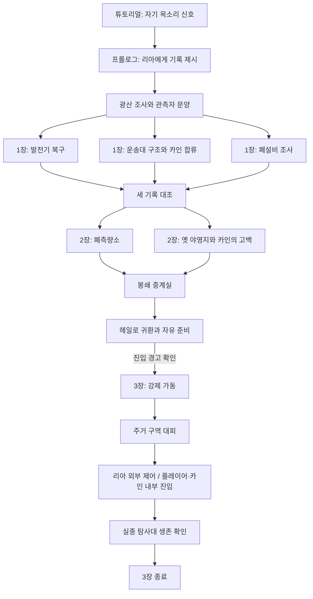

# SimpleGame 게임 개발 통합 문서

통합일: 2026-10-14  
최종 진행 정리: 2026-10-23 · 탐험 지도·광산 근접·45도 약도·바이크 부스트/후진·4배 MSAA·메시 충돌 개선 · RoadPlan/스토리 개정 유지

기준 브랜치: `iss01_actor_scene_render` · 범죄 시스템 변경 기준: `62b00b5` · 이전 도로 성능 비교 기준: `592ec4c` · 초기 기반: `41316a5`

게임 컨셉, 세계관·스토리, 향후 구현 명세, 현재 플레이, 코드·클래스 구조, 개발 규칙,
성능 분석, 모니터링, 검증 기록을 관리하는 단일 문서다. 이후 문서 변경과 개발 진도는 이 파일에 반영한다.

## 문서 읽는 기준

- **현재 구현:** 도시 도입부 → 전망대 조사·하강 → 리아에게 신호 기록 제시 → 도시 수신망 확인 → 개인 바이크로 연결 야외 맵 직접 운전 → 광산 입구에서 하차·입장 → 무작위 광산 조사 → 좌표 확보·직접 헤일로 귀환·수신망 보고 → 1장 「빛나는 개척지」. 야외에는 헤일로 주변에 흩어진 도시 5곳과 기본 주민 100명, 도로 계획에 따른 2·4차선 도로 및 신호를 따르는 지상 교통, 독립 항공 교통과 도시·광산 주변 시설을 배치했다. 도시 야외의 사격/근접·NPC/차량 피해·5단계 수배·보안대 대응·도시 간 악명/거래가와 모든 원인의 공통 의료 이송을 연결했다.
- **향후 기획:** 메인 스토리 2~3장의 실제 지역과 사건, 정식 장비·동료 관계 확장, 영구 저장·복원, 오픈 월드 스트리밍.
- **검증 상태:** 최신 범죄/충돌/의료·교통·렌더링·모니터 수정은 별도 검사 프로그램의 컴파일·링크, 게임 규칙/도시 교통/주민/장면 그래프, 숨겨진 WGL 표면의 실제 GPU 렌더링, 로컬 HTTP 검사를 통과했다. 340항목 리소스 캐시는 RoadPlan 88종과 기존 건축·비행체·프롭·캐릭터를 포함해 재생성했다. 아래 최신 항목의 성능 수치는 RTX 5080·1280×800에서 측정한 것으로 RTX 3080 노트북의 60FPS 보장을 뜻하지 않는다. 게임 실행 파일은 교체하지 않았으며 사용자 게임 빌드·연속 플레이·대상 노트북 실측이 남아 있다.
- **내용 우선순위:** 현재 구현과 조작은 1·6·7절을 따른다. 2~5절의 장기 기획·서사·명세는 구현 완료를 뜻하지 않는다.
- 기존 격리 구역의 작업장 4곳·협업 NPC 20명·성장 목표·전체 미니맵·펄스 공격은 제거했다. 같은 진입 구간을 광산 프롤로그로 교체했다.
- 중복 MD/TXT 사본은 통합했다. 초기 기획, 서사 확장안, 퀘스트 명세의 서로 다른 세부 내용은 보존했다.
- 별도 바이크 주행 스테이지는 제거했다. 현재 바이크는 야외에서 승하차하고 직접 운전하며, 광산 입구에서만 인스턴스 맵으로 전환한다. 본편 1장 현장 맵의 수신망 출발·귀환 방식은 이번 변경 대상이 아니므로 유지한다.
- 바닥의 8×8 표시 범위 분할과 GPU 인스턴싱은 오픈 월드의 데이터 로딩·스트리밍 구현을 뜻하지 않는다.

## 목차

1. [현재 개발 현황과 확인 대기 사항](#status)
2. [게임 정체성과 장기 개발 원칙](#principles)
3. [초기 게임 기획과 제작 단계](#design)
4. [메인 스토리 서사 확장안](#story)
   - [2026-10-23 서사·대사 개정과 2~4장·에필로그 추가 원고](#story-revision)
5. [메인 스토리 1~3장 구현 명세](#story-spec)
   - [대사 진행과 후속 스토리 구현 요청서](docs/STORY_IMPLEMENTATION_REQUEST.md)
6. [현재 콘텐츠와 모델·이동 확장](#content)
7. [튜토리얼·전투·성장·NPC 상세](#gameplay)
8. [코드·클래스·Scene 구조](#architecture)
9. [코드 작성과 개발 협업 규칙](#conventions)
10. [렌더링 최적화와 성능 분석](#performance)
11. [로컬 게임 모니터와 JSON 데이터](#monitoring)
12. [통합 출처와 유지 관리](#sources)

<a id="status"></a>

## 1. 현재 개발 현황과 확인 대기 사항

### 탐험 지도·광산 근접·바이크 조작·안티앨리어싱·충돌 개선 — 2026-10-23

- **광산 전장의 안개:** `MineState::explored`에 지나간 구간을 누적한다. 플레이어 주변 4월드 단위 안에서 벽/닫힌 격벽에 가리지 않은 바닥과 인접 벽만 기록한다. 멀어진 탐험 경로도 남고, 새 광산 인스턴스를 생성하면 초기화한다. 미니맵과 M 전체 지도 모두 미탐험 지형·목표·신호 아이콘을 숨기며 미탐험 칸에는 목적지를 찍을 수 없다. 스캐너의 실제 감지/HUD 방향 표시는 유지하지만 스캔만으로 지형을 공개하지 않는다.
- **고정 45도 약도:** 도시·광산·개척지의 원형 미니맵과 M 전체 지도를 시계방향 45도로 고정했다. 도로·건물·타일의 네 꼭짓점, 플레이어 방향, 범위 밖 목적지 화살표, 역변환 클릭 좌표를 함께 회전한다. 카메라/플레이어가 회전해도 약도는 고정되며 북쪽은 오른쪽 위다. 전체 지도는 회전한 외곽을 기준으로 축소해 지역 끝이 잘리지 않는다.
- **광산 V 근접:** 도시와 동일한 V키를 사용한다. 커서 방향 전방 120도·0.85월드 단위 이내의 가장 가까운 몬스터 하나에 피해 30+레벨 보정을 주고, 벽 시야와 생존 여부를 검사한다. 재사용 시간은 0.65초이며 탄약을 소모하지 않는다. 총격은 근접 동작 중 정지하고 기존 `Attack_Melee` 상체 포즈를 사용한다. 처치 보상은 기존 `DamageEnemy` 경로로 처리한다. 지도/일시정지/의료 이송/체력 0에서는 실행하지 않는다.
- **바이크:** 기본 최고 속도 7.5월드/초=54km/h, W+Space 부스트 최고 속도 12.8월드/초=92.16km/h다. 이전 최고 속도를 부스트에 배정했다. S는 먼저 브레이크를 걸고 이후 최대 0.65월드/초=4.68km/h로 후진한다. 후진 때 조향 방향을 반전하며 추진기/이동 애니메이션과 속도계는 속도의 크기를 사용한다. 모니터 JSON에는 부스트/후진 상태와 각 최고 속도를 추가했다.
- **렌더 전 4배 MSAA:** 기본 `RenderStyle::antialiasing=true`다. 지원되는 네이티브 해상도에서 색상/깊이 4표본 FBO를 준비하고 장면 제출 전에 `GL_MULTISAMPLE`을 활성화한다. 합성 전 색상과 깊이를 단일 표본으로 resolve해 기존 그림자·추진기 깊이 가림·광산 암막을 유지한다. 반/1/4 해상도 픽셀 모드에서는 MSAA를 끄고 최근접 확대를 유지한다. 하드웨어 표본 수에 맞춰 최대 4배를 사용하며 미지원이면 기존 렌더 경로로 돌아간다.
- **메시와 맞는 충돌:** 도시의 큰 AABB는 광역 검색에만 사용한다. 건물·고형 프롭의 실제 삼각형을 몸 높이 0.04~1월드 구간으로 잘라 지상 충돌을 캐시한다. 지붕·캐노피·안테나와 빈 중정이 바닥 전체를 막지 않는다. 작은 원형 몸체와 모서리 거리로 접촉을 판정하고 광산/개척지 타일에도 원-사각형 판정을 사용한다. 바이크는 새 메시의 실제 길이/폭과 Yaw 방향을 따르는 좁은 몸체로 검사한다. 주민/차량 접촉 반경도 줄이고 차량 원점과 실제 bounds 중심의 차이를 반영한다.
- **충돌 후 이동:** 짧은 이동 단계로 관통을 막고 접촉점까지 진행한 뒤 남은 이동을 벽의 접선 방향으로 투영한다. 비직교 벽에서도 옆으로 이동하며 작은 겹침은 분리한다. 바이크의 벽/차량/사람 접촉도 접선 속도를 남기며 정면 충돌에서는 멈춘다. 체력 피해·수배·교각/난간 높이 판정·기존 병원 이송은 유지한다.

별도 검사 프로그램으로 컴파일/링크, 안개 유지·벽 너머 비공개·재생성 초기화, 근접 입력/재사용/탄약/처치 보상/벽 차단, 기본/부스트/후진 속도, 벽·사선·겹침 분리, 도시 교통/주민·범죄/충돌/의료·고가 왕복·퀘스트·지도/클릭 좌표를 검증했다. 실제 RTX 5080 WGL 컨텍스트에서 4표본 활성화/해제, 색상/깊이 resolve, 픽셀 모드, 그림자·이펙트 가림·광산 암막과 지도 캡처를 검사했다. 캡처/성능 기록은 Git 제외 경로 `x64/RevisionChecks/improvement-renders/`에 있다. 게임 실행 파일은 교체하지 않았으며 사용자 게임 재빌드 후 적용한다.

### 스토리·인게임 문구 개정 — 2026-10-23

코드의 진행 조건과 화면 문구를 대조하고 도시 도입부·광산·1장의 대사, 목표, 조사 기록, 주민 대화를 개정했다. 리아의 단계별 대화는 `MineQuest::GetRiaDialogue()`로 분리해 목표 문장을 그대로 읽지 않게 했다. 문양 재조사, 세 현장 완료 후 리아 대화, 발전기 조사 기록을 실제 단계에 맞췄다. 광산 출구는 야외 입구로 나오는 동작임을 명시하고, 1장 종료 안내는 아직 입장할 수 없는 2장 지역과 구분했다. 거래 가격의 원인을 악명으로 표현하고 소지 한도와 부품 부족도 구분했다.

서사 본문은 [4절 개정 원고](#story-revision)에 보완했다. 2~3장의 기존 골격을 장면별 대사로 구체화하고, 4장 「닫히는 문」과 에필로그 「빈 채널」을 추가했다. **2장 이후의 지역·이벤트·선택 대화·저장 기능은 이 문서 작성으로 구현되지 않는다.** 대화 표시와 진행 처리, 분기, 후속 지역 제작 요청은 [구현 요청서](docs/STORY_IMPLEMENTATION_REQUEST.md)를 따른다. 기존 4절 앞부분과 5절은 배경과 기획 이력이며, 충돌하는 대사·사건 순서는 이번 개정 원고와 요청서를 우선한다.

이번 작업은 소스·문구와 진행 조건을 정적으로 대조했고, 변경한 게임 소스 5개 파일의 MSVC `/Zs` 구문 검사, UTF-8 디코딩, 신규 21개 장면의 요청서 연결, 알림·기록 문구의 추정 표시 폭, 변경 공백 검사를 통과했다. 실행 파일·오브젝트를 생성하는 게임 빌드와 실제 화면·연속 플레이는 수행하지 않았다. 다른 작업에서 진행 중인 이동·충돌·지도·애니메이션 변경의 검증 결과와 혼동하지 않는다.

### 신규 RoadPlan 도로 모델 적용 — 2026-10-23

`Resource/Documentation/road_plan_modules.json`의 조립 모듈 88종을 기존 변환기에 연결하고 임시 `DraftRoad`/`DraftJunction` 노면을 교체했다. 원본 GLB·Blender 프로젝트·독립 파트는 변경하지 않았다. 도로망 62개 접속점·77개 도로, 도시 5곳·광산·퀘스트 지점은 유지하며 새 포트 규격에 필요한 접속 길이만 조정했다.

- **실제 배치:** 2·4차선 직선, 생활/혼합 T 교차로, 곡선 연결부, 24m 폭 전환, 별도 차선 도색·횡단보도·보도·연석, 고가 데크·거더·난간·교각·램프를 적용했다. 카탈로그의 companion 위치/회전을 따라 캐시에서 조립한다. 기존 신호가 횡단보도 바깥에 정지선을 그리므로 교차로 모델의 내부 정지선은 중복 배치하지 않는다. 이번 도로망에 필요 없는 모듈도 등록해 후속 배치에서 사용할 수 있게 했다.
- **연결 규칙:** 기본 모듈은 실제 미터 크기로 반복 배치한다. 남는 짧은 끝 조각만 길이를 맞추고, 비직교 접속의 교차로/곡선/폭 전환은 원본의 노면·도색·보도를 함께 차량 경로에 맞춘 캐시 메시로 만든다. 차로 폭·접속 위치·법선을 유지한다. 24m 폭 전환의 충돌/차도 폭도 원본의 smoothstep 형태를 따른다.
- **고가/램프:** 상부 노면은 4.2월드 단위=8.4m, 구조 하부 여유는 8m다. 180m 평탄 고가는 16m×11+4m×1, 양쪽 램프는 각각 실제 수평 길이 110m다. 접속점 중심을 Y=±103.5로 옮겨 교차로 절단 뒤에도 램프 길이가 줄지 않게 했다. 차와 바이크는 원본의 16m 종단곡선·78m 일정 경사를 따르고 최대 경사는 8.9362%다. 지상 도로와 상부의 독립 연결/높이 판정을 유지한다.
- **구조물 충돌/그림자:** 교각은 지상 도로와 양쪽 보도 예약 폭 밖에 배치했다. 두 다리와 상부 가로보를 구분해 열린 하부 통로는 막지 않는다. 플레이어·주민·보안대는 교각/낮은 램프 하부를 피하며, 탑승한 바이크는 같은 구간을 실제 노면 위로 주행한다. 상부 난간은 해당 주행 높이에서만 막는다. 고가·램프·교각은 그림자를 만들고 평평한 도색/보도는 그림자 패스를 생략한다.
- **캐시/깜빡임:** 반복 조립체는 동일한 불변 메시와 머터리얼을 공유해 기존 인스턴싱을 사용한다. 서브밀리미터 두께 도색의 묻힌 아랫면을 런타임 표시에서 제외하고 윗면을 미세하게 띄워 24비트 깊이 버퍼의 깜빡임을 막았다. 원본 도색 형상/패킹은 보존한다. 포트·companion 표인 `SimpleGame/RoadPlanCatalog.h`는 변환 도구가 카탈로그에서 생성하며 `--check`로 일치 여부를 검사한다.
- **최신 팩:** 340항목·1,244,004정점·414,668삼각형·15,375애니메이션 프레임·125,231,257바이트. SHA-256 `ed12f2e087bd302ec505537bbc1492f15a293310d2628c3bd7a718f6ecb235ee`. `/Resource/Runtime/`은 계속 Git 제외 대상이며 원본에서 재생성한다.
- **검증:** 별도 검사 프로그램 컴파일/링크, 실제 메시 삼각형에 대한 모든 도로의 이음매/폭/높이 및 가능한 차량 회전 경로, 9% 이하 실제 경사와 바이크 고가 왕복 주행, 건물/보행 연결·퀘스트 접근, 도시 신호/차량/주민·범죄/충돌/의료·지도·장면 그래프와 전체 GPU 렌더 검사 통과. 88종의 원본 삼각형 수·bounds·변환 배율, 캐시 재생성 일치 검사도 통과했다. 게임 실행 파일은 변경하지 않았다. 사용자 게임 재빌드 후 적용된다.

RTX 5080·1280×800·최적화 검사에서 각 장면 24프레임 준비 후 120프레임을 측정했다. 아래 야외 장면에는 교통·주민·충돌·보안 시뮬레이션을 포함한다. 이 수치는 RTX 3080 노트북의 장시간 실제 창 표시 성능을 보장하지 않는다.

| 장면 | 평균 프레임 비용 | p95 |
|---|---:|---:|
| 도시 | 2.015ms | 2.429ms |
| 새 교차로 | 1.558ms | 1.880ms |
| 고가/지상 교차 | 1.471ms | 1.667ms |
| 새 램프 | 1.084ms | 1.330ms |
| 도시 5단계 수배·보안대 10명 | 2.253ms | 2.726ms |

검사 결과와 캡처는 Git 제외 경로 `x64/RevisionChecks/road-renders/`에 있다. `ROAD_MODULE_REQUEST.md`는 현재 `Resource/ROAD_MODULE_REQUEST.md`로 이동했으며, 납품/접속 계약은 [도로 모델 납품 문서](Resource/Documentation/ROAD_PLAN_ko.md)를 따른다.

### 도시 범죄·수배·실제 충돌·의료 이송·평판 — 2026-10-23

도시의 생존 기반인 전력·물류·수신망을 보호하는 **개척지 공동 보안망**을 사용한다. 공공 구역의 폭력과 장비 파괴가 수신망에 기록되어 보안대가 출동한다. 현재 추적을 뜻하는 **수배**와 도시 사이에 공유되는 **악명**을 분리하며, 사건이 없던 도시로 이동해도 악명은 남는다. 현대식 경찰 장비를 새로 도입하지 않고 기존 Guard/HeavyCombat 외형과 SF 제압 사격을 사용한다.

- **도시 전투:** 야외 도시/연결 도로에서 좌클릭 권총 사격, R 재장전, V 근접 공격. 기존 Firearm/Pistol의 탄창·탄퍼짐·사격 간격·총구/팔 연결을 재사용한다. 도시 총알은 짧은 간격의 연속 판정으로 건물·고형 프롭에서 멈추고 시민·보안대·교통 차량에 피해를 준다. 근접은 전방 범위/시야/재사용 시간을 검사하고 기존 `Attack_Melee` 상체 클립을 사용한다. 집·전망대 실내와 지도/정지 중 도시 공격은 입력으로 실행되지 않는다.
- **대상/서사:** 일반 도시 주민과 보안대는 처치할 수 있고, 교통 차량은 체력이 0이면 기동 불능 잔해로 남는다. 같은 시체/잔해를 반복 공격해 범죄를 중복 가산하지 않는다. 리아·마라·도시 카인은 서사 단절을 막기 위해 중상으로 쓰러져 60초 의료 지원 후 복귀하며 그동안 대화할 수 없다. 광산 구조 요청자/본편 동료의 기존 아군 사격 방지와 회복 규칙은 유지한다. 항공기·건물 파괴·차량 탈취·새 상점 UI는 이번 구현에 포함하지 않는다.
- **물리:** 플레이어/주민/보안대의 몸체를 분리하고 이동을 세분해 인물과 정지 차체를 관통하지 못하게 한다. 차량은 원본 실측 크기의 회전 직사각형을 사용하며 이동/회전 중의 충돌과 차량끼리의 분리 축 판정을 수행한다. 차량-인물/바이크 충격은 속도에 따라 피해·밀림·넘어짐 상태를 만들고 접촉 차체에서 안전하게 분리하며 차량을 잠시 정지시킨다. 고가와 지상은 높이가 다르면 충돌하지 않는다. 충격 무적 시간으로 한 접촉이 매 프레임 피해를 주는 것을 방지한다. 고형 장애물은 8월드 단위 공간 목록으로 조회한다.
- **수배:** 열도 범위는 0~1000, 별 단계 경계는 **20/80/180/360/650**이다. 경미한 단발 사격은 먼저 게이지를 쌓고 지속 사격·상해·살인·파괴·보안대 공격은 빠르게 단계를 올린다. 수배/열도는 HUD에서 별과 막대로 보여 준다. 20초간 추가 범죄가 없고 15초간 보안대 시야를 벗어나면 초당 8씩 감소한다. 집/광산/개척지에서도 보안망 수색 시간은 흐른다. 실제 영구 수배 기록/저장 파일은 아직 없다.
- **보안대:** 별 1~5에서 생존 대응 인원 한도는 2/4/6/8/10명이다. 약 3.5초 간격으로 화면 밖의 유효 경로에서 증원한다. 1~2단계는 Guard, 3~5단계는 HeavyCombat을 사용하고 단계에 따라 체력·이동·사격 간격·제압 피해가 강해진다. 고레벨 플레이어에게도 제압이 유효하도록 체력/피해를 일부 보정한다. 장애물 우회 경로와 사선 판정을 사용하고 건물을 관통해 사격하지 않는다. 목표를 놓치면 마지막 확인 위치로 수색하며 수배가 해제되면 철수한다. 시체를 포함한 보안대 표현 풀은 16개로 제한한다.
- **악명:** 범죄별 가중치로 0~100을 쌓는다. 가까운 시민은 폭력을 보고 피하고, 악명 25 이상이면 다른 도시의 주민도 거리/시야에 따라 피한다. 수배 해제/의료 이송은 악명을 지우지 않는다. 범죄 없이 90초가 지난 뒤에만 초당 0.005씩 천천히 회복한다. 거래 배율은 `1 + 악명 × 0.0075`, 최대 1.75배다. `CivicJustice::ShopPrice()`가 정수 올림 가격을 제공하며 기존 개척지 운송대의 부품-회복 키트 교환에도 연결했다. 향후 크레딧 상점도 같은 함수를 사용한다.
- **의료 이송:** 도시 교통 사고·보안대 제압·광산/개척지 전투 등 어떤 원인이든 체력 0을 같은 처리로 보낸다. 0.85초 페이드아웃 → 검은 화면에서 인근 도시 의료소 이송 → 0.35초 유지 → 1.1초 페이드인이다. 이송 중 이동/공격/지도 입력과 현장 시뮬레이션을 잠근다. 각 도시의 실제 건물 출입 보행로에 의료소를 지정하고 지도에 표시한다. 개인 바이크도 의료소 옆으로 회수한다.
- **패널티:** `HospitalRecovery::kLevelLoss=.05`, `kAssetLoss=.20`. 레벨의 5%를 올림해 잃되 1레벨 아래로 내려가지 않는다. 새 레벨의 필요 누적 경험치와 체력·공격·방어를 다시 계산한다. 보유 크레딧과 거래 부품 각각 20%를 정수 내림하여 회수하며 보유량이 있으면 최소 1개다. 빈 보유량을 음수로 만들지 않는다. 조사/구조/퀘스트 기록은 유지하고 체력을 회복하며 5초 재피격 보호를 준다. 검은 화면의 전환 시점에 한 번만 차감한다. 초기 크레딧은 500, 광산 부품 회수 시 5크레딧을 함께 받는다.
- **상태/연출:** `Civic.h/.cpp`의 `CivicJustice`, `CivicCombat`, `BodyCollision`, `HospitalRecovery`가 책임을 나누며 `CivicPresentation`은 상태를 읽어 화면만 그린다. `BodyImpact`의 방향/속도/남은 시간/반응 종류는 신규 애니메이션 연결용 데이터다. 지금의 쓰러짐은 정적인 임시 누운 자세이며 새 충돌/기립/사망 클립·라그돌은 제작하지 않았다. [충돌·치안 애니메이션 제작 요청서](Resource/CIVIC_ANIMATION_REQUEST.md)에 리그·클립·이벤트·물리 소유권 계약을 작성했다.
- **관측:** 모니터 스냅샷에 `security`(수배·열도·악명·거래 배율·경찰 수·의료 이송·차감), 플레이어 크레딧, 시민 체력/생사/공포 상태를 제공한다. 주민 수 표시는 생존/중상 상태를 반영한다. 영구 저장을 구현하기 전까지 이 상태는 현재 플레이 세션에 보존되며 새 게임은 초기화한다.

| 행위 | 열도 가중치 | 악명 가중치 |
|---|---:|---:|
| 공공 구역 사격 | 12, 0.75초 중복 억제 | 0.3 |
| 시민 상해 / 처치 | 35 / 140 | 3 / 14 |
| 차량 손상 / 파괴 | 15 / 65 | 1 / 6 |
| 보안대 상해 / 처치 | 60 / 180 | 5 / 18 |
| 난폭 운전 충돌 | 30, 대상 상해/파괴 별도 | 2 |
| 서사 인물 중상 | 80 | 8 |

검증: 별도 검사 프로그램을 컴파일·링크하고 `CivicTests`(사격/근접/벽 차단/처치 중복 방지/차량 잔해·실제 충돌·충격 보호/타 도시 회피·거래가/5단계 증원·제압/원인 공통 의료 이송·페이드·패널티 한 번 적용·퀘스트 보존)를 통과했다. 기존 게임 진행·교통/주민·도로/건물 접근·지도·장면 그래프 검사를 함께 통과했다. 실제 GPU 검사에 5단계 수배·의료 페이드·의료소 복귀 캡처를 추가했으며 화면 대부분이 검게 가려지는지도 픽셀로 검사했다. 모니터 웹의 실제 스냅샷 렌더링 검사도 통과했다. 게임 실행 파일은 교체하지 않았으며 장시간 수동 플레이와 실제 노트북 성능 확인은 사용자 빌드에서 이어서 확인한다.

RTX 5080·1280×800·MSVC /O2 별도 검사에서 11개 장면을 측정했다. 도시 기본 장면은 평균 약 **1.82ms/p95 2.19ms**, 수배 5단계·중장갑 보안대 10명 장면은 **1.97ms/p95 2.30ms**였다. 현장 갱신·물리/치안·주민/차량·GPU 렌더링과 완료 대기를 포함하고 창 표시/SwapBuffers/실제 입력 타이머는 제외한다. 다른 하드웨어의 60FPS를 보장하는 수치는 아니다.

### 원형 약도·전체 지도·스캔 파동·도로 우선 계획 — 2026-10-22

- **지도:** `MapHud`가 도시·광산·개척지의 시계방향 45도 고정 탑다운 약도를 공통으로 표시한다. 실시간 위성 카메라를 사용하지 않고 도로·건물·지형·퀘스트를 단순 도형으로 그린다. 미니맵은 원 바깥의 도형을 실제로 잘라내며, 플레이어 화살표만 진행/조준 방향으로 회전한다. 고가도로는 청록색으로 구분한다.
- **목적지:** M으로 전체 약도를 열고 좌클릭으로 목적지를 설정, 우클릭으로 해제한다. 지도 밖을 누르면 바뀌지 않으며 창 비율에 따른 여백도 좌표에서 제외한다. 지도는 지역별 목적지를 보관한다. 미니맵 범위 밖의 목적지는 원 가장자리 방향 화살표로 표시한다. 지도 중에는 현장 갱신과 이동·사격을 멈추며 M/Esc로 닫는다.
- **광산 스캔:** F를 누른 지점을 원점으로 지면에 원형 파동이 2.8초 동안 초당 15월드 단위로 퍼져 42월드 단위(84m)에 도달한다. 플레이어가 이동해도 파동 원점은 움직이지 않는다. 신호가 실제 파동에 도달해야 발견되며 발견 후 5초간 지도 기호와 화면 가장자리의 삼각형 방위 HUD가 표시된다. 기존 설계대로 방위·거리는 근사하며 정확한 NPC 좌표를 노출하지 않는다. 구조된 무리는 즉시 제외된다. 지면 깊이 검사를 유지하고 암막에는 지면 파동의 좁은 띠만 보이도록 하여 벽 위로 원을 덧그리지 않는다. 재사용 대기는 6초다.
- **로그:** 초기 출력 전 UTF-8 콘솔/문자열 로케일을 설정한다. 기존 초기 진단을 지우지 않고 매초 성능 보고서의 예약 영역만 갱신하여 콘솔 커서·사용자 스크롤 위치를 보존한다. 긴 보고서는 PgUp/PgDn·Home/End 페이지로 확인할 수 있다. JSONL 파일·모니터·파이프/리디렉션에는 기존 전체 항목과 시간별 원문을 유지한다. 일반 콘솔과 고정 높이 Windows Terminal을 모두 처리한다.
- **도로를 먼저 설계:** 근거리 교차부를 자동 병합하던 방식을 제거하고 도시마다 집산도로와 작은 생활도로 고리를 먼저 만든다. 넓은 접근부는 왕복 4차선, 생활·도시 간 연결은 2차선이다. 현재 **62연결점·77도로**, 교차부 최대 3갈래·접근부 차로 합 최대 10·유효 직선 최소 11월드 단위다. 5도시와 광산이 연결되며 도시 중심/서사 랜드마크는 유지한다. 보행 그룹의 축 판정이 반대편 교차로를 참조하던 오류도 현 교차로 기준으로 수정했다.
- **입체 교차:** 헤일로 동쪽 X=48에 상면 높이 4.2월드 단위(8.4m)·구조 하부 여유 8m의 고가 우회로와 양쪽 램프를 둔다. Y=-17 지상 집산도로와는 노드·신호·차량 충돌을 공유하지 않는다. 차량·개인 바이크는 램프 높이를 따라가며, 고가 측면에서 떨어지거나 고가 위에서 하차하지 못하게 한다. 낮은 램프 입구는 지상 보행자에게도 차도로 판정한다. 지상 보행과 고가 차량 충돌은 높이로 분리하며 건물·고형 프롭은 구조물 투영 공간을 침범하지 않는다.
- **도로 메시:** 최초 설계 단계의 단순 평면 도로는 위 최신 항목의 RoadPlan 모델로 교체했다. 도로망을 배치 기준으로 유지하고 노면·보도·곡선/폭 전환·고가 구조물과 차량 포트를 맞춘다.
- **건물/주민/퀘스트:** 집과 전망대의 서사 좌표를 우선 예약한 뒤 도로 가장자리에서 실제 건축 크기만큼 이격한 필지를 생성한다. 주민·차량은 확정된 길에서 생성한다. 모든 유지 건물의 출입구가 보행로로 연결되고, 집·리아·수신망·바이크·도로 진입점의 실제 보행 접근을 검사한다. 새 건물 5종은 외곽 필지에서 선택적으로 사용하여 큰 메시가 밀집하지 않게 한다.
- **새 리소스:** `Spire_Helix_12F`, `Tower_TwinBridge_16F`, `Arcology_Terrace_10F`, `Civic_TransitAtrium_4F`, `Habitat_Courtyard_3F`를 기존 GLB와 동일한 단위/머터리얼 경로로 연결했다. 기존 건물 종류 번호는 유지한다. **252항목·1,122,291정점·15,375애니메이션 프레임·114,990,183바이트**, SHA-256 `3549b87b621ac1dcae76ec2e3e5880797dff663c2e9469f7731e9166bb0b4b0c`다. 후속 캐릭터 디테일의 흉부 외장/하네스도 성별·체형별로 함께 조립하며, 원본 피부색·장비 오프셋·23본·15개 원본 클립과 게임의 Ride를 보존한다. 일부 Heavy/Lean 의복의 성별 치환 누락도 수정했다. 원본 제작 중인 파일은 보존했다.
- **아트 전달:** 사용자 요청에 따라 [도로 모듈 제작 요청서](Resource/ROAD_MODULE_REQUEST.md)를 별도로 작성했다. 현 배치·좌표·치수·포트·우선순위·기능 파트·재질/신호 계약과 최종 교량 하부 여유에서 아직 확정하지 않은 부분을 명시한다. 다른 에이전트에게 이 문서를 전달하여 제작을 요청할 수 있으며 다른 대화에 자동 전송하지 않는다.

검증: `MapHudTests`의 방향 고정/45도 회전/전장의 안개/원 경계/실제 입력 좌표/지역별 목적지 검사, `RoadPlanTests`의 교통망 연결·교차부 규모·상하층 분리·램프 연속성·건축 침범·신규 스타일·건물 진입로·퀘스트 접근 검사, 광산 스캔의 실제 도달 시간/원점 고정/수명/구조 제거 검사를 추가했다. 실제 렌더링에는 지도 5개 화면과 원 바깥 도형 유출·플레이어 회전 시 지형 불변·범위 밖 목적지 화살표 픽셀 검사를 포함한다. `ConsoleOutputTests`가 Windows 의사 콘솔에서 한글과 기존 기록·커서·페이지·리디렉션 보존을 검사했다. 최종 캐시의 원본 재생성 일치·독립 바이너리 검증도 통과했다. 18개 성별/역할 캐릭터의 파트·외장 삼각형 합, 원본 피부색·애니메이션을 대조한다. 게임 실행 파일은 교체하지 않고 별도 검사 실행 파일을 사용했다.

최종 자산을 포함한 RTX 5080·1280×800·MSVC /O2 검사에서 10개 장면을 렌더링했다. 도시 평균은 약 **1.69ms**, p95는 **2.14ms**였다. 현장 갱신·AI·메시·그림자·암막·후처리·HUD와 GPU 완료 대기를 포함하고 창 표시·SwapBuffers·실제 입력 타이머는 제외한다. RTX 3080 노트북의 60FPS 보장은 해당 장비 실측이 필요하다.

### 신호 고착·정체 수정과 방사형 도시 계획·비행체 추진기 — 2026-10-22

- **신호:** 횡단 중인 주민 상태 때문에 비움 단계가 무기한 멈추지 않도록 신호 시간과 보행자 양보 판정을 분리했다. 실제 교차로 진입 차량의 안전 비움은 유지한다. 없는 진행 방향의 녹색 단계를 생략하고 직진 녹색 10초·보호 좌회전 5초·황색/차량 비움 3초·보행 비움 2초를 사용한다. 직진 정지와 보호 좌회전을 별도 표시하여 좌회전 허용을 직진 녹색으로 오해하지 않게 했다.
- **보행 주기:** 좁은 도로에서 보행 방향 하나를 켜고 전체 차량 주기를 다시 반복하던 방식은 긴 대기를 만들었다. 2차선의 개별 횡단보도, 4차선의 축별 횡단보도를 **한 보행 순서 안에서 모두 제공**한 뒤 차량 주기로 돌아간다. 6차선의 전 방향 동시 보행은 유지한다. 없는 축을 선택해 아무 횡단보도도 켜지지 않는 경우도 막았다. 남아 있는 보행자는 차량 진입 시 계속 보호한다.
- **차량:** 교차로 전체를 한 대가 독점하던 예약을 실제로 교차하는 회전 경로끼리의 예약으로 바꿨다. 정지선을 통과하기 전에 진입을 확정하여 뒤늦은 황색/적색 때문에 횡단보도 안에서 멈추지 않게 했다. 출구에 뒷차체를 빼낼 공간까지 확보하고 진입한다. 출구 차가 약 5월드 단위 앞에 있을 때 뒤 차가 빠져나가지 못해 예약과 신호를 붙잡던 재현 사례를 수정했다(검사 기준은 월드 6.5단위의 출구 여유).
- **차량 생성/표시:** 짧은 연결 도로에는 임의로 차를 생성하지 않는다. 생성은 정지선 밖에서만 하고 예약된 출구 공간도 비워 둔다. 주변 차선의 수용 길이에 맞춰 유동 차량 수를 제한한다. 정지선은 횡단보도 바로 앞에 표시하고 차량 신호기의 위치도 일치시켜, 도로 한가운데의 이유 없는 정차처럼 보이지 않게 했다. 실제 대기열과 신호 대기는 유지한다.
- **도로 배치:** `37a9c88`의 도시 구획과 4개의 사선 도시 간 연결 방향을 복원했다. 이후 추가됐던 ±390 정사각형 외곽 간선은 제거했다. 기존 도로끼리 너무 가깝게 겹치는 교차부는 통합하여 **40연결점·54도로·최소 유효 직선 8월드 단위**로 연결한다. 도시 중심·광산 입구·퀘스트 좌표는 유지하며, 집 옆 바이크 좌표만 아래처럼 변경했다.
- **도로 메시:** 현재 Transit 팩을 사용한다. 규격이 맞는 T/사거리와 보행 코너는 원본 모듈을 사용하고, 사선·폭 전환·짧은 끝단은 같은 원본 표면/테이퍼/보행 모듈로 맞춘 런타임 접속 메시를 공유한다. 차선 폭은 3m다. 곡선 도로의 중심선과 차량 회전 곡선을 맞췄고, 차도 판정·보행 그래프·모니터가 같은 도로망을 사용한다. 원본 제작용 Transit 메시를 덮어쓰지 않았다.
- **도시 진입로:** `CityPlan`이 건물 외부 출입 지점에서 기존 보행로까지 장애물을 피하는 길을 만든다. 가로망에 접근할 수 없는 일반 건물 부지는 비워 연결 가능한 배치만 유지한다. 건물/보행로를 관통하지 않는 진입로를 만들고, 중복 구간을 공유하며 주변 고형 프롭의 침범을 막는다. 주민도 새 진입로를 우선하는 보행 노드를 사용한다. 주차·퀘스트 접근 공간은 예약되어 있다.
- **주차:** 개인 바이크는 집 동쪽 옆 `(-4.5, -6.5)`에 주차한다. 주차면에서 `(-4.5, -17)`의 대로까지 이어지는 통로와 집 출입 공간을 확보했다. 주차 중에는 분사 불꽃을 끈다.
- **지면:** 도로/건물 앞은 회색 포장, 주거 구획·공원·완충 공간은 잔디, 공업/물류 구획은 돌바닥을 사용한다. 도시 밖에는 흙·잔디·돌 지형을 배치한다. 바닥 색이 먹지 않던 흙 메시의 고정 재질을 도시 포장과 분리했다. 색 구간은 청크별로 캐시하여 같은 바닥을 프레임마다 다시 분류하지 않는다.
- **비행체:** 기본/변형 8종의 실제 발광 엔진 형상에서 분사 위치를 추출하고 해당 엔진 본을 따라 움직인다. 회전·뱅크·고도에 맞춰 기존 2D 분사 불꽃·스파크를 출력하며 앞의 차체에 가려지고 플레이어 가림 시 함께 흐려진다. 주기장 항공기는 분사하지 않는다. 갱신된 지상 차량 엔진에 발광 면이 없는 경우에는 실제 금속 노즐의 후면에서 분사 위치를 추출한다.
- 작업 중 추가 갱신된 비행체·프롭 디테일 자산도 런타임 캐시에 반영했다. **247항목·481,158정점·11,175애니메이션 프레임·54,896,605바이트**, SHA-256 `81799c12bca1d3fb2a04ca58682645e5233f387ebd19720dc64ed1b62d8ecea7`다. 제작 원본/제작 도구에서 별도로 진행된 수정은 보존하며, 이 작업은 게임 연결과 Runtime 캐시를 갱신한다.

검증: 전체 게임 규칙 검사와 도시/주민 검사, 건물 진입로의 차도·건물·고형 프롭 관통 검사, 신호 방향별 **120초 이내 첫 녹색** 검사(차량 없는 상태), 체류 주민이 있는 **300초 신호 진행** 검사, 헤일로와 신더에서 각각 **300초 교통** 검사(교차로 예약 고착·이유 없는 차선 중간 정지·차도 이탈), 장면 그래프·실제 GPU 렌더링 검사를 통과했다. 정적 도로망 검사, 원본 변환 캐시 재생성 일치와 독립 바이너리 검사도 통과했다. 창 없는 검사 프로그램을 사용했으며 사용자 게임 실행 파일은 교체하지 않았다.

새 디테일 자산을 포함한 RTX 5080·1280×800 GPU 검사에서 10개 장면을 검사했다. 최신 원본과 규격 교차로 모듈을 포함한 도시 평균은 약 **1.35ms**, p95는 약 **1.68ms**였다. 이는 해당 장비의 별도 검사 프레임 비용이며 RTX 3080 노트북의 창 표시/전력/발열을 포함한 60FPS 보장을 뜻하지 않는다. 사용자 게임을 다시 빌드하면 새 코드와 갱신한 Runtime 캐시가 함께 배포된다.

### 우측통행·한국식 신호·횡단보도·항공 가림·모니터 연결 개선 — 2026-10-22

- 쿼터뷰 화면의 아래로 증가하는 Y축까지 반영하여 `RoadNetwork::RightOf`를 `(-dy, dx)`로 고쳤다. 회전 분류와 신호 헤드 위치도 함께 맞췄으며, 화면에 투영한 진행 방향과 차선 오프셋의 외적을 검사하여 화면상 우측통행을 확인한다. 중앙 쪽 차선은 좌회전, 가장자리 차선은 우회전을 사용한다.
- 좌회전은 보호 좌회전 단계에서 허용하고, 황색·교차로 비움 단계를 유지한다. 일반 우회전은 적색에서 정지선 앞에 완전히 정지한 다음 최소 0.8초 확인하고, 횡단 보행자·허용된 횡단보도·우선 진행 차량·교차로 점유가 없을 때 서행한다. 6차선 접근부는 별도 우회전 신호를 갖도록 정하여 적색 우회전을 허용하지 않는다. 우회전 중에도 서행을 유지한다. 이 도로별 신호 선택과 대기 시간은 게임 설계값이며, 우회전의 정지/별도 신호 원칙은 [경찰청 안내](https://www.korea.kr/multi/visualNewsView.do?newsId=148910893)를 참고했다.
- 보행 전용 시간은 유지하되, **2차선은 한 횡단보도씩 순환**, **4차선은 같은 축의 횡단보도끼리 교대**, **6차선은 전 방향 동시**로 구성했다. 남은 녹색 시간 안에 건널 수 있을 때만 주민이 진입하고, 이미 건너는 사람이 있으면 비움 시간을 연장한다. HUD·주민 AI·모니터 JSON의 각 횡단보도가 같은 도로별 신호를 사용한다. 횡단 완료 시 행동도 즉시 보행/순찰로 전환하여 잘못된 횡단 상태를 남기지 않는다.
- 폭이 맞지 않던 보행 홀로그램 모델 대신, 원본 횡단보도(도로 진행 방향 길이 2월드 단위·4m)의 양 가장자리에 실제 도로 폭과 맞는 발광 띠를 놓았다. 진입 차선 바닥의 직진/좌/우 화살표는 제거하고, 차량 신호 헤드와 보도 대기 표시를 유지했다.
- 이전 비행 회랑 점선과 반복 라벨을 제거했다. 새 `Transit_AirGuide_Straight_16m`의 메시·형상·위치·실제 비행 고도는 유지하며, 지상 조명에 어두워지지 않는 청색 발광·미세한 밝기 맥동·투명한 깊이 표현으로 공중 홀로그램처럼 보이게 했다. 새 안내물은 그림자를 만들지 않는다.
- 지상 차량, 비행 중인 항공기, 주기장의 항공기도 회전·고도를 적용한 투영 경계와 깊이로 플레이어 가림을 검사한다. 가릴 때만 건물과 같은 0.28 불투명도를 사용한다. 건물/교통수단의 반투명 깊이는 고정된 4×4 커버리지로 처리하여 인스턴스 제출 순서가 바뀌어도 뒤의 플레이어가 보인다. 개인 바이크와 탑승자는 이 처리에서 제외했다.
- 바닥 타일을 같은 색의 연속 띠로 묶어 청크당 반복 제출을 줄였다. 불변 모델의 기본 본 행렬은 메시별로 재사용하고, 가져온 모델에 쓰이지 않는 절차형 관절 계산을 생략했다. 인스턴스 데이터는 모델 수집 한 번당 한 번 전송하여 바닥·그림자·표면 패스에서 재사용한다. 모델 해상도·원본 메시를 낮추지 않았고 그림자도 유지했다.
- 모니터는 다른 로컬 웹 포트에서 열어도 게임의 `127.0.0.1:17707` API를 요청한다. 서버는 localhost/127.0.0.1/IPv6 루프백 출처만 교차 출처 읽기를 허용한다. 파일로 연 페이지는 서버 주소로 연결하고, API/정적 파일의 쿼리 문자열을 처리한다. 전송 제한 시간을 전체 연결 시간에서 **마지막 진행 이후의 유휴 시간**으로 바꾸고 모델 목록의 브라우저 제한 시간도 늘렸다. 실행 파일 옆 배포 폴더와 소스의 `monitor` 폴더를 찾을 수 있으며, UI 표시 오류를 네트워크 단절과 구분한다.
- JSON 숫자 변환에서 필드마다 만들던 문자열 스트림을 제거했다. 브라우저 요청이 없으면 0.5초마다 상태를 직렬화하지 않는다. 실제 상태 100회 생성의 평균은 최적화 검사 프로그램에서 약 **0.58ms**였다.

검증은 요청된 성능·연결 동작을 확인하기 위해 별도 `x64/RevisionChecks` 검사 프로그램을 만들어 수행했다. **사용자 게임 실행 파일과 제작 원본/캐시는 교체하지 않았다.** `GameplayTests` 전체, 도시 교통·보행/주민 검사, `SceneGraphTests`, `RenderingTests`, `MonitorServerTests`가 통과했다. 이전 모델/맵 기준이던 총구·기초 바닥·바이크 제동/길어깨·옛 도시 격벽 검사 좌표를 현재 규칙과 실제 배치에 맞췄다. GPU 검사는 차량 가림 재질, 항공기 뒤 플레이어의 실제 노출 픽셀 증가와 제출 순서 독립성, 깊이·의복·이펙트·그림자·카툰/저해상도 표시를 포함한다. HTTP 검사는 페이지·쿼리 경로·로컬 출처 허용/외부 출처 미허용·6MiB 모델 전송·재시작을 포함한다. 실제 게임 상태를 넣은 대시보드 표시 검사와 JS 문법, 61연결점/81도로 정적 검사도 통과했다.

동일 RTX 5080·1280×800·숨겨진 WGL 표면에서 수정 전 HEAD와 비교했다. 도시·바이크 시나리오에는 실제 차량/항공기/주민 갱신을 포함하고, 각 장면은 예열 24프레임 뒤 120프레임을 측정했다. 표는 업데이트·그리기·GPU 완료 대기를 포함한 프레임 처리 비용이며, 화면 표시의 제한 주기나 노트북 성능을 측정한 값은 아니다.

| 구성/장면 | 수정 전 평균 → 수정 후 평균 | 수정 전 p95 → 수정 후 p95 |
|---|---|---|
| 최적화 검사 / 도시 | 1.95 → 1.18ms | 2.35 → 1.54ms |
| 최적화 없음 / 도시 | 10.06 → 5.40ms | 14.01 → 6.48ms |
| 최적화 없음 / 바이크 | 6.49 → 4.00ms | 7.51 → 5.08ms |
| 최적화 없음 / 운송대 | 6.29 → 4.80ms | 7.50 → 5.43ms |

10개 장면의 p95는 최적화 검사에서 최대 약 1.54ms, 최적화 없음 검사에서 최대 약 6.48ms였다. 이 수치를 RTX 3080 노트북 FPS로 환산하지 않는다. **대상 노트북의 전력/발열·드라이버·실제 창 표시·장시간 이동을 포함한 60FPS 방어는 사용자 빌드 후 실측이 필요하다.** 모니터 접속 주소는 게임 실행 후 `http://127.0.0.1:17707/`이다.

이하 같은 날짜의 이전 항목은 작업 당시 기록이며, 신호·항공 안내·검증 상태가 다르면 위 최신 항목을 따른다.

### Transit 도로·보행로·비행 안내 및 도로망 재구성 — 2026-10-22

- 후속 적용 요청에 따라 `transit_modules.json`과 한국어 조립 안내를 확인하고 원본 112모듈을 런타임 캐시에 추가했다. 기존 122항목 + 원본 112종 + 직선 끝부분 전용 절단 캐시 10종 = **244항목·364,926정점·11,175애니메이션 프레임·45,132,535바이트**다. Blender/GLB 제작 원본·새 제작/검증 도구는 실행하거나 수정하지 않았다.
- `TransitLayout.h/.cpp`가 모듈 배치·접속부 규격·차도/보도 공간을 담당한다. 차선 폭은 원본 그대로 3m(1.5월드 단위)다. 직선·90도 곡선·T/사거리·차선 폭 전환·횡단보도·보행로·경사로를 회전/이동하여 사용하고, 곡선이나 차선 폭을 늘려 맞추지 않는다. 끝의 1~3m 잔여 직선만 사전 변환 시 잘라 길이를 맞춘다. 모든 112종을 월드에 동시에 사용한 것은 아니다.
- 꼬임을 만들던 사선 지름길·비직각 교차부를 제거했다. 도시별 직교 블록과 X/Y ±390 지역 외곽 간선을 연결하고, 도시 진출입은 차선 폭 전환 지점에서 연결한다. 헤일로/베일은 2차선, 신더는 6차선, 루멘/에코와 지역 간선은 4차선이다. 헤일로 동쪽 간선에서 기존 광산 입구 `(128,18)`로 이어지며 도시 위치·바이크 주차·퀘스트 좌표는 유지한다. 이동 시간은 새 동선과 신호에 따라 달라진다.
- 교차로/곡선/전환 모듈의 실제 접속부 길이로 차선 시작·끝을 정한다. 차량의 90도 회전 제어점도 원호에 맞췄다. `RoadNetwork::Contains`는 새 직선·곡선·교차로·폭 전환의 차도 범위를 사용한다. 바닥·교통·보행 그래프·지도·건물 배치가 같은 데이터에서 나온다. 독립 정사각형 노면을 서로 덮어 만든 교차로는 사용하지 않는다.
- 횡단보도는 각 신호 접근부의 직선 4m 구간을 대체하며, 램프의 flush/raised 방향에 맞춰 4m 보행로를 연결한다. 차량 정지선 여유를 늘려 횡단보도 밖에서 기다리게 했다. 새 보도 범위에 건물과 고형 프롭이 들어오지 않도록 배치 검사를 추가하고, 기존 높이가 다른 Sidewalk 프롭의 임의 배치는 중단했다.
- 비행 안내는 실제 비행 곡선의 접선과 고도를 따라 원본의 얇은 16m 안내 메시를 배치한다. 면·터널·프레임을 새로 만들지 않으며 충돌·그림자는 없다. 비행체 본체/그림자의 시야 유지 조건은 앞선 수정대로 유지한다.
- 모델 도감에 실제 배치에 사용한 Transit 모델을 추가하고, 모니터 JSON에 `road_layout`, `transit_module_instances`를 제공한다. 원본 112종과 절단 캐시는 모두 파일 캐시에 보존한다.
- 정적 검사: `tools/check-transit-layout.mjs`로 **61연결점·81도로의 연결성, 직교성, 폭 전환, 접속부 간격(최소 유효 길이 7.5단위), 반 단위 잔여 길이와 원본 모듈 등록**을 확인했다. 변환 캐시 재생성 일치와 독립 바이너리 검사도 통과했다. 이 검사는 C++ 실행 결과나 최종 화면 검사와 다르다.
- 최종 변경 기준으로 소스·두 C++ 테스트를 포함한 **12개 번역 단위의 MSVC `/Zs` 구문 검사**, JS 문법·프로젝트/필터 XML·포맷·변경 공백 검사를 통과했다. 오브젝트나 실행 파일을 생성하지 않았다. 주민은 일반 보행/경비/배송별 속도를 사용하며 느린 인물은 원본 Walk, 빠른 인물은 Run 클립을 실제 속도에 맞춰 재생한다. 직업 목적지는 연결된 실제 시설 옆의 노드에서 선택하고, 갈 수 있는 직업 목적지가 없으면 보도 이동·휴식으로 대체하여 빈 장소에서 설비 작업 상태를 표시하지 않는다.
- **게임 빌드·링크·C++ 회귀 검사 실행·GPU 화면·FPS는 미검증이다.** 사용자 확인 순서: 시작/캐시 로딩 → 집·전망대·바이크 진출입 → 신호와 보행/차량 정지 위치 → 주민 순찰·직업 방문·대기·횡단 → 곡선/교차로/전환부·새 도보 바닥의 틈/높이/가림 → 도시 간 운전 및 광산 진입 → 비행 안내·본체/그림자 소멸 → 모니터의 경로 실패 수와 프로파일 로그.

### 비행체 그림자·자동 신호·도시 생활 AI — 2026-10-22

- 비행체 생성/제거를 같은 `OutsideVisibleFootprint`로 판정한다. 회전·롤·높이를 적용한 본체와 렌더러의 `.38/.55` 그림자 투영 범위, 블러 여유를 함께 검사하며 카메라·플레이어 양쪽 시야 밖에서만 생성/제거한다. Actor 컬링 경계도 그림자를 포함하도록 넓혔다. 그림자만 보이는 상태에서 Actor가 제거되는 두 경로를 수정했다.
- 우측 벡터 `RoadNetwork::RightOf`를 차선과 방향 표시에 공용으로 사용한다. 신호 축은 월드 X/Y가 아니라 실제 교차로의 주도로를 기준으로 정한다. 직진/우회전 → 황색 → 비움 → 보호 좌회전 → 황색 → 비움의 양 축 주기 뒤 보행 전용 녹색/비움으로 자동 순환한다. F 요청 API·입력·HUD를 제거했다. 차량은 같은 신호 상태를 보고 진입하며, 교차로 내 차량과 횡단 중인 사람을 확인한 뒤 다음 허용 단계로 넘어간다.
- `ResidentAI.h/.cpp`의 `CityResidents`가 일반 주민 98명의 보행·직업 방문·휴식·횡단 대기·횡단·양보·대화 상태를 갱신한다. 경비는 순찰, 배송/교대 근무자는 물류·교통 거점, 정비/통신 직군은 설비, 관측/탐사 직군은 관측·출발 시설, 학생/주민은 정류장·벤치와 생활 거점을 방문한다. 직업 작업은 도착 후 상태·대기 표현이며 새 생산/경제 시스템이나 별도 작업 애니메이션을 구현한 것은 아니다. 리아·마라·카인의 퀘스트 위치와 동료 AI는 보존한다.
- 보행 그래프는 건물·고형 프롭·차도·예약된 퀘스트 공간을 피하고 보도를 우선한다. 도로 횡단은 명시적 링크에서만 가능하고, 남은 녹색 시간 안에 건널 수 있어야 진입한다. 마주 오는 보행자는 분리된 횡단 트랙을 사용한다. 통행로가 막히면 양보 후 재탐색하며 순간 이동하지 않는다. 동일 배치는 그래프를 재사용하고 한 프레임 최대 2명만 경로를 계획한다. 기존 `npc_update`, `npc_navigation`, `npc_decisions`, `npc_path_requests`, `npc_path_visited_cells` 계측을 연결했다.
- 모니터 JSON에 실제 직업·행동·생활 거점·목적지·경로·횡단 교차로·일정 단계·경로 실패, 자동 신호 단계와 대기/횡단 인원을 제공한다. 도시 NPC의 `simulation_active`도 실제 야외 갱신 여부를 따른다. 브라우저에 새 행동 필터와 상세 항목을 추가했다.
- 주요 C++ 파일과 두 테스트 파일의 MSVC `/Zs` 구문 검사는 통과했다. 회귀 검사 코드는 본체가 화면 밖이고 그림자만 남는 경우, 우측 차선, 요청 없는 보행 주기, 주민 순찰/보행/횡단/직업 활동을 포함하도록 수정했다. **게임 빌드·회귀 테스트 실행·실제 GPU 화면·FPS 검증은 하지 않았다.**
- 후속 Transit 교체와 도로망 재구성도 코드에 반영했다. 바로 위 항목을 최신 기준으로 따르며, 아래 기존 도시·리소스 기록은 교체 전 기준이다.

### 이전 도시·교통·리소스 연결 기록 — 2026-10-22

도시 구조·지상/항공 교통과 신규 리소스 연결을 코드에 반영했다. 빌드·실행 확인은 사용자가 수행하는 협업 규칙을 유지한다. 아래 항목은 소스 반영 상태이며, 화면 품질·프레임 레이트·실제 주행 안정성을 검증했다는 뜻이 아니다.

| 구분 | 반영 사항 |
|---|---|
| 도시 배치 | 고정 시드로 헤일로 주변 네 방향에 다른 거리·각도로 도시를 분산. 월드 경계는 X/Y 모두 -440~440. 재시작할 때 배치는 유지 |
| 구획·도로 | 퀘스트 광장을 보행 공간으로 유지. 공업·물류 간선은 왕복 6차선, 연결·외곽은 4차선, 주거·관측 구획은 2차선. 사선 외곽 도로·비대칭 블록·도시별 건물 후퇴 거리 적용 |
| 단일 도로 데이터 | 실제 교차점을 분할한 `RoadNetwork`를 지면·차선·건물/주민 배치·차량 경로·지도에서 함께 사용. 사선 도로를 타일 계단 대신 연속 면으로 표현 |
| 차량 행동 | 여러 도로·양방향 차선에 차량 생성, 우측 통행·차간 거리·가감속·직진/좌회전/우회전·연속 곡선 회전. 교차로 점유와 출구 대기열을 확인하고 진입 |
| 신호 | 양 축 직진/우회전, 보호 좌회전, 황색, 차량 정지/교차로 비움, 전용 보행 단계. 바닥의 발광 화살표·횡단선·보도 패드로 방향별 차량/보행 상태 표현 |
| 상호작용·피해 | 횡단부 근처 F로 보행 신호 요청. 차량이 빠져나간 후 보행 허용. 무단 횡단 중 차량에 치이면 공용 체력 감소, 짧은 재피격 대기. 체력 소진 시 안전한 도시 공간으로 구조·진행 보존 |
| 차량 수명·부하 | 플레이어 주변에서 두 시야(카메라/플레이어)를 모두 벗어난 위치에 생성. 플레이어와 카메라 양쪽에서 155단위 이상 멀고 화면 밖일 때만 제거. 최대 112대·30Hz 판단·프레임 간 보간·공유 메시/머터리얼 인스턴싱 |
| 항공 교통 | 독립 곡선 회랑 4개·고도 22/28/34/40m에서 4기종의 기본/변형 8모델을 주변 교통으로 운용. 최대 24대·기체/그림자 모두 화면 밖 생성·충분히 멀어져야 제거·끝점 연장 비행. 기종별 순항·롤·착륙 장치 수납 적용 |
| 지도·모니터 | 실제 도로망과 흩어진 도시를 지도에 표시. 모니터에 활성 차량 수·상한·차선·회전 상태 추가. 고정 20초 도시 이동 안내 제거 |
| 퀘스트·주차 수정 | 집·리아·마라·전력 장치·전망대·수신망·카인과 바이크를 광장 동선으로 재배치. 광장·주차/출차 통로에 건물/일반 주민이 배치되지 않도록 예약. 바이크는 대로를 향해 주차 |
| 회귀 검사 | 연결성·도로 폭/사선·도시 분산·스폰/제거 시야·연속 이동/회전·정지·보행 전용 신호·횡단 요청·피해·실제 차량 메시/건물 간섭 검사 코드를 갱신. **C++ 회귀 테스트는 실행하지 않음** |

퀘스트·바이크 추가 수정: 기존 검사는 도로/건물 중첩만 확인해 바이크가 건물 안에 놓일 수 있었다. 이제 `CityLayout`에서 광장 X -10~14.5 / Y -4.5~6.5와 출차 통로 X 5.6~8.4 / Y -18.8~-3.2를 예약한다. 건물은 해당 영역에 들어가지 않으며, 일반 주민도 여유 간격을 두어 퀘스트 상호작용을 가로채지 않는다. 집과 전망대 본체를 각각 (-9,-7), (10,-9)로 옮겨 출입 지점과 맞췄다.

| 집 출구 | 리아 | 마라 | 전력 장치 | 전망대 승강기 | 수신망 | 카인 | 바이크 / 출차 방향 |
|---|---|---|---|---|---|---|---|
| (-7,-3.5) | (-4,0) | (0,3) | (8,3) | (12,-3.5) | (1,-3) | (-1,0.5) | (7,-10) / Y 음수, 대로 (7,-17) 방향 |

표시·상호작용·집/전망대 출구·1장 귀환은 공통 좌표를 사용한다. 주차 구역 바닥과 진입 통로, 전망대 승강장·집 앞 계단 바닥도 새 위치를 따른다. 리소스 실제 외곽을 적용한 정적 배치 계산에서 건물 199개와 일반 주민 98명(리아·마라 포함 총 100명)을 확인했고, 퀘스트/바이크 8지점과 연결 동선에 반경 0.65단위의 여유 공간을 확인했다. C++ 회귀 검사에는 실제 상호작용 순서와 초기 방향 그대로 승차→W 가속→대로 진입→제동·하차를 추가했다. 해당 **회귀 검사는 미실행**이며, 영향받는 게임 코드와 테스트 등 8개 번역 단위의 구문 검사(`/Zs`)는 통과했다.

#### 신규 비행체·프롭 연결 — 2026-10-22

`Resource/Export/Aircraft`의 완성 비행체 8개와 `Scenery`의 완성 조립체 34개를 런타임에 등록했다. 기존 78항목에 42모델과 차량 신호의 황색/청록 상태 2개를 더해 **122항목·245,526정점·11,175애니메이션 프레임·35,078,501바이트** 캐시를 생성했다. 원본 Blender/GLB·조립 JSON·제작 도구는 유지하며, 게임 실행에 제작 도구는 필요하지 않다.

- 비행체: Kite 운송기, Manta 에어택시/의료 모듈, Mule 화물 인양기, Warden 탐사기. 실제 미터 크기를 1월드=2m로 변환하고 공통 원점을 보존한다. 각 17본·12클립을 캐싱한다. 현재 움직이는 기체는 Cruise와 수납된 착륙 장치를, 주기 기체는 Aircraft_Reference의 전개 자세를 사용한다. 개폐·부스트 등 나머지 클립은 캐시에 보존하되 조작으로 노출하지 않았다.
- 야외 배치 목록: 새 프롭/주기 기체 200개. 도시별 착륙장과 주기 기체를 각각 5개 배치하고, 벤치·플랜터·정류장·안내판·충전기·가로등·보도·가드레일·전력/물류/통신 설비·외계 식생·광산 입구 작업 시설을 추가한다. 원본의 회전된 외곽을 검사하고 고형 프롭의 충돌에도 같은 외곽을 사용한다.
- 퀘스트 보호: 광장과 바이크 출차 통로, 건물, 도로/보행 여유, 일반 주민 위치를 침범하는 후보를 제외한다. 새 배치 데이터에서도 주민 98명과 퀘스트/바이크 연결 경로의 반경 0.65단위 공간을 확인했다. 리아·마라 포함 기본 도시 인구 100명은 유지한다.
- 신호/도로: 공중 차량 신호기는 기존 신호 제어의 적색·황색·청록 상태와 연결한다. 바닥 보행 홀로그램은 보행 단계에 따라 색이 바뀐다. 직선 2/4/6차선 모듈은 길이 4m를 유지하고 폭은 기존 3.1m 차선에 맞춰 조정한다. 사선 교차부의 공통 도로망·동선은 유지한다.
- 현장: 광산 문양 조사에 관측자 모노리스를, 1장 현장에 새 변압기·탐사 삼각대·프리즘 식생을 적용했다. 스토리와 상호작용 좌표는 유지한다.
- 등록과 배치는 구분한다. 배경 34종 중 현재 29종을 사용하며, 사거리·T자·90도 곡선·과속방지대·파손 아치는 캐시/모델 도감에 준비했다. 기존 교차로의 혼합 폭과 비직각 동선에 규격이 맞지 않는 모듈을 억지로 배치하지 않는다.
- 모니터: 활성 비행체 수·배치 프롭 수·비행 위치/고도와 비행체/프롭 도감 42항목을 추가했다. 항공기는 현재 주변 교통/배경이며 탑승·직접 조종·착륙 상호작용은 별도 범위다.

검사: 캐시 재변환 일치 및 독립 바이너리 검사(스킨·스케일·바닥/공중 신호 높이·착륙 장치 수납·세 신호 상태 차이), 정적 배치 공간, C++ 구문·JS 문법·포맷·변경 공백을 확인했다. C++ 회귀 검사에는 신규 모델·프롭 충돌/주민 접근·비행 연속성/출현/제거/가시성 항목을 추가했다. 게임 빌드·C++ 회귀 검사 실행·GPU 출력·FPS는 미검증이다.

현재 확인할 조작: 도보 WASD / E 기존 상호작용 / 횡단부 F 보행 요청 / 바이크 W 가속·S 제동·A/D 조향·정차 E 하차. 보행 신호는 청록=횡단, 적색=대기다. 차량은 청록 방향만 진입하며 황색부터 정지한다. 보행 종료 후 아직 횡단 중인 사람이 있으면 차량 정지 시간을 연장한다.

새 클래스는 파일을 늘리지 않고 `Overworld.h/.cpp`의 `RoadNetwork`·`TrafficSystem`·`Overworld`로 경계를 나누었다. 바닥 홀로그램은 공유 발광 평면으로 그리며 원근 깊이 검사를 적용하고 그림자는 만들지 않는다. 차량은 기존 Resource 메시를 그대로 공유한다.

완료한 정적 검사: 변경 코드와 영향받는 모델 로더, 두 C++ 테스트 파일을 포함한 11개 번역 단위의 MSVC 구문 검사 통과. JS 문법·C++ 포맷·변경 공백 검사 통과. 게임 실행 파일이나 오브젝트는 만들지 않았다.

남은 확인: 사용자 빌드·링크, C++ 회귀 검사 실행, 교차로 정체/차간 거리·회전·충돌·홀로그램 가림·건물 동선·도시 진입의 실제 플레이, 최대 차량 장면의 FPS/메모리 측정. 현재 최적화 구조가 60FPS를 보장한다고 주장하지 않는다.

### 이전 진행 요약 — 2026-10-21

아래는 교통 확장 전인 2026-10-21의 기록이다. 당시 ‘반영 완료’도 실행 검증 완료를 뜻하지 않는다. 최신 구조와 남은 확인은 위 2026-10-22 항목을 따른다.

기록 시점 브랜치는 `iss01_actor_scene_render`, HEAD는 `7b81a0c`다. 아래 최신 변경은 해당 커밋 이후 작업 폴더 기준이다.

| 구분 | 반영한 내용 | 현재 상태 |
|---|---|---|
| 야외 월드 | 도시 5곳·도시당 기본 NPC 20명, 개인 바이크 직접 승하차·운전, 인접 도시 정속 이동 약 20초 | 코드 반영 완료·실제 동선 확인 대기 |
| 광산 | 입구 상호작용으로 인스턴스 전환, 128×128 무작위 맵·넓어진 분기 통로·적 120마리 정원 | 코드·회귀 테스트 수정 완료·게임 검증 대기 |
| 메시·애니메이션 | Resource 기반 78항목, 인물 9역할×남녀·차량 5종·건물 5종·몹 6외형·소품·지면·식생, 최대 32본 스킨 | 연결·캐시 생성 완료·화면 확인 대기 |
| 배치·충돌 | 건물 비율·집 가구·광산 입구 조정, 전망대 우선 예약, 차량 발광 부위 기반 소켓·바이크 탑승 포즈 | 코드 반영 완료·간섭/부유/관통 확인 대기 |
| 렌더·도감 | 기존 인스턴싱·그림자·후처리·광산 암막 유지, 도감 주요 28종의 새 삼각형·원본 경로·비율 표시 | 코드 반영 완료·렌더 및 성능 확인 대기 |
| 링커 오류 | 누락된 `MineScene::DrawDarkness()` 정의 복구, 새 소스의 프로젝트·필터 등록 | 소스 확인 완료·재링크 확인 대기 |

#### 완료한 검사와 실행하지 않은 검사

- 완료: 캐시 재변환 일치, 독립 바이너리 데이터 검사(78항목·189,936정점·7,331애니메이션 프레임), JS 문법, 프로젝트/필터 XML 및 소스 등록, C++ 포맷, `git diff --check`.
- 미실행: 게임 빌드·링크, C++ 회귀 테스트, GPU 출력·캡처, 실제 플레이, 장시간 안정성 및 FPS/드로우콜 측정. 과거 버전의 검증 기록을 이번 버전의 통과 결과로 사용하지 않는다.
- 데이터 캐시 검사는 리소스 형식과 일치 여부만 확인한다. 60FPS 달성, 그림자 품질, 실제 관절 자세·충돌 정확도는 아직 확인하지 않았다.

#### 사용자 확인 및 이후 재개 순서

1. 빌드·링크 후 시작 로그 `resource_pack_loaded`와 리소스 로딩을 확인한다. `Resource/Runtime/game-assets.bin`·`manifest.json`은 프로젝트의 빌드 후 복사 대상이다.
2. 집 가구·단말·출입 → 주민/리아/마라의 외형·보행·조준 → 전망대 진입·하강 → 바이크 승하차·추진기/전조등 순으로 확인한다.
3. 도시 간 직접 운전·도로/건물 충돌·도시별 인원 → 광산 진입·바닥·몹·전력 우회·조사·구조·귀환 보고 → 광산 재입장 시 지형 변경·성장 보존을 확인한다.
4. 1장 현장의 건물·발전기·식생·동료, 브라우저 모니터/모델 도감, FPS·평균/최대 드로우콜과 프로파일 로그를 확인한다.
5. 이후에는 사용자가 전달한 빌드 오류·화면 문제·성능 로그를 기준으로 수정한다. 현재는 새 콘텐츠 확장이나 추가 렌더 기능을 자동 착수한 상태가 아니다.

#### 범위·보존 및 주의 사항

- Blender·GLB 제작 원본은 보존한다. 캐시 변환/검사 명령과 배포 안내는 `Resource/README.md`, 메시별 매핑과 원본 해시는 `Resource/Runtime/manifest.json`에 있다.
- BaseColor는 정점색 샘플링이며 Normal/ORM의 픽셀 단위 PBR은 미구현이다. 바이크 Ride는 원본 전용 클립이 아니라 기존 클립을 조합한 포즈이고, 원본의 모든 애니메이션을 게임 행동으로 연결한 것은 아니다.
- 새 도시 주민은 정위치 대화 NPC다. 과거 격리 구역의 수리/호위 팀 AI를 새 도시에 이식한 상태가 아니다. 영구 저장·월드 스트리밍·2장 실제 맵은 후속 범위로 남아 있다.
- 당시 변경의 커밋·푸시는 사용자가 관리했다. 현재 추적/변경 여부는 실제 Git 상태를 기준으로 확인한다.
- 특별한 상황이 아니면 빌드와 실행 결과 확인은 사용자가 직접 수행한다는 협업 규칙을 유지한다.

### Resource 메시 교체·배치 연결 — 2026-10-21

- 사용자의 후속 적용 지시에 따라 `Resource`의 GLB를 게임 메시로 연결했다. Blender/GLB 원본·기존 제작 도구는 보존하며 `tools/pack-resources.mjs`가 게임용 `Resource/Runtime/game-assets.bin`과 매핑·SHA-256 기록인 `manifest.json`을 생성한다. 캐시 형식은 `game_resource_pack_v1`이다. 과거 도형 라이브러리의 `models.bin` 버전 9 캐시는 더 이상 정상 게임 메시 경로에서 읽지 않는다.
- 런타임 항목은 78종이다. 기존 모든 ModelLibrary 메시 슬롯을 리소스 바인딩으로 교체하고, 도형으로 표시하던 침대·탁자·벽·단말·전력 장치·비상등·발전기·광산 격벽·관측 문양·식생에도 역할별 모델을 배치했다. UI 사각형·미니맵 표시·빛/불꽃·표식 등 비메시 표현은 기존 경로를 유지한다. Resource 전체 1,063개 파일을 모두 장면에 배치했다는 뜻은 아니다.
- 인물은 Explorer/Engineer/Guard/Medic/Researcher/Miner/HeavyCombat/Pilot/Civilian 9역할 × 남녀 정상 체형 18조합을 사용한다. 공통 본 이름으로 모듈을 재결합하고 체형별 액세서리 오프셋을 적용한다. 리아는 정비복, 마라는 의무복, 카인은 경비복, 광부는 채굴복, 광산 전투원은 중장갑복으로 연결한다. 주민 역할과 의복 유형도 맞췄다. 기존 독립 의복 색·헤어·성별 선택 데이터는 유지한다.
- GLB의 4개 스킨 가중치를 보존하고, GPU 뼈대 팔레트를 11개에서 최대 32개로 확장했다. 인체는 실제 HUMAN_7H 23본이다. Idle/Run·조준·발사 등의 클립을 30Hz 팔레트로 캐싱하여 재생하고, 상체 조준은 이동 중 골반에 재기준화한다. 플레이어의 실제 이동 속도에 맞춰 재생 속도를 조정하며 벽에 막혀 정지하면 Idle이 된다. 일반 이동·턴·점프 등 GLB의 모든 클립을 게임 기능으로 새로 구현한 것은 아니다.
- 바이크 탑승은 별도 원본 Ride 클립이 없으므로 Jump_Air 하체와 Aim_Base 상체를 조합하고 골반을 차량 driver_socket에 맞춘 전용 캐시 포즈를 사용한다. 차량 5종의 부상/순항 애니메이션과 실제 추진기·전면 발광 면에서 추출한 소켓을 연결했다. 바닥 기준을 보정해 기존 부상 높이가 이중으로 더해지지 않게 한다. 타입과 색상은 여전히 독립이다.
- 몹은 RelaySentinel/RiftGrazer/VeilWalker와 각 변형, 총 6외형이다. 입구 쪽은 기계형, 깊은 갱도는 변이형 위주로 배치하고 기존 AI·HP·경험치·공격 규칙은 유지한다. 아트의 이름이 우주적 존재의 정체를 확정하지는 않는다. 바위·지면·구조 장치·유적 문양도 팩의 모델을 사용한다.
- 미터→월드 단위는 0.5다. 인체는 기존 WorldScale.characterScale과 중복 축소되지 않도록 변환 시 보정한다. 차량/정적 환경은 GLB +Y 위를 게임 +Z 위로 바꾸고, 인체/몹은 +Z 전방을 게임 +X 전방으로 바꾼다. 도시 건물은 원본 실측 비율을 사용해 충돌·도로·이웃 건물 검사를 다시 거치고 NPC를 빈 공간에 배치한다. 1장 건물은 기존 기초 범위 안에 비율을 유지해 맞추며 접근 경로를 넓히는 방향으로 보정한다. 집 가구와 광산 입구의 충돌도 새 모델에 맞췄다. 지면은 상향 면만 추출해 높이 0에 놓아 두꺼운 바닥이 캐릭터를 가리지 않게 한다.
- 법선·BaseColor 색·표면 종류를 기존 조명 경로에 전달한다. BaseColor 텍스처는 UV에서 정점색으로 샘플링한다. **Normal/ORM의 픽셀 단위 PBR 텍스처 샘플링은 이번 연결에 포함하지 않는다.** GPU 인스턴싱·그림자·후처리·광산 암막을 유지하며, GPU 메시 경로가 불가능할 때도 변환된 리소스를 CPU 스킨으로 그린다. 원본 GLB의 액세서·변환·스킨은 [Khronos glTF 2.0 규격](https://registry.khronos.org/glTF/specs/2.0/glTF-2.0.html)을 기준으로 처리한다.
- 게임 실행은 GLB를 매번 파싱하거나 메시를 다시 생성하지 않고 바이너리 캐시를 한 번 읽는다. 프로젝트에 ResourceAssets.h/.cpp를 등록했고 빌드 후 실행 폴더의 `Resource/Runtime`으로 캐시·매니페스트를 복사한다. Node.js와 Blender는 게임 실행 의존성이 아니다. 원본을 바꾸면 `node tools/pack-resources.mjs`, 검사만 하려면 같은 명령에 `--check`를 붙인다.
- 시작 로그 `resource_pack_loaded`는 자원 수·삼각형 수·스킨 한도를 제공한다. 모델 도감 JSON에는 실제 새 삼각형·원본 경로·삼각형 수를 제공한다. 기존 프로파일링에서 초기 디스크 읽기, 정점 업로드, 본 팔레트별 인스턴싱, 그림자, 후처리, CPU 대체 경로의 드로우콜을 계속 관측할 수 있다.
- `node tools/pack-resources.mjs --check`로 재변환 일치를 확인했다. `node tools/check-resource-pack.mjs`의 독립 바이너리 검사도 통과했다: 78항목·189,936정점·7,331애니메이션 프레임·26,209,597바이트. 파일 해시·필드 경계·유한 수치·법선·정규화된 스킨 가중치·소켓 전후좌우·지면 높이·필수 클립을 검사한다. 이는 게임 성능이나 화면 품질을 검증한 결과가 아니다.
- C++ 포맷 정리, `git diff --check`, 변환·검사 도구/브라우저 JS의 문법 검사, vcxproj·filters XML 파싱과 ResourceAssets 등록 확인을 마쳤다. 전망대는 일반 건물보다 먼저 배치 검사를 하여 새 크기로 인해 퀘스트 건물이 제거되지 않도록 예약한다.
- **게임 빌드·링크·GPU 렌더·회귀 테스트·실제 플레이 검증은 하지 않았으며 사용자 확인 대기다.** 확인 순서는 집 가구/충돌 → 리아·마라·주민 복장/보행 → 5종 차량·바이크 승하차/추진기 → 도시 건물/도로 → 광산 바닥·몹·단말·문양·암막 → 1장 발전기·식생·동료 → 도감과 FPS/드로우콜 로그다.

### 연결 도시 5곳·직접 바이크 운전·무작위 광산 확장 — 2026-10-21

- 후속 링커 오류 수정: 주행 스테이지 코드 제거 중 함께 누락된 `MineScene::DrawDarkness()` 정의를 `Scene.cpp`의 광산 장면 영역에 복구했다. GPU 암막과 CPU 대체 경로를 모두 유지한다. 선언·호출부는 그대로 두었으며 빌드·실행 검증은 하지 않았다.
- `Overworld.h/.cpp`에 도시 정보·도로 연결·주민 배치·바이크 운전을 분리했다. 헤일로 `(0,0)`, 신더 `(302,97)`, 베일 `(-102,272)`, 루멘 `(-291,-97)`, 에코 `(94,-300)`를 폭이 다른 개방 도로로 연결한다. 도시 위치는 고정 시드의 각도·거리 변동으로 결정한다. 도시 이름은 이번 확장용 기본 명칭이다.
- 야외 이동 범위는 X/Y 모두 `-440~440`이고 기본 최고 속도는 초당 7.5월드 단위이며 Space 부스트는 12.8월드 단위, S 후진은 최대 0.65월드 단위다. 도시 간 거리와 도로의 굴곡, 신호 대기·혼잡에 따라 실제 이동 시간이 달라진다.
- 기본 인구는 도시당 20명이다. 헤일로는 리아·마라와 일반 주민 18명, 다른 도시는 일반 주민 20명씩이다. 카인 합류 후에는 예약된 주민 한 자리를 카인으로 교체한다. 동료가 광산/현장에 동행하면 모니터의 현지 인원은 실제 위치에 따라 일시적으로 줄어든다. 새 주민은 도시별 구전·역할·의복·색상·성별·헤어와 E 대화를 가진 정위치 NPC다. 새 생활 AI를 구현했다는 뜻은 아니다.
- 기존 JetTravelLevel·TravelState·JetTravelScene·TravelBackgroundScene·JetTravelHud와 회랑 장애물·강제 도착 로직을 제거했다. 도보 WASD는 유지하고, 탑승 중에는 W 가속 / S 제동 / A·D 조향 / 키 해제 시 감속 / 정차 후 E 하차를 사용한다. 개인 바이크의 주차 위치는 같은 실행 동안 유지하며, 도시 간 이동에서는 맵이 전환되지 않는다. 전망대 조사·하강 후 승차가 가능하다.
- 광산 입구는 야외 `(128,18)`에 있다. 바이크에서 내려 입구 가까이에서 E로 진입한다. 신호 기록 제시·수신망 조사를 완료해야 입장한다. 광산 출구에서는 들어오기 직전의 야외 위치로 돌아오고 바이크도 주차 위치에 남는다. 좌표 보고는 헤일로 수신망까지 실제로 돌아가 E를 눌러야 완료된다.
- 광산은 64×64에서 128×128로 변경했다. 격자 면적은 정확히 4배다. 매 입장을 새 탐사 회차로 해석하여 지형과 적·구조 무리를 다시 생성한다. 시드에 따라 타원형 방의 크기·위치와 굽은 연결로가 바뀌며, 양쪽 갱도에 각각 3×6 연결 그래프와 여러 순환 경로를 둔다. 통로는 반경 3~4 브러시로 파서 이전 3타일 폭보다 넓힌다.
- 필수 조사 장치·입구·구조 무리는 무작위 연결망에 반드시 연결한다. 접근 불가능한 바닥은 입구 기준 탐색으로 제거한다. 전력 우회 전/후의 서사 격벽은 유지하며 깊은 갱도로 가는 유일한 관문이다. 적 정원은 기존 30에서 120으로 면적 비율에 맞춰 늘렸다. 경험치·성장·보유품·조사 진행은 재입장해도 유지하지만 미획득 드롭과 해당 회차의 구조 인원 집계는 초기화된다. 디스크 영구 저장은 여전히 없다.
- 야외와 광산의 지형·바위 배치는 카메라 주변 범위로 제한한다. 먼 도시와 광산 끝의 모델이 잘리지 않도록 월드 깊이 범위를 늘리고 광산 GPU 조명의 64×64 고정값을 실제 맵 크기로 바꿨다. 기존 모델 캐시·인스턴싱·후처리·총기·동료 전투와 본편 1장 기능은 유지한다.
- 게임 지도와 브라우저 현황은 5개 도시, 연결 도로, 광산, 1장 현장을 구분한다. `jet_travel` 키는 호환을 위해 남기되 `mode=direct_overworld_driving`, 탑승 상태·실제 속도·바이크 위치·도시 간 기준 시간을 제공한다. 광산 지역에 `map_seed`, `generation_revision`, `walkable_cells`를 제공한다.
- `GameplayTests`에는 도시 인구·주민 배치, 도로 그래프의 전체 연결성·도시 분산·바이크 좌표 이동·승하차, 30개 시드의 재현성/다양성·필수 경로·연결성·분기, 실제 귀환 보고와 재입장 시 진행 보존을 반영했다. `RenderingTests`는 회랑 대신 야외 바이크 장면을 사용한다. **이번 작업에서 테스트를 실행하지 않았으며 성능과 화면 품질을 확인했다고 주장하지 않는다.**
- 사용자 확인 순서: 빌드 → 전망대까지 진행 → 바이크 승차/제동/하차 → 도로를 따라 5개 도시 방문 → 광산 입구에서 하차·입장 → 전력 우회·조사·구조 → 출구 복귀 및 바이크 유지 → 헤일로 보고 → 광산 재입장 후 지형 변경·경험치 보존 → 브라우저 도시/NPC/속도 표시와 FPS 로그 확인.
- **후속 작업 처리:** 별도 적용 지시를 받아 Resource 메시 교체를 구현했다. 바로 위 「Resource 메시 교체·배치 연결」 항목을 현재 기준으로 따른다. 실제 화면 확인은 사용자 대기다.

### 1장 「빛나는 개척지」 — 2026-10-16

- 광산 좌표 확보·헤일로 귀환이 끝나면 도시 수신망에서 1장 현장 출발을 선택할 수 있다. 정상 동선에서는 광산 보고 다음 날로 문맥을 전환한다. 발전기·운송대·폐설비는 하나의 연결된 48×44 야외 현장(초원/사막/정비 설비/폐중계 시설)에 있으며 원하는 순서로 조사한다. 필수 과제에 제한 시간·처치 수·선택 의뢰 조건을 두지 않는다.
- `MQ01A_CITY_POWER`: 발전기의 주기적인 N-0 외곽 전력 유출을 조사하고 별도 차단기에서 폐쇄 선로를 분리한다. 발전기 발광과 도시 조명이 안정되지만 마지막 계기판의 주기적인 반응은 남는다. 리아의 휴대 조명 수리는 선택이며 작업대·안전 야영지의 조명 소품에 반영된다.
- `MQ01B_MISSING_CONVOY`: 카인이 점호한 실제 생존자는 5명이다. 끊어진 수신기의 여섯 번째 교신은 과거 교신의 재생으로 기록하며 구조 대상 NPC를 생성하지 않는다. 측량 표식 3개를 순서대로 확인하고 돌아와 대피를 지시하면 5명이 끊긴 수로를 우회해 안전 지점으로 걸어간다. 출발을 분산하고 캠프 도착 위치를 나눠 겹침을 줄였다. 5명 도착 후 카인이 합류한다. 부품 3개를 보상하고 캠프에서 부품 2개와 회복 키트 1개를 교환하며 이동로 안내를 받을 수 있다. 운송 차량 수리도 선택 의뢰로 남긴다.
- `MQ01C_ABANDONED_RELAY`: 점거자에게 먼저 말을 걸 수 있다. 입구 적재함의 거래 기록을 제시하면 3명이 실제 경로로 철수한다. 먼저 사격하거나 안쪽 경계선을 넘으면 인간 점거자와 전투한다. 전투·비전투 모두 같은 단말에서 기본 장부를 얻을 수 있다. 상세 장부는 선택이며 삭제된 발주처의 정체를 확정하지 않는다. 광산 구조 NPC의 아군 사격 방지는 유지한다.
- 리아와 합류한 카인은 야외에서 플레이어를 따라가며 사격한다. 공통 Pistol의 탄창·탄퍼짐·재장전을 사용하고, 적 사격은 플레이어·동료에게만 피해를 준다. 동료는 쓰러진 뒤 12초 후 회복한다. 플레이어가 쓰러지면 안전 게이트에서 회복하며 현장 조사·구조·적 제압 기록은 보존한다. 휴식 메뉴의 R은 현장에선 기록을 보존한 헤일로 귀환이다.
- `MQ01D_COMPARE_RECORDS`: 세 현장이 모두 완료되어야 헤일로 수신망에서 개방된다. 광산 좌표·전력 유출 주기·운송대 교신 기록을 N-0/17 아래 대조하고, 원격 관측 화면에서 외곽 조명 8개를 순차 점등한다. 리아의 대사와 카인의 수로 진입로 기록 후 `main.chapter1_complete`, `main.outer_waterway_unlocked`를 설정한다. **이번 구현의 플레이 범위는 1장 종료까지다. 2장 수로의 실제 맵·사건·출발 동선은 후속 구현이며 자동으로 이동하지 않는다.**
- M은 현장 지도, J는 확보한 조사 기록이다. 기록은 조사 여부에 따라 내용을 달리 표시하고 신호들의 동일 발신 여부는 미확인으로 둔다. 도시에는 합류 후 카인이 나타나 대화할 수 있다. 필수 조사가 끝난 지점의 표시는 제거하고 보급 거래에는 퀘스트 마커를 붙이지 않는다.
- GameLevels가 ChapterOneLevel을 소유한다. FrontierMap(지형·경로), FrontierCombat(진영·사격), FrontierParty(동행·대피)를 같은 Level 파일에 나눴다. FrontierScene과 ChapterHud도 기존 Scene/Hud 파일의 클래스 계열에 추가했다. 영웅의 체력·경험치·총기·보유품은 광산과 공유하며 레벨 파일·무기 파일을 늘리지 않았다. 현장 상태는 같은 실행에서 귀환/재입장 시 보존되지만 디스크 영구 저장은 아직 없다.
- 도시·현장 전환 시 E를 길게 눌러도 출발↔귀환이 반복되지 않도록 누름 상태를 해제 입력까지 유지한다. 지도/기록 키의 반복 입력도 억제한다. 현장 인원·동료 체력·조사 플래그·외곽 수로 기록은 로컬 모니터 JSON에 반영한다.
- 전체 게임 빌드/링크, GameplayTests, SceneGraphTests, RenderingTests, RenderQueueSmokeTests로 검증한다. 세 현장 여섯 가지 완료 순서, 전투/비전투 장부 확보, 다섯 생존자 우회 이동, 대피 도중 귀환/재개, 선택 의뢰·보급 교환, 아군 사격 방지, 동료 회복, 벽과 탄환, 전환 키 반복, 기록 대조 조건을 검사한다. GPU 캡처·성능 자료는 `x64/ChapterChecks/renders`, 실행 파일은 `x64/ChapterChecks/SimpleGame.exe`다.

### 헤어 분리·체형 비율·광산 NPC 교전·시점 확대 — 2026-10-15

- HairStyle에 Buzz(짧은 머리), SidePart(가르마), Curls(곱슬), Bob(단발), Ponytail(포니테일), Bun(묶음머리) 6종을 추가했다. 머리카락은 의복·성별과 독립적인 공유 메시이며 Head 관절을 따라간다. 정비 안전모/의료모용으로 머리카락 윗부분을 생략한 변형도 캐시한다. 밀폐형 경비 헬멧에서는 머리카락을 숨긴다. 주민·구조대원은 헤어 데이터를 보유하며 리아는 포니테일, 마라는 묶음머리다. 플레이어와 바이크 탑승자는 같은 playerHair를 사용한다.
- 남성형/여성형은 헤어를 제외한 몸체 자체에서 차이가 난다. 몸통을 어깨→허리→골반 3단 단면으로 생성하고 어깨 폭·허리 굴곡·골반 폭·사지 두께를 다르게 했다. 어깨·고관절 위치도 체형별로 조정하며 같은 손목 목표를 향하는 사격 IK와 장비복을 유지한다. 맨몸 높이는 180cm 기준이며 헤어·모자는 별도로 더해진다. 모델 캐시는 버전 9다.
- 광산 전투원과 리아는 시야 안 7월드 단위의 몬스터를 향해 팔·총을 조준하고 엄호 사격한다. 각자 Pistol을 보유하여 12발 탄창·탄퍼짐·재장전을 처리한다. NPC 사격은 0.55초 간격, 피해 10, 사거리 7.5다. 광부는 3단위 안의 위협을 피해 신호 중심 3단위 안에서 물러서며, 1.15단위 안에서는 1.1초 간격으로 피해 8의 근접 방어를 한다. 철수 중에도 방어하며 보행은 귀환 경로를 우선한다.
- 몬스터는 길을 찾을 수 있는 플레이어와 시야 안 10단위의 생존 NPC 중 가까운 대상을 선택한다. NPC에게는 1초 간격으로 피해 12를 준다. 벽·폐쇄 격벽은 조준과 공격을 막으며 입구 반경 4는 모두의 안전 구역이다. 적 재생성도 NPC와 4단위 이상 떨어진 곳에서 한다. NPC 사격의 총구 발광과 탄환 조명은 광산 암막에도 반영한다.
- NPC 체력은 100이다. 0이 되면 쓰러져 이동·공격을 중단하고, 12초 뒤 체력 50으로 회복한다. 가까이에서 E 응급 처치를 하거나 무리 구조를 확인하면 즉시 일으킬 수 있으며 회복 후 3초 보호를 받는다. 구조·철수 상태는 보존한다. NPC가 마무리한 몬스터는 플레이어 경험치·처치 수·드롭을 주지 않는다. 모니터에는 실제 체력·탄창·방어/회피/쓰러짐 상태를 전달한다.
- **광산 PK 대상은 추가하지 않았다.** 이 프롤로그는 구조 신호와 리아의 동행·협력을 배우는 구간이고, 인간 약탈자와의 충돌은 본편 1장에 배치되어 있다. 구조 요청자에게 PK 대상을 섞으면 현재 서사에 근거가 없으므로 아군 사격 피해 방지를 유지한다.
- 도보 장면(도시·집·전망대·광산)은 WorldCamera::zoom=1.35로 확대한다. 직교 쿼터뷰 각도와 게임 속 실제 크기는 유지한다. 조준 커서·HUD는 원래 화면 좌표를 사용하고 조준면 투영·컬링·NPC 화면 밖 판정·광산 깊이 복원에 같은 확대/역변환을 적용한다. 화면 공간인 바이크 주행은 기존 배율이다.
- GameplayTests, SceneGraphTests, RenderingTests, RenderQueueSmokeTests 및 전체 게임의 최적화 빌드/링크를 통과했다. 헤어 6종과 모자용 변형, 헤어 없는 체형 비율·사격 IK, 180cm 높이, 양방향 NPC 전투·엄폐·탄창 재장전·구조/회복·아군 사격 방지, 확대 시 6방향 조준, 2×/4× 픽셀 확대·GPU 깊이 경로를 검사했다. 캡처는 `x64/CompanionChecks/renders`의 `hair-and-bodies.bmp`, `hair-rear.bmp`, `npc-defence.bmp`, `city.bmp`, `mine.bmp`에 있다.

RTX 5080, 1280×800, MSVC /O2, 장면별 24프레임 준비 후 120프레임 측정 결과다. 레벨 갱신·NPC AI·메시/그림자·암막·후처리·HUD와 glFinish를 포함한다. 마지막 부하 장면은 열린 시험 구역에 NPC 12명·리아·체력 500의 몬스터 90마리를 집중시켜 실제 NPC 사격이 발생함을 확인한다. 창 표시·SwapBuffers·입력·전체 타이머 루프는 제외하며 여러 하드웨어의 60FPS 보장을 뜻하지 않는다.

| 장면 | 평균 | P95 |
|---|---:|---:|
| city | 0.945ms | 1.188ms |
| observatory | 0.481ms | 0.858ms |
| bike | 0.457ms | 0.852ms |
| mine_entry | 0.718ms | 0.979ms |
| mine_ruins | 0.676ms | 1.029ms |
| mine_90_enemies | 0.711ms | 1.120ms |
| npc_firefight_90_enemies | 1.188ms | 1.546ms |

### 구역 격벽·교통·실측 스케일·SF 모델·여성형 추가 — 2026-10-15

- 이동 가능한 도시 경계를 3.2m급 모듈 격벽으로 연결하고, 두 도로 축과 만나는 8곳에는 4m급 차량 통행 게이트를 배치했다. 통행 구멍은 실제 도로 폭과 일치한다. 보행 경계는 이전과 같으며 차량은 게이트를 통과한다. 가까운 플레이어를 가리는 격벽 패널만 반투명해진다.
- 차량 순환 구간은 기존 X ±20에서 ±52로 늘렸다. 지형 끝 X ±48보다 4월드 단위 바깥에서 순환하므로 차량 전체가 맵 밖으로 나간 뒤 재배치된다. 도시의 이동 경계 X ±18 통과 시에는 계속 진행한다.
- 미니맵은 구역 밖·부분적으로 범위를 넘는 건물을 통째로 제외한다. 건물의 실제 바닥 투영을 그리며 UI 내부 영역에 완전히 포함되는지도 확인한다. 외곽 장식 건물은 구역 지도에 나오지 않는다.
- WorldScale 기준: 1월드 단위=2m, 수직 1m=22px. 주인공의 기본 맨머리 메시 높이는 정확히 1.8m가 되도록 출력한다. 의복별 안전모/헬멧은 그 위에 더해진다. 월드에서 캐릭터를 줄인 만큼 총구·탄환 생성 거리·조준면 높이도 같은 비율로 보정했다. 바이크 탑승자는 같은 인체 스케일과 실제 좌석 위치를 사용한다.
- 차량 크기는 생성 단계에서 길이×폭×높이에 맞춰 굽는다. 일반 부상차 4.3×1.70×1.35m, 셔틀 5.6×1.85×2.10m, 수송차 5.2×1.90×2.00m, 순찰차 4.6×1.75×1.55m, 바이크 2.5×0.95×1.05m다. 주행 월드에서는 추가 축소 없이 출력하고 15~20cm 부상 높이를 사용한다. 주행 스테이지의 확대는 차체와 탑승자에 함께 적용한다.
- 건물 본체 높이는 주거 모듈 7.2m, 적층 거주 포드 10.8m, 정비 격납고 5.4m, 리브 돔 6.5m, 전망대 11.5m 기준이다. 안테나 등 상부 설비는 별도다. 압력문 높이는 유형과 관계없이 2.15m다. 침대·단말·망원경 등 주요 가구/설비도 인체 기준으로 조정하고 집 가구의 충돌 범위를 맞췄다.
- 건물은 경사 지붕과 굴뚝을 제거하고 압력 선체·적층 포드·유리 슬릿·반응로/열교환기·태양광 배열·돔 리브·센서 마스트·압력문으로 재구성했다. 차량은 곡면 캐노피와 독립 자기장 포드·발광 코일·센서 외장을 사용한다. 캐릭터는 역할별 복장을 유지하며 통신 장치·전원 모듈·관절 장비를 추가했다. 권총은 35cm급 코일식 외형으로 바꾸되 탄창·탄퍼짐 등 전투 규칙은 유지한다.
- Gender(Male/Female)와 여성형 메시 5종을 추가했다. 여성형은 같은 관절에 맞춘 어깨/허리·머리 형상과 뒤로 묶은 머리를 사용하며, 안전모·의료모·방호 헬멧에 맞춰 머리카락을 배치한다. 성별은 Resident/RescueNpc/GameState 데이터로 정하며 의복/색상과 분리한다. 리아·마라와 지정된 주민/구조대원에게 여성형을 적용했고 플레이어와 바이크 탑승자도 playerGender에 따라 선택한다. 성별 선택 UI는 추가하지 않았다.
- 모델 캐시는 버전 8이다. 남성형/여성형 메시와 격벽/게이트도 불변 공유 VBO로 보관하고 같은 포즈는 인스턴싱한다. 모델 도감은 차량 5·의복 5×체형 2·건물 5, 총 20종을 표시한다. 도감은 개별 모델을 보기 좋게 확대하는 형태 미리보기이며 실제 월드의 상대 크기나 최종 조명을 비교하는 화면은 아니다.
- 검증: 최적화(/O2, assert 활성) 코어·게임 컴파일/링크와 GameplayTests·SceneGraphTests·RenderingTests·RenderQueueSmokeTests 통과. 180cm 기준/차량 5종 실측 치수, 두 체형의 5종 의복·보행/조준 관절·얼굴 간격, 성별에 따른 실제 Actor 메시 교체, 도로/건물/차량 간격, 격벽과 게이트 8개, 교통 순환 시 전체 맵 이탈, 미니맵 제외·부분 경계와 기존 회귀 검사를 포함한다. 캡처·모델 JSON·성능은 `x64/DistrictChecks/renders`에 보관한다.

### NPC 방향·바이크 Yaw·추진기 가림·도시 외곽 확장 — 2026-10-14

- MovementFacing이 실제 이동 구간으로 몸의 Yaw와 보행 여부를 계산한다. 리아의 동행·광부/전투원 귀환 경로에 적용했으며, 꺾이는 지점에서는 마지막으로 걸은 구간을 바라보고 정지 후에도 방향을 유지한다. 벽 때문에 이동하지 못하면 보행 애니메이션을 멈춘다. 도시 주민의 출력도 같은 방향 데이터를 받는다.
- 바이크 조향 상태를 rollRadians에서 yawRadians로 교체했다. W는 화면 위쪽, S는 아래쪽을 향하도록 기본 진행 방향에서 최대 ±30도 Yaw 회전한다. Roll/Pitch는 적용하지 않으며 조작 해제·도로 끝에서는 진행 방향으로 부드럽게 복귀한다. 차체·탑승자·추진기 장착점은 같은 회전을 따른다.
- 추진기 빌보드의 노즐·꼬리에 월드 카메라 깊이를 전달한다. 불꽃·불티·발광은 불투명 메시의 깊이를 검사하되 깊이를 쓰지 않는다. 따라서 앞쪽 건물/차체/잔해가 겹친 부분만 가리고, 뒤쪽 메시 위로는 정상 표시한다. 빌보드 방식과 기존 불꽃 모양은 유지한다. RenderQueue::Depth(enabled, write)는 검사와 쓰기를 구분한다.
- 도시의 이동/충돌 경계는 X [-18,18], Y [-12.5,13.5]로 유지했다. 출력 지형을 X [-48,48), Y [-44,44)로 확장하고 경계 밖에도 절차적 건물 블록을 배치했다. 기존 도시의 화면 배경은 제거했으며 실내·전망대·바이크 배경은 유지한다. 주변 지형/건물도 공유 메시·인스턴싱·장면 컬링을 사용한다.
- 검증: 최적화 코어·게임 컴파일/링크와 GameplayTests·SceneGraphTests·RenderingTests·RenderQueueSmokeTests 통과. NPC 이동·회전·정지/경로 전환, Yaw 조향·복귀, 이펙트의 전후 깊이·깊이 쓰기 차단과 실제 바이크의 불꽃/불티/발광 가림을 검사했다. 도시 경계 8개 위치에서 화면 모서리/변의 깊이를 읽어 빈 공간이 없는지 확인했고 이동 경계도 검사했다. 실제 GPU 캡처와 성능 자료는 `x64/MovementChecks/renders`에 보관한다.

### 메시·머터리얼·그림자 품질 개선 — 2026-10-14

- Actor의 RenderObject가 실제 출력에 사용하는 `shared_ptr<rendering::Mesh>`와 `shared_ptr<rendering::Material>`을 보유한다. 불변 로컬 메시 VBO와 머터리얼은 Renderer에서 공유한다. 매 프레임 전체 정점을 CPU에서 다시 투영하지 않고 크기·위치·회전·팔레트·관절을 GPU에 전달한다.
- 동일 메시·관절 포즈는 팔레트와 크기가 달라도 하나의 하드웨어 인스턴스 묶음으로 그린다. 바닥 → 바닥 장식 → 그림자 → 입체 모델 → 글자·발광·빌보드 순서를 사용한다. 텍스트/이펙트의 UV 배열과 인스턴스 속성이 충돌하지 않도록 속성 divisor를 복구한다.
- 모서리 베벨, 세분화한 돔과 부드러운 법선, 둥근 얼굴·머리카락·노즐, 건물별 외벽 창호·옥상 설비, 차량 흡기구·해치·손잡이를 추가했다. 휘어진 지붕과 층별 후퇴면에 맞춰 디테일을 배치한다. 광산 벽은 방향·높이를 셀별로 달리한 암석 메시다. 모델 캐시는 버전 7, 파츠 용량은 1024다.
- 머터리얼은 body/accent/emission과 roughness/metallic/emission 강도/그림자 여부를 가진다. 파츠의 금속·직물·유리·고무·암석·피부·발광 표면을 구분해 카툰 명암 위에 반사광을 적용한다. 물리 기반 조명 전체를 구현한 것은 아니다.
- 모델 실루엣을 방향광에 따라 바닥에 투영하고, 최대 640×400 그림자 마스크에서 겹침을 합집합으로 만든 뒤 9개 샘플로 부드럽게 합성한다. 인물·차량·건물·암석에 같은 경로를 사용한다. 현재 수광면은 바닥이며 모델끼리의 그림자나 캐스케이드 그림자 맵은 구현 범위에 없다.
- 바닥을 1.001 크기의 공유 평면 인스턴스로 채워 틈을 막고 반복 테두리·타일별 명암을 제거했다. 지형의 청크 구분은 표시 범위 관리에만 사용한다.
- 광산 암막은 기존 16px CPU 블록 대신 장면 깊이를 읽는 GPU 마스크로 출력한다. 기본 모드에서는 1280×800 해상도와 타일 경계 DDA 가시성·광원별 3회 샘플·1px 경계 필터를 사용한다. 벽 표면의 높이를 복원해 바닥 그림자가 벽 위로 계단처럼 올라오는 현상을 줄인다. 픽셀 모드는 선택 해상도와 최근접 확대를 유지한다. 게임 규칙의 CPU 가시성 판정은 별도 유지한다.
- Game::IsQuestInteraction에서 도시의 월드 표시·미니맵·상호작용 HUD를 함께 제어한다. 전망대 하강 직후는 리아, 기록 제시 후는 수신망, 수신망 확인 후에만 바이크 안내가 나온다. 광산 조사 표시는 MineQuestStage와 직접 연결한다.
- 전망대 망원경과 조작 콘솔을 삼각대·경통·렌즈·구동부·화면·키보드가 있는 공유 입체 메시로 바꿨다.
- 추진기는 첨부 참고 이미지의 양쪽 청록 코어가 긴 푸른 꼬리로 합쳐지는 곡선형 발광을 절차적 빌보드로 구현했다. 노즐당 10개의 불티가 불꽃 쿼드 바깥으로도 날아가며, 모델 출력 뒤에 별도로 합성한다.
- 검증: 최적화(/O2, assert 활성) 코어·게임 컴파일/링크, GameplayTests·SceneGraphTests·RenderingTests 통과. 메시 공유, 인스턴싱·그림자 호출, 퀘스트 표시 순서와 그래픽 상태 복원·부모 이동을 따르는 이펙트, 기존 깊이·조준·의복·주행·해상도 검사를 포함한다. 실제 GPU 캡처와 측정 자료는 `x64/QualityChecks/renders`에 보관한다. 측정 조건과 결과는 10절을 따른다.

이하 날짜별 항목은 당시 구현 기록이며 현재 경로·캐시·검증 상태는 위 최신 항목과 6·8·10절을 우선한다.

### 주행 연출·의복 복원·카툰/도트 출력 준비 — 2026-10-14

- 바이크 기울기를 피치에서 진행 축 기준 좌우 롤로 교체했다. 이동하는 쪽으로 최대 30도 기울며 탑승자와 좌석·추진기 위치도 함께 변환한다. 조작 중지·도로 끝에서는 수평으로 돌아온다.
- 도로·잔해의 화면 이동 배율을 거리당 2.3px에서 12px로 올렸다. 근거리 구조물은 18px, 원경→근경 건물은 0.5/1.9/4.5px를 사용한다. 순항 시 도로는 약 696px/s, 근거리 구조물은 약 1044px/s다.
- TravelScenery가 누적 거리와 고정된 월드 번호로 보이는 구간을 산출한다. 건물의 모양·높이는 월드 번호에 묶이며, 화면 슬롯 재활용이나 나머지 연산 경계에서 다른 모양으로 바뀌지 않는다. 차선·노면 이음매·속도선·근거리 구조물도 이 기준으로 연속 이동한다.
- 의복 5종을 별도 입체 형상으로 복원했다. 탐험복(짧은 재킷·배낭), 정비 작업복(멜빵·공구 벨트·안전모), 경비 방호복(방탄판·어깨/팔 보호대·바이저), 의무복(흰 가운·의료 표식·의료 가방), 연구원 코트(긴 분할 옷자락·스카프·어깨 가방)를 사용한다. 옷자락은 다리 관절을 따라가며 의복 정점과 얼굴 간격을 검사한다.
- 추진기 노즐 위치와 분사 방향은 3D 모델을 따라가되 불꽃은 카메라를 향하는 2D 쿼드로 그린다. 기존 JetExhaust 셰이더의 발광 코어·흔들림·불티와 emission 색·출력에 따른 길이를 복원했다. 광원 번짐·물결·총구 이펙트도 2D 합성을 유지한다.
- RenderStyle로 기본 카툰 명암(3단계)을 적용했다. F7은 카툰/연속 명암 비교, F8은 기본 해상도→640×400→320×200 월드 출력 비교다. 기본은 1280×800이다. 해상도를 낮추면 색상/깊이 FBO를 실제 크기로 다시 확보하고 최근접 필터로 확대하며, 픽셀 모드에서는 블룸·필름 그레인을 끈다.
- HUD와 커서는 1280×800 논리 좌표를 유지하므로 도트 미리보기에서 조준 위치와 UI 배치가 달라지지 않는다. 도트 스타일은 비교 옵션이며 최종 아트 방향으로 확정하지 않는다. 카툰 명암 변경 시 색이 구워진 정적 메시 캐시도 무효화한다.
- 의복 형상과 파츠 정보 변경으로 모델 캐시는 버전 5다. 이전 버전 캐시는 재생성한다.
- 검증: 전체 코어/게임 컴파일·링크, GameplayTests·SceneGraphTests·RenderingTests 통과. 실제 GPU에서 스크롤 경계 프레임 비교, 양방향 롤/복귀, 5종 의복과 얼굴 간격, F7/F8, 해상도 전환 및 확대 픽셀 블록의 RGB 일치를 확인했다. 캡처는 x64/PresentationChecks/renders에 보관한다.

### 3D 모델 기반 쿼터뷰 전환 — 2026-10-14

- 2.5D는 3D 메시를 고정 직교 쿼터뷰 카메라로 렌더링하는 방식으로 정의한다. 캐릭터 스프라이트·의복 덧그리기와 평면 차량을 제거했다.
- 캐릭터·차량·건물·광산 드론·아이템·주행 잔해를 입체 메시로 표현한다. 면 방향에 따른 명암과 깊이 버퍼를 적용하고, 후처리 FBO에도 깊이 첨부를 추가했다.
- CityLayout이 도로 타일·건물 이격·차량 위치·전방 각도를 함께 관리한다. 도로/다른 건물과 겹친 배치는 제거하고, 반대 차선 차량은 월드에서 180도 회전한다.
- 바이크 주행은 같은 쿼터뷰 메시를 사용한다. 실제 측면 속도에 따라 최대 ±30도 좌우 롤로 부드럽게 회전하고, 조작 중지나 도로 끝에서는 수평으로 복귀한다. 탑승자·손·좌석·추진기에도 같은 자세를 적용한다.
- ModelRig의 어깨→팔꿈치→손 관절에 의복과 총기를 연결했다. 양손 IK 조준·보행·반동·탑승 포즈를 지원하고, 얼굴 아래에서 의복이 끝나도록 형상을 분리했다.
- 탄환은 실제 손/총구 위치에서 출발한다. 몸에서 총구까지도 충돌 검사를 수행하므로 총을 벽에 붙여도 벽 너머로 탄환이 생성되지 않는다.
- 모델 캐시는 버전 4다. 모델 도감도 스프라이트 대신 실제 관절의 기본 포즈를 펼친 3D 좌표를 표시한다.
- 전체 소스 컴파일·링크, 기존 게임/장면 그래프 테스트와 RenderingTests를 통과했다. 실제 NVIDIA 드라이버의 숨겨진 WGL 표면에서 24비트 깊이·FBO·후처리·장면 출력과 8방향 조준을 검사하고 이미지를 확인했다. 연속 플레이와 FPS 실측은 별도다.
- 빌드 환경 메모: 기본 Debug 링크는 설치된 MSPDB140.DLL 버전 호환 오류(LNK1101)로 실패했다. 코어·게임 실행 파일은 심볼 없는 빌드로 연결했고, 일반 프로젝트도 일시적으로 `_LINK_=/DEBUG:NONE /INCREMENTAL:NO`를 적용해 연결했다. 프로젝트의 디버깅 설정은 유지했다.

참고: Project Zomboid의 고정 대각 시점과 입체 캐릭터·차량 표현을 방향으로 삼았다. 깊이 버퍼와 캐릭터·차량 가림의 배경은 공식 [42 Techdoid](https://projectzomboid.com/blog/news/2022/02/42-techdoid/)를 참고한다. 기존 게임의 자산을 사용하지 않으며 현재 형상은 절차적으로 생성하며 베벨·곡면·설비 등 디테일을 추가한 입체 모델이다.

### 역할별 클래스와 파일 통합 — 2026-10-14

- 게임 소스·헤더를 68개에서 38개로 통합했다. 레벨은 Level, 무기는 Weapon, 장면은 Scene, HUD는 Hud에서 관리한다.
- 같은 부모를 상속하는 클래스는 같은 파일에 두고 클래스 경계 주석을 넣었다.
- 광산의 맵·전투·구조·조명 담당 클래스를 분리하고 게임·레벨 상태 소유자를 명확히 했다.
- 모델 생성과 모니터링의 작은 파일들도 기능별 클래스로 통합했다.
- 프로젝트·필터·테스트와 문서의 소스 경로를 갱신했다.
- 전체 코드의 컴파일·링크와 실제 코어를 연결한 게임 규칙·장면 그래프 회귀 검사가 통과했다. 화면·플레이 검증은 별도다.

### 광산 프롤로그 전환 — 2026-10-14

이전 격리 구역은 기술 시험 구간으로 종료하고, 바이크 목적지를 광산으로 교체했다.

| 분야 | 현재 반영 |
|---|---|
| 진행 | 신호 기록 제시 → 도시 수신망 확인 → 리아 합류·광산행 → 전력 우회·격벽 개방 → 유적 구조 신호 → 관측자 문양 → 중계 좌표 → 헤일로 귀환 |
| 맵 | 64×64, 입구·주 갱도·갈림길·폐쇄 격벽·지하 유적을 연결한 고정 구조. 시드는 적 배치를 바꾼다. |
| 어둠 | 커서 방향 플래시라이트, 제한된 근접 시야, 고정등과 탄환 주변만 밝힌다. 벽·닫힌 격벽이 빛을 차단하며 후처리 뒤에 어둠을 적용한다. |
| 전투 | Weapon → Firearm → Pistol. 권총 12발, 사격 간격 0.2초, 재장전 1.4초, 연사 탄퍼짐 누적·시간 경과 회복, 벽에서 멈추는 발광 탄환 |
| 적 | 고장 난 채굴 드론 30기, 플레이어 추적·공격, 처치 후 15초 재출현. 스토리 완료 후 반복 사냥 가능 |
| 구조 | 광부 2무리·고립 전투원 2무리, 각 3명. F 스캔으로 대략적 방위·거리 확인, E 구조 시 입구로 보행 |
| 동료 | 바이크 출발 시 companion.ria_joined 활성화, 광산에서는 리아가 실제 경로를 따라 동행 |
| 모니터 | mine 지역·퀘스트·명시적 플래그·탄창·탄퍼짐·스캐너·구조 무리·철수 인원 표시. 시험 작업장 제거 |
| 검증 | C++ 컴파일·링크, 실제 코어의 회귀 테스트, 30개 시드의 경로 연결, 모니터 JS 구문·JSON·프로젝트 등록 검사 |
| 실행 확인 | 전체 소스 컴파일·링크 완료. 실제 렌더링·플레이·성능 확인은 남아 있음 |

퀘스트·성장·탄창·구조 성과는 같은 실행에서 도시 왕복 시 유지한다. 프로그램 종료 후 영구 저장은 아직 없다.
광산 조사를 완료해도 구조와 사냥을 계속할 수 있으며, 구조 인원이나 처치 수가 필수 스토리 진행을 막지 않는다.

### 이전 확장 기록 — 2026-10-14, 광산 전환 이전

다음 표는 기반 커밋의 과거 기록이다. 격리 구역·작업장·시험 NPC 관련 항목은 위 광산 전환으로 대체되었다. 모델·바이크·렌더링 기반은 이어서 사용한다.
향후 작업 진도는 이 통합 문서에 날짜별로 이어서 기록한다.

#### 광산 전환 이전에 반영되었던 범위

| 분야 | 진도 |
|---|---|
| 게임 기반 | 싱글 플레이 SF·코스믹 호러 RPG, 쿼터뷰 2.5D, 한글 UI, WASD 및 상호작용 |
| 객체 구조 | Actor와 Scene Graph를 통한 객체 배치·계층·컬링·표시 순서 제어 |
| 전투·성장 | 플레이어 공격, 드롭 획득, 회복 키트, 경험치·레벨·자동 스탯 반영 |
| 격리 구역 | 연결된 랜덤 64×64 맵, NPC 20명, 몹 정원 72기와 재출현 |
| 렌더링·성능 | RenderQueue 배칭, 정적 메시·재질·모델 캐시, 발광·후처리, CPU/GPU 계측과 초당 통계 |
| 모델 확장 | 차량·캐릭터·건물 각 5종, 형태와 body/accent/emission 색 분리, 캐시 버전 3 |
| 차량 수정 | 전면 헤드라이트·후면 추진기, 후방 배기, 색상 연동 불티, 교통 이동 속도 증가 |
| 튜토리얼 확장 | 대형 전망대 외관·관측 데크, 신호 조사, 하강 후 개인용 제트 바이크 탑승 |
| 이동 스테이지 | 바이크 조종·가감속·부스트, 다층 시차 스크롤, 잔해 회피, 격리 구역 도착 전환 |
| NPC 협업 | 작업장 4곳의 실제 보급·수리·엄호 전투·치료·구조 및 회복 |
| 로컬 모니터 | 500ms JSON 상태 수신, 지역·NPC·몹·주행·작업장·성능 표시, 검색·필터·JSON 저장 |
| 모델 도감 | /models.html에서 실제 캐시 15종과 독립 색상을 비교하는 형태 미리보기 |

메인 스토리 1~3장 전체 진행, 영구 퀘스트/지역/NPC 상태 저장·복원은 아직 구현 완료로 보지 않는다.
분위기는 현재 상태에서 도출하고 소문·성향은 설정 정보다. 소문 전파 시뮬레이션은 미구현이다.

#### 확인한 내용

- 생성 모델의 폴리곤/유리 면 214개, 조명·노즐 장착점과 부품 수를 수치 검토했다.
- 퀘스트 지점 접근 좌표, 전환 분기, 호출 인터페이스, 프로젝트 파일 등록을 정적으로 확인했다.
- 브라우저 JavaScript 구문, HTML 연결, JSON 필드와 프로파일러 항목 연결을 확인했다.
- 검토 중 발견한 면적 0 차량 후면, 차체 밖 헤드라이트, 액세서리만 표시되는 탑승자,
텍스트 자원이 포함된 바닥 캐시, NPC 초기 행동 대상 좌표 문제를 소스에서 수정했다.

- 이 내용은 실제 게임 렌더링·플레이 검증이나 60FPS 달성 확인을 의미하지 않는다.

#### 사용자 보고 오류와 수정 상태

사용자가 SimpleGame.exe의 0xC00000FD(Stack overflow) 예외를 보고했다.
약 238KiB 모델 라이브러리를 지역 변수와 값 반환으로 중복 복사하는 경로를 확인해 수정했다.

- 라이브러리는 std::unique_ptr로 힙에 보관한다.
- Generate/GenerateVehicle/GenerateCharacter/GenerateBuilding은 저장 공간에 직접 생성한다.
- 캐시 로딩·저장은 실제 Library 크기를 사용하며 기존 버전 3 형식은 유지한다.
- 손상된 캐시를 읽은 뒤 재생성할 때는 새 저장 공간을 사용한다.

상태: 수정 적용 및 소스 확인 완료, 재빌드·재실행으로 오류가 해소되었는지는 확인 대기.
예외 주소만으로 실제 발생 호출 경로를 확정한 것은 아니며, 재발 시 디버거 호출 스택을 확인한다.

#### 당시 확인 계획 (광산 전환 이후에는 7.6절 사용)

1. 사용자 재빌드 후 시작 및 모델 캐시 로딩/생성이 정상인지, 스택 오버플로가 재발하는지 확인.
2. 차량·캐릭터·건물 5종과 전후 장착점·불꽃 색/방향을 실제 렌더링에서 확인.
3. 전망대 진입 → 측정 → 하강 → 바이크 → 격리 구역의 전체 흐름 및 일시정지·초기화를 확인.
4. NPC의 보급·수리·방어·치료, 몹 재출현, 플레이어 경험치 분리와 모니터 일치를 확인.
5. 프로파일링 로그로 FPS·드로우 콜·협업·길 찾기·JSON 생성 비용을 확인.

빌드와 실행 결과 확인은 특별한 상황이 아니면 사용자가 직접 진행한다.
당시 기록 작성 시에는 미커밋 상태였으며, 통합 기준 커밋 41316a5에는 해당 변경이 반영되어 있다.

<a id="principles"></a>

## 2. 게임 정체성과 장기 개발 원칙

이 문서는 `SimpleGame` 프로젝트의 장기 개발 기준이다. 향후 기능, 구조, 콘텐츠를 추가할 때 이 문서의 방향성을 기본 틀로 유지한다. 명시적인 변경 합의 없이는 아래 원칙을 바꾸지 않는다.

### 1. 프로젝트 정체성

- **형태:** 싱글 플레이 실시간 렌더링 기반 게임
- **장르:** 쿼터뷰 2.5D 오픈 월드 RPG
- **핵심 경험:** 미지의 SF 세계를 탐험하며 동료와 유대를 쌓고, 인간의 통제를 벗어난 우주적 공포와 상실을 마주한다.
- **현재 기술 기반:** Windows C++, OpenGL, GLEW, FreeGLUT

초기에는 단색 사각형 렌더링 기반에서 시작했으며, 현재 구현 범위는 1절에 정리한다. 이후의 코드는 일회성 예제보다 게임 기능을 지속적으로 추가할 수 있는 구조를 우선한다.

### 2. 표현 및 공간 원칙

게임 규칙과 길 찾기는 2D 타일 좌표를 중심으로 관리한다. 화면은 3D 모델을 고정 직교 쿼터뷰 카메라로 렌더링한다. 캐릭터·차량을 2D 스프라이트나 화면 도형으로 대체하지 않는다.

기본 월드 좌표 변환은 다음을 기준으로 한다.

```text
screenX = (worldX - worldY) * tileWidth / 2
screenY = (worldX + worldY) * tileHeight / 2 - worldZ * heightUnit
```

- `worldZ`는 높이를 나타내며 화면상으로는 위쪽으로 이동시킨다.
- 카메라, 좌표 변환, 월드 타일, 오브젝트 정렬은 렌더러에서 분리된 명확한 계층으로 설계한다.
- Actor는 레이어와 깊이 순으로 배치하고, 실제 3D 메시 표면의 가림은 깊이 버퍼로 해결한다. HUD와 발광·어둠 마스크는 별도 합성한다.
- 2.5D 표현을 위해 타일·지형·구조물·캐릭터의 높이와 겹침을 일관되게 처리한다.

### 3. 오픈 월드 구조 원칙

월드 전체를 한 번에 메모리에 올리거나 그리지 않는다.

- 월드는 청크 단위로 나눈다.
- 카메라 주변 청크만 로드·업데이트·렌더링한다.
- 월드 데이터는 타일, 정적 오브젝트, 동적 엔티티, 이벤트 상태로 구분한다.
- 저장·로드와 스트리밍을 고려해 지역 간 상태를 독립적으로 유지할 수 있게 한다.

초기 코드 구조는 다음 역할 경계를 지향한다.

```text
Game       : 게임 루프, 상태 전환, 입력, 게임 규칙
World      : 청크, 타일 맵, 오브젝트 배치, 저장·로드
Entity     : 플레이어, 동료, NPC, 몬스터, 아이템의 상태와 행동
Renderer   : 카메라에 보이는 타일·엔티티의 실시간 렌더링
Resource   : 텍스처, 셰이더, 사운드 등 리소스의 로딩과 캐싱
```

### 4. 세계관과 분위기

#### 기본 세계관

인류는 성간 문명권을 이룬 미래에 살며, 고대 선행 문명이 남긴 성간 관문망을 완전히 이해하지 못한 채 사용한다. 관문망은 단순한 이동 수단이 아니라 우주 밖 존재의 관측을 막기 위해 만들어진 거대한 장막의 일부다.

관문을 무분별하게 재가동한 결과 장막이 약해지고, 변방 행성에서는 통신 두절, 시간 오차, 생태계 변이, 집단 실종, 공간 왜곡이 발생한다. 중앙 권력과 기업, 비밀 연구 조직은 진실을 은폐하거나 이를 이용하려 한다.

#### 분위기 변화

1. **초반 — 경이와 개척:** 아름다운 외계 풍경, 활기 있는 정착지, 탐험과 거래.
2. **중반 — 불안과 의심:** 폐쇄 구역, 실종 기록, 달라지는 기억, 왜곡된 유적.
3. **후반 — 공포와 무력감:** 공간 붕괴, 시간 반복, 인간의 이해를 거부하는 존재의 흔적.
4. **결말 — 선택과 대가:** 진실·안전·힘 중 무엇을 택할지 결정.

코스믹 호러는 적이나 괴물을 과도하게 설명하는 방식보다, 인간의 이해와 통제가 닿지 않는 현실을 체감시키는 방식으로 표현한다. 우주 밖 존재는 끝까지 명확히 규정하지 않는다.

### 5. 동료와 상실

이 게임은 싱글 플레이어 경험이다. 동료는 전투 보조 수단이 아니라 플레이어가 세계를 해석하고 감정을 나누는 핵심 인물이다.

- 동료마다 세계관을 보는 서로 다른 신념, 역할, 개인 퀘스트를 부여한다.
- 이동·전투·캠프·무전 대화를 통해 유대를 장기적으로 쌓는다.
- 상실은 플레이어의 명백한 실패에 대한 처벌이 아니라, 최선의 노력으로도 막을 수 없는 불가항력과 사고를 통해 발생할 수 있다.
- 결정적인 상실은 드물게 사용하되, 발생 후에는 일회성 컷신으로 끝내지 않는다.
- 사라진 동료의 장비, 로그, 미완의 퀘스트, 정착지의 반응, 파티 기능의 공백, 다른 동료의 관계 변화가 월드에 지속적으로 남아야 한다.
- 일부 동료는 사망 외에도 이탈, 변질, 적대 등 다른 형태로 상실될 수 있다.

동료 상실은 플레이어가 모든 사람을 구할 수 없음을 깨닫게 하고, 후반의 우주적 선택에 감정적 무게를 부여해야 한다.

### 6. 메인 퀘스트 1편: 《침묵하는 관문》

#### 개요

첫 번째 이야기는 변방 행성 `에르마`의 개척 도시 `헤일로`에서 시작한다. 플레이어는 오래전에 실종된 탐사선이 보낸 구조 신호를 조사하며, 성간 관문과 우주적 존재의 첫 흔적을 발견한다.

#### 흐름

1. **프롤로그 — 낙하한 신호**
- 인근 광산에서 수신된 오래된 탐사선의 구조 신호를 조사한다.
- 현지 정비사 `리아`가 첫 동료로 합류한다.
- 지하 유적에서 플레이어와 닮은 관측자 문양을 발견한다.

2. **1장 — 빛나는 개척지**
- 헤일로와 주변 지역을 탐험하며 발전기, 실종 운송대, 약탈자 문제를 해결한다.
- 전 탐사대 경비원 `카인`이 합류한다.
- 모든 이상 현상이 폐쇄된 관문 `N-0`과 연결되어 있음을 알게 된다.

3. **2장 — 돌아오지 않은 사람들**
- 관문 주변의 시간·공간 왜곡 지역을 탐사한다.
- 탐사대 로그와 과거의 흔적을 통해 관문이 장막의 일부임을 추론한다.
- 카인은 과거 탐사대를 두고 후퇴했다는 사실을 드러낸다.

4. **3장 — 관문이 열리는 밤**
- 비밀 연구 조직 `심연 관측국`이 관문을 강제로 재가동한다.
- 헤일로가 왜곡에 휘말리고, 플레이어와 동료들은 시민 대피와 관문 정지 작전을 수행한다.
- 실종 탐사대가 죽은 것이 아니라 관측되지 않는 공간에 갇혔음을 발견한다.

5. **4장 — 닫히는 문**
- 관문을 닫기 위해 내부와 외부에서 동시에 제어 장치를 유지해야 한다.
- 리아는 외부 제어를 맡고, 플레이어와 카인은 관문 내부의 핵을 파괴한다.
- 관문 붕괴로 리아는 도시 일부와 함께 현실에서 사라진다. 시신과 확정적인 죽음의 증거는 남지 않는다.

6. **에필로그 — 빈 채널**
- 헤일로는 살아남지만 지역 일부가 사라지고, 리아의 장비와 로그만 남는다.
- 플레이어는 장막 붕괴가 은하 전체에서 시작됐음을 알게 된다.
- 다음 이상 신호는 미확인 행성 `네레우스`에서 수신되며, 발신자는 리아다.

### 7. 구현 우선순위

향후 기술 작업은 다음 순서를 기본으로 한다.

1. 안정적인 렌더링 루프, 오류 처리, 리소스 수명 관리
2. 카메라와 쿼터뷰 좌표 변환
3. 타일 맵과 화면 정렬
4. 플레이어·동료·NPC 엔티티 기반 구조
5. 청크 로딩과 월드 저장 상태
6. 텍스처, 애니메이션, UI, 사운드
7. 전투, 퀘스트, 대화, 스토리 이벤트

새 기능은 가능하면 위의 책임 경계를 넘지 않게 구현하며, 렌더링 코드에 월드 규칙이나 스토리 규칙을 직접 섞지 않는다.

<a id="design"></a>

## 3. 초기 게임 기획과 제작 단계

초기 기획의 제안과 제작 단계다. 단계별 항목이 모두 구현된 것은 아니며 현재 상태는 1절을 따른다.

작성일: 2026-09-09 · 버전: 0.1 · 프로젝트: SimpleGame · 게임 정식 명칭: 미정

본 문서는 지금까지 합의한 요구 사항과 `이 문서의 장기 개발 원칙 절`를 게임 경험, 콘텐츠, 제작 범위로 구체화한 초기 기획서다. 기본 방향과 메인 퀘스트 1편의 골격은 유지한다. 새롭게 제시하는 세부 시스템과 제작 범위는 제안이며, 구현 완료를 의미하지 않는다.

### 1. 게임 개요

| 항목 | 기획 기준 |
|---|---|
| 플레이 형태 | 싱글 플레이 |
| 장르 | 오픈 월드 RPG |
| 화면 표현 | 실시간 렌더링 기반 쿼터뷰 2.5D |
| 세계관 | 성간 문명이 형성된 먼 미래의 SF |
| 분위기 | 신비와 경이로 시작해 탐험이 깊어질수록 어두워지는 코스믹 호러 |
| 정서적 중심 | 동료와의 유대, 갑작스럽고 피할 수 없는 상실, 그 이후의 삶 |
| 현재 개발 기반 | Windows, C++, OpenGL, GLEW, FreeGLUT |
| 1편 이야기 | 《침묵하는 관문》 — 변방 행성의 사고 조사에서 시작되는 장막 붕괴 |

플레이어는 아름답고 낯선 개척 행성을 동료들과 탐험한다. 작은 구조 요청과 지역 문제를 해결할수록 세계를 지탱하던 기술에 대한 믿음이 흔들리고, 결국 인간을 적으로 여기기조차 하지 않는 거대한 현상과 마주한다.

중심 질문은 “모든 것을 구할 수 없는 세계에서, 누구와 무엇을 위해 계속 살아갈 것인가?”이다.

### 2. 핵심 경험과 설계 원칙

#### 탐험하고 싶은 세계

초반부터 공포를 전면에 내세우기보다 외계 풍경, 정착지의 생활, 유적의 아름다움으로 호기심을 만든다. 탐험에는 장비와 자원뿐 아니라 인물의 사정, 새로운 길, 세계를 다르게 이해하게 하는 정보가 보상으로 주어진다.

#### 일상으로 쌓이는 동료 관계

함께 이동하고, 사소한 부탁을 해결하고, 위험에서 도움을 받는 경험을 반복한다. 동료에게는 개인 목표와 취향, 플레이어 없이도 이어지는 관계가 있다. 죽음을 예고하기 위한 인물로만 소비하지 않는다.

#### 성장해도 사라지지 않는 공포

성장은 전투와 탐험의 선택지를 늘린다. 그러나 우주적 존재 자체를 체력 수치와 최종 공격으로 정복하지는 않는다. 국지적 적은 싸워 이길 수 있어도, 큰 현상 앞에서는 이해·회피·봉쇄·구조가 목표가 된다.

#### 상실 이후에도 이어지는 플레이

갑작스러운 상실은 충분한 관계 축적 뒤에 발생한다. 사건 직후의 슬픔뿐 아니라 대화의 침묵, 비어 있는 작업대, 달라진 탐험 습관을 통해 부재를 오래 느끼게 한다. 동시에 플레이어에게 애도하고 다른 사람을 돕고 앞으로 나아갈 행동을 남긴다.

### 3. 시간적 배경과 세계관

시대는 인류가 성간 문명을 이룬 뒤 수백 년이 흐른 미래다. 정확한 연도는 미정이다. 인류는 여러 행성에 정착했으나 장거리 이동은 선행 문명의 관문망에 의존한다. 기술을 운용할 수 있다는 자신감과 그 원리를 모른다는 취약성이 공존한다.

개발자 관점의 기본 진실은 관문망이 우주 밖 존재의 관측을 차단하는 장막의 일부라는 것이다. 인류의 재가동이 장막을 약화시킨다. 다만 게임 속 기록과 인물의 설명은 불완전하며, 존재의 기원·의도·전체 모습까지 확정적으로 설명하지 않는다.

| 시대 구분 | 사건과 현재에 남긴 영향 |
|---|---|
| 선행 문명 시대 | 장막과 관문망 건설. 문명 소멸의 정확한 경위는 불명 |
| 인류 확장기 | 관문 발견과 이용, 성간 정착지 확장 |
| 현재 이전 | 변방에서 탐사대 실종과 통신·시간 이상 누적 |
| 게임 시작 | 에르마에서 오래된 탐사선의 구조 신호 수신 |

생활 공간에는 수리한 장비와 익숙한 인간 문화가 존재한다. 그 바깥에는 설명할 수 없는 규모의 구조물과 생태계가 놓인다. 사람의 생활감이 있어야 이후의 붕괴가 구체적인 상실로 다가온다.

### 4. 월드 구성과 자유도

장기 목표는 오픈 월드다. 초기 제작 범위는 에르마의 헤일로와 연결된 주변 지역으로 제안한다. 은하 규모의 설정이 곧 다수 행성을 초기부터 구현한다는 뜻은 아니다. 네레우스는 1편 이후의 이야기 연결점으로 둔다.

| 지역 | 플레이 역할 | 분위기와 변화 |
|---|---|---|
| 헤일로 | 대화, 거래, 정비, 동료 관계의 거점 | 활기 있는 도시에서 사고와 부재의 흔적이 남은 도시로 변화 |
| 초원·사막과 이동로 | 자유 탐험, 운송대 수색, 지역 의뢰 | 외계의 아름다움 속에 드문 이상 징후 |
| 광산·폐광 | 도입부 구조 신호 조사, 기본 전투·상호작용 | 산업 시설 아래 드러나는 고대 유적 |
| N-0 외곽 | 기록 조사, 우회 경로, 공간 퍼즐 | 지형과 기억이 맞지 않는 불안 |
| 관문 내부 | 정지 작전과 이야기의 절정 | 별과 공간 자체가 관측하는 듯한 공포 |

지역 의뢰와 탐험 순서는 가능한 범위에서 자유롭게 둔다. 핵심 이야기의 전환은 조사 진척과 사건 조건으로 연결한다. 단서는 여러 경로로 얻을 수 있도록 설계하되, 주요 사건의 인과는 유지한다.

월드 상태는 퀘스트 전후에 달라진다. 대피시킨 주민, 복구한 시설, 발견한 기록 등이 이후 대화와 지역 상태에 반영되도록 한다. 구체적인 분기 수는 제작 규모에 맞춰 결정한다.

### 5. 기본 플레이 순환

```text
정착지에서 준비·대화
→ 동료와 지역 탐험
→ 전투·조사·구조·장치 조작
→ 자원과 단서 획득
→ 귀환·정비·관계 변화
→ 월드와 이야기에 변화 발생
→ 새로운 탐험
```

실시간 렌더링은 확정 사항이다. 전투 방식은 아직 확정하지 않았으며, 실시간 액션·전술 일시정지 등은 별도 결정한다. 초기에는 이동, 상호작용, 한 가지 공격과 동료 보조 행동으로 기본 재미를 확인하는 방안을 제안한다.

| 시스템 | 초기 설계 방향 | 미정 사항 |
|---|---|---|
| 이동·카메라 | 쿼터뷰 공간 탐색, 지형 충돌, 플레이어 추적 | 키보드·마우스 조작 방식, 회전·줌 |
| 조사 | 신호·로그·유적·환경 흔적을 연결 | 스캔 장비와 퍼즐의 상세 규칙 |
| 전투 | 지역의 위협에 대응하고 동료와 협력 | 전투 시간 방식, 무기, 조준, 난이도 |
| 성장 | 장비와 기술로 탐험·전투 선택지 확대 | 레벨·클래스·스킬 트리 유무 |
| 동료 | 동행 행동, 상황 대화, 개인 사건 | 동시 동행 인원, 명령 UI, 관계 수치 노출 |
| 퀘스트 | 지역 문제와 메인 미스터리 연결 | 분기 규모와 반복 의뢰 여부 |
| 저장 | 탐험·퀘스트·동료·월드 상태 지속 | 자동·수동 저장 정책과 전투 패배 처리 |

### 6. 주요 인물과 세력

| 대상 | 역할과 서사 기능 |
|---|---|
| 플레이어 | 구조 신호와 개인적인 연결을 지닌 인물. 유적의 관측자 문양과 닮아 있음. 출신·과거·이름·커스터마이징은 미정 |
| 리아 | 현실적이고 밝은 현지 정비사. 정비와 일상 대화를 통해 개척지에 대한 애착을 형성하는 첫 동료 |
| 카인 | 실종 탐사대의 전 경비원. 과거 동료를 두고 후퇴한 기억을 숨기며 생존과 죄책감의 갈등을 보여 줌 |
| 헤일로 주민 | 플레이어가 지키려는 삶의 구체적인 모습. 의뢰와 사건 이후 반응을 통해 세계의 변화를 전달 |
| 심연 관측국 | 현상을 이해하고 통제할 수 있다고 믿는 비밀 연구 조직. N-0 강제 재가동의 주체 |
| 중앙 권력·기업 | 은폐와 이해관계를 만드는 배경 세력. 1편의 직접 개입 범위는 미정 |

리아와의 관계는 수리, 탐험 중 대화, 헤일로의 일상으로 쌓는다. 카인과의 관계는 공동 생존과 과거에 대한 반응으로 형성한다. 상세 개인 퀘스트는 추후 작성한다.

### 7. 메인 퀘스트 1편 — 《침묵하는 관문》

| 구간 | 목표와 주요 플레이 | 드러나는 사실·감정 변화 |
|---|---|---|
| 프롤로그: 낙하한 신호 | 리아와 광산의 구조 신호 조사. 이동·전투·상호작용 습득 | 오래전 실종 탐사선의 신호는 지하 유적에서 송출됨. 관측자 문양 발견. 호기심 형성 |
| 1장: 빛나는 개척지 | 발전기 복구, 운송대 수색, 관문 시설의 약탈자 조사. 카인 합류 | 사건들이 N-0과 연결됨. 생활과 관계를 충분히 경험한 뒤 이상 징후 확대 |
| 2장: 돌아오지 않은 사람들 | 왜곡 지역 탐사, 과거·현재 흔적 비교, 탐사대 로그 수집 | 관문이 장막 일부라는 가설. 카인의 후퇴 사실 공개. 경이에서 불안으로 전환 |
| 3장: 관문이 열리는 밤 | 강제 재가동으로 뒤틀린 헤일로에서 시민 대피. 리아는 외부 제어, 플레이어와 카인은 내부 진입 | 심연 관측국의 개입. 실종 탐사대가 관측되지 않는 공간에 갇혔음을 발견 |
| 4장: 닫히는 문 | 내외부 제어를 유지하며 관문 핵 파괴. 붕괴 속 탈출 | 공간이 플레이어를 인식하는 흔적. 탈출 직전 리아와 도시 일부가 현실에서 잘려 나감 |
| 에필로그: 빈 채널 | 살아남은 헤일로 방문, 유품·로그 확인, 카인과 대화 | 지역 사건은 수습되지만 리아는 부재. 은하의 장막 붕괴와 네레우스발 신호로 다음 이야기 연결 |

리아의 마지막 무전 초안은 “여긴… 아직 빛이 있어.”다. 마지막 연결 신호는 네레우스에서 오며, 발신자는 리아, 수신 시각은 관문 붕괴 이후 17일이다. 신호의 진위와 리아의 생존 여부는 확정하지 않는다.

1편은 헤일로의 즉각적인 위기를 수습하는 지역 이야기로 마무리한다. 전체 게임의 결말 후보로 논의한 관문망 정지, 진실 공개, 존재와 접촉, 장막 계승은 후속 기획 대상이며 1편에서 구현할 확정 분기가 아니다.

### 8. 동료 상실 연출과 플레이어의 영향력

리아의 실종은 현재 이야기 골격상 불가항력 사건이다. 유대 수치나 숨겨진 정답 부족으로 발생한 벌처럼 보이게 하지 않는다. 플레이어와 동료들이 합리적인 계획을 실행해도 예측할 수 없는 공간 붕괴가 탈출을 끊는 인과를 전달한다.

이를 위해 구할 수 없는 상황에서 구출 성공을 암시하는 거짓 선택지나 실패 판정용 시간제한을 두지 않는 방향을 제안한다. 대신 시민 구조, 시설 보호, 기록 확보처럼 실제로 결과를 바꿀 수 있는 행동에 선택의 무게를 둔다.

상실 이후에는 다음 흔적을 남긴다.

- 이동 중 익숙했던 대사와 무전 응답의 부재.
- 비어 있는 정비 공간, 남은 도구와 개인 기록.
- 헤일로 주민과 카인의 반응 변화.
- 리아에게 의지하던 탐험·지원 행동의 변화.
- 미완의 부탁을 플레이어가 이어갈 여지.

동료 기능의 공백은 체감시키되 메인 진행이 영구적으로 막히지 않도록 대체 경로를 설계한다. 다시 수신되는 목소리는 상실을 즉시 취소하는 보상이 아니라 애도와 의심을 동시에 일으키는 단서로 사용한다.

### 9. 시청각 방향

초반은 외계 자연의 빛과 인간 거점의 따뜻한 생활음을 중심으로 한다. 깊은 지역에서는 익숙한 형태에 작은 불일치를 추가하고, 후반에는 공간·빛·소리의 관계가 무너지도록 한다. 어두움은 단순히 화면 밝기를 낮추는 것에 한정하지 않는다.

| 단계 | 화면 | 소리 |
|---|---|---|
| 경이 | 개방된 지형, 발광 식생, 유적의 규모감 | 환경음, 주민 대화, 동료의 자연스러운 반응 |
| 불안 | 반복되는 구조물, 기록과 다른 흔적, 빛의 불일치 | 지연된 응답, 출처가 불명확한 신호 |
| 공포 | 불가능한 연결, 사라진 지형, 관측당하는 연출 | 응답 없는 채널, 낯익은 목소리의 부조화 |
| 상실 이후 | 익숙한 공간의 빈자리와 사고 흔적 | 이전에 있던 특정 대화와 작업음의 부재 |

쿼터뷰에서는 캐릭터와 상호작용 대상의 식별을 유지하고, 큰 구조물이 플레이어를 가릴 때 표시 방식을 마련한다. 공간 왜곡은 길 찾기 규칙과 단서를 갖추어 버그로 오해되지 않게 한다. 카툰 명암을 기본으로 개발하며, 최종 아트 자산과 도트 출력 채택 여부는 미정이다. 640×400·320×200 출력은 비교 가능한 미리보기로 준비한다.

### 10. 기술 및 데이터 설계 방향

월드 좌표와 화면 좌표를 분리하고 타일 기반 쿼터뷰 투영을 적용한다. 높이는 별도로 관리한다. 가림 순서는 화면의 아래쪽 대상이 나중에 그려지는 원칙에서 시작하되, 구조물 크기와 높이를 고려해 확장한다.

청크를 사용해 주변 월드를 로드하고 보이는 대상을 렌더링한다. 멀리 있는 지역도 퀘스트 결과와 영구 상태는 보존해야 하므로, 화면 밖이라는 이유로 세계의 사건 상태를 잃지 않도록 한다.

| 영역 | 책임 |
|---|---|
| Game | 입력, 업데이트와 렌더링 흐름, 상태 전환, 규칙 |
| World | 청크, 지형, 배치, 지역 변화, 저장 상태 |
| Entity | 플레이어·동료·NPC·적·아이템의 상태와 행동 |
| Renderer | 카메라, 투영과 가림 처리, 화면 출력 |
| Resource | 셰이더·텍스처·사운드 로딩과 캐싱 |
| 서사 데이터 | 대화 조건, 퀘스트 단계, 동료 상태, 사건 후 변화 |

장기 개발에서는 콘텐츠를 추가할 때 렌더링 코드를 수정하지 않아도 되는 구조를 지향한다. 기존 렌더러의 오류 처리, 경로 의존성과 리소스 수명은 기능 확장의 기초 정비 대상으로 둔다.

### 11. 단계별 제작 범위 제안

#### 단계 A: 탐험 기반

작은 쿼터뷰 맵에서 플레이어가 이동하고 카메라가 따라오며 충돌·가림·상호작용이 일관되게 작동하는 상태를 만든다. 인접 청크 이동과 기본 상태 저장을 확인할 수 있는 범위를 목표로 한다.

#### 단계 B: 첫 플레이 가능 구간

프롤로그의 축소 구간으로 헤일로 일부, 광산 이동로, 유적의 한 공간을 연결한다. 리아 한 명, 짧은 대화, 단일 전투 유형, 장치 조작, 신호 발견과 귀환을 넣는다. 탐험과 동료 동행이 재미있는지 확인하는 단계이며, 리아의 상실 사건은 아직 포함하지 않는다.

#### 단계 C: 관계와 월드 반응

지역 의뢰와 카인 합류, 동료 상황 대화, 퀘스트 결과에 따른 주민 반응을 추가한다. 이동·전투뿐 아니라 인물과 거점에 애착이 생기는지 확인한다.

#### 단계 D: 1편 완성

왜곡 지역, 대피 작전, 관문 내부, 리아 실종과 에필로그를 연결한다. 사건 후 월드 변화와 저장 복원까지 포함한다. 충분한 유대 축적 없이 상실 장면만 먼저 완성하는 것을 목표로 삼지 않는다.

초기 범위에는 멀티플레이, 은하 전체 탐험, 우주선 조종, 대규모 절차 생성, 모든 퀘스트의 다중 결말을 포함하지 않는 안을 제안한다. 제작 일정과 목표 플레이 시간은 인력·자산 제작 속도 및 기본 플레이 검증 이후 산정한다.

### 12. 초기 기획 당시의 미결정 사항

1. 전투 시간 방식과 기본 조작: 현재 프로토타입은 실시간 권총 전투와 WASD 이동을 구현했다. 본편 확장은 별도 결정한다.
2. 플레이어의 정체성과 구조 신호의 개인적 연결.
3. 동시 동행 인원과 동료 명령 방식: 현재 광산에서는 리아가 퀘스트에 따라 합류한다. 카인 합류와 동료 명령은 후속 구현 대상이다.
4. 그래픽 제작 방식과 캐릭터·타일의 기준 크기.
5. 성장·장비·패배·저장의 기본 규칙: 현재 경험치 성장과 입구 회복은 구현되어 있으며 본편 장비·영구 저장은 후속 대상이다.
6. 1편의 지역 규모, 목표 분량, 제작 인력과 일정.

### 13. 개발 협업 원칙

장르, 시점, 세계관의 분위기, 동료와 상실이라는 기본 틀은 유지한다. 세부 제안은 해당 기능을 구현하기 전에 구체화하며, 새로운 제안을 확정 요구 사항으로 취급하지 않는다.

특별한 상황이 아니면 빌드와 실행 결과 확인은 사용자가 직접 수행한다. Codex는 요청 범위의 분석·문서화·코드 수정을 진행하고 확인이 필요한 사항을 전달한다. 별도 빌드 검증이 꼭 필요한 경우에는 먼저 이유를 설명한다.

본 문서 작성에 따른 빌드·실행 검증은 수행하지 않는다. 기존 게임 개발 지침과 충돌이 생기면 사용자의 최신 합의를 기준으로 관련 문서를 함께 정리한다.

<a id="story"></a>

## 4. 메인 스토리 서사 확장안

《침묵하는 관문》
메인 스토리 확장안 — 도시 도입부에서 3장까지

기준 자료: 2절 장기 개발 원칙 / 3절 초기 기획 / 6절 도시 도입부·7절 광산
작성 범위: 튜토리얼과 광산 프롤로그의 연결, 메인 1~3장, 지역 변화와 후속 확장 접점.
문서 성격: 기존 이야기 골격을 유지한 서사 초안. 아래의 개별 사건·대사·시설·보조 인물 설정은 신규 제안이며, 구현 완료나 확정 시스템을 뜻하지 않는다.

### 0. 이어지는 출발점 — 주거 구역 07, 낙하한 신호

에르마의 개척 도시 헤일로는 황야 끝에 덧붙인 임시 거점처럼 보이지 않는다. 고가 선로 위로 자기부상 차량이 지나고, 높은 건물의 창문에는 서로 다른 시간에 불이 켜진다. 도시 밖에는 발광 식생의 띠가 이어지고, 그 너머로 오래전에 폐쇄된 N-0 관문의 윤곽이 보인다. 사람들은 관문이 멈춰 있다는 사실에 익숙하다. 도시의 일상은 그 거대한 침묵을 배경으로 계속된다.

플레이어는 아파트 단말의 메시지를 확인하고 주거 구역으로 나온다. 집 근처의 정비사 리아와 인사를 나누고, 원한다면 광장의 마라를 도와 동쪽 전력 장치를 복구한다. 창문들이 따뜻한 빛을 되찾는다. 리아는 전력이 돌아온 건물 중 하나를 가리킨다.

“저 집은 불이 들어오면 꼭 창부터 열어. 밖에서 자기 집이 어떻게 보이는지 궁금한가 봐.”

전망대의 GATE SIGNAL 단말에서 플레이어 자신의 목소리가 돌아온다. 녹음한 기억도, 송신한 기록도 없다. 음성은 문장이 되기 전에 끊기지만, 마지막 숨소리까지 자신의 것임을 알아볼 수 있다. 이 서사 초안은 신호 조사를 튜토리얼의 끝으로 삼았다. 현재 구현에서는 전망대 하강과 바이크 주행을 마친 뒤 튜토리얼이 완료되며, 선택 의뢰 상태는 유지된다.

이후 리아에게 이상 신호의 기록을 보여주면 본편 조사가 시작된다. 리아는 곧바로 관문을 열자는 대신 도시 수신망의 중계 기록을 살핀다. 관문 방향에서 들어온 것으로 표시된 신호에, 인근 광산의 오래된 통신선 주소가 겹쳐 있다. 광산 관리소에도 같은 시각 구조 요청이 접수되었다. 발신 식별자는 오래전에 실종된 탐사선의 것이다.

“장비가 거짓말할 수는 있어. 그래도 어디서부터 틀렸는지는 찾아봐야지.”

리아는 현장 조사를 위해 첫 동료로 합류한다. 튜토리얼의 고정 NPC 상태에서 동행으로 넘어가는 시점이다. 두 사람은 광산의 끊긴 전력을 우회하고, 폐쇄 구획의 위협을 넘어 지하 유적에 도달한다. 인간이 설치한 통신선은 유적 외벽에서 끝나는데, 구조 신호는 벽 안쪽에서 계속 들린다. 벽에는 플레이어와 닮은 관측자 문양이 있다.

리아는 문양과 플레이어를 번갈아 바라보다 먼저 기록 장치를 내린다.

“닮았다는 것하고, 널 가리킨다는 건 다른 얘기야. 아직은.”

유적을 조사하면 짧은 중계 좌표를 확보한다. 음성의 주인이나 플레이어의 정체는 밝혀지지 않는다. 귀환한 두 사람은 같은 좌표가 도시 전력망의 오래된 시설 목록에도 남아 있음을 발견한다. 그 시설은 폐쇄된 N-0 관문의 외곽 설비다.

이 연결은 도시의 자기 목소리와 광산의 탐사선 신호를 하나의 조사선으로 묶되, 두 신호가 같은 발신자에게서 왔다고 확정하지 않는다.

### 1장. 빛나는 개척지

장 중심: 헤일로에서 살아가는 사람들을 알고, 흩어진 생활 문제가 N-0으로 이어진다는 사실을 발견한다.
주요 공간: 주거 구역 07, 정비 구역, 초원 이동로, 사막 운송로, 관문 외곽의 폐설비.

#### 1-1. 도시를 움직이는 것들

광산 조사 보고를 마친 다음 날에도 헤일로는 분주하다. 상인은 새로 들어올 화물을 기다리고, 주민들은 전력 사용 시간을 두고 다툰다. 도시 관리 부서는 오래된 탐사선 식별자가 검출되었다는 사실보다 반복되는 정전과 운송 지연에 먼저 반응한다. 리아 역시 작업대에 밀린 수리품을 보고 한숨을 쉰다.

플레이어는 도시 발전기 복구, 실종 운송대 수색, 폐설비의 약탈자 조사에 참여한다. 세 현장에 접근하는 순서는 자유롭다. 각각은 주민의 당장 필요한 문제로 시작하며, 광산의 기록은 조사 중 발견하는 단서를 비교하는 기준이 된다.

발전기에서는 고장이 아닌 전력 유출이 확인된다. 사용 중지된 선로가 일정한 간격으로 전력을 가져간다. 리아가 선로를 분리하자 기계는 정상으로 돌아오지만, 멈춘 계기판의 바늘 하나는 같은 간격으로 계속 움직인다. 리아는 계기판을 두드리다가 손을 멈춘다. 대신 주민들에게 전력이 돌아왔다고 알린다.

일을 마친 뒤 플레이어가 정비소에 남으면 리아의 작은 부탁을 받을 수 있다. 오래된 휴대용 조명을 함께 고치는 일이다. 리아는 값비싼 유물보다 직접 수리해 다시 쓸 수 있는 물건을 좋아한다. 조명이 켜지면 둘은 그것을 야외 작업에 가져간다. 이후 캠프에서도 같은 조명이 놓이고, 반복 방문에 따라 자연스러운 대화가 쌓인다.

#### 1-2. 도착하지 않은 운송대

초원에서는 발광 식물이 바람의 방향을 따라 밝아진다. 리아는 지름길을 알고 있다며 길을 벗어나지만, 아름다운 경치를 보여주려는 핑계였다는 사실을 곧 들킨다. 플레이어가 찾는 운송대는 사막 경계의 말라붙은 수로에 갇혀 있다. 약탈 흔적은 거의 없다. 운전자들은 해가 지기 전에 출발했는데 얼마 가지 않아 다시 같은 표지판을 보았다고 말한다.

현장에는 전 탐사대 경비원 카인이 먼저 와 있다. 그는 길을 찾는 대신 차량마다 사람 수를 적고 있다. 무전으로는 여섯 명이 대답하는데 눈앞에는 다섯 명뿐이다. 여섯 번째 응답은 끊어진 차량 수신기에서 나온다.

카인은 수신기를 부수지 않고 천으로 감싼다.

“대답이 온다고 그쪽으로 가면 안 됩니다. 먼저 여기 있는 사람부터 옮기죠.”

플레이어는 생존자들을 데리고 측량 표식이 이어진 우회로를 확보한다. 무전 속 사람을 확인하려는 조사도 가능하지만, 그 신호를 따라가는 것이 구조의 정답인 것처럼 제시하지 않는다. 확인할 수 있는 것은 앞선 교신의 일부가 지금 다시 재생되고 있다는 점뿐이다.

구조가 끝나면 카인은 광산에서 확보한 기록을 보고 표정이 굳는다. N-0 주변에서 근무한 경험이 있다며 동행을 제안한다. 세부 이유는 말하지 않는다. 합류 후 그는 이동로의 위험을 짚고 주민들의 짐을 나르지만, 관문을 바라보는 자리에는 앉지 않는다.

#### 1-3. 버려진 시설의 새 부품

관문 외곽의 약탈자들은 폐설비에서 중계 부품을 빼내 판매하고 있다. 전투로 제압하거나 거래 내역을 확인해 물러나게 할 수 있다. 이들은 이상 현상의 설계자가 아니다. 최근 들어 정체불명의 구매자가 특정 부품에만 높은 값을 제시했고, 그 뒤 시설에 새 전원이 들어왔다고 증언한다.

남은 장부에는 발주처가 삭제되어 있다. 대신 광산 좌표와 발전기에서 확인한 전력 유출 주기, 운송대의 통신 이상 시각이 같은 설비 번호 아래 기록되어 있다. 어느 현장을 먼저 조사했든 마지막에는 세 기록을 대조하는 짧은 귀환 장면으로 연결한다.

헤일로의 불빛이 켜지는 시간, 멀리 보이는 N-0 외곽에도 작은 빛이 순서대로 들어온다. 도시 당국은 관문 자체의 가동 기록이 없다고 답한다. 리아는 그 말을 부정하지 않는다.

“문이 안 열렸다는 건 맞을 거야. 문 주위에서 아무 일도 없었다는 뜻은 아니고.”

카인은 예전 탐사대가 사용한 외곽 진입로를 지도에 표시한다. 지도에 있는 다리는 현장에서 사라졌지만, 그 아래로 지나던 수로는 아직 남아 있을 것이라고 말한다. 출발 전 캠프에서 그가 인원 수를 다시 세는 소리가 들린다.

#### 1장 완료 후 남는 변화

발전기를 복구한 구역은 조명과 정비 시설이 안정된다. 마라의 튜토리얼 의뢰를 마쳤다면 주민들은 플레이어를 알아보고 공동 작업에 참여한다. 미완료라면 부탁은 유지되며, 완료 시점에 맞는 대사로 이어진다.

구조한 운송대는 거래와 이동로 안내를 재개한다. 남겨진 운송 차량을 회수하고 수리하는 선택 의뢰도 열린다. 폐설비에서 구매자 추적에 필요한 상세 장부까지 확보하면 장비를 구매한 조직을 추적하는 선택 의뢰가 열린다. 사건 해결은 도시를 실제로 살기 좋게 만들지만, 관문 외곽의 불빛은 꺼지지 않는다.

### 2장. 돌아오지 않은 사람들

장 중심: 관문을 이동 장치로만 이해할 수 없음을 깨닫고, 카인의 후퇴와 실종 탐사대의 흔적을 마주한다.
주요 공간: N-0 외곽 수로, 폐측량소, 탐사대 야영지, 봉쇄된 중계실.

#### 2-1. 지도에 없는 귀환로

외곽의 풍경은 처음부터 흉측하지 않다. 맑은 물 위로 유적의 기둥이 비치고, 낮에도 잔광이 남는 식생이 수로를 덮는다. 불안은 돌아가는 길에서 시작된다. 건너온 기둥에는 반대쪽에서만 보았던 균열이 있고, 멀리 놓인 차량의 경고등은 소리보다 먼저 깜박인다.

리아는 일정한 간격으로 작업용 조명을 설치하고, 카인은 지형 대신 사람이 남긴 표식을 따라가자고 제안한다. 플레이어는 폐측량소와 옛 야영지를 원하는 순서로 조사하며 귀환로를 확보한다. 왜곡된 길에는 표식·설비 반응·반복되는 환경음 등 확인 가능한 단서를 둔다. 세계는 이해하기 어렵지만, 플레이어가 근거를 가지고 길을 찾는 행동은 유효하다.

측량소의 최근 보고서에는 폐쇄된 시설을 정상 운용한 것처럼 쓴 점검 기록이 있다. 야영지에는 훨씬 오래된 탐사대의 식사 흔적이 남아 있다. 포장재는 낡았는데 컵의 물은 아직 따뜻하다. 카인은 손을 대려던 리아를 제지하고, 잠시 뒤 자신이 그 컵의 주인을 알고 있다고 털어놓는다.

#### 2-2. 후퇴한 사람

야영지 기록의 마지막 구간에는 후퇴 명령과 서로 어긋나는 위치 보고가 들어 있다. 카인은 자신이 실종 탐사대의 경비원이었음을 밝힌다. 이상 현상이 발생했을 때 그는 남은 사람들을 데리고 철수하라는 명령을 받았다. 점호 때마다 숫자가 달라졌고, 바로 뒤에서 들리던 동료의 발소리가 벽 안으로 이어졌다.

그는 후퇴했다. 남겨 둔 동료가 있다는 것을 알면서도 돌아서지 않았다. 이후 자신이 실제로 누구를 보았고 누구의 목소리만 들었는지 확신할 수 없게 되었다. 공식 보고서에는 철수 경로와 시각만 적었다.

“돌아가면 찾을 수 있을 거라고 생각했습니다. 그때는 길이 없어질 수도 있다는 걸 몰랐습니다.”

플레이어는 카인의 선택을 이해하거나, 숨긴 사실을 비판하거나, 지금 할 수 있는 일을 묻는다. 어느 반응도 그를 즉시 치유하거나 자동으로 이탈시키지 않는다. 이후 카인이 먼저 상황을 공유하는 정도와 캠프 대화가 달라진다. 리아는 그를 대신 변호하지 않고, 현재의 지도 위에 돌아올 길을 함께 표시한다.

“이번엔 모르는 걸 모른다고 말해 줘. 그래야 같이 정하지.”

이후 카인은 길을 안내하기 전에 자신의 기억과 기록이 다르다는 사실을 먼저 알린다. 관계의 변화는 긴 고백 한 번보다 이런 작은 습관에 남는다.

#### 2-3. 문이 아니라 가림막

두 조사 지점의 기록을 대조하면 봉쇄된 중계실로 접근할 수 있다. 그곳의 선행 문명 도식에는 N-0이 목적지를 연결하는 선보다, 넓은 빈 영역의 가장자리를 유지하는 형태로 그려져 있다. 탐사대는 가동 때마다 통신 범위가 확장되는 동시에 주변 현실의 불일치가 증가했다고 기록했다.

리아는 광산의 신호와 도식을 겹쳐 본다. 신호가 이동한 경로라고 생각했던 선들이, 특정 구역을 비워 두기 위한 경계일 수도 있다. 카인은 관문이 열릴 때마다 탐사대가 무언가를 더 많이 보게 된 것이 아니라, 그쪽에서 이곳을 찾기 쉬워진 것 아니냐고 묻는다.

“그럼 이건 문이 아니라…”
리아는 말을 끝내지 못하고 화면의 빈 공간을 손으로 가린다.

일행은 관문망이 일종의 장막일 수 있다는 가설에 도달한다. 무엇의 관측을 막는지, 누가 왜 만들었는지는 모른다. 문서의 개발자 관점에서 확정된 진실과, 인물들이 이 시점에 추론할 수 있는 범위를 구분한다.

중계실의 인간용 장비에서는 심연 관측국의 내부 문서를 발견한다. 관측국은 N-0의 출력을 올려 끊어진 탐사 구역을 다시 고정하려 한다. 실종자를 되찾고 현상을 통제한다는 명분 아래, 도시 전력망을 시험에 사용했다. 연구 기록 일부에는 확대 가동을 중지하자는 반대 의견이 있으나 승인 문서에서는 삭제되어 있다.

#### 2-4. 돌아갈 수 있을 때

헤일로로 돌아오자 광장의 상인은 며칠 전에 인사를 나눴다고 말한다. 플레이어가 외곽에 머문 시간과 맞지 않는다. 마라는 자신이 틀린 날짜를 적었을 수도 있다며 웃다가, 장부에서 같은 물품을 두 번 산 기록을 발견한다. 이상은 도시 전체를 즉시 공포에 빠뜨리는 대신 익숙한 일상 사이로 번진다.

일행은 관리 부서에 확보한 기록을 넘긴다. 그러나 관측국은 사고 예방을 위한 승인된 조정이라며 접근을 막고, 관문 시설 주변의 경계를 강화한다. 일행은 추가 경고 전송과 비상 전력 점검, 우회 대피로 확보를 준비한다. 이 구간에서는 자유 탐험과 남은 의뢰를 계속할 수 있다.

3장으로 넘어가는 사건은 현실 시간이나 선택 의뢰의 지연으로 발동하지 않는다. 핵심 증거를 보고하고, 관측국의 가동을 저지하기 위해 외곽 차단 설비로 출발하는 메인 목표를 수락하면 진행된다. 출발 전에는 리아가 당분간 도시의 이동과 거래가 제한될 수 있음을 알려 준비할 기회를 준다.

#### 2장 완료 후 남는 변화

N-0 외곽에는 안전 표식이 남아 재방문 경로가 열린다. 기록을 확보한 장소에는 후속 조사 의뢰를 붙일 수 있다. 도시에서는 일부 시설의 제한 운영과 실종 신고가 시작되지만, 주민의 생활과 상점 이용은 이어진다.

카인의 개인 의뢰는 실종자들의 마지막 위치를 정리하고 남겨진 물건을 가족에게 전하는 일로 연결된다. 물건의 발견을 사망 확정으로 처리하지 않는다. 리아의 정비 활동은 공동 비상 전력망 구축으로 확장된다. 두 의뢰는 관계와 구조 여건을 바꾸며, 메인 진행의 필수 수집 과제가 되지는 않는다.

### 3장. 관문이 열리는 밤

장 중심: 익숙한 도시를 구하며 인간의 개입 한계를 체감하고, 실종자들의 현재에 도달한다.
주요 공간: 외곽 차단 설비, 뒤틀린 주거 구역 07과 이동로, 외부 제어소, 관문 내부의 진입 구획.

#### 3-1. 저지되지 않은 가동

일행이 차단 설비에 도착하면 관측국은 이미 독립 전원으로 전환하고 있다. 도시 전력망을 끊는 것만으로 시험을 중지할 수 없다. 현장 책임자는 실종 탐사대의 생체 신호를 제시한다. 대기하면 신호를 다시 잃고, 지금 가동하면 공간을 고정해 사람들을 데려올 수 있다고 주장한다.

플레이어는 2장의 기록을 근거로 경고하고 현장 설비를 차단한다. 일부 장비와 인원은 멈출 수 있지만, 앞서 관문 내부로 전달된 가동 절차는 지속된다. 책임자는 예상과 다른 응답을 받고 나서야 상부에 중단을 요청한다. 돌아오는 것은 승인도 거절도 아닌 자신의 요청 음성이다.

관문에 섬광이 일지 않는다. 그 너머에 있어야 할 밤하늘이 가까워진다. 헤일로의 창문마다 같은 별의 배열이 비치기 시작한다. 방향도 건물의 높이도 관계없다. 잠시 뒤 주거 구역의 계단 하나가 광산의 통로로 이어지고, 고가 선로는 원래 있던 역을 지나도 끝나지 않는다.

카인이 도시 쪽을 돌아본다.

“관문으로 가기 전에, 저 사람들부터.”

#### 3-2. 불이 켜진 집들

주거 구역 07로 귀환하면 튜토리얼에서 걸었던 길이 대피 구역이 되어 있다. 아파트는 여전히 보이지만 집으로 곧장 이어지던 도로는 다른 구역의 벽과 맞닿아 있다. 마라는 광장에 주민을 모으고 있다. 리아는 어디에 사람이 살았는지 기억하며 건물을 가리키고, 카인은 확인한 인원과 아직 응답이 없는 집을 분리해 기록한다.

대피는 하나의 긴 추격 장면보다 여러 현장 과제로 진행한다. 닫힌 통로를 열고, 다친 사람을 이동시키고, 전력이나 통신을 연결한다. 국지적 위협은 교전·우회·장치 조작으로 해결할 수 있다. 하늘에 생긴 현상 자체를 공격 대상으로 제시하지 않는다.

동쪽 전력 장치를 복구했다면 따뜻한 창문 빛과 비상등이 집결지의 기준이 된다. 아직 복구하지 않았다면 리아가 휴대 조명을 설치하고 수동 개방 경로를 안내한다. 이전 도움은 더 수월한 대피와 추가 물자 확보로 이어지지만, 선택 의뢰를 건너뛴 것이 곧 주민의 확정 사망으로 환산되지는 않는다.

1장에서 구조한 운전자들은 대피 안내에 합류한다. 이후 차량 회수·수리 의뢰까지 마쳤다면 차량으로 부상자와 물자를 나른다. 수리하지 않았다면 도보 이동로를 확보하는 현장 과제가 추가되고 운전자들이 운반을 돕는다. 차량은 주민 대피 연출과 지원으로 사용하며 탑승 조작을 새 필수 시스템으로 요구하지 않는다. 약탈자들의 장비 거래망을 밝혀 두었다면 예비 전원 창고를 쉽게 찾는다. 미확보 상태에서도 현장 단서를 통해 접근할 수 있다.

플레이어는 대피소의 보조 전력과 도시 수신기의 기록 보존 중 어느 쪽에 예비 자원을 먼저 배정할지 결정할 수 있다. 우선 배정한 곳은 즉시 안정되고, 다른 곳은 수동 작업이나 추후 복구가 필요하다. 필수 인원 대피와 진행에 필요한 정보에는 공통 경로를 남긴다. 선택의 결과는 남은 기록의 분량, 물자 상태, 주민의 후속 부탁에 반영한다.

한 집 앞에서 주민이 안쪽의 가족에게 문을 열라고 말한다. 안에서는 그 주민의 목소리가 같은 말을 반복한다. 카인이 거리를 확보하는 동안 리아가 측면 통로를 열어 실제 거주자를 밖으로 데려온다. 그 사람이 구조된 뒤에도 닫힌 문 안에서는 대화가 계속된다. 일행은 소리의 정체를 확인하러 되돌아가지 않는다.

#### 3-3. 바깥에 남는 손

주요 대피 지점을 연결하고 귀환로를 마련하면 관문 정지 작전을 시작한다. 관측국의 현장 기술자는 가동 설비를 중지했는데도 관문이 반응하고 있다고 털어놓는다. 인간용 장비는 작동을 요청했을 뿐이며, 현재 현상을 유지하는 것은 내부의 다른 구조다. 기술자는 외부 제어소의 도면을 제공하지만 완전한 해법을 알지는 못한다.

리아는 도면과 자신이 확인한 실제 배선을 대조한다. 내부로 들어간 일행이 돌아올 연결을 유지하려면 외부에서 지속적으로 조정해야 한다. 그녀는 그 작업을 맡겠다고 한다. 플레이어와 카인은 내부를 조사하고 정지 가능한 핵심 구조를 찾는다.

이 역할 분담은 희생 선언이 아니다. 제어소에는 대피를 마친 지원 인력이 있고, 예비 전원과 철수 순서를 확보한다. 통신이 끊겼을 때의 복귀 기준도 합의한다. 리아는 작전이 끝나면 미뤄 둔 수리를 마쳐야 한다며 자신의 작업 장갑을 다시 조인다.

“들어가서 본 걸 그대로 말해 줘. 이해는 돌아와서 같이 하자.”

카인은 먼저 들어가려다 플레이어를 기다린다. 이번에는 혼자 판단하지 않겠다는 뜻이다. 두 사람은 리아의 무전을 들으며 N-0 내부의 진입 구획으로 향한다.

#### 3-4. 아직 끝나지 않은 점호

내부에는 광활한 다른 행성 대신 외곽 야영지의 일부가 놓여 있다. 천막은 잘린 지면 끝에 서 있고, 그 아래에는 멀리 있어야 할 헤일로의 불빛이 보인다. 기록 속에서만 들었던 점호 소리가 가까이서 들린다.

실종 탐사대원들이 있다. 그들에게는 철수 직후의 짧은 시간이 지났을 뿐이다. 카인의 낡아진 장비와 얼굴을 알아보지 못하던 대원이 그를 이름으로 부른다. 카인은 무릎을 굽히고 대원의 눈높이에서 대답한다.

“늦었습니다. 지금은 여기 있습니다.”

처음에는 과거 영상처럼 보이지만 대원은 플레이어가 새로 떨어뜨린 표식을 집어 들고, 방금 외부에서 보낸 질문에도 응답한다. 리아의 장비에는 비어 있는 공간으로 표시되는데 현장에서는 물건을 주고받을 수 있다. 독립된 반응과 접촉이 겹치며, 일행은 적어도 눈앞의 실종자들이 단순한 녹화물이 아니라 현재 살아 있는 사람들임을 확인한다.

그러나 돌아가는 통로에 다가가면 외부 좌표가 이들을 잡지 못한다. 시험용 표식은 건너가도, 대원이 붙들고 이동하면 양쪽 기록이 끊기며 출발점으로 돌아온다. 시도는 안전선을 둔 조사로 보여 주고 반복적인 사망 실험으로 연출하지 않는다. 이들은 죽은 것으로 처리되어 온 시간 동안, 정상 공간에서 관측되지 않는 구역에 갇혀 있었다. 이것이 다른 모든 실종 사건에도 해당하는지는 알 수 없다.

내부 단말에는 연결을 유지하는 핵심 구조와 내외부 제어점이 함께 표시된다. 이를 멈추면 헤일로의 확대 붕괴를 저지할 가능성이 있지만, 현재 열린 경로도 유지되지 않을 수 있다. 리아는 외부에서 먼저 대피 구획을 고정하고, 일행이 내부의 제어 조건과 탈출 경로를 확인하자고 제안한다. 완전한 폐쇄에는 양쪽의 동시 작업이 필요하다는 사실만 여기서 드러난다.

리아가 다음 조정을 알리기 전에 같은 음성이 다른 채널에서 먼저 들린다. 잠시 뒤 실제 무전이 도착한다. 두 음성은 마지막 단어만 다르다. 누구도 어느 쪽이 미래인지, 다른 공간의 응답인지 설명하지 못한다.

플레이어가 돌아서자 통로 벽의 관측자 문양이 보인다. 광산에서 본 것과 닮았지만 이번에는 일행이 방금 서 있던 방향을 향한다. 그것이 움직이는 순간은 아무도 보지 못했다.

카인은 탐사대원들의 이름을 다시 묻기 시작한다. 리아는 바깥에서 하나씩 받아 적는다. 헤일로의 대피소에는 불이 남아 있고, 관문 안에서는 아직 끝나지 않은 점호가 이어진다.

3장 종료. 다음 장의 목표는 ‘내외부 제어를 유지하고, 관문을 닫을 방법을 실행한다’로 연결된다. 핵 파괴, 최종 탈출, 리아의 실종은 이 장에서 발생하지 않는다.

### 4. 오픈월드에 남기는 결과와 사이드퀘스트 연결

각 지역은 메인 진행 단계와 개별 의뢰 결과를 함께 반영한다. 도시가 위기에 들어갔다고 모든 이전 결과를 덮어쓰지 않는다. 재방문과 저장·불러오기 이후에도 구조 인원, 복구 시설, 확보 기록, 동료와의 대화 이력이 유지되는 것을 기획 기준으로 삼는다.

주거 구역 07
일상: 마라의 전력 의뢰, 주민 인사, 아파트 귀환.
불안: 같은 구매 기록과 어긋난 날짜, 비상 물품 준비.
위기: 광장 집결지, 바뀐 통로, 복구 여부에 따른 유도등.
연결 의뢰: 대피한 주민의 집 확인, 약과 생활 물품 회수, 임시 거처 연결. 3장 중에는 건물 일부를 접근 불가로 두되 영구 소멸은 확정하지 않는다.

초원·사막 이동로
일상: 운송대 구조, 발광 식생 관찰, 정비 물자 운반.
불안: 측량 표식과 맞지 않는 거리, 반복되는 무전 조사.
위기: 구조한 운송대의 지원, 확보한 우회로의 대피 활용.
연결 의뢰: 운송 재개, 남겨진 화물의 주인 찾기, 왜곡 구간의 안전 표식 보수. 각 구간별 안전 여부를 따로 남겨 전체 황야가 한꺼번에 닫히지 않게 한다.

광산·폐광
일상: 구조 신호의 최초 조사 현장.
불안: 발견했던 문양과 달라진 기록을 비교하는 재조사.
위기: 도시와 비정상적으로 연결된 통로, 작업자의 이동 확인.
연결 의뢰: 현장 기록 사본 회수, 광부들의 교대 시간 대조. 신규 단서는 기존 신호의 의문을 넓히되 플레이어 정체의 확정 답으로 쓰지 않는다.

N-0 외곽
일상: 폐설비 조사와 부품 거래 추적.
불안: 표식으로 확보한 길, 카인의 옛 야영지, 관측국 문서.
위기: 외부 제어소와 지원 거점. 앞서 확보한 장비가 예비 전력으로 쓰인다.
연결 의뢰: 남겨진 탐사 장비의 소유자 확인, 연구 중단 의견을 남긴 인물 추적. 관측국 인물 모두를 동일한 신념의 적으로 고정하지 않는다.

관문 내부
3장에서는 진입 구획과 실종자 체류 공간만 공개한다. 도시와 직접 오가는 자유 탐험은 작전 상황에 맞춰 제한하고, 진입 전 제한을 알린다. 4장 전까지 안전하게 확보한 구획에서 재정비와 대화를 할 수 있다.
연결 의뢰: 실종자에게 가족의 근황 전하기, 서로 다른 시간의 물건 대조. 가족이나 물품 의뢰는 재회·탈출 성공을 보장하는 약속으로 쓰지 않는다.

사이드퀘스트 운영 원칙
미완료 의뢰는 재난 이후 목적을 바꿔 이어갈 수 있다. 예컨대 ‘전등 수리’는 ‘대피소 전원 확보’, ‘화물 배달’은 ‘보관한 물품의 주인 확인’으로 연결된다. 이미 완료한 일의 보상과 인물 반응은 보존한다. 메인 사건에 들어가기 전 가능한 준비를 알리되, 숨겨진 완료율로 동료의 운명을 판정하지 않는다.

### 5. 장기 확장을 위한 경계

이번 3장 안에서 확인하는 것
도시와 광산의 이상이 N-0 조사로 이어진다. 카인은 과거 탐사대에서 후퇴했다. 심연 관측국이 위험한 강제 가동을 수행한다. 관문망이 장막이라는 가설을 얻는다. 관문 안에서 만난 실종 탐사대원들이 살아 있으며 정상 공간에서 관측되지 않는 구역에 갇혀 있음을 확인한다.

후속 이야기로 남기는 것
플레이어의 목소리가 돌아온 이유와 관측자 문양의 관계, 선행 문명의 소멸, 우주 밖 존재의 성격, 관측국의 전체 조직과 후원 세력은 미해결로 둔다. 중앙 권력과 기업의 개입은 문서와 거래 흔적 수준에서 확장할 수 있으며, 이번 사건의 책임이 불명확해질 만큼 새 흑막을 겹치지 않는다.

기존 4장·에필로그와의 연결
4장에서는 리아가 외부 제어를 유지하고 플레이어와 카인이 내부 핵을 파괴하는 기존 흐름을 따른다. 이후 예측 불가능한 붕괴로 리아와 도시 일부가 사라지는 사건은 유지한다. 3장의 준비 결과는 시민·시설·기록의 보존에 영향을 주며, 리아를 구할 숨겨진 정답으로 바뀌지 않는다.

리아의 마지막 무전 “여긴… 아직 빛이 있어.”는 4장 소실 장면에, 관문 붕괴 이후 17일에 수신되는 네레우스발 신호는 에필로그에 사용한다. 3장에 미리 사용하거나 생존 확정의 증거로 제시하지 않는다. 후속 신호는 부재를 즉시 취소하지 않고, 남겨진 사람들이 다시 움직일 이유가 된다.

확장 단위
후속 지역은 ‘그곳의 일상과 사람들 → 독립적인 지역 문제 → 관문망과의 접점 → 해결 후 남는 지역 변화’의 구조로 추가한다. 헤일로에서 얻은 지식은 새 지역을 이해하는 출발점이 되지만 모든 현상을 설명하는 정답은 아니다. 동료의 관계와 미완의 부탁은 지역을 넘어 이어지고, 새 행성 방문이 이전 도시의 상처와 복구 상태를 초기화하지 않도록 한다.

제작 범위
이번 서사의 중심은 에르마의 기존 지역 재방문과 변화다. 신규 행성 탐험, 우주선 조종, 차량 탑승, 우주적 존재와의 보스전은 요구하지 않는다. 동료가 함께 등장하는 서사 장면은 유지하되, 동시 동행 인원과 본편 전투 확장은 별도 기획 결정을 따른다. 초기 제작에서는 각 장의 핵심 사건과 대표 지역 변화부터 구현하고, 사이드퀘스트와 상황 대화를 같은 연결점에 순차적으로 추가할 수 있다.

<a id="story-revision"></a>

### 6. 2026-10-23 개정 기준 — 지금 아는 것과 앞으로 알게 될 것

이하 원고는 기존 세계관과 4장·에필로그의 결말을 유지하는 개정안이다. **코드에 반영한 짧은 문구와 앞으로 구현할 장면 대본을 구분한다.** 장면 ID는 후속 제작의 연결용 식별자이며 현재 코드의 퀘스트 ID가 아니다. 대괄호의 행동·연출 지문은 화면 대사로 출력하지 않는다. 다음 구현 요청서는 [별도 문서](docs/STORY_IMPLEMENTATION_REQUEST.md)에 둔다.

#### 실제 개발 상태와 서사의 간극

| 범위 | 코드에서 확인한 현재 상태 | 이번 작업 |
|---|---|---|
| 게임 컨셉 | 에르마의 개척 도시에서 시작하는 SF 탐험 RPG. 동료 관계와 생활 문제에서 우주적 공포로 전환 | 탐험의 경이와 생활감을 초반 대사에 복원 |
| 도시 도입부 | 집 단말 → 리아 → 전망대 콘솔 → 하강. 전망대에도 리아 모델 배치 | 단말 메시지와 직접 대화 구분, 전망대 동행 안내 정리 |
| 광산 | `MineQuest` 9단계. 전력 우회·신호·문양·좌표·직접 귀환·보고 구현 | 조사 목적과 다음 행동 명시, 재조사·재입장 문구 수정 |
| 구조 대상 | 광산의 실제 광부·전투원과 오래된 탐사선 구조 신호는 별개 | 광부가 실종 탐사대의 생존 증거인 것처럼 말하지 않음 |
| 1장 | `ChapterOneLevel`에서 발전기·운송대·폐설비 자유 순서 조사, 기록 대조·카인 합류 구현 | 선행 조사를 안 했는데 다른 현장의 결론까지 아는 문구 수정 |
| 1장 선택 행동 | 조명 수리·차량 수리·상세 장부 플래그 존재 | 아직 없는 야영지·대피 효과를 현재 보상처럼 설명하지 않음 |
| 도시 생활 | 5개 도시, 기본 주민 100명, 교통·악명·의료 이송 구현 | 같은 소문 반복을 직업별 생활 대화와 도시 소문으로 나눔 |
| 2~3장 | `waterwayUnlocked`까지 존재. 수로·재난·관문 내부 실제 맵과 진행 없음 | 조사 근거·선택지·진입 경고·필수 장면 대본 추가 |
| 4장·에필로그 | 2절에 줄거리만 존재 | 구조 작전·관문 폐쇄·리아 실종·도시 복구·17일 후 신호 원고 추가 |
| 대화 표시 | `ShowNotice()`의 단일 문자열을 12초 표시. 최대 3줄, 새 알림이 기존 내용 교체. 1장 대조는 3초·8초에 자동 진행 | 현재 문구는 짧게 수정. 대화 순차 표시·이력·완료 시점 처리는 요청서로 남김 |
| 저장·복원 | 메모리 내 상태만 유지. 영구 저장 없음 | 2장 이후 제작 전 필요한 상태와 중단 복귀 기준 명시 |

#### 말투와 정보 공개 기준

- **리아:** 플레이어에게 편한 반말. 관찰한 사실을 먼저 말하고, 해석과 제안을 붙인다. 모르는 일은 모른다고 한다. 매번 불길한 격언을 말하지 않는다. 카인에게는 익숙해지기 전까지 존댓말을 쓴다.
- **카인:** 짧고 절제된 존댓말. 사람 수, 확인한 길, 다음 행동을 구체적으로 말한다. 과거 고백 뒤에는 기억의 한계를 먼저 알리는 행동으로 변화한다.
- **마라:** 생활 속의 존댓말. 아이와 집, 이웃을 이야기한다. 세계관을 설명하는 역할을 맡기지 않는다.
- **주민·운송대:** 자신의 직업과 눈앞의 일을 말한다. 소문은 전해 들은 말로 표현한다. 초반 모든 주민이 재난의 진실을 아는 듯 말하지 않는다.
- **시스템:** 목표는 장소·대상·행동, 완료 안내는 실제 바뀐 상태를 적는다. 이동 자체에 E를 붙이지 않고 상호작용할 대상에 붙인다. 보상·조작·개발 상태는 인물의 말과 구분한다.
- **공포:** 플레이어가 무엇을 해야 할지는 명확하게, 현상이 왜 생기는지는 불확실하게 둔다. 조사 기록에 개발자만 아는 정답을 넣지 않는다.

| 시점 | 플레이어가 확인하는 사실 | 아직 결론 내리지 않는 것 |
|---|---|---|
| 전망대 | 보낸 기억이 없는 자신의 음성 | 미래의 자신, 복제, 운명이라는 해석 |
| 광산 | 실종 탐사선 식별자·닮은 문양·중계 좌표 | 두 신호의 동일 발신자, 문양 제작자 |
| 1장 | N-0/17 좌표·전력 주기·교신 시각의 일치 | 관측국 이름과 장막의 진실 |
| 2장 | 관측국의 시험 기록과 중단 의견 삭제 | 장막 가설의 완전한 입증, 우주 밖 존재의 정체 |
| 3장 | 직접 만난 탐사대원들의 생존과 좌표 불일치 | 모든 실종자의 생존, 무전이 과거인지 미래인지 |
| 4장 | 관문 확장 정지, 리아와 도시 일부의 소실 | 리아의 사망·생존 확정, 핵 파괴가 모든 관문에 유효하다는 일반화 |
| 에필로그 | 네레우스 식별자의 신호에 리아 음성 포함 | 현재 위치, 송신 시점, 구조 가능성 |

#### 현재 문구에서 바꾼 핵심

| 상황 | 기존 문제 | 반영 방향 |
|---|---|---|
| 리아에게 다시 말 걸기 | `리아 /` 뒤에 퀘스트 목표를 그대로 연결 | 단계별 구어체 대사를 별도로 제공 |
| 전망대 조사 이후 | 기록·대사 화자·행동이 뒤섞임 | 수신 기록과 플레이어 관찰을 표시하고 내려가 대조하도록 안내 |
| 광산 좌표 획득 | 헤일로 대조 전부터 N-0 폐설비 연계를 확정 | 광산에서는 좌표 확보만, 보고 시 설비 목록 일치 확인 |
| 문양 재조사 | 이미 조사했어도 먼저 신호를 조사하라고 안내 | 선행 미완료와 조사 완료를 구분 |
| 발전기 기록 | 조사만 해도 선로 분리 이후의 현상을 기재 | `generatorInspected`와 `generatorRestored`로 문구 구분 |
| 약탈자 거래·기본 장부 | 다른 현장을 보기 전에 모든 기록의 일치를 단정 | 장부 내용만 저장하고 세 현장 대조에서 연결 확정 |
| 조명 수리 | “이후 야영지에도 놓인다”라는 제작 지시가 대사에 포함 | “다음에 야영할 때 가져가자”라는 인물의 제안으로 교체 |
| 카인 합류 | 대사 속에 보상·상점 개방 설명 포함 | 인물 대사 후 `[구조 완료]` 요약으로 구분 |
| 1장 종료 | 미구현 수로가 지금 열려 있는 것처럼 안내 | 기록 확보와 실제 진입 가능 여부 구분 |

### 7. 2장 개정 대본 — 돌아오지 않은 사람들 [미구현]

1장에서 확인한 것은 관문 자체의 가동이 아니라 외곽 설비의 작동이다. 일행의 목적은 관문 개방이 아니라 **도시 전력이 어디에 쓰였고, 운송로에 무슨 일이 생겼는지 확인하는 것**이다. 다음 장면은 기존 2장 골격에 실제 대화와 조사 순서를 붙인다.

#### S20. 수로 입구 — 지도를 믿을 수 있는 구간

시작: 헤일로에서 카인의 진입로 기록을 확인하고 수로 조사를 선택한다. 1장 현장 재방문과 별도 출발 항목으로 둔다.

목표: `수로 입구에 귀환 표식 설치 [E]`

[다리가 있어야 할 자리에 교각 두 개만 남아 있다. 강바닥의 오래된 도로 표식은 이어져 있다.]

> 리아: 다리는 없네. 지도만 오래된 걸까?
>
> 카인: 마지막으로 왔을 땐 있었습니다. 언제 없어졌는지는 모릅니다.
>
> 리아: 그럼 돌아갈 길부터 표시하자. 이쪽 등은 계속 켜 둘게.
>
> 카인: 측량소와 야영지, 둘 다 이 수로에서 갈립니다. 어느 쪽부터 보셔도 됩니다.

조명 수리를 했다면 리아는 고친 조명을 시작점에 놓는다. 하지 않았다면 작업등을 쓴다. 조명은 귀환로 식별의 공통 단서이며 선택 의뢰 전용 열쇠가 아니다.

#### S21. 폐측량소 — 오늘의 점검 기록

목표: `점검 단말과 실제 배전 상태 비교 [E]`

[문은 녹슬어 붙었고 내부 계측기는 분리되어 있다. 단말에는 오늘 오전 점검 완료가 찍혀 있다.]

> 리아: 이 장비로 오늘 측정했다고? 센서가 아예 없는데.
>
> 카인: 누가 다녀갔다는 발자국도 없습니다.
>
> 리아: 시간부터 틀렸을 수도 있어. 서명하고 전력 기록을 같이 챙기자.

단말에는 N-0/17로 전력을 보낸 시각과 승인 서명이 남아 있다. 서명만으로 조직을 확정하지 않는다. 조사 기록: `설비는 정지했는데 최근 점검 기록이 남아 있다. 서명과 전력 사용 내역을 확보했다.`

#### S22. 옛 야영지 — 남겨 두고 온 사람

목표: `야영지 점호 기록 확인 → 카인과 대화 [E]`

[포장재는 바스러지는데 컵 바닥에는 김이 남아 있다. 카인이 리아의 손을 가볍게 막는다.]

> 카인: 잠깐만요. 만지지 마십시오.
>
> 리아: 이 컵을 알아요?
>
> 카인: 통신원 자리입니다. 철수 명령을 받을 때도 여기 앉아 있었습니다.
>
> 카인: 제가 이 탐사대 경비였습니다. 남은 사람들을 데리고 나가라는 명령을 받았고… 돌아섰습니다.
>
> 플레이어: 뒤에 사람들이 남아 있었어?
>
> 카인: 목소리는 들었습니다. 사람이 있었는지, 이미 없어진 뒤였는지 지금도 모르겠습니다. 보고서에는 그걸 쓰지 않았습니다.

플레이어 선택과 카인의 응답:

| 선택 문장 | 저장 값 | 카인의 응답 |
|---|---|---|
| 그때 확인할 수 있는 사람부터 데리고 나온 거겠지. | `understand` | 그렇게 생각하려고 했습니다. 남은 사람들까지 잊어도 된다는 뜻은 아닌데 말입니다. |
| 함께 들어올 거였다면 미리 말했어야 해. | `criticize` | 맞습니다. 판단하실 기회를 제가 뺏었습니다. 여기부터는 기억과 확인한 사실을 나눠 말씀드리겠습니다. |
| 지금 확인할 수 있는 것부터 찾자. | `focus_present` | 점호 원본부터 챙기겠습니다. 돌아갈 길도 다시 확인하죠. |

> 카인: 돌아가면 찾을 수 있을 거라고 생각했습니다. 그때는 길이 없어질 수도 있다는 걸 몰랐습니다.
>
> 리아: 이번엔 확실하지 않은 것도 말해 주세요. 그래야 같이 정하죠.

대화 종료 후 기록과 선택을 확정한다. 카인은 동료로 남는다. 이후 다른 현장으로 이동할 때 먼저 “제 기억과 지금 지형이 다릅니다”라고 알리는 짧은 반응을 넣는다.

#### S23. 봉쇄 중계실 — 경계의 모양

선행: 측량소·야영지·카인 대화 완료. 조작 순서: 출입 전원 복구 → 선행 문명 도식 → 탐사대 가동 기록 → 인간 장비의 승인 문서.

목표: `관문 도식과 가동 기록 대조 [E]`

[도식은 목적지를 향한 화살표 대신 넓은 빈 구역의 가장자리를 잇는다. 가동 출력을 올린 기록 옆에 위치 오차가 커진다.]

> 리아: 이동 경로라고 생각했는데… 이 선들, 전부 빈 구역의 둘레를 따라가.
>
> 카인: 출력을 올린 날마다 위치 보고가 어긋났습니다. 탐사대 기록도 그렇고요.
>
> 리아: 어딘가로 보내는 장치가 아니라, 둘 사이를 가려 두는 장치일 수도 있겠어.
>
> 플레이어: 열수록 그 경계가 약해지는 거라면?
>
> 리아: 그럴 가능성은 있어. 아직은 가설이야. 누가 왜 만들었는지는 여기 안 나와.

다음 단말의 문서 제목은 `심연 관측국 / 실종 구역 재고정 시험`. 가동 목적, 도시 전력 시험, 확대 가동 중단 권고, 권고가 빠진 최종 승인본을 각각 확인한다.

> 리아: 실종자들을 데려오려고 출력을 올린 거야. 그런데 중단하라는 의견이 최종본에는 없어.
>
> 카인: 경고를 못 본 게 아니군요. 보고도 진행했습니다.
>
> 리아: 원본을 가져가자. 이번에도 계속하면 도시 쪽 오차가 얼마나 커질지 몰라.

완료 기록에는 관측국의 개입은 사실, 장막은 가설로 나누어 남긴다.

#### S24. 헤일로 귀환 — 틀린 날짜

목표: `수신망에 시험 기록 보고 → 마라와 이야기 [E]`

> 마라: 벌써 또 나가세요? 어제도 같은 장비를 메고 가시던데.
>
> 리아: 우린 오늘 아침에 돌아왔어요.
>
> 마라: 그랬나요… 제가 날짜를 잘못 적었나 봐요. 그런데 이 물건, 왜 두 번 샀지?

[마라가 같은 구매 내역 두 줄을 손가락으로 짚는다. 웃어넘기려다가 장부를 닫지 못한다.]

> 카인: 밖에서 가져온 기록만 이상한 게 아닙니다. 여기 시간도 대조해야겠습니다.

이후 자유 준비 구간을 연다. 당국에는 기록을 접수했지만 관측국은 승인된 시험이라고 답한다. 승인 문서가 위험의 부재를 보증하지 않는다는 점을 보여 주되, 당국 전체를 무능한 악역으로 고정하지 않는다. 도시 보안대 일부는 대피로와 주민 보호를 준비한다.

#### S25. 차단 설비로 출발 — 준비할 시간

> 리아: 도시 쪽 선로만 끊어도 다음 시험은 늦출 수 있을 거야. 외곽 차단 설비로 가 보자.
>
> 카인: 통행이 제한될 수 있습니다. 물자와 남은 일부터 확인하십시오. 준비되면 출발하죠.

선택: `외곽 차단 설비로 출발한다` / `아직 준비한다`.

시스템 경고: `출발하면 헤일로 일부 지역의 이동과 거래가 제한됩니다. 미완료 선택 의뢰는 사건 이후 이어갈 수 있습니다.`

출발을 확정하기 전까지 세계는 재난 상태로 바뀌지 않는다. 준비 시간이나 선택 의뢰 수로 주민·동료 운명을 판정하지 않는다.

### 8. 3장 개정 대본 — 관문이 열리는 밤 [미구현]

#### S30. 외곽 차단 설비 — 끊어도 멈추지 않는 것

목표: `도시 전력 선로 차단 → 독립 전원 상태 확인 [E]`

> 관측국 책임자: 생체 신호가 돌아왔습니다. 이번에 연결을 놓치면 다시 찾을 수 있다는 보장이 없습니다.
>
> 리아: 출력을 올릴 때마다 도시 좌표가 틀어졌어요. 중단 권고 원본도 가져왔습니다.
>
> 관측국 책임자: 그래서 독립 전원으로 옮겼습니다. 도시망은 더 쓰지 않습니다.
>
> 리아: 전력 사용량이 문제가 아니에요. 관문 반응이 도시까지 번지고 있다고요.

[플레이어가 도시 선로와 현장 기동기를 차단한다. 일부 설비와 경비 드론은 정지한다. 내부 반응 값은 줄지 않는다.]

> 현장 기술자: 명령은 이미 안으로 넘어갔습니다. 여기서 요청을 끊어도 내부 반응은 계속됩니다.
>
> 관측국 책임자: 본부, 확대 가동을 중단합니다. 응답하십시오.
>
> 수신기: 본부, 확대 가동을 중단합니다. 응답하십시오.

이미 전달된 절차를 멈추지 못한 것이며, 플레이어가 특정 차단기를 빼먹은 실패로 표현하지 않는다. 도시 방향의 서로 다른 창문에 같은 별 배열이 비친다. 카인: “도시 쪽 통로가 바뀌었습니다. 관문보다 주민들부터 확인합시다.”

#### S31. 주거 구역 07 — 집을 찾는 사람들

공통 목표는 `광장 집결로 확보`, `부상자를 안전 지점으로 이동`, `대피소와 외부 제어소 통신 연결`이다. 각 목표에는 시작·진행·완료 피드백을 둔다.

> 마라: 이쪽이에요! 혼자 돌아가지 마세요. 아직 못 나온 집은 제가 적어 둘게요.
>
> 카인: 응답 없는 집과 사람이 없는 집을 구분해 주십시오. 제가 옆길부터 확인하겠습니다.

전력 의뢰 완료 시 리아: “마라 집 쪽은 불이 살아 있어. 저 창문을 기준으로 광장까지 연결하자.” 미완료 시: “전력선이 끊겼어. 작업등을 놓을게. 불이 이어지는 쪽으로 안내해 줘.”

차량 수리 완료 시 운전자: “차 움직입니다. 다친 분부터 태워 주세요. 짐은 다음에 실을게요.” 미완료 시: “차는 못 써도 길은 알아요. 들것 이쪽으로 주세요. 교대로 옮기죠.” 도보 경로의 잔해 제거 과제를 추가하되 필수 인원은 동일하게 구조할 수 있다.

#### S32. 닫힌 집 — 목소리보다 사람

목표: `측면 통로를 열고 거주자 구조 [E]`

> 주민: 안에 있어? 문 좀 열어 봐!
>
> 문 안의 목소리: 안에 있어? 문 좀 열어 봐!
>
> 카인: 문에서 떨어지십시오. 옆으로 나갈 길을 찾겠습니다.
>
> 리아: 측면 잠금이 풀렸어. 이쪽으로 데려와.

[실제 거주자가 측면 출입구로 나온다. 닫힌 정문 안에서는 같은 대화가 이어진다.]

> 카인: 두 분 다 나왔습니다. 집결지로 가시죠.

정문을 다시 열라는 목표는 생기지 않는다. 무전·목소리를 무조건 거짓으로 처리하는 규칙 대신, 직접 확인한 사람과 검증 가능한 귀환로를 우선한다.

#### S33. 예비 전원 — 먼저 지킬 것

선행: 필수 대피로 확보. 상세 장부가 있으면 창고 위치를 즉시 알고, 없으면 현장 표지와 수리 기록으로 찾는다.

> 리아: 예비 전원이 하나야. 대피소 냉난방을 먼저 살릴지, 수신 기록을 먼저 복사할지 정해야 해. 나머지는 수동으로 이어 둘게.

| 선택 문장 | 즉시 반응 | 사건 이후 |
|---|---|---|
| 대피소 전력부터 연결하자. | 마라: 아이들부터 안으로 들일게요. 기록 복사는 제가 사람을 더 구해 볼게요. | 대피소 물자 여유. 긴 교신 일부는 복원 의뢰로 남음 |
| 수신 기록부터 보관하자. | 카인: 복사본을 옮기겠습니다. 대피소에는 운송대와 수동 난방을 연결하죠. | 상세 교신 보존. 대피소 소모 물자 보충 의뢰가 남음 |

선택은 ‘사람과 정보를 맞바꾸는 버튼’으로 만들지 않는다. 필수 대피 인원과 메인 진행 기록은 양쪽 모두 보장한다.

#### S34. 외부 제어소 — 돌아올 약속

목표: `예비 전원·통신·철수 표식 점검 후 관문 진입`

> 현장 기술자: 인간 쪽 기동기는 멈췄습니다. 이제 안쪽에서 연결을 붙들고 있는 구조를 찾아야 합니다.
>
> 리아: 그동안 바깥에서 좌표를 맞춰야 돌아올 길이 유지돼. 여긴 내가 볼게.
>
> 카인: 지원 인력과 예비 전원은 확인했습니다. 연결이 불안정해지면 조사부터 중단하고 귀환하겠습니다.
>
> 리아: 좋아. 나도 이상하면 바로 알릴게. 들어가서 본 걸 그대로 말해 줘. 이해는 돌아와서 같이 하자.

외부에 혼자 남겨 희생을 예고하는 장면이 아니다. 지원 인력과 후퇴로를 실제로 보여 준다. 통신 두절 시 마지막으로 확인된 표식으로 복귀하는 규칙을 공통 목표에 기록한다.

#### S35. 안쪽 야영지 — 대답하는 사람

목표: `탐사대원과 접촉 → 새 질문에 대한 응답 확인 → 외부 계측과 비교`

새 제작 범위에서는 직접 확인하는 생존자를 **3명**으로 고정한다. 운송대의 여섯 번째 무전과 이 인원을 대응시키지 않는다. 나머지 탐사대의 상태는 미확인이다.

> 탐사대 통신원: 경비원님? 장비가… 왜 그렇게 낡았어요? 철수한 지 얼마나 됐다고.
>
> 카인: 늦었습니다. 지금은 여기 있습니다.

[플레이어가 방금 만든 표식을 건넨다. 통신원이 받아 뒷면의 새 번호를 읽는다. 이어 리아가 즉석에서 고른 두 단어 중 하나를 되묻는다.]

> 탐사대 통신원: ‘바람’이요. 지금 바깥에서 물은 거 맞죠? 거기 정말 연결돼 있어요?
>
> 리아: 응답은 들려. 그런데 계측기에는 그 자리에 아무도 없어. 지금 사람이 닿는다는 거지?
>
> 카인: 손을 잡고 있습니다. 셋 다 숨을 쉬고, 지금 묻는 말에 답합니다.

목표와 기록에는 `현재 접촉한 탐사대원 3명 생존 확인`이라고 적는다. 단일 음성·오래된 로그만으로 생존 플래그를 세우지 않는다.

#### S36. 넘어가지 못하는 경계 — 아직 끝나지 않은 점호

[빈 표식은 연결 통로를 통과한다. 안전줄을 잡은 대원이 경계로 다가가자 외부 좌표가 사라지고, 대원은 한 걸음 전 위치에 다시 선다. 안전 시험은 여기서 중단한다.]

> 탐사대 통신원: 분명 앞으로 갔는데… 왜 다시 여기죠?
>
> 리아: 물건하고 사람을 같은 좌표로 잡지 못해. 더 밀어 넣지 마. 대조할 기록부터 모으자.
>
> 카인: 성함을 한 분씩 말씀해 주십시오. 바깥 기록에도 남기겠습니다.

내부 단말에서 내외부 동시 제어 필요성을 확인한다. 다른 채널이 먼저 “다음 표식에서 멈춰”를 내보내고, 잠시 뒤 실제 리아는 “다음 표식에서 기다려”라고 말한다. 두 줄은 서로 다른 채널로 표시한다.

3장 완료 기록: `생존자 3명을 확인했다. 현재 연결로는 밖으로 옮길 수 없다. 내외부 제어와 귀환 좌표를 함께 조정해야 한다.` 다음 목표는 `안전 구획에서 귀환 조건 정리`다. 아직 핵을 파괴하거나 리아를 실종시키지 않는다.

### 9. 4장 추가 원고 — 닫히는 문 [미구현]

장 중심은 불가능한 구조를 무작정 반복하는 대신, 확인 가능한 조건을 하나씩 마련하는 것이다. 외부 기술자의 도움은 N-0의 인간 장비를 다루는 지식으로 한정한다. 장막과 존재의 정체를 설명하는 해설자로 만들지 않는다.

#### S40. 안전 구획 — 사람을 데려갈 좌표

목표: `생존자 3명의 현재 응답과 외부 점호 기록 대조 [E]`

리아는 3장에서 작성한 이름·질문·응답의 대조 기록을 내부 단말의 귀환 목록에 넣는다. 물건이 통과한 좌표와 사람의 응답이 겹치는 짧은 구간을 시험한다. 이것은 이 장비에서 관찰한 현지 해법이며 모든 실종을 푸는 원리는 아니다.

> 리아: 이 장비, 여기 들어온 사람을 아직 옛 탐사 좌표로 묶어 두고 있어. 바깥에서 확인한 지금 기록을 넣어 볼게.
>
> 탐사대 통신원: 이름을 말하면 되는 건가요?
>
> 리아: 이름만으론 안 됐어. 지금 묻고 답한 기록이 필요해. 한 분씩, 내가 부르면 대답해 줘.
>
> 카인: 건너간 뒤에도 제가 응답을 확인하겠습니다. 앞사람이 확인되기 전에는 다음 분을 보내지 않겠습니다.

플레이어는 세 대원의 응답을 각각 확인하고 외부 인수 기록을 받는다. 버튼을 빨리 누르는 시험과 숨겨진 제한 시간은 없다. 의료 이송·중단 후에는 인수 확인된 사람을 다시 내부로 돌려놓지 않는다.

#### S41. 마지막 인수 — 이번에는 확인하고 간다

목표: `탐사대원 3명 외부 인수 확인 → 카인과 내부 제어점으로 이동`

[마지막 대원이 외부 지원 인력에게 인계된다. 수신기 너머에서 지금 대피소의 날씨와 냄새를 이야기한다.]

> 탐사대 통신원: 먼지 냄새가 나요. 바람도 불고요. 여기 바깥 맞아요.
>
> 카인: 세 명 인계 확인했습니다. 남은 탐사대 명단도 넘겼습니다. 확인하지 못한 분들은 수색 중으로 남겨 주십시오.
>
> 플레이어: 같이 나가도 돼. 안쪽은 내가 확인할게.
>
> 카인: 이번에는 혼자 결정하고 돌아서지 않겠습니다. 두 제어점을 함께 봐야 합니다. 계획대로 같이 가겠습니다.

핵심 구조를 정지하면 도시로 번지는 연결을 끊을 수 있지만 내부 통로도 유지되지 않는다. 대원 인수가 끝난 뒤, 플레이어와 카인은 두 제어점을 순서대로 해제하고 외부 귀환선을 따라 나오는 계획을 확인한다.

#### S42. 안과 밖의 제어 — 멈출 준비

목표: `내부 제어점 2곳 해제 → 귀환선 점검 → 핵심 구조 파괴`

> 리아: 외부 예비 전원, 정상. 지원팀은 안전선 뒤로 이동했어. 너희가 나오면 나도 연결을 넘기고 철수할게.
>
> 카인: 귀환 표식 확인했습니다. 내부 두 곳도 분리됐습니다.
>
> 리아: 남은 중심 구조가 계속 연결을 만들고 있어. 그걸 끊어야 도시 쪽 확대가 멈춰. 준비됐으면 시작해.

핵은 우주적 존재의 몸이 아니라 파괴 가능한 관문 장치다. 기존 사격으로 노출된 결합부를 파괴할 수 있게 하되 신규 거대 보스전을 필수로 요구하지 않는다. 표식과 귀환선의 상태는 공격 중에도 읽을 수 있게 한다.

#### S43. 귀환 — 사라지는 쪽이 바뀐다

[핵이 정지하자 도시의 연결 확대가 멎는다. 내부 귀환선은 계획대로 유지된다. 플레이어와 카인이 경계를 넘는다. 리아가 제어를 지원팀에 넘겼다는 응답이 도착한다.]

> 카인: 두 명 귀환했습니다. 리아 씨도 철수하십시오.
>
> 리아: 인계 끝났어. 지금 나갈게. …잠깐, 바깥 지도가—

[검증한 내부 길이 아니라 외부 제어소와 인근 도시 구획의 좌표가 함께 사라진다. 리아가 서 있던 구획이 다른 도로·건물 일부와 함께 현실에서 빠진다. 지원팀의 마지막 확인 위치와 시간은 남는다.]

> 리아 · 마지막 수신: 여긴… 아직 빛이 있어.

즉시 달려갈 ‘구조 제한 시간’이나 리아를 대신 남기는 선택지는 없다. 예비 전원·동료 호감도·의뢰 완료율로 사건을 회피하는 분기도 두지 않는다. 준비한 안전 절차가 실제로 작동한 부분을 먼저 보여 주고, 예측 범위를 벗어난 외부 소실을 사건의 원인으로 표현한다.

#### S44. 없는 거리 — 부재를 확인하는 일

목표: `외부 안전선 확인 → 지원팀 기록 회수 → 실종 접수`

[리아가 있던 방향에 투명한 벽이나 임시 잔해를 놓지 않는다. 도로 끝의 위치와 그림자가 이어지지 않는다. 우회하면 다른 쪽 도로는 찾을 수 있지만, 사라진 구획으로 들어갈 좌표는 없다.]

> 플레이어: 마지막 응답을 다시 틀어 줘.
>
> 카인: 같은 기록입니다. 새 응답은 없습니다.
>
> 마라: 명단엔 뭐라고 적을까요?
>
> 카인: 실종으로 남겨 주십시오. 확인한 위치와 시간도 같이요.

관문 확장은 멈추고 대피소는 유지된다. 구조한 탐사대원은 의료소에서 만날 수 있다. 시신·확정 사망 알림·사망 보상을 만들지 않는다. 장 종료 기록은 `N-0 확대 정지 / 헤일로 일부 구획 소실 / 리아 실종 / 확인한 탐사대원 3명 인수 완료`로 나누어 남긴다.

리아의 휴대 조명은 2장 귀환 표식에서 회수해 대피소로 옮겨 둔 물건이다. 손실 구획에서 갑자기 유품이 생성되지 않는다. 수리하지 않았다면 정비소에 남은 예비 부품과 작업 기록을 사용한다.

### 10. 에필로그 추가 원고 — 빈 채널 [미구현]

#### S50. 다음 날 — 할 일이 남은 도시

목표: `대피소·의료소·정비소에서 남은 사람들 확인`

마라는 임시 숙소와 물자 명단을 정리한다. 운송대는 우회 배송을 재개하고, 카인은 탐사대원의 가족에게 현재 위치를 전하는 일을 돕는다. 상실 뒤에도 거래·탐험·복구 의뢰를 이어갈 수 있다. 다른 네 도시가 같은 이유로 모두 파괴되었다고 확장하지 않는다.

> 마라: 늘 놓던 자리에 컵을 하나 더 꺼냈어요. 치우려다… 그냥 뒀어요.
>
> 카인: 오늘 확인한 분들은 모두 답했습니다. 리아 씨 채널에는 새 응답이 없습니다. 내일도 확인하겠습니다.

휴대 조명을 고쳤다면 플레이어가 대피소의 같은 조명을 켤 수 있다. 리아의 자동 조언을 재생하는 대체 NPC로 쓰지 않는다. 미완료 상태라면 남은 부품으로 대피소 조명을 수리하는 선택 의뢰를 제공한다.

#### S51. 남겨 둔 일 — 선택의 결과

| 이전 행동 | 사건 이후 장면·대사 |
|---|---|
| 마라 전력 복구 완료 | 마라: 그때 밝혀 둔 창문 덕분에 사람들이 광장을 찾았어요. 이제 이쪽 불도 같이 지켜요. |
| 전력 의뢰 미완료 | 마라: 집 쪽은 돌아갈 수 없지만, 여기 전등은 고칠 수 있겠죠? 아이들이 밤에 덜 무서워하게요. |
| 운송 차량 수리 완료 | 운전자: 이 차로 다친 분들을 옮겼어요. 이제는 새 거처로 짐을 실어야죠. |
| 차량 수리 미완료 | 운전자: 걸어서 옮긴 짐은 다 도착했어요. 남겨 둔 차는 길이 열리면 같이 보러 갑시다. |
| 대피소 전력 우선 | 기록 담당자: 끊긴 교신이 좀 있어요. 남은 사본부터 맞춰 볼게요. 리아 씨 마지막 기록은 따로 보관했습니다. |
| 수신 기록 우선 | 마라: 밤새 비축 난방재를 썼어요. 다음 운송편에 조금만 보태 주시면 돼요. |
| 상세 장부 확보 | 현장 기술자: 이 서명이 중단 의견 원본에도 있습니다. 증언할 사람을 찾을 수 있겠습니다. |

카인 응답의 후속 대화: `understand`면 “이해해 주신 말은 기억합니다. 확인하지 못한 이름까지 지우지는 않겠습니다.”, `criticize`면 “오늘 기록도 먼저 보여 드리겠습니다. 모르는 부분은 따로 표시했습니다.”, `focus_present`면 “오늘 할 일은 셋입니다. 명단 대조, 물자 전달, 새 응답 확인.”이라고 말한다. 전투 수치나 동료 잔류 조건은 달라지지 않는다.

#### S52. 붕괴 후 17일 — 다시 켜진 수신기

자유 플레이로 실제 17일을 기다리게 하지 않는다. 복구 구간의 필수 대화를 마친 뒤 플레이어가 `수신 기록 정리를 마친다`를 선택하면 날짜 전환을 명시한다. 이전 자유 탐험과 남은 복구 의뢰는 그 이후에도 가능하다.

기록 정리 중 다른 성계의 관문에서도 위치 오차와 교신 반복이 보고됐음을 확인한다. 헤일로만의 사고가 아니라 관문망 곳곳에서 경계가 약해지는 징후다. 일행은 은하 전체에 번지는 장막 붕괴의 가능성을 알게 되지만, 같은 폐쇄 방법을 다른 관문에 적용할 수 있다고 단정하지 않는다.

[수신망 단말. 발신 구역 식별자 `네레우스 / 미확인 행성`. 본문 음성에는 송신 시각을 검증할 수 있는 동기 정보가 없다.]

> 수신 기록 · 리아의 음성: 수신 확인. 여기 조명이 하나 켜졌어. 누가 듣고 있으면…
>
> 카인: 음성은 일치합니다. 송신 시각은 확인되지 않습니다.
>
> 플레이어: 새로 들어온 기록은 맞지?
>
> 카인: 예. 오늘 처음 수신됐습니다. 어디서 온 건지부터 확인하죠.

휴대 조명 수리 여부와 관계없이 같은 메인 신호를 받는다. 이 신호는 리아의 현시점 생존이나 즉시 구조 성공을 보장하지 않는다. 단말 목표: `네레우스 신호의 경로를 조사할 준비를 한다`. 새 행성 맵·우주선 조종은 후속 편의 범위이며 이 에필로그에서 자동으로 이동하지 않는다.

마지막 장면은 리아의 모습 대신 켜진 수신 표시와 비어 있는 작업 자리를 보여 준다. 플레이어가 단말에서 물러나면 헤일로의 복구 활동과 자유 플레이가 이어진다.

— 서사 개정 원고 끝 —

<a id="story-spec"></a>

## 5. 메인 스토리 1~3장 구현 명세

다음은 프롤로그와 본편 1~3장의 구현 명세다. 프롤로그의 신호 조사·리아 합류·광산·귀환은 7절 방식으로 구현했다. 1장은 위 현장 조사·구조·기록 대조까지 구현했다. 2~3장과 영구 저장·복원, 장기 관계 시스템은 후속 대상이다. 현재 플래그는 같은 실행에서 유지되며 파일에 저장되지는 않는다.

> 기존 프로젝트에 추가하기 위한 Codex 작업 지시 문서다. 현재 프로젝트의 구조·명명 규칙·데이터 형식을 먼저 확인하고 그 형식에 맞춰 구현한다. 이 문서는 특정 엔진, 클래스명, 파일 구조를 새로 강제하지 않는다.

### 1. 구현 목표

튜토리얼 `HALO: 주거 구역 07` 이후부터 메인 스토리 3장 종료까지 플레이 가능한 퀘스트 흐름을 추가한다.

- 튜토리얼의 불가능한 자기 음성을 광산 구조 신호 조사로 연결한다.
- 리아를 첫 동료로, 카인을 1장 중반에 합류하는 동료로 구현한다.
- 초반의 개척지 경이감이 2장의 불안, 3장의 코스믹 호러로 점진적으로 바뀌게 한다.
- 메인 진행과 선택 의뢰 결과가 지역 외형, NPC 대사, 대피 방식에 남도록 한다.
- 3장은 N-0 내부에서 실종 탐사대를 확인하고 내외부 동시 제어의 필요성을 발견하는 지점에서 끝낸다.
- 리아의 실종, 관문 핵 파괴, 네레우스 신호는 4장 이후를 위해 보류한다.

### 2. 변경 금지 사항

- 게임은 싱글 플레이 쿼터뷰 2.5D 오픈 월드 RPG를 유지한다.
- 우주 밖 존재의 정체·형태·의도를 확정하거나 설명하지 않는다.
- 코스믹 호러 현상을 체력형 보스나 처치 가능한 적으로 만들지 않는다.
- 선택 의뢰 미완료를 리아의 실종이나 주민의 자동 사망 조건으로 사용하지 않는다.
- 플레이어의 음성, 관측자 문양, 실종 탐사선 신호가 같은 원인이라고 확정하지 않는다.
- 심연 관측국 구성원 전원을 악인으로 묘사하지 않는다.
- 3장에서는 차량 조종, 우주선 조종, 신규 행성, 관문망 전체 구현을 요구하지 않는다.

### 3. 권장 데이터 모델

프로젝트에 이미 퀘스트·대화·월드 상태 시스템이 있으면 아래 개념만 기존 형식으로 매핑한다. 없다면 최소한 다음 상태를 저장·복원할 수 있게 구성한다.

#### 퀘스트 상태

`locked`, `available`, `active`, `completed`, `failed`를 기본으로 사용한다. 이 시나리오의 필수 퀘스트에는 시간 초과 실패를 두지 않는다.

#### 영구 플래그

| 플래그 | 의미 |
|---|---|
| `tutorial.gate_signal_heard` | 전망대에서 자기 목소리 신호 확인 |
| `side.mara_power_restored` | 마라의 동쪽 전력 장치 복구 완료 |
| `main.mine_relay_coordinate_found` | 광산 유적에서 중계 좌표 확보 |
| `companion.ria_joined` | 리아 동료 합류 |
| `main.city_generator_restored` | 도시 발전기 복구 |
| `main.convoy_survivors_rescued` | 운송대 생존자 구조 |
| `companion.kain_joined` | 카인 동료 합류 |
| `main.scrapper_ledger_found` | 폐설비 기본 장부 확보 |
| `side.scrapper_detail_ledger_found` | 구매자 추적용 상세 장부 확보 |
| `side.convoy_vehicle_repaired` | 운송 차량 회수·수리 완료 |
| `main.survey_station_investigated` | 폐측량소 조사 완료 |
| `main.old_camp_investigated` | 옛 야영지 조사 완료 |
| `main.kain_retreat_revealed` | 카인의 과거 공개 |
| `choice.kain_response` | `understand`, `criticize`, `focus_present` 중 하나 |
| `main.veil_hypothesis_found` | 관문망이 장막이라는 가설 발견 |
| `main.observatory_documents_found` | 심연 관측국 내부 문서 확보 |
| `side.emergency_grid_ready` | 리아의 공동 비상 전력망 의뢰 완료 |
| `side.missing_belongings_delivered` | 카인의 유류품 전달 의뢰 완료 |
| `main.chapter3_committed` | 3장 진입 경고 확인 후 출발 |
| `choice.evacuation_priority` | `shelter_power` 또는 `signal_records` |
| `main.halo_evacuation_complete` | 필수 대피 현장 완료 |
| `main.gate_entry_reached` | N-0 내부 진입 |
| `main.missing_expedition_confirmed_alive` | 실종 탐사대 생존 확인 |
| `main.chapter3_complete` | 3장 종료 |

#### 지역 단계

| 지역 | 단계 값 |
|---|---|
| 주거 구역 07 | `normal` → `uneasy` → `evacuation` |
| 초원·사막 이동로 | `open` → `marked_anomaly` → `evacuation_route` |
| 광산·폐광 | `signal_site` → `altered_records` → `cross_connected` |
| N-0 외곽 | `dormant` → `investigation` → `active_crisis` |
| N-0 내부 | `locked` → `entry_zone` |

지역 단계와 개별 의뢰 플래그는 분리한다. 메인 단계가 바뀌어도 완료한 선택 의뢰와 NPC 반응을 덮어쓰지 않는다.

### 4. 전체 진행 흐름



### 5. 프롤로그 — 낙하한 신호

#### `MQ00_SIGNAL_FALLEN`

**선행 조건:** `tutorial.gate_signal_heard == true`

**시작:** 전망대 조사 이후 리아와 상호작용한다.

**목표 순서:**

1. 리아에게 신호 기록을 보여 준다.
2. 도시 수신망에서 광산 통신선 주소와 겹치는 중계 흔적을 확인한다.
3. 리아와 광산으로 이동한다. 이때 `companion.ria_joined = true`.
4. 끊긴 전력을 우회하고 폐쇄 구획을 통과한다.
5. 지하 유적에서 구조 신호와 관측자 문양을 조사한다.
6. 중계 좌표를 확보하고 헤일로로 귀환한다.

**필수 대사:**

- 리아: “네가 보낸 적 없는 목소리라고? 수신기 오류일 수도 있어. 광장 수신망에서 이 신호가 어디를 거쳤는지 확인해 보자.”
- 문양 조사 후 리아: “이 문양, 너랑 닮았네. 그래도 널 새긴 거라고 단정하진 말자. 기록해 둘게. 안쪽 단말도 확인해 보자.”

**완료 결과:**

- `main.mine_relay_coordinate_found = true`
- N-0 외곽 설비가 지도에 표시된다.
- 1장의 세 메인 목표가 개방된다.
- 신호들의 동일 발신 여부는 퀘스트 로그에 `미확인`으로 남긴다.

### 6. 1장 — 빛나는 개척지

세 퀘스트는 원하는 순서로 진행한다. 세 현장을 완료한 뒤 헤일로 수신망에서 기록 대조를 마쳐야 장을 완료한다.

#### `MQ01A_CITY_POWER`

도시 발전기를 조사해 고장이 아니라 폐쇄 선로로의 주기적인 전력 유출임을 확인한다. 선로를 분리하면 정상 조명과 정비 시설이 복구되지만, 정지한 계기판 하나는 같은 주기로 움직인다.

**완료:** `main.city_generator_restored = true`

**선택 연결:** 리아와 휴대용 조명을 고치는 `SQ_RIA_PORTABLE_LIGHT`를 연다. 완료하면 캠프 소품과 관련 대사를 활성화한다.

#### `MQ01B_MISSING_CONVOY`

사막 경계의 반복 구간에서 운송대 생존자들을 찾는다. 현장 인원은 5명이지만 무전에는 6명이 응답한다. 여섯 번째 응답은 과거 교신의 반복이며 구조 대상으로 확정하지 않는다.

카인은 다음 대사와 함께 안전한 우회로 확보를 우선한다.

> “대답이 온다고 그쪽으로 가면 안 됩니다. 먼저 여기 있는 사람부터 옮기죠.”

**완료:**

- `main.convoy_survivors_rescued = true`
- `companion.kain_joined = true`
- 거래와 이동로 안내 재개
- `SQ_CONVOY_VEHICLE_RECOVERY` 개방

#### `MQ01C_ABANDONED_RELAY`

관문 외곽 폐설비를 점거한 약탈자를 조사한다. 전투 또는 거래 기록 제시로 해결할 수 있다. 두 방식 모두 핵심 진행과 기본 장부 확보가 가능해야 한다.

**필수 발견:** 광산 좌표, 전력 유출 주기, 운송대 이상 시각이 같은 설비 번호에 연결되어 있다.

**완료:** `main.scrapper_ledger_found = true`

**선택 결과:** 상세 장부를 찾으면 `side.scrapper_detail_ledger_found = true`와 구매자 추적 의뢰를 개방한다.

#### `MQ01D_COMPARE_RECORDS`

세 퀘스트 완료 후 헤일로에서 자동 개방한다. 기록을 대조한 뒤 N-0 외곽 조명이 순차적으로 켜지는 연출을 재생한다.

**대사:** 리아: “관문 가동 기록은 없는데 외곽 설비에는 불이 들어오네. 관문이 멈춰 있어도 주변 장치는 작동하고 있었던 거야.”

**완료 조건:** 2장 외곽 수로 개방. 카인이 과거 탐사대의 진입로를 지도에 표시한다.

### 7. 2장 — 돌아오지 않은 사람들

#### `MQ02A_RETURN_ROUTE`

N-0 외곽에서 폐측량소와 옛 야영지를 자유 순서로 조사한다. 공간 왜곡은 무작위 순간이동이 아니라 조명 표식, 설비 반응, 반복 환경음으로 해독 가능하게 만든다.

**폐측량소 결과:** `main.survey_station_investigated = true`. 폐쇄 시설을 정상 운용한 것으로 기록한 최근 보고서를 얻는다.

**옛 야영지 결과:** `main.old_camp_investigated = true`. 낡은 포장재와 따뜻한 물, 과거 탐사대 점호 기록을 발견한다.

#### `MQ02B_KAIN_RETREAT`

옛 야영지 조사 중 카인이 과거 탐사대 경비원이었으며 동료를 남겨 두고 철수했다고 밝힌다.

**선택지:**

1. 이해한다 → `choice.kain_response = understand`
2. 숨긴 일을 비판한다 → `choice.kain_response = criticize`
3. 지금 할 일을 묻는다 → `choice.kain_response = focus_present`

선택은 후속 캠프 대사와 카인의 정보 공유 태도에만 영향을 준다. 즉시 이탈, 퀘스트 실패, 전투 능력 패널티를 만들지 않는다.

**필수 대사:**

- 카인: “돌아가면 찾을 수 있을 거라고 생각했습니다. 그때는 길이 없어질 수도 있다는 걸 몰랐습니다.”
- 리아: “이번엔 확실하지 않은 것도 말해 주세요. 그래야 같이 정하죠.”

#### `MQ02C_VEIL_RELAY`

두 조사 지점 완료 후 봉쇄 중계실을 연다. 선행 문명 도식과 탐사 기록을 조합해 N-0이 이동 장치인 동시에 어떤 관측을 막는 장막의 일부라는 가설을 얻는다.

인간 장비에서 심연 관측국 문서를 발견한다. 문서에는 실종 구역 고정이라는 가동 목적, 도시 전력망을 이용한 시험, 확대 가동 반대 의견의 삭제 흔적이 있어야 한다.

**완료:**

- `main.veil_hypothesis_found = true`
- `main.observatory_documents_found = true`
- 주거 구역 07을 `uneasy` 단계로 변경

#### 2장 귀환 및 3장 진입

헤일로에서 날짜와 구매 기록의 불일치를 NPC 대사로 보여 준다. 자유 탐험, 상점, 남은 선택 의뢰는 유지한다.

3장 진입은 실제 시간 경과로 자동 발생시키지 않는다. 플레이어가 외곽 차단 설비 출발을 선택할 때 다음 경고를 표시한다.

> “출발하면 헤일로 일부 지역의 이동과 거래가 제한됩니다. 준비되지 않은 선택 의뢰는 사건 이후 다른 형태로 이어질 수 있습니다.”

확인 시 `main.chapter3_committed = true`.

### 8. 3장 — 관문이 열리는 밤

#### `MQ03A_FORCED_ACTIVATION`

심연 관측국은 독립 전원으로 N-0을 가동한다. 플레이어가 설비 일부를 차단해도 이미 내부로 전달된 절차가 계속된다. 현장 책임자가 상부에 보낸 중단 요청은 잠시 뒤 동일한 목소리로 되돌아온다.

**필수 환경 변화:**

- 관문 너머의 밤하늘이 물리적으로 가까워 보인다.
- 방향이 다른 모든 창문에 동일한 별 배열이 비친다.
- 주거 구역 계단 하나가 광산 통로와 연결된다.
- 고가 선로 차량이 원래 역을 지나도 돌아오지 않는다.

카인의 “관문으로 가기 전에, 저 사람들부터.” 이후 대피 퀘스트로 전환한다.

#### `MQ03B_HALO_EVACUATION`

주거 구역 07을 `evacuation` 단계로 바꾼다. 최소 3개의 현장 목표를 제공한다.

1. 닫힌 통로 개방
2. 부상자 이동
3. 전력 또는 통신 연결

**이전 선택 반영:**

| 조건 | 3장 반영 |
|---|---|
| `side.mara_power_restored` | 따뜻한 창문 빛과 비상등이 집결지 유도선이 됨 |
| 미완료 | 리아가 휴대 조명과 수동 개방 경로 제공 |
| `side.convoy_vehicle_repaired` | 차량이 부상자·물자 운반 연출에 등장 |
| 차량 미수리 | 도보 이동로 확보 목표 추가, 운전자들은 운반 지원 |
| `side.scrapper_detail_ledger_found` | 예비 전원 창고 위치를 즉시 확인 |
| 상세 장부 미확보 | 현장 단서를 조사해 같은 창고에 접근 |
| `side.emergency_grid_ready` | 대피소 전력 안정 시간이 늘고 보조 작업 감소 |

예비 자원의 우선 배정 선택지를 제공한다.

- 대피소 보조 전력 → `choice.evacuation_priority = shelter_power`
- 도시 수신 기록 보존 → `choice.evacuation_priority = signal_records`

두 선택 모두 메인 진행과 필수 구조를 보장한다. 차이는 에필로그의 물자 상태, 보존 로그, 후속 주민 의뢰에 남긴다.

**공포 연출:** 주민이 닫힌 집 안의 가족에게 문을 열라고 말하면 안에서 그 주민 자신의 목소리가 같은 문장을 반복한다. 실제 거주자를 측면 통로로 구조한 뒤에도 문 안의 대화는 계속된다. 조사 목표를 추가하지 않는다.

완료 시 `main.halo_evacuation_complete = true`.

#### `MQ03C_OUTSIDE_HAND`

관측국 기술자가 외부 제어소 도면을 제공한다. 리아는 외부에서 귀환 연결을 유지하고, 플레이어와 카인은 내부 핵심 구조를 조사하기로 한다.

역할 분담은 희생 선택처럼 연출하지 않는다. 지원 인력, 예비 전원, 철수 순서, 통신 두절 시 복귀 기준이 준비되었음을 대사나 오브젝트로 보여 준다.

**필수 대사:** 리아: “들어가서 본 걸 그대로 말해 줘. 이해는 돌아와서 같이 하자.”

진입 시 `main.gate_entry_reached = true`.

#### `MQ03D_UNFINISHED_ROLL_CALL`

관문 내부 `entry_zone`에는 외곽 야영지의 일부와 잘린 지면 아래 보이는 헤일로를 배치한다. 실종 탐사대원에게는 철수 직후의 짧은 시간만 흐른 것으로 설정한다.

다음 세 상호작용으로 이들이 녹화 영상이 아닌 살아 있는 사람임을 확인한다.

1. 탐사대원이 플레이어가 방금 떨어뜨린 표식을 집는다.
2. 방금 보낸 질문에 독립적으로 응답한다.
3. 현장에서는 접촉 가능하지만 리아의 외부 장비에는 빈 공간으로 표시된다.

통로 횡단 시험에서 물건은 건너가지만 탐사대원은 좌표가 끊기며 출발점으로 돌아온다. 실패 과정에서 탐사대원을 죽이지 않는다.

**필수 대사:** 카인: “늦었습니다. 지금은 여기 있습니다.”

**마지막 연출:**

- 내부 단말에서 내외부 동시 제어가 필요함을 확인한다.
- 리아의 실제 무전보다 먼저 거의 같은 음성이 다른 채널에서 재생된다.
- 두 음성의 마지막 단어만 다르다.
- 관측자 문양이 일행이 방금 서 있던 방향을 향하지만 움직이는 순간은 보여 주지 않는다.
- 카인이 탐사대원의 이름을 묻고 리아가 외부에서 받아 적는다.

**완료:**

- `main.missing_expedition_confirmed_alive = true`
- `main.chapter3_complete = true`
- 다음 메인 목표를 “내외부 제어를 유지하고 관문을 닫을 방법을 실행한다”로 등록

### 9. 선택 의뢰와 사건 이후 변환

미완료 선택 의뢰를 삭제하지 말고 사건 이후 목적을 변환한다.

| 사건 전 의뢰 | 사건 이후 연결 |
|---|---|
| 전등 수리 | 대피소 전원 확보 |
| 운송 차량 회수 | 남겨진 화물과 소유자 확인 |
| 탐사 장비 회수 | 실종 대원의 가족 또는 소유 기록 확인 |
| 광산 기록 조사 | 바뀐 기록 사본 비교 |
| 구매자 추적 | 관측국 내부의 가동 반대 인물 추적 |

이미 완료한 의뢰의 보상과 NPC 인지는 유지한다. 변환 의뢰는 4장 이후에도 이어갈 수 있게 데이터상 별도 ID를 사용한다.

### 10. 분위기와 표현 규칙

- 프롤로그와 1장: 넓은 시야, 발광 식생, 생활 소리, 동료의 자연스러운 대화.
- 2장: 기존 자산의 작은 불일치, 지연된 소리, 기록과 다른 지형. 화면을 단순히 어둡게 만들지 않는다.
- 3장: 불가능한 공간 연결과 익숙한 목소리의 부조화. 상호작용 대상과 이동 경로는 명확히 표시한다.
- 왜곡 길 찾기는 플레이어가 버그로 오해하지 않도록 반복되는 시각·음향 규칙을 제공한다.
- 모든 화면 텍스트와 대사는 한글로 표시하고 프로젝트의 UTF-8 처리 규칙을 따른다.

### 11. 구현 순서

1. 영구 플래그, 퀘스트 단계, 지역 단계의 저장·로드 연결
2. 프롤로그와 리아 동료 전환
3. 1장의 세 자유 순서 퀘스트와 합류 지점
4. 카인 합류와 동료 상황 대화
5. 2장의 두 조사 지점, 공간 퍼즐, 카인 선택 대화
6. 심연 관측국 문서와 3장 진입 경고
7. 3장의 월드 상태 전환과 대피 목표
8. 이전 선택 의뢰 결과의 대피 반영
9. 외부 제어소, N-0 내부 진입 구획, 실종 탐사대 장면
10. 저장 후 재진입, 지역 상태 복원, 미완료 의뢰 변환 검증

### 12. 완료 기준

- 튜토리얼 완료 데이터가 있으면 프롤로그를 정상 시작할 수 있다.
- 1장의 세 메인 퀘스트를 어떤 순서로 완료해도 같은 장 종료 지점에 도달한다.
- 리아와 카인의 합류 상태가 저장·불러오기 후 유지된다.
- 2장의 조사 순서가 바뀌어도 중계실이 올바르게 개방된다.
- 카인 선택 대화가 진행 차단 없이 후속 대사에 반영된다.
- 3장 진입 전 경고가 표시되고, 진입 후 지역 단계가 일관되게 바뀐다.
- 선택 의뢰 완료 여부에 따라 대피 방식과 대사는 달라지지만 메인 진행은 막히지 않는다.
- 대피 우선순위 두 선택 모두 3장 완료가 가능하다.
- 3장 종료 시 리아는 살아 있고 외부 제어소에 남아 있다.
- 리아 실종, 관문 핵 파괴, 네레우스 신호가 3장에 조기 노출되지 않는다.
- 저장·불러오기 후 퀘스트, NPC, 지역 외형, 접근 경로가 같은 상태로 복원된다.

### 13. 후속 구현을 위해 남겨 둘 연결점

- 4장: 리아의 외부 제어, 플레이어와 카인의 내부 핵 파괴, 예측 불가능한 공간 붕괴.
- 에필로그: 리아의 부재가 정비소, 장비, 대화, 지원 기능에 지속적으로 반영됨.
- 관문 붕괴 17일 후 네레우스에서 리아 명의의 신호 수신.
- 마지막 무전 후보: “여긴… 아직 빛이 있어.”
- 플레이어의 목소리, 관측자 문양, 선행 문명의 소멸, 우주 밖 존재는 장기 미스터리로 유지.

<a id="content"></a>

## 6. 현재 콘텐츠와 모델·이동 확장

### 모델 형태와 색상

| 구분 | 타입 | 형태의 차이 |
|---|---|---|
| 차량 | Coupe, Shuttle, Hauler, Patrol, JetBike | 곡면 캐노피·자기장 포드·발광 코일, 여객/화물 모듈·순찰 센서·바이크 좌석/핸들 |
| 캐릭터 | Explorer, Engineer, Guard, Medic, Researcher, Miner, HeavyCombat, Pilot, Civilian × Male/Female | 조합 레시피·체형별 액세서리 보정을 적용한 직업별 의복과 장비 |
| 건물 | Habitat, Terraced, Workshop, Dome, Observatory | 압력 주거 모듈, 적층 거주 포드, 자기장 정비 격납고, 리브 돔, 관측 돔·센서 마스트 |

타입은 형상을 정하고 Palette는 몸체(body)·장식(accent)·발광(emission) 색을 정한다.
동일한 타입에도 다른 팔레트를 지정할 수 있다. 현재 형상은 Resource 원본을 사전 변환한
`game_resource_pack_v1` 바이너리로 제공하며, 게임 시작 때 크기·버전·필드·스킨 유효성을 검사해 읽는다.
원본 변경 후 `node tools/pack-resources.mjs`로 갱신하고 `--check` 및 별도 바이너리 검사로 일치 여부를 확인한다.
라이브러리와 리소스 저장소는 힙에 보관하며 로딩·반환 중 대형 스택 복사를 만들지 않는다.
3D 메시 정점은 공유 정적 VBO에 한 번 올리고 GPU에서 관절·크기·회전·직교 투영을 적용한다. 바닥은 공유 평면의 인스턴스로 출력한다. Actor가 실제 메시와 머터리얼의 shared_ptr을 보유한다.

차량의 기본 전방은 로컬 +X다. 헤드라이트는 앞쪽, 추진기 노즐은 뒤쪽에 있으며
불꽃은 노즐에서 로컬 -X로 뻗는다. 반대 방향 차량은 차체·노즐·헤드라이트·불꽃을 함께
180도 회전한다. 추진기와 헤드라이트도 같은 3D 변환을 적용하며,
발광과 추진 궤적의 길이는 emission 색과 가속 정도를 따른다.

게임 실행 중 http://127.0.0.1:17707/models.html 에서 실제 모델 캐시의 28개 타입과
독립 색상 배치를 확인할 수 있다. 형태의 유한 좌표, 삼각형 법선·스킨 가중치,
노즐·헤드라이트의 앞뒤 배치는 데이터 검증 대상으로 포함한다.
브라우저의 형태 미리보기에는 실제 머터리얼·후처리·그림자·불꽃의 최종 합성이 포함되지 않는다.

현재 메시 경로는 불변 삼각형 목록과 최대 32본 스킨 팔레트를 사용한다. 파츠당 8정점·1024파츠의 과거 도형 팩토리는 호환 코드에만 남아 있다. RenderingTests에는 실제 GPU에서 그리기 순서를 반대로 바꿔도 깊이 결과가 같은지 확인하는 검사가 있으나 이번 변경 후 실행하지 않았다.

### 도시 도입부에서 광산으로

집 단말 → 리아 → 전망대 관측 → 하강 → 리아에게 기록 제시 → 도시 수신망 단말 →
리아 합류·바이크 탑승 → 야외 직접 운전 → 광산 입구에서 하차·입장으로 이어진다.

도시 수신망은 광장 남쪽 (월드 좌표 0, -2)에 배치했다. 전망대 신호 기록을 리아에게 먼저 보여 주어야
광산 통신선과 겹치는 중계 흔적을 확인할 수 있다. 도시의 마라 선택 의뢰는 그대로 유지한다.
신호들의 동일 발신 여부와 플레이어의 정체는 확정하지 않는다.

바이크는 W 가속, S 제동, A·D 조향으로 조작한다. 정차 후 E로 내리고, 주차한 바이크 가까이에서 E로 다시 탄다. 별도 주행 회랑·시차 배경·강제 도착은 제거했다. 야외 다섯 도시는 도로로 연결되어 있으며 도시별 거리가 다르며 도로 굴곡과 신호·혼잡에 따라 이동 시간이 달라진다. 광산 입구 (128,18)에서 하차한 뒤 E로 입장해야 광산 맵으로 바뀐다. 1 키는 앞부분을 생략하는 개발용 광산 진입이며 정상 동선이 아니다.

### 광산 프롤로그와 기존 시험 구간의 교체

옛 격리 구역의 수리팀·보급팀·작업장 순환은 삭제했다. 광산에는 구조 요청을 보내는 실제 NPC 무리와
전력 우회 장치·폐쇄 격벽·구조 신호·관측자 문양·중계 단말을 둔다. 세부 규칙과 조작은 7절을 따른다.
차량·건물은 각 5종, 캐릭터는 의복 9종×체형 2종이다. 헤어 6종과 모자용 변형을 포함하며 현재 모델 캐시는 `game_resource_pack_v1`이다. 도감의 28개 주요 타입 외에도 지면·식생·소품·몹을 함께 캐싱한다.

<a id="gameplay"></a>

## 7. 광산 조사·총기 전투·구조 상세

### 7.1. 진행 단계와 플래그

| 순서 | 행동 | 상태 |
|---|---|---|
| 1 | 전망대에서 돌아와 리아에게 E로 신호 기록 제시 | main.signal_record_shown |
| 2 | 도시 수신망 단말에서 광산 통신선과 겹치는 흔적 확인 | main.mine_trace_confirmed |
| 3 | 리아와 바이크 출발, 주행 후 광산 도착 | companion.ria_joined |
| 4 | 주 갱도 끝 비상 배전반을 E로 조작해 전력 우회 | main.mine_power_bypassed |
| 5-a | 열린 격벽 너머 유적의 구조 신호 조사 | main.mine_signal_investigated |
| 5-b | 신호 옆의 플레이어와 닮은 관측자 문양 조사 | main.observer_glyph_investigated |
| 6-a | 유적 안쪽 단말에서 중계 좌표 확보 | main.mine_relay_coordinate_found |
| 6-b | 입구에서 E로 헤일로 귀환·보고 | main.mine_returned_to_halo |

퀘스트 ID는 `MQ00_SIGNAL_FALLEN`에 해당한다. `MineQuest`가 순서를 검사하며 앞 단계를 건너뛴 상호작용은 진행시키지 않는다.
좌표 확보 뒤 귀환해야 완료되며, 중간에 도시로 돌아와도 조사 상태는 유지된다.
전력 우회 전에는 격벽이 이동·시야·탄환을 막고 유적으로 가는 우회 경로는 없다.
귀환 보고 뒤 도시 수신망에서 1장 현장 조사를 시작한다. 발전기·운송대·폐설비를 자유 순서로 진행하며 세 기록을 모아 헤일로로 귀환한다.

### 7.2. 조작

| 입력 | 동작 |
|---|---|
| WASD | 보행 시 화면 방향 이동 |
| 바이크 W / S / A·D | 가속 / 브레이크 후 저속 후진 / 조향 |
| 바이크 W+Space | 부스트, 이전 최고 속도까지 가속 |
| 마우스 이동 | 조준 십자선·권총·플래시라이트 방향 |
| 왼쪽 버튼 | 사격, 누르면 사격 간격마다 연속 발사 |
| R | 재장전 |
| V | 도시 야외·광산 근접 공격 |
| F | 구조 스캐너 |
| E | 조사·구조·물품 회수·입구 귀환 |
| Q | 체력 45를 회복하는 키트, 최대 체력이면 미소모 |
| Esc | 일시정지·복귀 |
| F7 | 카툰 명암 ↔ 연속 명암 비교 |
| F8 | 기본 해상도 → 640×400 → 320×200 도트 출력 미리보기 |
| 일시정지 중 R | 광산 조사·맵 배치·성장·구조를 처음부터 다시 시작 |
| 일시정지 중 Q | 종료 |
| 도시/주행 중 1 | 광산 시험 진입 |

광산 재시작은 앞선 도시 준비 단계를 시험용으로 충족하고 광산의 전력 우회 단계부터 시작한다.
마우스 좌표는 레터박스와 창 크기를 반영해 1280×800 내부 화면으로 변환한다.
창 밖·레터박스·일시정지·지역 전환에서는 사격 입력을 해제한다. 재진입 시 눌린 상태의 자동 사격을 이어 가지 않는다.

### 7.3. 광산과 조명

128×128 바위 격자(기존 면적의 4배)에 입구, 넓은 분기 갱도, 폐쇄 격벽, 지하 유적을 배치한다.
성장 시험용 넓은 집결지·작업장 4곳과 전체 지도 미니맵은 사용하지 않는다.
매 진입마다 시드로 방과 굽은 연결로·순환 경로·적 배치를 생성한다. 조사 장치와 구조 무리를 연결망에 붙인 뒤 연결되지 않은 바닥을 제거한다. 전력 격벽은 서사상의 통행 제한으로 유지한다. 벽과 맵 외곽은 충돌 영역이다.

입구와 광부 랜턴, 배전반, 일부 유적 설비 주변만 고정등이 밝힌다.
플래시라이트는 커서 방향의 원뿔과 거리 감쇠를 사용하고 벽·격벽에 막힌다.
플레이어 발밑의 제한된 근접 시야는 후진 이동을 돕는다. 총구와 탄환 궤적도 잠깐 주변을 밝힌다.
화면 전체의 어둠을 블룸 이후, HUD 이전에 적용해 가려진 방의 발광·이름표가 노출되지 않게 한다.
게임 규칙은 CPU 가시성 판정을 사용한다. 출력은 장면 깊이·타일 가시성을 읽는 GPU 암막이며 기본 해상도에서 계산하고 경계를 필터링한다. GPU 경로를 지원하지 않는 환경에서만 기존 CPU 보간 마스크를 사용한다.

### 7.4. 권총과 반복 전투

`combat::Weapon`은 무기의 공통 수명·갱신·발사·재장전 인터페이스,
`Firearm`은 탄창·연사 간격·재장전·탄퍼짐,
`Pistol`은 권총의 설정과 표시 이름을 담당한다. 새 총기는 Weapon 파일에서 Firearm을 상속하고 별도 설정을 제공한다.

| 항목 | 권총 설정 |
|---|---|
| 탄창 | 12발 |
| 기본 피해 | 18, 레벨마다 +4 |
| 사격 간격 | 0.2초 |
| 재장전 | 1.4초 |
| 탄속·사거리 | 월드 기준 38/초, 최대 24 |
| 탄퍼짐 | 최소 0.008rad, 발사마다 +0.033rad, 최대 0.16rad |
| 회복 | 초당 0.09rad 감소 |
| 예비 탄창 | 반복 탐사·사냥이 막히지 않도록 무제한 |
| 빈 탄창 | 다음 사격 시 자동 재장전, R로 수동 재장전도 가능 |

조준은 화면 좌표를 쿼터뷰 월드 방향으로 역변환한다. 탄퍼짐은 화면 조준각에 적용한다.
탄환을 이동 구간의 작은 단위로 검사해 저프레임에서도 벽·적을 통과하지 않게 하며 가장 먼저 닿은 대상에서 멈춘다.
빛나는 궤적과 총구 섬광은 월드 위에 출력하고 같은 어둠 마스크를 적용한다. 십자선 간격은 탄퍼짐에 따라 넓어진다.

고장 난 채굴 드론은 정원 120기, 체력 40이며 플레이어 상대 기본 공격력은 10, NPC 상대 피해는 12다. 플레이어는 연결된 갱도로 추적하고 시야 안의 가까운 NPC도 공격한다.
처치 15초 후 입구·플레이어·NPC·밝은 곳을 피한 유효 바닥에 재출현한다.
플레이어가 마무리하면 경험치 20과 드롭을 받는다. 전체 처치 순번이 3의 배수면 키트, 나머지는 부품 하나다. NPC의 마무리는 경험치·드롭을 주지 않는다.
드롭 최대 128개, 키트 999개, 부품 9999개 상한을 유지한다.

레벨 L 필요 누적 경험치는 30×(L-1)×L, 최대 레벨 100이다.
최대 체력은 100+(L-1)×20, 권총 피해는 18+(L-1)×4, 방어력은 2+(L-1)×2다.
피해는 max(1, 적 공격력-방어력), 레벨 상승 시 체력이 회복된다.
쓰러지면 공통 의료 이송으로 인근 도시 의료소에서 체력을 회복한다. 조사·구조·퀘스트 기록은 유지하고 레벨/재화 패널티와 5초 재피격 보호를 적용한다. 상세 수치는 1절의 최신 범죄/의료 항목을 따른다.
입구 반경 4는 플레이어와 NPC 모두를 적의 추적·피해로부터 보호한다. 레벨 3 달성 시험 목표는 제거했다.

### 7.5. 실제 구조 요청과 스캐너

광부 2무리·고립 전투원 2무리, 각 3명을 서로 다른 갱도에 배치한다.
NPC들은 실제 구조 요청의 출처이며 유적의 실종 탐사선 신호와 구분한다.

F 스캔은 활성화 지점에서 지면 파동을 2.8초간 15월드 단위/초로 전파하며 재사용 대기는 6초다.
범위는 월드 42, 방위는 22.5도 단위, 거리는 6단위 구간으로 근사한다.
신호 도달 후 5초간 지도 기호와 화면 가장자리 삼각형으로 근사 방위·거리를 표시한다.
플레이어가 이동해도 파동은 시작 지점을 유지하며, 표시는 그 기록에 대한 현재 상대 방위를 가리킨다.
광산도 M 전체 약도를 사용할 수 있다. 일반 적 위치와 발견되지 않은 구조 신호는 지도에 표시하지 않는다.
이미 구조한 무리는 다시 스캔되지 않는다.

무리 중심 가까이에서 E를 누르면 3명 모두 구조되고, 열린 갱도의 BFS 경로로 광산 입구를 향해 걸어간다.
구조 전후 모두 NPC는 몬스터의 공격 대상이며 전투원은 엄호 사격, 광부는 회피·근접 방어를 한다. 플레이어와는 충돌하지 않으며 아군 사격으로 피해를 받지 않는다. 체력 0에서 쓰러지면 이동을 멈추고 E 응급 처치 또는 12초 후 회복한다. 구조 확인은 쓰러진 무리원도 일으키므로 귀환 진행을 영구적으로 막지 않는다.
최소 4만큼 걸은 뒤 화면에서 가로 240/세로 200픽셀 이상 벗어난 상태가 1.2초 지속되면 개체를 제거한다.
아직 화면에 보이거나 입구가 화면 안에 있는 경우에는 즉시 제거하지 않는다.
`returned_people`는 화면 밖에서 귀환을 이어 가도록 추상화한 인원이며 도시 도착 애니메이션의 관측 수는 아니다.

리아는 출발 시 합류하며 광산에서 독립적인 경로로 플레이어를 따라온다. 시험 동행 토글과 카인 배치는 제거했다.
리아의 자동 엄호 사격은 현재 구현에 포함한다. 동료 관계·명령과 본편 카인 합류는 이후 이야기에서 별도로 구현한다.

### 7.6. 검증과 사용자 확인

독립 검사 `tests/GameplayTests.cpp`는 게임 창이나 OpenGL 없이 실제 게임 규칙 소스를 연결한다.

- 무기 상속, 발사 간격, 탄창 소진, 자동·수동 재장전, 사격 차단, 탄퍼짐 누적·회복.
- 퀘스트 순서·중복 진행 방지와 리아 합류 플래그.
- 30개 시드의 필수 조사 지점·생존자 귀환로·전체 유효 바닥 연결 및 폐쇄 격벽 차단.
- 쿼터뷰 조준 방향, 앞뒤 조명, 벽 너머 빛·탄환 차단, 실제 명중·경험치·드롭.
- 스캐너 제한 시간·쿨다운, 중복 구조 방지, 보행 후 화면 밖 개체 제거.
- 좌표 확보·도시 귀환 완료 및 재입장 상태 유지.
- 실제 모니터 스냅샷 출력 및 JSON 해석.

Visual Studio x64 Developer PowerShell에서 다음과 같이 실제 코어와 회귀 테스트를 연결할 수 있다.
테스트 main은 게임 프로젝트에 포함하지 않는다. GameplayTests와 SceneGraphTests는 창이나 GL 컨텍스트를 만들지 않는다. RenderingTests는 화면에 표시하지 않는 WGL 표면을 만들어 실제 그래픽 드라이버로 검사한다. 그래픽 DLL은 검색 경로에 있어야 한다. RenderingTests의 BMP 캡처·모델 JSON·performance.json은 기본적으로 x64/ModelChecks/renders에 저장한다. 첫 인자로 다른 출력 폴더를 지정할 수 있다. 아래 /O2 최적화 빌드에서도 NDEBUG를 정의하지 않아 assert 검증을 유지한다.

```powershell
$checkDir = "x64/CoreChecks"
New-Item -ItemType Directory -Force $checkDir | Out-Null
$sourceFiles = @(Get-ChildItem SimpleGame -Recurse -Filter *.cpp |
    Where-Object { $_.FullName -notmatch '\\Dependencies\\|\\x64\\' -and $_.Name -ne 'SimpleGame.cpp' } |
    Select-Object -ExpandProperty FullName)
cl /nologo /O2 /c /EHsc /std:c++17 /utf-8 /Y- /I SimpleGame "/Fo:$checkDir/" @sourceFiles
if ($LASTEXITCODE -ne 0) { throw "코어 컴파일 실패" }
$objectFiles = @($sourceFiles | ForEach-Object {
    Join-Path $checkDir (([IO.Path]::GetFileNameWithoutExtension($_)) + '.obj')
})
lib /nologo "/OUT:$checkDir/GameCore.lib" @objectFiles
if ($LASTEXITCODE -ne 0) { throw "코어 라이브러리 생성 실패" }
$env:PATH = (Resolve-Path SimpleGame/Dependencies/x64).Path + ';' + $env:PATH
foreach ($testName in @('GameplayTests', 'SceneGraphTests', 'RenderingTests', 'MonitorServerTests')) {
    cl /nologo /O2 /EHsc /std:c++17 /utf-8 /Y- /I SimpleGame "/Fo:$checkDir/" "/Fe:$checkDir/$testName.exe" "tests/$testName.cpp" /link "$checkDir/GameCore.lib" /LIBPATH:SimpleGame/Dependencies/x64 freeglut.lib glew32.lib opengl32.lib user32.lib gdi32.lib psapi.lib ws2_32.lib
    if ($LASTEXITCODE -ne 0) { throw "$testName 링크 실패" }
    & "$checkDir/$testName.exe"
    if ($LASTEXITCODE -ne 0) { throw "$testName 검사 실패" }
}
```

게임 실행에서는 다음 순서로 확인한다.

1. 전망대 조사 → 하강 → 리아 기록 제시 → 도시 수신망 확인 전후로 바이크 탑승 제한 확인.
2. 출발 시 리아 합류, 주행 후 광산 진입, 입구·갈림길·고정등·조사 안내 확인.
3. 창 크기·비율을 바꿔 커서·십자선·권총·플래시라이트 방향이 일치하는지 확인.
4. 어두운 방·벽 너머·블룸·NPC 이름표가 빛이 없는 곳을 노출하지 않는지 확인.
5. 연사 탄퍼짐, 12발 소진·R 재장전, 벽과 가까운 적에서 탄환이 멈추는지 확인.
6. F 펄스·충전·범위 밖 요청, 네 구조 무리 발견과 E 구조·귀환 보행·화면 밖 제거 확인.
7. 전력 우회 전 격벽 차단, 우회 후 개방, 신호 → 문양 → 좌표 → 헤일로 귀환 확인.
8. 중간 귀환·재입장·사망·일시정지·재시작에서 입력과 퀘스트가 일관적인지 확인.
9. 완료 후에도 사냥·남은 구조를 계속할 수 있고, 모니터 상태가 실제 게임과 일치하는지 확인.

### 7.7. 1장 현장 조작·검증

| 조작 | 동작 |
|---|---|
| 도시 수신망 E | 광산 귀환 이후 현장 출발 / 세 현장 완료 후 기록 대조 |
| 현장 WASD·마우스 | 도보 이동·조준, 좌클릭 권총 사격 |
| E | 조사·대화·측량 표식 확인·대피 지시·보급 교환·입구 귀환 |
| R / Q | 재장전 / 공통 보유 회복 키트 사용 |
| M / J | 현장 지도 / 확보한 기록 표시 전환 |
| Esc → R | 일시정지 후 헤일로 귀환, 현장 상태 보존 |
| 도시 2 | 개발용 1장 직행. 광산 기록을 완료한 것으로 조작하지 않고 현장만 개방 |

정상 동선에서는 광산 필수 조사 → 입구 귀환 → 도시 수신망 → 세 현장 자유 조사 → 도시 귀환 → 수신망 대조를 따른다. 개발용 2는 도시·광산 앞부분을 건너뛰는 시험 진입이다. 운송대 보급 교환은 비용을 표시한 E 상호작용으로 처리하며 부품이 부족하거나 키트가 상한이면 차감하지 않는다.

<a id="architecture"></a>

## 8. 코드·클래스·Scene 구조

### 8.1. 역할별 파일 구성

외부 라이브러리·테스트·빌드 산출물을 제외한 게임 소스는 C++ 39개 + 헤더 29개(68개)에서
역할 계열별 헤더/소스 파일을 사용한다. 새 레벨·무기·장면·HUD는 해당 계열에 클래스를 추가하고, 여러 계열이 공유하는 연결 야외 맵 데이터와 직접 운전은 Overworld.h/.cpp로 분리한다.

| 파일 | 클래스와 책임 |
|---|---|
| `Game.h / Game.cpp` | GameState, Game, GameCallbacks, CityLayout, MovementFacing, WorldCamera. 상태·입력·도시 진행·카메라·도로/건물/차량 배치 |
| `Overworld.h / Overworld.cpp` | Overworld, CityInfo. 5개 도시·도로망·주민 배치·개인 바이크 직접 운전 |
| `ResidentAI.h / ResidentAI.cpp` | CityResidents. 도시별 보행 그래프·직업 목적지·경로 계획·자동 신호 대기/횡단·생활 상태 |
| `TransitLayout.h / TransitLayout.cpp` | TransitLayout, TransitPlacement. 원본 크기의 도로/보도/비행 안내 조립·접속부·물리 범위·보도 예약 |
| `Level.h / Level.cpp` | Level, MineLevel, ChapterOneLevel, GameLevels. 레벨 수명·진행·갱신 |
| `Level.h / Level.cpp` 내부 | MineQuest, MineMap, MineCombat, MineRescue, MineLighting, FrontierMap, FrontierCombat, FrontierParty. 퀘스트·지형·전투·구조·빛 가시성 |
| `Weapon.h / Weapon.cpp` | Weapon, Firearm, Pistol. 공통 무기·총기 규칙·권총 |
| `Scene.h / Scene.cpp` | Scene, ScreenScene과 실내·도시·전망대·광산·개척지·배경·HUD 장면 클래스, SceneManager |
| `Hud.h / Hud.cpp` | Hud, CityHud, MineHud, ChapterHud, MapHud. 목표·알림·탄창·스캐너·원형/전체 약도·목적지 |
| `Drawing.h / Drawing.cpp` | Drawing, ColorRGBA. 도형·문자·투영·인물·차량·건물 공통 출력 |
| `Renderer.h / Renderer.cpp` | Renderer, GameRenderer, RenderStyle, rendering::Mesh/Material/FrameStatistics. 공유 GPU 자원·FBO·카툰 명암·해상도 선택·후처리·프레임 출력 순서 |
| `ModelLibrary.h / ModelLibrary.cpp` | ModelLibrary, ModelFactory, ModelRig, CharacterPose, Transform3D, Gender, WorldScale. 실측 스케일·체형·리소스 바인딩·포즈 힌트·호환 도형 팩토리 |
| `ResourceAssets.h / ResourceAssets.cpp` | ResourceAssets, ResourceMesh, ResourceClip. 불변 바이너리 메시·소켓·본 팔레트 로딩, 애니메이션 샘플링·CPU 스킨 |
| `tools/pack-resources.mjs / check-resource-pack.mjs` | 원본 GLB의 오프라인 변환·캐시 일치 검사 / 독립 바이너리 데이터 검사. 게임 빌드나 실행을 하지 않는다. |
| `Monitoring/Monitor.h / Monitor.cpp` | GameMonitor, WorldSnapshot, ModelCatalog. 발행 일정·게임 JSON·모델 도감 |
| `Monitoring/LocalMonitorServer.h / LocalMonitorServer.cpp` | loopback HTTP·통신 스레드·정적 파일 |
| `Actor/Actor.h / Actor.cpp` | Actor, Position, Bounds, rendering::RenderObject. 객체 계층·오프셋·가시성·경계·공유 메시/머터리얼 소유 |
| `Scene/SceneGraph.h / SceneGraph.cpp` | SceneGraph. 소유권·순환 방지·경계 캐싱·컬링·정렬 |
| `RenderQueue.h / RenderQueue.cpp` | Mesh와 삼각형 배칭·VBO·인스턴싱 |
| `RenderAssets.h / RenderAssets.cpp` | 재질·발광 아틀라스·한글 텍스처 LRU |
| `RenderCache.h / RenderCache.cpp` | 기존 2D 메시 캐시·지형 표시 범위 어댑터 |
| `AssetCache.h / AssetCache.cpp` | 파일 크기·버전·체크섬·원자적 교체 |
| `Profiler.h / Profiler.cpp` | CPU/GPU 계측·JSONL·즉시 모드 드로우 콜 래퍼 |
| `Civic.h / Civic.cpp` | CivicJustice·CivicCombat·BodyCollision·HospitalRecovery: 도시 범죄·평판·보안대·충돌·의료 이송. CivicPresentation은 표시만 담당 |
| `SimpleGame.cpp` | 창 생성·초기화·콜백 등록 |
| `stdafx.h / stdafx.cpp`, `targetver.h` | 기존 공통 빌드 설정 |
| `tests/GameplayTests.cpp` | 실제 코어의 무기·레벨·퀘스트·조명·구조·재진입 회귀 검사 |
| `tests/SceneGraphTests.cpp` | 그래프 계층·소유권·배치·정렬 검사 |
| `tests/MonitorServerTests.cpp` | 실제 루프백 HTTP·대시보드 파일·쿼리·출처 제한·대용량 모델 전송·재시작 검사 |
| `tests/RenderingTests.cpp` | 3D/의복·관절·차량·주행·GPU 깊이·카툰/도트·퀘스트 표시·공유 자원·인스턴싱·그림자·장면 성능 검사 |
| `tests/RenderQueueSmokeTests.cpp` | OpenGL 컨텍스트가 필요한 기존 배칭 검사 |

### 8.2. 공통 부모와 계열별 클래스

```text
Level
  ├─ MineLevel
  └─ ChapterOneLevel

Weapon
  └─ Firearm
       └─ Pistol

Scene
  ├─ InteriorScene / CityScene / ObservatoryScene / MineScene / FrontierScene
  └─ ScreenScene
       └─ BackgroundScene / HudScene

Hud
  └─ CityHud / MineHud / ChapterHud
```

각 계열의 선언과 구현은 같은 이름의 .h/.cpp 한 쌍에 유지한다.
파일 내부의 구분 주석에 클래스 이름과 역할을 적어 경계를 표시한다.
새 권총·새 레벨 하나마다 파일을 만들지 않는다.

### 8.3. 상태 소유권과 갱신

- Game이 GameState를 소유한다. g_state 전역 정의는 제거하고 Game::Get().GetState()로 접근한다.
- GameLevels가 MineLevel과 ChapterOneLevel을 소유한다. 바이크는 별도 Level이 아니라 GameState와 Overworld의 야외 이동 상태다.
- Game은 Level 인터페이스로 활성 레벨을 갱신한다. 야외에서 바이크를 타면 Overworld::UpdateBike가 도보 이동 대신 실행된다.
- MineLevel은 MineState를 소유한다. 맵·전투·구조·조명 클래스는 같은 상태의 안정적인 참조를 사용한다.
- Level과 Game은 복사를 금지해 내부 참조가 다른 소유자를 가리키지 않도록 한다.
- 광산 갱신 순서는 총기·탄환 → 구조·동료 → 적 경로·전투로 유지한다. 조작·수치·퀘스트 순서는 유지한다.
- 맵 생성은 CPU 데이터와 mapRevision만 바꾼다. MineScene은 revision 변경 시 다음 출력에서 지형 GPU 캐시를 무효화한다.
- GameRenderer가 Renderer를 소유하고 GL 컨텍스트가 살아 있을 때 자원을 정리한다.
- SceneManager가 장면을 소유하고 Scene은 기존 배치를 지속적인 Actor로 동기화한다.

### 8.4. 3D 메시·관절·깊이

- 로컬 모델 좌표는 +X 전방, +Y 측면, +Z 위쪽이다. 고정 카메라는 방위 45도·고도 약 30도이며 기존 2:1 바닥 타일 투영을 유지한다.
- DrawModel3D는 공유 메시·머터리얼과 인스턴스 정보를 제출한다. GPU가 관절→크기→회전과 화면 좌표·카메라 깊이를 계산한다. DrawBox도 같은 입체 메시 경로를 사용한다. OpenGL 3.3 미지원 시 기존 CPU 투영 경로로 돌아간다.
- RenderQueue의 깊이 사용 여부는 배치 상태에 포함된다. 입체 표면은 GL_DEPTH_TEST/LEQUAL과 깊이 쓰기를 사용한다. 추진기 불꽃·불티·노즐 발광은 깊이 검사만 사용하고, HUD·글자는 깊이 검사 없이 합성한다.
- 주 프레임과 후처리 FBO에 깊이 버퍼를 확보하고, 배경과 월드 사이에 깊이만 초기화한다. 불투명 표면의 가림은 Actor 제출 순서에 의존하지 않는다.
- CharacterPose는 부모 상대 관절을 재귀적으로 적용한다. 의복을 몸 표면으로 구성하고 목·얼굴과 분리했다. 총 위치는 오른팔과 팔꿈치·손을 따라가며 손목은 조준면에 총열을 안정화한다.
- HairStyle은 몸체와 분리한 Head 관절 메시다. 체형별 어깨/고관절 위치와 같은 사격 손목 목표를 사용하며 도감의 바인드 포즈도 성별 관절을 반영한다. 헤어가 없는 모델 도감의 체형과 실제 장면의 헤어 결합을 구분한다.
- 현재 관절은 강체 파츠의 계층 애니메이션이다. 외부 스킨 메시 파일 가져오기나 의복 물리 시뮬레이션은 구현하지 않았다.

### 8.5. 카툰·저해상도 출력과 빌보드

- RenderStyle.cartoon은 면 법선의 명암을 3단계(0.46/0.72/1.0)로 나누며 기본값은 켜짐이다. 베벨과 곡면의 법선 및 머터리얼별 반사광에도 적용한다. 외곽선이나 별도 팔레트 제한은 구현하지 않았다.
- RenderStyle.resolution은 Native/Half/Quarter다. SetStyle이 색상·깊이 타깃의 크기와 확대 필터를 함께 변경한다. 카메라·모델 좌표·HUD의 논리 해상도와 입력 변환은 유지한다.
- 픽셀 모드는 실제 작은 FBO로 장면을 렌더링하고 GL_NEAREST로 확대한다. 색상 샘플·비네트도 원본 픽셀 중심에서 계산하며 블룸과 필름 그레인은 끄므로 한 원본 픽셀 안의 색이 흔들리지 않는다. 임의 크기의 창에서는 화면 맞춤 비율에 따라 표시 픽셀 폭이 달라질 수 있다.
- 추진기 불꽃은 노즐을 투영한 뒤 화면 공간에서 일정한 폭의 2D 쿼드로 확장한다. 3D 조명·면 명암을 불꽃에 적용하지 않으며, 차체 방향이 바뀌어도 불꽃 폭이 찌그러지지 않는다. 노즐부터 꼬리까지 카메라 깊이를 보간하고 메시와 깊이 검사하며, 반투명 이펙트는 깊이를 쓰지 않는다.

### 8.6. Scene과 Actor API

BeginPlacement → Place 또는 PlaceWorldActor → EndPlacement는 같은 이름의 Actor를 재사용하고 사라진 배치만 제거한다.
SceneGraph는 부모 이동 상속·하위 경계 합산·컬링을 수행한다. 출력 순서는 레이어 → 깊이 → 생성 순서다.
배경·주행·HUD는 화면 공간, 도보 장면은 카메라와 독립적인 쿼터뷰 투영 공간이다. 도보 장면의 WorldView가 1.35배 직교 투영을 적용·복구하며 WorldCamera가 논리 투영 좌표와 화면 좌표를 변환한다.

GetGraph().Find(name)으로 객체를 찾는다. SetVisible(false)는 하위 표시를 숨기고,
SetEnabled(false)는 Actor 갱신을 중지한다. SetPosition은 로컬 투영 오프셋이며 게임플레이 충돌 좌표를 바꾸지 않는다.
Reparent는 로컬 오프셋을 유지한다. CollectVisible 결과는 다음 수집·삭제·Clear 전까지만 유효하다.

순회·그리기 콜백 중에는 노드를 추가·삭제·재부모화하지 않는다.
저장되는 콜백에는 임시 변수의 참조를 캡처하지 않는다. 장면 멤버를 사용하는 콜백은 장면 수명 내에서 this를 캡처한다.
아이템·구조 NPC는 벡터 인덱스 대신 안정적인 배치 ID를 사용한다. 화면 컬링은 시뮬레이션을 멈추지 않는다.

Scene 동기화는 배치를 매 프레임 방문하며 정적 배치의 증분 동기화는 없다.
경계는 보수적 AABB이고 오클루전 컬링·LOD는 없다. 부모 변환은 2D 이동만 지원한다.
Renderer의 입체 모델 경로는 동일 메시·관절 포즈를 모아 인스턴싱한다. RenderQueue의 기존 2D/캐시 경로는 순서가 연속된 동일 단일 범위 메시만 조건부 인스턴싱한다.


<a id="conventions"></a>

## 9. 코드 작성과 개발 협업 규칙

1. 루트 .clang-format(Microsoft 기반)을 적용한다.
들여쓰기 4칸, 줄 길이 110자, 제어문 중괄호 필수, 짧은 함수도 줄을 나눈다.

2. 헤더에는 자료형·상수·함수 선언을 두고, 구현과 상태 정의는 .cpp에 둔다.
3. 타입·열거형·함수는 PascalCase, 변수·필드는 lowerCamelCase를 사용한다.
상수는 k 접두사, 공유 상태 정의는 g_ 접두사, Renderer 멤버는 기존 m_ 규칙을 따른다.

4. 상태나 객체 종류는 숫자 코드 대신 enum class를 사용한다.
반복되는 게임 규칙 수치는 이름 있는 constexpr 상수로 관리한다.

5. 입력·전투/성장·맵 생성·화면 출력·캐시 저장의 책임을 분리한다.
화면 출력 함수는 게임 상태를 변경하지 않는다.

6. .cpp 첫 include는 stdafx.h로 유지한다.
GLEW는 FreeGLUT보다 먼저 포함하고, Windows 매크로와 충돌하는 함수 이름을 피한다.

7. 소스는 UTF-8, 화면 문구는 한글을 사용한다. 빌드는 기존 C++17 설정을 유지한다.
8. 자원을 생성한 객체가 해제 책임도 가진다. GPU 자원은 GL 컨텍스트가 살아 있을 때 해제한다.
9. 캐시 포맷/생성 방식 변경 시 버전을 올린다. 크기·버전·체크섬 검증을 통과한 파일만 읽는다.
10. 새 소스/헤더는 vcxproj 및 vcxproj.filters에 함께 등록한다.
11. 특별한 상황이 아니면 빌드와 실행 결과 확인은 사용자가 수행한다.

<a id="performance"></a>

## 10. 렌더링 최적화와 성능 분석

### 적용 사항

1. RenderQueue: GL_POLYGON/QUADS/FAN/LINE을 삼각형으로 변환하여 연속된 같은 상태끼리 배칭.
텍스처/프로그램/깊이 사용/이펙트 uniform 상태가 바뀌거나 버퍼 한계, 캐시 메시/패스 경계에서 분리.
임의의 재질 정렬은 하지 않는다. 기존 painter order와 알파 합성 순서를 유지한다.
선은 사각형 삼각형으로 변환하므로 원래 드라이버 선 래스터화와 가장자리가 조금 다를 수 있다.

2. 도시/광산 바닥: 8×8 청크의 표시 범위를 방문해 공유 평면 메시와 머터리얼 인스턴스를 제출한다. 타일별 CPU 정점/청크 메시를 재생성하지 않는다. 평면은 미세하게 겹쳐 래스터 틈을 막고 테두리 패턴을 넣지 않는다. 물결은 별도 동적 셰이더 배치로 유지한다.

3. 입체 모델은 공유 머터리얼의 팔레트·거칠기·금속성·발광과 파츠별 표면 분류를 사용한다. 기존 단색/2D 도형·빌보드·글자는 공용 아틀라스와 RenderQueue를 사용한다.

4. 발광: 6개의 타원 대신 미리 생성한 그라데이션 아틀라스 셀 사각형 1개.
원래의 빛 번짐을 근사하며 정확히 동일한 픽셀을 보장하지 않는다.

5. models::ModelLibrary::Get()의 불변 3D 모델: 모델별 VBO를 캐시하고 Actor가 메시·머터리얼 shared_ptr을 보유한다. 동일 메시·포즈는 비연속 객체여도 묶으며 위치·스케일·회전·색·머터리얼 수치는 인스턴스 속성으로 전달한다. 서로 다른 관절 포즈는 별도 묶음이다. 3D 가림은 깊이 버퍼를 사용하고, 글자·발광·불꽃은 모델 패스 뒤에 합성한다. 미지원 환경은 CPU 투영 경로로 돌아간다.

6. 도시·광산·개척지는 공통 시계방향 45도 고정 약도를 사용하며, 광산은 탐험한 지형만 누적 표시한다. 지형 약도와 실제 발견 신호를 표시하며 일반 적 위치는 표시하지 않는다. 지도에는 별도 실시간 장면 카메라를 사용하지 않는다.

### 2026-10-16 1장 GPU 검증

RTX 5080, 1280×800, MSVC /O2, 장면별 24프레임 준비 후 120프레임을 측정했다. 현장 갱신·동료 AI·사격·장면 그래프·모델·그림자·후처리·현장 지도/HUD·glFinish를 포함하며, 실제 창 표시·SwapBuffers·입력 타이머 루프는 제외한다. 모든 하드웨어의 60FPS 보장을 뜻하지 않는다.

| 장면 | 평균 | P95 |
|---|---:|---:|
| frontier_generator | 0.847ms | 1.020ms |
| frontier_convoy | 0.951ms | 1.277ms |
| frontier_relay_combat | 0.812ms | 1.007ms |

측정 JSON과 GPU 캡처는 `x64/ChapterChecks/renders`에 있다. `chapter-generator.bmp`, `chapter-convoy.bmp`, `chapter-escort.bmp`, `chapter-relay.bmp`, `chapter-journal.bmp`, `chapter-comparison.bmp`로 실제 장면을 확인했다. `chapter-snapshot.json`은 지역별 인원 합계·전체 NPC 수·중복 ID 없음·장 종료 플래그를 파싱해 검사했다. 장시간 수동 플레이와 다양한 하드웨어 검증은 남아 있다.

### 2026-10-15 격벽·SF 모델·체형 추가 후 자동 성능 측정

측정 장치: NVIDIA GeForce RTX 5080, Windows, MSVC /O2 최적화(검증 assert 활성), 1280×800 기본 카툰 출력.
각 장면에서 24프레임 준비 후 120프레임을 측정했다. 활성 레벨·장면 그래프 갱신, 모델·그림자·불꽃, 후처리, 광산 암막, HUD와 glFinish GPU 완료 대기를 포함한다.
숨겨진 WGL 표면에서 실행하므로 창 표시/SwapBuffers/VSync 대기와 실제 입력·모니터 발행은 포함하지 않는다. 적 90마리 조건은 전체 시뮬레이션 개수이며 화면 밖 적까지 렌더링하는 조건은 아니다.

| 장면 | 평균 ms | P95 ms | 최댓값 ms | 프레임당 출력 호출 | 인스턴싱 호출 |
|---|---:|---:|---:|---:|---:|
| 도시 | 1.225 | 1.521 | 1.699 | 91 | 27 |
| 전망대 | 0.535 | 0.867 | 1.188 | 58 | 9 |
| 바이크 | 0.480 | 0.873 | 1.980 | 30 | 8 |
| 광산 입구 | 0.621 | 0.918 | 1.104 | 30 | 9 |
| 광산 유적 | 0.638 | 0.860 | 1.131 | 30 | 9 |
| 광산 적 90마리 | 0.791 | 0.997 | 1.169 | 30 | 9 |

현재 장치·위치·짧은 자동 측정 구간은 모두 60FPS의 16.67ms 프레임 예산 안에 들었다. 모든 PC나 장시간 실제 플레이의 60FPS를 보장하는 결과는 아니다. 셰이더 초기 컴파일은 준비 구간 이전이다. 원본 수치·모델 데이터·장면 캡처는 `x64/DistrictChecks/renders/performance.json`, `models.json`, BMP/PNG 파일에 보관한다. 출력 호출에는 그림자/합성/글자도 포함하고, 인스턴싱 호출은 모델·그림자 패스 중 2개 이상 인스턴스를 그린 묶음 수다.

### 로그 위치 및 빈도

- npc_decisions/npc_shots/npc_enemy_kills는 광산의 방어 AI에서, npc_shots는 개척지 동료 사격에서도 집계한다. 이전 협업용 npc_cooperation 및 workstation_* 카운터는 호환 항목이다. 조명 비용은 mine_lighting, 구조·동행 비용은 npc_update/npc_navigation으로 관측한다.

- 로컬 HTML 대시보드 http://127.0.0.1:17707/ 에서 최근 성능 구간을 확인할 수 있다.
monitor_snapshot CPU 시간과 monitor_snapshots 횟수로 JSON 생성 비용을 계측한다.
사용 안내: 이 문서의 로컬 게임 모니터 절.

- NPC 계측: npc_update, npc_navigation과 npc_path_requests/npc_path_visited_cells. 현재 리아 경로는 0.65초 간격으로 갱신하고 구조 NPC는 구조 시 귀환 경로를 만든다. npc_decisions는 광산 NPC의 현재 방어 판단 수다.

- 프레임별 출력 대신 약 1초에 한 번, 종료 시 남은 구간을 출력한다.
- 콘솔은 UTF-8로 초기화하고 기존 진단 뒤의 고정 영역에서 보고서를 갱신한다. 커서와 스크롤 위치를 보존하며 PgUp/PgDn·Home/End로 긴 보고서의 페이지를 본다. 항목별 줄바꿈·들여쓰기와 계측 구간별 한 줄 수치는 유지한다.
- 분석용 파일은 기존 JSONL 형식(구간당 한 줄)을 유지한다.
- 콘솔과 실행 파일 옆 Logs/performance-<pid>-<session>-<segment>.jsonl에 동시 기록.
- 파일은 한 실행당 최대 4개 세그먼트, 각 약 16MiB로 순환한다. 가장 오래된 세그먼트를 덮어쓴다.
- 다른 실행의 로그는 자동 삭제하지 않는다. 장기 수집 시 사용자가 보관/정리한다.
- 디렉터리/파일 쓰기가 실패하면 콘솔 출력은 계속되며 file_logging_enabled=false로 표시된다.
- 파일은 JSON만 기록한다. 콘솔에는 기존 캐시/셰이더 진단 메시지도 섞일 수 있다.
- 키는 영어 snake_case, 단위는 명시적 ms/bytes/seconds, schema=game_performance_v1.

### 주요 필드 정의

event: performance_window
scene: interior/exterior/observatory/overworld_bike/mine/mixed. 구간에서 장면이 바뀌면 mixed.
frame_id: 실행 내 마지막 프레임 번호.
window_index: 보고 구간 번호. 1번은 초기 로딩 영향이 포함될 수 있다.
opengl/build_config: GPU 벤더·렌더러·버전과 Debug/Release 구성을 비교용으로 기록.
window_seconds: 실제 steady_clock 경과 시간. 정확히 1초라고 가정하지 않는다.
frames/fps: 구간 내 완료 프레임 수 / 실제 구간 시간.
target_fps/below_target_fps: 60 FPS 기준 여부. 원인 추정이나 성능 보장이 아니다.
frame_interval_ms: 프레임 시작 사이 간격의 p95/p99/max와 표본 수.
타이머 대기, 이벤트 처리, 표시 대기, 로깅 지연을 포함한다.
최대 4096개 표본, 초과분은 dropped_samples로 명시. max는 초과분도 포함.
draw_calls_per_frame: 마지막/구간 평균/구간 최대 실제 GL 제출 횟수.
glDrawArrays/Instanced 한 번=1. 후처리 glBegin/glEnd 한 구간=1.
제출한 Actor 수나 논리 도형 수와 다르며 드라이버 내부 명령 수는 아니다.
gpu_timer_supported: 타이머 쿼리 지원 여부.
gpu_elapsed_ms: 완성된 비동기 GPU 프레임 쿼리의 avg/max/samples.
gpu_scopes_ms: background/world/post_process/hud의 비동기 timestamp 구간.
GPU 결과는 몇 프레임 늦게 도착하며 CPU 구간과 동일 프레임 집합이 아니다.
미지원/미도착은 null 또는 해당 GPU 항목 없음. 0ms로 해석하지 않는다.
query 결과 준비 여부만 검사하고 기다리지 않는다. 풀 부족은 gpu_query_skipped로 집계.
GPU elapsed에는 명령 사이 GPU 유휴 구간도 포함될 수 있으며 GPU 사용률이 아니다.
process_memory_bytes: 프로세스 working_set/private_commit. GPU VRAM 사용량이 아니다.

### cpu_scopes_ms 항목

- frame_cpu: 프레임 콜백 경과 시간. present 대기를 포함한다.
- update/movement/combat/navigation: 업데이트/이동/전투·적 갱신/BFS 시간.
- scene_update/scene_placement/scene_cull_sort: Actor 갱신/배치 동기화/컬링·정렬.
- background/world/hud/post_process: 출력 구간별 CPU 경과 시간.
- queue_flush/mesh_build: 최종 제출/캐시 메시 생성 비용.
- texture_upload/text_rasterize/disk_cache_read/disk_cache_write/map_generation: 자원·맵 비용.
- log_output: 통계 정렬/직렬화/파일·콘솔 출력 비용. 다음 구간에 보고한다.
- resource_initialize/shader_compile: 초기 자원 준비/셰이더 컴파일·링크 비용.
- 각 항목의 total/avg/max는 ms, samples는 호출 수, draw_calls_total은 구간 내 제출 수.
- 타이머는 중첩된 inclusive 시간이다. 항목을 전부 더해서 프레임 시간으로 사용하지 않는다.
- samples=0은 미실행이다. 시간이 0이라는 뜻이 아니다.

### counters 항목 (최근 구간 누계)

- submitted_primitives: 캐시 모델을 포함한 논리 도형 수.
- submitted_vertices: 삼각형 변환 후 제출 정점 수(캐시 메시 재사용 포함, 인스턴스별 합계).
- draw_calls: GPU 제출 횟수. avg draw calls는 draw_calls_per_frame.avg를 사용한다.
- batch_state_breaks: 텍스처/프로그램/uniform 차이로 배치가 갈라진 횟수.
- batch_capacity_breaks: 스트리밍 정점 수 제한(65536)으로 출력한 횟수.
- batch_barrier_breaks: 캐시 메시 전환 때문에 보류 중 출력을 제출한 횟수.
배치 분할 카운터는 일부 원인이 겹칠 수 있어 합계가 draw_calls와 같지 않다.

- mesh_cache_hits/misses: 모델/지형 GPU 메시 캐시 적중·생성.
- mesh_upload_bytes/stream_upload_bytes/texture_upload_bytes: 해당 구간 업로드 바이트.
누계 할당량이나 현재 GPU 메모리 점유량이 아니다.

- text_cache_hits/misses/evictions: 한글 문자열 텍스처 캐시 상태.
- scene_placements/visited_nodes/rejected_subtrees/visible_actors/bounds_recomputed:
반복 배치/컬링/경계 캐시 효율. 여러 장면 수집의 누계이며 고유 Actor 개수가 아니다.

- disk_cache_hits/misses: 파일 캐시 검증 결과. 초기 로딩에도 집계된다.
- minimap_rebuilds: 이전 전체 지도 캐시의 호환 카운터. 현재 광산에서는 사용하지 않는다.
- instanced_draw_calls/rendered_instances: 실제 하드웨어 인스턴싱 호출/캐시 메시 인스턴스 수.
rendered_instances에는 개별 메시 fallback도 포함한다.

- collision_queries/line_of_sight_queries/navigation_visited_cells: 게임플레이 공간 탐색량.

### AI 분석 규칙

1. 첫 구간은 초기 로딩과 셰이더/메시 생성 영향을 받는다. 워밍업 이후 동일 장면끼리 비교한다.
2. FPS < 60만 보고 GPU 병목이라고 단정하지 않는다.
3. present가 크고 나머지가 작으면 VSync/표시 대기를 조사한다. 타이머 16ms 설정은 유지했다.
4. scene_placement/update가 크면 CPU 상태 동기화·게임 로직을 조사한다.
5. GPU world/post_process가 크면 도형 수 외에 픽셀 수/오버드로/셰이더 부하를 조사한다.
6. text_cache_misses/texture_upload_bytes 급증과 p99 악화가 겹치면 문자열 캐시 churn을 조사한다.
7. mesh_cache_misses/minimap_rebuilds가 정지 장면에서 반복되면 캐시 무효화 정책을 조사한다.
8. draw_calls가 줄어도 FPS가 오르지 않을 수 있다. 타이머/동기화/필레이트 병목을 구분한다.
9. log_output 비용도 확인한다. 콘솔 파이프나 파일 시스템이 느리면 계측 자체가 영향을 준다.
10. GPU 미지원/미수집, 표본 누락을 0으로 대체하지 않는다.

### 향후 확장

- Profiler.h의 Timer/Counter enum과 Profiler.cpp의 이름 배열에 같은 순서로 항목 추가.
static_assert로 항목 수 불일치를 검사한다.

- CPU 함수 범위: profiling::Scope timer(profiling::Timer::...);
- 카운터: profiling::Count(profiling::Counter::..., amount);
- GPU 패스: profiling::GpuScope timer(profiling::Timer::...);
GPU 구간 종료 전에 해당 패스 RenderQueue::Flush를 실행해야 올바르게 측정된다.

- 현재는 GLUT 단일 스레드 전용이다. 작업 스레드 추가 시 thread-local 집계/병합을 먼저 구현한다.
- 새 저수준 GL 출력 경로는 큐를 통하거나 최종 제출 지점에서 DrawCalls를 집계한다.
- framebuffer/viewport/projection/blending 변경과 텍스처/메시 삭제 전에는 반드시 큐를 Flush한다.
- 성능 문제가 생길 수 있는 모든 함수를 자동 추적하지는 않는다. 주요 경로에 계측 지점을 제공한다.
개별 함수/할당 추적, GPU 점유율·VRAM·드라이버 stall 분석은 추가 계측/외부 프로파일러가 필요하다.

### 사용자 확인 항목

- 빌드 후 집/도시/광산에서 각각 워밍업 후 10초 이상 로그 수집.
- 이전과 같은 위치/해상도/빌드 구성에서 FPS와 draw_calls_per_frame 비교.
- 건물 앞뒤, 반투명 건물, 그림자, 글자 색, 차량/인물 위치, 물결/불꽃, 발광 확인.
- 광산 재시작 후 지형 캐시와 구조 무리·조사 상태가 갱신되는지 확인.
- Logs JSONL을 AI에게 전달하면 항목별 병목 후보를 분석할 수 있다.
- 광산을 포함한 실제 GPU 장면 출력·회귀 검사와 아래 조건의 성능 측정을 완료했다. 장시간 수동 플레이와 다른 하드웨어 검증은 남아 있다.

### 배칭 스모크 테스트 (사용자 실행)

- tests/RenderQueueSmokeTests.cpp는 게임 main과 별도이며 OpenGL 컨텍스트를 생성한다.
- 숨겨진 창의 픽셀 소유권 문제를 피하려고 오프스크린 FBO를 사용한다. OpenGL 3.0 미지원 시 종료 코드 77.
- 같은 상태 사각형 2개가 1회로 합쳐지는지, 알파 순서, 캐시 메시 이동/인스턴싱 fallback을 확인한다.
- x64 Native Tools Command Prompt에서 저장소 루트 기준(테스트는 NDEBUG 없이 빌드):

```bat
cl /nologo /EHsc /std:c++17 /utf-8 /Y- /I SimpleGame tests\RenderQueueSmokeTests.cpp SimpleGame\RenderQueue.cpp SimpleGame\Profiler.cpp /Fe:RenderQueueSmokeTests.exe /link /LIBPATH:SimpleGame\Dependencies\x64 freeglut.lib glew32.lib opengl32.lib psapi.lib
set "PATH=%CD%\SimpleGame\Dependencies\x64;%PATH%"
RenderQueueSmokeTests.exe
```

- 이 테스트의 glReadPixels는 검증용 동기화이다. 실제 게임의 프로파일링은 GPU 결과를 기다리지 않는다.

<a id="monitoring"></a>

## 11. 로컬 게임 모니터와 JSON 데이터

### 사용과 통신

게임 실행 중 [로컬 모니터](http://127.0.0.1:17707/)에서 도시·주행·광산 상태를 관측한다.
[모델 도감](http://127.0.0.1:17707/models.html)은 실제 파일 캐시의 주요 28종(차량 5·인물 18·건물 5) 형상·팔레트 비교용이다.
게임 빌드 시 monitor의 웹 파일을 실행 파일 옆 Monitor 폴더로 복사한다.

게임 내 서버는 Windows Winsock을 사용하며 127.0.0.1:17707에만 바인딩한다.
`GET /api/state`는 `game_monitor_v1` JSON, `GET /api/models`는 모델 카탈로그다.
게임은 500ms마다 게임 스레드에서 스냅샷을 만들고, 별도 통신 스레드에는 완성된 문자열만 전달한다.
브라우저는 요청 완료 500ms 뒤 다음 요청을 시작하며 중첩 요청하지 않는다.
제한 시간은 2초, 실패 재접속 간격은 1~10초다. 3초 이상 sequence가 바뀌지 않으면 갱신 지연을 표시한다.
일시정지 중에도 스냅샷과 연결을 유지하며 simulation_active=false로 중단 상태를 구분한다.

읽기 전용이며 게임 상태를 변경하는 명령이나 임의 경로 접근을 제공하지 않는다.
연결 최대 16개, 헤더 최대 4KiB, 클라이언트 연결 수명 3초와 비동기 전송을 유지한다.
최신 스냅샷 하나만 보관해 미접속 시 대기열이 쌓이지 않는다.
게임 재실행은 session_id로 구분하며, 종료 시 소켓·통신 스레드를 정리한다.
이벤트 이력은 브라우저 메모리에 최대 100건이며 현재 JSON을 파일로 저장할 수 있다.

### 현재 스키마

| 필드 | 의미 |
|---|---|
| session_id / sequence / sent_at_unix_ms | 실행·순번·생성 시각 |
| current_region_id / current_area / paused | halo_07/cinder/veil/lumen/echo, overworld, mine, frontier 및 현재 장소·일시정지 |
| counts | 배치 NPC·현재 지역·시뮬레이션 인원, 적 생존·재출현·드롭, 구조·화면 밖 철수 인원 |
| player | 위치·성장·보유품·처치, magazine_rounds / magazine_capacity / reloading / spread_radians |
| quests | 튜토리얼 단계, main_quest 목표, 전망대·전력·선택 의뢰 상태 |
| flags | 7.1절의 명시적 진행 플래그, companion.ria_joined 포함 |
| mine | 현재 목표, 리아 합류, 구조·철수 인원, scanner_seconds / scanner_cooldown / active_bullets / flashlight_angle |
| mine.rescue_groups[] | 무리 id·이름·인원·구조 여부·위치 |
| npcs[] | 배치 id·지역·역할·위치·경로·following / distress / evacuating 행동·group_id |
| mobs[] | 적 id·위치·체력·재출현 대기 |
| jet_travel | 호환 키. mode=direct_overworld_driving, active, position, speed, speed_kmh, city_spacing, nominal_city_travel_seconds |
| performance | 최근 game_performance_v1 보고 구간, 첫 수집 전 null |
| workstations | 구버전 호환을 위한 빈 배열. 작업장 시뮬레이션은 제거 |
| transport / notice | HTTP 요청 수와 게임 안내 |

도시의 리아는 광산 동료와 동시에 중복 출력하지 않는다. 광산은 최초 진입 전에는 미생성이다.
광산 진입 시 구조 대상 12명과 리아가 표시되고, 화면 밖 철수에 따라 구조 NPC가 실제 배열에서 제거된다.
지역을 떠나면 광산 시뮬레이션은 중지된다. 재입장은 새 인스턴스이므로 지형·적·구조 대상을 다시 생성하고 성장·보유품·조사 플래그만 유지한다.
광산 구조 NPC와 적의 id에는 generation_revision을 포함하여 새 입장 회차를 이전 배치와 구분한다. 리아 등 서사 인물의 id는 유지한다.

구조 무리의 정확한 좌표는 개발용 모니터에서만 관측한다. 게임 HUD의 스캐너는 파동 도달 후 대략적 방위·거리만 잠시 표시한다.
500ms 사이에 끝난 섬광·짧은 동작은 스냅샷에 잡히지 않을 수 있다.
mine_lighting 비용과 npc_update/npc_navigation, monitor_snapshot을 함께 확인한다.
모델 도감은 실제 머터리얼·그림자·후처리의 최종 게임 화면을 대체하지 않는다.

### 확인 및 접속 문제

1. 실행 폴더의 Monitor 웹 파일 6개가 최신인지 확인한다.
2. 도시 준비와 광산 도착에 따라 main_quest·flags·지역이 맞게 바뀌는지 확인한다.
3. 탄창·재장전·탄퍼짐, 스캐너 대기 시간, 구조 무리 상태·철수 인원과 게임을 대조한다.
4. 일시정지·도시 귀환·재시작·게임 종료·재실행에서 관측 상태와 자동 연결 복구를 확인한다.

포트 사용 오류는 중복 실행된 게임 등 17707 사용 프로그램을 정리한 뒤 재실행한다.
asset missing or invalid는 실행 폴더 Monitor 파일의 복사 상태를 확인한다.
실행 파일을 별도로 옮길 때 Monitor도 함께 옮긴다. 모니터 시작 실패 시에도 게임은 계속 진행한다.

<a id="sources"></a>

## 12. 통합 출처와 유지 관리

다음 16개 기존 문서를 이 파일로 대체했다. 아래는 통합 당시의 출처이며, 이후 제거된 기술 시험 콘텐츠는 현재 광산 설명으로 갱신했다. 외부 라이브러리의 README·라이선스, 코드·테스트,
빌드 산출물과 실행 로그는 통합 대상에서 제외했다.

| 기존 문서 | 통합 위치 |
|---|---|
| `GAME_DEVELOPMENT_GUIDELINES.md`, `GAME_DEVELOPMENT_GUIDELINES.txt` | 2절 장기 개발 원칙. 동일한 사본이었다. |
| `INITIAL_GAME_DESIGN.md`, `INITIAL_GAME_DESIGN.txt` | 3절 초기 기획. 동일한 사본이었다. |
| `침묵하는_관문_메인스토리_1-3장.txt` | 4절 서사 확장안 |
| `docs/Concept.md` | 5절 본편 퀘스트·플래그·완료 기준 |
| `docs/CONTENT_EXPANSION.md`, `docs/CONTENT_EXPANSION.txt` | 1절 개발 현황과 6절 최신 확장. TXT 요약은 상세 MD의 같은 내용과 통합했다. |
| `TUTORIAL_PROTOTYPE.txt` | 6절 도시 도입부·7절 광산 |
| `LEVEL_ONE.txt` | 7.4절 전투·성장 |
| `docs/Quarantine_Npc_Test.md` | 7.5절 구조 NPC (기존 협업 시험은 종료) |
| `CODE_STRUCTURE.txt` | 8.2절 파일별 역할 |
| `ACTOR_SCENE_STRUCTURE.txt` | 8.3절 Actor·Scene |
| `CODE_CONVENTIONS.txt` | 9절 코드 규칙 |
| `PERFORMANCE_PROFILING.txt` | 10절 성능 분석 |
| `docs/Game_Monitoring.md` | 11절 모니터링 |

통합 시 오래된 튜토리얼 완료·광산 진입 경로, 탑승 미지원 설명, NPC 수리·회피 설명,
드롭 지급 기준, 장면 종류와 당시 미커밋 상태 문구를 현재 코드·이력에 맞게 정리했다.
초기 기획의 미정 사항은 현재 프로토타입 결정과 구분했다.

### 이후 갱신 규칙

- 게임 컨셉·서사 변경은 관련 기획 절, 구현 변경은 현재 콘텐츠와 코드 구조 절에 함께 반영한다.
- 새 개발 진도는 1절에 날짜별로 추가하고 코드 반영·정적 확인·실행 확인 상태를 구분한다.
- API·조작·포트·JSON 스키마가 바뀌면 해당 사용법과 검증 절차도 함께 갱신한다.
- 동일한 내용을 TXT 사본이나 별도 개발 문서로 다시 분산하지 않는다.
- 특별한 상황이 아니면 빌드와 실행 결과 확인은 사용자가 수행한다.
