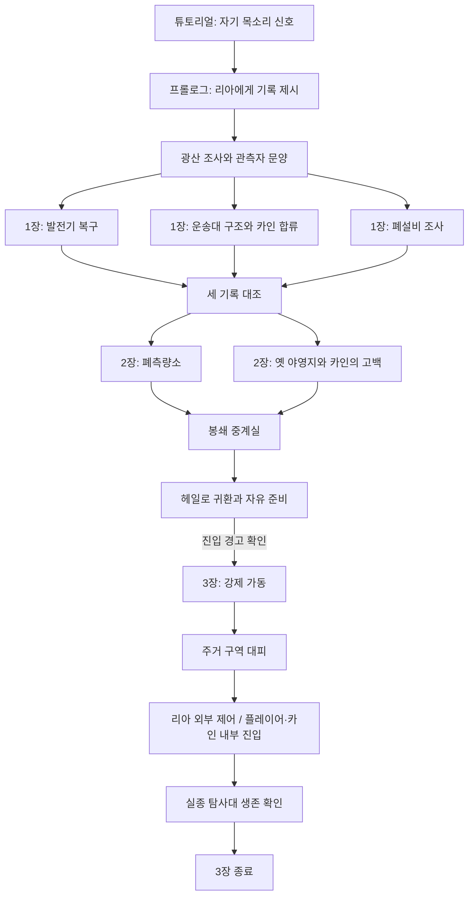

# SimpleGame 게임 개발 통합 문서

통합일: 2026-10-14  
최종 진행 정리: 2026-11-27 · OpenGL 4.5 / 144+ FPS 렌더·시뮬레이션 최적화 및 CQ-01~08 구조 정비(52절) + 차세대 렌더링 최적화 R1~R4 구현 완료(55절·57절) + CQ-09 거주지(56절) + CQ-04B 절차 도시·도로망(58절) + CQ-04 C2/CQ-10 시설·빈 구역(59절) + CQ-12 UI 정돈(60절) + CQ-11 Mixamo 3계층 모듈러 파이프라인 및 4파츠 조합 실렌더 완료(61절) + R5 물리 기반 조명(GGX · IBL · 3D 포인트 라이트 · ACES 톤매핑) 구현 완료(62절) + 카메라 줌·비행체 탑뷰/고도 블러·바람 이펙트·수배 AI 능동 탐색·시설 NPC 1인칭 서비스 UI·4K/전체화면(63절) + 16:9 기본 비율/DPI 선명 UI·고도 클리핑/트레일/바람 보완·비일시정지 대면 NPC 대화·상점 NPC 실시간 애니메이션(64절) + 1챕터 메인 스토리 전 구간(Save Schema 15 · 65절) + 10종 4단계 오픈월드 랜덤 인카운터(Save Schema 16 · 66절) + 오픈월드 단일 이식·대사 개정(67절) + 파트 1 개편(구도심 5개 전부 Rev 5 절차 도시화·바이크 시작/차량·비행체 퀘스트 해금·공용 차 강화·도시 수신망 삭제·J 원격 수령 차단 + N키 3D 경로 안내 리본·고정 문구 정비 · 68절) 완료 / 다음: 파트 2(광산·개척지·카인 첫 대면·퍼즐/미니게임·3D 외관/실물 상점 UI) → 파트 3(3D 행성/우주 맵·클러스터 필터·UI 경계선·제작 요청서·미사용 파일 정리)

현재 개발 계획 브랜치: `iss04_ContentQuality` · 초기 구조 기준: `iss01_actor_scene_render` · 범죄 시스템 변경 기준: `62b00b5` · 이전 도로 성능 비교 기준: `592ec4c` · 초기 기반: `41316a5`

게임 컨셉, 세계관·스토리, 향후 구현 명세, 현재 플레이, 코드·클래스 구조, 개발 규칙,
성능 분석, 모니터링, 검증 기록을 관리하는 단일 문서다. 이후 문서 변경과 개발 진도는 이 파일에 반영한다.

## 문서 읽는 기준

- **이동 변경 검증 (2026-10-29):** 최적화 코어·별도 게임 실행 파일의 컴파일/링크를 통과했다. `tests/MovementTests.cpp`는 출발/정지, 급반전의 제동·접지 대기·회전·재가속, 조준 중 방향 유지, 30/60/144Hz 차이와 130% 고정 응답, 벽 접선 속도·부동소수점 허용 오차, 실내/광산/1장 실제 입력, 바이크 옆미끄러짐·접지 복귀·후진, 메뉴 재개 시 잔여 속도 제거와 테스트 옵션 제거 후 기존 옵션 동작을 검사한다. Gameplay·Civic(실제 고속 충돌 후 조작 복구 포함)·SceneGraph·MapHud·RoadPlan·ConsoleOutput 및 실제 WGL RenderingTests를 통과했다. 새 spine 보정의 포즈 캐시 무효화와 하체 보존, 남녀 출발/반전 모션, 옵션 레이아웃을 확인했다. 로그는 `x64/RevisionChecks/motion-*.log`, GPU 캡처는 `x64/RevisionChecks/motion-renders`다. 일반 Debug/Release 실행 파일은 교체하지 않았다. 전용 발 디딤 애니메이션 납품이나 장시간 사용자 조작감 검수를 완료한 것으로 해석하지 않는다.

- **물리적 이동 응답:** `Game.h/.cpp`의 `MotionMath`, `PlayerMotion`이 공통 속도 접근·제한 회전·충돌 후 속도 제거를 담당한다. 실내/도시/광산/1장 도보는 3.2월드/초의 같은 최대 속도를 사용하며 쿼터뷰 역투영 후 정규화하여 방향별 속도 차이를 없앴다. 기준 가속 14·제동 22월드/초²에 고정 응답 1.3을 적용해 실제 가속 18.2·제동 28.6월드/초², 급반전 시 감속→제한 회전→재가속으로 진행한다. 완만한 회전은 최대 15.6rad/초, 빠른 반전의 제동 구간은 6.5rad/초다. 이동이 멈춰도 바라보는 방향을 유지한다. 조준 중에는 커서 방향의 정확한 회전/사격을 유지하면서 하체 속도에 가감속을 적용한다. 가속·제동·선회 때 spine에 작은 균형 보정을 더하며 하체/충돌 루트를 움직이지 않고 조준 중에는 보정을 제거한다.
- **차량 관성과 고정 응답:** 바이크는 실제 월드 속도 벡터와 차체 yaw/각속도를 따로 보유한다. 조향에 각가속을 적용하고 횡방향 속도를 짧게 남긴 후 접지력을 회복한다. 브레이크는 더 강한 횡속도 감쇠를 사용한다. 기존 7.5 순항·12.8 부스트·0.65 저속 후진 상한을 유지하며 HUD는 실제 속도를 사용한다. 교통 AI 차량은 기존 가감속·신호/차선 경로를 지키면서 코너 진입 속도를 4.5 이하로 제한하고 차체 회전 속도도 제한한다. 플레이 테스트 결과에 따라 도보·바이크의 가감속/선회/접지 응답은 공통 상수 `MotionMath::kResponse = 1.3f`(130%)로 고정했다. 테스트용 슬라이더·입력 처리·세션 설정값은 제거했다. 최대 속도는 바뀌지 않는다.
- **충돌·전환과 모션 납품:** 충돌 후에는 벽 방향 속도만 제거하고 접선 이동은 보존한다. 미세한 부동소수점 누적 오차를 충돌로 오인하지 않도록 허용 오차를 둔다. 메뉴·지도·기록·Q 선택·차단 대화·승하차·지역 전환·의료/겹침 복구는 `GameState::StopMotion()`으로 잔여 속도를 제거한다. 전용 출발·정지·발 디딤 180도 회전 클립은 아직 제작되지 않아 [신규 제작 요청](Resource/ANIMATION_BLEND_REQUEST.md)에 P0/P1과 리그/위상/루트 소유권을 기록했다. 2026-10-29 Mixamo의 Running Turn 180 공개 미리보기를 확인했으며, 외부 모션 파일을 가져오지는 않았다.

- **애니메이션 블렌딩:** `Animation.h/.cpp`의 AnimationMath, AnimationBlendSpace, LayeredAnimation, CharacterAnimation으로 공통 처리한다. 기본 Idle/Walk/Run은 속도 1D 블렌드, 조준 이동은 납품된 17개 속도 표본(정지+8방향 걷기+8방향 달리기)·24개 삼각형의 2D 블렌드다. 프레임 사이와 클립 사이를 본 로컬 이동/크기 선형 보간·최단 경로 쿼터니언 보간으로 섞고 FK 뒤 스키닝한다. 방향이나 속도 전환 때 위상을 재시작하지 않고 정지하면 마지막 보행 위상을 보관한다. Aim_Base/사격/근접은 본별 상체 마스크로 얹고 root·pelvis·하체의 이동을 보존한다. 상체 회전은 컴포넌트 공간에서 섞어 골반 흔들림이 총구 방향을 바꾸지 않게 하며, 발바닥 접지는 충돌/배우 루트를 움직이지 않는 시각 보정이다.
- **이동과 조준:** 맨손·무장 모두 기본은 WASD 입력 방향으로 회전한다. 무장 상태에서 우클릭을 유지할 때 커서 방향으로 배우를 회전시키고 WASD의 화면 기준 이동은 유지한다. 이때 바라보는 방향에 대한 전·후·좌우·대각선 속도로 하체 모션을 고른다. 우클릭 해제 후 움직이면 이동 방향 회전으로 돌아간다. 비조준 사격은 배우가 바라보는 방향, 조준 사격은 커서 방향이며 도시·광산·1장에 동일하게 적용한다. 메뉴·지도·Q 선택창·대화·지역 전환·창 이탈·의료 이송은 조준 입력을 해제한다. 미니맵 화살표는 실제 배우 방향을 따른다.
- **리소스/추가 모션:** Runtime은 v3이며 기존 정점·메시·클립을 유지하고 공유 애니메이션 뱅크에 본 이름/부모/바인드·블렌드 표본·발 접지점을 추가했다. 로컬 본 표본은 뱅크마다 한 번 계산하여 성별·의복·헤어가 공유한다. 변경된 변환기/블렌딩 JSON은 증분 준비 입력에 포함되어 다른 PC에서도 자동 재생성된다. 기존 실행 파일은 v3를 읽을 수 없으므로 게임을 재빌드해야 한다. 후진·옆걸음 클립은 이미 있어 연결했고, 권총 운반 3종과 Reload_Pistol의 총 4개 신규 클립도 연결했다. 운반은 속도·보행 위상을 공유하고 조준 가중치로 전환하며, 재장전은 실제 무기 진행률과 0.15초 진입/복귀 블렌드를 사용한다. root·pelvis·하체와 탄약 판정은 유지한다. [모션 연결 기록](Resource/ANIMATION_BLEND_REQUEST.md)에 납품 완료 상태와 향후 빠른 이동 표본 범위를 정리했다.
- **참고 구조:** Epic의 [Blend Spaces](https://dev.epicgames.com/documentation/unreal-engine/blend-spaces-in-unreal-engine)와 [Layered Blend Per Bone](https://dev.epicgames.com/documentation/unreal-engine/animation-blueprint-blend-nodes-in-unreal-engine)의 속도 표본·본 마스크 개념을 참고한 자체 C++ 구현이다. 언리얼 런타임이나 블루프린트 에디터를 추가한 것은 아니다.
- **블렌딩 검증:** 최적화 코어와 별도 게임 실행 파일 빌드·링크, GameplayTests/CivicTests/SceneGraphTests/MapHudTests/RoadPlanTests/ConsoleOutputTests/MonitorServerTests, ResourceLoadingTests/StartupTests, 리소스 무결성·자동 재생성 입력 검사와 실제 WGL GPU RenderingTests를 통과했다. 이동 방향 회전·우클릭 유지/해제·후진 이동·비조준 사격·지역/메뉴/Q/창 이탈/바이크 탑승 시 입력 해제, 표본 가중치·최단 회전·프레임 연속성·실제 후진 하체 차이·총구 방향 고정·발바닥 접지를 검사했다. GPU 캡처는 `x64/RevisionChecks/animation-renders`의 `animation-aim-male.bmp`, `animation-aim-female.bmp`, `animation-layers.bmp`다. 같은 검사 PC의 CPU 준비 1회는 약 298ms/개인 메모리 약 112.5MiB였다. 실제 배포 실행 파일 교체와 사용자 PC 수동 플레이를 실행한 결과는 아니다.

- **스테이지 시험 진입 / 무장:** 시작·일시정지 메뉴의 `스테이지 목록 · 테스트`는 서장 헤일로 시작, 전망대 스테이지 시작, 바이크 해금(거주지 옆 탑승 상태), 권총 해금(광산 입구 야외), 광산 스테이지 시작, 1장 개척지 시작의 기존 6개와 CQ-01C의 `행성 자유 탐사 · 도보 / 바이크`를 합한 7개 항목이다. 리아 만나기 같은 개별 퀘스트는 목록으로 나누지 않는다. 선택하면 현재 세션을 초기화하고 선택 구간 이전의 필수 스토리·동행·보고 조건을 충족한다. 선택 의뢰·선택 보상은 완료로 꾸미지 않는다. 권총 해금 이후의 직행에는 권총을 보유하지만 기본 장착은 맨손이다. 정상 진행에서는 집·도시·전망대·바이크 이동까지 권총이 없으며, 광산 입구에서 리아의 장비 인계 대화를 끝내면 권총을 받고 입장한다. 인계는 1회이며 재입장으로 탄창을 보충하지 않는다. 새 행성 탐사는 지형/이동 검증 진입점이며 기존 도시·광산·전투 콘텐츠의 이전은 D 이후로 구분한다.
- **무기 선택:** Q를 누른 채 마우스를 움직여 위쪽 주 무장 / 왼쪽 아래 맨손 / 오른쪽 아래 보조 무장을 가리키고 Q를 놓아 확정한다. 주 무장은 비어 있고, 보조 무장은 권총 수령 후에만 선택 가능하다. 빈 슬롯·Esc 취소·창 이탈은 기존 장착을 유지한다. 선택 중 게임 진행과 공격을 멈추고, 닫은 뒤 새 공격 입력을 요구한다. 맨손 좌클릭은 근접 공격, 권총 좌클릭은 사격이다. V 근접은 장착과 관계없이 사용할 수 있다. 회복 키트는 G로 이동했다.
- **커서 제한:** 무기 선택창이 열린 동안 Win32 `ClipCursor`로 게임 클라이언트의 실제 1280×800 비율 표시 영역 안에 커서를 가둔다. 창 이동·크기 변경 시 경계를 갱신하고 Q 해제, Esc, 메뉴/대화/병원 전환, 게임 초기화·종료, 최소화·포커스 상실 시 해제한다. 앞서 설정된 제한은 보존하고 다른 앱의 새 제한을 덮어쓰지 않는다. 렌더링/CPU 검사처럼 보이지 않는 창에서는 운영체제 커서를 가두지 않는다.
- **맨손 타격 / 충돌 보정:** 기존 `Attack_Melee` 리소스 클립은 있었지만 상체 선택과 표본 추출이 무장 상태에만 허용되어 맨손에서 누락됐다. 맨손도 타격/복귀 전체 구간을 0.65초 안에 재생하고 이동 중 골반·하체 표본은 유지한다. 블렌드 스페이스·우클릭 조준의 현재 구현은 위 애니메이션 항목을 따른다. 이동은 0.02월드 이하로 분할해 얇은 경계 관통을 줄이고, 차량 폭 이상의 깊은 겹침도 가까운 빈 공간으로 보정한다. 차량 분리 위치는 메시 bounds 중심을 반영하며 바이크는 접촉 회전·밀림 후 전체 외곽/같은 높이 차량을 다시 검사한다. 최근 안전했던 위치·방향·고도를 우선 복구하고, 사용 불가능하면 주변 빈 공간을 찾는다. 보행자 군집 분리도 벽과 다른 차량을 함께 검사한다.
- **바이크 충돌 후 조작 잠김 수정:** 강한 충돌이 탑승자에게 0.6초 `Knockdown`을 부여했지만, 탑승 중에는 충격 무적 시간만 줄이고 반응 시간은 갱신하지 않아 넘어짐이 영구히 남았다. 보행용 넘어짐 입력 차단도 바이크보다 먼저 실행되어 조향·가속·후진 모두 막혔다. 입력 차단은 도보에만 적용하고 탑승 중에도 반응 시간·무적·충격 속도를 함께 갱신한다. 탑승자에게 도보 밀림을 따로 적용하지 않아 바이크와 위치를 유지한다. 보행 중의 짧은 넘어짐과 밀림은 유지한다. `Game::Update()`는 기존 타이머의 시뮬레이션 부분을 분리한 공통 진입점으로, 회귀 검사에서도 키 입력→실제 게임 업데이트→충돌/회복 경로를 실행한다. 이전 겹침 검사는 무적을 켜고 `UpdateBike()`를 직접 호출해 이 문제를 발견하지 못했다.
- **조작 잠김 회귀 검사:** `TestMountedImpactControls`에서 실제 고속 차량 충돌 피해 후 탑승을 유지한 상태의 즉시 조향·후진, 충격 반응 종료, 재가속, 하차 후 보행과 도보 넘어짐 유지까지 검사한다. 수정 전 실제 게임 업데이트에서 조향 실패를 재현했고 수정 후 CivicTests·GameplayTests·장면/맵/도로/콘솔·GPU RenderingTests 및 별도 게임 실행 파일 컴파일·링크를 통과했다. 기록은 `x64/RevisionChecks/bike-impact-*.log`, GPU 캡처는 `x64/RevisionChecks/bike-impact-renders`에 있다. 배포 실행 파일은 교체하지 않았다.
- **이번 변경 검증:** 최적화 코어·테스트 빌드, GameplayTests/CivicTests/SceneGraphTests/MapHudTests/RoadPlanTests/ConsoleOutputTests/MonitorServerTests 및 실제 WGL GPU RenderingTests를 통과했다. 메뉴의 시작/해금 6개 지점과 선행 조건·안전한 시작 위치, 정상 동선의 권총 인계·재입장·탄창 보존, Q 반복/취소/메뉴 차단과 레터박스 입력을 검사했다. 남성·여성의 맨손 타격과 헤어 스키닝에서 상체 변화·보행 하체 유지·타격 시점별 표본을 확인했고, 얇은 장애물에 대한 고속 이동과 차량 3개 방향에서 깊은 겹침·바이크 전신 복구·후속 탈출 이동을 검사했다. 화면 캡처는 `x64/RevisionChecks/melee-cursor-collision-renders`에 있다. 숨겨진 WGL/CPU 검사는 운영체제 커서를 실제로 제한하지 않으므로, 다중 모니터·Alt+Tab·창 이동 중의 네이티브 제한은 실제 게임 창에서 수동 확인할 대상이다. 일반 배포 실행 파일은 교체하지 않았다.

- **현재 구현:** 도시 도입부 → 전망대 조사·하강 → 리아에게 신호 기록 제시 → 도시 수신망 확인 → 개인 바이크로 연결 야외 맵 직접 운전 → 광산 입구에서 하차·입장 → 무작위 광산 조사 → 좌표 확보·직접 헤일로 귀환·수신망 보고 → 1장 「빛나는 개척지」. 야외에는 헤일로 주변에 흩어진 도시 5곳과 기본 주민 100명, 도로 계획에 따른 2·4차선 도로 및 신호를 따르는 지상 교통, 독립 항공 교통과 도시·광산 주변 시설을 배치했다. 도시 야외의 사격/근접·NPC/차량 피해·5단계 수배·보안대 대응·도시 간 악명/거래가와 모든 원인의 공통 의료 이송을 연결했다.
- **향후 기획:** 메인 스토리 2장 이후의 실제 지역과 사건, 정식 장비·동료 관계 확장과 통합 안정화. 현재 수동 저장/복원과 다른 행성 프로필·행성별 기록은 G1/G2 소스 구현·실행 검증 대기다. CQ-03A는 기존 제안·광산 대사에 한정한 서사 정합성 작업이며 후속 장 제작 완료를 뜻하지 않는다.
- **검증 상태:** 변경별 컴파일·링크, 게임 규칙/도시 교통/주민/장면 그래프, 숨겨진 WGL 표면의 실제 GPU 렌더링과 모니터 HTTP 검사 기록은 아래 날짜별 항목을 따른다. 현재 리소스 캐시는 RoadPlan 88종과 건축·비행체·프롭·캐릭터를 포함한 v3 216항목·공유 애니메이션 뱅크 13개이며 새 PC 자동 재생성과 로더·GPU 검사를 통과했다. 아래 성능 수치는 RTX 5080·1280×800 별도 검사로 RTX 3080 노트북의 60FPS 보장을 뜻하지 않는다. 게임 실행 파일은 교체하지 않았으며 사용자 게임 빌드·연속 플레이·대상 노트북 실측이 남아 있다.
- **내용 우선순위:** 현재 구현과 조작은 1·6·7절을 따른다. 2~5절의 장기 기획·서사·명세는 구현 완료를 뜻하지 않는다.
- 기존 격리 구역의 작업장 4곳·협업 NPC 20명·성장 목표·전체 미니맵·펄스 공격은 제거했다. 같은 진입 구간을 광산 프롤로그로 교체했다.
- 중복 MD/TXT 사본은 통합했다. 초기 기획, 서사 확장안, 퀘스트 명세의 서로 다른 세부 내용은 보존했다.
- 별도 바이크 주행 스테이지는 제거했다. 바이크는 야외에서 직접 운전한다. 광산은 실제 입구/지하층으로 출입하고(D3-1), 개척지는 같은 지상 장면에서 도보/바이크로 경계를 넘나든다(D3-2). E에서 정상 새 게임도 행성 모드의 헤일로 거주지에서 시작하도록 전환했다. 지역 방문·현장 기록·임무 수락/보류/완료를 분리했으며 기존 스토리/해금 직행은 개발용 상태 구성으로 유지한다. C 이후는 사용자 빌드·실행 검증 대기다.
- 바닥의 8×8 표시 범위 분할과 GPU 인스턴싱은 오픈 월드의 데이터 로딩·스트리밍 구현을 뜻하지 않는다.

## 목차

1. [현재 개발 현황과 확인 대기 사항](#status)
   - [iss04_ContentQuality 개발 계획 — 목표 12개와 실행 순서](#content-quality-plan)
     - [CQ-01 행성 규모 심리스 월드 — 확정 요구와 A~H 구현 분할](#planet-world-plan)
2. [게임 정체성과 장기 개발 원칙](#principles)
3. [초기 게임 기획과 제작 단계](#design)
4. [메인 스토리 서사 확장안](#story)
   - [2026-10-23 서사·대사 개정과 2~4장·에필로그 추가 원고](#story-revision)
   - [2026-11-26 장기 대서사 확장 — 인물 심화·챕터 2~3·4대 결말](#story-saga-expansion)
5. [메인 스토리 1~3장 구현 명세](#story-spec)
   - [대사 진행과 후속 스토리 구현 요청서](docs/STORY_IMPLEMENTATION_REQUEST.md)
6. [현재 콘텐츠와 모델·이동 확장](#content)
7. [튜토리얼·전투·성장·NPC 상세](#gameplay)
8. [코드·클래스·Scene 구조](#architecture)
9. [코드 작성과 개발 협업 규칙](#conventions)
10. [렌더링 최적화와 성능 분석](#performance)
11. [로컬 게임 모니터와 JSON 데이터](#monitoring)
12. [통합 출처와 유지 관리](#sources)

<a id="status"></a>

## 1. 현재 개발 현황과 확인 대기 사항

<a id="content-quality-plan"></a>

### iss04_ContentQuality 개발 계획 — 2026-10-30

#### 목적과 확정 범위

현재 구현된 콘텐츠의 전반적인 품질을 높이고, 이후 콘텐츠가 일관된 규칙과 구조 위에 추가될 수 있도록 기반을 다진다. 아래 12개 목표를 이번 브랜치의 개발 계획으로 등록한다. 새 콘텐츠의 양만 늘리거나 개별 장면의 임시 보정으로 끝내지 않고, 현재 콘텐츠에서 검증한 처리 방식을 이후에도 재사용할 수 있게 하는 것이 목적이다.

**각 단계에서 구체적으로 구현할 기능·규칙·연출·수치·자산 범위는 사용자가 해당 단계에서 지시한 뒤 확정한다.** 이후 CQ-05B에서 사용자가 기동 중심 전투를 선택해 Shift 달리기·Space 짧은 회피의 초기 구현을 추가했다(40절). 공유 스태미너는 CQ-05B 후속으로 추가했다(42절). 상위 목표 등록은 개발 계획이며 실제 코드 구현/검증 상태와 초기 조정값은 아래 단계별 기록을 따른다.

현재 상태는 **CQ-01A~B의 기존 v1 검증 이력 유지 / CQ-01H3 통합 안정화·목표 기기 실측 미완료 / CQ-02A~E·CQ-03A~C·CQ-04A~B·C1·CQ-05A~B 소스 구현**이다. 행성 스트리밍·도시/광산/개척지·동료/교통/치안·자율 임무 수락·중계환·다중 행성 저장 기반을 연결했고 H3에서 측정 도구와 비용 보완을 작성했다. 28~32절은 활동 추적·정산/완료, 33~35절은 인물/기록 문맥, 36~38절은 기존 시설/외부 설비 접근, 39~40절은 기존 공격 제한과 기동 중심 전투의 달리기/회피 프로토타입을 다룬다. 새 저장은 스키마 10이며 1~9를 읽는다. 새 게임의 배치 리비전은 4이고 리비전 3 저장은 기존 배치를 유지한다. 11월 4일 GLFW 전환의 별도 [검증 기록](docs/GLFW_MIGRATION.md)은 빌드 통과와 18개 중 14개 검사 통과를 기록한다. Gameplay·Movement·WorldGeneration의 기존 실패와 MonitorServer 환경 제한, 장거리 통합 플레이·목표 기기 실측은 남아 있다. 이 과거 기록을 이번 CQ-05B의 빌드/검사 결과로 인용하지 않으며 이번에도 빌드·네이티브 검사·게임/GPU/FPS 실행을 하지 않는다.

#### 현재 구현을 출발점으로 삼는다

- 야외에는 연결 도로와 도시 5곳이 있고 광산과 1장은 별도 현장 맵으로 진입한다. 이는 완성된 전체 월드 구성이나 지역 스트리밍의 구현을 뜻하지 않는다.
- 프롤로그/광산의 필수 진행은 순차 구조이며, 1장에는 세 현장의 선택 순서가 있다. 전부 선형이라고 보거나 이미 완전한 오픈월드 진행이라고 보지 않는다.
- 권총·맨손/근접·조준·탄퍼짐·탄창·재장전·공통 의료 이송과 이동 관성이 있다. 도보·바이크의 이동 응답은 사용자 확인에 따라 **130% 고정**이며 테스트 슬라이더는 제거한 상태를 기준으로 한다.
- 주민/적/동료/보안대의 기본 행동, NPC 상호 교전, 5단계 수배·미발각 해제·악명 반응과 교통 신호가 있다. 대응 난이도와 행동 완성도는 이번 개선 대상이다.
- 개인 바이크 승하차/조종, AI 지상·항공 교통, 차량/비행체 피해와 기본 파괴 처리가 있다. 일반 차량·비행체의 플레이어 탑승/조종과 완성된 잔해 수명 관리까지 구현되었다고 간주하지 않는다.
- 거주지는 출입·시작 위치·단말 등 도입부 역할이 중심이다. 기존 UI, 3D 모델/공유 리소스, 원형 지도, 대화/기록 체계를 개선의 출발점으로 사용한다. 영구 저장/복원은 기존 장기 기획이며 이번 목표 등록만으로 신규 구현 범위를 확정하지 않는다.

#### 권장 실행 순서

`사용자 번호`는 이번에 제시한 12개 대상 목록과의 대응이다. 완료 기준은 단계의 큰 방향을 뜻하며, 실제 기능 목록과 검증 항목은 착수 때 구체화한다.

| 순서 / 관리 ID | 목표 | 사용자 번호 | 먼저 수행하는 이유와 선행 관계 | 단계의 큰 완료 기준 | 상태 |
|---|---|---:|---|---|---|
| 1 / CQ-01 | 행성 규모 절차 생성 심리스 월드와 지역 연결 | 9 | 지역의 관계·접근·복귀 구조가 이후 도시·이동 수단·퀘스트 배치의 기준이다. 현재 구현을 에르마의 고정/절차 지역으로 이전하며 A~H로 나눠 개발한다. | 도시 4단계와 비도시 지대, 구면 순환·스트리밍·연속 탐사·자율 수락·빠른 이동이 공통 행성 기반에서 연결된다. | 정비 완료(52절) — 반경 비례 지형·260km 대륙 도로·공용 허브 중계환·4단계 도시 방사형 밀도·실내/야외 분리 반영 / 사용자 플레이 검증 대기 |
| 2 / CQ-02 | 오픈월드에 맞는 게임 진행 구조 | 5 | CQ-01 위에서 공간 접근 조건과 사건 진행 조건을 구분해야 특정 동선에 묶인 후속 콘텐츠가 반복되지 않는다. | 자유 탐험과 필요한 선행 조건이 구분되고, 대상 콘텐츠의 방문 순서·중단·복귀가 진행 상태와 모순되지 않는다. | 정비 완료(52절) — `WorldMode` 상태 머신 및 `Game::Player()`/`Loadout()`/`ActiveFirearm()` 통합 진입점 정리 / 사용자 실행 대기 |
| 3 / CQ-03 | 인물 서사·스토리·게임 진행 개연성 강화 | 12 | CQ-01~02의 공간/진행 구조에 인물의 목적과 사건 인과를 맞춘다. 앞 두 단계에서도 필요한 서사 조건은 함께 대조한다. | 사용자가 지정한 인물·사건·동선·진행 조건이 서로 납득 가능하게 연결된다. 구체적인 대사/분기는 별도 확정한다. | A~C 소스 구현 — 현재 콘텐츠의 대사·선택 반응·조사 기록·완료 후 재방문, 33~35절 / 사용자 실행 대기 |
| 4 / CQ-04 | 도시 디자인·인프라·건물 형상/용도/출입 구체화 | 11 | CQ-01~03을 토대로 도시 공간을 확정해야 길 찾기·승하차·교전·실내 콘텐츠의 기준이 안정된다. | 대상 도시의 시설 역할과 접근/출입 동선이 일치하고, 플레이 가능한 공간으로 작동한다. | **구현 완료(52·54·58·59절)** — CQ-04B(Layout Revision 5 도시·도로망·입체 교통·교통신호) + 구 5도시 경계 보강 + CQ-04 C2 전 도시 시설(상점·의료소·정비소·행정 의뢰소) 실내 출입·서비스·저장 스키마 14 완료 |
| 5 / CQ-05 | 전투 구체화·독자적인 전투 방식·플레이어 이동 확장 | 2 | 전투의 규칙과 플레이어 능력을 먼저 정해야 상대 AI와 수배 난이도를 그에 맞춰 설계할 수 있다. | 사용자가 확정한 전투/이동 방식의 기본 플레이 순환과 입력·충돌·애니메이션 연결이 성립한다. | 정비 완료(52절) — 표면 V/R/G 복구·회피 무적(180ms)·전술 집중(+30%/탄약 보충)·주 무장 `PulseCarbine`·표면 근접 부채꼴/넉백 통일 |
| 6 / CQ-06 | 차량·비행체 탑승/조종·파괴/잔해 로직 | 4 | CQ-01/04의 이동 공간과 CQ-05의 조작/피해 규칙에 맞춘다. 이후 AI/치안이 반응할 이동·탑승·파괴 상태를 먼저 안정시킨다. | 대상 이동 수단의 탑승부터 조종·이탈·파괴·잔해 정리까지 상태 전환과 소유권이 일관된다. | 정비 완료(52절) — NPC 차량 탈취·전 거점 차량/비행체 재배치·비행체 고고도 순항(140m/s, 280m)·충돌 피해·추락 폭발 및 낙하 물리 통일 |
| 7 / CQ-07 | NPC·적·경찰 AI 행동 개선 | 3 | CQ-04~06의 공간·전투·이동 수단 규칙을 공통 전제로 행동을 개선한다. | 대상 AI가 상황과 자신의 역할에 맞게 행동하며, 상태 전환·길 찾기·상호작용에서 모순이나 고착이 없다. | 정비 완료(52절) — 시체 오사 필터·3D 고도 시야·1장 스크래퍼 시야/기동/위협공유·행성 동료 현장 구조/측면 산개 반영 |
| 8 / CQ-08 | 수배 시스템 난이도 스케일링 | 1 | 플레이어의 실제 대응 능력과 경찰 AI가 정해진 CQ-05~07 이후에 조정해야 수치만 올리는 난이도를 피할 수 있다. | 사용자가 정한 단계별 난이도와 대응 원칙이 실제 플레이에서 구분되고, 추적·대응·해제 흐름이 납득 가능하다. | 정비 완료(52절) — 5단계 병과(순찰/기동/중무장/저격/대공요격)·1성 투항 벌금·5성 대공 3D 사격·티어별 도주 시간 반영 |
| 9 / CQ-09 | 플레이어 거주지 고유 기능 | 6 | CQ-02~04의 진행/도시 구조와 CQ-05~08의 외부 활동을 바탕으로 돌아올 거점의 역할을 정한다. | 침대(휴식·수배 진정·안전 저장)·작업대(키트 제작·방호복/무기 3단계 강화·차량/비행체 원격 정비)·보관함/옷장(의료비 보호 금고·물자 보관·외형 변경)·거점 단말(현황 브리핑·차량 호출)을 헤일로 거주지 내부에 구현하고 저장 스키마 13·HUD·모니터·회귀 테스트로 연결했다. | 구현 완료(56절) |
| 10 / CQ-10 | 빈 구역 콘텐츠·미니퀘스트 등 추가 | 10 | 안정된 지역·인물·행동·거점 체계를 재사용해 앞 단계의 확장성을 실제 콘텐츠로 검증한다. | 대상 빈 구역에 장소/인물/활동의 맥락이 있는 콘텐츠가 들어가고, 기존 진행과 충돌하지 않는다. 수량·의뢰 내용은 별도 확정한다. | **구현 완료(59절)** — 비도시 5종(전초·노천 광구·무법 지대·고대 유적·야생) 2×2 현장 거점·지역 특화 미니퀘스트 및 보너스 보상·무법자 약탈자 교전(정당방위 무수배)·지역별 지도 색상/핀 반영 |
| 11 / CQ-11 | 모델 퀄리티 개선 및 차세대 렌더링 최적화(R1~R4) | 8 | 공간 용도·출입·전투/탑승 동작과 필요한 자산이 안정된 뒤 최종 모델 작업의 재제작을 줄인다. v4 파이프라인(EBO·정점 압축·LOD·그림자 프록시·GPU 컬링/MDI·PBR 텍스처 배열, 53절)을 선행/병행 구축해 상향된 폴리곤 상한을 목표 기기(RTX 3070 Ti Laptop 60fps / RAM 16GB)에서 방어한다. | R1~R4 렌더링 최적화 경로가 검증되고, 대상 모델의 형상·크기·재질·LOD0~2·그림자 프록시·가동/접촉 지점이 53절 규모별 상한과 아트 방향에 맞는다. 단순 폴리곤 증가를 완료 기준으로 삼지 않는다. | R1~R4 및 **Mixamo 3계층 연동 파이프라인 완료(55·57·61절)** · 1호 자산(`Field_Medic_Coat_LOD0`) 검수 통과 · 잔여 바디/의복/애니메이션 납품 대기 |
| 12 / CQ-12 | UI 배치·디자인·가독성 최종 구체화 | 7 | 앞 단계에서 확정된 정보와 조작 흐름을 기준으로 전체 UI의 위계와 일관성을 정리한다. | 대상 화면의 배치·디자인·정보 우선순위가 통일되고, 실제 장면/해상도에서 읽고 조작할 수 있다. | **구현 완료(60절)** — 전 HUD 반투명 다크글라스(`HudCard`) 통일·좌하단 바이탈/조작 안내 겹침 제거·상시 물자(키트/고철/Cr) 표시·전체 지도 상단/하단 범례 및 지도 경계 분리·`MapLabel` 충돌 억제·미니맵 `N` 방위표/시설 색상 범례·1280×800 영역 분리 자동 회귀 통과 |

#### 순서 운영 원칙

- 위 순서는 기본 착수 순서다. 새 세부 지시가 선행 작업을 바꾸면 필요한 의존 관계를 확인하고 이 표를 갱신한다. 특정 방식이나 콘텐츠를 미리 구현해 사용자의 후속 선택을 제한하지 않는다.
- CQ-01~04는 **월드·진행·서사·도시를 맞추는 기반 구간**, CQ-05~08은 **상호작용·행동·난이도를 다듬는 구간**, CQ-09~10은 **거점과 지역 콘텐츠로 재사용성을 검증하는 구간**, CQ-11~12는 **모델과 UI를 전체적으로 마감하는 구간**이다.
- 서사 검토는 CQ-03 이후에도 계속한다. 후속 전투·치안·거점·의뢰가 인물과 세계관의 개연성을 무너뜨리면 해당 단계에서 수정한다. 이번 계획이 기존의 미구현 2~4장/에필로그 전체 제작을 자동으로 승인하는 것은 아니다.
- CQ-11/12가 뒤에 있어도 모델/충돌 치수, 출입 판독, 조작 안내, 목표/상태 가독성 등 해당 기능을 플레이하는 데 필요한 수정은 각 단계에서 처리한다. 최종 아트 마감과 전체 UI 통일을 후반에 배치한 것이며, 불편한 임시 UI나 기능과 맞지 않는 모델을 마지막까지 방치하는 순서가 아니다.
- 신규 전투 방식, 이동 행동, 탑승 가능 기종, 잔해 정책, 거주지 시설, 미니퀘스트, 새 지역/건물/대사와 최종 디자인은 모두 해당 단계의 사용자 지시로 확정한다. 이 계획에서 구체적인 수치·키·재화·보상·콘텐츠 수량을 임의로 고정하지 않는다.

#### 각 단계의 착수·완료 기록

1. **세부 지시 수신:** 대상 CQ-ID와 사용자가 요구한 기능, 영향을 받는 기존 기능을 기록한다.
2. **구현 범위 확정:** 현재 구현과 부족한 부분, 다른 단계의 선행 조건, 완료 판단과 검증 방법을 정리한 뒤 구현한다. 필요한 모델·UI·애니메이션은 기존 요청서에 연결한다.
3. **공통 기반 우선:** 상태의 소유권·고유 식별·지역 이동/복귀·피해/사건 전달·수명 관리 등 필요한 계약을 정리한다. 기능별 임시 분기와 중복 구현을 늘리지 않으며, 렌더링이 게임 진행 상태를 바꾸지 않게 한다. 이번 CQ-01 지시로 행성 스트리밍과 생성 시드/월드 변경분 보존의 기반은 범위에 포함한다. 저장 슬롯·전체 게임 저장 UI나 다중 행성 스토리까지 자동 확장하지 않는다.
4. **현재 콘텐츠로 검증:** 해당 단계의 실제 플레이 흐름, 예외·중단·재진입, 다른 시스템과의 연결, 기존 기능 회귀를 확인한다. 죽음/의료 이송·충돌·대화/메뉴·반복 입력·지역 복귀 등이 관련되면 함께 검사한다.
5. **성능·자산 확인:** 모델/애니메이션/리소스의 기존 납품 기준을 지키고, 대상 기능이 60FPS 목표와 로딩/메모리에 주는 영향을 동일 조건에서 비교한다. 목표 장비인 RTX 3080 노트북의 실측과 다른 GPU의 검사 결과를 구분한다.
6. **완료 및 후속 기록:** 실제로 구현·검증한 내용과 남은 제한, 다음 콘텐츠가 재사용할 접점을 통합 문서에 남긴다. 상태는 `대기 → 진행 중 → 검증 대기 → 완료`로 갱신하며, 선행 작업 때문에 진행할 수 없으면 사유를 적는다. 다음 단계의 기능은 다음 사용자 지시를 받은 뒤 확정한다.

**현재 확인 지점: CQ-01H3 통합 검증(27절).** C~H2의 이동·도시/현장·임무·중계·저장·교통/동료/치안·절차 거점 연결은 소스에 반영했다. H3에서 실제 사용자 로그를 분석하고 지도/교통 비용과 측정 구분을 보완했다. 변경 후 네이티브 회귀·장거리 연속 플레이·목표 기기 Release 실측은 대기다. 정상 새 게임의 미수락 자유 탐사, J의 제안/보류/재개, 스토리/장비 해금 직행, 광산 재입장과 개척지 경계·의료 이송·지도 줌, 중계환 E 등록/지도 T 이동·X 취소·P 개관, F5/F9 저장/복원을 함께 확인한다.

**최근 개발 지점은 CQ-08(50절)이다.** 기존 범죄 집계·승급 시간·20초 해제 계약을 유지하면서 단계별 대응 프로필, 제한된 성장 보정과 실제 신고/목격 정보 기반 증원을 연결했다. 초기 수치는 사용자 밸런스 확인 대기이며 다음 계획 항목은 CQ-09 거주지 고유 기능이다. CQ-07~08 플레이 확인, CQ-04 C2 자산 납품과 H3 장거리·성능 검증은 계속 대기 중이다.

**그래픽 제작/최적화 지침은 51절에서 갱신했다.** 텍스처 도입에 앞서 필요한 자산·공유 파츠/프리팹·선택적 정적 결합·재질/텍스처 공유·로딩/메모리/검수 계약을 기존 요청서에 정리했다. 사용자는 필요한 GLSL 버전 변경과 최신 버전 사용을 허용했다. 이는 새 렌더러 구현 완료나 CQ-09 착수 기록이 아니다.

<a id="planet-world-plan"></a>

#### CQ-01 개정 목표 — 행성 규모 심리스 탐험

현재의 고정 사각형 야외와 분리된 현장 맵에서, 한 행성의 여러 도시·지대를 실제로 오가며 탐사하는 월드로 전환한다. 스토리·미니퀘스트의 수령과 참여는 플레이어 재량으로 두고, 지역 발견/이동과 임무 수락/진행을 분리한다. 기존 에르마의 개척 생활·관문망·동료 서사와 이전 개발 계획을 함께 유지한다.

구현 규모가 좌표·지형·도시 생성·스트리밍·기존 콘텐츠 이전에 걸치므로 **A~H로 분할한다. A~B는 기존 v1 검증 이력을 유지하고 축소 v2를 재검증한다. C~G1은 소스 구현·실행 검증 대기, G2/H는 대기다.** 일부 단계만 끝났을 때 행성 월드 전체가 완성되었다고 기록하지 않는다.

##### 1. 공간·명칭·도시 등급

- 시작 행성의 기존 정식 명칭 **에르마**와 후속 이야기의 **네레우스**를 유지한다. 초기 플레이 콘텐츠의 이전 대상은 에르마다. 다른 반경/시드를 가진 절차 행성은 같은 데이터 계약으로 만들 수 있게 하지만, 네레우스 스토리나 성간 비행 플레이를 이번 단계에서 새로 구현하지 않는다.
- 현재 헤일로·신더·베일·루멘·에코는 모두 사용자가 지정한 최하위 도시 단위인 **시내**로 분류한다. 기존 이름과 영구 ID(`halo_07`, `cinder`, `veil`, `lumen`, `echo`)를 유지한다. 여기서 시내는 게임의 정착지 등급이며, 모든 도시를 정사각형 구획으로 나눈다는 뜻이 아니다.
- 도시의 4단계는 `시내 → 소도시 → 대도시 → 항성계 수도`로 데이터화한다. 등급·고유 명칭·소속 행성/항성계·도시 footprint·도시 기능을 분리한다. 아래 신규 이름은 기존 원고에서 이름을 찾지 못한 유형에 부여한 **이번 개정의 기본 명칭**이다. 아직 게임 오브젝트가 생성된 상태는 아니다.

| 유형 | 보존/신규 기본 명칭 | 배치/서사 원칙 |
|---|---|---|
| 시내 | 헤일로, 신더, 베일, 루멘, 에코 | 헤일로의 거주 구역 07·집·전망대·신호 조사 핵심 공간은 고정 앵커. 다른 기존 정착지는 명칭을 보존하고 스토리 앵커 지정 여부에 따라 생성 위치를 정한다. |
| 소도시 | 카르덴 (`karden`) | 에르마의 생활·산업 정착지용 기본 명칭. 같은 템플릿의 추가 소도시는 시드 기반 명명 규칙을 사용한다. |
| 대도시 | 아스테리온 (`asterion`) | 서울급 면적 기준을 적용할 대표 대도시. 여러 기능 구역과 주변 지대를 가진 도시 단위로 생성한다. |
| 항성계 수도 | 루케른 프라임 (`lucerne_prime`) | 에르마가 속한 항성계의 행정 중심 정착지로 신규 등록한다. 헤일로는 여전히 수도에서 떨어진 변방 개척 생활권이다. 해당 행정 배경·인물 대사는 CQ-03에서 대조하며, 수도의 존재만으로 에르마가 은하 문명의 중심이라는 설정을 만들지 않는다. |
| 전초기지 | 칼릭스 전초기지 (`calyx_outpost`) | 주변 자연/산업 지대와 육상·항공 접근 및 지역 중계 거점을 연결한다. |
| 광산 지대 | 오르딘 광구 / 오르딘 광산 (`ordin_mining_zone`, `mq00_mine`) | 기존 광산의 고유명이 없으므로 부여한다. 기존 구조 신호·광부/전투원·리아·지하 유적의 역할과 퀘스트 ID를 보존한다. |
| 무법 지대 | 회색분지 (`grey_basin`) | 지대 분류·관할/위험 정보와 접근 구조를 준비한다. 새로운 세력·PK·수배 면책 규칙은 CQ-03/07/08의 후속 지시로 확정한다. |
| 고대잔해 지대 | 백색환 유적지 (`white_ring_ruins`) | 물리적인 행성 유적은 연속 지형이다. 고대 구조물의 존재로 관문/우주 밖 존재의 정체까지 설명하지 않는다. |
| 기존 본편 현장 | 빛나는 개척지, N-0 외곽 | 원고의 명칭과 사건 앵커를 유지한다. 1장 현장은 이전하고, 미구현 후속 장의 장소는 예약만 하며 사건을 자동 제작하지 않는다. |

추가 지역명은 `행성 시드 + 지역 영구 ID + 명명 규칙 버전`으로 결정한다. 기존 고유명과 중복되지 않게 하며, 번역/표시명 변경이 지역 ID나 퀘스트 참조를 바꾸지 않게 한다. 지역별 수량·밀도와 실제 생성 위치는 행성 프로필의 값으로 관리한다.

##### 2. 실제 크기와 도시 면적

- 사용자의 서울 예시에 따라 **현실 대비 1/4은 면적 비율**로 확정한다. `게임 도시 면적 = 현실 참조 면적 × 0.25`다. 같은 형태를 축소하면 길이/폭은 각각 1/2이며, 가로·세로를 각각 1/4로 줄여 면적을 1/16로 만들지 않는다.
- 서울의 2025년 행정구역 면적 605.25km²를 참조하면 서울급 대도시 목표는 **151.3125km²(약 151.31km²)**다. 이는 정사각형으로 환산했을 때 한 변 약 12.30km인 면적 예시이며, 실제 도시는 지형을 따라 비정형 footprint로 생성한다. [서울시 공식 100대 통계](https://data.seoul.go.kr/dataVisual/seoul/seoul100List.do)의 확인 시점 수치이며 이후 통계 변화로 기존 생성 월드가 바뀌지 않게 참조값/버전을 보관한다.
- 각 도시 템플릿은 현실 참조 면적과 그 출처/가정을 갖고 동일한 0.25 비율을 사용한다. 네 등급에 단일한 현실 행정구역 기준이 있다고 가정하지 않는다. 생성 완료 시 도로·택지·공원·시설 등으로 구성된 도시 footprint의 면적을 검증한다.
- 180cm 캐릭터와 건물·차량·도로의 실측 비율, 현재 `WorldScale::metersPerUnit = 2`를 유지한다. 도시의 면적 압축과 개별 메시의 크기를 구분한다. 현재 헤일로 핵심 블록을 앵커로 보존하면서 도시의 실제 범위를 확장한다.
- 도시 면적 비율을 행성 반경에 자동 적용하지 않는다. 행성은 프로필의 물리적 반경을 가지며, 큰 도시/행성 전체를 한 번에 메모리에 생성하거나 모든 건물/NPC를 매 프레임 시뮬레이션하지 않는다.
- **2026-11-02 축소 개정:** 워프 도입 전 탐사 부담을 줄이기 위해 에르마의 선형 행성 스케일을 1/4로 줄인다. 반경 4,800→1,200km, 대원 둘레 약 30,159→7,540km다. 면적은 반경 제곱에 따라 1/16이지만 도시 자체의 기존 목표 면적과 1월드 단위=2m, 인물/차량/건물/무기 사거리·이동 속도는 유지한다. 거주지·광산의 기존 핵심 동선을 압축하지 않고 개척지/N-0 장거리 앵커와 생성 분포 간격을 줄인다. 실제 플레이 지형은 새 프로필/버전에서 생성하며 이미 살아 있는 세션을 도중에 늘이거나 줄이지 않는다.

##### 3. 행성 구면과 지역 좌표

- 2.5D는 **표현 방식**이다. 전역 이동/거리/지역 연결은 구면에 놓고, 현재 플레이어 주변만 로컬 접평면으로 투영해 기존 쿼터뷰와 조작을 유지한다. 직사각형 X/Y의 나머지 연산으로 만든 토러스를 최종 행성 구조로 사용하지 않는다.
- 기준 방향을 곡면을 따라 유지한 직진은 대원 경로로 정의하며, 한 바퀴 거리 `C = 2πR` 후 출발 위치/방향으로 돌아오게 한다. 고정 위도를 따라가는 이동과 대원 직진은 구분한다. 카메라/조작의 로컬 축은 이동에 맞춰 연속 변환하여 면 경계·극지에서 입력 방향이 뒤집히지 않게 한다.
- 현실의 고체 표면 행성 크기를 참고한다. 검증용 평균 반경 예시는 수성급 약 2,440km, 화성급 3,389.5km, 지구급 6,371km이며 대원 둘레는 각각 약 15,331km·21,297km·40,030km다. [NASA 수성 자료](https://science.nasa.gov/mercury/facts/), [NASA 화성/지구 비교](https://nssdc.gsfc.nasa.gov/planetary/factsheet/marsfact.html?level=1). 대기·중력·생물 환경을 이 반경만으로 추정하거나 다른 행성의 설정을 그대로 복제하지 않는다.
- `PlanetProfile`마다 반경/생성 분포가 다르고, 선택된 반경은 시드·버전과 함께 유지한다. 에르마의 스토리 프로필과 임의 절차 행성 프로필을 구분하며, 실제 행성별 반경/기본 수치는 CQ-01A/B에서 데이터로 확정한다. 플레이 편의를 위해 이미 생성된 행성의 크기를 이동 중 변경하지 않는다.
- 전역 위치는 64비트 정밀도 구면 좌표와 행성/공간 ID로 보관하고, 청크 주소는 안정적인 정수 키로 관리한다. 렌더·인접 충돌에는 플레이어 주변의 상대 좌표를 사용한다. 기존 `Vector2`에 행성 전체의 큰 절대 좌표를 직접 넣지 않는다.
- 구면 청크는 큐브-스피어 계열의 연속 분할을 기본 설계로 삼는다. 면 경계/꼭짓점의 이웃 청크·지형/도로 접속·속도/방향 변환·경로/미니맵 거리를 같은 계약으로 처리한다. 현재의 ±440 경계는 기존 로컬 구간의 범위이며 행성의 끝이 아니다. 코드상 경계 제거는 CQ-01C/D에서 처리한다.

##### 4. 절차 생성과 유기적인 연결

1. 행성 시드·생성기 버전·반경·거시 지형/환경을 정한다. 메인 스토리 고정 앵커와 접근에 필요한 공간을 먼저 예약한다.
2. 지형·자원·거주 가능성·기존 정착지 관계에 맞춰 나머지 도시/전초/광산/무법/잔해/자연 지대를 배치한다. 같은 행성 프로필과 시드에서는 청크 방문 순서나 작업 완료 순서가 달라도 동일하게 생성한다.
3. 대륙/산맥/수계/고도와 지역의 용도를 고려해 간선·우회·분기·순환 경로를 구성한다. 모든 지점을 하나의 직선/같은 간격/고정 직각 격자로 연결하지 않는다. 자연 구간과 도시 내부의 도로 설계 규칙은 구분한다.
4. 지역의 footprint·수용량·진입점·교량/터널·보행/차량 경로와 항공 연결을 검증한다. 접근 가능한 각 지역은 연결망에 속해야 하고, 절차 생성 때문에 필수 앵커나 중계 포인트가 단절되지 않아야 한다. 지형상 육상 접근이 불가능한 곳은 사용 가능한 이동 수단/연결 방식도 함께 정의한다.
5. 발견·시설 변화·파괴·회수·보상·퀘스트 결과는 생성 원본에 덮어쓰지 않고 고유 ID에 연결된 변경분으로 보관한다. 청크를 내렸다 다시 올리거나 같은 광산에 재진입해도 이미 존재한 지역/인물/사건을 새로 추첨하거나 보상을 중복 지급하지 않는다.

에르마의 헤일로 핵심 구역·거주지·전망대·MQ00 광산 핵심 공간·1장 현장의 필수 지점 등 스토리 고정 장소는 전용 카탈로그로 보존한다. 고정 여부, 생태/지형 생성 여부, 퀘스트 접근 조건은 서로 다른 속성이다. 스토리와 관계없는 지대는 시드에 따라 달라지되, 일단 생성된 한 월드에서는 계속 같은 장소다.

##### 5. 심리스 범위와 인스턴스 제한

- **행성 표면의 도시·야외·전초·무법·물리적 잔해/유적, 물리적으로 연결된 광산·폐광·지하/일반 건물 내부는 같은 행성의 연속 공간**으로 다룬다. 지상/지하/실내는 높이·층/공간 연결로 구분하고, 별도 로딩/컬링은 같은 공간을 나누어 처리하는 구현 세부다. 입장할 때마다 새 인스턴스를 만드는 지역으로 정의하지 않는다.
- 인스턴스형 던전은 설정상 행성의 일상적인 연속 공간이 아닌 **관문 너머의 분리된 공간·이상 영역 등**에 한정한다. `관문 시설 건물`과 `관문 너머 공간`을 구분하며, 메인 스토리 장소라는 이유만으로 행성 지형을 인스턴스로 분리하지 않는다. 허용 여부는 명시적인 공간 분류로 판단한다.
- 스토리 장소는 사건 연출/일시 통제 등 원고상 필요한 예외를 가질 수 있다. 이러한 예외는 이유·범위·진입/복귀 상태를 명시하고, 주변 일반 행성 구간의 탐사까지 선형 진행으로 막지 않는다.
- 광산의 매 입장 재생성은 D3-1에서 제거했다. 1장의 수신망 선택→분리 현장 전환은 D3-2의 이전 대상이다. 오르딘 광산/지하 유적과 빛나는 개척지는 행성의 실제 위치로 접근하며, 층별 시야·전장의 안개·스캐너·NPC 구조 기능을 위치/레이어에 맞춰 보존한다.
- 청크 로딩은 CPU 생성·메인 스레드 게시·렌더 업로드를 구분하고 이동 방향/속도로 미리 준비한다. 인접 청크의 연속 지형/충돌/경로와 낮은 세부도의 기반 데이터를 유지하면서 필요한 범위만 올린다. 표면 경계에서 로딩 화면·퀘스트 선택·고정 벽으로 이동을 끊는 것을 완료 상태로 삼지 않는다.

##### 6. 자유 탐사·선택적 임무 참여

- `지역 발견`, `스토리/미니퀘스트 제안`, `수락`, `진행`, `완료`, `읽은 대사/확보한 기록`을 구분한다. 지역 진입/중계 이동만으로 퀘스트를 강제 수락·완료하거나 선행 사건을 완료한 것으로 꾸미지 않는다.
- 메인 스토리를 받지 않아도 일반 지역을 자유롭게 탐사한다. 사건 인과에 필요한 단서/동료/장치 조건은 해당 사건에 걸고, 광산/개척지 등 일반 지리 공간 전체의 방문 조건과 분리한다. 안전/환경/시설 때문에 실제 접근 제한이 있으면 그 조건을 따로 표시한다.
- 스테이지 목록은 개발용 상태 구성 도구로 유지하고 정상 탐험의 해금/완료 규칙과 분리한다. 기존 권총 소유·명시적인 장비 인계·기본 맨손·이동 응답 130% 원칙도 유지한다. 탐사 진입 자체가 권총 지급이나 리아 합류를 강제하지 않도록 이전한다.
- 기존 MQ00/1장의 사건·선택·보상 ID와 중복 방지, 대화 재개, 의료 이송 후 기록 보존을 지킨다. 수신망은 이야기/정보/이동 서비스의 역할을 각각 가지며, 현장 이동을 위해 메인 퀘스트를 수락하게 만드는 필수 메뉴가 되지 않게 한다.
- 이 내용은 CQ-02의 전체 퀘스트 재설계를 선행 완료한 것으로 처리하지 않는다. CQ-01E에서는 자유로운 지역 접근과 현재 퀘스트의 안전한 이전에 필요한 최소 분리를 수행하고, 새 분기/미니퀘스트 내용은 CQ-02/03/10에서 확정한다.

##### 7. 관문망을 참고한 행성 내 빠른 이동

- 행성 내 국지 빠른 이동 장치의 기본 명칭은 **국지 중계환**이다. 관문망의 표식/좌표 중계를 응용한 제한된 행성 내 전송 설비로 설정한다. 일상적인 빠른 이동이 메인 스토리의 성간 관문 재가동이나 장막 붕괴 사건을 자동으로 일으키지 않도록 기술적/서사적 역할을 구분한다. 세부 설명 대사는 CQ-03에서 다듬는다.
- 모든 접근 가능한 지역에 최소 한 곳 이상을 배치하고, 넓은 도시·분리된 생활권·출입점과 길 찾기 거리를 기준으로 여러 포인트를 둔다. 지역 수가 늘면 커버리지를 재검증한다. 경계선만 가깝고 실제 접근 경로는 없는 포인트를 해당 지역의 유효 커버로 세지 않는다.
- 포인트의 발견/등록, 현재 사용 가능 여부, 목적지 선택을 퀘스트 수락과 분리한다. 발견된 포인트를 행성 지도/목록에서 식별하고 이동 후 같은 월드의 안전한 도착 위치에 배치한다. 비용·교전/수배 중 제한·차량 동반 정책의 최종 수치는 해당 후속 시스템과 맞추되, 이를 위한 조건 조회 접점을 준비한다.
- 목적지 청크 선행 준비·도착 위치 점유 검사·이동 중 중복 입력·취소/실패·의료 이송과의 충돌을 처리한다. 빠른 이동 연출은 지역 경계를 걸어 넘는 심리스 탐사와 별개다. 이동 시 발견·NPC·차량·보상/진행 상태를 초기화하지 않는다.

##### 8. 다른 개발 계획과의 연결 계약

| 연동 대상 | CQ-01에서 제공할 기반 / 후속 단계에 남기는 작업 |
|---|---|
| CQ-02 진행 구조 | 지역 접근과 퀘스트 상태의 분리, 발견/제안/수락/완료 이벤트·고유 ID. 새 퀘스트 분기/진행 규칙은 후속 확정. |
| CQ-03 서사 | 기존 인물·고정 사건 앵커·도시/지대 명칭·중계환의 설정 경계. 신규 도시 배경·완성 대사·후속 장의 실제 사건은 후속 확정. |
| CQ-04 도시 | 4단계 footprint·도시 기능/출입 예약·지형과 도로 연결. 시설별 상세 배치·건물 형상/실내 활동은 후속 구체화. |
| CQ-05 전투/이동 | 구면의 로컬 위치·높이·속도/방향 변환·충돌/위험 조회. 새 달리기/구르기/독자 전투 규칙은 미구현 상태로 유지. |
| CQ-06 탑승/조종/잔해 | 행성별 공용 쿠페·Courier와 기존 개인 바이크. 행성 좌표·주차·파괴/잔해를 보존하며 비행은 별도의 고도·선체 스윕을 사용한다. AI 차량 탈취·동료 탑승·승하차 인체 연출은 후속 범위. |
| CQ-07 AI | 기존 거리별 갱신·경로 안정성에 감지/위험 기억과 역할별 기본 판단을 연결했다. 마지막 확인 좌표는 소유 지역 프레임에서 관리한다. 동료/분대 협동·개척지와 일반 행성 인물의 공통 판단 적용·새 사회 행동은 후속 범위. |
| CQ-08 수배 | 지역 관할/법 집행/위험 정보, 행성 내 사건 발생 위치와 이동 이벤트. 수배 난이도·추격/빠른 이동 제한의 최종 정책은 후속 확정. |
| CQ-09 거주지 | 고정 거주지 ID·위치·출입 연결·복귀 상태. 거주지 전용 기능 자체는 후속 구현. |
| CQ-10 지역 콘텐츠 | 재현 가능한 지역 ID·POI/인물 자리·발견/수락 접점·보상 중복 방지. 실제 미니퀘스트와 배치 수량은 후속 확정. |
| CQ-11 모델 / CQ-12 UI | 물리적 단위·모듈 접속·스트리밍 범위·도시/지대/이동점/목표의 지도 정보. 현 단계에 필요한 표시를 먼저 연결하고 최종 모델/디자인 마감은 후속 수행. |
| 기존 대사/후속 스토리 요청서 | `docs/STORY_IMPLEMENTATION_REQUEST.md`의 장면/대사/선택/보상 ID와 P0 기록 보존을 유지하고, 선형 지역 진입 전제는 이번 개정에 맞춰 이전한다. P1~P3의 전 장 제작을 자동 착수하지 않는다. |
| 기존 리팩토링/성능 계획 | `docs/REFACTORING_20261028.md`의 메인 스레드 리소스 소유·불변 결과 게시·작업 취소/회수·모니터 계약을 지킨다. 모델 도감 전용 작업을 전역 월드 생성 작업 풀로 임의 전용하지 않는다. |

초기 데이터 계약에는 행성 정의(시드/생성기 버전/반경), 지역 정의(유형/도시 등급/명칭/footprint/고정 여부), 위치(행성/공간/층), 청크 키, 개체/콘텐츠 영구 ID, 월드 변경분, 임무 수락 상태, 중계 포인트가 포함된다. 클래스명/저장 형식의 최종 코드는 CQ-01A에서 기존 파일 책임 경계에 맞춰 정한다.

##### 9. 구현 하위 단계와 개별 완료 판단

| 하위 단계 | 구현 범위 | 이 단계에서 확인할 완료 조건 | 선행 / 상태 |
|---|---|---|---|
| CQ-01A — 데이터 계약·구면 좌표 | 행성/지역 등급·명칭·반경/단위·위치/층·고정 앵커·영구 ID·버전 계약, 구면 이동/거리/방향과 기존 로컬 좌표 어댑터. | 서로 다른 반경에서 대원 한 바퀴의 출발점/방향 복귀, 극/면 모서리 통과, 왕복 변환·거리·정밀도와 1/4 면적 계산을 CPU 검사. 기존 플레이 유지. | 기존 v1 검증 / 축소 v2 프로필 재검증 대기 |
| CQ-01B — 결정적 행성·지역 생성 | 거시 지형·고정 구역 예약·절차 정착지/지대·명명·도로/연결 그래프·중계 후보 배치. | 같은 시드/버전의 방문/생성 순서와 무관한 동일 결과, 다른 시드의 비고정 지역 차이, 고정 앵커 보존·중복/겹침·지역/중계 후보 연결성 검사. 아직 전체 고품질 도시 렌더 완성 단계는 아님. | 기존 v1 검증 / 축소 v2 생성·접속 재검증 대기 |
| CQ-01C — 지형 스트리밍·연속 이동 | 구면 청크 로드/해제·선행 생성·로컬 원점·지형/충돌/경로 게시·기존 쿼터뷰 연결. | 축소 검증 행성과 현실 반경 데이터 모두에서 경계·극/모서리 이동, origin 이동·고속 선행 로딩·취소/월드 전환·메모리 상한을 검사. 도보/기존 바이크가 끊김 없이 탐사. | 구현 / 사용자 빌드·실행 검증 대기 |
| CQ-01D — 도시/지대와 기존 현장 이전 | 도시 4단계의 목표 footprint·기존 도시 핵심 블록, 전초/무법/잔해 지대, 오르딘 광산의 지하·빛나는 개척지의 물리적 연결. | 도시 면적/실측 비율·도로/출입 접속, 지상/지하 이동·지역 재진입·현재 시설/NPC/광산 시야/구조 기능을 검사. 고정 스토리 장소는 보존. | A~C / D1~D3-2 소스 구현·사용자 실행 검증 대기 |
| CQ-01E — 자유 탐사와 임무 참여 분리 | 지리 접근/퀘스트 제안·수락/사건 조건 분리, MQ00/1장 이전·수신망 역할 정리·개발용 진입 호환. | 임무를 받지 않은 자유 탐사, 거절/중단/늦은 수락/재방문, 선행 단서/장비/동료 상태, 대화/의료 이송·중복 보상 방지와 기존 선택 보존 검사. | D / 소스 구현·사용자 빌드·실행 검증 대기 |
| CQ-01F — 국지 중계환·행성 지도 | 지역별 복수 빠른 이동점과 실제 커버리지·발견/등록·지도 선택·도착 준비. 지도는 행성 개관→지역→블록의 연속 확대·축소, 이동·내 위치 복귀, 거리 척도·확대 단계별 상세도·층별 목적지와 발견 정보를 연결한다. D3-1의 지상 지역도/현장 약도 줌 조작을 재사용한다. | 커서 위치 고정 줌·선택 좌표 일치, 축척별 가독성/비용 제한, 행성 이음매·지하층·중계환 필터 검사. 모든 지역의 유효 이동점, 중복 입력·미준비/점유·실패/취소·이동 전후 상태 보존 검사. | B~E / 소스 구현·사용자 빌드·실행 검증 대기 |
| CQ-01G — 월드 연속성·다른 행성 프로필 | 시드/버전/발견·개체/시설 변경분의 직렬화·복원과 호환 경계, 다른 반경/시드의 절차 행성 프로필 연결. | 스트리밍 재로딩/프로세스 재시작의 동일 월드·변경분 복원, 생성기 버전 불일치 처리, 행성 간 상태 분리·서로 다른 일주 거리 검사. 네레우스 사건/성간 조종이나 완성 저장 슬롯 UI는 범위 밖. | A~F / G1·G2 소스 구현·사용자 빌드·실행 검증 대기 |
| CQ-01H — 통합 안정화·성능·회귀 | 교통/항공/AI의 지역 경계·원거리 갱신·수명, 지도/목표/빠른 이동/기존 테스트 진입, 메모리·생성/업로드 예산 조정. | 실제 연속 플레이와 고속 이동·장거리 탐사·의료/대화/귀환 회귀, 스트리밍 경계와 도시 밀집 장면의 프레임 시간/메모리 측정. 목표 RTX 3080 노트북에서 60FPS 확인과 미달 항목 기록. | A~G / H1~H2 소스 구현 / H3 로그 분석·비용 보완·도구 준비, 변경 후 사용자 실행 검증 대기 |

현실 반경의 행성을 실제 시간으로 걸어서 일주해야 검사가 끝나는 방식은 사용하지 않는다. 수학/시뮬레이션 일주 검사와 고속·축소 프로필의 경계 연속성 검사를 구분하고, 최종 플레이 반경은 해당 행성 프로필 값으로 유지한다. A/B의 데이터 검사 통과를 C~H의 심리스 플레이·성능 완료로 대체하지 않는다.

CQ-01 완료 시에는 같은 행성의 여러 지역을 퀘스트 수락과 무관하게 탐사하고, 물리적 지리/구면 연결·중계환·변경분 보존을 이용해 지속해서 오갈 수 있어야 한다. 새 행성/도시/지대/의뢰를 추가할 때 기존 고정 좌표와 개별 Level 분기에 매번 기능을 덧붙이지 않는 기반을 결과물로 삼는다.

##### 10. CQ-01A 구현/검증 완료 — 2026-10-30

`SimpleGame/World.h/.cpp` 한 쌍에 월드 데이터·식별·구면 수학·청크 주소·기존 좌표 연결을 역할별 클래스 경계로 구성했다. `.vcxproj`와 필터에 등록했다. 새 레벨/도시마다 소스 파일을 추가하거나 기존 플레이를 생성 월드로 교체하지 않았다.

| 구현 | 현재 제공하는 계약 |
|---|---|
| PlanetDefinition / RegionDefinition | 행성·항성계 ID, 64비트 시드, 생성기 버전, 미터 반경, 지역 유형/도시 4등급, 표시명과 참조 면적의 분리·검증. |
| WorldLocation / StoryAnchor | 행성/시드/버전·지역·공간 분류·층·고도와 고정 앵커. 이상 공간 내부 좌표는 행성 귀환 앵커와 분리. 표면/지하/일반 실내는 인스턴스 불허, 이상 영역만 허용하는 공통 판정. |
| WorldIdentity | 표시명/프로세스 방문 순서에 독립적인 영구 키, 분리된 생성 스트림 시드. 행성 ID·시드·버전을 키에 포함하고 길이 구분/고정 바이트 순서를 사용. 반경이 다른 프로필은 SameWorld로 구분. 실제 저장 파일 입출력은 G의 범위. |
| SurfaceGeometry | double 구면 위치·위경도·대원 거리·접평면 지수/로그 변환·평행 이동된 로컬 축·방향 기저 변환. 직진 일주와 극지 통과에서 위치/방향을 보존하며, 대척점의 모호한 로컬 역변환은 명시적으로 거부. |
| CubeSphere / ChunkKey | 6면 큐브-스피어 주소·정수 이웃 변환·부모/자식·모서리 소유 규칙. 0~30레벨, 행성/시드/버전/층을 포함한 키. 면 경계 이웃은 부동소수점 투영 결과를 floor하지 않고 정수 축 변환으로 연결. 지형/청크 자체를 로드하는 기능은 C에서 구현. |
| WorldCatalog | 에르마와 15개 기존/계획 지역의 메타데이터. 새 도시/지대는 카탈로그 등록만 했으며 지형/건물/NPC를 생성하거나 활성화하지 않음. |
| LegacyWorldAdapter / 기존 게임 연결 | 기존 1월드=2m와 행성 좌표의 읽기 전용 왕복 변환. 5개 CityInfo에 시내 등급, Overworld::StoryAnchors에 집 출입·리아·전망대·수신망·광산 입구의 기존 좌표 기반 앵커를 연결. Game::PlanetLocation은 야외만 변환하고 아직 이전하지 않은 집/전망대 실내·광산/1장 인스턴스는 nullopt를 반환. |

초기 A의 에르마는 `erma_system`, 반경 4,800km·시드 `0x458a91`·생성 버전 1이었다. **현재는 2026-11-02 개정의 반경 1,200km·동일 시드·생성 버전 2**다. 가상 행성의 설계값이며 시내/소도시/수도의 참조 면적 4/64/1,200km²와 목표 면적 1/16/300km², 대도시의 목표 151.3125km²는 유지한다. 참조 면적은 설계용 가정과 출처를 구분한다. 캐릭터/건물 메시를 1/4로 줄이는 개정이 아니다.

**검증:** `tests/WorldTests.cpp`의 47,319개 검사가 v143과 프로젝트 기본 v145에서 통과했다. 다른 반경/시드/버전, 4등급/15지역 메타데이터, 키의 고정 결과·충돌 방지, 여러 출발 위도/극지/방향에서 4,096회 누적 대원 이동의 1mm 이내 폐합·방향 복귀, 로컬/위경도/고도/원점 변환, 면 경계·꼭짓점과 30레벨 이웃의 상호 연결·공유 변, 무효 좌표 거부 및 기존 게임 연결을 검사했다. Gameplay·Movement·Civic·SceneGraph·MapHud·RoadPlan·ConsoleOutput, 실제 WGL RenderingTests도 통과했다. 기존 야외 경계·퀘스트·시야·조작은 그대로이며, A를 완료한 것만으로 자유 행성 탐사가 가능해진 상태는 아니다.

**빌드 확인:** v145에서 코어/검사 및 별도 전체 게임 실행 파일 `x64/RevisionChecks/DeliveryGame.exe`의 최적화 컴파일/링크를 통과했다. 정식 MSBuild Release/v145도 `x64/CQ01ANativeChecks/SimpleGame.exe`에 빌드했다. 처음의 PDB 링크 `LNK1101`은 제한된 실행 환경의 도구 간 통신 문제였으며, 같은 빌드를 일반 실행 환경에서 확인해 통과했다. 프로젝트 도구 집합이나 사용자 도구/DLL은 변경하지 않았고 일반 Debug/Release 실행 파일을 교체하지 않았다. 로그는 `x64/RevisionChecks/world-a-*.log`, GPU 캡처는 `x64/RevisionChecks/world-a-v145-renders`다.

##### 11. CQ-01B 구현/검증 완료 — 2026-10-31

`SimpleGame/WorldGeneration.h/.cpp`에 지형 함수·행성 배치 결과·생성기를 역할별 클래스로 모았다. 프로젝트와 필터에 등록했으며 `Overworld::PlanetPlan()`에서 필요할 때 한 번 생성한 읽기 전용 결과를 제공한다. 기존 Reset/갱신/그리기에서 이 함수를 호출하지 않으므로 현재 게임의 로딩 경로·야외 경계·퀘스트·건물/NPC·조작을 바꾸지 않는다.

| 구현 | 현재 제공하는 기능과 후속 사용처 |
|---|---|
| PlanetTerrain | 구면 법선의 3D 노이즈로 대륙·해양·고도/경사·수분/온도·광물과 8개 생물군계(Ocean/Coast/Grassland/Forest/Desert/Rocky/Alpine/Ice)를 조회한다. 극·경도/큐브 면 경계에 별도 봉합선이 없다. 지형 메시 전체를 미리 만들지 않으며, C에서 청크별 표본과 지형/충돌을 준비하는 입력으로 사용한다. |
| TerrainReservation | 고정 스토리 구역의 지형 높이를 먼저 예약하고 32km 전이 구간으로 주변 고도와 연결한다. 실제 기존 5개 앵커에는 별도 우선순위를 주어 좌표·높이를 보존한다. 같은 우선순위에서 충돌하는 보호 고도는 거부한다. |
| PlanetGenerator | 고정 구역 선예약 → 지형에 따른 인구권 후보 → 지역 목적별 부지 평가 → 유기적 footprint → 중계 후보 → 연결망 순서로 생성한다. 고정/정의 입력을 ID로 정렬하고 지형·부지·형상·이름 스트림을 분리해 전역 난수나 방문 순서에 의존하지 않는다. 탐색 횟수와 지역/인구권 수에 상한을 두며 실패 시 지역 ID/시드를 보고한다. |
| GeneratedRegion | 비정형 볼록 다각형의 회전·장단축·꼭짓점 간격을 변화시키고, 실제 구면 면적을 맞춘다. 시내/소도시/대도시/항성계 수도는 A의 1/4 면적 계약을 지킨다. 부지는 육지·경사·수분/온도·광물·도시와의 거리 등을 목적별로 평가하고 같은 물리 공간의 경계 사이에 1.5km 이상 여유를 확보한다. 고정 구역끼리는 기존 예약을 우선한다. |
| TravelNode / TravelConnection | 지역 입구와 중계 후보를 연결하는 도로/항공 경로 데이터. 지형을 탐색하고 완화한 지역 도로는 수면·9% 경사 제한·다른 구역 예약을 검사한다. 직선거리 180km 초과나 지형상 도로를 만들 수 없는 구간에는 명시적인 항공 경로를 기록한다. 최소 연결망에 인근 대체 경로를 더하고 전 구역/중계 후보의 도달성을 검사한다. C/D의 지형/도로 게시와 CQ-06 이동 수단의 공통 입력이다. |
| RelayCandidate | 모든 구역에 최소 한 후보를 배치하며 큰 도시에는 복수를 둔다. 중심/경계뿐 아니라 내부 격자 표본도 평가하여 기본 5km 기하 범위를 확보한다. 후보 위치의 육지 여부와 연결망 편입을 검사한다. 실제 시설·발견/등록·이동 요청·도보 접근성/지하 동선에 따른 최종 커버리지는 F에서 구현한다. |
| GeneratedPlanet | 지역/후보/연결/보호 데이터와 조회·검증·결과 해시. 청크 키의 행성/시드/버전/층을 검사하고 해당 구역과 지하 입구를 보수적으로 조회한다. 조회는 배우/지형을 활성화하거나 배치 결과를 변경하지 않아 C의 작업 스레드와 이후 AI/지도 시스템이 공유할 수 있다. |

**유기적 배치의 적용 범위:** 에르마 기본값은 12개 인구권에 카탈로그의 개별 지역 14개와 추가 절차 지역 64개, 총 **78개 구역**을 배치한다. `overworld`는 집계 ID로 유지한다. 신더/베일/루멘/에코는 헤일로 주변 65km 이내에서 같은 반경·동일 간격 배치 없이 지형에 맞춰 선택하며, 다른 인구권은 행성 전역의 육지에 분포한다. 추가 지역은 시내/소도시·전초·광구·무법지·잔해·야외 지대로 구성하고 시드별 음절 이름과 안정 ID를 부여한다. 현재의 64개는 초기 생성 예산이며 행성 전체의 최종 콘텐츠 수량은 CQ-10에서 구체화한다. 도시 내부 도로/시설/건물·실루엣을 실제로 바꾸는 작업은 D 및 CQ-04에서 이어간다.

**스토리 고정 위치:** 헤일로 원점과 집 출입·리아·전망대·수신망·광산 입구는 기존 좌표를 사용한다. 오르딘 광산은 같은 행성의 지하층 -1, 입구 기준 지하 30m의 공간으로 예약하고 표면 입구를 따로 둔다. 기존에 분리되어 있던 빛나는 개척지와 N-0 외곽은 헤일로 접평면의 각각 `(동 12km, 북 8km)`, `(동 29km, 남 14km)`를 고정 전역 위치로 정했다. 이 두 지점은 연결 이전을 위한 신규 지리 기준이며, 기존 현장 메시/배우의 배치는 D에서 이 기준에 맞춰 이전한다. 물리적 지대를 이상 영역 인스턴스로 바꾸지 않는다.

**연결 결과와 비용:** 기본 시드 `0x458a91`에서 107개 중계 후보와 255개 연결(도로 243 / 항공 12), 경로 표본 17,162개를 생성한다. 검사 PC의 v145 최적화 빌드에서 최초 배치 생성은 약 **0.60초**였다. 이후 조회는 동일 결과를 재사용하며 지형은 필요한 위치만 계산한다. C에서 이 최초 준비를 작업 예산·취소/게시 계약에 연결해야 한다. 실제 행성의 건물/청크 전체를 상주시키는 구조는 사용하지 않는다. 이 수치는 생성 CPU 시간이며 RTX 3080 노트북의 스트리밍/60FPS 실측은 C~H에서 확인한다.

**검증:** `tests/WorldGenerationTests.cpp`의 **287,589개 검사**를 통과했다. 기본 결과의 입력 역순 재생성/해시 일치, 8개 시드(0·최대 64비트 포함), 비고정 지역 변화·고정 위치/형상 유지, 면적/비중첩/내부 중계 범위, 지형/도로 경사·수면·대체 경로, 헤일로와 네 주변 도시의 지상 연결, 동시/역순 지형 조회·면 경계/극 연속성, 청크 층/입구/외부 월드 거부, 잘못된 예약/소유권/연결 데이터 거부를 검사했다. 추가 128개 지역과 반경 1,737.4/7,000km의 일반 행성 입력도 검사했으며, 후자는 G의 실제 프로필 선택·저장 기능에 사용할 생성기 입력 검증이다. 기존 WorldTests 47,319개와 Gameplay·Movement·Civic·SceneGraph·MapHud·RoadPlan·ConsoleOutput 및 실제 WGL RenderingTests도 통과했다.

**빌드/검사 산출물:** 정식 MSBuild Release/v145를 `x64/CQ01BNativeChecks/SimpleGame.exe`에 빌드했다. 일반 Debug/Release 실행 파일은 교체하지 않았다. 로그는 `x64/RevisionChecks/world-b-*.log`, 기존 화면 GPU 회귀 캡처는 `x64/RevisionChecks/world-b-renders`다. 생성 검사는 선택 인자로 배치/경로/중계/저해상도 지형 검토 JSON을 출력하며 이번 결과는 `x64/RevisionChecks/world-b-preview.json`에 있다. 실제 월드 영구 저장 형식과 버전 호환은 G에서 구현한다. 생성 알고리즘을 바꿀 때는 시드와 생성기 버전을 함께 관리한다.

**다음 C의 접점:** `Overworld::PlanetPlan()`의 결과 → `RegionsInChunk()`의 예약/입구 → `PlanetTerrain::Sample()`의 지형 → 경로/중계 표본 순서로 사용한다. C는 별도의 월드 생성 규칙을 만들지 않고 이 결과를 불변 데이터로 공유한다. 지형 스트리밍·실제 심리스 플레이는 C, 기존 도시/광산/1장 이전은 D, 임무의 자율 수락은 E, 빠른 이동 기능은 F의 완료 조건을 따른다.

##### 12. CQ-01C 구현 / 실행 검증 대기 — 2026-10-31

**사용자 실행 방침:** 사용자가 빌드는 직접 진행한다고 재확인했다. 이번 변경은 소스 구현·검사 코드 작성과 정적 점검까지 수행했다. C++ 컴파일/링크, CPU 검사 실행, 게임/GPU 캡처와 FPS 측정은 실행하지 않았다. A/B의 과거 통과 기록을 이번 C 변경의 통과 결과로 인용하지 않는다.

**플레이 진입:** 게임을 빌드한 뒤 시작·일시정지 메뉴 → 스테이지 목록 → **행성 자유 탐사 · 도보 / 바이크**를 선택한다. 에르마의 헤일로 전역 위치에서 시작하며 근처에 기존 호버바이크가 있다. WASD 도보, E 승하차, 바이크 W 가속/S 제동·저속 후진/A·D 조향/Space 부스트, M 주변 지도, Esc 메뉴를 사용한다. 기존 130% 가감속과 순항/부스트/후진 속도를 유지한다. 탐사 구간에는 기존 ±440 이동 경계를 적용하지 않으며 전역 위치를 구면 이동으로 갱신한다. 최초 행성 준비 중에는 준비 안내를 표시하고 이후 청크 경계에서는 간략 지형·접촉 데이터를 이용한다.

| 계열 | 구현한 책임 |
|---|---|
| World.h/.cpp — CubeSphere | 청크 내부의 정규화 좌표 → 구면 표본, 구면 위치 → 청크 내부 좌표를 추가했다. 인접 면/변에서 동일 지형 표본을 사용하고 정점과 접촉 격자의 주소 계약을 공유한다. |
| WorldGeneration.h/.cpp — PlanetGenerator / PlanetTerrain | B의 동일 시드/버전/고정 위치 생성 규칙을 사용하면서 생성/도로 단계에 협력적 취소를 연결했다. 접촉의 높이·경사를 재사용하는 Environment 조회를 분리하여 구역 경계와 무관한 환경/색을 계산한다. 생성 출력 규칙을 임의로 다시 추첨하지 않는다. |
| WorldStreaming.h/.cpp — SurfaceChunk | 불변 CPU 정점·법선/환경, 지형 접촉 격자, 구역 참조·청크별 도로 조각. 표면 같은 세부도 청크의 변 표본을 공유하고 접촉은 실제 삼각형 분할의 보간을 사용한다. 도로는 B의 지상 연결을 지형 높이에 맞춰 잘라 게시한다. 공중 연결은 지상 도로로 그리지 않는다. |
| WorldStreaming.h/.cpp — TerrainStream | 월드 전용 작업 하나가 행성 데이터/청크를 준비한다. 메인은 요청·선행 준비·불변 결과 게시·원거리 회수만 담당한다. 리소스 레지스트리·Game 상태·GL·모니터를 작업 스레드에서 변경하지 않는다. 월드 전환/종료는 취소 통지 후 회수하고, 같은 키를 재요청했을 때도 작업 토큰이 다른 오래된 결과를 버린다. 실패한 청크는 현재 관심 영역에서 자동 재시도 루프를 돌리지 않고 기반 지형을 유지한다. 실패 목록도 관심 범위를 벗어나면 회수해 상주 기록이 누적되지 않게 했다. |
| WorldStreaming.h/.cpp — SurfaceSession | 실제 위치/이동 기저는 double 구면 좌표로 소유하며 전역 float XY를 누적하지 않는다. 로컬 원점에서 플레이어가 128m 이상 멀어지거나 고도 차이가 64m 이상이면 원점을 이동한다. 카메라·시선/속도·주차 바이크는 전역 위치/기저를 유지해 변환한다. 지형 접촉 이동은 최대 2m 간격으로 검사하고 세밀 청크가 없으면 같은 행성 높이 함수로 판정한다. 도보는 수면/급경사를 제한하고 호버바이크는 수면을 이동할 수 있으며 수면 위에서는 하차하지 않는다. |
| Scene.h/.cpp — PlanetScene | 기존 카툰/MSAA/깊이/머터리얼 경로에 구면 지형 모델을 제출한다. 구면 위치를 청크의 접평면/상대 좌표로 바꾸고 각 청크 기저를 현재 로컬 기저로 회전한다. 변 아래의 작은 치마 메시로 정밀도 틈을 보완한다. 세부 메시가 준비되지 않은 영역에는 81정점의 간략 바닥을 표시한다. 준비된 메시를 프레임당 최대 2개(간략 바닥 포함), CPU 준비 시 2ms 경계에서 나눠 처리한다. 개별 업로드의 GPU 소요 시간은 실측 대상이다. |
| Renderer / 수명 | 화면 주변 최대 32개 청크 모델을 보관하고, 멀어지거나 월드를 바꾸면 Renderer::ReleaseModel로 GPU 캐시를 지운 뒤 모델 주소를 해제한다. 같은 모델 주소가 재사용돼 이전 GPU 지형을 가리키는 문제를 피한다. Reset/종료는 작업 회수 → 장면 리소스 정리 → GL 자원 종료 순서로 연결했다. |
| Game / Overworld / Hud / Monitoring | 별도 복제 없이 기존 도보/바이크 가감속·조작을 지형 접촉에 연결한다. 탐사 상태에서 기존 도시 교통·NPC·수배 갱신과 분리하고 레거시 위치를 이용한 상호작용을 호출하지 않는다. 위치/해발·지역·승하차·45도 고정 주변 약도와 M의 5km 탐사도를 표시한다. 모니터 JSON에 surface_streaming의 행성/위경도·세대·보관/대기/취소/회수·오류/메모리 정보를 추가하고 프로파일 장면은 planet_surface로 구분한다. |

**현재 예산:** 기본 청크는 변당 16셀이고 행성 반경에 맞춰 최대 목표 변 길이 128m의 분할 레벨을 선택한다. 로딩 반경 160m, 회수 반경 260m, 속도에 따른 2초 선행 위치(최대 180m)를 사용한다. 유지 청크 최대 96개/CPU 보관 32MiB, 미게시 작업 최대 48개, 완료 큐 최대 4개, 업데이트당 게시 최대 2개다. 하나의 청크에 도로 표본 1,024개 상한을 둔다. 이 예산은 스트리머 소유 캐시·대기열에 대한 제한이며, B의 불변 배치 데이터·외부에서 보관한 과거 스냅샷·GPU/드라이버를 포함한 전체 프로세스 메모리 실측은 별도로 한다. GPU 메시 캐시의 32개 상한과 해제 경로도 검사 대상으로 둔다.

**준비한 회귀 검사 — 실행 대기:**

- `tests/WorldStreamingTests.cpp`: 6면 경계/꼭짓점/극/경도 변의 정점·높이·법선·환경과 접촉 격자 왕복, 도로 조각 높이, 잘못된 키/격자/예산 거부. 느린 작업 주입으로 취소·선행 준비·완료 큐/메모리 상한·월드 시드/버전 전환·과거 스냅샷의 불변 수명·실패 후 기반 접촉·종료 회수를 검사한다. 반경 1km 검증 행성의 대원 일주/극 통과·방향 복귀와 4,800km 행성의 면 경계·원점 이동을 검사한다.
- `tests/GameplayTests.cpp`: 7번째 진입점과 잘못된 진입 선택 후 세션 보존을 반영했다. 기존 6개 스토리/해금 지점, 무장/입력/전환 회귀도 함께 실행한다.
- `tests/WorldGenerationTests.cpp`: Environment의 높이/경사 재사용과 기존 생성 규칙의 동일성 검사를 추가했다. 기존 B 재현성/연결/고정 구역 검사도 재실행 대상이다.
- `tests/RenderingTests.cpp`: 행성 도보·주변 지도·실제 바이크의 원점 이동 캡처(`planet-surface.bmp`, `planet-survey-map.bmp`, `planet-bike-rebased.bmp`)와 모델 주소 재사용 후 GPU 캐시 갱신 검사를 추가했다. 기존 장면/조명/애니메이션/효과/깊이 회귀도 유지한다.

**가벼운 CPU 검사 실행 방법:** Visual Studio의 **x64 Native Tools** 콘솔에서 아래 명령으로 World/WorldGeneration/WorldContent/WorldStreaming과 CPU 검사만 빌드·실행할 수 있다. 전체 게임/리소스/GPU 검사를 함께 빌드하지 않는다. 빌드 로그는 `x64/WorldStreamingChecks/build.log`, 검사 로그는 같은 폴더의 `tests.log`에 저장하고 콘솔에는 짧은 결과만 출력한다.

```powershell
powershell -NoProfile -ExecutionPolicy Bypass -File tests/WorldStreamingTests.ps1 -Run
```

이번 정적 점검은 clang-format, 검사 스크립트의 PowerShell 구문, 프로젝트/필터 XML·소스 등록과 `git diff --check`까지 수행했다. 컴파일 성공·검사 통과·GPU 품질·프레임 방어를 확인한 상태로 기록하지 않는다. 사용자 빌드 뒤 도보/부스트 이동, 128m 원점 경계, E 승하차/주차 후 복귀, M/메뉴 정지·재개, 지형 준비 중 다른 스테이지/재시작·종료를 확인한다. 성능은 목표 RTX 3080 노트북에서 실제 연속 탐사와 p95/p99 프레임 간격·메모리를 측정해야 한다.

**남은 경계와 다음 단계:** C의 탐사 화면은 B의 실제 지리·지형/도로와 이동 기반을 확인하는 진입점이다. 기존 도시 건물/NPC/교통·광산/실내·1장 현장과 지하 층의 콘텐츠 이전은 D, 자유 임무 수락은 E, 중계환과 전체 행성 지도/이동은 F, 저장/다른 행성 선택은 G, 도시·교통과 장거리 탐사의 통합 성능은 H에 남아 있다. 기존 6개 스테이지의 현장 배치를 동시에 옮기거나 새로운 미니퀘스트를 추가하지 않았다.

**후속 헤더 점검:** `Scene.cpp`의 `std::clamp`/`std::sort`에 필요한 `<algorithm>` 누락을 수정했다. `WorldStreamingTests.cpp`의 `std::max`에도 같은 헤더를 명시했다. 게임/검사 소스의 clamp/sort 직접 포함과 프로젝트의 C++17 설정을 정적으로 확인했으며 빌드는 실행하지 않았다.

##### 13. CQ-01D 세부 분할 / D1 구현 — 2026-10-31

D는 대규모 도시 배치와 기존 시설·NPC·전투 현장의 수명 이전을 포함하므로 사용자 지시의 작업 분할 방침에 따라 아래 순서로 나눈다. **이번 착수 범위는 D1이며, D 전체 완료를 의미하지 않는다.** 다음 세부 단계의 착수도 사용자 지시를 따른다.

| 세부 단계 | 구현 범위와 연동 | 상태 |
|---|---|---|
| D1 — 지역 콘텐츠 배치/스트리밍 | B의 실제 footprint 안에 도시 네 등급의 지역별 도로·블록·건물, 비도시 시설을 배치한다. 청크 게시/회수, 공유 메시 렌더링, 지형 접지·충돌·주변 약도와 연결한다. | 구현 / 사용자 빌드·실행 검증 대기 |
| D2 — 기존 도시 핵심 블록·시설/NPC 이전 | 헤일로 고정 시설·거주지·전망대·인물, 기존 도시별 핵심 블록을 행성 프레임에 배치한다. 기존 접근 동선과 새 지역 도로를 실제 노드로 연결하며, 주민/교통의 지역별 활성화·수명과 실내 출입을 연결한다. CQ-04의 새 건물 내부 콘텐츠 전체를 미리 만드는 단계는 아니다. | 구현 / 사용자 빌드·실행 검증 대기 |
| D3-1 — 광산 지하 연결·현장 수명 / 지도 탐색 | 오르딘 실제 입구에서 E 출입, 같은 행성 지하층의 좌표, 한 월드 한 갱도와 NPC/전투/안개 상태 보존. 지리 입장만으로 임무를 수락/완료하지 않는다. 확대/축소·지도 이동·위치 복귀와 지상 지역도의 목적지 방향 표시를 선반영한다. | 구현 / 사용자 빌드·실행 검증 대기 |
| D3-2 — 빛나는 개척지의 지상 심리스 접속 | 기존 지형/시설/조사 지점/현장 인원을 고정 frontier 프레임에 배치하고 지상 경계를 도보/바이크로 넘나든다. 같은 장면·스트리밍 수명·물리 좌표를 유지한다. 도시 단말은 조사 보고/현장 위치 표시를 담당하고 원격 진입시키지 않는다. 기존 1장 직행과 재방문 상태를 보존한다. | 소스 구현 / 사용자 빌드·실행 검증 대기 |

**D1 구현 내용:**

- `WorldContent.h/.cpp`에 리소스와 독립적인 `ContentLayout`, `SurfaceStructure`, `SurfaceStreet`, `ContentCollision`을 모았다. 별도 레벨·건물별 소스 파일이나 새 메시 원본을 늘리지 않는다. `layout1` 영구 개체 ID와 별도 배치 개정 번호 1을 사용하며, B의 시드/반경/고정 위치/면적 계산은 바꾸지 않는다.
- 도시 전역을 미리 건물로 채워 저장하지 않는다. 현재 주변 셀만 같은 지역/셀 좌표로 결정적으로 생성한다. 도시별 거리 간격·방향·연속 굴곡이 다르고, 인접 셀이 동일 노드를 공유하여 블록이 접속한다. 지역의 비정형 footprint 밖에는 건물을 배치하지 않으며, 면적은 시내/소도시/대도시/항성계 수도의 기존 1/4 목표를 그대로 따른다.
- 기본 도로는 왕복 2차선이며 소도시 간선은 4차선, 대도시/수도 간선은 최대 6차선이다. 차선당 3m와 보행로 2.4m, 건물 후퇴선을 사용한다. 건물은 모든 인접 도로와 보행로·기존 지역 접근로를 피한다. 고정 스토리 앵커 주변은 비워 D2의 실제 핵심 블록을 덮지 않는다. D1 도로는 지형을 따르는 블록 기하이며 기존 차량 신호/주행 그래프와의 접속은 D2/H 검사 대상이다.
- 주거/산업/교통·생활/행정·관측의 용도와 도시 등급별 높이/형태를 구분한다. 전초기지에는 쉘터·중계기·태양광, 광산 지상에는 광업 설비, 무법 지대에는 인양 컨테이너/거점, 고대잔해에는 문양석/아치가 배치된다. 광산 지상 설비는 실제 지하층·퀘스트 입장을 대체하지 않는다. 새 상점·미니퀘스트·상호작용을 완성한 것으로 처리하지 않는다.
- 청크 작업은 순수 CPU 배치 값만 게시하고, 장면에서 기존 SF 건물/프롭의 공유 모델을 선택해 인스턴싱 경로로 제출한다. 원본의 실제 메시 경계를 기준으로 중앙 피벗·물리 크기를 맞추고, 경사 차이는 낮은 기초로 보완하며 수면/너무 가파른 부지는 제외한다. 플레이어를 가리는 건물/시설은 반투명해진다.
- 건물/시설은 중심 청크, 도로 조각은 중점 청크가 소유한다. `SurfaceChunk::Bytes()`에 시설·문자열·도로 메모리를 포함한다. 거친 행성 미리보기(청크 반경 1,024m 초과)는 개체를 만들지 않는다. 기본 상세 청크/큐/32MiB 보관 상한은 C와 같다. 새 구조물도 같은 프레임/월드 수명에 묶인다.
- 충돌은 렌더 청크 도착 여부와 관계없이 같은 배치 함수/회전된 물리 경계를 조회한다. 별도 로컬 셀 캐시는 최대 64개이며 오래된 셀부터 회수하고 월드 시드/버전 전환·종료 때 비운다. 플레이어/바이크는 최대 0.4m 간격으로 물체 충돌을 확인한다. 이 작은 CPU 캐시의 구조물은 청크 준비 중에도 공유 모델로 표시한다. 실제 GPU 업로드 중 멈춤이나 60FPS 방어를 실측한 상태는 아니다.
- 기존 45도 고정 원형 미니맵/M 주변 탐사도에 상세 청크의 도로와 건물 footprint/용도 색상을 표시한다. 먼 5km 전역의 모든 건물을 미리 생성하지 않으며, 전역 지도·발견/빠른 이동 UI는 F에 남는다. 모니터의 `surface_streaming`에 배치 개정·구조물 수·충돌 캐시 셀 수를 추가했다.

**확인 경로:** 기존 `행성 자유 탐사 · 도보 / 바이크` 진입 후 WASD/E/바이크 조작과 M을 사용한다. `[` / `]`로 생성된 지역 목록을 순회한다. 같은 행성·작업·임무 상태를 유지하면서 입구 주변 32m 안에서 물/경사/건물을 피한 착지점을 찾고, 없으면 이동을 거부한다. 이 조작은 해당 개발용 탐사에서만 작동하며 시험 바이크도 함께 옮긴다. 정상 게임의 발견/등록/비용/목적지 준비를 갖춘 중계환 이동은 F에서 구현한다. 기존 6개 스토리/해금 스테이지는 D2/D3 이전 대상 그대로 유지한다.

**검사 준비와 한계:** `tests/WorldStreamingTests.cpp`에 네 도시 등급/비도시 지대의 배치, 동일 시드 재현/다른 시드 분리, 청크 소유/도로 경계, 회전 경계와 도로 후퇴선, 청크 미게시/회수 후 충돌, 캐시 상한/월드 전환, 고속 물체 관통 방지, 안전한 개발용 재배치 검사를 작성했다. 기존 GPU 원점 이동 검사는 새 도시 장애물의 영향을 받지 않는 고정 평지에서 수행하도록 구분했다. `tests/WorldStreamingTests.ps1`의 CPU 전용 소스 목록과 Visual Studio 프로젝트/필터 등록을 갱신했다. 형식 검사·algorithm 헤더 직접 포함·프로젝트/필터 XML와 등록·검사 스크립트 구문/UTF-8 BOM·변경분 공백 검사를 수행했다. **이번 단계도 컴파일·검사 실행·게임/GPU/FPS 측정을 하지 않았다.** 사용자는 앞 절의 CPU 검사 명령을 그대로 사용할 수 있다. D2/D3에서 기존 시설/NPC·광산/개척지 접근/재입장/진행 상태를 실제로 이전하고, E~H와의 통합 및 목표 하드웨어 성능을 후속 확인한다.

##### 14. CQ-01D2 구현 / 한국어 소스 인코딩 정비 — 2026-10-31

**적용 범위:** 스테이지 목록의 `행성 자유 탐사 · 도보 / 바이크`에 기존 5개 도시의 핵심 블록·시설/주민을 연결했다. 정상 서장부터 이어지는 기존 6개 스테이지를 한 번에 교체한 것은 아니다. 광산·개척지의 물리적 연결/상태 수명은 D3, 임무 수락과 사건 조건의 정식 분리는 E에서 이어간다. D2의 소스 구현을 기록하며 빌드·실행 완료로 기록하지 않는다.

| 책임 | 반영한 내용 |
|---|---|
| `WorldContent` — `CityCorePlan` | 기존 배치에서 복사한 리소스 독립적인 도시 핵심 블록 정의, 건물/프롭/주차 비행체·보행 연결로·지상 도로, `core1` 영구 ID와 팔레트/물리 크기를 소유한다. 행성 준비 작업에서 실제 생성 지역 프레임으로 변환해 불변 셀로 게시한다. 모델 포인터·Game 상태·GL을 작업에 넘기지 않는다. |
| `WorldGeneration` | `WithCityCores`는 입력을 복사해 고정한다. 지역/고정 스토리 위치와 도시 1/4 면적을 유지하면서 핵심 구역을 접지하고, 도시 간 완충 범위가 서로 겹치지 않게 제한한다. 스토리 앵커의 지형 우선순위를 보존한다. 핵심 도로 말단을 외곽 로컬 도로의 정확한 중점에 T자로 접속하고, 도시 접근 노드를 그 접속점에 연결한다. 핵심 고체 시설을 가로지르는 지역 연결 도로를 배제하며 적합한 지상 연결이 없으면 기존 공중 연결 계약을 사용한다. 핵심 블록 입력은 manifest digest에도 포함한다. |
| `Overworld` — `PlanetCities` | 헤일로는 원래 고정 좌표, 신더·베일·루멘·에코는 생성된 도시 프레임으로 이전한다. 주민의 원래 이름·직업·대사·체형/의복/헤어·동선과 상태를 유지한다. 가까운 핵심 구역만 활성화하고 원거리에서는 로컬 시뮬레이션을 멈추되, 재방문 시 주민·차량·신호 상태를 초기화하지 않는다. 기존 주민 경로/신호 대기 로직을 복제하지 않고 관측 좌표를 변환해 호출한다. |
| `TrafficSystem` / `CityResidents` | 지역별 교통 상태와 차선 필터, 필터 후의 실제 회전/신호 가능 방향을 사용한다. 핵심 구역에서 서비스하는 지상 차선만 운행하며 경계 차선에서 끊어진 경로를 선택하지 않는다. 막힌 말단은 기존 연속 U턴과 예약 규칙을 사용한다. 주민 갱신도 해당 도시로 제한한다. |
| `Game` / `Scene` / `Hud` | 거주지·전망대, 리아·마라·카인, 수신망·전력 장치·승강기, 주민 대화와 고정 퀘스트 표시를 같은 전역 배치에 연결했다. 바이크는 거주지 옆 원래 주차 위치에 놓는다. 기존 실내 메시·대화·조작을 재사용하고 출입 시 재생성하지 않는다. 실내 위치도 같은 행성의 `Interior` 좌표/층으로 보고하며, 퇴실 시 출입구 8m 이내의 안전한 도보 위치를 찾는다. 실패하면 실내에 남는다. 주차 바이크·주민·퀘스트/보유품 상태는 출입으로 초기화하지 않는다. |
| 장면/접촉·모니터 | 가져온 메시의 원래 크기·팔레트와 보행 연결로를 재사용하고 플레이어를 가리는 시설은 반투명하게 표시한다. 지상 차량·주민 위치/회전을 행성 원점에 맞춰 변환하고, 보행/차량 신호와 횡단 표시를 같은 로컬 도로에 배치한다. 원형 약도에는 기존 청크 경로로 핵심 건물/도로가 표시된다. 모니터의 활성 도시·핵심 구역 수·실제 갱신 주민 수를 연결했다. |

**출입/진행 경계:** 거주지와 전망대는 물리적 출입구로 접근하며, 근처의 시설과 바이크 중 실제로 더 가까운 대상을 선택한다. 실내 전환은 기존 장면을 보여 주는 방식이며 별도 난수 인스턴스/주민/퀘스트를 생성하지 않는다. 전망대의 보관 기록을 다시 읽을 수 있다. 탐사 모드의 도시 수신망은 현재 조사 기록을 보여 주며 기존 1장 맵으로 순간 이동시키지 않는다. 그 연결은 D3/E로 넘긴다. 자발적으로 대화하는 기존 선택 의뢰는 기존 로직을 재사용한다. 아직 새 임무 제안/거절 UI 전체를 만든 것은 아니다.

**교통/치안 후속 경계:** D2의 차량은 이전한 핵심 구역의 지역 서비스 교통이며, 외곽 절차 도로 전체나 지역 간 연결을 따라 이동하는 전역 교통까지 완료한 것은 아니다. 플레이어가 보지 않는 거리에서 해당 도시를 비활성화하며 차량 상태는 도시별로 보존한다. 경계 간 교통 인계·원거리 저빈도 갱신·비행 교통·표면 탐사의 치안/차량 접촉 피해/의료 이송 통합은 H의 대상이고, 탑승/조종 전체 개선은 CQ-06과 연결한다. 기존 6개 플레이 스테이지의 전투/치안 기능을 제거하지 않는다. 새 건물 내부/상점/미니퀘스트는 CQ-04/09/10의 세부 지시를 따른다.

**한국어 인코딩:** `Scene.cpp`에 있던 37개 비ASCII 줄은 CP949 바이트였으며, 프로젝트는 `/utf-8`로 컴파일하도록 설정되어 있었다. CP949를 엄격하게 디코딩해 원래 한국어를 복원한 뒤 UTF-8 BOM으로 저장했다. `.editorconfig`로 C++/헤더/PowerShell은 UTF-8 BOM, 문서·JSON 등은 UTF-8을 지정한다. 수정한 C++/헤더/PowerShell 파일도 이 규칙에 맞춘다. MSVC는 `/utf-8`을 유지하고 잘못된 문자 인코딩 경고 C4819/C4828을 오류로 처리한다. 기존 런타임 콘솔의 UTF-8 코드 페이지/문자열 출력은 유지한다.

`tools/Test-SourceEncoding.ps1`은 프로젝트·검사·도구·통합 문서를 엄격한 UTF-8로 읽고 잘못된 바이트/실제 대체 문자 U+FFFD를 거부한다. 외부 Dependencies는 제외한다. CPU 전용 검사 스크립트도 컴파일 전에 이 검사를 수행한다. 인코딩만 확인할 때는 다음을 사용한다.

```powershell
powershell -NoProfile -ExecutionPolicy Bypass -File tools/Test-SourceEncoding.ps1
```

**검사 준비:** CPU 검사에는 핵심 배치의 고정 ID/모델/물리 크기, 생성 구역과의 정확한 T접속, 일반 건물과의 충돌 공유, 입력 digest/잘못된 정의/취소 검사를 추가했다. 게임 규칙 검사에는 고정 앵커 보존, 도시 재방문 시 주민/차량/신호 상태 보존, 거주지/전망대 출입·행성 좌표·주차 바이크·진행 상태 보존을 작성했다. 원래 지형/원점/큐·취소·수명 검사와 기존 도시/대화 검사는 유지한다. **컴파일·네이티브 검사 실행·게임/GPU 캡처·FPS 측정은 하지 않았다.** 수동 확인은 탐사 진입 → 헤일로의 인물/시설·거주지/전망대 출입 → 도시 목록 순회/재방문 → 도보·바이크·M/메뉴/대화 정지·재개 순서다. 다음 착수는 **CQ-01D3**이며 사용자 지시를 따른다.

**중단점 후속 검토 — 2026-11-02:** 퇴실과 동시에 주차 바이크의 로컬 위치/높이를 새 원점으로 갱신해 다음 프레임 전에도 상호작용 좌표가 일치하도록 보완했다. 잘못된 차선 번호는 필터 해제 상태에서도 거부하고, 지도·무장 선택·대화로 멈춘 도시를 모니터에서도 정지 상태로 보고한다. 대상 123개 파일의 엄격한 UTF-8 검사와 수정 소스/스크립트 20개 파일의 UTF-8 BOM·CRLF 검사를 통과했다. 변경 C++ 18개 파일의 형식, 프로젝트 XML/컴파일 인코딩 옵션, 변경 PowerShell 2개 파일의 구문과 변경분 공백도 정적으로 확인했다. `clamp`/`sort` 등을 사용하는 변경 소스의 `<algorithm>` 포함을 확인했다. 네이티브 검사의 실행 결과는 사용자 빌드 후 확인해야 한다.

##### 15. CQ-01D3-1 구현 / 지도 확대·축소 — 2026-11-02

**분할과 상태:** D3를 `D3-1 광산 지하·현장 수명`과 `D3-2 개척지 지상 심리스 접속`으로 나눴다. 이번 소스 반영은 D3-1과 지도 탐색 기능이다. 개척지를 별도 야외 장면으로 E 왕복시키는 임시 연결을 D3 완료로 간주하지 않는다. 다음 착수 대상은 D3-2이고 사용자의 단계 진행 지시를 따른다. 기존 1장 직행과 정상 6개 스테이지는 유지한다.

**물리적 광산:** 행성 자유 탐사에서 오르딘의 생성된 `access` 위치 5m 안에 도보로 접근한 뒤 E로 들어간다. 바이크는 외부에 주차한다. 같은 SurfaceSession·행성·스트리밍 epoch를 유지하고, 광산의 플레이어 위치를 실제 `mq00_mine` 프레임의 지하층(-1), 기존 표면보다 30m 아래로 변환해 보고한다. 광산 화면은 기존 조명/시야·전장의 안개·스캔 파동/방향 HUD·총기/근접·구조 AI를 그대로 사용한다. 입구 E로 원래 지상 출입 위치 8m 이내의 물/경사/건물/사람/차량/바이크를 피한 지점에 돌아온다. 안전한 지점이 없으면 지하에 남는다. 출입에 따라 바이크의 전역 위치나 행성 목적지는 이동하지 않는다. `[`/`]` 개발용 지역 이동은 광산 내부에서 차단한다.

**현장 수명:** 첫 방문에만 행성 ID/시드/생성 버전·지역 ID·`mine_layout_v1` 채널에서 갱도 시드를 얻는다. 일반 스토리 광산도 같은 원칙을 사용한다. 재입장으로 지형 revision·적 체력/사망/재출현 타이머·NPC 체력/구조/대피·드롭·탐험 안개·조사/성장/보유품을 초기화하지 않는다. 비방문 중에는 현장을 정지한다. 출입 시 투사체/짧은 궤적·현재 스캔 접촉 표시는 정리하며, 스캐너 재사용 대기와 NPC/전투원 상태는 보존한다. 새 게임/사용자가 선택한 명시적 재시작만 초기화하고, 프로그램 종료 후 저장/복원은 G로 남긴다. 리아는 실제 합류 플래그가 있을 때만 등장·동행·사격·피격·조명에 참여한다.

**진행/의료 경계:** 행성에서 광산을 발견하고 들어가는 것만으로 `BeginJourney`나 필수 임무 단계를 진행시키거나 권총을 지급하지 않는다. 지리 접근과 퀘스트 수락/동료·장비 인계의 정식 연결은 E에서 이어간다. 기존 정상 스토리 경로는 선행 대화와 장비 인계를 유지한다. 광산에서 체력 0이 되면 기존 페이드·성장/재화 패널티를 사용하고, 실제 행성 거리로 가까운 기존 의료소를 골라 안전하게 배치한다. 예전 도시 XY를 행성 원점에 그대로 쓰지 않으며 주차 바이크도 보존한다. 의료소가 막혔을 때는 좌표를 망가뜨리는 대신 현장 회복 사실을 알린다. 이 연결은 광산의 죽음/귀환을 위한 최소 회귀 대응이며 전역 치안/원거리 의료 서비스 전체는 H에 남아 있다.

**지도 조작:** M으로 지도를 연 뒤 **휠 또는 +/- 확대·축소, 방향키 지도 이동, C 내 위치 중심, 0 기본 축척/중심 복귀**를 사용한다. 커서 아래 지점을 유지하며 확대·축소하고 같은 변환을 목적지 클릭/표시에 사용한다. 도시·광산·개척지 약도는 각각 확대 상태와 이동 위치를 따로 보관하며 광산의 미탐험 구간은 확대해도 드러나지 않는다. 미니맵은 기존 방향 고정·주변 범위를 유지한다.

**행성 지역도:** 기존 5km 고정 반경을 제거했다. 기본 표시 반경은 1km, 에르마에서 최소 64m~최대 200km이며 더 작은 행성에서는 반경에 따라 상한을 제한한다. 지도 이동 범위도 유한하게 제한한다. 지역/광산 입구와 연결 도로·거리 반경·현재 위치를 표시하고, 가까이 준비된 건물/보행로는 같은 청크 데이터로 보여 준다. 지도 확대 때문에 먼 건물 청크를 통째로 생성하지 않는다. 좌클릭으로 행성 좌표의 목적지를 설정하고 우클릭으로 지운다. 목적지가 미니맵 밖이어도 가장자리 방향 표시가 남으며, 원점 이동/광산 출입에도 전역 목적지가 유지된다. 대척점은 방향이 하나로 정해지지 않으므로 잘못된 로컬 투영 대신 거리만 표시한다. 실제 행성 전역 개관·발견/층 필터·축척별 원거리 상세 자료·중계환 UI는 F에서 확장하며, 현재 지역도를 행성 전체 지도 완성으로 기록하지 않는다.

**검사 범위:** 게임 규칙 검사에 원격 광산 진입 거부·행성/지하 고도·임무 미수락 상태의 출입·재방문 revision/안개/NPC/적/드롭 보존·비방문/지도 열람 중 정지·목적지/바이크/epoch 유지·의료 이송을 추가했다. 기존 재입장 검사는 revision 유지로 갱신했다. 지도 검사에는 커서 고정 줌·이동/역변환·내 위치 복귀·미니맵 불변·비열람 중 입력 거부를 준비했다. **컴파일·네이티브 검사·게임/GPU/FPS 측정은 실행하지 않았다.** 전체 대상 123개 파일의 엄격한 UTF-8 검사, 수정 C++/헤더 12개 파일의 UTF-8 BOM·CRLF/형식·algorithm 헤더 검사, 프로젝트/필터 XML 파싱과 변경분 공백 검사를 통과했다. 새 선언/정의와 입력·장면·HUD·의료 연결은 소스로 검토했으며 컴파일 검증을 대체하지 않는다.

**사용자 확인 경로:** `행성 자유 탐사 · 도보 / 바이크` → M에서 휠/방향키/C/0와 목적지 표시 확인 → `[`/`]`로 오르딘 입구에 개발용 이동 → E 입장 → 이동/스캔/근접/구조 → 입구 E 퇴장 → E 재입장 후 탐험 기록/인원 상태 확인. 임무 미수락 상태·의료 이송·세 종류 기존 약도 줌은 추가한 네이티브 검사와 수동 플레이로 확인한다.

##### 16. CQ-01D3-2 구현 / 에르마 이동 스케일 1/4 — 2026-11-02

**적용 범위:** `행성 자유 탐사 · 도보 / 바이크`의 빛나는 개척지를 별도 야외 장면에 E로 진입하는 방식으로 연결하지 않았다. `PlanetScene`·같은 `SurfaceSession`에서 지상 지형/시설/도로/인원을 보여 주고 경계의 격벽·귀환 게이트를 사용하지 않는다. 보행과 바이크는 기존 지상 이동/원점 이동/경사/충돌 경로로 계속 진행한다. 정상 서장부터의 행성 모드 전환·정식 임무 수락 구조는 E, 전역 교통/동료 인계와 원거리 갱신/최적화는 H에 남긴다. 기존 6개 스토리/기능 해금 스테이지의 직행은 유지한다.

| 책임 | 반영한 내용 |
|---|---|
| `Level` — `FrontierSurface` | 기존 `ChapterOneLevel`과 같은 파일의 현장 어댑터. 고정 frontier 프레임↔행성 원점의 위치·방향을 변환한다. 지상 장면과 플레이어의 좌표를 유지하면서 기존 현장 전투/AI/상호작용에는 잠시 현장 좌표를 관측시킨다. 플레이어/카메라/커서/방향/카메라 높이는 호출 종료 시 복원한다. |
| `WorldContent` / `PlanetCities::Describe` | 기존 5개 도시 핵심 블록에 개척지의 불변 현장 블록을 추가한다. 작업 전에 리소스 bounds를 실제 미터 크기·팔레트·안정 ID로 복사하고 worker는 모델 포인터/GL을 사용하지 않는다. 준비된 핵심 블록은 총 6개다. 기존 건물·발전기·차단기·작업대·운송 차량·표식·폐설비·식생과 지상 도로를 같은 청크/충돌/약도에 게시한다. |
| `Scene` | 48×44의 기존 지형을 고정 프레임의 작은 지상 패치로 표현한다. 가장자리의 풀/모래 색을 주변 지형에 섞고 지상 도로는 경계 밖으로 연장한다. 지형 모델은 월드당 한 번 준비·공유하고 월드/epoch 종료 시 해제한다. 기존 공유 모델의 인스턴스 제출을 유지하며 NPC·불빛·상호작용·총알 궤적도 같은 프레임으로 변환한다. |
| `Game` / `Hud` | 현장 안에서도 바이크 운전과 승하차를 유지한다. 총기/근접·R 재장전·G 회복·조준/상체 애니메이션을 기존 현장 규칙에 연결한다. M은 행성 지역도를 유지하고 현장 목표도 같은 약도에 배치한다. 현장 E는 실제 가까운 설비/NPC에 작용하며 상점 보급 교환·위험 대화 판단도 좌표 변환을 공유한다. |
| 현장 수명 | 방문으로 현장 지형/인원·체력·조사·구조/협상/보상을 재생성하지 않는다. 현장 주변에서만 기존 AI를 갱신하고 멀어지면 정지한다. 퇴장 후 남은 탄환/짧은 궤적·사격/보행 표현은 정리해 되돌아왔을 때 멈춘 탄환이나 달리는 제자리 포즈가 남지 않게 한다. 현장 동료의 위치/체력도 보존한다. 행성 전역 동료 동행/지역 간 인계는 E/H에서 통합한다. |

**공간과 임무:** 지상 경계를 넘어왔다는 이유로 `Unlock`, 동료 합류, 조사 완료나 보상을 실행하지 않는다. 미수락/미해금 상태에서도 지형과 인원을 탐사할 수 있고, 기존 1장 조사 상호작용은 현재의 선행 이야기 해금 상태를 사용한다. 헤일로 수신망은 세 현장 기록 대조를 재사용하고, 출발 안내는 현장 목적지를 지도에 표시한다. 단말 선택으로 플레이어를 개척지에 순간 이동시키지 않는다. 퀘스트 제안/거절/늦은 수락과 정상 진행의 전환은 다음 E에서 구현한다.

**스케일 개정 수치:** 에르마 반경 `4,800,000→1,200,000m`, 생성 버전 `1→2`. 기본 지역 간 여유 간격 `1,500→375m`, 인구권 배치 반경 `65,000→16,250m`, 지상 연결 후보 거리 `180,000→45,000m`로 줄였다. 개척지 기준 위치는 기존 로컬 `(6000,4000)→(1500,1000)`, N-0은 `(14500,-7000)→(3625,-1750)`이다. 구면의 전역 지역 간 거리가 줄고 고정 장거리 앵커도 1/4로 가까워진다. 기존 도시 핵심/광산 입구 동선, 도시 목표 면적·건물/인물/차량의 물리 크기, 총기 사거리와 이동 속도는 유지한다. 절차 지역의 정확한 위치는 버전 2의 시드 결과로 다시 정하며 모든 지역 쌍의 거리가 숫자 그대로 1/4이 된다는 뜻은 아니다. 다른 행성은 계속 명시적 반경을 받는 데이터 계약을 유지한다.

**호환과 검사 상태:** v1 청크/개체 키와 축소 월드가 섞이지 않게 생성 버전을 2로 구분했다. 기존 v1 seed golden은 독립 fixture로 유지하고 v2 키/반경 계약을 추가했다. 생성 검사에는 축소된 개척지/N-0 고정 위치를, 게임 검사에는 도보/바이크 경계 통과·장면/epoch 불변·실제 현장 E·사격 방향/관측 좌표 복원·비방문 정지·재방문 인원/체력/조사 유지·미수락 지리 접근을 추가했다. 이전 A/B 검사의 실행 이력을 새 v2의 검증 결과로 간주하지 않는다. **이번에도 빌드·네이티브 검사·게임/GPU/FPS 측정은 실행하지 않았다.** 대상 123개 파일의 엄격한 UTF-8 검사, 수정 C++/헤더 17개 파일의 BOM·CRLF/형식·algorithm 헤더 검사, 프로젝트/필터 XML 파싱과 변경분 공백 검사를 통과했다. 선언·정의/입력·장면·전투·좌표 경로는 소스로 검토했으며 컴파일/실행 검증을 대체하지 않는다.

**사용자 확인 경로:** 행성 자유 탐사 → `[`/`]`로 빛나는 개척지 주변 확인 → 지형/도로 경계를 도보·바이크로 통과 → 하차 후 발전기/운송대/폐설비 조사·전투·M 목적지 → 멀리 이동 후 재방문 → 헤일로 수신망의 기록/목적지 표시. 다음 개발 단계는 **CQ-01E**이며 사용자 지시를 따른다.

##### 17. CQ-01E 구현 / 지역 생성 방향과 건물 제작 원칙 — 2026-11-02

**범위와 상태:** 정상 새 게임을 행성 모드의 헤일로 거주지에서 시작하도록 전환했다. 전망대·광산·개척지의 실제 출입과 임무 참여를 분리하고, 기존 MQ00·1장·마라 의뢰에 명시적인 제안/수락/보류/재개/완료 상태를 연결했다. **소스 구현·사용자 빌드/실행 검증 대기**이며 F는 착수하지 않았다. 앞선 D 기록의 “E에 남음”은 당시 상태이고 현재 상태는 이 항목을 따른다.

**지역 방향:** 헤일로와 같은 월드 X/Y 축을 절차 구획의 기본 축으로 사용한다. 공용 쿼터뷰 투영에서 화면상 45도로 보이므로 월드에 45도를 한 번 더 곱하지 않는다. 지역 전체에 적용하던 무작위 yaw를 제거했지만 도로 공유 노드의 완만한 변형, 구획 폭/깊이·시드별 배치·지형 대응·불규칙 외곽은 유지한다. 건물도 해당 도로 변을 따라 정렬한다. 기존 고정 도시 핵심 블록/현장 좌표는 보존한다. `ContentLayout::Revision=2`와 `layout2.cell.*` 개체 ID로 새 배치를 구분한다. 행성 반경/지리 생성 버전은 앞선 v2를 유지하며 장기 저장과 배치 버전 호환은 G에서 다룬다.

**건물 메시 원칙 개정:** 기존 모델을 구획 bounds에 맞춰 스케일링하는 현재 방식은 테스트용이다. 정식 콘텐츠에서는 도시 등급·건물 용도별 실측 메시 또는 의도적으로 설계한 조립 모듈을 사용해야 한다. 층수 증가를 창문·문·외벽의 비균등 확대만으로 해결하지 않는다. [전용 건물 메시 제작 요청](Resource/RENDER_RESOURCE_REQUEST.md)의 CQ-01E 후속 항목에 도시 4단계·광산/전초/무법/잔해 시설, 미터/원점/축·출입/충돌/가림 메타데이터와 기존 폴리곤 납품 원칙을 기록했다. 새 건물 메시 제작/납품은 미완료이고 이번에 모델·Runtime을 교체하지 않았다. 이 원칙은 CQ-11 모델 품질·CQ-04 도시 인프라 계획과 연동한다.

| 책임 | 구현 내용과 후속 접점 |
|---|---|
| `Game` — `QuestParticipation` | `signal/mine/frontier/mara`의 안정 ID와 `NotAccepted/Active/Paused/Completed` 상태를 분리한다. 지리 방문/현장 발견은 수락을 대신하지 않는다. 재수락·재보고로 완료 상태나 보상을 초기화하지 않는다. 참여 상태와 물리 기록은 `GameState`/현장 상태에 보관하고 후속 저장 계약에서 함께 직렬화한다. |
| 정상 진입과 개발 진입 | 새 게임/행성 모드 재시작/서장 직행은 임무 미수락·기본 맨손·권총 미지급으로 거주지에서 시작한다. 단말을 읽거나 리아와 대화하지 않아도 외출·바이크·일반 지역 탐사가 가능하다. 나머지 기존 스토리/해금 직행과 자유 탐사 테스트 항목은 이전 필수 진행을 완료한 별도 fixture를 유지한다. |
| 제안·참여 UI | 집 단말·리아·마라·수신망·개척지 입구에서 제안하고 “지금은 하지 않는다”를 고를 수 있다. `J` 조사 기록의 네 임무 버튼에서 제안/보류/재개한다. 선행 단서가 부족하면 조건을 표시한다. 수락·보류·완료 여부에 맞춰 목표/HUD/상호작용 강조를 갱신한다. 기존 UI 자산을 재사용한다. |
| 전망대 | 단말 열람과 음성 기록/지상 복귀는 실제 발견으로 보관한다. 미수락 상태에서도 출입·기록 확보가 가능하고 늦게 수락하면 이미 확보한 사실만 반영한다. 리아의 제안을 거절해도 신호 기록이 지워지지 않는다. |
| 광산 | 전력 우회·신호·문양·좌표를 임무 단계와 별도로 보관한다. 미수락/보류 중에도 전력을 복구하고 조사·구조·전투·재방문할 수 있다. 좌표 추출에는 실제 신호/문양 기록이 필요하다. 수락 후 수신망 대조→리아 동행 요청→현장 조사라는 사건 조건을 유지한다. 리아 합류와 권총 인계는 각각 명시적인 대화/입구 인계로만 실행하며 실제 방문만으로 발생하지 않는다. 완료는 헤일로 수신망에 직접 보고할 때 처리한다. |
| 개척지 | 미수락/보류 상태의 발전기·수신기·거래 흔적·접근 가능한 장부를 사전 기록으로 남긴다. 수락/재개 시 해당 기록만 반영하며 전력 복구·구조·협상·기록 대조를 꾸며 완료하지 않는다. 기존 현장 순서 선택, 협상/전투·장부 선택·보급 교환·MQ01D 완료 대화를 재사용한다. |
| 보상·대화·의료 | 실제 운송대 전원 대피 사실과 카인 합류/부품 보상 수령을 구분한다. 보류 중 대피가 끝나면 사실을 보관하고 재개 시 한 번만 지급한다. 미완료 대화/중단 대화가 있으면 참여 상태 변경을 막아 콜백 유실을 피한다. 의료 이송은 임무 보류·현장/발견·장비·보상 기록을 초기화하지 않는다. |
| 수신망/모니터 | 수신망은 조회·지도 위치 표시·좌표 보고·기록 대조를 담당하고 현장으로 순간 이동시키지 않는다. 모니터의 기존 필드를 유지하면서 임무별 참여/자격과 광산 물리 기록/개척지 사전 기록을 추가한다. 미수락 임무를 현재 목표로 표시하지 않는다. |

**검사 추가:** `GameplayTests`에 정상 시작·거절/늦은 수락·미수락 광산 조사·리아 동행 거절/수락·권총 인계·보류/재개·명시 보고·개척지 사전 기록·보상 한 번 지급·마라 복구 선행·의료 이송 후 상태 유지 계약을 추가했다. `WorldStreamingTests`에 절차 도로 기본 축이 헤일로와 일치하면서 완만한 변형을 유지하는 계약을 추가했다. 사용자 방침에 따라 빌드·네이티브 검사·게임/GPU/FPS 측정은 실행하지 않았다. 대상 123개 파일의 엄격한 UTF-8 검사, 수정 C++/헤더 11개 파일의 BOM·CRLF/clang-format·algorithm 헤더 검사, 리소스 요청서 UTF-8, 프로젝트/필터 XML 파싱과 변경분 공백 검사를 통과했다. 소스 검토와 정적 검사는 컴파일/실행 검증을 대신하지 않는다.

**사용자 확인 경로:** 새 게임 → 단말 제안 거절 후 자유 외출 → 임무 없이 전망대/광산 방문·기록 확보 → J 또는 리아에게서 늦게 수락 → 수신망 조회·리아 동행 선택 → 광산 입구 권총 인계 → J 보류/재개 → 헤일로에 직접 보고 → 개척지 사전 조사 후 수락·기존 선택/보상·의료 이송·재방문. 다른 지역에서는 전체 구획의 기본 방향과 도로/건물 접속을 함께 확인한다.

**남은 범위:** F의 국지 중계환·행성 전체 지도/이동, G의 저장·재현/다른 행성 선택, H의 전역 동료/교통/AI 인계·원거리 갱신·성능 검증은 아직 구현하지 않았다. 이번 E는 CQ-02의 새 퀘스트 설계나 CQ-03의 전면 서사 개편, 새 도시 건물 납품을 대신하지 않는다. 다음 착수는 **CQ-01F**이며 사용자 지시를 따른다.

##### 18. CQ-01F 구현 — 국지 중계환과 행성 전체 지도 (2026-11-02)

**상태:** 지역별 후보를 실제 지상의 국지 중계환으로 표시하고 발견/등록·목적지 선택·준비/취소/안전 착지를 연결했다. 행성 지도는 기존 주변 약도에서 행성 전역까지 연속 확대·축소한다. **소스 구현·사용자 빌드/실행 검증 대기**이며 실행·GPU/FPS 검증을 완료한 상태가 아니다. E의 남은 범위 표기는 당시 기록이며 F의 현재 상태는 이 항목을 따른다. 다음 개발 단계는 G이고 이번에 착수하지 않았다.

| 책임 | 구현과 계약 |
|---|---|
| `WorldGeneration` — 중계환 배치 | 기존 지역별 복수 후보와 5km 커버리지 설정을 재사용한다. v2는 후보를 배치할 때 0.65배 간격으로 여유를 확보하고 최대 96m 이내에서 육지/국소 경사·고정 이야기 앵커·실제 핵심 블록의 건물/차도 예약을 피한다. 반경 12m의 착지 구역과 8m 완충 지형을 준비한다. 이동 후에도 기존 검증의 0.7배 거리 커버를 만족해야 하며 광산의 중계환은 지하가 아닌 지상 입구 주변에 둔다. 안전 후보를 만들지 못하면 생성 오류로 보고한다. |
| `WorldContent` | 절차 건물이 중계환 중심의 보행/착지 공간을 점유하지 않도록 같은 불변 계획에서 예약한다. 배치 리비전은 `3`이며 생성 건물 ID는 `layout3.cell.*`다. 기존 헤일로/다른 지역의 화면상 45도 기본 방향과 유기적 구획 변형을 유지한다. |
| `RelayNetwork` | 지역 방문, 중계환 100m 내 발견, 5m 내 E 등록을 임무와 별도로 보관한다. 등록은 한 번만 수행하고 지역 방문/등록으로 단서·권총·동료·임무 완료를 지급하지 않는다. 행성 ID/seed/생성 버전의 world key로 범위를 묶고 다른 월드 바인딩 시 분리한다. 집합/안정 ID와 world key는 G의 저장 접점이다. 현재는 실행 세션 동안만 보존한다. |
| `RelayTravel` | 지상에서 가까운 등록 중계환을 출발점으로 삼고 등록한 다른 점으로 이동한다. 현재 기본 정책은 무료·도보 전송이며 바이크는 주차 위치에 남는다. 수배/교전·차량 탑승·실내/지하·미완료 대화·의료 이송 중에는 제한 사유를 표시한다. 비용·차량/동료 동반과 치안 최종 정책은 CQ-06/08과 연동할 별도 조회 접점이다. |
| `TerrainStream` | 하나의 기존 CPU worker가 출발지와 목적지의 두 초점을 같은 resident/queue/메모리 예산 안에서 준비한다. 이동 중 플레이어는 출발지에 남고 목적지 반경 96m의 보수적 청크 범위가 게시된 뒤 착지한다. 새 월드/epoch를 열거나 현장 상태를 다시 생성하지 않는다. 취소하면 목적지 전용 작업/청크는 기존 취소·보존/퇴출 규칙으로 정리한다. |
| 착지/실패/의료 | 지형·건물 충돌과 도착 도시의 주민/차량, 개척지 인원, 주차된 바이크를 검사하고 막혀 있으면 8m 안에서 빈 위치를 찾는다. 원격 위치는 출발지 접평면으로 억지 변환하지 않고 구면 위치로 직접 검사하므로 대척점도 처리한다. 중복 시작을 막고 X/Esc 취소·목적지 생성 실패·20초 준비 초과·출발 조건 변경·의료 이송을 처리한다. 실패/취소는 이동을 커밋하지 않으며 의료 이송 자체의 정상 전환은 유지한다. |
| `SurfaceAtlas` / `MapHud` | 45도 고정 약도에 방위거리 투영을 사용한다. 표시 반경은 64m부터 `π×행성 반경` 직전까지이고 에르마 최대 약 3,770km로 전역 지역이 표시된다. 원 안의 클릭과 그리기는 동일한 역투영을 사용한다. 경도 이음매/극점과 대척점의 투영 단절을 처리한다. 정확한 대척점은 가장자리의 결정적 표식으로 표현하고 미니맵에 임의의 방향 화살표를 만들지 않는다. 중심에서 먼 곳은 형상/축척 왜곡이 있으므로 상세 확인은 확대해서 한다. |
| 축척/발견/층별 표시 | 행성 개관은 위경선·지역점·축약된 지상/항공 연결, 지역도는 외곽/도로, 블록 약도는 이미 준비된 인접 건물/보행로를 표시한다. 지도 확대 때문에 먼 건물 청크를 생성하지 않는다. 미방문 지역은 미확인 표시로 구별하고 발견/등록 중계환 필터·등록 목록을 제공한다. 광산 M 약도의 전장의 안개를 유지하면서 Tab으로 지상 지도를 따로 볼 수 있다. 지상 목적지와 지하 현장 목적지는 기존 별도 상태를 유지한다. |
| `Scene` / 모니터 | 가까운 중계환은 공유 단말 메시와 2D 발광 표식으로 표시한다. 전용 신규 건물 메시를 납품한 상태가 아니며 기존 스케일링은 E에서 정한 테스트용 원칙을 따른다. 모니터에는 발견/등록 수·여행 출발/목적 ID·준비 시간·현재 지도 층/필터를 추가했다. 기존 필드와 현장/보상 상태를 유지한다. |

**조작:** 가까운 중계환에서 하차 후 `E`로 등록하고 지도를 연다. 등록 목록 또는 지도 표식을 클릭해 목적지를 선택하고 이동 버튼/`T`를 누른다. `[`/`]`는 지도를 열었을 때 목록 페이지를 바꾸며, 지도를 닫았을 때의 개발용 지역 순회는 유지한다. `X`/`Esc`는 준비 중 이동 취소다. 지도는 휠·`+/-` 확대/축소, 방향키 이동, `C` 내 위치, `0` 주변 약도 초기화, `P` 행성 전체, `L` 중계환 필터, 광산 내부 `Tab` 지하/지상 전환을 지원한다. 지도 원 바깥/투영 한계 밖의 선택은 거절한다. 유효 범위 안에서는 커서를 기준으로 확대하고 전체 행성 가장자리에서는 유한한 지도 경계로 이동을 제한한다.

**보존과 후속 연동:** 전송은 임무 참여·조사·구조/협상·체력·보상·NPC/차량의 지역별 현장 수명을 초기화하지 않는다. 주차된 바이크의 위치와 구면상 방향도 보존한다. 차량은 출발지에 남고 동료의 전역 인계는 H에 남아 있으므로 해당 동료를 임의로 합류/해산시키지 않는다. G는 발견/등록·목적지/지도 설정과 현재 월드/위치/참여/현장 기록을 저장하고, 준비 중 전송 자체는 저장 시 안전한 출발 상태로 정리할 수 있어야 한다. CQ-12는 현재 공용 UI로 연결한 목록/사유/진행 표시를 최종 아트로 다듬는다.

**검사 추가와 한계:** `WorldTests`에 행성 크기별 지도 왕복/극점/경도 이음매·대척점/한계 밖 거절, `WorldGenerationTests`에 발견/명시 등록·중복/원격 등록 거절·월드 범위·모든 중계환의 지상 육지 위치 계약을 추가했다. `WorldStreamingTests`는 출발지 유지·원격 선행 준비/취소·대척점 착지·동일 epoch/예산·목적지 실패 시 출발지 유지 계약을 추가했다. `GameplayTests`는 등록 두 곳·지도 전역 클릭 왕복·수배/탑승 제한·중복 시작/취소·현장/바이크/보상 보존·광산 층 전환·의료 취소를 추가했다. **네이티브 검사는 작성만 했으며 빌드·테스트 실행·게임/GPU/FPS 측정은 사용자 방침에 따라 하지 않았다.** 거리 커버·착지/예약 검증과 실제 모든 지역의 장거리 접근 동선/체감 성능 검증을 구별하며 후자는 사용자 실행 확인과 H 통합 검증이 필요하다. 대상 123개 파일의 엄격한 UTF-8 검사, 수정 C++/헤더 20개 파일의 UTF-8 BOM·CRLF/clang-format·algorithm 헤더 검사, 프로젝트/필터 XML 파싱과 변경분 공백 검사를 통과했다. 이 결과는 컴파일/실행 검증을 대신하지 않는다.

##### 19. CQ-01G 분할 / G1 현재 월드 저장·복원 구현 — 2026-11-02

**범위와 상태:** G는 대화/진행·광산·도시 인원/교통·치안·위치/층을 함께 복원하는 작업과 다른 행성의 콘텐츠/상태 분리 작업에 걸친다. 사용자 지시의 장시간 작업 분할 원칙에 따라 다음 두 단계로 나눴다. G1에 이어 사용자 진행 지시로 G2도 아래 20절까지 소스 구현했다. **G1·G2 모두 사용자 빌드/실행 검증 대기**이며, 통합 실행 검증을 완료한 상태는 아니다.

| 세부 단계 | 범위 | 상태 |
|---|---|---|
| G1 — 현재 에르마 월드의 저장/복원 | 버전·무결성·좌표·상태 직렬화, 수동 저장/백업, 같은 시드/배치 재생성과 준비 후 원자적 교체, 현재 콘텐츠의 현장·임무·개체 변경분 복원. | 소스 구현 / 사용자 빌드·실행 검증 대기 |
| G2 — 다른 행성 프로필과 월드 간 상태 분리 | 반경/시드가 다른 일반 절차 행성의 실제 선택·진입, 에르마 전용 ID/시설/인물/서사를 분리하고 행성별 상태를 보관/재방문한다. G1의 전체 행성 정의·레이어·레지스트리/직렬화 접점을 확장한다. 네레우스 사건이나 성간 조종을 제작한 것으로 간주하지 않는다. | 소스 구현 / 사용자 빌드·실행 검증 대기 |

**조작과 파일:** 타이틀/일시정지 메뉴의 `월드 저장 · 불러오기`, `F5` 수동 저장, `F9` 저장 메뉴를 사용한다. G1은 단일 월드 체크포인트이며 완성된 다중 슬롯/자동 저장 UI는 추가하지 않았다. 기본 위치는 `%LOCALAPPDATA%\GameSoftware\Saves\world.sav`, 이전 유효 파일은 `world.sav.bak`이다. LocalAppData를 찾을 수 없으면 실행 파일 옆 `Saves`를 사용한다. 경로는 UTF-16 파일 API, 기록/대사 문자열은 UTF-8을 사용한다. 저장 파일과 임시/백업은 Git 입력이나 Resource/Runtime에 넣지 않는다.

| 책임/보존 범위 | 구현 내용 |
|---|---|
| `Save` — `SaveArchive` | 포인터·vtable·함수 콜백·GL/메시/청크 캐시를 저장하지 않고 필드를 명시적으로 직렬화한다. 숫자는 고정 little-endian 형식, 문자열은 길이와 엄격한 UTF-8 검사를 사용한다. 형식 버전 1, 콘텐츠 배치 리비전, 본문 길이/64비트 FNV-1a 체크섬을 검사한다. 본문 최대 16MiB, 목록/문자열/전체 원소 수·열거형·수치·인덱스/공간 조건을 제한한다. 체크섬은 우발적인 손상 검출용이며 암호학적 서명은 아니다. |
| 월드 동일성 | 행성 ID/이름/계·seed·생성기 버전·반경·스토리 프로필, 생성 계획 digest, 전송된 접평면 pose/원점·바이크 위치/구면상 방향·광산 지상 귀환 위치를 보관한다. G1은 현재 에르마 프로필만 수용한다. 생성기/배치/건물·도로 입력이 달라 같은 배치를 재현할 수 없으면 원본을 덮어쓰지 않고 거절한다. 구버전 자동 마이그레이션은 구현하지 않았다. |
| 주인공·진행·기록 | 성장/체력/재화·보유품·맨손/권총 소유와 선택 무장·탄창/재장전/탄퍼짐/RNG, 외형, 임무 수락/보류/완료, 실제 조사 사실·시설 변경, 완료 대화/선택·읽은 대사 이력/이벤트 ID, 지도 설정/목적지·발견 지역/중계환 등록을 보관한다. 불러오기로 임무를 자동 수락하거나 완료 보상을 다시 지급하지 않는다. |
| 광산·개척지 | 실제 생성된 광산의 seed·타일·탐험 안개·길 찾기 자료·전력/신호/문양/좌표·적/부활 시간·드롭/고유 ID·구조 무리/인원·대피 경로/수량·리아 상태를 보관한다. 개척지의 시설/단서·협상/전투·호위/도착·동료/보상 수령·기록 대조와 현장 인원/경로를 보존한다. 내부 저장이면 같은 지하/실내 좌표와 지상 귀환점으로 복원하며 지상 출발로 꾸며 진행을 넘기지 않는다. |
| 도시·치안 | 주민의 위치/이름/의복·외형·체력/공포/일과·경로/횡단·RNG, 도시별 차량·차선/회전·신호/주기·파괴/잔해·고유 ID, 항공 교통·파괴/낙하, 보안대/열도/수배/악명/미발각 시간·대응 단계/RNG·의료 누적 패널티를 보존한다. 정적 모델/도로는 재생성하고 현재 구현된 개체/시설의 가변 상태를 복원한다. 일반 건물 파괴 등 아직 없는 기능의 변경분까지 구현한 것으로 처리하지 않는다. |
| `SaveSystem` — 안전한 쓰기 | 메모리의 복사본을 인코딩/검사하고 별도 임시 파일 기록·flush 후 기존 파일을 교체한다. 기존 유효 파일은 백업으로 보관한다. 파일 형식/배치 버전이 다른 무결한 원본도 백업한다. 현재 파일이 손상됐으면 정상 백업을 손상된 내용으로 덮지 않는다. 실패한 임시 파일은 정리하고 오류 사유를 표시한다. |
| 준비 후 복원 | 별도의 후보 `SurfaceSession`에서 같은 행성을 비동기로 재생성하고 digest/중계 기록/도착 청크 96m·실제 지형/충돌·저장 접평면을 검사한다. 준비 중 현재 게임의 진행을 정지하고 Esc/취소 버튼을 제공한다. 검증·준비 완료 후 소유 상태를 교체한다. 파일/버전/무결성/생성 실패·30초 준비 초과·취소는 현재 월드를 교체하지 않는다. 기본 파일을 읽지 못하면 유효한 이전 백업을 확인해 그 사실을 표시하고 원본 파일을 수정하지 않은 채 복원한다. |
| 진행 중 상태 경계 | 중계환 준비 중 F5 저장은 이동을 커밋하기 전의 실제 출발 위치를 저장하고 불러올 때 준비 작업을 재개하지 않는다. 활성/중단/대기 대화는 완료 후 저장하도록 제한 사유를 표시한다. 완료 기록/선택은 보존하지만 C++ 콜백을 저장하는 방식으로 미완료 대화를 복원하지 않는다. 의료 이송 중에는 저장/불러오기를 제한한다. 눌린 키·마우스 발사/조준·운동 속도·탄환/궤적·스캐너 펄스·짧은 표현/카메라 보간은 재생하지 않고 안전한 중립 상태로 시작한다. |
| UI/관측 | 타이틀/일시정지의 기존 조작 순서를 유지하며 저장 메뉴를 덧붙였다. 저장 경로·제한/실패·준비/취소/백업 복원 메시지를 표시한다. 기존 “저장 미지원” 안내를 행성 월드 지원 범위에 맞춰 변경했다. 모니터에 `world_checkpoint`의 loading/can_save/message를 추가하고 불러오기 중 시뮬레이션을 정지로 표시한다. 기존 개발용 레거시 직행은 저장 대상이 아니며 정상 새 게임/행성 자유 탐사에서는 사용할 수 있다. |

**검사 작성:** `GameplayTests`에 광산 내부 저장→현재 상태 초기화→복원, 탄창/재장전·한글 대사/완료 이벤트·미니맵 안개·적/구조 인원·물자 ID·임무 보류·발견/등록·악명/수배·바이크 위치 보존, 불러오기 중 취소/중복 입력, 진행 대화 중 저장 거절, 손상된 기본 파일의 백업 복원/원본 유지, 형식 버전 불일치 거절/현재 상태 보존, 중계 준비 중 출발 위치 저장 계약을 추가했다. 같은 네이티브 검사 실행 파일의 `--checkpoint-write <경로>`와 별도 프로세스의 `--checkpoint-read <같은 경로>` 모드로 재시작 왕복을 확인할 수 있도록 했다. **작성만 했으며 빌드·네이티브 검사·재실행/게임/GPU/FPS 검증은 사용자 방침에 따라 실행하지 않았다.** 대상 125개 파일의 엄격한 UTF-8 검사, 수정/신규 C++·헤더 13개 파일의 UTF-8 BOM·CRLF/clang-format·algorithm 헤더 검사, 프로젝트/필터 XML 및 Save 파일의 등록 일치, 변경분 공백 검사를 통과했다. 정적 검사는 컴파일/실행 검증을 대신하지 않는다.

**G1 저장 오류 보정:** 사용자 실행 중 보고된 “저장된 도시 인구 / 건물 계약이 다릅니다.”는 정상 안내가 아니라 검증 로직의 오류였다. 일반 주민은 헤일로 18명 + 나머지 4개 시내 각 20명 = **98명**이며 리아/마라는 별도 랜드마크다. 저장 검사가 이를 100명으로 오인했다. `Overworld::ResidentPopulation(city)`를 생성/검증에서 공유하고 전체/도시별 인원을 검사하도록 수정했다. 건물 수 제한도 별도 사유로 표시한다. 98명인 정상 생성 상태의 저장/복원 회귀 검사를 작성했으며 실행 확인은 남아 있다.

##### 20. CQ-01G2 구현 — 다른 행성 선택과 월드별 기록 (2026-11-02)

**상태와 사용:** 소스 구현 / 사용자 빌드·실행 검증 대기. 정상 새 게임 또는 스테이지 목록의 행성 탐사를 시작한 뒤, 일시정지 메뉴의 `행성 선택 · 탐사 테스트`에서 선택한다. 지상의 도보 상태이고 중계 준비·의료 이송·진행/중단/대기 대화가 없어야 전환한다. 이는 개발용 프로필 진입이며 우주선 조종/성간 항로/네레우스 사건의 완성을 뜻하지 않는다.

| 프로필 | 반경·시드 | 생성/콘텐츠 경계 |
|---|---|---|
| 에르마 (`erma`) | 1,200 km / `0x458a91` | 기존 스토리 앵커·헤일로와 시내·실내·광산·개척지와 가변 현장 상태를 유지한다. |
| 세이라 (`seira`) | 434.35 km / `0x5e17a31` | 작은 탐사 행성. 독립적인 착륙 거점·시내/소도시/대도시/수도권 정의와 추가 절차 지대 32개를 생성한다. |
| 오르엔 (`orren`) | 1,750 km / `0x077e493` | 큰 탐사 행성. 세이라와 같은 생성 계약에서 별도 시드/반경으로 배치·지형·일주 거리가 달라진다. |

세이라/오르엔의 반경에도 사용자가 지정한 탐사 스케일 1/4를 적용한다. 착륙 거점의 고정 좌표는 안전한 테스트 출발지 예약이며 메인 스토리 고정 사건이 아니다. 기존 구면 지형/도로 우선 배치·불규칙 지역·45도 기본 방향·지역 연결망·중계 커버리지·지도 줌을 재사용한다. 일반 행성에는 에르마 전용 인물·실내/광산/개척지 현장·임무/대화 이력·고정 핵심 블록을 복제하지 않는다. 일반 행성의 새 주민·전투/의뢰·건물 출입 콘텐츠는 이번 G2에서 추가하지 않았으며 H의 전역 개체 이전 및 후속 CQ 콘텐츠와 연결한다. 기존 건물 스케일링은 앞서 명시한 테스트 한정 원칙을 유지한다.

**행성 간 상태:** 방문을 마친 행성은 메모리의 월드 키별 기록으로 보관하고, 재방문할 때 같은 생성 계획과 위치/방향·주차 바이크·발견/등록·지도 목적지·시설/NPC·현장/임무 기록을 복원한다. 성장/체력/재화·소유/선택 무장·탄창/재장전·주인공 외형·UI 설정·악명은 여행자 상태로 현재 값을 이어간다. 과거 행성으로 돌아가 보유품/재화를 되돌리거나 보상을 다시 받는 구조가 아니다. 각 일반 행성에는 충돌/지형을 확인한 위치에 테스트용 바이크를 따로 주차하며, 차량을 성간 이동시킨 것으로 취급하지 않는다. 일반 행성 의료 이송은 그 행성의 가까운 중계 거점으로 복귀하며 헤일로의 로컬 좌표를 설치하지 않는다.

**준비·실패 경계:** 원래 월드와 분리된 후보에서 생성·배치 digest·중계 레지스트리·안전한 착륙/주차·96m 상세 청크와 저장 위치를 확인한다. 준비 완료 시에만 행성 및 메모리 기록을 교체한다. Esc 취소, 알 수 없는 프로필, 생성/버전/충돌/시간 초과 시 기존 행성과 기록을 유지한다. 키/마우스 홀드·탄환·표현 타이머·대화 콜백·캐시를 재생하지 않도록 메모리 재방문도 디스크와 같은 직렬화 경계를 거친다. 모니터도 일반 행성에서는 에르마 인물과 도시 인구를 보고하지 않고 해당 행성의 생성 지역을 보고한다.

**저장 기능의 목적:** 같은 실행 중 멀리 이동하거나 행성에 재방문할 때의 보존은 메모리 기록과 스트리밍이 담당한다. **심리스 이동 자체 때문에 디스크 저장이 필수인 것은 아니다.** G 개발 계획의 “프로세스 재시작 후 동일 월드/변경분 복원”을 위해 F5 수동 저장을 제공한다. 게임을 종료한 후에도 장비·성장·조사/구조·임무·주민/시설 변화·등록한 중계환을 이어가는 용도다. 저장하지 않아도 현재 실행 중 탐사는 가능하며, 종료 후 미저장 진행은 사라진다.

**G2 당시 파일 형식(형식 3~5 확장은 22~24절 참고):** G2는 기존 단일 체크포인트 경로를 유지하면서 형식 버전 **2**에 활성 월드 키와 방문한 행성들의 기록을 함께 저장한다. G1 형식 버전 1의 동일 배치 에르마 파일은 한 행성 캠페인으로 읽고, 이후 저장 시 버전 2로 기록한다. 배치/생성기/리소스 계약이 다른 파일의 자동 마이그레이션을 뜻하지 않는다. 원본/백업·UTF-8·크기/수량 상한·원자적 파일 교체 원칙을 유지한다. 여러 저장 슬롯/자동 저장 UI는 이번 범위 밖이다.

**검사 작성과 확인 순서:** 일반 주민 98명/도시별 인원, 버전 1 파일 읽기, 선택 프로필의 서로 다른 키/시드/반경·4도시 등급/37지역·고정 착륙지/중계 연결·결정적 digest, 알 수 없는 프로필, 전환 취소/중복 입력, 세이라→오르엔→세이라 재방문, 일반 행성에서 저장→초기화→불러오기→에르마 귀환, 장비/재화 최신 값과 에르마 현장 변화/주차 위치 보존, 입력 홀드 제거와 모니터의 인물 분리를 소스 검사에 추가했다. **빌드·네이티브 검사 실행·게임/GPU/FPS 검증은 하지 않았다.** 사용자 확인은 행성 탐사 → F5 저장 성공 → 하차 후 메뉴에서 세이라 선택 → M 지도/중계 등록 → 오르엔/세이라 재방문 → 일반 행성에서 저장·재실행 후 불러오기 → 에르마 귀환 순서다.

**정적 확인:** 대상 125개 파일의 엄격한 UTF-8 검사, 수정/신규 C++·헤더 20개 파일의 UTF-8 BOM·CRLF/clang-format·algorithm 의존성 검사, 프로젝트/필터 XML과 Save 등록 일치, 변경분 공백 검사를 통과했다. 컴파일/실행 결과를 의미하지 않는다.

**다음 지점:** 사용자 진행 지시로 H에 착수했으며, 아래 21절처럼 H1~H3으로 나눴다. G1·G2의 사용자 빌드/실행 검증은 여전히 대기다.

##### 21. CQ-01H 분할 / H1 도시 개체 갱신·충돌 안정화 — 2026-11-02

**범위와 상태:** H는 기존 개체의 로컬/행성 좌표 연결, 전역 개체/동료 인계, 실제 GPU 성능 측정에 걸친다. 사용자 지시의 장시간 작업 분할 원칙과 빌드/실행 사용자 수행 방침에 따라 다음 순서로 나눴다. 이번은 **H1 소스 구현 / 사용자 빌드·실행 검증 대기**다. H 전체나 CQ-01 전체를 완료한 상태는 아니다. 사용자 진행 지시로 아래 22절의 H2a에 착수했다. **이후 사용자 진행 지시로 H2b1·H2b2·H2b3a·H2b3b를 소스에 반영했으며, 다음은 H3 실행 검증이다(23~26절).**

| 세부 단계 | 구현 범위 / 완료 조건 | 상태 |
|---|---|---|
| H1 — 현재 도시 개체 갱신·물리 연결 | 기존 에르마 5개 핵심 도시의 거리별 갱신·재진입, 보이지 않는 개체 수명, 도시 관측 좌표/속도/방향의 왕복 변환, 차량/보행자 충돌과 행성 실좌표 동기화, 경로 탐색 예산/관측 지표. | 소스 구현 / 사용자 빌드·실행 검증 대기 |
| H2 — 전역 개체·동료·항공/치안 인계 | 도시 핵심 블록 밖의 실제 행성 연결 경로와 개체 소유권, 항공 교통의 독립 경로/월드 위치, 리아·카인 및 보안대의 지상/도시/광산/개척지 인계·중복 방지, 일반 행성 개체 활성화와 저장 호환. 임무 수락/일반 탐사·CQ-05 전투/이동·CQ-06 탑승/잔해·CQ-07 AI·CQ-08 수배 개선에 연동. | H2a·H2b1·H2b2·H2b3a·H2b3b 소스 구현·실행 검증 대기 / H3 대기 |
| H3 — 통합 회귀·실측·예산 조정 | 사용자 빌드 후 A~G/H의 네이티브 검사·재시작/취소/의료/대화·고속/장거리/재방문 회귀, 실제 목표 기기에서 프레임/메모리/생성·업로드 지연 측정, 결과에 근거한 예산 조정 및 미달 기록. | H3 착수 / 기존 로그 분석·소스 보완·검증 도구 준비, 변경 후 네이티브/실측 대기 — 27절 |

**H1 거리 정책:** `Overworld` 파일에 `CitySimulation`과 `CitySimulationStatus`를 함께 두었다. 핵심 도시 중심까지의 구면 거리가 420m 이내이면 상세 갱신을 시작하고, 이미 상세 갱신 중이면 500m까지 유지한다. 500~900m 주변은 보관 구간, 그 밖이나 실내/지하 체류 중에는 휴면 구간으로 취급한다. 화면에 보이는 개체의 범위보다 크게 잡은 활성 범위와 진입/이탈 여유로 경계에서의 반복 정지/활성화를 줄인다. 가까운 상세 도시를 각각 관측하되, 프레임 전체의 주민 경로 결정 예산은 **2건**을 공유한다. 단일 도시가 아닌 여러 도시의 활성 범위가 겹쳐도 도시 수만큼 경로 요청 예산이 늘어나지 않는다.

**H1 보존·원거리 수명:** 먼 도시 주민의 위치/체력/외형/경로·횡단 상태와 살아 있는 차량의 ID/차선/위치·회전 예약·신호 위상은 보존한다. 공포·대화/일과 대기·피격/무적 시간과 시체/잔해 시간은 실제 플레이 시간만큼 진행한다. 보이지 않는 파괴 차량은 12초가 지난 뒤 회수하며, 먼 곳에서 차량/주민을 새로 생성하거나 지나간 시간을 이동/충돌 계산으로 몰아 재생하지 않는다. 살아 있는 원거리 교통과 신호를 서로 다른 시간으로 진행시키지 않도록 함께 정지한다. **원거리 차량의 실제 연속 운행·경제/일과 전체 저주기 시뮬레이션까지 구현한 것은 아니며, 전역 경로 운행은 H2에 남긴다.** 정지 메뉴·지도·무기 선택·기록/차단 대화·중계 준비·의료 이송에서는 시간을 누적하지 않는다.

**H1 좌표·충돌 보정:** `PlanetCities::Observe`에서 플레이어·카메라·주차 바이크뿐 아니라 방향·이동/바이크 속도·피격 충격 벡터·고도를 현재 도시 프레임으로 변환한다. 관측 종료/예외 시 원래 관측 좌표를 회복하고, 정상 완료한 현재 도시의 플레이어 접촉 보정만 행성 접평면으로 변환한다. 차량 접촉으로 바뀐 위치를 실제 `SurfaceSession`의 구면 위치에도 반영하여 다음 프레임에 되돌아가지 않게 했다. 기존 도시 전용 조건 때문에 빠지던 행성 도시 차량 충돌/피해·동일 충격의 반복 피해 방지·NPC 피격 회복을 연결했다. 보행/횡단·차량 접촉은 해당 도시 주민만 참조하며, 별개 도시의 예전 XY 좌표나 아직 전역 이전되지 않은 보안대를 충돌 대상으로 섞지 않는다. 임시 도시 관측 중 저장/불러오기/행성 교체는 거절한다. 완전한 치안/사격·동료 인계는 H2 범위다.

**H1 시간·비용 관측:** 행성 플레이 시간이 진행되지 않던 부분, 의료 지원 후 피해 유예 시간이 만료되지 않던 부분, 지상 도시의 임시 피격 상태가 멈추던 부분을 보정했다. 실내/광산 체류 중에도 바깥 도시의 수명 정리를 수행한다. 렌더링에서는 멀리 있는 핵심 도시의 주민/차량·전체 교차로 조사를 먼저 제외한다. 프로파일에 `planet_simulation` 시간, `city_detailed_ticks`, `city_passive_residents`, `city_retired_wrecks`, `city_contact_corrections`를 추가하고 모니터의 `surface_streaming.city_simulation`에 도시별 band/구면 거리/상세 tick/휴면 시간/차량 수와 경로 예산을 표시한다. 저장 형식은 2를 유지하며 거리 밴드/관측 문맥·통계는 로드 후 실제 위치로 다시 계산한다. 개체 수명/회복 시간은 기존 저장 필드를 사용한다.

**검사 작성:** `GameplayTests`에 거리 경계/왕복 여유·실내/잘못된 거리, 휴면 주민의 위치/경로 유지와 공포/피격/시체 수명, 원거리 잔해 회수·생존 차량/신호 예약 보존·스폰 억제, 일시정지의 시간 동결, 도시 관측 중 예외/중첩 거절·트래픽 문맥/속도·방향 복원·저장 경계, 다른 도시 주민의 충돌 배제, 실제 차량 접촉 피해/반복 방지, 충격 후 행성 실좌표/화면 좌표 동기화, 피해 유예 만료와 모니터 지표 검사를 추가했다. 이전 도시 재방문/신호·중계·G 저장·행성별 기록 검사는 유지한다. **작성만 했으며 빌드·네이티브 검사·게임/GPU/FPS 측정을 실행하지 않았다.**

**정적 확인:** 대상 125개 파일의 엄격한 UTF-8 검사, 수정 C++·헤더 13개 파일의 UTF-8 BOM·CRLF/clang-format·algorithm 헤더 검사, 프로파일러 enum/표시명 개수 일치, 프로젝트/필터 XML 구문과 변경분 공백 검사를 통과했다. 컴파일·동작·프레임 성능 확인을 대신하지 않는다.

**사용자 실행 확인:** 헤일로에서 보행·신호·차량 접촉/바이크 고속 접촉 → 다른 시내 이동/재방문 → 주민 피격/차량 파괴 후 멀리 이동해 잔해 회수 → 거주지/광산 체류 후 귀환 → 지도/메뉴 정지 동안 시간/개체 상태 동결 → 저장·재실행·복원 → 세이라/오르엔 왕복 순서다. H3에서는 같은 화면/설정에서 도시 밀집·활성 경계 반복·바이크 부스트/중계 도착을 비교하고 CPU/GPU 프레임 시간·상위 지연·청크 수/바이트·업로드·경로 요청 예산을 함께 기록한다. 목표는 RTX 3080 노트북 60FPS이며 **현재 충족을 주장할 실측 결과는 없다.**


##### 22. CQ-01H2a 구현 — 행성 연결 교통·항공 운행과 개체 소유권 (2026-11-02)

**범위와 상태:** H2는 실제 행성 교통 경로/수명/저장과 동료·법 집행의 전역 인계/전투를 함께 다룬다. 사용자 장시간 작업 분할 원칙에 따라 **H2a 교통 기반 → H2b 동료·보안대·일반 행성 인물/전투 인계**로 나눴다. 이번은 H2a 소스 구현 / 사용자 빌드·실행 검증 대기다. H2 전체 완료가 아니며 H2b와 H3는 다음 지시에 따라 진행한다.

| 세부 단계 | 구현 범위 | 상태 |
|---|---|---|
| H2a — 행성 교통 개체·경로·수명·저장 | 전역 구면 위치/월드 소유권, 실제 연결로의 우측통행·연결 경로 선택, 독립 항공 곡선, 가까운/원거리 갱신·화면 밖 생성/회수·파괴 상태, 일반 행성과 렌더/충돌/모니터/저장 연결. | 소스 구현 / 사용자 실행 검증 대기 |
| H2b — 동료·치안 및 지역 활동 인계 | 리아/카인의 실제 단일 위치와 도시/광산/개척지/지상 인계·중복 표시 방지, 보안대 관할/수색·추격의 전역 위치, 전역 차량/항공 개체와 기존 사격·범죄 사건의 연결, 일반 행성의 인물/활동과 도시 내부 도로 진출입 인계. | H2b1·H2b2·H2b3a·H2b3b 소스 구현·실행 검증 대기 / H3 대기 |

**구현 위치와 소유권:** `Overworld.h/.cpp`에 `PlanetTraffic`, `PlanetTrafficState`, `PlanetTrafficActor`, `PlanetTrafficRoute`를 기존 교통 클래스와 함께 모았다. 개체는 청크·렌더 노드가 아닌 해당 행성 세션이 소유한다. 월드 키는 행성 ID/시드/버전·교통 리비전에 결합하고, ID는 월드 키 아래의 단조 증가 번호로 관리한다. 위치/방향은 구면 좌표·전역 접벡터, 경로 진행은 미터로 저장한다. 로컬 원점 이동·날짜 변경선·지역 경계 때문에 개체를 다른 도시 XY 좌표로 복제/재생성하지 않는다. 준비가 끝난 현재 행성의 불변 생성 계획에서 경로 캐시를 한 번 만들고, 저장에는 청크/메시/포인터나 캐시를 넣지 않는다.

**지상 경로:** 실제 `GeneratedPlanet.connections`의 Road 경로를 사용하고, 양방향 각각 우측 1.5m 차선 중심을 따라 운행한다. 경로 끝에서는 차선 오프셋을 줄여 연결 노드에서 좌표가 갑자기 튀지 않게 했다. 같은 노드의 다음 지상 경로를 선택하며, 후속 경로가 없는 끝단은 대기한다. 전방 차량과 접촉 대상 앞에서 감속/정지하고, 플레이어 접촉은 짧은 간격의 스윕으로 검사해 빠른 통과를 막는다. 플레이어 이동/바이크의 충돌과 중계·의료 착지 검사에서도 전역 차량과 지상 잔해를 조회한다. 기존 5개 도시 핵심 블록과 개척지의 지역 전용 시뮬레이션은 유지하고, 새 지상 차량은 핵심 블록의 보호 범위에 들어가지 않는다. **도시 내부 신호·교차로·차량의 완전한 진출입 인계나 모든 절차 도시 내부 격자 교통을 완료한 것은 아니며 H2b에 남긴다.** 현재 범위는 실제 행성 연결로 운행 기반이다.

**항공 경로와 표현:** 도로 폴리라인을 그대로 따라가지 않고 연결 지점 사이에 구면 곡선 항로를 별도로 만든다. 운행 높이는 현재 테스트용 절차 건물 높이를 고려한 지면 위 88~100m 대역이다. 항로 끝을 넘으면 마지막 접선 방향으로 이어 날아가며, 진행값이 커질 때는 같은 구면 위치를 유지하는 일주 거리 정규화를 한다. 기존 SF 항공 모델·지상 차량 모델 라이브러리·공유 리소스·추진기/빌보드 이펙트·가림 반투명 렌더링을 재사용한다. 새 리소스를 제작하거나 비행 조종/탑승을 추가하지 않았다. 향후 실측 건물 메시와 비행 조종 도입 시 CQ-04/06/11에서 고도·충돌/공역 규칙을 더 구체화한다.

**거리 갱신과 비용:** 현재 월드에 지상 최대 64대, 항공 최대 24대를 둔다. 가까운 1,500m는 매 플레이 프레임, 먼 곳은 약 0.5초 단위로 경로 진행을 갱신한다. 먼 개체도 같은 경로/ID를 이어가며, 세밀한 근거리 충돌 계산을 전 행성에 적용하지 않는다. 생성 후보 조회는 미리 계산한 구면 구간 범위와 도로 인접 목록을 사용하며, 0.75초마다 최대 24회 시도한다. 후보는 플레이어 근처의 화면 밖에만 허용하고 실제 차체/항공체·그림자와 카메라/플레이어 양쪽 화면 경계를 검사한다. 살아 있는 개체는 4,000m 이상 떨어지고 화면 밖일 때만 회수한다. 따라서 보이지 않게 된 직후 도시 경계에서 사라지지 않는다. 전체 풀 상한과 원거리 보존을 함께 사용하므로, 실제 밀집도와 새 구역 유입 시 가용 수량은 H3 실측 후 조정한다.

**파괴·정지 경계:** 파괴 시 이동을 멈추고 항공체는 지면으로 낙하한다. 파괴 상태/탑승자 여부/잔해 시간과 낙하 속도를 보관하고, 20초가 지난 보이지 않는 잔해를 회수한다. 항공 잔해가 플레이어를 감싼 채 충돌체로 생기지 않도록, 플레이어가 형상 밖에 있을 때 지상 충돌을 활성화한다. 독립 파편·회수/탑승 조작·파괴의 범죄 보고/사격 대상 통합은 H2b 및 CQ-06/08 범위다. 정지 메뉴·지도·기록·무기 선택·차단 대화·의료 이송·중계 준비 중에는 진행하지 않는다. 실내/광산 체류 중에는 지상 개체를 새로 생성하지 않고 기존 교통의 원거리 시간만 진행한다.

**저장 형식 3:** 기본 경로와 원자적 교체/이전 백업 정책은 유지한다. 기존 형식 2의 캠페인 본문을 바꾸지 않고 뒤에 월드 키별 교통 확장과 길이 꼬리를 붙였다. 전체 본문 크기/체크섬·확장 길이·월드 키 중복/누락·최대 개체 수를 검사한다. 형식 1·2는 교통 확장이 없는 기존 진행으로 읽고, 복원되는 행성에서 빈 전역 교통을 초기화한다. 새로운 저장/행성 재방문은 ID·경로/방향·실좌표·속도·고도·체력/파괴/낙하/잔여 원거리 시간·RNG를 복원한다. 준비된 별도 세션에서 실제 경로가 존재하는지, 경로 진행값과 구면 위치/높이가 일치하는지 확인한 후에만 현재 행성과 교통 소유권을 교체한다. 형식/리비전/월드/경로 오류나 취소로 현재 월드를 교체하지 않는다.

**관측과 검사 작성:** 프로파일에 `planet_traffic_prepare`, `planet_traffic` 시간과 생성/회수·상세/원거리 tick 카운터를 추가했다. 모니터의 `surface_streaming.planet_traffic`에서 월드 키·리비전·경로 수·거리 기준·지상/항공 개체 수와 각 개체의 ID/경로 진행·전역 위치·체력/잔해를 읽을 수 있다. `GameplayTests`에는 날짜 변경선·우측 차선 분리·항공 곡선/일주 위치, 잘못된 월드/중복 ID/없는 경로/잘못된 위치 거절, 원거리 누적 갱신·정지·4km 보존/카메라 가시성·지면/카메라 고도에 따른 차체·그림자 범위·화면 밖 생성·상한, 파괴/낙하/회수, 형식 1/2 호환·무결한 헤더의 잘못된 확장 꼬리 거절·현재 진행 보존, 세이라/오르엔의 같은 숫자 ID와 서로 다른 피해 상태의 저장/재방문 분리를 작성했다. **검사 코드는 작성만 했으며 빌드·네이티브 검사 실행·게임/GPU/FPS 측정은 하지 않았다.**

**정적 확인:** 대상 125개 파일의 엄격한 UTF-8 검사, 수정 C++·헤더 10개 파일의 UTF-8 BOM·CRLF/clang-format·algorithm 헤더 검사, 프로파일러 enum/표시명 개수 일치, 프로젝트/필터 XML과 변경분 공백 검사를 통과했다. 컴파일·실제 운행/저장 복원·프레임 성능 검증을 대신하지 않는다.

**사용자 실행 확인:** 행성 탐사 → 도시 외곽 연결로를 도보/바이크로 이동하며 양방향 차량 확인 → 접촉·가림 반투명·항공 모델/추진기 확인 → 먼 이동/재방문 → 광산/거주지 체류·지도/정지 메뉴 → 세이라/오르엔 교통과 저장/재실행 → 에르마 귀환 순서다. 항공/지상 풀 상한·거리별 갱신과 메모리·CPU/GPU 비용은 H3에서 목표 기기로 실측해야 한다. 다음 구현은 H2b다.


##### 23. CQ-01H2b1 구현 — 동료의 단일 위치·상태와 지역 인계 (2026-11-03)

**범위와 상태:** H2b의 동료, 전역 치안/전투, 도시 교통과 일반 행성 인물은 서로 다른 인계 경계를 갖는다. 장시간 작업 분할 방침에 따라 다음으로 세분화했다. 이번은 **H2b1 소스 구현 / 사용자 빌드·실행 검증 대기**이며 H2b 전체나 CQ-01 전체 완료를 뜻하지 않는다. 다음 착수는 사용자 지시를 따른다.

| 하위 단계 | 구현 범위 | 상태 |
| --- | --- | --- |
| H2b1 — 동료 단일 위치·상태 | 리아/카인의 행성 소유권과 실제 위치·체력·탄창, 지상/광산/개척지 인계, 지역별 중복 표시·충돌체 제거, 근거리 동료의 의도적 이동 동행, 저장 호환. | 소스 구현 / 사용자 실행 검증 대기 |
| H2b2 — 전역 치안·전투 연결 | 보안대 관할과 전역 수색/추격 위치, 전역 지상/항공 교통의 사격·범죄 사건 연결, 지상 동료의 전투/피해·차량 접촉 연결. CQ-05/06/07/08의 후속 개선과 연동. | 소스 구현 / 사용자 실행 검증 대기 — 24절 |
| H2b3a — 기존 도시 차량 진출입 | 실제 도시 접근로를 통한 도시/행성 도로 차량 소유권 인계·중복 방지·저장. | 소스 구현 / 사용자 실행 검증 대기 — 25절 |
| H2b3b — 일반 행성 인물·활동 | 절차 도시/전초기지의 거점 주민·선택 의뢰, 거리별 활성화·저장과 치안/교통 연결. | 소스 구현 / 사용자 실행 검증 대기 — 26절 |
| H3 — 실제 통합 회귀·GPU 측정 | 장거리/고속/다중 행성·저장/이송·도시 밀집 장면 회귀와 목표 기기의 CPU/GPU·메모리·60FPS 실측. | 착수 / 27절 소스·도구 반영, 사용자 네이티브/실측 대기 |

**단일 동료 기록:** 기존 `Overworld.h/.cpp` 안에 `PlanetParty`를 추가했다. 행성별 월드 키와 고정 ID `party/ria`, `party/kain`, 단일 지상/광산/개척지 소유권, 구면 위치·방향·체력·피격/행동 대기·쓰러짐 회복 시간·권총 탄창/재장전/탄퍼짐/RNG를 보관한다. 광산/개척지의 기존 필드는 해당 지역 시뮬레이션이 빌려 쓰는 좌표 사본이다. 매 프레임 소유 지역에서만 상태를 회수하고 다음 소유 지역에 반영하므로, 방문마다 회복되거나 다른 지역의 예전 체력/탄창으로 덮이지 않는다. 공통 `NpcCombatState`는 무기 파일로 옮기고 레벨의 기존 타입 이름은 별칭으로 유지했다. 임무 수락·동료 합류 조건을 추가하거나 자동 완료하지 않는다.

**물리적 인계:** 지상에서는 도보 속도 8m/s와 3.2m/4.8m 간격으로 플레이어를 추종한다. 한 번에 최대 0.05초만 진행하고 지형/건물·도시 인물·전역 차량·다른 동료·주차 바이크를 확인하는 제한된 우회 탐색을 사용한다. 실내에는 복제하지 않고 출입구 바깥에서 기다린다. 광산 입구 6m 안의 살아 있는 동료만 입장 지점의 통행 가능한 자리로 인계한다. 플레이어가 나간 뒤 갱도에 남은 동료는 실제 경로로 입구까지 걸어 나온다. 쓰러진 동료는 제자리에 남아 기존 회복 시간 뒤 움직인다. 플레이어가 개척지에 있을 때 그 구역에 실제로 들어온 동료만 지역 AI에 넘기고, 비활성화 시 같은 지상 위치로 회수한다. 기존 광산에는 없던 카인의 이동·몬스터 표적/권총 엄호·응급 처치·총구 조명과 표시도 연결했다.

**추종의 현재 한계:** 이 단계의 지상 추종은 짧은 거리 장애물 우회 기반이다. 도시 전체의 보행 경로/횡단 신호 판단, 고속 바이크를 따라가는 탑승·이동 수단, 모든 동적 차량 접촉/야외 사격은 완료되지 않았다. 복잡한 벽 배치에서는 동료가 막힐 수 있으며, 거리가 벌어져도 따라잡기 순간이동은 하지 않는다. 지상 전투·피해 사건은 이후 H2b2에서 연결했다(24절). 완전한 경로 판단/전술·동료 탑승은 CQ-06/07에서 확장한다.

**출입·이동·표시:** 합류한 리아의 도시/전망대 고정 모델·도시 충돌체·상호작용 표식과 카인의 도시 고정 복제물을 숨긴다. 대화는 실제 지상 위치에서 기존 내용으로 연결하며, 지역 AI·몬스터의 표적·광산/개척지 HUD도 소유권을 확인한다. 중계·의료 이송과 개발용 지점 이동은 출발점 12m 안의 살아 있는 지상 동료만 동행 대상으로 선택한다. 착지가 성공한 뒤 목적지 주변의 빈 자리에 놓고, 취소/실패 시 동료를 옮기지 않는다. 광산·원거리·쓰러진 동료를 임의로 끌어오지 않으며, 동료를 놓을 공간이 없으면 원래 위치를 보존한다. 다른 행성 방문 시 에르마의 동료는 에르마 기록에 남고, 일반 행성에 복제되지 않는다. 실제 성간 동료 탑승/동행은 별도 콘텐츠 단계다.

**저장 형식 4:** 기존 형식 3 본문과 교통 확장을 유지하고, 뒤에 월드별 동료 확장과 길이 꼬리를 붙였다. 형식 1~3도 읽으며 복원 준비 단계에서 그 형식이 실제 표시하던 지역의 상태를 이관한 뒤 임무 합류 기록·좌표/현장 범위·광산 벽·체력/시간·월드 키를 검사한다. 검사와 착지 준비가 끝난 뒤에만 현재 게임을 교체한다. 예전 형식의 방문하지 않은 행성 기록은 해당 행성 복원 시 이관한다. 원본 저장 파일을 로드만으로 덮어쓰지 않으며, 백업/체크섬/UTF-8/크기 제한/취소 정책은 유지한다. 카인의 광산 좌표는 새 동료 확장에서 복원하므로 기존 레벨 본문을 바꾸지 않는다.

**관측과 검사 작성:** 모니터 NPC 목록은 실제 소유 지역에서 고정 동료 ID를 한 번만 출력하며, `planet_party`에서 행성·소유 지역·위경도/고도·체력/탄창을 함께 확인한다. 행성 지도에는 지상 동료와 쓰러진 동료의 실제 위치를 표시한다. 프로파일에 `planet_party` 시간과 `companion_handoffs` 카운터를 추가했다. `GameplayTests`에 체력/재장전 유지, 소유권 없는 사본의 덮어쓰기 방지, 카인의 광산 저장/복원, 쓰러진 갱도 동료의 위치 유지, 근거리/원거리 이동 동행 구분, 행성별 기록 분리, 잘못된 소유권 거절과 형식 1/2/3 호환 검사를 작성했다. **빌드·네이티브 검사·게임 실행·GPU/FPS 측정은 하지 않았다.**

**정적 확인:** 대상 125개 파일의 엄격한 UTF-8 검사, 수정 C++·헤더 15개 파일의 BOM·CRLF·clang-format·algorithm 헤더 검사, 프로젝트/필터 XML, 프로파일 enum/표시명 수 일치(카운터 46개·타이머 32개), 기존 광산 저장 본문 유지와 변경분 공백 검사를 통과했다. 컴파일·네이티브 회귀·실제 플레이 검증을 대신하지 않는다.

**사용자 실행 확인:** 리아 동행 수락 → 도시/거주지·전망대 출입 후 중복 여부 → 도보 추종과 바이크로 멀어진 경우 위치 유지 → 광산 입장·피격·퇴장/재입장 → 카인 합류 후 광산 엄호 → 근처/원거리/쓰러진 동료가 있는 중계/의료 이송 → 저장/재실행 및 이전 형식 로드 → 세이라/오르엔 방문과 에르마 귀환을 확인한다. 실제 추종 경로·전환 시각·UI 겹침·성능은 실행 확인이 필요하다.


##### 24. CQ-01H2b2 구현 — 행성 치안·사격·차량 피해 연결 (2026-11-03)

**범위와 상태:** H2b2는 **소스 구현 / 사용자 빌드·실행 검증 대기**다. 기존 도시 전용 치안/사격 갱신이 행성 탐사에서는 호출되지 않던 단절을 연결했다. 수배 난이도 자체를 새로 설계하는 CQ-08이나 모든 NPC 전술을 교체하는 CQ-07을 완료한 상태는 아니다. 후속 H2b3은 기존 도시 차량 진출입(H2b3a)과 일반 행성 인물/활동(H2b3b)으로 나눴다. H2b3a 소스 반영 내용은 25절이며, H2b3b의 후속 소스 반영 내용은 26절에 기록했다.

**단일 보안대와 관할:** 기존 `Civic.h/.cpp`에 `PlanetSecurity`를 추가했다. 월드 키별 사건 위치·마지막 수색 목표와 각 보안대의 고정 ID·실제 구면 위치·추적 목표·방향·출동 지역을 보관한다. 체력/등급·탄창·재장전·탄퍼짐/RNG·피격 상태는 기존 보안대 상태를 그대로 사용한다. 로컬 좌표는 시뮬레이션·렌더용 사본이며, 떠다니는 좌표 원점이 바뀌어도 실제 위치를 보존한다. 플레이어가 이동했다고 기존 보안대를 옆으로 재배치하지 않는다. 새 보안대는 사건/마지막 관측 위치 주변 40~72m의 빈 공간에서 화면 밖 출동을 시도하며, 일반 행성에서도 같은 치안 기반을 사용할 수 있다. 관할은 출동 지역 ID로 기록하고 같은 행성 안에서는 추적이 도시 경계를 넘는다. 성간 수배 이송·도시별 별도 법률/조직/영장 정책은 별도 콘텐츠다.

**수색과 비용 경계:** 주변 600m 이내 보안대만 이동·시야·사격 판단을 한다. 멀어진 개체는 위치를 보존하고 무기/임시 상태·시체 시간만 갱신한다. 한 프레임의 새 경로 탐색은 최대 2건·각 256회 확장으로 제한하고, 장애물이 없는 근거리는 직접 경로를 쓴다. 최대 16개 보안대 풀과 기존 등급별 인원·체력/화력 기준을 유지한다. 미발각 상태는 첫 실제 출동 뒤 20초가 지나면 게이지를 서서히 깎지 않고 수배 전체를 해제하고 이번 사건의 악명을 반영하지 않는다. 발각된 경우에도 20초간 시야에서 벗어나면 수배는 해제되며 이미 확정된 악명은 유지한다. 열량과 경과 시간에 따른 단계 상승 기준도 기존 값을 유지한다. 실내/광산으로 숨으면 보안대는 바깥에서 대기·출동하고 내부로 순간이동하지 않는다. 지도/정지/기록/무기 선택/차단 대화/의료 이송 동안 시간은 진행하지 않는다.

**지상·항공 사격과 범죄:** 행성 지상에서 권총과 맨손 공격을 갱신하고 기존 도시 주민·스토리 연락 인물·보안대·지상 동료·도시 차량·행성 연결로 차량/항공체의 실제 피해에 연결했다. 조준한 차량/항공체의 화면상 메시 범위를 선택하면 높이를 포함한 탄도로 발사하고, 탄퍼짐·탄창·재장전·사거리를 유지한다. 캐릭터/차량의 높이와 차체 범위, 지형과 건물의 높이를 검사하므로 위에 있는 비행체에 발사한 총알이 낮은 물체를 무조건 맞히지 않는다. 건물 검사는 준비된 충돌 형상을 높이로 제한하는 방식이며 개별 삼각형/본 단위 피격 판정은 아니다. 전역 개체의 파괴 상태와 잔해 수명은 H2a 교통에 남는다. 플레이어의 발사 자체·차량 접촉·비파괴 차량 피해는 수배를 올리지 않고, 사람에 대한 무기 상해와 탑승자가 있는 차량/비행체의 최초 파괴만 범죄를 기록한다. 빈 차량·이미 파괴된 잔해·NPC가 낸 피해로 플레이어를 중복 기소하지 않는다.

**장면·동료·접촉 연결:** 개척지의 기존 지상 탄도/근접 공격도 행성 보안대·교통 피해 조회에 연결했다. 광산 전투는 기존 지하 시뮬레이션을 유지한다. 지상의 리아/카인은 식별된 교전 중 가까운 보안대에 권총으로 엄호하고 피해·쓰러짐·탄창 상태를 유지한다. 도시 차량과 전역 연결로 차량은 근처 동료/보안대의 이동 경로 접촉도 확인하고 충돌 시 제동·피해를 처리하되 접촉을 범죄로 기록하지 않는다. 경찰의 독자적 차량 탑승/운전·긴급 차량 진로 양보·완전한 도시 보행/전술·동료 탑승·개척지의 고도 조준/모든 전투 방식 통합은 CQ-05/06/07에서 확장한다. 현재 지상 추종/경로는 제한된 로컬 판단이며 복잡한 구조물에서는 막힐 수 있다.

**표시와 관측:** 행성 장면에서 보안대 모델·무장/피격·궤적을 실제 높이에 그린다. 수배 중 행성 미니맵/확대한 지도에는 보안대 위치와 시야 방향·최대 범위 부채꼴을 표시한다. 부채꼴은 방향/최대 범위의 근사이며 실제 발각은 거리·각도·지형/건물 차폐 검사로 판단한다. 모니터의 `security.world_key`, `security.planet_officers`에서 ID·관할·위경도·검색 목표·등급·체력·탄창/방향을 확인한다. `planet_security` 시간과 공통 NPC 경로 요청/확장 수를 프로파일에 기록한다.

**저장 형식 5:** 기본 캠페인/치안/광산 본문과 형식 3 교통·형식 4 동료 확장을 그대로 두고 월드별 보안대 좌표 확장과 길이 꼬리를 추가했다. 형식 1~4도 읽으며 복원 준비 단계에서 기존 로컬 좌표를 저장된 행성 원점에 연결한다. 월드 키, 보안대 ID 대응·중복·상한, 위치/방향과 사건/수색 기록을 확인한 뒤에만 현재 게임을 교체한다. 행성 재방문은 해당 행성의 치안 기록을 복원하고 다른 행성에 보안대를 복제하지 않는다. 기존 원자적 저장·백업·체크섬·UTF-8·크기 제한·취소 원칙은 유지한다. 로드만으로 원본 파일을 다시 쓰지 않는다. 총알·궤적·경로 캐시는 임시 상태로, 행성 교체/실내 진입·중계/의료 착지에는 폐기하고 가까운 좌표 원점 변경에는 실제 위치를 유지해 변환한다.

**회귀 검사 작성:** `GameplayTests`에 비범죄 행동의 열량 유지, 실제 출동과 미발각 20초 완전 해제/악명 보존, 원점 변경 시 보안대·총알 위치 보존, 시간 조건 없는 단계 급상승 방지, 탑승/빈 차량·중복 파괴의 범죄 구분, 보안대 저장/복원·잘못된 ID 거절, 정지 시 추적 시간 유지와 형식 1/2/3/4 호환 사례를 작성했다. **빌드·네이티브 검사·게임 실행·GPU/FPS 측정은 하지 않았다.** 이 상태는 실제 추적/명중/충돌/성능 검증을 대신하지 않는다.

**정적 확인:** 대상 127개 파일의 엄격한 UTF-8 검사, 수정 C++·헤더 16개 파일의 BOM·CRLF·clang-format·algorithm/동료/치안 정의 헤더 검사, 프로젝트/필터 XML, 프로파일 enum/표시명 일치(카운터 46개·타이머 33개), 기존 치안·광산·체크포인트/동료 전투 저장 본문 유지와 변경분 공백 검사를 통과했다. 컴파일/링크·실제 회귀·성능 검증을 대신하지 않는다.

**사용자 실행 확인:** 도시 지상에서 발사만 하기/접촉하기 → NPC 무기 상해와 첫 출동 → 20초 미발각 해제 → 실제 시야 발각·교전/도시 경계 이동 → 미니맵 표시 → 주민/연결로 차량·항공체 조준과 최초 파괴 → 동료 엄호·차량 접촉 → 실내/광산 은신과 의료 이송 → 저장/재실행·다른 행성 방문/귀환 순으로 확인한다. 밀집 장면의 CPU/GPU/메모리와 RTX 3080 노트북 60FPS 실측은 H3에 남긴다.


##### 25. CQ-01H2b3a 구현 — 기존 도시와 행성 연결로의 차량 인계 (2026-11-03)

**범위와 상태:** H2b3을 H2b3a(기존 도시 차량 진출입)와 H2b3b(절차 도시 인물·활동)로 나눴다. 이번은 **H2b3a 소스 구현 / 사용자 빌드·실행 검증 대기**다. H2 전체·CQ-01 전체 완료를 의미하지 않는다. 후속 H2b3b도 소스에 반영했으며 26절에서 범위와 검증 대기를 구분한다.

**실제 도로 연결:** 메인 행성의 기존 5개 도시에서 생성기의 첫 실제 접근로와 행성 도로 노드가 일치하고 지상 연결로가 있는 경우, 기존 포장 위에 우측통행 입구·출구 경로를 만든다. 도시 차선 끝에서 접근로를 거쳐 지역 연결로로 나가며, 반대편 차로로 들어온 차량은 도시 차선 시작에서 기존 교통 시뮬레이션에 합류한다. 건물 사이를 새 경로로 관통하거나 도로·도시 배치 계약을 변경하지 않는다. 도시 내부의 한국식 신호·회전·보행 양보 체계는 유지한다. 접근로는 최대 6m/s이며 행성 도로 합류점에서는 진출 차량·도착 순서에 따라 양보한다. 모든 교차로 전술이나 긴급 차량 우선권 개선은 CQ-07/08 범위다.

**한 차량·한 시뮬레이션 소유자:** 전역 ID를 유지하면서 도시의 로컬 차량 ID를 대응시킨다. 도시가 맡은 동안 전역 기록은 위치·방향·속도·체력·탑승/잔해 상태를 따라가되 이동·그리기·피격·접촉을 중복 수행하지 않는다. 차종과 색상도 인계 전후 같은 변형을 사용한다. 기존 도시 차량도 출구에 도착하면 전역 기록을 받아 실제 접근로로 나간다. 진입 지점에 차량·플레이어·동료·보안대·정적 장애물이 있거나 수용 한도를 넘으면 마지막 안전 위치에서 대기한다. 전역 지상 64대·항공 24대의 기존 상한을 유지하고 도시가 맡는 전역 차량은 도시별 최대 8대로 제한한다. 도시 소유 차량은 단순 거리 이탈로 제거하지 않고, 도시의 상세/원거리 갱신과 잔해 처리에 따른다. 외곽 도로의 기존 원거리 갱신·화면 밖 장거리 회수는 유지한다.

**피해와 관측:** 로컬 차량 피해를 전역 기록에 반영하고, 도시 소유 차량을 전역 ID로 공격한 경우 실제 도시 차량에 피해를 전달한다. 탑승 차량의 최초 파괴만 한 번 범죄로 기록한다. 모니터의 `surface_streaming.planet_traffic`에 `city_limit`·`city_owned`, 개체별 `owner_city`·`city_vehicle_id`를 추가하고 로컬 차량에 `global_id`를 제공한다. 프로파일의 `traffic_handoffs`는 실제 인계 횟수다. 도시 소유 전역 기록과 그 로컬 투영은 별도 차량으로 합산하지 않는다.

**저장 형식 6:** 기존 캠페인·차량·동료·치안 저장 본문은 유지하고 월드별 차량 소유권 확장과 길이 꼬리를 추가했다. 형식 1~5도 읽는다. 복원 전 월드/도시·전역/로컬 ID의 중복·대응·상한, 차선·차종·체력/탑승 상태, 실제 위치·속도·잔해 시간과 경로를 확인한다. 저장 직전 도시 상태를 전역 기록에 동기화한다. 원자적 교체·백업·체크섬·기존 파일 보존 원칙은 유지한다. 기존 3/4/5 교통·동료·치안 확장 자체의 데이터 배치는 바꾸지 않았다.

**회귀 검사 작성:** `GameplayTests`에 실제 입구 경로의 인계·도시 주행·같은 ID/체력/차종 유지, 도시 소유 상태의 저장/복원, 실제 출구 위치의 연속성, 막힌 입구의 위치 유지와 해제 후 재진입, 최초 파괴의 단일 범죄 기록 사례를 추가했다. 기존 저장 호환 검사를 형식 5까지 확장하고 형식 6 확장의 잘못된 길이 거절 사례를 연결했다. **빌드·네이티브 검사·게임 실행·FPS 측정은 하지 않았다.** 정적 확인과 작성된 검사는 실행 검증을 대신하지 않는다.

**정적 확인:** 대상 127개 파일의 엄격한 UTF-8 검사, 수정 C++·헤더 9개 파일의 BOM·CRLF·clang-format, algorithm/정의 헤더와 변경분 공백 검사, 프로젝트/필터 XML, 프로파일 enum/표시명 일치(카운터 47개·타이머 33개)를 확인했다. 기존 차량·교통·치안·광산·체크포인트·NPC 전투 저장 본문도 유지했다. 컴파일/링크·네이티브 회귀·실제 성능 검증은 대기다.

**후속 범위:** 일반 절차 도시/전초기지의 거점 주민·활동/의뢰·보행 경로와 거리별 저장은 후속 H2b3b(26절)에서 연결했다. 도시 전체 생활 인구·복잡한 보행/전술·대규모 의뢰 콘텐츠는 CQ-07/09에서 확장한다. 이번 인계는 메인 행성의 기존 도시 핵심 블록에 한정하며, 절차 도시 내부 교통·차량 탑승/조종·경찰 차량·잔해 정책 통합은 해당 후속 단계와 CQ-06/07/08에 연결한다.

**사용자 실행 확인:** 기존 도시 외곽에서 차량의 진출·진입 관찰 → 입구 정체/장애물 해제 → 같은 차량의 색상·차종·체력과 중복 표시 확인 → 도시 소유 중 저장/재실행 → 차량 파괴와 단일 수배 사건 → 멀리 이동 후 도시 재방문 → 지도/대화/일시정지 중 시간 정지 → 다른 행성 왕복을 확인한다. 밀집 접근로의 교착·차량 간 간격·시각적 연속성과 실제 성능은 실행 확인이 필요하다.


##### 26. CQ-01H2b3b 구현 — 절차 생성 지역의 주민·선택 의뢰와 우측통행 보정 (2026-11-03)

**범위와 상태:** H2b3b의 **소스 구현 / 사용자 빌드·실행 검증 대기**다. 일반 절차 도시와 전초기지에 재방문 가능한 생활 거점과 선택형 현장 활동을 연결했다. H1~H2의 소스 연결 뒤 다음은 **H3 — 실제 연속 탐험·회귀·성능 검증**이다. 모든 도시의 생활 인구나 CQ-07/09 콘텐츠 확장을 완료한 뜻은 아니며, H 전체 완료 판정에는 H3 실행 결과가 필요하다.

**외곽 도로 우측통행 수정:** 구면 도로의 차선 벡터가 화면 Y가 아래로 향하는 기존 `RoadNetwork::RightOf({x,y})={-y,x}`와 반대로 계산되어 있었다. 구면의 법선/진행 방향 외적 순서를 바로잡고 도시 진입·진출 접근로의 로컬 차선 오프셋도 같은 기준으로 바꿨다. 왕복 차량은 진행 방향 기준 오른쪽을 사용하며 항공 독립 경로는 유지한다. 저장 형식 1~6의 지상 차량은 이전 경로/위치를 먼저 확인한 뒤 해당 ID·체력·진행률을 유지해 새 차선으로 이전한다. 이미 우측통행 위치인 기록은 다시 뒤집지 않는다. 아직 재방문하지 않은 행성의 이전 필요 상태도 새 저장에 보존한다. 도로 배치·생성 계약 버전은 바꾸지 않았다.

**절차 거점의 실제 위치:** `Overworld.h/.cpp`의 `PlanetCommunity`가 행성별 주민/현장 상태를 소유한다. 기존 헤일로 등 핵심 도시 블록과 개척지의 인물은 복제하지 않는다. 표면의 일반 절차 도시·전초기지 접근점 주변 350m에서 가까운 거점 하나씩 준비한다. 도시에서는 실제 도로의 연속된 지형 표본을 이어 보행로에 배치하고, 전초기지는 생성된 시설 주위의 빈 작업장을 사용한다. 건물/지형 차폐와 경사를 확인하며 배치할 길이 없으면 억지로 생성하지 않는다. 준비 범위는 거점당 최대 16개 콘텐츠 셀·48개 경로 후보이며 실패 재시도는 5초 간격이다. 한 거점에 2~4명의 주민, 접수 단말과 측정 단말을 둔다. 행성 전체를 시작할 때 미리 생성하지 않는다.

**생활·피해·거리별 갱신:** 고정 ID와 시드 기반 성별·체형·머리카락·직업 외형을 사용한다. 주변 160m의 최대 48명만 상세 이동하며, 접수 담당의 대기와 다른 주민의 짧은 보행, 가감속/방향 회전·장애물/차량/플레이어/동료/보안대 양보를 적용한다. 악명 30 이상·근거리 사격·피해를 인지하면 자신의 보행 구간에서 플레이어에게서 멀어지는 쪽으로 피한다. 원거리는 실제 위치와 경로를 유지하고 일시 상태·사망 시간만 갱신한다. 사격·근접 공격은 실제 높이를 포함한 기존 치안 피격 처리와 연결되며 무기 상해/처치만 해당 사건을 기록한다. 외곽 차량의 주민 접촉도 피해와 제동에 연결하되 NPC가 낸 피해를 플레이어 범죄로 처리하지 않는다. 사망한 주민은 시체 표시가 끝나도 사망 기록을 유지하며 재방문으로 부활하지 않는다. 주민/단말의 접촉과 중계/의료 착지의 빈 공간 검사도 연결했다.

**선택형 현장 의뢰:** 접수 단말에서 중계 잡음 측정·전력 분기 진단·환경 센서 점검 중 해당 지역의 의뢰를 확인한다. 방문 자체로 수락하지 않으며 대화에서 수락/나중에를 고른다. 수락 후 측정 지점에서 E로 기록 확보 → 접수 단말에 제출하면 100크레딧을 한 번 지급한다. 진행 중 단말에서 중단/재수락이 가능하고 메인 임무·광산 조사 플래그는 변경하지 않는다. 주민을 공격하더라도 현장 단말의 기록 제출 기능을 잃지 않는다. 수락한 측정/제출 위치는 미니맵·전체 지도에 표시하며 탐험 기록에 목표를 남긴다. 새로운 고유 서사 인물·주요 장면·평판 해소 보상은 추가하지 않았다.

**저장 형식 7:** 기존 형식 1~6과 그 본문/확장 순서를 유지하고 마지막에 행성별 지역 활동 확장과 길이 꼬리를 추가한다. 거점/주민 ID, 실제 구면 위치·경로·방향·체력/사망·공포 상태, 의뢰 단계와 일회 보상을 복원한다. 지역·주민 중복/수량 상한, 월드 키, 지역 종류/거리·경로 진행값/위치·높이를 확인한 뒤 준비된 상태를 교체한다. 최대 512개 거점·거점당 4명이며 상세 갱신/렌더는 별도 48명 상한이다. 이전 행성 방문 장부에도 같은 확장을 보관하므로 성간 테스트 왕복으로 주민 피해나 의뢰 보상을 초기화하지 않는다. 기존 원자적 저장·백업·체크섬·UTF-8·크기 제한과 실패 시 기존 플레이 유지 원칙은 유지한다.

**관측과 회귀 검사 작성:** 모니터의 `surface_streaming.community`에 월드 키·거점/의뢰 상태·주민 ID/체력·위경도·속도·공포를 추가했다. `npc_community`/`npc_community_nearby`와 전체/현재 지역 인구 수에 거점 주민을 반영한다. 프로파일에 `planet_community`, `community_sites_prepared`, `community_detailed_ticks`를 추가했다. `GameplayTests`에는 외곽 차선과 기존 도로의 방향 일치, 이전 차선 기록의 보정·중복 보정 방지, 절차 거점 생성/중복 ID 거절·정지·악명 회피, 의뢰 거절/수락/중단/측정/단일 보상과 메인 진행 독립, 실제 피해·범죄·저장 복원 사례를 작성했다. 저장 호환 검사에 형식 6도 추가했다. **빌드·네이티브 회귀·게임 실행·FPS 측정은 하지 않았다.**

**정적 확인:** 대상 127개 파일의 엄격한 UTF-8 검사, 수정 C++/헤더의 BOM·CRLF·clang-format·algorithm/정의 헤더, 프로젝트/필터 XML·프로파일 enum/표시명 일치(카운터 49개·타이머 34개), 기존 차량/치안/광산/체크포인트/NPC 전투 저장 본문 유지와 변경분 공백 검사를 통과했다. 실행 검증을 대신하지 않는다.

**사용자 빌드 오류 보정:** `SimpleGame/x64/Debug/SimpleGame.log`에서 `Scene.cpp`의 C2513·C2678·C2088 오류 5건을 확인했다. 추가한 `near` 지역 함수 이름이 Windows 매크로와 충돌한 것이 원인이므로 `withinDrawRange`로 변경하고 관련 `near`/`far` 지역 이름도 명확한 거리/진행값 이름으로 정리했다. 이후 사용자 빌드 로그(2026-11-03 16:26:58)에서 실행 파일 생성까지 확인했다. H3의 후속 변경은 그 이후이며 별도 재빌드 대기다.

**현재 한계와 후속 연결:** 이번은 각 지역 접근점 주변의 생활 거점 기반이다. 대도시 전체 블록의 인구 밀도·집/직장 생활권·횡단과 대규모 보행 경로·복잡한 전술/추격은 CQ-07/10, 여러 종류의 미니퀘스트와 고유 인물의 장기 서사는 CQ-09/11에서 확장한다. 절차 도시 내부의 차량 교통/탑승은 CQ-06에 연결한다. 고유 도시 메시는 기존 요청서대로 별도 제작이 필요하며 이번에 기존 자산을 새 도시 전용 자산으로 간주하지 않는다.

**사용자 실행 확인:** 외곽 왕복 차량의 우측통행 및 도시 진출입 → 이전 형식 저장 복원/행성 재방문 → 일반 절차 도시·전초기지 접근과 보행로 배치 → 주민 방향/정지·양보·악명/피해 반응 → 현장 의뢰 거절/수락/중단 → 지도 측정 지점/기록 제출과 중복 보상 방지 → 원거리 이동/재방문·저장/재실행·다른 행성 왕복 → 일시정지/대화 중 상태 정지를 확인한다. H3에서는 여기에 고속 장거리 이동·의료/기존 임무 회귀, 밀집 장면 CPU/GPU/메모리·RTX 3080 노트북 60FPS 실측을 묶는다.


##### 27. CQ-01H3 착수 — 기존 실행 로그 분석·비용 보완·검증 경로 정리 (2026-11-03)

**범위와 상태:** H3에 착수했다. 이번에 수행한 것은 **사용자가 남긴 빌드/플레이 로그 확인, 측정 조건 분류 수정, 지도/교통 비용의 소스 보완, 실행 도구와 회귀 검사 작성, PowerShell 분석 도구 검사**다. 사용자 방침에 따라 빌드·네이티브 검사·게임 실행·새 GPU/FPS 측정은 하지 않았다. H3나 CQ-01의 완료 판정은 변경 후 네이티브 결과와 실제 플레이/대상 기기 실측까지 대기한다.

**확인된 기존 실행 기록:** `SimpleGame/x64/Debug/SimpleGame.log`의 2026-11-03 16:26:58 기록에는 이전 `near` 매크로 오류 수정 뒤 `x64/Debug/SimpleGame.exe` 생성이 나온다. H3 변경의 빌드 성공을 뜻하지 않는다. 이후 플레이 로그 `performance-22800-333954781-0.jsonl`의 워밍업과 겹치는 창을 제외한 100개 창·약 101초를 분석했다. GPU는 **RTX 5080, 구성은 Debug**다.

| 기존 로그의 관측값 | 결과 |
|---|---:|
| 총 프레임/총 시간으로 구한 FPS | 46.46 |
| 창별 p95 중 최댓값 | 62.341ms |
| 창별 p99 중 최댓값 | 67.872ms |
| 최대 프로세스 private commit | 약 476.66MiB |
| HUD CPU 총 시간/렌더 프레임 | 약 7.20ms |
| 행성 교통 CPU 총 시간/렌더 프레임 | 약 4.45ms |

보고서는 `x64/H3Checks/baseline-20261103/summary.json`·`summary.md`에 있다. 이 로그의 `planet_surface` 분류는 실내/메뉴를 세밀하게 나누지 않았으므로 순수 야외 부하라고 단정하지 않는다. 해상도/렌더 설정·정지 여부도 빠져 있어 새 결과와 동일 조건 개선율을 계산할 수 없다. 서로 중첩된 CPU 범위는 합산하지 않는다. 전체 프레임의 p95/p99를 재구성한 값이 아니며 RTX 3080 노트북의 성능 근거도 아니다.

**지도 도로 조회:** 기존 미니맵이 매 프레임 행성 전체 연결로의 모든 표본을 순회하던 경로를 보완했다. `WorldGeneration.h/.cpp`의 `RouteSpatialIndex`가 불변 연결로별 보수적 구면 경계를 한 번 준비하고, HUD는 현재 지도 범위와 겹칠 수 있는 연결로만 기존 세부 거리/투영/원형 클리핑에 넘긴다. 긴 구간의 중간점·날짜변경선·극과 반구 이상의 경로를 보수적으로 처리하며 큰 지도 LOD·도로 표현/선택 좌표는 유지한다. 인덱스는 현재 행성 하나분만 재사용하고 새 행성/로드 시 교체한다. `planet_map` 시간, `planet_map_routes_rejected`·`planet_map_segments_visited`로 비용을 확인한다.

**교통 갱신 범위:** 지상/항공 차량의 매 프레임 상세 범위를 1,500m에서 240m로 조정했다. 그 밖에서도 카메라의 실제 가시 범위에 걸리면 상세 갱신을 유지해 보이는 비행체/차량이 저빈도로 점프하지 않게 한다. 보이지 않는 원거리 차량은 실제 ID·위치·건강/경로를 유지하면서 기존 2Hz 갱신을 사용한다. 지상 정적 충돌은 근처로 진입할 때 확인하며 근거리 인물/플레이어의 기존 접촉 검사와 도시 차량 인계는 유지한다. 지상 64·항공 24대, 원거리 회수 4km 기준은 바꾸지 않았다. `planet_traffic_contacts`·`planet_traffic_populate` 시간을 분리했다. 변경 후 정체·경계·고속 이동의 연속성과 절감 폭은 실행 확인 대상이다.

**측정 조건의 구분:** 장면 분류에서 실내/전망대를 행성 모드보다 먼저 판단하고 개척지도 별도로 기록한다. 성능 창에 viewport, 지도/메뉴/일시정지·탑승, 월드 해상도 배율·MSAA 표본·카툰/AA 설정을 추가한다. 창 안에서 조건이 바뀌면 `mixed_context=true`·`context=null`로 기록한다. `Measure-GamePerformance.ps1`은 실행 중인 게임을 조작하지 않고 기존 JSONL을 읽는다. 회전/복사 로그의 중복 창을 제거하고, 기본 10초 워밍업 및 그와 겹친 창·혼합 조건·확인된 정지/메뉴/전체 지도 구간을 제외한다. 서로 다른 실행/GPU/구성/장면/조건은 합치지 않는다. FPS는 프레임/시간, GPU 평균은 GPU 표본 수로 가중하며, 창별 백분위를 평균 내지 않는다. Release·목표 GPU·알려진 조건·30초 이상 여부는 표본 자격일 뿐 60FPS 보장이 아니다. 기존 조건 미상/Debug 로그는 목표 성능 판정에서 제외한다.

**회귀 실행 도구:** `tests/ContentQualityChecks.ps1`은 기본 실행 시 안내만 출력한다. 사용자가 `-Build -Run`을 지정하면 프로젝트의 코어 소스를 한 번 빌드해 별도 라이브러리로 재사용하고 기본 10종의 월드·생성·스트리밍·게임플레이·치안·지도·이동·그래프·도로·콘솔 검사를 실행한다. `/O2`에서 assert를 유지하고 강제 포함 헤더로 비활성화를 거절한다. 실행 파일은 `x64/H3Checks/bin`, 로그/결과는 `x64/H3Checks`에 두며 일반 게임 실행 파일을 교체하지 않는다. 소스/테스트/리소스 manifest 지문과 바이너리 해시로 오래된 빌드 실행을 거절한다. 검사 프로세스의 `LOCALAPPDATA`는 검사 전용 폴더로 분리해 실제 플레이 저장을 덮어쓰지 않는다. 기본 검사별 제한 시간은 600초다. 게임플레이 통과 후에는 별도 프로세스의 저장/복원도 실행한다. `-Test RenderingTests`는 명시적으로 선택하며, GPU 출력 검사도 실제 표시 창의 장거리/FPS 검증을 대체하지 않는다.

**사용자 실행 순서:** 일반 게임 프로젝트를 **Release/x64**로 빌드해 리소스를 준비한다. Visual Studio의 x64 Native Tools 콘솔에서 다음을 실행한다.

```powershell
powershell -NoProfile -ExecutionPolicy Bypass -File tests\ContentQualityChecks.ps1 -Build -Run
```

실제 게임에서는 같은 해상도/렌더 설정으로 헤일로 도보·교차로/공중 교통 밀집·바이크 부스트/원점 경계·광산 전투/재입장·개척지 출입·절차 거점/의뢰·중계/의료·여러 행성 왕복·저장/재실행을 확인한다. 측정할 장면마다 워밍업 뒤 30초 이상 남기고 모니터 스냅샷으로 위치/지역·차량/주민 수를 함께 보관한다. 게임의 새 로그를 분석하려면 다음을 실행한다. 기본값은 가장 최근 Debug/Release 실행의 모든 회전 세그먼트를 읽는다. 특정 기록은 `-LogPath`로 지정한다.

```powershell
powershell -NoProfile -ExecutionPolicy Bypass -File tools\Measure-GamePerformance.ps1
```

**검사 작성과 이번 확인:** 구면 경계가 실제 구간을 잘라내지 않는지, 날짜변경선/극/원거리 제외, 카메라에 보이는 먼 차량의 상세 갱신과 숨은 차량의 2Hz 위치 보존 사례를 네이티브 검사에 추가했다. 실행은 대기다. PowerShell 구문/기본 안내 실행과 `PerformanceAnalysisTests.ps1`의 합성 로그 검사(FPS/GPU 가중·중복/워밍업/혼합/정지/불완전 행 처리·Debug 판정 제외)는 통과했다. 130개 파일의 엄격한 UTF-8, 수정 파일의 BOM/CRLF·clang-format·프로젝트 XML·정의 헤더·Windows 매크로 충돌 이름·enum/표시명(카운터 51개·타이머 37개)·공백 검사를 통과했다. 회귀 실행 도구가 참조하는 코어 소스 28개와 중복 오브젝트 이름도 확인했다. 수정 후 실제 FPS 향상이나 RTX 3080 노트북 60FPS 방어는 아직 확인되지 않았다.

**남은 H3 완료 조건:** 현재 지문으로 빌드한 회귀 검사 결과, 주요 이동/임무/차량/의료/대화/다중 행성 수동 회귀, 목표 GPU의 Release 프레임 간격·메모리·생성/업로드 비용, 결과에 따른 미달 항목 수정과 재검증이다. 이 조건 전에는 H 전체·CQ-01을 완료로 표시하지 않는다.


##### 28. CQ-02A — 기존 임무의 선택·추적 정리 및 도로/접촉/접지 보정 (2026-11-03)

**지시와 범위:** 사용자의 다음 단계 진행 지시와 함께 도로의 한 점 집중, 차량의 NPC 충돌 소실, 건물 바닥/지형 z-fighting을 수정한다. CQ-02는 먼저 **이미 있는 네 임무의 수락/보류/재개·선행 조건·표시 목표 선택**을 정리한다. 새로운 퀘스트·분기·보상·장면·차량 기종은 확정하지 않는다. CQ-01H3는 변경 후 네이티브 회귀와 실제 목표 기기 측정이 남아 있으며, CQ-02 착수를 H3 완료로 해석하지 않는다.

**임무 진행:** J 조사 기록에 기존 참여 버튼과 별도의 `목표 추적`을 연결한다. 진행 중인 다른 임무를 보류하지 않고 HUD의 다음 행동만 선택할 수 있다. 보류/완료된 목표는 추적 대상에서 제외하고 남아 있는 활성 임무를 표시한다. 명시적 선택이 없으면 현재 광산/개척지 현장과 기존 활성 임무를 기준으로 고른다. 자유 방문·미수락 조사·보류 후 현장 복귀·획득 장비/구조/보상은 기존 물리 사실과 임무 참여의 분리를 유지한다. 수락 조건은 `MissionRestriction`에서 통일해 제안 안내와 기록 본문에 같은 이유를 제공한다. 기존 네 임무의 참여 상태만 저장하는 형식은 유지하며 목표 추적 선택은 이번 세션의 표시 설정이다. 추후 CQ-02 상세 확장은 사용자 지시로 확정한다.

**도로 원인과 수정:** 중계환마다 지역 중심 노드에 직결하던 별 모양 연결이 실제 생성 그래프에 있었다. 새 배치 리비전 **4**에서는 지역 간 연결 수를 제한하고 같은 지역의 가까운 기존 지역/중계환 접속점에 연결한다. 일반 노드는 최대 4갈래, 고정 도시의 접근로와 만나는 지역 노드는 외부 최대 3개에 도시 접근로 1개를 예약한다. 연결성을 검사하고 제약을 넘는 그래프는 거절한다. 지도에서만 도로를 숨기는 처리가 아니며 노면·통행·배치 예약도 같은 생성 연결을 사용한다. 임의 교차각의 최종 모듈 조립/출입구 정교화는 CQ-04와 연계한다. 같은 위치의 지역 접속점·중계환은 실제 교차로 하나로 묶어 갈래 수를 합산하고, 둘 사이의 가상 연결은 물리 도로 가지로 중복 계산하지 않는다.

**기존 저장 호환:** `GeneratedPlanet.layoutRevision`과 버전을 유지하는 생성기 복사 경로를 추가했다. 새 게임은 리비전 4를 사용한다. 기존 리비전 **3** 저장은 원래 도로·콘텐츠 ID·생성 digest를 유지해 복원하고 재저장할 때도 해당 리비전을 보존한다. 행성별 체크포인트는 각자의 리비전을 갖는다. 기존 인물/차량/의뢰 위치를 새 도로 위로 임의 이동시키거나 저장을 지우지 않는다. 따라서 기존 저장의 도로가 자동으로 바뀌지는 않으며 새 배치 확인은 새 게임에서 한다. 저장 스키마 7의 필드/바이트 형식은 바꾸지 않는다.

**차량 접촉:** 탑승 중 NPC를 먼저 정적 장애물처럼 막던 검사를 분리했다. 건물·도로 구조물·정차 차량·단말은 여전히 고형물이고 보행 중 인물 분리는 유지한다. 바이크는 구면상의 이전/이후 위치와 회전하는 차체 캡슐을 세분·최초 접촉 탐색해, 양 끝 위치가 NPC 밖에 있더라도 지나친 접촉을 검출한다. 도시 주민/서사 인물·보안대·동료·일반 지역 주민·개척지 인물에 기존 체력/반응 처리를 연결한다. 접촉 전까지 이동을 되돌리고 안쪽 속도만 제거해 후진·옆 미끄러짐·기존 겹침 탈출을 허용한다. 높이가 다른 층은 분리하고 먼 인물은 구면 범위 검사 후 투영해 비용과 대척점 오류를 피한다. 차량 접촉 자체는 기존 범죄 기준대로 수배/악명을 올리지 않는다. 일반 차량/비행체의 플레이어 조종은 CQ-06 범위로 남는다.

**건물 접지:** 건물 하단은 기준 지면 +0.08m, 기초 상판은 +0.10m로 분리해 공면과 노출된 틈을 피한다. 깊이 검사를 끄지 않고 도로·프롭·충돌 높이를 함께 변경하지 않는다. 새 배치는 중심/모서리를 포함한 대지 5×5 표본의 최고 지형 높이를 사용한다. 리비전 3은 기존 배치/샘플을 유지하고 렌더 접지 보정만 적용한다. 미래 실측 메시의 지면·바닥·개구부 메타데이터를 로더에 연결하면 이 테스트용 높이/스케일 맞춤을 대체한다.

**리소스 요청서 확인:** `Resource/ROAD_MODULE_REQUEST.md`에 이미 납품된 RoadPlan 88모듈/428파트의 재사용·최대 접속 수·임의 각도 정렬과 게임/모델 담당 구분을 보충했다. `Resource/RENDER_RESOURCE_REQUEST.md`에는 누락된 건물 지면/바닥/기초·출입구·경사지 스커트 규격을 추가했다. `Resource/CIVIC_ANIMATION_REQUEST.md`의 오래된 미제작 안내를 정정하고 인체 82클립·차량 21액션 납품과 남은 게임 반응 연결을 구별했다. `Resource/UI/UI_REQUIREMENTS.md`에는 별도 목표 추적 상태·한글 선행 조건·기존 버튼 재사용의 디자인 요청을 추가했다. 새 자산을 제작했거나 모든 반응 애니메이션을 연결했다고 표시하지 않는다.

**검증 상태:** 도로 연결 수·중계환 분산·리비전 3 재현/버전 거절·건물/도로 접지 구분, 임무 추적/보류·조건, 실제 절차 주민에 대한 고속 전 구간 접촉·층 분리·겹침 탈출·범죄 미발생의 네이티브 회귀 코드를 추가했다. 사용자 방침대로 빌드·네이티브 검사·게임 실행·새 FPS 측정은 하지 않았다. UTF-8 소스 130파일 검사, 변경 22파일의 BOM/CRLF, 프로젝트 XML 파싱, 추가 메서드 정의·저장 필드 형식 유지 및 `git diff --check`는 통과했다. 빌드/실행 성공이나 시각 품질·FPS 검증 결과를 뜻하지 않는다.

**사용자 실행 순서:** 새 게임의 다중 중계환 대도시/수도 지도와 실제 노면 → 기존 리비전 3 저장 복원/재저장·행성 왕복 → 도시/일반 지역/개척지 NPC에 바이크 저속·고속·회전·후진 접촉과 다른 높이 통과 → 건물 바닥의 정지/이동·줌/저해상도 깜빡임 → J 목표 선택·보류/복귀·선행 조건과 광산/1장 완료·보상 회귀를 확인한다. H3 검사/RTX 3080 노트북 Release 실측은 계속 남는다.

##### 29. CQ-02B — 기존 지역 활동의 추적·현장 복귀·HUD/지도 목표 통일 (2026-11-03)

**범위와 상태:** 사용자의 다음 단계 지시로 CQ-02B를 진행했다. 현재 있는 네 이야기 임무와 일반 도시/전초기지의 센서 의뢰를 같은 추적/위치 안내로 연결하는 **소스 구현·사용자 빌드/실행 검증 대기**다. 새로운 임무·분기·대사·보상·지역을 만들거나 현장 접근 조건을 추가하지 않는다. CQ-01H3의 회귀/RTX 3080 노트북 실측과 이후 CQ-02 상세 확정은 별개다.

**공통 조회와 상태 소유:** `Game.h/.cpp`의 `ActivityJournal`이 수락된 이야기 또는 지역 의뢰의 제목·다음 행동·지역·행성 목표점·광산 목표점을 읽기 전용 값으로 제공한다. 이야기 참여는 기존 `QuestParticipation`, 지역 측정/제출/정산은 기존 `PlanetCommunity`가 소유한다. 추적은 상태를 바꾸지 않으며 미수락/완료 의뢰를 추적하거나 메뉴에서 보상을 받지 못한다. 지역 완료/중단 시 갱신 경로에서 무효 선택을 정리하고 이전 이야기 추적 또는 남은 활성 임무를 안내한다. 렌더링 조회에서 진행·보상·탐사·위치를 변경하지 않는다.

**J 기록과 선택:** 이야기/지역 구분을 추가하고 지역 의뢰를 지역 ID 순서로 정렬해 페이지당 세 개로 표시한다. 실제로 수락한 측정/제출 중 활동만 목록에 나타난다. 의뢰 이름을 눌러 추적하고 지도 버튼으로 목표를 중심에 놓는다. 수락/중단/제출은 원래의 현장 단말 상호작용을 유지한다. 이야기의 수락·보류·재개 버튼과 추적 버튼도 분리되어 다른 활성 활동을 임의 중단하지 않는다. 목록 감소 후 페이지 이동이 한 번에 반영되도록 현재 유효 페이지를 기준으로 계산한다. 의뢰가 없을 때는 현장 수락 방법을 기록 본문에 안내한다.

**지역 간 복귀와 다음 행동:** 이야기 표식은 변경된 행성의 도시 좌표 변환과 고정 현장 입구를 사용한다. 광산의 배전반→신호→문양→좌표는 실제 퀘스트 단계와 같은 목표점을 사용한다. 광산에서 지상 활동을 선택하면 현재 광산 출구를 안내하고 밖에서 원래 목표를 이어간다. 거주지/전망대에서도 외부 목표는 출구 안내를 거친다. 개척지는 가능한 필수 행동 중 가까운 지점을 표시하며 발전기·운송대·폐설비의 방문 순서를 강제하지 않는다. 호위 중에는 이동 중인 미도착 대원을 안내하고, 세 현장 완료 후 헤일로 수신망으로 목표를 전환한다. 선택 조사·상세 장부·보급/차량 수리는 이 안내로 필수화하지 않는다.

**HUD·지도 일치:** 도시/광산/개척지/행성 HUD와 J의 다음 행동이 같은 조회를 사용한다. 광산/개척지 HUD가 선택한 활동을 무시하고 고정 스토리 목표를 덮어쓰던 경로를 정리했다. 미니맵에는 추적 목표의 청록색 표식 또는 화면 밖 방향을 표시하고, 전체 지도에는 다른 수락한 지역 의뢰를 보조 표식으로 표시한다. 광산 안개는 유지하며 미탐사 위치의 표식을 노출하거나 지형을 밝히지 않는다. 지상 개관을 열었을 때 지하 안개 검사를 지상 좌표에 잘못 적용하지 않도록 분리했다. `지도 보기`는 화면 중심만 바꾸고 수동 목적지/중계환 선택을 변경하지 않는다. 대척점에는 모호한 방향 화살표를 표시하지 않는다.

**UI와 모니터:** 좁은 활동 버튼은 기존 메뉴의 큰 아이콘 여백을 제거하고 14px·한글 줄바꿈/페이지로 표시한다. 긴 이름/상태의 행은 모두 유지하고 J가 시뮬레이션을 멈추어도 UI 시간으로 페이지를 넘긴다. HUD 문맥은 최대 두 행씩 표시하고 현장 조사 수를 아래로 배치한다. `quests.tracked_activity`는 종류·제목·다음 행동·지역·의뢰 지역 ID·이야기 ID와 지상/지하 목표 유무를 제공한다. `Resource/UI/UI_REQUIREMENTS.md` 9절에 이 상태·색 구분·목록/문맥·현장별 검수 요청을 추가했다. 새 모델·애니메이션·UI 아트 제작은 하지 않았다.

**저장 호환:** 새로운 지역 추적의 행성 식별자/지역 ID와 J 분류/페이지는 세션 표시 설정이다. 다른 행성의 동일한 지역 ID와 일치해도 추적을 이어받지 않도록 두 식별자를 함께 확인한다. 기존 진행·보상·지역 상태는 저장되며 저장 스키마 7과 배치 3/4 호환 및 기존 필드 순서는 변경하지 않는다. 파일을 불러온 뒤에는 수락된 기록에서 다시 추적을 선택할 수 있다. 추적 설정의 영구 저장이나 신규 활동/분기는 후속 세부 지시로 확정한다.

**작성한 회귀와 확인 한계:** 기존 실제 절차 의뢰 흐름에 미수락 추적 거절·선택/중단·지도 열기·센서→접수 단말 목표 전환·한 번의 보상/완료 후 선택 정리를 추가했다. 별도로 광산 단계별 목표·다른 활동의 출구 경유·도시 좌표 변환·지도 중심·기존 수동 핀/안개/크레딧/진행 불변, 목록 버튼의 비겹침·한글 줄바꿈 검사를 작성했다. 사용자 방침대로 네이티브 검사·빌드·게임 실행·새 GPU/FPS 측정은 하지 않는다. UTF-8 소스 130파일, 변경 9파일의 BOM/CRLF·clang-format·프로젝트 XML·추가 메서드 정의·기존 저장 소스 유지 및 `git diff --check`는 통과했다. 빌드/실행 성공이나 시각 품질·목표 기기 성능 검증을 뜻하지 않는다.

**사용자 실행 확인:** J 이야기/지역 전환과 여러 의뢰 페이지 → 수락하지 않은 현장 자유 방문 → 수락한 의뢰 선택·지도 열기·기존 수동 핀 유지 → 센서 측정과 단말 제출/중단 → 다른 이야기/광산/개척지 추적으로 전환·현장 밖/안 복귀 → 저장·재실행 후 진행/일회 보상과 추적 재선택 → 긴 한글/지원 해상도·UI 알파·미탐사 광산 지도·지상 개관을 확인한다. 실행 결과 전에는 CQ-02 전체나 H3 완료로 판정하지 않는다.

##### 30. CQ-02C — 행성별 활동 추적 저장·복원과 유효하지 않은 참조 정리 (2026-11-03)

**범위와 상태:** 사용자의 다음 단계 지시로 CQ-02B에서 세션 한정이던 추적 선택을 지속 탐험에 연결했다. 기존 네 이야기 임무와 이미 있는 지역 센서 의뢰의 **선택/복원 소스 구현·사용자 빌드/실행 검증 대기**다. 신규 임무·분기·보상·진행 제한은 추가하지 않는다. CQ-01H3 실측과 CQ-02 전체 완료 판단은 별도 대기다.

**선택 계약:** `ActivityTrackingState`는 기억한 이야기 임무 ID와 지역 의뢰의 행성 식별자/지역 ID만 가진다. 진행 단계나 목표 좌표를 중복 저장하지 않고 복원 후 기존 참여 상태·현장 기록에서 다음 행동을 계산한다. 지역 의뢰를 추적할 때 기억한 이야기 선택도 보존하므로 제출/중단 뒤 기존 이야기로 돌아갈 수 있다. `ActivityJournal::CaptureTracking/RestoreTracking`은 전달받은 상태/행성/활동 기록만 사용하며 전역 게임/렌더링/스트리밍 준비에 의존하지 않는다. 저장 검사나 취소할 후보의 복원으로 현재 플레이의 선택을 바꾸지 않는다.

**디스크와 방문 기록:** 저장 스키마 **8**은 기존 본문/1~7형식 확장 뒤에 월드별 추적 레코드와 8바이트 길이 푸터를 추가한다. 레코드는 월드 수와 고유 키, 이야기 ID(Count는 명시 선택 없음), 의뢰 행성 키/지역 ID를 갖는다. 월드 수/중복 키·형식/문자열 길이/확장 길이를 검사한다. 기존 `Checkpoint`, `GameState`, `QuestParticipation`의 본문 필드 순서는 변경하지 않는다. 메모리의 행성 방문 장부도 같은 추적 계약으로 정리하므로 다른 행성 왕복과 디스크 복원이 같은 선택을 보존한다. 콘텐츠 배치 3/4 및 생성 digest는 바꾸지 않는다.

**이전 저장과 복원 안전성:** 1~7형식은 새 추적 확장이 없는 경로로 읽고 기존 진행/현장 기록에서 기본 목표를 표시한다. 8형식의 선택이 완료/보류된 이야기, 미수락/완료/없는 의뢰, 다른 행성에 대한 참조이면 해당 선택만 정리한다. 임무 수락·재개·완료/보상·의뢰 기록을 수정하지 않는다. 알 수 없는 열거 값이나 잘린/중복된 확장 등 형식 손상은 후보 읽기에서 거절하며 준비 후 교체·취소·백업 정책을 유지한다. 검사/불러오기 준비 중에는 현재 월드와 선택을 바꾸지 않는다.

**UI와 후속 연동:** 지역 선택을 복원하면 유효한 수락 의뢰들을 정렬해 J의 지역 분류와 해당 페이지를 다시 계산한다. 열린 메뉴/마우스/입력은 복원하지 않는다. 페이지 크기는 `ActivityJournal::LocalEntriesPerPage`로 공통화했다. 기존 HUD/지도 목표·수동 목적지·광산 안개·의료 이송 후 진행은 같은 활동 소유권을 유지한다. `Resource/UI/UI_REQUIREMENTS.md` 10절에 최신 복원 동작과 검수 요청을 기록했다. 새 아트/모델/애니메이션은 필요하지 않다. 이 ID/진행 분리는 CQ-03 서사와 CQ-10 지역 콘텐츠 확장, CQ-12 UI에 재사용한다.

**회귀 코드:** 독립 메타데이터의 유효/다른 행성/미수락/완료/보류/없는 ID, 지역 목록 뒤쪽 페이지, 여러 활성 이야기 중 선택 보존을 작성했다. 실제 저장에서는 8형식 추적 복원·검사/준비 취소의 현재 선택 보존·7형식의 진행 유지/기본 추적, 측정 후 제출 전 지역 의뢰 복원과 이후 일회 보상, 다중 행성 메모리 왕복/캠페인 디스크 재실행을 추가했다. 이전 저장 생성 도구를 8→1~7로 갱신하고 7형식 지역 확장/8형식 추적 확장의 손상된 푸터를 각각 검사한다. 네이티브 검사는 작성만 했으며 실행하지 않았다.

**확인 한계:** 사용자 방침대로 빌드·네이티브 검사·게임 실행·새 GPU/FPS 측정은 하지 않았다. UTF-8 소스 132파일, 작업트리 변경 11파일(이전 B/const 접근자 수정 포함)의 BOM/CRLF·clang-format·프로젝트 XML·기존 저장 본문 필드 순서·추적 확장의 읽기/쓰기 순서·독립 메서드 정의·`git diff --check`는 통과했다. 실제 빌드/저장 왕복·시각 품질·성능을 검증한 결과는 아니다. 29절의 세션 한정 설명은 B 단계 당시 이력이며 C 이후 새 저장은 추적을 보존한다.

**사용자 실행 확인:** 이야기 임무 두 개 이상 수락 후 뒤쪽 임무 추적 저장/재실행 → 지역 의뢰 측정/제출 전 저장 및 J 목록 페이지/실제 목표 확인 → 불러오기·행성 준비 취소 → 각 행성에서 다른 선택 후 왕복/캠페인 저장/재실행 → 중단/완료 의뢰의 미재활성·중복 보상 없음 → 이전 7형식 저장 복원/8형식 재저장 → 의료 이송·광산/개척지 복귀·수동 지도 핀/안개 보존 순서다.

##### 31. CQ-02D — 지역 의뢰 진행·일회 정산 계약과 세이라 준비 실패 보정 (2026-11-03)

**지시와 범위:** 사용자가 두 번째 행성의 불러오기 실패를 수정하고 다음 단계를 진행하도록 지시했다. 세이라의 배치 조건과 오류 전달을 보정하고, 기존 지역 의뢰의 진행·보상 처리를 `CommunityTaskProgress`로 분리했다. 새 이야기/지역/의뢰·보상 액수·모델은 추가하지 않는다. **소스 구현·사용자 빌드/실행 검증 대기**이며 CQ-01H3나 CQ-02 전체 완료를 뜻하지 않는다.

**세이라 원인 대조:** 사용자가 알려 준 일반적인 불러오기 실패 문구는 준비 세션의 내부 오류를 숨기던 경로와 연관된다. 세이라 v2 시드 `98662961`, 반경 `434,350m`를 대상으로 C#의 독립 수치 진단에서 기존 지형/난수/구면 footprint·후보 탐색을 대조했다. 수도권 후보 256개 중 중심/이격 조건을 통과한 68개가 모두 도시 전체 경사 4.5% 제한에서 탈락했다. 바다/고도 조건을 유지할 때 가장 나은 후보의 최대 경사는 약 5.3759%였고, 6% 조건에서는 유효 후보 1개가 있었다. 보완 조건을 반영한 37개 지역의 수치 배치는 완료됐으며 대체 조건을 쓴 곳은 `system_hub` 한 곳이다. 재현용 수치 분석은 Git 제외 경로 `x64/CQ02Diagnostics/SeiraPlacementProbe.ps1`에 보관한다. 이것은 게임/네이티브 검사 실행이나 실제 로드 성공의 증거는 아니다.

**배치 보정과 호환:** 원래 탐색에서 정상 후보가 하나도 없는 일반 행성의 도시만 최대 `min(6%, maximumRoadGrade)` 후보를 사용한다. 중심 경사 4.5%, 지상/최소 고도, 지역 이격, 도시 면적/반경·시드, 기존 9% 지상 도로 경사 한도는 유지한다. 후보를 더 조사하는 과정에서 난수를 추가 소비하지 않고, 기존 우선 후보가 있으면 항상 원래 결과를 사용한다. 따라서 이전에 성공하던 시드/배치의 선택 순서와 digest를 바꾸지 않는다. 에르마와 정상적인 기존 저장을 임의로 재배치하거나 실패를 빈 행성으로 처리하지 않는다. 준비 실패 시에는 행성명과 원래 작업 오류를 알림에 포함해 일반적인 실패 문구에 가리지 않는다. 기존 월드는 후보 준비/검증이 끝나기 전까지 유지한다.

**진행 소유권:** `Overworld.h/.cpp`의 `CommunityTaskProgress`가 수락(0→1), 중단(1→0), 측정(1→2), 제출/지급(2→3)을 담당한다. 수락 전 측정, 반복 측정, 측정 뒤 오래된 중단 요청, 완료 의뢰 재수락/중복 지급은 거절한다. `IsActive`를 J 목록·HUD/지도·추적 저장/복원에서 공유하며 읽기 중 진행을 바꾸지 않는다. 현장 상호작용은 같은 행성/지역의 실제 단말·센서에서만 전이를 요청한다. 이야기 임무의 참여/물리적 사실 분리는 유지하고, 모든 메인 퀘스트를 이번에 새 계약으로 옮겼다고 표시하지 않는다.

**보상과 저장 유효성:** 보상은 기존 100크레딧이다. 기존 저장 검사의 크레딧 상한 `9,999,999`를 `PlayerStats::kMaximumCredits`로 공통화하고, 지급이 상한을 넘으면 완료나 부분 지급을 먼저 하지 않는다. 측정/추적 기록과 잔액을 그대로 보존하고 정산 보류를 안내해 나중에 같은 단말에서 제출할 수 있다. 정상 정산은 검사가 끝난 뒤 잔액과 지급 완료 상태를 함께 바꾸며 이후 요청은 재지급하지 않는다. `CommunitySite.task`의 unsigned 저장 값 0~3과 기존 본문 필드 순서는 유지하므로 저장 형식은 C의 8형식을 그대로 사용하고 1~7형식 읽기도 유지한다.

**회귀·리소스:** 세이라 네이티브 생성 검사에 37개 지역, 수도권의 지상/6% 이내 조건, 실제 대체 조건 사용, 1/4 면적 보존을 추가했다. 의뢰 검사에는 잘못된 순서/재시도·중단 후 재수락·측정 기록 보존·한도/상한 직전·정산 후 재요청·잘못된 잔액/상태를 작성했다. 실제 현장 흐름에도 한도 보류 뒤 정상 재제출·일회 보상을 추가했다. 이 네이티브 코드는 실행 대기다. `Resource/UI/UI_REQUIREMENTS.md` 11절에 정산 보류·기록 보존·재제출 안내를 기존 알림으로 제공하도록 기록했다. 추가 메시·애니메이션·UI 텍스처는 필요하지 않다.

**검증 한계:** 수행한 실행은 별도 수치 진단이며 게임 빌드·네이티브 검사·게임/GPU/FPS 실행은 하지 않았다. 소스 인코딩 검사 132개 파일, 변경 파일 형식/줄바꿈, `git diff --check`, 프로젝트 XML, 진행 클래스 선언/단일 정의 검사를 통과했다. `Checkpoint`, `GameState`, `QuestParticipation`, `Campaign`, `CommunitySite`, `PlayerStats`의 기존 저장 본문 필드 순서가 HEAD와 동일함을 정적으로 대조했다. 사용자 확인은 세이라 첫 진입 → 오르엔/에르마 왕복 → 저장/재실행 → 의뢰 수락/중단/재수락·측정/제출 → 재화 한도 보류와 재제출·중복 지급 없음 → 새 실패가 있다면 보존된 상세 원문 순서다.

##### 32. CQ-02E — 기존 이야기 임무의 완료 조건·보고·대조 재시도 통합 (2026-11-03)

**지시와 범위:** 다음 단계 진행 지시에 따라 CQ-02D의 지역 의뢰 계약에 이어 기존 네 이야기 임무의 완료 판정을 정리했다. `Game.h/.cpp`에 `StoryMissionProgress`를 두고, 전달된 월드/광산/1장 상태와 이야기 행성 여부만으로 수락 선행 조건·완료 가능 여부·완료 전이를 처리한다. 클래스에 별도 진행 복제본, 전역 세션 접근, 렌더링 의존성은 없다. 새 임무·대사·보상·지역·후속 장은 만들지 않으며 CQ-03의 서사 세부 설계를 앞서 확정하지 않는다. 상태는 **소스 구현·사용자 빌드/실행 검증 대기**다.

**완료 계약:** 에르마의 지상 탐험에서 수락 중인 임무만 완료할 수 있다. 신호는 전망대 기록 확보/하강, 광산은 좌표 확보 뒤 `ReturnToHalo`, 마라 의뢰는 전력 복구, 1장은 발전기 복구/운송대 구조/장부 확보라는 기존 사실을 사용한다. 미수락·보류·이미 완료·다른 행성·필수 사실 부족·알 수 없는 ID는 진행과 보유품을 바꾸지 않는다. 조회는 읽기 전용이며 수락/보류/방문 사실을 생성하지 않는다. 완료 시 참여 상태와 기존 부속 플래그(광산 보고 완료, 마라 완료, 기록 대조/수로 해금)를 한 처리에서 갱신한다. 추가 재화 지급이나 권총 지급은 없다.

**현장과 표시:** `Game::CanCompleteMission/CompleteMission`이 현재 행성과 실제 상태를 공통 계약에 전달한다. 전망대 동기화, 수신망의 광산 보고, 마라 보고, 1장 대조의 마지막 대화가 이 처리를 호출한다. 광산/마라/1장 퀘스트 상호작용 강조도 같은 완료 가능 판정을 사용한다. 자유 탐사로 확보한 사실은 그대로 남고, 광산/마라/1장은 실제 보고/대조를 수행하기 전에는 완료되지 않는다. 신호 임무의 기존 수락/복귀 동기화는 유지하며 다른 이야기 행성에서 진행하지 않는다. 의료 이송·저장·지도/모니터 조회로 임무를 자동 완료하지 않는다. 모니터의 임무별 `completion_ready`는 현장 완료 조건 충족 여부이며 플레이어가 지금 보고 지점에 있다는 뜻은 아니다.

**대조 재시도:** 1장 대조는 마지막 페이지에서도 현재 참여·세 현장 조건을 다시 검사한다. 대화 시작 후 조건이 유효하지 않으면 완료/수로 해금을 하지 않는다. 이때 대화의 일회 이벤트만 소비되어 이후 재시도가 막히지 않도록 기존 대조 대화를 재실행 가능한 방식으로 연결했다. 실제 완료는 공통 계약이 한 번만 허용한다. 완료 뒤에는 기존 완료 상태/현장 재방문 안내를 사용한다. 구형 비행성 플레이 경로와 메뉴의 스테이지 시험 진입용 사전 완료 설정은 보존한다.

**저장·리소스·회귀:** 저장 스키마 8, 배치 리비전 4, 기존 본문 필드/열거 값/의뢰 보상은 변경하지 않는다. 새 클래스는 상태 필드를 추가하지 않는다. `Resource/UI/UI_REQUIREMENTS.md` 12절에 완료 판정·현장 강조와 재시도 검수를 기록했으며 새 모델/애니메이션/UI 아트는 필요하지 않다. 네이티브 회귀 코드에는 네 임무의 선행/미수락/보류/재개/외부 행성/반복 완료/보유품 보존과 읽기 전용 조회, 1장 대조 도중 보류 후 재개/재대조를 작성했다. 게임 빌드·검사 실행·FPS 측정은 사용자 방침에 따라 하지 않았다. 소스 인코딩 132파일, 변경 7파일의 UTF-8/BOM/CRLF·clang-format·공백·프로젝트 XML·계약 선언/단일 정의 검사를 통과했다. `Checkpoint`, `GameState`, `QuestParticipation`, `Campaign`, `CommunitySite`, `PlayerStats`, `DialogueState`의 기존 저장 본문 7종이 HEAD와 동일함을 정적으로 대조했다. 이는 실제 저장 왕복이나 네이티브 검사 통과 결과가 아니다.

**사용자 실행 확인:** 미수락 상태로 전망대/광산/전력 장치를 방문 → J에서 수락/보류/재개 → 광산/마라 보고 전후 목표·강조 확인 → 1장 세 현장을 다른 순서로 완료하고 수신망 대조 → 의료 이송/저장·재실행 후 기록 보존 → 반복 보고/대조에서 진행 중복 없음 → 다른 행성에서 에르마 임무 미진행 순서다. CQ-01H3/전체 CQ-02의 실제 통합 검증 대기는 유지한다.

##### 33. CQ-03A — 기존 제안·광산 대사의 발견·재개·동료 문맥 (2026-11-04)

**진행 확인과 범위:** 최신 커밋 `45fd26e`까지 CQ-02A~E의 활동 추적·저장·일회 정산·이야기 완료 계약이 소스에 반영된 것을 확인하고, 사용자의 다음 단계 지시로 CQ-03A에 착수했다. 기존 도입부·광산·1장 제안을 현재 자유 탐사/선택 수락 방식에 맞추는 단계다. CQ-01H3·CQ-02의 실행 검증은 계속 대기이며 전체 완료로 표시하지 않는다. 2장 이후 새 지역·사건·분기·동료 상실 연출은 이번 범위에 포함하지 않는다.

**공통 대사 선택:** `Story.h/.cpp`의 `StoryDialogue`는 전달받은 기존 상태를 읽어 `DialogueLine`을 만든다. 재화·참여·발견·장비·진행 상태를 바꾸거나 전역 게임·렌더링에 접근하지 않는다. 재생/이력은 기존 `Dialogue`, 물리적 조사는 `MineLevel`, 수락/보고/보상은 기존 진행 소유자가 유지한다. 새 파일은 Visual Studio 프로젝트와 필터에 등록했으며 검사 도구도 프로젝트 소스 목록에서 함께 가져온다.

- **제안과 재개:** 전망대 음성 확보 여부, 광산의 전력/신호/문양/좌표, 개척지 사전 관찰/현장 완료, 마라 전력 복구를 반영한다. 이미 확보한 기록이 있으면 첫 방문을 다시 요청하지 않고, 전력 복구 뒤에도 방이 어둡다는 대사를 하지 않는다. 보류한 임무는 재개 문맥과 선택지를 사용한다. 미래 단서나 조사하지 않은 사실은 확정하지 않는다.
- **전달 방식:** 집 단말은 단말 기록, 수신망은 수신망 기록, 인물 대면은 현장, J 등의 재열람은 제안 기록으로 표시한다. 플레이어가 먼저 확보한 사실은 `나 / 조사 기록`으로 분리해 원격 제안자의 새로운 발언으로 꾸미지 않는다. 기존 `mission/proposal/*` 장면 ID와 `accept/later` 선택 ID를 유지한다. 제안문을 읽는 것만으로 수락·보고·보상이 발생하지 않으며 기존 마지막 선택 콜백을 사용한다.
- **광산 발견/재조사:** 배전반·구조 신호·문양·좌표는 조작 전 사실로 첫 발견과 재열람을 구분한다. 재조사는 보관 기록을 보여 주며 첫 발견의 놀람을 반복하지 않는다. 리아 발언은 `PlanetParty`가 실제 광산에 배치한 생존 리아가 있을 때만 사용하고 무전 채널로 표시한다. 동행 약속만 남았거나 다른 곳에 있는 경우, 중상인 경우에는 현장 기록을 사용한다. 기존 광산 장면 ID를 보존하고 하위 대사 ID로 발견/보관 문맥을 구분한다.
- **진행/저장:** 좌표 추출의 신호·문양 조건, 늦은 수락·보류 중 조사·현장 정지·보고 조건과 보상은 그대로다. 저장 스키마 8·배치 리비전 4와 기존 저장 본문 필드/열거 값은 바꾸지 않는다. 대사 선택용 영구 플래그나 복제 진행 상태를 추가하지 않는다. 새 메시·애니메이션·UI 이미지나 Runtime 재생성도 필요하지 않다.

**검사 코드와 확인 범위:** `GameplayTests`에 최초/사전 조사/보류 후 재개/완료·잘못된 임무 ID, 제안 채널/선택 ID, 단독/동행 발견·좌표 기록 부족·재열람과 읽기 중 상태 불변 검사를 추가했다. 실제 미수락 광산 조사 흐름에도 단독 화자·보관 기록·늦은 수락 제안 연결을 검사하도록 보강했다. 정적 확인 결과는 아래 후속 기록에 남긴다. 사용자 방침에 따라 빌드·네이티브 회귀 실행·게임/GPU/FPS 측정은 수행하지 않는다.

**정적 확인:** 엄격한 UTF-8 검사 149파일, 변경 C++/헤더 6파일의 BOM/CRLF와 clang-format, 프로젝트/필터 XML·소스 경로·새 파일 단일 등록, 변경분 공백 검사를 통과했다. `GameState`, `QuestParticipation`, `DialogueState`, `Checkpoint`, `Campaign`, `CommunitySite`, `PlayerStats`의 기존 선언 7종도 HEAD와 동일함을 대조했다. 네이티브 회귀 코드는 작성 상태이며 컴파일/실행 성공·대사 화면의 실제 줄바꿈/조작감 검증을 대신하지 않는다.

**사용자 확인 경로:** 집 단말 제안을 거절 → 혼자 광산의 배전반/신호/문양/좌표 조사 → 같은 지점 재조사 → 리아 또는 J에서 늦게 수락 → 보류/재개 → 실제 동료와 새 조사/중상 시 기록 화자 확인 → 전력 복구 후 마라 제안 → 개척지 사전 기록 뒤 수락 → 저장/복원·보고·중복 보상 회귀를 확인한다. 다음 CQ-03 세부 작업은 현재 인물/1장 후속 반응과 원고의 실제 연결을 대상으로 사용자 지시에 따라 구체화한다.

##### 34. CQ-03B — 기존 인물의 선택 대화·인원 재확인·부재 시 기록 대조 (2026-11-05)

**범위와 현재 상태:** 사용자의 다음 단계 진행 지시로 CQ-03A의 후속을 구현했다. 기존 원고/요청서의 `조명 수리 후 짧은 휴식`, `구조 후 카인의 인원 재확인`, `전력 복구 후 마라 반응`을 실제 E 상호작용에 연결한다. 새 임무·재화·관계 수치·실종 사건·2장 이후 지역을 추가하지 않는다. **소스 구현·이번 변경의 사용자 빌드/실행 검증 대기**이며 CQ-03 전체 완료가 아니다. 기준 커밋은 GLFW 전환 `0e14ce6`이다.

- **리아:** 발전기 복구와 휴대 조명 수리 뒤 실제 현장 동료에게 E로 말을 걸면 짧은 대화를 나눈다. 잠시 서로의 상태를 살피고 플레이어가 조명 수리 사실을 전하며 돌아간 뒤 따뜻한 것을 마시자고 이야기한다. 현재 동료가 없는 과거 수리 장면에 있었다고 꾸미지 않으며, 경과 시간이나 관계 점수·후속 비극의 원인으로 쓰지 않는다.
- **카인:** 대피 완료·합류 뒤 실제 현장 동료에게 E로 인원을 다시 확인한다. 명부 크기, 실제 도착 인원, 의료 지원이 필요한 인원을 현재 `survivors`에서 계산한다. 무전의 추가 응답을 새 생존자로 세지 않으며, 수신기 기록을 확인한 경우에만 그 응답을 질문한다. 비어 있는 명부·미도착/부상 인원도 전원 안전으로 꾸미지 않는다. 과거 탐사대의 비밀은 아직 공개하지 않는다.
- **마라:** 전력을 복구하고 실제 완료 보고를 한 뒤 다시 말을 걸면 방의 불빛과 아이의 반응을 들을 수 있다. 개척지 발전기도 복구했다면 플레이어가 먼저 그 일을 이야기하고 마라가 반응한다. NPC가 현장 사실을 미리 아는 방식으로 처리하지 않는다. 실제 마신 차·숙박·시간 경과를 새 게임 상태로 만들지 않는다.

**상호작용과 안전:** `ChapterAction`의 기존 값을 유지하고 끝에 `RiaTalk/KainTalk`만 추가했다. 선택 대화는 동료의 현재 좌표에 표시하며 `PlanetParty`의 현장 소유와 생존 상태를 함께 확인한다. 임무 보류 중에도 물리적 완료 사실과 실제 동료가 있으면 대화할 수 있지만 임무를 재개하지 않는다. 중상/부재 때 표식을 숨기며, 교전 중에는 안전 확보 안내만 제공한다. 선택 대화는 청록색으로 구분하고 행성 지도에서 필수 현장 목표로 표시하지 않는다. 필수 목표 수와 자유로운 현장 방문 순서는 유지한다.

**화자와 기록 대조:** 발전기 조사·선로 분리·조명 수리에서 리아가 현장에 없으면 설비/작업 기록으로 안내하고, 가능한 리아 응답은 무전으로 표시한다. `MQ01D/comparison`은 실제 지상 배치·생존 동료만 무전 화자로 사용한다. 부재한 리아의 부분은 플레이어 관찰, 부재한 카인의 부분은 수신망의 보관 지도 좌표와 플레이어의 확인 의도로 이어간다. 같은 장면/기존 하위 ID와 마지막 대화의 완료 재검사·일회 처리 계약은 유지하며, 대화 선택만으로 수로 해금·장 완료가 발생하지 않는다.

**책임과 보존:** 내용/조건 조회는 `StoryDialogue`, 실제 상호작용과 안전 확인은 `ChapterOneLevel`/`Game`, 표시는 기존 Scene/Hud가 담당한다. 프레임별 표식 조회는 문자열 대사를 생성하거나 인원 목록을 순회하지 않는다. 인원 계산과 대사 생성은 E로 대화할 때만 수행한다. 선택 대화에는 완료 콜백/보상이 없고 기존 Dialogue 이력·중단/재개를 사용한다. 점호 하위 ID에는 현재 인원 조합을 넣어 바뀐 확인 기록도 이력에 남긴다. 저장 스키마 8·배치 리비전 4와 기존 저장 상태 필드/본문을 바꾸지 않으며 새 영구 대화 플래그도 추가하지 않는다. 새 리소스 제작·Runtime 변환은 필요하지 않다.

**회귀 준비:** 기존 `GameplayTests`에 선택 조건·부재/중상·실제 도착/부상 수·빈 명부·미확인 무전 비노출·마라 완료 보고·기록 대조의 네 화자 조합을 작성했다. 실제 현장 E로 재생·반복 열람·교전 시 거절·퇴장/재입장·참여/장 완료/보상 불변을 검사하는 경로도 추가했다. CMake의 `StoryFollowups`는 같은 GameplayTests 실행 파일에 `--story-followups`를 전달해 이번 대사 검사만 선택한다. 원래 전체 Gameplay 검사를 대체하거나 기존 실패를 통과로 처리하지 않는다.

사용자가 빌드한 뒤 이번 검사만 실행하려면 다음을 사용한다.

```powershell
ctest --preset release-x64 -R '^StoryFollowups$' --output-on-failure
```

Visual Studio 검사 실행 파일을 직접 사용할 때도 `GameplayTests.exe --story-followups`로 같은 경로를 선택한다. 이번 작업에서는 빌드·CMake 구성·네이티브 검사·게임/GPU/FPS 실행을 하지 않는다. GLFW 전환 기록의 기존 Gameplay/Movement/WorldGeneration 실패와 MonitorServer 환경 제한 및 CQ-01H3 실측 대기는 그대로 남아 있다. 정적 확인 결과는 아래 후속 기록에 남긴다.

**정적 확인:** 엄격한 UTF-8 검사 152파일, 변경 C++/헤더 8파일의 BOM/CRLF·clang-format, 프로젝트/필터 XML·소스 경로와 CMake/Visual Studio 코어 목록 일치, 변경분 공백을 확인했다. 저장에 사용하는 `GameState`, `QuestParticipation`, `DialogueState`, `Checkpoint`, `Campaign`, `CommunitySite`, `PlayerStats`, `ChapterOneState`의 선언 8종은 기준 커밋과 동일하다. 기존 `ChapterAction` 열거 순서를 유지하고 끝에 두 항목만 추가한 것도 대조했다. 컴파일·네이티브 회귀 통과·화면 가독성/성능의 실측 결과가 아니다.

**사용자 확인 경로:** 개척지 발전기 복구 → 조명 수리 → 실제 리아에게 E로 선택 대화 → 운송대 대피/합류 → 카인에게 E로 인원 재확인 → 반복 대화/임무 보류·현장 재방문·중상/전투 시 표시 → 마라 완료 보고 후 재대화 → 동료를 현장에 남겨 둔 채 수신망 기록 대조 → 저장/복원·장 완료/중복 보상 회귀 순서다. 다음 작업도 현재 인물/현장 서사의 연결을 기준으로 구체화하며, 미구현 후속 장 전체 제작을 자동 착수하지 않는다.

##### 35. CQ-03C — 조사 기록의 사실/의문·현재 안내·1장 완료 후 재방문 (2026-11-05)

**범위와 상태:** 기준 커밋 `af1578e`의 CQ-03B에 이어 기존 도입부·광산·1장의 기록/재대화/완료 후 흐름을 연결했다. 추가 이야기·지역·보상·동료 관계 수치를 만들지 않는다. **소스 구현·사용자 빌드/실행 검증 대기**이며 기존 네이티브 검사 실패나 CQ-01H3 성능 대기를 해결한 기록이 아니다.

**확인한 사실과 남은 의문:** `StoryJournal.h/.cpp`는 기존 월드/광산/1장 상태만 읽어 `InvestigationRecord(id/title/fact/unresolved)`를 만든다. 새 게임에서는 아직 보지 않은 단서를 만들지 않는다. 전망대 음성의 발신자, 문양의 제작자/의미, 추가 무전 응답의 생존 여부, 익명 구매자, 분리된 선로의 전력원은 확인 사실과 구분해 기록한다. 수로 좌표 보유를 실제 통행 확인으로 설명하지 않는다. 뒤 장의 장막 가설·조직 정체·실종 사건을 미리 확정하지 않는다.

**발견과 참여:** 사전 기록/수락 후 조사에 같은 기록 ID를 사용해 이미 본 단서를 중복 표시하지 않는다. 선로 복구 전후에는 같은 발전기 기록의 내용을 현재 사실로 갱신한다. 임무 미수락/보류 중에 얻은 신호·문양·좌표·대피 사실도 남지만 수락·보고·보상·합류를 생성하지 않는다. 카인 합류와 대피 도착을 별도 기록으로 제공한다. 예전 비행성 시험 경로는 기존 퀘스트 단계에서 증거를 유도하는 호환을 유지하고, 행성 플레이는 실제 현장 기록 플래그를 사용한다. 저장 본문에 추가 기록 복제본을 보관하지 않는다.

**J 기록과 재대화:** `Dialogue::Journal`은 임무 참여/선행 조건·지역 의뢰와 기존 다음 목표를 유지하면서 관찰 내용을 `확인한 사실 / ...`, 미해결 내용을 `남은 의문 / ...`으로 표시한다. 광산 좌표 보유와 실제 보고 완료를 분리해 완료된 보고를 다시 하라는 고정 문구를 제거했다. 수신망의 광산 조사 상태는 `수신망 / 단말 기록·조사 안내`로 표시하며 리아의 현장 발언을 단말이 대신 말하지 않는다. 리아의 광산/개척지 재대화도 기록 수집·대조 전·대조 후를 구분하고, 현재 이용 가능한 활동 범위를 안내한다.

**완료 후 선택:** `chapter1/return`은 대조가 끝난 뒤 수신망에서 기록을 다시 확인하고 `기존 현장 재방문 / 지금은 기록만 확인한다`를 선택하는 대화다. 단순 재열람이나 취소는 수동 지도 핀·추적 선택·현재 위치·진행·보상을 바꾸지 않는다. 재방문을 골랐을 때만 행성 모드는 기존 개척지 입구를 지도에 표시하며 순간 이동하지 않는다. 예전 시험 경로는 기존 1장 현장을 다시 연다. 마지막 콜백에서 대조 완료와 현재 이야기 월드/세션 준비 상태를 다시 확인한다. 실제 MQ01D 완료는 기존 대조 대화의 일회 계약으로 유지하며, 이 선택은 2장 진입이나 새 임무 수락이 아니다.

**구조/호환:** 조사 기록은 `StoryJournal`, 대사 구성은 `StoryDialogue`, 재생/선택은 기존 `Dialogue`와 `Game/ChapterOneLevel`이 담당한다. 새 소스/헤더를 Visual Studio 프로젝트·필터와 CMake 코어 목록에 등록했다. 기존 저장 상태 필드·스키마 8·배치 리비전 4·리소스 팩은 변경하지 않는다. 새 메시·애니메이션·UI 이미지나 Runtime 변환은 필요하지 않다.

**작성한 회귀:** 신규/미수락/보류·사전 조사 반영/중복 ID 없음·발전기 복구 전후·대피/합류 분리·보고 완료·후속 단서 비노출·예전 시험 경로의 증거 호환을 작성했다. 수신망 화자와 완료 후 대화의 선택 ID, 예전 현장 재방문/취소·보상 불변, 실제 행성 흐름의 수동 핀 보존·선택 후 목표 표시·현재 위치/스트리밍 epoch 보존도 검사하도록 추가했다. 기존 `StoryFollowups`/`GameplayTests --story-followups`는 이번 순수 기록/재대화 검사와 예전 현장 왕복도 포함한다. 행성 핀 검사는 전체 GameplayTests의 기존 행성 진행 흐름에 추가했다. 사용자 방침에 따라 이번 작업에서 빌드·CMake 구성·네이티브 검사·게임/GPU/FPS 실행은 하지 않는다.

**정적 확인:** 엄격한 UTF-8 검사 154파일, 변경 C++/헤더 7파일의 BOM/CRLF·clang-format, 프로젝트/필터 XML와 새 파일 단일 등록·소스 경로, CMake/Visual Studio 코어 목록 일치, 변경분 공백을 확인했다. 저장 관련 `GameState`, `QuestParticipation`, `DialogueState`, `Checkpoint`, `Campaign`, `CommunitySite`, `PlayerStats`, `ChapterOneState` 선언 8종은 기준 커밋과 동일하다. 컴파일/링크·저장 왕복·실제 대사/기록 화면의 검증 결과가 아니다.

**사용자 확인 경로:** 새 게임에서 J의 미발견 단서 비노출 → 임무 없이 광산/개척지 조사 → 늦게 수락·보류·재개해도 기록 중복 없음 → 광산 보고 완료 뒤 J/리아/수신망의 안내 → 1장 대조 완료 후 수동 지도 핀 지정 → 수신망에서 기록만 확인해 핀 보존 → 재방문 선택 시 기존 현장만 지도에 표시 → 이동/재방문·저장/복원·선택 대화·보상 회귀를 확인한다. 다음 로드맵 대상은 CQ-04의 현재 도시/시설 배치와 출입 동선 정합성이며 기존 실행 검증 대기는 유지한다.

##### 36. CQ-04A — 기존 헤일로 시설 접근·입구 안내·연결된 보행 공간으로 퇴실 (2026-11-05)

**범위와 상태:** 다음 단계 지시로 CQ-04에 착수했다. 앞선 CQ-03C 작업트리 변경을 보존하고, 우선 현재 실제로 이용 가능한 시설의 접근 계약과 퇴실 안전을 정리했다. `CityFacilities.h/.cpp`의 헤일로 거주지·전망대·도시 수신망·전력 장치 네 항목에 안정 ID/역할/표시명/상호작용 대상/야외 위치를 정의한다. 집·전망대만 실내 도착·복귀 지점과 바깥 방향을 갖는다. 새 실내·상점·거주지 기능·건물 메시 제작을 완료한 단계는 아니다. **소스 구현·사용자 빌드/실행 검증 대기**다.

| CQ-04 분할 | 범위 | 현재 상태 |
|---|---|---|
| A — 기존 시설 접근과 퇴실 안전 | 고정 시설의 진입/복귀·표식, 연결된 안전 위치 선택과 계측 | 이번 소스 반영 / 실행 검증 대기 |
| B — 실제 출입구와 보행 연결·시설 역할 | 기존 헤일로 네 시설의 실제 이용 지점에서 보행망까지 파생 연결, 용도별 입장/야외 장치 구분 | 소스 반영, 37절 / 저장 배치 유지·실행 검증 대기 |
| C1 — 기존 도시별 외부 인프라 연결 | 기존 지구급 5개 도시의 설비 역할·발밑 크기 대조·점검 접근로와 관측 | 소스 반영, 38절 / 실행 검증 대기 |
| C2 — 등급별 새 건물·도시 배치 교체 | 새 실측 건물의 출입/충돌/접지 메타데이터와 도시 등급별 배치 연결 | 자산 계약 납품 대기. 현재 5종 조립 건물과 구분 |

**확인한 기존 경계:** `CityPlan::Rebuild`는 일반 건물의 여러 면에서 보행 연결 후보를 고르지만 실제 전망대 승강기는 고정 위치를 사용한다. 이 frontage를 즉시 바꾸면 `PlanetCities::Describe`의 보행 모듈과 생성 digest가 달라져 기존 저장을 재현하지 못할 수 있다. 이번에는 배치·기존 보도·건물 크기·원본 메시·생성 digest 입력을 바꾸지 않고 접근 정의와 복귀 처리를 먼저 연결했다. 실제 보행 모듈의 정렬/재배치는 B/C에서 버전/호환과 함께 다룬다. 새 모델의 실측 문 위치를 납품받았다고 주장하지 않으며, 현재 정의는 기존 게임 플레이의 고정 포털이다.

**공통 접근 정의:** 헤일로의 시설 상호작용 조회, 실내 도착/퇴실 좌표, 가까운 시설 안내가 같은 레지스트리를 사용한다. 기존 스토리 앵커 좌표와 상호작용 키 E를 유지한다. 수신망·전력 장치를 새 건물 입장 기능으로 취급하지 않는다. 집/전망대의 앞쪽 안내는 기존 홀로그램 스트립으로 표현하고, 가까운 시설 한 곳의 용도·출입 안내만 표시한다. 퀘스트 표식이 있을 때 설명 표식을 중복 표시하지 않는다. 렌더링은 조회만 수행하며 시설 상태를 바꾸지 않는다.

**안전한 퇴실:** 기존의 8m 주변 빈 점 탐색 대신 집/전망대의 경우 출입구 앞쪽 반경 8m, 1m 간격의 최대 289노드에서 정적으로 연결된 위치를 탐색한다. 각 연결은 0.25m 이하 간격으로 검사해 벽 반대편의 빈 점을 바로 선택하지 않는다. 출입구 자체가 막힌 주거지는 우회 시작점을 임의 생성하지 않으며, 원래 제어 장치가 차지한 전망대 표식은 정의된 앞쪽 승강기 대기점을 시작점으로 사용한다. 차량 주행로는 복귀 후보에서 제외한다.

정적 지형/구조물 연결과 현재 NPC·차량·동료·개척지 인원·바이크 점유를 구분해 검사한다. 정적으로 연결된 후보 중 실제 비어 있는 점에만 복귀하고, 모두 막혔으면 안내 후 실내와 기존 위치/바이크/퀘스트 상태를 유지한다. 후보를 선택한 뒤 `LandOnSurface`의 추가 원형 재검색을 끄므로 다른 벽면으로 다시 우회 배치하지 않는다. 광산·의료 이송 등 기존 일반 복귀는 원래 주변 탐색을 유지하되 공유 `SurfaceLandingClear`의 같은 점유 조건을 사용한다. 영구 배치·인구·보상·임무 수락/완료를 초기화하지 않는다.

**성능 계측:** 탐색은 퇴실 E 입력 때만 수행하고 프레임별 시설 조회는 고정 네 항목만 순회한다. 기존 AI 프로파일 로그에 CPU 타이머 `facility_exit_search`, 카운터 `facility_exit_visited_nodes`, `facility_exit_failures`를 추가했다. 이전 타이머/카운터 열거 값은 보존하고 끝에 추가했으며 기존 JSON 필드도 유지한다. 실제 지연 시간·GPU 비용·60FPS를 측정한 기록은 아니다.

**검사 준비와 호환:** `GameplayTests`에 레지스트리 고유 ID·고정 앵커, 점유된 출입구 앞 대체 위치·연결 없는 벽 반대편 거부·우회 가능 경로·뒤쪽/거리 제한·회전된 방향·막힌 주거지/승강기 대기점·잘못된 정의·노드 상한을 추가했다. 실제 새 게임에서 모든 복귀 후보를 임시 주민으로 점유해 실내 잔류/상태 보존을 확인하고, 주민 복원 후 퇴실·주행로 회피·바이크/성장/임무/스트리밍 epoch 보존, 전망대 출입도 검사하도록 작성했다. 검사 fixture의 임시 인물은 게임 콘텐츠에 추가하지 않는다. CMake의 `CityFacilities` 또는 `GameplayTests --city-facilities`로 이번 검사만 선택할 수 있으며 전체 Gameplay 검사에도 포함한다.

```powershell
ctest --preset release-x64 -R '^CityFacilities$' --output-on-failure
```

새 소스/헤더는 Visual Studio 프로젝트·필터와 CMake에 등록했다. 저장 스키마 8·배치 리비전 3/4·기존 상태 필드·리소스 팩은 유지한다. 이번에도 빌드·CMake 구성·네이티브 검사·게임/GPU/FPS 실행을 하지 않았다. 기존 GLFW 전환의 실패 항목과 CQ-01H3 실측 대기를 완료로 표시하지 않는다.

**정적 확인:** 엄격한 UTF-8 검사 156파일, 이번 변경 C++/헤더 9파일의 BOM/CRLF·clang-format, 프로젝트/필터 XML·새 파일 단일 등록·CMake/Visual Studio 코어 목록 일치와 변경분 공백을 확인했다. 프로파일의 Counter/Timer 열거 항목 수와 이름 목록도 대조했다. 저장 관련 `GameState`, `QuestParticipation`, `DialogueState`, `Checkpoint`, `Campaign`, `CommunitySite`, `PlayerStats`, `ChapterOneState` 선언 8종은 기준 커밋과 동일하다. 컴파일·네이티브 검사 통과·실제 출입/표식 화면의 검증 결과가 아니다.

**사용자 확인 경로:** 새 게임 → 집 앞 출입 안내/퇴실·재입장 → 주민/바이크/차량이 입구에 있을 때 복귀 위치와 막힌 경우 실내 잔류 → 전망대 승강기 출입/복귀 → 수신망·전력 장치의 가까운 시설 표시 → 지도/메뉴/대화·저장/복원 후 반복 출입과 진행/바이크 보존 → 프로파일의 퇴실 탐색 비용을 확인한다. 다음 구현은 B의 실제 frontage·시설 배치/용도 정합성이며 기존 저장을 즉시 재배치하지 않는 방식으로 범위를 확정한다.

##### 37. CQ-04B — 실제 시설 이용 지점과 보행망의 연결 (2026-11-05)

**범위와 상태:** 기존 헤일로 거주지·전망대 승강기·도시 수신망·전력 장치의 네 이용 지점을 대상으로 보행 연결을 추가했다. 거주지는 실제 집 출입 좌표, 나머지는 고정 장치 앞 대기점을 연결 시작점으로 사용한다. 거주지/전망대만 입장 가능하고 수신망은 조사 기록 대조, 전력 장치는 주거 구역 전력 복구라는 기존 역할을 유지한다. 다른 도시의 새 실내·상점·건물 메시·인프라 전체를 완료한 단계는 아니다. **소스 구현·사용자 빌드/실행 검증 대기**다.

**배치와 저장 호환:** `FacilityApproaches.h/.cpp`는 저장하지 않는 파생 보행 계획을 담당한다. `CityPlan::Connections/Walkways`, `PlanetCities::Describe`, 지형 생성 리비전과 digest 입력을 변경하지 않는다. 기존 건물/차도/소품을 옮기지 않고 기존 보행로 또는 먼저 연결된 시설 접근로에 정확히 접속하는 경로를 준비한다. 이미 같은 직선 구간을 덮는 보행 메시를 다시 만들지 않으며 시설끼리 연결을 공유한다. `CityPlan::FitWalkway`는 기존 `RoadPlan_Walk_W2_L4` 조립 기능만 재사용하고 기본 배치 목록에는 추가하지 않는다. 새 게임과 성공한 저장/행성 복원에서 계획을 적용한다. 저장 복원은 적용 전에 계획을 준비하고, 취소/실패한 후보 계획은 현재 계획을 교체하지 않는다. 저장 스키마 8·배치 리비전 3/4·기존 저장 상태 선언과 원본 리소스는 유지한다.

**통로와 표시:** 시설 하나당 반경 32m, 간격 1m의 최대 4,225노드에서 결정적인 4방향 탐색을 수행한다. 벽·고정 소품·교통 장치·차도에 0.8m 중심선 여유를 두고, 연결 구간은 0.25m 이하 간격으로 검사한다. 목표에 가까운 빈 지점에서 멈추지 않고 실제 보행 선분에 투영한 끝점까지 검사한다. 실패하면 통로를 만들지 않으며 시설/인물을 다른 위치로 옮기지 않는다. 탐색 배열은 힙에 두고 프레임별 재생성하지 않는다. 결과를 기존 1.5m 폭 보행 메시로 조립하고 도시/행성 화면의 거리 제한을 적용해 표시한다. 기존 보도와의 접속 겹침은 6mm 높이 차로 분리한다. 실제 화면에서 모서리·이음새·가림을 확인한 기록은 아니다.

**보행/퇴실:** 집·전망대에 연결된 접근로가 있으면 퇴실 후보를 해당 접근로나 기존 보행로에서 선택하며 A의 정적 연결·앞쪽 제한·실시간 점유 검사와 실패 시 실내 잔류를 유지한다. 연결 준비에 실패한 시설은 A의 기존 안전 탐색을 유지한다. `CityResidents::RefreshSidewalks`는 이미 존재하는 NPC 그래프 노드의 보행로 분류만 갱신한다. 원래 횡단 연결과 경로·현재 위치·행동·난수 상태를 보존하고, 퀘스트 전용 광장 등 원래 NPC 진입 금지 공간은 해제하지 않는다. 새 시설 출근 행동이나 NPC 그래프 토폴로지 확장은 CQ-07의 범위다.

**관측:** 기존 AI 프로파일 JSON에 `facility_approach_prepare`, `facility_approach_visited_nodes`, `facility_approach_connections`, `facility_approach_failures`를 추가했다. 기존 열거 항목 뒤에 추가하고 이름/개수 검사를 유지한다. 모니터 JSON의 `city_facilities[]`는 안정 ID·지역·용도 표시명·실내 여부·`access_status`(`connected`, `unconnected`, `not_prepared`)·경로 점 수·방문 노드 수를 읽기 전용으로 제공한다. 현재 행성이 헤일로를 포함하지 않으면 `not_prepared`로 구분한다. 실제 소요 시간이나 60FPS 달성을 측정한 기록은 아니다.

**검사 준비:** `CityFacilities` 선택 검사와 전체 Gameplay 검사에 직접 접속·벽 반대편 거부·장애물 우회·정확한 사선 접속·시작점 점유·이미 보도 위인 지점·범위/노드 상한·잘못된 입력·결정성을 추가했다. 실제 새 게임에서는 네 시설의 시작/보행망 접속, 계획 준비 전후 기본 도시 digest/보행 목록 보존, NPC 분류 갱신의 행동/경로 보존, 보도 위 퇴실, 저장 취소 시 계획 보존·성공 복원 시 재준비, 모니터 추가 필드를 검사하도록 작성했다. 이번에 네이티브 검사를 실행하지 않았다.

**정적 확인:** 엄격한 UTF-8 검사 158파일, 변경 C++/헤더 13파일의 BOM/CRLF·clang-format, 프로젝트/필터 XML·새 소스/헤더 단일 등록·Visual Studio/CMake 코어 소스 목록 일치, 변경분 공백을 확인했다. 프로파일 열거 항목과 JSON 이름은 Counter 56개·Timer 39개로 일치한다. 기존 저장 상태 선언 8종은 기준 커밋과 동일하며 기본 도시 생성 함수의 변경은 없다. 빌드·네이티브 검사·게임·GPU/FPS 실행을 하지 않았으며 통로 연결 성공과 화면 품질의 실행 검증은 남아 있다.

**사용자 확인 경로:** 새 게임 → 집 앞 보행로/재입장 → 전망대 승강기 앞 실제 연결 통로·출입 → 수신망/전력 장치의 장치 앞 통로 → 인물/바이크가 입구를 막을 때 보도 위 퇴실과 실내 잔류 → 저장 취소/성공 복원·다른 행성 이동/복귀 후 배치와 연결 유지 → 모니터 JSON 접근 상태와 프로파일 비용을 확인한다. 선택 검사는 앞 절의 `CityFacilities` 명령을 사용한다. 기존 Gameplay·Movement·WorldGeneration 실패 및 MonitorServer 환경 제한과 CQ-01H3 실측 대기는 그대로 남아 있다.

##### 38. CQ-04C1 — 기존 도시별 외부 인프라와 실측 점검 접근로 (2026-11-06)

**범위와 납품 대조:** 기존 5개 도시의 배치된 외부 설비에 도시별 역할을 연결했다. 현재 `WorldCatalog`에서 이 다섯 도시는 모두 `District`다. 신규 상위 등급 도시의 모델링 완료로 표시하지 않는다. `architecture_styles.json`과 `REFINED_CITY_ko.md`에는 기존 건물 5종의 조립 변환·층수·층고가 있지만, `RENDER_RESOURCE_REQUEST.md`의 CQ-01E/02A 후속에서 요청한 도시 등급별 새 건물·출입 포트·보행 충돌·접지 계약을 대체하지 않는다. 새 건물·실내·상점·무료 충전/수리 기능은 추가하지 않았다. C2의 자산 교체는 납품 대기이며 이번 C1은 **소스 구현·사용자 빌드/실행 검증 대기**다.

| 도시 | 인프라 성격 | 기존 설비에서 선택하는 역할 3개 |
|---|---|---|
| 헤일로 | 주거·관문 관측 지원 | 교통 안내, 이동수단 충전 설비, 전력 분배 설비 |
| 신더 | 광산 교대·공업 물류 지원 | 교대 물류, 배관/환기, 전력 분배 |
| 베일 | 관측 기록·측정 환경 지원 | 관측 기록 중계, 지원 태양광, 환경 유지 |
| 루멘 | 피난 생활·필수 자원 지원 | 이동 대기 구역, 생활 용수 저장, 태양광 |
| 에코 | 통신 복구·이동 지원 | 통신 중계, 점검 이동수단 충전 설비, 전력 분배 |

**실제 배치 연결:** `CityInfrastructure.h/.cpp`에 안정적인 도시/역할 ID와 기존 `SceneryType` 후보를 정의한다. 일치하는 실제 배치 소품만 선택하고 원본 메시 이름·미터 단위 크기·회전된 발밑 AABB와 연결한다. 장식이나 다른 용도의 모델을 임의 대체하지 않는다. 설비 발밑 범위 바깥 1.3m의 네 외부 점검 후보 중 정적으로 비어 있고 보행망에 가까운 지점을 정렬해 역할당 최대 4번 탐색한다. 이를 건물의 실측 출입문 위치로 취급하지 않는다. 성공한 설비 하나를 서로 다른 역할에 중복 배정하지 않는다. 설비가 없으면 `missing_asset`, 있되 연결하지 못하면 `unconnected`이며 임의 배치 이동이나 끊어진 통로를 만들지 않는다.

**공통 보행 처리:** B의 정적 여유 검사·네이티브 보행 조립·공간 인덱스 조회를 `CityWalkways.h/.cpp`로 분리해 시설 출입과 외부 설비가 공유한다. 건물/고정 장치의 충돌 범위는 4월드 단위 셀로 준비해 탐색 표본마다 도시 전체 건물 목록을 순회하지 않는다. 각 경로는 B의 반경 32m·1m 격자·최대 4,225노드·0.25m 구간 표본·0.8m 정적 여유를 사용한다. 외부 설비 하나의 추가 통로 길이는 최대 64m로 제한해 긴 우회 경로의 메시 증가를 제한한다. 기존 보행로·앞서 연결된 헤일로 시설과 설비 경로를 공유하고 겹치는 직선 메시를 중복 생성하지 않는다. 새 통로는 기존 1.5m 네이티브 보행 모듈을 재사용한다. 새 모델·리소스 재패킹은 없다.

**표시와 NPC:** 레거시 도시 장면에서는 Actor/Scene Graph로 통로와 가장 가까운 설비 안내를 배치하고, 행성에서는 소유 도시의 프레임·상세 활성 상태·거리 제한을 적용한다. 기존 소품 원본 크기·색상·충돌은 보존한다. 설비 가까이에서 역할과 ‘외부 점검 접근로’를 표시하며 E 입력·실내 진입·충전/수리 보상을 암시하지 않는다. NPC 그래프의 기존 노드만 보행로로 분류하며 원래 신호/횡단·퀘스트 예약 공간·현재 경로와 행동은 유지한다. 설비 근무 행동과 AI 확장은 CQ-07에 남는다.

**저장과 월드 수명:** 두 접근 계획은 게임 스레드에서 한 번 준비하고 렌더링은 조회만 한다. 새 게임에서는 이전 계획을 비우고 기본 배치가 준비된 뒤 적용한다. 저장/행성 복원은 시설 계획과 외부 설비 계획을 모두 먼저 준비한 다음 성공 시 함께 적용한다. 취소/실패한 후보는 현재 계획을 교체하지 않는다. 비서사 행성에서는 계획을 비우고 에르마 복귀 시 다시 준비한다. 기본 `CityPlan` 연결/보행 목록·`PlanetCities::Describe`·기본 소품 생성·지형 digest 입력·저장 스키마 8·배치 리비전 3/4·저장 상태 선언은 유지한다.

**모니터와 성능 관측:** JSON `city_infrastructure`에 준비 여부·원본 발밑 계약/외부 점검 계약·새 건물 출입 계약 납품 대기·보행 모듈 수·15개 역할의 선택 소품/실측 크기/도시 기준 미터 좌표/접근 상태/탐색 시도·노드 수를 추가한다. 브라우저의 해당 도시 카드에 ‘기반시설 접근 n / 3’을 펼쳐 역할·상태·크기·접근 좌표를 볼 수 있다. 갱신 시 펼침 상태를 유지하고 기존 JSON에서 새 필드가 없으면 기존 카드로 표시한다. 프로파일에 `city_infrastructure_prepare`, `city_infrastructure_attempts`, `city_infrastructure_visited_nodes`, `city_infrastructure_connections`, `city_infrastructure_failures`를 추가했다. 실제 비용이나 60FPS 실측은 아니다.

**검사 준비:** 기존 `CityFacilities` 선택 검사/전체 Gameplay 경로에 도시/역할 ID·실제 등급 대조, 회전된 발밑 밖 점검 후보, 원본 자산/실측 크기 일치·중복 배정 거부·정확한 기존 보행 연결·경로 구간 여유·시도/노드 상한·도시별 연결 존재·기본 core digest 보존을 검사하도록 작성했다. 저장 취소 시 현재 계획 보존·복원 후 재준비, 비서사 행성에서 비우기/에르마 복귀, 모니터 계약 필드를 추가했다. 네이티브 검사를 실행하지 않았다.

**정적 확인:** 엄격한 UTF-8 검사 162파일, 변경 C++/헤더 14파일의 BOM/CRLF·clang-format, 프로젝트/필터 XML·새 소스/헤더 단일 등록·Visual Studio/CMake 코어 목록 일치를 확인했다. 모니터 스크립트 구문·웹 파일 UTF-8·변경분 공백을 확인하고 프로파일 Counter 60개/Timer 40개의 JSON 이름 수를 대조했다. 기존 저장 상태 선언 8종은 기준 커밋과 동일하다. 컴파일·네이티브 검사·브라우저 화면·게임/GPU/FPS 실행은 하지 않았다.

**사용자 확인 경로:** 헤일로→신더→베일→루멘→에코 순서로 바이크 이동 → 각 도시 모니터 카드의 기반시설 접근 펼침/좌표 대조 → 연결된 외부 설비까지 실제 보행·기존 차도와의 교차/이음새·가까운 안내 확인 → NPC 횡단/신호·바이크와 시설 출입 회귀 → 저장 취소/복원·에르마 이탈/복귀 → 프로파일의 준비 비용과 플레이 FPS를 확인한다. 선택 검사는 앞 절의 `CityFacilities` 명령을 재사용한다. C2 납품 대기와 기존 실행 검사 실패·CQ-01H3 실측 대기는 완료로 처리하지 않는다.

##### 39. CQ-05A — 기존 전투 조작 계약과 상태 관측 (2026-11-06)

**범위와 상태:** 다음 단계 지시 후 리소스를 다시 대조했으며 C2의 새 건물 계약은 추가되지 않았다. 기존 CQ-04C1 변경을 보존하고 CQ-05의 독립적인 기존 전투 기반부터 착수했다. 전투 방향 선호를 질문하되 그 답에 의존하지 않는 공통 조작 제한·기존 오류 보정만 구현했다. 달리기/구르기·무적/자원 소모·새 무기·새 공격 방식·키/공격 수치 변경은 추가하지 않았다. **소스 구현·사용자 빌드/실행 검증 대기**이며 CQ-05 전체 완료가 아니다.

**확인한 불일치와 보정:** 광산/개척지의 좌클릭 공격이 무장 여부를 확인하기 전에 동시 탄환 한도를 검사해, 맨손 상태도 탄환 128개에서 공격하지 못했다. 이제 맨손 좌클릭은 근접 경로로 먼저 분기하고 사격에만 탄환 한도를 적용한다. 광산/개척지의 128개, 도시/행성 야외의 일반탄·공중탄 합계 96개라는 기존 사격 한도는 유지한다. 도시 공격에 없던 플레이어 체력 소진 검사와 공통 저장 복원·메뉴·중계 준비 검사를 연결했다. 재장전은 공통 제한에 따라 체력 소진·탑승·비전투 실내에서도 차단한다. 기존 입력의 상위 차단을 우회해 내부 함수를 직접 호출하더라도 같은 기준을 사용한다.

**공통 계약:** `PlayerCombat.h/.cpp`는 광산·개척지·도시/행성 야외와 비전투 공간을 구분한 읽기 전용 `PlayerCombatContext` 및 순수 판정 `EnvironmentBlock/Evaluate`를 제공한다. 탄창·재장전·발사 간격·근접 회복은 기존 소유자의 값을 조회한다. 사격/근접/공통 R 호출만 `Allow`에서 요청/차단을 계측하고 상태 조회·모니터는 요청 수를 늘리지 않는다. 도시 `Available`은 환경 조건만 검사하므로 발사 간격이나 재장전 때문에 무기 시간 갱신을 멈추지 않는다. `Firearm`에는 남은 발사 간격 조회자만 추가하고 저장되는 무기 필드나 수치는 바꾸지 않았다.

**기존 플레이 보존:** 빈 탄창에서 좌클릭하면 기존 `TryFire`가 자동 재장전을 시작하며, 판정 조회만으로 재장전하거나 탄약을 소비하지 않는다. 사격·근접 회복 시간, 기존 장비 소유/선택·권총 인계, V 근접, 무기 선택창의 입력 정리, 지형/벽/대상 명중·피해/성장·의료 이송은 기존 구현을 사용한다. 근접 도중 R 재장전과 총기 재장전 중 근접은 원래 허용되던 조건을 유지하며 새로운 배타 행동 규칙을 만들지 않는다. 지역 이동이나 저장 복원을 이유로 탄약/쿨다운을 초기화하지 않는다. 비차단 대화는 `LocksWorld` 기준을 유지한다.

**관측과 성능:** 모니터 JSON `player.combat`에 현재 구역, 좌클릭 의미(`fire`, `melee`, `auto_reload`), 좌클릭/V/R 허용 여부와 영문 차단 사유, 사격/근접 회복 시간, 동시 탄환/한도를 추가했다. 브라우저 월드 상태에는 이를 한글로 표시하며 구버전 JSON에 필드가 없으면 기존 표시를 유지한다. AI 프로파일 카운터 `combat_action_requests`, `combat_context_blocks`, `combat_recovery_blocks`, `combat_weapon_blocks`, `combat_capacity_blocks`를 뒤에 추가했다. 이 수치는 전투 어댑터에 도달한 조작 시도이며 실제 발사/명중/처치 횟수가 아니다. 누르고 있는 사격 입력은 발사 대기 중에도 시도로 집계될 수 있고, 상위 메뉴에서 차단된 입력은 어댑터 요청으로 집계되지 않는다. 콘솔의 매 프레임 문자열 출력은 추가하지 않는다. 실제 CPU/GPU/FPS 비용은 미측정이다.

**검사 준비:** 별도 `tests/PlayerCombatTests.cpp`와 CMake `PlayerCombat` 검사에 세 구역의 공통 차단·잘못된 구역 호출·무장/재장전/공격 회복·탄환 한도와 근접 독립성을 작성했다. 실제 도시/광산/개척지 호출에서 탄환 한도의 맨손 공격·사격 탄약 보존, 도시 체력 소진 공격 거부, 탑승/실내 재장전 거부, 세 구역의 공통 재장전, 빈 탄창 자동 재장전, 모니터 조회의 탄약/타이머/조작 카운터 보존을 검사하도록 했다. 창/GL 컨텍스트 없이 CPU 규칙을 검사하는 기존 테스트 방식이다. 이번에 실행하지 않았다.

**정적 확인:** 엄격한 UTF-8 검사 165파일, 이번 C++/헤더 10파일의 BOM/CRLF·clang-format, 프로젝트/필터 XML·신규 파일 단일 등록·Visual Studio/CMake 코어 소스 목록·모니터 스크립트 구문과 변경분 공백을 확인했다. Counter 65개/Timer 40개와 JSON 이름 수가 일치하며 저장 관련 선언 8종과 `Firearm`의 private 저장 멤버는 기준 커밋과 동일하다. CMake 구성·빌드·네이티브 검사·브라우저 화면·게임/GPU/FPS 실행은 하지 않았다.

```powershell
ctest --preset release-x64 -R '^PlayerCombat$' --output-on-failure
```

**사용자 확인 경로:** 광산/개척지/도시에서 맨손 좌클릭·V·권총 사격과 R → 탄창 소진 후 자동 재장전 → 공격 회복과 재장전 중 V → 메뉴/지도/기록/대화/무기 선택창·탑승/하차·의료 이송 전후 차단과 재개 → 저장/복원 뒤 탄창·재장전 보존 → 모니터의 좌클릭 의미·한글 차단 사유와 프로파일 시도 수를 확인한다. CQ-04C2 자산 납품, 신규 전투/기동의 세부 방향, 기존 네이티브 검사 실패·CQ-01H3 실측 대기는 남아 있다.

##### 40. CQ-05B — 기동 중심 전투의 달리기·짧은 회피 대시 (2026-11-06)

**방향과 상태:** 사용자가 전투 방향 질문에 ‘기동 중심 전투 확장’을 선택했다. A의 공통 전투 계약 위에 Shift 달리기·Space 짧은 회피 대시를 구현했다. 이 키/수치는 최초 프로토타입의 구현 선택이며 향후 조정할 수 있다. 전용 구르기 클립·스태미나/신규 재화·무적·새 무기/피해 수치·적 AI 변경은 추가하지 않았다. **소스 구현·사용자 빌드/실행 검증 대기**다.

| 조작/상태 | 현재 규칙 |
|---|---|
| WASD | 기존 화면 기준 이동과 기본 속도 3.2월드/초, 고정 이동 응답 130% 유지 |
| Shift 홀드 | 이동 중 기본 목표 속도의 1.45배. 조준·재장전·발사 간격·근접 회복 중에는 일반 목표 속도로 복귀 |
| Space 새 입력 | 입력 이동 방향으로 대시. 방향 입력이 없으면 현재 바라보는 방향. 방향은 동작 중 고정 |
| 회피 이동 | 7.5월드/초 × 0.22초, 장애물이 없을 때 1.65월드=3.3m. 마지막 프레임의 부분 시간만 이동 |
| 재사용 | 이동 구간 뒤 0.85초. 실제 시뮬레이션 시간만 진행. 회복 중 입력은 나중에 자동 실행되지 않음 |
| 회피 중 전투 | 대기 중인 회피 입력을 포함해 좌클릭·V·R 차단. 동작 종료 뒤 기존 공격 규칙으로 복귀 |
| 피해 | 회피 무적 없음. 기존 탄환·근접·차량 피해 판정을 유지 |
| 실내/탑승 | 집·전망대에서 기동 확장 비활성. 바이크 Space 부스트는 기존 동작 유지 |

**구조와 충돌:** `PlayerMobility.h/.cpp`는 방향 고정·동작 시간·재사용 대기·입력 예약·달리기 조건을 맡고 `PlayerMotion`이 소유한다. 기존 가속/제동 코드를 바꾸지 않고 일반 이동의 목표 속도만 달리기 상태에 따라 조절한다. 대시는 변위를 기존 `BodyCollision::Slide/MovePlayer`와 행성 `SurfaceSession::Move`에 전달하며 충돌을 우회하거나 목적지로 순간 이동하지 않는다. 실제 이동이 요청의 20% 미만이면 회피를 중단하고 대기시간을 남긴다. 표면 원점 재설정 시 회피 방향도 같은 좌표 프레임으로 회전한다. 동작 종료 시 잔여 대시 속도가 일반 이동에 남지 않게 정리한다.

**상태 수명과 입력:** `StopMotion`은 이동·진행 중/예약된 회피를 취소하면서 재사용 대기는 유지한다. 메뉴·무기 선택·전환·승하차·의료 이송·포커스 상실에서 기존 정지 경로를 재사용한다. 재사용 대기는 일시정지 중 소모되지 않으며 탑승 중 실제 시뮬레이션에서는 진행한다. GLFW의 양쪽 Shift를 하나의 논리 입력으로 묶어 한쪽을 먼저 놓아도 다른 쪽이 눌려 있으면 유지한다. Space는 기존 키다운 반복 차단을 사용해 누르고 있기만 해서는 연속 회피하지 않는다. 기동은 비전투 공간·메뉴/저장 준비·의료 이송·체력 소진·탑승·중계 준비 등 공통 환경 제한을 따른다.

**애니메이션·안내:** 실제 Run/방향별 이동·운반/조준 레이어와 기존 몸 기울기 입력을 재사용한다. 회피 방향에 따라 시각적 몸 기울기를 보완하며 실제 충돌 위치는 애니메이션이 바꾸지 않는다. 전용 구르기 애니메이션을 적용했다고 주장하지 않는다. HUD에는 Shift/Space와 회피 중 공격 제한·남은 대기를 표시하고 도움말에 조작을 연결했다. 모니터 `player.combat`에 `sprinting`, `dodging`, `dodge_cooldown_seconds`, `dodge_invulnerable=false`, `dodge_active` 차단 사유를 추가했다. 프로파일 카운터 `dodge_started`, `dodge_rejected`, `dodge_contacts`로 시작·재사용 중 입력 거부·충돌 중단을 집계한다. 기존 Movement/Combat 계측과 함께 확인하며 실제 FPS는 측정하지 않았다.

**저장 호환:** 새 저장 스키마 **9**는 기존 8 본문/확장을 유지하고 끝에 월드 수·고유 키·재사용 대기 float 및 8바이트 길이 푸터를 추가한다. 월드 수/중복·잘못된 키·잘린 길이·비정상/범위 밖 수치를 거절한다. 1~8형식에는 새 확장이 없어 대기를 0으로 시작한다. 저장 당시의 위치·기존 탄창/재장전·진행은 유지하고, 진행 중 회피의 잔여 이동·속도·키·예약 입력은 복원하지 않는다. 메모리 행성 왕복과 디스크 복원 모두 동작을 취소하고 남은 대기만 유지한다. 기존 `GameState`/Checkpoint 본문 필드 순서·지형/도시 배치 리비전 3/4·생성 digest는 바꾸지 않는다. 구버전 실행 파일은 새 9형식을 읽지 못하므로 원래처럼 버전 오류로 거절한다. 원본 파일을 자동 변환해 덮어쓰지 않는다.

**검사 준비:** `PlayerMobility` CMake 검사에 30/60/144Hz의 동일 회피 거리·대각 정규화·재입력 예약 방지·방향 유지/좌표 회전·달리기 억제 조건·정지 시 대기 보존·벽 충돌 중단·실제 광산 키 입력/공격 제한·일시정지/재개·9형식 대기 복원·8형식 기본값·NaN 거부를 작성했다. `PlayerCombat`에 회피 중 모든 공격/재장전 차단을, `GlfwPlatform`에 양쪽 Shift/포커스 검사를 추가했다. Gameplay의 이전 저장 생성 도구를 9→1~8로 확장하고 기존 추적/지역 푸터 손상 검사도 보존했다. 이번에 네이티브 검사를 실행하지 않았다.

**정적 확인:** 엄격한 UTF-8 검사 168파일과 애니메이션 요청서/웹 스크립트 인코딩, 이번 C++/헤더 17파일의 BOM/CRLF·clang-format, 프로젝트/필터 XML·신규 파일 단일 등록·Visual Studio/CMake 코어 소스 목록·모니터 스크립트 구문·변경분 공백을 확인했다. Counter 68개/Timer 40개와 JSON 이름 수가 일치한다. 저장 관련 선언 8종과 기존 GameState 본문 직렬화 필드는 기준 커밋과 동일하며 추가 대기는 독립 확장으로 기록한다. 지형/도시/기본 소품 생성 함수도 바꾸지 않았다. CMake 구성·컴파일·네이티브 검사·게임/브라우저 화면·GPU/FPS 실행은 하지 않았다.

```powershell
ctest --preset release-x64 -R '^(PlayerMobility|PlayerCombat|GlfwPlatform)$' --output-on-failure
```

**자산 후속:** 기존 [애니메이션 요청서](Resource/ANIMATION_BLEND_REQUEST.md)에 실제 회피 스텝의 방향별 in-place 표본·접지/중단/복귀 계약을 추가했다. 이는 요청이며 제작·외부 레퍼런스 확인·Blender/GLB 검증·Runtime 재패킹 완료가 아니다. 현재 납품된 클립·23본·부착점·리소스 팩을 유지한다.

**사용자 확인 경로:** 광산/개척지/도시에서 WASD→Shift 달리기→우클릭 조준 시 감속→Space 이동/정지 방향 회피→벽·문턱·NPC·차량·지형에서 충돌/중단→동작 중 좌클릭/V/R 제한과 종료 후 재개→길게 누름/연타·두 Shift 교대 해제·메뉴/무기 선택/포커스/승하차→표면 원점 이동→회피 대기 중 저장/복원·이전 저장 읽기→HUD/모니터/프로파일과 실제 플레이를 대조한다. 전용 애니메이션 품질·기동 수치 조정·새 전투 세부 규칙과 기존 실행 검증 대기는 남아 있다.

##### 41. UI v1.3 납품 연결 — 활동 기록·통합 아틀라스·정적 배경 (2026-11-09)

**범위와 기준:** 사용자가 제작된 UI의 확인과 적용을 요청했다. 기준 `b17e966`의 GLFW·달리기/회피·전투·저장 9형식과 작업 폴더의 미커밋 UI 납품을 보존하며 `Resource/UI/ACTIVITY_IMPLEMENTATION_ko.md`, `PERFORMANCE_DELIVERY_ko.md`의 미연결 항목을 소스에 연결했다. 제작 화면을 게임 전체에 붙이지 않고 실제 상태·텍스트와 부품을 합성한다. CQ-12 전체 마감이나 기존 CQ-01H3/게임플레이 검증 완료를 뜻하지 않는다.

**아틀라스와 배포:** `RenderAssets.h/.cpp`의 CPU용 `UiAtlasCatalog`가 `Export/Atlases/ui_complete.json`의 버전·형식·샘플링·145개 파일 식별자·영역/여백·중복·PNG SHA-256을 검사한다. GL 초기화 경로는 통합 PNG를 한 번 디코딩하고 각 crop의 RGBA SHA-256을 확인한 뒤 한 텍스처로 올린다. 원본 145개 PNG를 개별 디코딩/재배치하지 않는다. straight RGBA·linear/clamp·밉맵 없음·반 픽셀 inset·기존 12px 9분할을 유지하고 작은 페이지 점은 9분할하지 않는다. 잘못되거나 빠진 납품을 성공/원본 폴백으로 숨기지 않는다. Visual Studio 배포에 Export의 JSON을 추가했고 CMake의 기존 Export 디렉터리 복사는 PNG/JSON을 함께 포함한다. 제작 미리보기·SVG는 게임 배포 대상으로 추가하지 않는다. 그래픽 의존성은 기존 정적 GLFW/GLEW이며 SHA-256은 Windows 시스템 BCrypt를 사용한다.

**활동 기록:** `Hud.h/.cpp`의 `ActivityJournalUi`는 1280×800 기준 `(64,40,1152,720)` 프레임, 상단 이야기/지역 탭, 왼쪽 이야기 4행·지역 최대 3행, 오른쪽 기록 본문으로 구성한다. 목록 페이지와 본문 페이지는 독립적이다. 본문은 실제 20px 한글 글꼴 폭/남은 높이로 나누며 긴 제목도 보존한다. 제목이 UI 시간으로 순환해도 본문의 예약 높이/페이지 구성을 바꾸지 않는다. 진행·보류·미수락·선행 조건·완료·추적·측정·제출/정산 보류에 새 아이콘과 행 강조를 사용한다. 명령 버튼은 분리된 입력에서만 참여/추적을 변경한다. 기록 그리기/본문 페이지 전환은 임무·재화·현장 기록을 수정하지 않는다.

**열람·추적·입력:** 이야기 행은 읽을 기록을 선택하고 별도 `목표 추적` 버튼으로 HUD를 바꾼다. 지역 의뢰 이름은 기존대로 선택/추적하며 원격 수락·중단·제출·정산을 추가하지 않는다. `UiState`의 열람 ID/본문 페이지는 일시적이며 저장 본문이나 행성 추적 확장에 쓰지 않는다. 저장에서 복원한 기존 추적을 기본 열람으로 사용한다. PageUp/PageDown은 새 본문 페이지를 이동하고, W/S·Tab/Enter와 마우스는 같은 컨트롤 범위를 사용한다. J 안의 R 입력이 재시작을 실행하지 않도록 차단했다. 대사 이력과 비행성 시험 경로의 기존 기록 화면은 유지한다. 읽기에는 `Game::MissionObjective(id)`와 `StoryJournal`의 실제 사실/의문을 재사용한다.

**HUD·지도:** 추적 제목/다음 행동/문맥을 좌상단의 고정 기준선 57/88/116에 배치해 기존 진행 HUD와 겹치지 않게 한다. 긴 줄은 UI 시간으로 전부 순환하고 전체 기록은 J에서 확인한다. 측정/제출/재화 한도에 맞는 새 HUD 아이콘을 사용한다. 지도는 새 청록 표적을 사용하며 기존 금색 수동 목적지·45도 고정 방향·광산 탐험 안개·화면 밖 방향 표시를 유지한다. 목록이나 지도 보기 때문에 수동 핀을 덮어쓰거나 자동 경로선을 만들지 않는다. `completion_ready`는 상시 HUD에 추가하지 않는다.

**배경:** 기존 `Drawing::DrawBackdrop`의 별·관문 링·원경 건물·레일을 납품된 RGBA 레이어로 교체했다. 회전 표식 12개·완료 효과·관문 텍스트·차량 4대는 기존 위치/동작과 합성 순서를 유지한다. 원경은 현재 smooth/cartoon 설정에 대응하며 1x/2x 리소스는 월드 렌더 폭으로 고른다. 메타데이터/10개 PNG 해시는 초기화에서 검사하고 이미지 디코딩/업로드는 실제 사용할 때 한 번만 수행해 캐시한다. UI 합성에 넣지 않고 기존 월드 MSAA/저해상도/후처리 경로 안에서 사용한다. 모델 팩이나 원본 메시·애니메이션은 재생성하지 않는다. 오프라인 대안과 실제 게임의 깊이/합성·후처리 일치 및 성능은 사용자 실행 확인 대상이다.

**검사와 한계:** 별도 Python/Pillow 읽기 검사로 아틀라스 145개 원본 PNG의 해시·크기·RGBA crop 일치·4px 투명 여백과 배경 10개 PNG의 해시/크기/RGBA를 확인했다. 결과는 Git 제외 경로 `x64/UIIntegrationChecks/20261109-assets.json`에 보관한다. `GlfwPlatformTests`에는 GL 초기화 전 카탈로그 확인·잘못된 버전/중복 키/영역/잘린 JSON/누락 ID 거절을, `GameplayTests`에는 이야기 열람과 추적 분리·컨트롤 겹침/프레임 경계·독립 페이지·R 차단·기록 조작의 이동 키 소비·재화/목적지 보존을 추가했다. 렌더 검사의 최소 스프라이트 수는 145개로 갱신했다. 네이티브 검사는 작성만 했으며 빌드·게임·GPU/FPS 실행은 하지 않았다. 소스 UTF-8 153파일, 변경 C++/헤더 12파일의 BOM/CRLF·clang-format, 프로젝트/필터 XML·UI manifest JSON·변경 공백을 확인했다. Save.cpp 전체와 기존 임무/진행 열거 값은 HEAD와 동일하고 기존 UiAction 값도 보존한다. 제작 도구의 manifest 연결 플래그도 소스 연결 상태와 맞췄으며 도구를 실행해 SVG/PNG를 다시 생성하지 않았다. 실제 클릭·글자 배치·깊이 합성·프레임/로딩 개선을 검증한 결과는 아니다.

**사용자 확인 경로:** 빌드 후 타이틀/옵션/Q/스테이지의 기존 부품 유지 → J 이야기 열람/보류/추적·완료 → 지역 0/1/4개 이상·긴 이름과 본문/목록 독립 페이지 → 광산 안개와 수동 지도 핀 → 측정/정산 보류/저장·재실행/정상 제출 → 1280×800·1920×1080·2560×1440/최소 UI 알파/밝은 도시·어두운 광산 → smooth/cartoon·월드 해상도별 배경과 동적 요소 순서를 확인한다. 기존 CQ-05B, GLFW 전환 당시 실패 항목과 목표 기기 성능 검증 대기는 유지한다.

##### 42. CQ-05B 후속 — 도보 공통 회피와 공유 스태미너 (2026-11-09)

행성 지상 입력이 Space 처리를 건너뛰던 경로를 공통 도보 입력으로 옮겼다. 광산·도시·외곽·개척지·도보 실내에서 회피할 수 있다. 이동과 피해 판정은 기존 충돌 경로와 0.22초의 이동 창을 사용한다. 조준 시 배우의 방향을 기준으로 8방향을 고르고 현재 보행 위상에서 가까운 발 변형을 선택한다. 0.40초 단발 표본은 0.05초 진입과 0.10초 복귀를 사용한다. 연속 회피는 직전 회피 포즈에서 새 표본으로 섞인다. 피격·충돌·정지 명령은 진행 중인 이동을 끊고 해당 포즈에서 전환한다. 무장 시 기존 운반·조준·재장전 상체를 합성한다.

달리기와 회피의 공유 스태미너를 CQ-05 계획에 추가하고 적용했다. 상한 100, 회피 1회 30, 달리기 초당 18, 휴식 회복 초당 25가 초기 조정값이다. 소비를 멈춘 뒤 0.6초가 지나면 회복한다. 소진 시 Shift를 놓았다가 다시 눌러 달리기를 시작한다. 회피는 이전 고정 재사용 대기 대신 남은 스태미너와 현재 회피 진행 여부로 판정한다. UI와 모니터는 실제 잔량을 사용한다.

스키마 10은 기동 확장에 스태미너와 회복 지연을 저장한다. 행성 간 이동에도 두 값을 넘긴다. 1~8형식은 스태미너를 최대치로 시작하고, 9형식은 기존 대기 값을 검사한 뒤 최대 스태미너로 전환한다. 자세와 진행 중 회피는 로드 시 일시 상태로 정리한다.

리소스 팩을 갱신하고 216개 자산의 팩 무결성을 검증했다. 도보 지상 Space와 탑승 입력 분리, 회피 포즈의 이동 창 이후 전환, 스태미너 소모·회복과 9→10 저장 호환 회귀 코드를 갱신했다. 빌드와 실제 플레이 검증은 대기다.

##### 43. CQ-06A — 교통수단 파괴와 잔해 수명 (2026-11-09)

기존 도심 차량, 행성 지상 교통과 두 비행체 경로가 같은 `VehicleWreck` 정책을 사용한다. 파괴 시 이동과 교차로 예약을 해제하고 시뮬레이션상의 탑승 표시를 정리한다. 파괴 직전 사람이 타고 있었는지를 기준으로 기존 범죄 신고를 한 번만 처리한다.

비행체는 착지할 때까지 잔해 수명이 지나도 유지하며 착지 속도는 0으로 정리한다. 행성 비행체의 착지 잔해는 플레이어가 차체 밖에 있을 때 충돌을 활성화한다. 도심 차량은 화면 밖에서 12초, 행성 교통과 비행체는 20초 뒤 회수할 수 있다. 플레이어와 카메라가 보는 범위에 남아 있으면 57초부터 60초까지 흐려진다. 잔해는 기존 모델을 쓰며 전조등과 추진 효과를 끈다.

모니터는 정상 운행·추락·잔해·정리 직전 상태와 잔해 경과 시간을 표시한다. 상태는 기존 체력·고도·경과 시간에서 계산하며 저장 스키마 10과 도시 차량 인계 기록을 사용한다. 회귀 코드에는 화면 안 잔해 수명과 추락 중 보존·착지 후 제거를 추가했다. 빌드·플레이 검증은 대기다.

CQ-06B의 지상 차량 탑승·주행·하차는 44절에 기록한다. CQ-06C에서 비행체 탑승·조종·착륙과 운전자 이탈로 확장한다.

##### 44. CQ-06B — 지상 공용차 탑승·주행·하차 (2026-11-09)

- 행성별 공용 쿠페 한 대를 헤일로 거주지 또는 탐사 행성 착륙 지점 주변의 통과 가능한 지면에 배치한다. AI 교통 차량의 승객·운전자와 차선 소유권은 기존 교통 시스템이 관리한다.
- 차 옆에서 E로 탑승한다. W는 가속, S는 제동 및 저속 후진, A/D는 조향이다. 주행 중의 가감속과 횡방향 관성을 적용하고, 차량 HUD에 속도와 내구도를 표시한다.
- 차체 크기에 맞춰 지면·장애물·교통을 검사한다. 바이크와 공용차는 NPC 접촉 검사를 공유하며, 승차 중 보행 전투·회피·국지 중계·행성 선택을 제한한다. 하차는 정차한 상태에서 E를 누르면 옆, 반대쪽, 앞뒤 순서로 공간을 검사해 수행한다. 주변이 막히면 주차 위치를 옮길 수 있다.
- 공격으로 파괴되면 안전한 곳으로 강제 하차하고, 출구가 모두 막히면 의료 이송을 시작한다. 지상 잔해 회수 후 차고지 인근에서 대체 공용차를 배치한다.
- 주차 후 저장하면 차량의 행성 좌표·방향·내구도·잔해 시간이 보존된다. 스키마 11은 1~10을 읽으며 차량 기록이 없는 저장은 최초 배치를 적용한다. 탑승·하차는 즉시 전환으로 연결했고 연출용 리소스는 `Resource/CIVIC_ANIMATION_REQUEST.md`에 기록했다.

검증은 수정한 소스와 회귀 검사 코드의 구문 검사까지 진행한다. 실제 배치·조작·충돌·주차 복원은 빌드 후 플레이에서 확인한다.

##### 45. CQ-06C — 공용 비행체 탑승·조종·착륙·추락 (2026-11-11)

- `PlayerAircraft.h/.cpp`에 행성별 공용 Courier의 영속 상태와 조종·배치·착륙·이탈 처리를 분리했다. 기존 원본 메시와 캐시를 사용하고 VS/CMake 소스 목록에 등록했다. 헤일로 거주지 또는 일반 행성 착륙 지점의 12~60m 후보 중 기체 전체가 들어가는 공간에 한 대를 배치한다. 안전한 후보가 없으면 덮어쓰거나 강제 생성하지 않고 다시 탐색한다. 지도와 현장에 공용 비행체를 표시한다.
- E로 탑승, Space로 이륙/상승, C로 하강, W/S로 전후 이동, A/D로 조향, X로 제동한다. 전진 목표 속도는 36m/s, 후진은 8m/s, 수직 이동은 9m/s이며 지면 위 120m부터 추가 상승을 제한한다. 선회 시 뱅크를 적용하고 HUD에 속도·고도·내구도·착륙 상태를 표시한다.
- `SurfaceSession::Fly/AirClear`가 실제 구면 좌표와 고도를 유지하면서 최대 0.4m 간격으로 선체를 스윕한다. 원본 Courier 경계에서 구한 수평 외접 반경과 높이를 사용한다. 지형·건물·고가 노면의 높이를 검사하고 교통 차량/비행체는 원본 메시 크기와 실제 고도를 비교한다. 비행 중 지상 이동의 고도 보정과 도시/개척지의 2D 플레이어 접촉을 적용하지 않는다. 카메라·스트리밍 예측·원점 재배치는 실제 기체 위치와 속도를 사용한다.
- 수평 속도 2m/s 이하이고 평탄한 육지·빈 선체 공간·하강 경로가 확인되면 E 착륙 안내를 표시한다. E로 착륙을 시작하거나 진행 중 취소한다. 착륙 지점이나 하강 경로가 막히면 자동 착륙을 중단한다. 착륙 후 다시 E로 주변의 안전한 출구를 검사해 하차한다. 공중 하차는 허용하지 않는다. 기체 파괴 시 수직 추락을 스윕하고 지면/구조물에 지지된 뒤 안전 이탈 또는 의료 이송을 처리한다. 추락 중에는 잔해 시간을 진행하지 않으며, 정착한 잔해는 기존 공통 수명/페이드/회수 정책을 사용한다.
- 스키마 12의 행성별 확장에 기체 위치·방향·내구도·잔해 시간·지상 상태를 추가했다. 스키마 1~11에는 기체 기록이 없으므로 기본 상태에서 최초 배치한다. 탑승 또는 추락 중 저장/행성 전환을 제한하고 탑승 중 불러오기도 착륙·하차 안내를 표시한다. 입력·조종 속도·열린 패널은 저장하지 않는다.
- 프로파일러 `player_aircraft` CPU 구간과 `aircraft_hull_queries`, `aircraft_contacts`, `aircraft_boardings`, `aircraft_exits`, `aircraft_landings`, `aircraft_crashes` 누계를 추가했다. 모니터 JSON의 `player.aircraft`에 배치/탑승/착륙 요청·내구도·지면 기준 고도·수평/수직 속도·잔해 시간을 제공하고 브라우저 상태창에도 표시한다.
- `GameplayTests --aircraft`에 공중 고도 유지·3D 이동·스윕 중단·실제 메시 경계·원점 재배치·지형 관통 방지 회귀 코드를 추가했다. 기존 저장 회귀에는 스키마 11 fixture를 읽어 공용차가 유지되고 새 비행체 기록은 기본값으로 복원되는 검사를 추가했다. 사용자 방침에 따라 빌드, 네이티브 테스트, 게임/브라우저 실행, GPU 측정은 하지 않는다. 실제 배치 가능 여부·입력·교통 접촉·착륙/하차·추락·스키마 11→12/재방문 복원과 장거리 카메라는 사용자 실행 검증 대기다.

정적 확인: UTF-8 170개 파일 검사, 수정 C++의 clang-format 형식 검사, VS 프로젝트/필터 XML 파싱과 VS/CMake 소스 목록 일치, 프로파일러 카운터 74개·타이머 41개 이름 수 일치, `monitor/app.js`의 `node --check`, `git diff --check`를 통과했다. C++ 컴파일이나 네이티브 회귀 실행 결과를 의미하지 않는다.

승하차는 즉시 전환이며 조종석 인체 자세·문/좌석 접점·동료 동승·AI 이동 수단 탈취는 아직 포함하지 않는다. 필요한 인체 연출은 `Resource/CIVIC_ANIMATION_REQUEST.md`의 CQ-06C에 기록했다. 리소스 원본 변경·팩 재생성은 수행하지 않았다.

2026-11-11 빌드 오류 보정: 사용자 Debug 빌드 로그(`SimpleGame/x64/Debug/SimpleGame.log`)의 C2882 4건·C2660 2건은 `PlanetHud::DrawMap`에서 상태 변수 `w` 대신 네임스페이스 이름 `world`를 객체처럼 참조한 한 곳에서 연쇄 발생했다. 비행체 지도 표시의 네 참조를 `w.aircraft`로 수정했다. 인코딩·형식·차이 검사는 다시 확인하며 재빌드/실행은 사용자 확인 대기다.

#### CQ-06C 이착륙·동료·고도별 지형 표시 보정 (2026-11-11)

- 착륙 가능 안내는 저속 비행과 지면·공간·하강 경로 검사를 함께 사용한다. 안내용 검사는 0.2초 간격으로 갱신하고 입력 시 다시 확인한다. 감속 후 자동으로 시작되는 대기 요청을 남기지 않는다.
- 비행체 탑승 중 리아·카인은 지상에서 대기한다. 이미 기체 안쪽에 겹친 동료는 지상 장애물을 확인하며 바깥으로 걸어 나오고, 기존 겹침이 이착륙을 막지 않게 한다. 도보 추종 중에는 주차된 기체 내부로 진입하지 않도록 검사한다. 개척지 동료도 탑승 중 지상 관리로 인계하고 하차 후 기존 추종 경로로 복귀한다.
- 카메라 중심과 화면 네 모서리를 지상에 투영해 지형 시야를 구한다. 비행 고도와 카메라 지연·원점 재배치에 따른 지상 시야의 이동을 청크 요청·유지·퇴거·화면 선별에 연결했다. 상세 지형 생성 및 GPU 업로드가 늦는 동안에도 같은 시야를 덮는 저해상도 지형을 표시한다. 기존 청크·메모리·GPU 업로드 한도를 공유한다.
- 회귀 코드에 고속 비행 중 착륙 요청 차단, 동료 겹침 분리와 비행 중 지상 대기, 조종자와 떨어진 카메라 지상 시야의 청크 준비·예산 유지를 추가했다. 수정 소스·회귀 코드의 MSVC /Zs 구문 검사와 UTF-8·형식·변경 공백 검사를 확인했다. 게임 빌드·네이티브 회귀 실행·이착륙 화면·고도별 연속 비행 및 FPS 실측은 사용자 확인 대기다.

#### CQ-06C 비행 중 정적 그림자 위치 보정 (2026-11-11)

정적 구조물의 그림자를 매번 로컬 Z=0에 투영하던 경로에 수신 지면 높이를 추가했다. 건물과 기초가 사용하는 구면 투영 지면 높이를 인스턴스별로 전달하고, 해당 지면에서부터의 높이만큼 빛 방향으로 투영한다. 고도 상승·원점 재배치로 로컬 지면 높이가 달라져도 오브젝트와 그림자의 기준이 함께 이동한다. 인스턴스 데이터의 기존 여유 성분을 사용해 버퍼 크기와 드로우 횟수를 유지한다.

렌더 회귀 코드에 서로 다른 두 지면 높이의 동일 메시를 한 번에 인스턴싱하고, 로컬 원점 높이를 ±64단위 변경해도 그림자를 포함한 화면이 같은지 비교하는 검사를 추가했다. 수정 소스의 구문·UTF-8·형식 검사를 확인하며, GPU 회귀 실행과 비행 중 실제 화면 검증은 사용자 확인 대기다.

##### 46. CQ-07A — AI 이동·경로 고착 완화 (2026-11-11)

CQ-07을 A 이동·경로 안정성, B 감지·기억·역할별 판단, C 동료·적·보안대 협동과 상호작용으로 나눈다. 이번 구현은 A다. 다음 단계의 세부 행동·전술은 사용자 지시에 맞춰 확정하고 CQ-08 수배 난이도와 연결한다.

- 도시 시민은 충돌 처리 이후 실제 좌표로 경유지 도착을 판단한다. 마주친 시민은 잠시 양보한 뒤 자기 진행 방향의 오른쪽으로 비켜 가며, 옆걸음과 원래 경로 복귀 구간을 지형·건물·도로와 대조한다. 횡단 신호 대기·대화·피격은 이동 고착 시간에서 제외하며, 횡단 중 경로와 점유는 유지한다.
- 보안대는 유효한 경로를 유지하다 목적지 변경·경로 소진·실제 이동 고착 시 다시 탐색한다. 프레임당 기존 보안대의 새 경로 탐색을 최대 두 번으로 제한한다. 정적 공간이 허용하면 경로 끝을 실제 목적지에 연결하고, 충돌 뒤 좌표로 경유지 도착과 사격 방향/거리를 계산한다.
- 광산 적은 벽 모서리를 가르는 경유지 선택을 피하고 가까운 적끼리 중첩되지 않도록 제한된 방향 후보를 검사한다. 기존 중첩에서 멀어지는 이동은 허용한다. 플레이어/NPC 피해·보상과 현재 표적 선택 규칙은 기존 전투 경로를 사용한다.
- 리아·카인은 광산과 개척지에서 플레이어를 볼 수 있고 각자의 정지 거리에 도달하면 즉시 멈춘다. 광산에서는 유효 경로를 재사용하며 이동이 막히면 다음 탐색 시 갱신한다. 구조 NPC는 끊긴 퇴로를 재탐색한다. 광산 동료·퇴로 재탐색은 갱신당 최대 세 번의 예산과 재시도 간격을 공유한다.
- 보안대의 고착 시간과 구조 NPC의 재시도 시간은 임시 상태다. 저장 스키마 12와 기존 저장 필드 순서를 유지하며, 불러온 경로는 실제 이동 검사로 이어서 사용한다.

시민의 양방향 통과, 보안대 경로 재사용, 광산 동료의 정지 거리·적 중첩 방지·막힌 퇴로 복원을 확인하는 회귀 코드를 추가했다. 광산 검사는 GameplayTests --navigation으로 따로 실행할 수 있다. 수정 C++·회귀 코드의 구문 검사와 UTF-8·형식·변경 공백 검사를 확인하며, 게임 빌드·네이티브 회귀 실행·밀집 구역 플레이와 CPU/GPU 실측은 사용자 확인 대기다.

#### CQ-07A 추종 점멸·군중 교착·보행 속도 보정 (2026-11-11)

- 리아·카인의 추종은 멈추는 거리와 재출발 거리를 분리한다. 멈춘 뒤 0.6월드 단위(1.2m)의 여유를 더 벗어나야 다시 출발하며 광산·개척지·행성 지상에 같은 판정을 적용한다.
- MovementFacing에 실제 이동 속도·이동 거리로 진행하는 보행 위상을 연결했다. NPC의 이동/정지 블렌드는 짧게 완화하고, 멈춘 동안 보행 위상은 진행하지 않는다. 도시 주민·보안대·광산/개척지 인물·지상 동료·절차 거점 주민의 몸과 머리카락에 같은 입력을 전달한다.
- 도시의 양방향 보행은 횡단 중에도 예약한 횡단보도 중심선의 0.5월드 단위 이내에서 양보할 수 있다. 횡단 점유와 신호 대기 상태를 보존하며, 일반 우회는 도로 밖에서 검사한다. 공유 작업 지점과 광산 출구는 가까운 안전 위치에서 대기하게 해 한 좌표에 계속 밀고 들어가는 움직임을 줄인다.
- 지상 동료와 광산 인물은 이미 겹친 상태에서 서로 멀어지는 이동을 허용하고, 제한된 옆걸음과 중간 경유지 재선택으로 통과한다. 절차 거점 주민도 원래 경로 주위 1.5m의 보행 공간 안에서 우회하며 실제 이동량으로 경로 진행도를 갱신한다. 위치가 경로로 순간 복귀하지 않게 하고, 재방문 검증은 이 우회 공간과 정적 충돌을 함께 검사한다.
- 추종 상태·보행 위상·속도는 임시 상태이며 저장 형식 12의 필드 순서를 유지한다. 우회 중인 주민의 실제 행성 위치는 기존 위치 필드에 보존한다. 리소스 교체와 새 애니메이션 제작 요청은 필요하지 않다.

정지 거리 주변 반복 이동, 속도별 보폭 진행·정지 후 위상 고정, 우회 위치 재방문 검증의 회귀 코드를 추가했다. 이전 방향 검사 fixture는 두 인물이 독립 통로로 이동하도록 수정했다. 소스 구문·UTF-8·형식 검사를 확인하며 실제 화면·밀집 구간 통과·저장 왕복과 FPS 검증은 사용자 확인 대기다.

##### 47. CQ-07B — 감지·위험 기억·역할별 판단 (2026-11-21)

**진행 확인:** 작업 시작 시 브랜치는 `iss04_ContentQuality`, HEAD는 `e44cbbf`이며 작업 트리는 깨끗했다. 비행체 이착륙 보정과 CQ-07A의 이동/군중/추종 개선이 커밋되어 있었다. 남아 있는 `SimpleGame/x64/Debug/SimpleGame.log`는 2026-11-16 Debug 실행 파일 생성까지 기록한다. 이는 기존 빌드 기록 확인이며 이번 CQ-07B의 빌드·실행이나 기존 기능 전체의 플레이 검증을 대신하지 않는다.

- **공통 판단:** `NpcPerception.h/.cpp`에 순수 CPU 규칙인 `ThreatMemory`, `Perception`, `PerceptionSettings`를 분리했다. 거리·수평 시야·근거리 인지·높이 차의 기하 검사와 장면별 시야 차폐 검사를 구분한다. 기억은 `visible / remembered / unaware`, 자극은 `sight / sound / report`, 판단은 `routine / withdraw / observe / investigate / engage`로 기록한다. 실제 마지막 좌표는 시민의 도시 좌표·광산 적의 현장 좌표·보안대의 기존 `lastKnown`이 소유하므로 원점 재배치 때 임시 좌표 복제본이 남지 않는다.
- **시민:** 악명 인지는 기존 거리 조건에 시야 방향/차폐를 적용하고, 0.25~0.325초 간격과 초기 위상 분산으로 검사한다. 실제 감지·사건/피격 지점을 기억하며 보이지 않는 플레이어의 현재 좌표를 회피 방향에 사용하지 않는다. 일반 시민은 위험 지점에서 멀어지고, 경비원·관측원은 시각 경계 시 거리를 두고 관찰한다. 너무 가깝거나 사건 자극이 들어오면 회피한다. 새 무장이나 시민의 공격 행동은 추가하지 않는다. 횡단 중에는 먼저 기존 횡단 경로와 점유를 유지하고, 종료 후 반응한다.
- **광산 적:** 시야 또는 발사/피격 사건으로 확인한 좌표를 약 4초 기억한다. 시야를 잃으면 마지막 지점을 수색하며 플레이어의 실시간 내비게이션 필드로 숨은 좌표를 갱신하지 않는다. 막힌 기억 지점의 경로는 갱신당 최대 두 건·개체별 0.8초 재시도 간격으로 찾는다. 마지막 지점에 도달하면 주변을 살피고 기억 만료 후 멈춘다. 사라진 표적에게 피해를 주지 않으며 실제 재감지 후 교전을 재개한다. 기존 안전 구역·피해량·동료 방어의 경험치/보상 규칙을 유지한다.
- **보안대:** 시야 확인은 약 6초, 사건 보고는 약 8초의 조사 기억을 준다. 시야를 잃으면 기존 `lastKnown`만 조사하고 만료되면 이동을 멈추고 주위를 살핀다. 저장에서 복원한 보안대는 저장된 보고 지점을 한 번 조사하며 실제 플레이어 좌표를 새로 받지 않는다. 수배 해제 후 철수 목적지를 매 프레임 플레이어 위치로 바꾸지 않는다. 수배 단계·식별/해제 시간·사건 심각도·공격력은 이번 단계에서 변경하지 않는다.
- **저장/수명:** 새 감지·판단·재검사 시간·수색 경로는 임시 상태이며 기존 저장 필드와 스키마 12를 유지한다. 시민의 위험 좌표와 적의 유효 감지 상태는 불러온 뒤 재감지하며, 기존 보안대 마지막 보고 좌표는 기존 저장 필드에서 복원한다. 원거리 시민도 기억 시간을 줄이고, 사망한 개체는 대응 기억을 정리한다. 기록/지도/정지 등 기존 월드 갱신 잠금은 유지한다.
- **관측:** 모니터 JSON은 시민·광산 적·보안대에 `perception`의 상태·자극·판단·기억 시간·마지막 확인 좌표·좌표계를 제공한다. 시민 상세 패널에서도 감지/판단과 위험 지점을 확인할 수 있다. 보안대의 공통 목록은 `security.responders`, 행성별 기존 목록은 `security.planet_officers`다. 프로파일러 `npc_perception` CPU 구간, `npc_perception_queries`, `npc_visual_detections`, `npc_stimuli_received`, `npc_memories_expired`, `npc_memory_path_requests` 누계를 추가했다. 시각 감지 누계는 고유 개체 수가 아니라 성공한 판정 횟수다.

`NpcPerceptionTests`에 시야·근거리/높이 경계, 차폐 결과, 유한 기억, 역할 판단을 추가했다. `CivicTests`에는 기억 지점 반대 방향 회피·경비원 관찰·보안대 기억 만료 후 정지, `GameplayTests --perception`에는 벽 뒤 실제 위치 추적/공격 방지·기억 만료·재감지·수색 경로 예산 회귀를 추가했다. 빌드·네이티브 테스트·게임/브라우저 실행·FPS 측정은 사용자 수행 방침에 따라 실행하지 않는다. 정적 확인과 실제 사용자 검증 결과를 구분한다.

**정적 확인:** UTF-8 173개 파일 검사, 수정 C++/헤더의 clang-format 검사, VS 프로젝트/필터 XML 파싱, VS/CMake 생산 소스 목록 일치, 프로파일러 카운터 79개·타이머 42개 이름 수 일치, 모니터 JS의 `node --check`, `git diff --check`를 통과했다. `Save.cpp`는 변경하지 않았으며 저장 필드 순서와 스키마 12를 유지한다. C++ 컴파일과 위 회귀 실행은 대기다.

**후속 경계:** CQ-07C의 협동/역할 배분과 개척지·행성 동료/거점 주민의 공통 감지 규칙 적용은 후속이다. 모든 AI에 새 전술을 적용했거나 CQ-07 전체가 완료된 상태는 아니다. 기존 리소스와 애니메이션을 사용하며 제작/팩 재생성은 하지 않았다.

##### 48. CQ-07C1 — 표적 분담·아군 사선·근거리 경고 공유 (2026-11-21)

**범위:** 시작 지점은 `iss04_ContentQuality`의 `f99a53e`(CQ-07B), 작업 트리는 깨끗했다. CQ-07C를 C1 사격/정보 협동과 C2 현장 지원/구조·공통 판단 확장으로 나누어 이번은 C1을 구현했다. 기존 NPC·적·보안대·전투 수치·현재 퀘스트를 사용하며, 새 지원 보상이나 자동 퀘스트 완료를 추가하지 않는다.

- **책임 분리:** `NpcCooperation.h/.cpp`는 표적 점수·퍼짐을 포함한 사선 검사·유한한 목격 보고 선택의 CPU 규칙을 소유한다. `NpcTeams.cpp`는 광산·개척지·보안대·행성 동료의 실제 좌표/소유권에 연결하는 어댑터다. 각 헤더에는 자료형/선언/상수만 두고 VS/CMake 등록을 추가했다.
- **방어 분담:** 광산 무장 동료/구조 전투원은 이미 배정된 표적의 점수에 부담을 더하고, 비무장·중상 구조 인원을 위협하는 적을 우선한다. 적별 보호 우선 여부는 한 번 계산해 재사용한다. 개척지 동료와 점거자는 각자의 실제로 보이는 표적을 나누며, 행성 지상 리아·카인도 보안대 표적 분담을 사용한다. 표적이 하나면 함께 대응할 수 있고, 분담을 위해 사거리·차폐를 무시하지 않는다.
- **사격 보류:** 광산·개척지의 무장 NPC, 보안대, 행성 동료는 발사 전 아군/보호 인원의 사선 점유를 확인한다. 현재 총기 퍼짐과 인물 여유 반경을 함께 검사하며, 쿼터뷰 탄도는 투영 각도 범위에 여유를 준다. 행성의 수평 탄도는 발사/인물 고도도 대조한다. 막히면 `hold_fire` 상태로 탄약을 소모하지 않고 다음 갱신을 기다린다. 발사 후 뛰어든 인원이나 발사 후 상황 전체를 예측하는 완성된 전술/아군 피해 시스템은 아니다. 기존 피해·회복·플레이어 경험치 규칙은 유지한다.
- **경고 공유:** 광산 적과 보안대는 이번 갱신에 직접 본 정보만 별도 스냅샷에 모아 주변에 전달한다. 새 정보가 없는 개체가 평면 거리 8월드 단위(16m) 안의 가장 가까운 보고를 받아 최대 2초 수색하며, 원본 기억이 더 짧으면 그 길이만 사용한다. 이미 알고 있는 정보와 실제 시야를 덮어쓰지 않는다. 전달받은 보고는 `visible`이 되지 않고 재전파하지 않으므로 숨은 플레이어 좌표 갱신·경고의 무한 연장을 막는다. 같은 거리에서는 보고자 ID로 순서를 고정한다.
- **수명/저장:** `TeamState`의 협동 행동·표적 슬롯·보고자 ID는 장면 소유 임시 상태다. 동료의 지역 소유권 인계 때 지우며, 저장 필드/스키마 12는 변경하지 않는다. 보고 좌표도 기존 `Enemy.target`·보안대 `lastKnown`에서 관리해 CQ-07B의 원점/저장 계약을 유지한다. 새 수색은 B의 재탐색 예산을 사용한다.
- **모니터/계측:** 동료·구조 NPC·점거자·광산 적·보안대 JSON에 `teamwork`를 추가한다. `task`, `task_label`, `target_scope`, `target_id`, `reporter_id`로 방어·보호·발사 보류·공유 지점 수색을 구분하고 인물 상세 패널에도 표시한다. ID는 장면 내 임시 슬롯(광산/개척지는 1부터)이며 보안대 대상/보고자는 기존 보안대 ID다. 개척지 적의 표적 슬롯은 플레이어/리아/카인 순이다. 기존 `npc_cooperation` CPU 구간과 새 `npc_team_assignments`, `npc_friendly_fire_holds`, `npc_reports_shared` 누계를 사용한다. 배정/보류 누계는 고유 인원 수가 아니라 갱신 중 판정 횟수다.

**회귀 코드:** `NpcCooperationTests`는 표적 부담/보호 우선, 사선 앞뒤·고도·퍼짐, 보고 범위/수명/자기 보고 제외·재전파 방지를 검사한다. `GameplayTests --cooperation`에는 플레이어가 사선을 막을 때 탄약 유지·해제 후 발사·방어 표적 분담·벽 너머 동료의 경고 수신/만료·2차 전파 금지를 추가했다. `CivicTests`에는 보안대 아군 사선에서 탄약 유지와 통과 후 발사를 추가했다. 빌드·네이티브 회귀·게임/브라우저 실행·성능 실측은 사용자 방침에 따라 수행하지 않는다.

**정적 확인:** UTF-8 177개 파일, 수정 C++/헤더의 clang-format 형식, 새 소스 BOM, VS 프로젝트/필터 XML과 VS/CMake 생산 소스 목록, 프로파일러 카운터 82개·타이머 42개 이름 수, 모니터 JS의 `node --check`, `git diff --check`를 확인했다. 저장 코드는 변경하지 않아 스키마 12와 기존 필드 순서를 유지한다. C++ 컴파일·네이티브 회귀 통과나 실제 프레임 성능을 뜻하지 않는다.

**후속:** 사선을 비우는 전술 이동/대형, 수리·운반·구조 담당자와 엄호자의 행동 배분, 개척지/일반 행성 인물의 감지·기억 통합은 C2에 남긴다. C1을 CQ-07 전체 완료나 CQ-08 수배 개선 완료로 표시하지 않는다. 리소스 원본이나 Runtime 팩을 변경하지 않았다.

##### 49. CQ-07C2 — 동료 응급 처치·현장 작업/엄호·위험 기억 확장 (2026-11-21)

**범위와 출발 상태:** `iss04_ContentQuality`의 `f99a53e` 위에 남아 있던 CQ-07C1 미커밋 변경을 보존하고 이어서 구현했다. 이번 작업은 소스 구현과 정적 확인 단계다. 기존 NPC·시설·이동 경로를 사용하며 새 자산이나 Runtime 팩을 생성하지 않는다.

- **분리된 지원 규칙:** `NpcSupport.h/.cpp`는 역할과 연속 수행 시간, 위험 중단, 작업 중 사격 제한을 관리한다. `NpcSupportScenes.cpp`는 광산/개척지의 실제 동료 소유권·경로·부상자·위험 판정을 연결한다. 헤더에는 자료형·선언·상수를 두고 두 소스와 헤더를 VS 프로젝트/필터 및 CMake에 등록했다.
- **구조 담당과 엄호:** 합류한 리아는 6월드 단위 안에서 처음 직접 확인한 중상 아군에게 이동해 안전한 상태로 3초간 연속 응급 처치한다. 동료와 광산 구조 대상/개척지 운송대가 대상이며, 리아가 불가능하면 카인이 맡는다. 둘 다 활동할 수 있으면 카인은 처치 지점 주변을 엄호하며 기존 표적 분담·사선 확인 후 사격한다. 회복은 기존 처치와 같은 체력 50·피격 보호 3초이며, 중상 대기 시간이 끝난 대상이나 적의 시체를 새로 부활시키지 않는다. 기존 12초 자동 회복과 플레이어 직접 처치도 유지한다.
- **현장 역할:** 개척지의 기존 발전기·수신기·차량 부근에서 리아가 통행 가능한 작업 지점으로 이동해 4초 점검하고 조달 지점까지 이동해 1초 대기하는 순환을 수행한다. 합류한 카인은 작업자를 따라 엄호한다. 이는 주변 인물의 점검/조달 행동이며 발전기·차량 수리 완료, 호위 수락·구조 확정, 퀘스트 완료나 재료/경험치/크레딧 지급을 대신하지 않는다. 기존 서 있는 자세·보행·무장 포즈를 사용하며 전용 의료/수리 클립이나 실제 운반 물품 모델은 추가하지 않았다.
- **중단과 복귀:** 보이는 적이 작업자나 처치/작업 지점의 3월드 단위 안에 있거나 작업자가 피격 보호 중이면 진행 시간을 지우고 작업을 중단한다. 플레이어가 현장에서 벗어나거나 대상이 사라지면 일반 동행으로 복귀한다. 지원 경로 탐색은 갱신당 최대 2회, 재요청 간격 0.8초다. 3초간 진척이 없으면 작업을 포기하고 2초 뒤 다시 고려한다. 기존 일반 동행의 탐색 예산은 별도로 유지하며 실제 벽·길목·군중 회피를 사용한다. 엄호 경로를 매 갱신 새 작업으로 초기화하지 않는다.
- **감지·기억:** 광산 아군·개척지 교전 인물·행성 동료에 공통 `ThreatMemory`를 연결해 직접 본 위험을 4초 기억하고 만료·중상·지역 소유권 인계 때 정리한다. 시야가 없으면 기억 좌표를 관찰할 수 있지만 그 좌표만으로 발사하지 않는다. 행성 동료의 위험 위치는 절대 행성 좌표에 보관해 원점 이동 후 다시 투영한다. 일반 행성 거점 주민은 18m 시야·근거리 감지·장애물 검사를 약 0.25~0.325초마다 수행한다. 위험을 목격하면 6초 기억하고 기억한 지점 반대쪽의 기존 생활 경로 끝으로 피한다. 비활성 주민도 기억 시간을 줄이며 보이지 않는 현재 플레이어 좌표로 도주 방향을 갱신하지 않는다. 피해를 받으면 자기 피격 지점을 경고로 기억한다.
- **관측과 성능:** NPC JSON의 `support`에 `task/task_label`, `subject_id`, `progress_seconds/duration_seconds`, `performing`, `blocked`, `goal/coordinate_frame`을 제공한다. 활동명과 상세 패널에도 구조·점검·조달·엄호를 표시한다. 광산/개척지/행성 동료에 `perception`을, 거점 주민에는 `surface_streaming.community.sites[].residents[].perception`을 추가했다. 후자의 위험 위치는 `planet_degrees` 좌표계의 `last_latitude/last_longitude`다. 기존 `npc_visual_detections/npc_memories_expired`와 새 CPU 구간 `npc_support`, 누계 `npc_support_assignments`, `npc_support_path_requests`, `npc_support_blocked_ticks`, `npc_support_aids`, `npc_support_work_cycles`로 배정·탐색·중단·처치/작업 완료를 구분한다. 중단 누계는 고유 사건 수가 아니라 중단 판정 갱신 횟수다.

**회귀 코드:** `NpcSupportTests`는 연속 작업 시간·위험에 의한 초기화·정지/잘못된 시간·긴 프레임 제한·엄호 중 사격 허용을 검사한다. `GameplayTests --support`에는 광산 처치 중 위험 접근과 재개·플레이어 이탈·퀘스트/보상 유지, 개척지 점검/조달과 카인 엄호·경로 유지·지역 이탈 및 모니터 필드를 추가했다. 기존 거점 주민 검사는 실제 가까운 시야 조건을 명시하고 목격·비활성 상태의 기억 유지/만료를 검사하도록 보완했다. 테스트 코드는 추가했으며 실행하지 않았다.

**정적 확인:** UTF-8 181개 파일, 변경 C++/헤더 20개 파일의 clang-format·BOM·CRLF, VS 프로젝트/필터 XML 및 VS/CMake 생산 소스 43개 일치, 프로파일러 카운터 87개·타이머 43개 이름 수, 모니터 JS의 `node --check`, `git diff --check`를 확인했다. `Save.cpp`를 변경하지 않아 저장 스키마 12와 필드 순서를 유지한다. 지원 작업·위험 기억은 저장하지 않는 임시 상태다. 빌드·네이티브 테스트·게임/브라우저 실행·GPU/FPS 측정은 사용자 수행 방침에 따라 하지 않았다.

**사용자 확인/후속:** 광산 부상자 근처의 리아 처치 → 적 접근으로 중단 → 안전 확보 후 회복 → 구조 확정/보상 유지 → 개척지 설비 주변의 리아 점검/조달과 카인 엄호 → 플레이어 이탈/지역 인계·저장 복원 → 거점 주민 시야·차폐·기억 만료와 모니터/프로파일을 확인한다. 선택 회귀는 `NpcSupportTests.exe`, `GameplayTests.exe --support`와 기존 `--cooperation/--perception`이다. 사선을 적극 비우는 전술 이동·전투 대형·전용 작업 애니메이션은 아직 추가하지 않았으며, 이번 역할 연결이나 정적 검사를 CQ-07의 실제 플레이 완료·60FPS 보증으로 표시하지 않는다. 다음 계획 항목은 CQ-08이다.

##### 50. CQ-08 — 단계별 수배 대응·성장 보정 상한·정보 기반 증원 (2026-11-22)

**출발 상태/범위:** `iss04_ContentQuality`의 `d20944e`(협동 전투 기반 구현), 깨끗한 작업 트리에서 시작했다. 기존 도시/행성의 보안대·카빈·범죄/평판·의료 이송을 사용한다. 아래는 이번 단계의 초기 조정값이며 사용자 플레이로 확정할 밸런스다. 새 경찰 차량·항공 추격·도로 봉쇄·범죄 종류·악명 감면 의뢰를 추가하지 않았다.

**공통 대응 정책:** `SecurityResponse.h/.cpp`에 순수 CPU 정책과 단계별 프로필을 분리했다. 도시/행성의 새 병력 체력, 보안대 이동/사격/피해, `SecurityCarbine`의 기본 사격 간격·퍼짐, 승급 열도/시간, 모니터가 같은 정책을 사용한다. 새 파일은 VS 프로젝트/필터와 CMake에 등록했다.

| 수배 | 대응 | 대응 인원 목표 | 기본 증원 간격 | 기본 체력 | 방어 적용 전 기본 피해 | 사격 간격 | 이동 속도 | 사격 거리 |
|---|---|---:|---:|---:|---:|---:|---:|---:|
| 1 | 초동 대응 | 2 | 5초 | 100 | 12 | 1.4초 | 2.45 | 9.5 |
| 2 | 증원 대응 | 4 | 4.5초 | 140 | 16 | 1.2초 | 2.7 | 11 |
| 3 | 중무장 대응 | 6 | 4초 | 180 | 20 | 1초 | 2.95 | 12.5 |
| 4 | 집중 대응 | 8 | 3.5초 | 220 | 24 | 0.8초 | 3.2 | 14 |
| 5 | 최대 대응 | 10 | 3초 | 260 | 28 | 0.6초 | 3.45 | 15.5 |

속도·거리는 월드 단위 기준이며 행성에서는 1단위가 2m다. 기본 카빈 퍼짐은 순서대로 0.071/0.062/0.053/0.044/0.035rad다. 18발 탄창·2.1초 재장전·연속 사격 퍼짐·실제 탄환/사선·시야 차폐는 유지한다. 첫 사건은 즉시 배치를 시도하며 이후 사건마다 대기 시간을 무조건 2초로 줄이던 처리는 해당 단계 간격으로 제한했다. 배치 지점을 찾지 못하면 1초 뒤 재시도한다.

- **성장과 피해:** 플레이어 6/11/16/21레벨에서 성장 보정 구간이 하나씩 증가하고 최대 4구간이다. 구간마다 새 병력 체력 +8·사격 피해 +8, 최대 각각 +32다. 무제한 `8×(플레이어 레벨-1)` 체력 추종과 플레이어 방어력을 피해량에 다시 더하던 처리를 제거했다. 최대 체력 비례 피해도 제거했으며 최종 피해는 기존 `max(1, 공격력-방어력)`을 따른다. 기존 병력을 승급 때 회복시키거나 즉시 새 등급으로 올리지 않는다. 기존 저장의 개별 체력도 일괄 재작성하지 않는다.
- **낮은 단계 재진입:** 높은 단계에서 남은 병력이 새 낮은 단계 사건을 같은 강도로 이어받지 않도록 대응 인원을 제한한다. 이전 등급이 현재 수배보다 높은 재투입 병력은 등급/무기를 낮추며 체력은 새 프로필 상한 이하로만 줄이고 회복하지 않는다. 초과 인원과 신고 지점에서 300월드 단위를 넘는 병력은 철수 대상으로 구분한다. 철수 병력은 발각·발사·협동 경고에서 제외하고 동료도 먼저 공격 대상으로 삼지 않는다. 화면 안에서 즉시 제거하지 않고 기존 철수 경로/화면 밖 정리를 사용한다. 철수 목적지 도착 뒤에는 같은 경로를 반복 요청하지 않는다. 시체·철수 인원을 포함한 전체 슬롯 상한은 16개를 유지한다.
- **정보 기반 증원:** `CivicJustice::DispatchTarget()`은 직접 목격을 우선하고, 다음으로 유효 시간이 가장 많이 남은 보고를 선택한다. 같으면 기존 보안대 ID로 순서를 고정한다. 최초 배치 전에는 신고 지점으로 출동할 수 있고, 이후 새 범죄 보고는 최대 8초만 유효하다. 도시 증원은 이 지점의 18~34월드 단위 주변, 행성 증원은 40~72m 주변을 검사한다. 숨은 플레이어의 현재 위치를 배치 중심으로 사용하지 않는다. 신규 병력은 보고의 남은 시간을 그대로 물려받고 직접 봤다고 표시하지 않는다. 정보가 만료되면 추가 증원을 보류하므로 배치·전파를 반복해 수색 기억을 무한 연장하지 않는다. 실제 다시 목격하거나 새 범죄가 신고되면 갱신할 수 있다.
- **비용 한도:** 도시의 배치 후보 검사는 시도당 최대 64개지만 실제 경로 탐색은 최대 2회로 제한했다. 행성은 기존 후보 24개와 지형·점유·화면 밖 검사를 사용한다. 기존 보안대 갱신의 경로 예산도 2회를 유지한다. 새 전면 길 찾기/매 프레임 무제한 스폰을 추가하지 않는다.
- **보존한 진행 규칙:** 열도 20/180/400/650/900와 최소 경과 0/25/60/105/165초를 모두 충족한 새 범죄만 한 단계 올린다. 대기만으로 승급하지 않는다. 최초 대응 인원 배치 후 미식별 20초, 식별 후 연속 미발각 20초의 해제 규칙과 확정/보류 악명 구분을 유지한다. 이후 범죄는 식별 후 도주 타이머를 초기화하지만 최초 미식별 타이머는 다시 시작하지 않는다. 시야 110도·26단위와 실제 장애물, 의료 이송/저장/월드 정지 계약도 유지한다.

**모니터/프로파일:** `security.response`에 대응 이름·인원 목표/현재 대응 인원·성장 구간·신규 체력·방어 전후 예상 피해·사격/증원 간격·추적 단계·해제 잔여 시간·다음 단계 열도/시간/새 사건 필요 여부를 제공한다. `dispatch_state`는 `inactive/awaiting_report/capacity_reached/roster_full/cooldown/ready`, 보고 출처는 `initial_dispatch/recent_crime/direct_sighting/remembered_report/none`이다. `dispatch_target/coordinate_frame`, `target_memory_seconds/reporter_id`로 실제 증원 근거를 관찰한다. 브라우저 현황에도 추적·증원 대기 사유·해제 시간을 표시한다. CPU 구간 `security_dispatch`와 누계 `security_dispatch_attempts`, `security_dispatch_spawned`, `security_dispatch_deferred`, `security_spawn_candidates`, `wanted_escalations`, `wanted_unidentified_escapes`, `wanted_identified_escapes`를 추가했다. 정보 만료 보류는 고유 사건 수가 아닌 보류 갱신 횟수다. 모니터 조회는 시뮬레이션 상태를 변경하지 않는다.

**회귀 코드/정적 확인:** `SecurityResponseTests`에 열도/시간 경계·단계 생략 방지·기본 압력 증가·성장 상한·비정상 입력을 추가했다. `CivicTests`는 보고 지점과 실제 플레이어의 분리·실제 도시 스폰 위치·정보 만료 후 보류·전달 정보 만료·방어력/최대 체력이 발사 피해를 되올리지 않음·잔존 병력 축소·승급 시 회복 금지·모니터 필드를 검사한다. 기존 행성 보안대 검사에도 보고 수명·신규 체력 프로필을 대조한다. 테스트 코드는 추가했으며 실행하지 않았다. UTF-8 184개 파일, 변경 C++/헤더 12개의 형식·BOM·CRLF, VS 프로젝트/필터 XML 및 VS/CMake 생산 소스 44개 일치, 프로파일러 카운터 94개·타이머 44개 이름 수, 모니터 JS 구문, `git diff --check`를 정적으로 확인한다. `Save.cpp`와 스키마 12/필드 순서는 변경하지 않는다.

**사용자 검증/후속:** 1~5단계에서 달리기/회피·엄폐·사선에 따른 교전 → 낮은/높은 플레이어 레벨에서 체력/방어 성장 체감 → 시야 이탈 후 마지막 신고 지점 증원·정보 만료 후 보류 → 두 종류의 20초 해제와 악명 유지 → 이전 병력 잔류 상태에서 새 낮은 단계 사건 → 도시/행성 이동·저장/복원·의료 이송·모니터와 프로파일을 확인한다. 선택 검사는 `SecurityResponseTests.exe`, `CivicTests.exe`와 기존 행성 보안대 회귀다. 사용자 방침대로 빌드·네이티브 검사·게임/브라우저 실행·FPS/GPU 측정은 수행하지 않는다. 초기 밸런스나 60FPS 실측을 완료한 상태가 아니며 다음 계획 항목은 CQ-09 거주지 고유 기능이다.

##### 51. 그래픽 자산 요청·모듈 조립/텍스처 최적화 설계 (2026-11-22)

**사용자 지시:** CQ-08까지 필요한 그래픽 자산을 기존 요청 문서에 정리하고, 현재 파츠 조립 방식을 유지하면서 확장성과 효율을 갖춘 관리/제작 규칙을 정했다. 추가 지시로 필요한 OpenGL/GLSL 버전 변경과 최신 버전 사용이 허용되었다. 이번 범위는 문서/계약 갱신이며 게임 코드·셰이더·Runtime 팩·모델·이미지를 변경하지 않았다.

- **최신 요청의 기준:** [그래픽 리소스 요청서](Resource/RENDER_RESOURCE_REQUEST.md) 1~6절에 GFX-01~08을 등록했다. 공유 표면/텍스처 시범 세트, CQ-04C2 실측 건물/접지·출입 계약, 현재 메시 UV/탄젠트/재질 점검을 P0로 두고, 작업/구조 표현·도로 가공 계약·효과 마스크·필요 LOD/그림자 프록시·기존 차량 손상 표현을 P1로 정리했다. 자산 수량을 무조건 늘리거나 납품된 도로/클립/UI를 재제작하는 요청이 아니다.
- **현 상태와 납품 대조:** 현재 팩은 조립 정점과 정점색 샘플링 기반이며 GPU 픽셀 텍스처링에 필요한 UV/탄젠트/서브메시·텍스처 참조 확장이 필요하다. `Player_Explorer.glb`의 JSON 청크에서 98클립과 기존 Medical/권총 운반/출발/회피 이름을 읽었다. 가감속 19클립·회피 16클립·UI 145개 아틀라스 등 기존 납품과 게임 연결/실행 검수를 구분했다. Blender 재가져오기나 동작 재생을 이번에 확인하지 않았다.
- **조립/공유 결정:** 제작은 불변 파츠와 프리팹 조립 설명으로 유지하고 배포는 공유 Mesh·MaterialTemplate/Instance·TextureSet·AnimationBank와 필요한 정적 결합을 혼합한다. 정적 구조는 가림/LOD/스트리밍 공간 단위로 결합하고, 반복 파츠는 인스턴싱, 문/추진기/장비/투명·파괴 부위는 필요한 독립 제어를 유지한다. 타입·색·오염·장비 조합마다 GLB/정점/컬러 맵을 복제하지 않는다. 렌더 결합이 Actor/Scene의 충돌·출입·수명·그림자 의미를 없애지 않게 한다.
- **텍스처 제작 기준:** 재질군별 타일형·trim·소품 atlas와 같은 규격의 texture array를 조합한다. 전 세계 단일 atlas나 모든 파트의 4K 세트를 기본으로 삼지 않는다. BaseColor/Emissive의 sRGB와 Normal/ORM/마스크의 선형 데이터, ORM 채널, UV/탄젠트/미러·밉/패딩·alpha/shadow 계약을 명시했다. 공유 1024/2048 페이지, 표면/인물 texel 밀도, 재질 슬롯 수는 검토 시작값이며 실제 화면/메모리/드로우 비교로 조정한다. 원본 디테일·파트당 최대 200삼각형·예산 우회 분할 금지는 유지한다.
- **OpenGL/GLSL 전환:** 새 텍스처 경로는 OpenGL 4.5 Core / GLSL 4.50을 우선 목표로 하고 4.6 기능이 필요하면 4.6 / 4.60으로 상향할 수 있다. 현재 GLSL 1.20 유지를 요구하지 않는다. 실제 컨텍스트·기능/한도 조회와 함께 VAO/VBO/EBO·명시적 행렬/정점 입력·삼각형 제출·월드/스킨/그림자/UI/후처리를 이전한다. 셰이더 버전 문자열만 바꾸지 않는다. 버퍼 재질 레코드·인스턴스 속성·texture array·DSA/불변 저장소·동기화된 업로드를 설계 대상으로 두며 bindless/가상 텍스처/MDI/GPU culling을 처음부터 모두 필수로 하지 않는다.
- **빌드/상주 예산:** 안정 논리 ID와 메시·이미지·재질·프리팹별 콘텐츠 키/의존성을 분리한다. 외부 이미지·설정까지 증분 갱신을 추적하고 같은 요청/자산을 공유한다. 공용 팩/지역 청크와 중앙 핸들, 작업 스레드 CPU 준비·GL 소유 스레드 업로드/삭제, 참조 중 자원 보호를 목표로 한다. 월드 텍스처 낮음 128MiB/높음 512MiB, staging 64MiB, 플레이 중 프레임 업로드 2MiB·CPU 준비/발행 약 1ms를 검토 시작값으로 기록했다. 예약된 저장소·전체 밉·별도 렌더 타깃/그림자/UI/메시/애니메이션까지 구분 계측한다. 예산/새 계측 이름은 설계이며 구현/실측 결과가 아니다.
- **모션/제작 지침:** [애니메이션 요청](Resource/ANIMATION_BLEND_REQUEST.md)에 실제 납품 이름과 신규 처치/점검/운반의 루프·중단·부착/거리·게임 판정 분리 계약을 추가했다. 기존 환자용 Medical과 처치자 동작을 혼동하지 않는다. [Resource 제작 지침](Resource/AGENTS.md)에 최신 계약과 GLSL 변경 허용을 연결하고, [UI 요청](Resource/UI/PERFORMANCE_RESOURCE_REQUEST.md)의 현재 연결 상태를 보완했다.

**실행 순서:** 대표 자산 공유 규격/비용표 → ID/UV/재질/리그·변환 계약 고정 → 새 버전 팩/로더와 새 컨텍스트/셰이더 경로 → 컬러·Normal/ORM/발광·alpha/그림자·상주/업로드 검수 → 검수한 제작 규격 확장 → 결합/인스턴싱/LOD/지역 청크 실측 순이다. 기존 v3 팩을 새 필드 없이 같은 형식으로 덮어쓰거나, 색/파츠 조합 전체를 일괄 재베이크하지 않는다. GPU 프레임 검수와 초기 폴리곤 수치만으로 완료 처리하지 않는다.

**확인 범위:** 저장소 소스·요청/납품 메타데이터와 Khronos 공식 규격을 대조했다. 문서 인코딩·링크·변경 범위를 정적으로 검사한다. 새 자산 제작·이미지 생성·게임 빌드/테스트·브라우저/GPU 실행·Runtime 재패킹은 하지 않았다. 실제 구현/시각/성능 검증과 기존 CQ-07~08·H3 확인 대기는 그대로 남는다. 기본 콘텐츠 로드맵의 다음 항목은 CQ-09다.

##### 52. OpenGL 4.5 / 144+ FPS 렌더 최적화 및 CQ-01~08 기반 정비 (2026-11-23)

**배경:** 59.9 FPS 고정 및 범죄·보안 병력 스폰 시 ~30 FPS(323.9 ms 길찾기 스파이크) 저하를 해결하고, CQ-09~12 착수 전에 기존 CQ-01~08 코드의 구조적 결함·실제 버그·기획 의도 괴리를 일괄 정비했다. 미착수 항목(CQ-09 거주지 고유 기능, CQ-10 빈 구역 미니퀘스트, CQ-11 모델/텍스처 리메이크, CQ-12 UI 최종 마감, 2~4장)은 착수하지 않고 대기 상태를 유지한다.

- **렌더·성능 아키텍처 (51절 OpenGL 4.5 반영):**
  - `Renderer.cpp` / `RenderQueue.cpp`: 모든 3D·후처리 셰이더를 `#version 450 core`(하위 330 폴백)로 상향하고, `layout(std430, binding = 0)` SSBO GPU 본 팔레트 + `glDrawArraysInstancedBaseInstance` 통합 드로우, `resourceId` 기반 공유 불변 VBO 풀, VAO + 3-정점 풀스크린 트라이앵글(`GL_QUADS` 제거), 4 MB `GL_MAP_UNSYNCHRONIZED_BIT` 링 버퍼를 적용했다.
  - `Window.cpp` / `Game.cpp` / `Profiler.cpp`: 60 Hz 프레임 캡을 해제하고 `steady_clock` 고정밀 `dt`로 전환했으며(기존 `FrameSchedule::NextDelay` 60 Hz 단위 테스트 계약 유지), 콘솔/파일 프로파일 출력을 백그라운드 `AsyncLogQueue`로 이관했다.
  - AI/충돌/미니맵/프러스텀: 63-bit 큐브스피어 셀 키, 16 m × 16 m 2D 공간 버킷 충돌 캐시, `EmergencyRoute` 재사용 버퍼/지연 통과 캐시, 미니맵 `RenderCache::DrawSlot` 정적 레이어 캐싱, 행성 씬 `ScreenFrustum` 컬링, `2048×1024` 공유 동적 텍스트 아틀라스를 적용했다.
- **치명 버그 및 코어 아키텍처 정비:**
  - 행성 표면 야외에서 `V`(근접)·`R`(재장전)·`G`(회복키트)가 조기 `return`으로 무시되던 버그와 표면 피해 알림 누락을 수정했다.
  - 거주지/전망대 실내 이동이 야외 행성 스트리밍(`!surface->Ready()`)에 묶여 멈추던 결합을 분리하고(`MovementTests` 통과), 명시적 `WorldMode` 상태 머신과 `Game::Player()`/`Loadout()`/`ActiveFirearm()` 통합 진입점을 도입했다.
  - 상호작용 우선순위를 교정해 고정 시설(`GateBeacon` 등)과 차량/비행체 탑승이 주차 바이크나 동료에 가로채이지 않게 했고, `FriendlyFireBlocked`의 시체(`health <= 0`) 누락과 `TerrainViewCache`/`populateCollision` 정적 수명을 정리했다.
- **오픈월드·4단계 도시·이동성 실용화 (CQ-01 / CQ-04):**
  - `PlanetTerrain::Height`의 중·세부 노이즈 주파수를 행성 반경(`planet.radiusMeters / 1,200 km`)으로 정규화해 작은 행성(`seira`)의 과도한 경사 왜곡을 제거했다.
  - 도로 경사 검증 샘플 간격을 500 m → 200 m로 세밀화하고(`WorldGenerationTests` 경사 예산 충족), 대륙 간선 도로 상한을 45 km → 260 km로 확장해 인구권 간 지상 도로 연결을 가능하게 했다.
  - `PlayerAircraft` 고도 상한을 280 m, 고고도 `Shift+W` 순항 속도를 최대 140 m/s(~504 km/h)로 확장하고 착륙 허용 경사/고도차를 현실화했다. 주요 공용 도시 허브(`halo_07`, 소도시/대도시/항성계 수도 대표 중계환)를 공용 중계망에 초기 등록하고 이용 반경을 12 m로 확장했다.
  - 4단계 절차 도시(`WorldContent.cpp`)에 방사형 구역(도심 3×3 고밀도+광장 / 중간 복합 3×3 / 외곽 산업 2×2)과 4/6차선 간선 체계를 도입하고, `PlanetCommunity` 정착지 인구를 도시 등급별(6~18명, 전역 72명)로 확장했다.
- **전투·수배·AI·차량 실질 고도화 (CQ-05 ~ CQ-08):**
  - 회피에 180 ms 무적 프레임(`Invulnerable`), 1.2초 전술 집중(`+30%` 피해·집탄 보정), 회피 시 탄약 +2 보충을 추가하고, 주 무장 `PulseCarbine`(24발 고속 카빈, 챕터1 해금 또는 레벨 2 해금, Q 휠 위쪽 슬롯)과 표면 근접 1.45 부채꼴·레벨 스케일링·넉백을 연결했다.
  - 수배 시스템을 5단계 병과(`Patrol` / `Tactical` 측면 기동 / `Heavy` 중무장 / `Marksman` 원거리 저격 / `Interceptor` 5성 대공 3D 요격)와 1성 비무장 투항·벌금(100 크레딧), 행성 표면 티어별 도주 시간(16~44초)으로 개편하고, 경찰 3D 고도 시야를 보정했다.
  - 1장 스크래퍼에 `Perception::InSight`·위협 공유·전투 기동을 부여하고, `PlanetParty` 행성 동료에 쓰러진 동료 현장 구조(`Aid`)와 교전 시 측면 산개를 추가했다.
  - `PlanetTraffic` 지상 차량 탈취 탑승(`CommandeerNearest`), 전 정착지/허브 차량·비행체 재배치, 차량 고속 충돌 피해·폭발, `PlayerAircraft`의 `VehicleWreck::Fall` 물리 통일 및 추락 폭발 판정을 구현했다.
- **저장·불러오기 안정화 및 호환성:** `Save.cpp` 스키마 12 바이너리 호환을 유지하면서 기존 잠재 결함 두 건을 수정했다 — `FrontierSurface::Describe()`가 `surfaceObstacles`를 선초기화해 인게임 빠른 불러오기(F9) 시 행성 배치 다이제스트 불일치가 발생하던 문제와, `SaveArchive::Capture()`에서 스태미너·회복 지연(`playerMotion.mobility`)이 누락되던 문제를 해결했다.
- **검증 (`build/opt-x64` Release x64):** `RenderingTests --benchmark --glfw`(16장면 전 구간 0/120 초과, `planet_surface` 0.991 ms / ~1,009 FPS, `planet_surface_security_5stars` 1.482 ms / ~675 FPS, `npc_navigation` 평균 0.097 ms / 최대 0.518 ms), `WorldGenerationTests`(181,471 체크), `WorldStreamingTests`(58,225 체크), `WorldTests`(47,366 체크), `MovementTests`, `PlayerMobilityTests`, `CivicTests`, `SecurityResponseTests`, `NpcCooperationTests`, `NpcPerceptionTests`, `NpcSupportTests`, `GameplayTests --city-facilities` / `--story-followups`, `tools/Test-SourceEncoding.ps1`(169 UTF-8 파일) 전부 통과. 다음 착수 대상은 **CQ-09 플레이어 거주지 고유 기능**이다.

##### 53. 차세대 렌더링 최적화 기술 개발 계획(R1~R4) 및 모델링 폴리곤 상한 개정 (2026-11-23)

**배경 및 목표:** 52절의 OpenGL 4.5 / SSBO 스키닝 / 공유 VBO 최적화를 기반으로, **CQ-11 모델 퀄리티 개선**에서 한층 높은 디테일의 메시·PBR 텍스처를 수용하면서도 최종 목표 사양(**RTX 3070 Ti Laptop VRAM 8 GB / RAM 16 GB 기준 60 FPS 안정 방어**, 개발 머신 144+ FPS)을 유지할 수 있도록 **LOD·인덱스 버퍼(EBO)·정점 압축·그림자 프록시·계층/GPU 컬링·MDI·텍스처 배열** 개발 계획과 규모별 폴리곤 상한을 확정한다. 본 절은 설계·계획 개정이므로 엔진 코드나 기존 `v3` 런타임 팩을 아직 변경하지 않는다.

###### 53.1 렌더링 최적화 기술 개발 로드맵 (R1 ~ R4)

| 단계 | 기술 항목 | 핵심 구현 내용 | 기대 효과 및 목표 수치 | 선행 조건 |
|---|---|---|---|---|
| **R1** | **v4 리소스 팩 · 인덱스 버퍼(EBO) · 압축 정점 포맷** | 현행 v3의 비인덱스 삼각형 리스트(`ResourceVertex` 84 B × 3 = `252 B/삼각형`)를 `uint16/uint32` EBO + 압축 정점(`pos` 12 B + `oct normal/tangent` 8 B + `uv0` half2 4 B + `color/mat` 4 B + 스킨 `u8×4/unorm8×4` 8 B = 정적 **28 B** / 스킨 **36 B**)으로 전환. 공용 팩 + 지역/자산군 청크 분할 인덱스 지원. | 삼각형당 저장·VRAM 비용 `252 B → ~25~45 B` (**약 4~6배 절감**). 512 MB~1 GB 예산 내 고유 메시 수용량 `32만 → 500만+ 삼각형`으로 확대. | 51절 GFX-01/03 UV·탄젠트·재질 슬롯 스키마 확정 |
| **R2** | **화면 투영·거리 기반 다단계 LOD (LOD0~2) & 전용 그림자 프록시** | 45° 쿼터뷰 카메라 거리·줌·화면 투영 비율(Screen Coverage)에 따라 `LOD0`(근접 ≥12%, ≤45 m) → `LOD1`(중거리 5~12%, 45~110 m, ~45~50%) → `LOD2`(원경/고고도 비행 <5%, 110 m+, ~15~25%) → `소형 프롭 컬링`(<8 px)을 ±10% 히스테리시스로 전환. 640×400 그림자 패스는 전용 저폴리 `Shadow Proxy`(LOD0의 15~30%) 또는 `LOD2` 제출. | 밀집 도시·고고도 순항 시 동시 렌더 삼각형 **50~70% 절감**, 그림자 패스 정점 처리량 **70~85% 절감**. | R1 v4 메시 헤더에 LOD 범위·그림자 프록시 서브메시 오프셋 추가 |
| **R3** | **계층적 프러스텀/Hi-Z 오클루전 컬링 · 정적 HLOD · MDI (`OpenGL 4.6`) · 원거리 스킨 완화** | 정적 건물/도로를 16~32 m 공간 청크(`SpatialChunk`)로 묶어 계층적 AABB 컬링 및 원거리 정적 HLOD 적용. 대도시 가림 제거를 위한 Compute 기반 Frustum + Hi-Z 오클루전 컬링과 `glMultiDrawElementsIndirect`(MDI, 필요 시 OpenGL 4.6 `gl_DrawID`) 통합 드로우. 중·원거리 NPC/차량의 스킨 평가 주기를 60 Hz → 30/15 Hz로 단계 완화. | 대도시·항성계 수도 밀집 구역 드로우 콜 **50회 미만 유지**, 건물 뒤 비가시 오브젝트 GPU 제거, 대규모 군집 CPU/GPU 병목 해소. | R1~R2 완료 및 16장면 벤치마크 계측 |
| **R4** | **공유 PBR 텍스처 배열(`Texture2DArray`) · 멀티파츠 `skinSlot` 공유 · 소켓 부착 · 상주 예산** | BaseColor/Emissive(BC7 sRGB), Normal(BC5 선형 XY 복원), ORM(BC7 선형)을 `glTexStorage3D` 텍스처 배열로 통합하고 인스턴스 속성(`materialId/layerId/tint/wear`)으로 전달해 R3 MDI 단일 배칭을 유지한다. 동시에 모듈러 3계층 캐릭터(53.3절)를 위해 동일 캐릭터의 `바디+의복+헤어+스킨 파츠`가 SSBO 본 행렬 1슬롯(2 KB)을 공유(`skinSlot`)하고, 강체 장비는 소켓(`head`/`chest`/`back`/`pelvis`/`hand.R`) 정적 부착 및 `visibility` 가림 마스크로 클리핑·중복 드로우를 제거한다. 월드 텍스처 상주 예산 `128~512 MiB` 관리. | 텍스처 전환으로 인한 MDI 분할 제거, 캐릭터 멀티파츠 본 SSBO 전송량 **75~80% 절감**, 잔주름·재봉선·볼트·패널선을 폴리곤 대신 PBR 노멀/ORM 맵으로 표현. | R1~R3 완료(55절) + GFX-01/3계층 캐릭터 계약 확정 |

- **장면 성능 예산 (RTX 3070 Ti Laptop 60 FPS / 16.6 ms 기준):** R1~R4 적용 후 대도시·항성계 수도 + 5성 수배 동시 교전(건물 40동·NPC 60명·차량 20대·비행체 6대·프롭 120개)에서 LOD/오클루전 적용 후 화면 동시 가시 삼각형 **120만 ~ 180만 이하**, 그림자 패스 **35만 이하**, 드로우 콜 **< 60**, GPU 렌더 시간 **4~6 ms 이내**를 목표로 검증한다.

###### 53.2 모델링 폴리곤 상한 개정 (v4 렌더링 최적화 적용 기준)

기존 v3의 "개별 파츠당 최대 200삼각형" 규격은 EBO·LOD·그림자 프록시가 없던 시점의 한도다. **R1(EBO·정점 압축)과 R2(LOD·그림자 프록시) 적용을 전제로 한 신규/CQ-11 모델링 상한**을 다음과 같이 개정한다. 세부 규칙은 [폴리곤 예산 문서](Resource/Documentation/POLYGON_BUDGET_ko.md) 및 [그래픽 리소스 요청서](Resource/RENDER_RESOURCE_REQUEST.md) 7절과 동일하게 동기화한다.

1. **개별 독립 파츠(Part) 1개 기준 상한 (LOD0 / 한도 우회 분할 금지 유지):**

| 파츠 규모 (대각선 길이 $D$) | 기존 v3 상한 예시 | **개정 v4 상한 (LOD0)** | LOD1 (~50%) | LOD2 (~20%) | 대표 파츠 |
|---|---:|---:|---:|---:|---|
| 초소형 (`< 0.5 m`) | 184 | **400 삼각형** | 200 | 생략/컬링 | 무기 부착물, 손·장갑, 바이저, 소형 센서/단말 부품 |
| 소형 (`0.5 m ≤ D < 2.0 m`) | 188 | **800 삼각형** | 400 | 150 | 캐릭터 의복·외장·얼굴·헤어, 소형 가구·소품 |
| 중형 (`2.0 m ≤ D < 8.0 m`) | 192 | **1,500 삼각형** | 750 | 300 | 차량 차체·캐노피·부상 코일, 가로등·신호기, 출입구 프레임 |
| 대형 (`8.0 m ≤ D < 25.0 m`) | 196 | **3,000 삼각형** | 1,500 | 600 | 비행체 동체·날개, 건물 층별 파사드·코어 모듈, 교차로·보도 |
| 초대형 (`D ≥ 25.0 m`) | 200 | **5,000 삼각형** | 2,500 | 1,000 | 110 m 램프·고가 거더, 대형 아트리움·랜드마크 구조 모듈 |

2. **완성 조립 메시(에셋) 1개 기준 상한 (v3 실용 한도 vs v4 최적화 적용 후):**

| 에셋 규모 | 현재 `v3` 실측 (평균/최대) | `v3` 실용 한도 (최적화 전) | **개정 `v4` LOD0 최대** | **LOD1** (~45~50%) | **LOD2** (~15~25%) | **그림자 프록시** |
|---|---:|---:|---:|---:|---:|---:|
| 바닥·노면 타일 (`ground`) | 2 / 4 | 32 | **64** | 16 | 4 | 없음 |
| 초소형 소품·장비·헤어 (`prop`, `hair`) | 72~98 / 184 | 500 | **1,200** | 500 | 컬링 | 200 (또는 생략) |
| 식생·자연물 (`nature`) | 152 / 188 | 800 | **2,000** | 800 | 250 | 300 |
| 도시 시설·가로 설비 (`scenery`) | 240 / 560 | 1,500 (대형 2,500) | **4,000** (대형 패드 6,000) | 1,800 | 600 | 600 |
| 도로·교량·고가 모듈 (`transit`) | 372 / 5,960 | 2,000 (대형 6,000) | **5,000** (대형 램프 **12,000**) | 2,500 (5,500) | 800 (2,000) | 1,000 (2,500) |
| 일반 크리처·드론 (`creature`) | 1,195 / 1,528 | 3,500 | **8,000** | 3,500 | 1,200 | 1,200 |
| 지상 차량 (`vehicle`) | 1,364 / 1,629 | 5,000 | **12,000** | 5,500 | 2,000 | 2,000 |
| 캐릭터 — 일반 NPC (`character`) | 3,607 / 3,913 | 6,000 | **12,000** | 5,500 | 2,000 | 1,800 |
| 캐릭터 — 플레이어·주연 (`character`) | 3,607 / 3,913 | 8,000 | **18,000** | 8,000 | 2,500 | 2,200 |
| 비행체 (`aircraft`) | 2,215 / 2,665 | 8,000 | **20,000** | 9,000 | 3,000 | 3,000 |
| 소·중형 건물 (`building`) | 3,144 ~ 18,000 | 15,000 | **40,000** | 18,000 | 6,000 | 5,000 |
| 대형 랜드마크·초고층 (`building`) | 최대 53,008 | 50,000 | **100,000 ~ 120,000** | 45,000 | 15,000 | 12,000 |

- **적용 경계 (게이트 규칙):**
  - R1(v4 팩·EBO·36 B 압축 정점)·R2(LOD0~2·그림자 프록시·소형 컬링)·R3(Mega-VBO/EBO MDI·원거리 스킨 완화)는 55절에서 구현 완료되었다. 기존 v3 호환 파트는 억지로 재분할하거나 면을 늘리지 않고 보존한다.
  - 신규/리메이크(CQ-11, GFX-02 등) 자산은 위 v4 파트·조립체 상한을 모두 적용한다. 중형 이상은 LOD0~2와 그림자 프록시를 동시 납품하고, 유형별 생략·컬링·LOD2 겸용 조건은 예산표를 따른다. 볼트·나사·미세 홈·봉제선은 공유 Normal/ORM/Trim 텍스처로 처리한다.
  - 한도를 맞추기 위해 원래 파트를 임의로 쪼개거나 GLB 파일 수를 늘리는 우회 분할 금지 원칙은 v4에서도 그대로 유지한다.

###### 53.3 모듈러 3계층 캐릭터 구조(기본 인체 뼈대 + 의복 + 추가 파츠) 및 R4 연동 계획 (2026-11-24 개정)

**배경:** 캐릭터의 팔·다리·몸통·의복을 작은 파츠 단위로 잘게 쪼개 모델링할 경우 경계면 버텍스 노멀 단절, UV 텍셀 밀도 불일치, 관절 웨이트 찢어짐으로 디테일이 무너지는 문제가 발생한다. 이에 캐릭터 제작·렌더 구조를 **“단일 마스터 인체 뼈대(스켈레톤) + 의복 레이어 + 추가 파츠” 3계층 모듈러 구조**로 확정하고 R4와 함께 런타임 기반을 연동한다.

| 계층 | 구성 요소 | 모델링·리깅 규칙 | 런타임 렌더·최적화 규칙 (R1~R4) |
|---|---|---|---|
| **1계층 · 기본 인체 뼈대** | 남/여 마스터 베이스 인체 1종 + **신규 표준 Mixamo 스켈레톤 프리셋** (`mixamorig:Hips`~`Head`/`Left·RightHand`/`Foot`, 22본 코어 또는 65본 풀, 엔진 최대 72본; 기존 `HUMAN_7H` 23본 하위 호환 유지) | **Blender 소스(`.blend`)**에는 단일 연속 마스터 인체를 유지해 비율 기준(1.8m) 및 의복 `Data Transfer` 웨이트 원본으로 사용한다. 팔/몸통/다리를 소형 파츠로 절단하지 않는다. | **기본 표준(방식 A — 익스포트 시 가려진 피부 제거):** 게임용 `.glb` 익스포트에서는 의복 아래 보이지 않는 몸통·팔다리 피부를 제거하고 **노출부(머리·목·양손)**만 내보내 정점·스키닝 비용과 클리핑을 원천 차단한다(반팔·반바지 등 특수 의복은 해당 의복에 노출 피부 포함). 향후 상·하의 개별 커스터마이징이 필요할 때만 선택 옵션(방식 B)으로 전신 바디에 `Body_Exposed`(0)/`Body_Upper`(2)/`Body_Lower`(3)/`Body_Head`(4) 네이밍과 `visibilityMask`를 사용한다. |
| **2계층 · 의복 레이어** | 상·하의 또는 전신 의복 세트(코트·작업복·방호복 등, 세트당 1~2메시) | 마스터 베이스 인체 위에 감싸 모델링하고 **Data Transfer로 베이스 웨이트를 전사**해 관절 변형을 일치시킨다. 큰 실루엣(어깨선·옷자락·벨트 볼륨)은 메시로, 잔주름·재봉선·원단 질감은 R4 PBR Normal/ORM으로 표현한다. | 1계층과 동일한 Mixamo 마스터 본·애니메이션 뱅크 및 R4 **`skinSlot`(SSBO 본 행렬 1슬롯)**을 공유한다. 소형 파츠 800삼각형 한도로 억지 분할하지 않고 아래 캐릭터 합산 예산으로 관리한다. |
| **3계층 · 추가 파츠** | 변형 파츠(헤어·망토 등) + 강체 부착 파츠(헬멧·고글·배낭·견갑·파우치·무기) | 변형이 필요한 파츠만 동일 Mixamo 마스터 스킨 메시로 제작한다. 변형이 불필요한 강체 장비는 소켓 원점 기준 **정적 메시**로 제작한다. | 스킨 파츠는 1~2계층과 같은 `skinSlot`을 공유한다. 강체 장비는 `Head`(`mixamorig:Head`)·`Chest`(`mixamorig:Spine2`)·`Back`(`mixamorig:Spine1`)·`Pelvis`(`mixamorig:Hips`)·`HandR`(`mixamorig:RightHand`)·`HandL`(`mixamorig:LeftHand`) 소켓에 정적 부착(스킨 비용 0)하며, 원경(`zoom < 0.75`, 7 px 미만)에서는 R2 소형 프롭 컬링으로 자동 생략한다. |

- **캐릭터 1명 합산 권장 폴리곤 예산 (LOD0 / 3계층 전체 합계):**
  - 일반 군중 NPC: **권장 2,000 ~ 4,000 삼각형** (상한 12,000 / `LOD1` ~45~50% / `LOD2` ~15~25% / `ShadowProxy` ~1,200~1,800).
  - 플레이어 · 주요 서사 NPC: **권장 3,500 ~ 8,000 삼각형** (상한 18,000 / `LOD1` ~45~50% / `LOD2` ~15~25% / `ShadowProxy` ~1,800~2,200).
- **R4 엔진 연동 계약:**
  1. **공유 PBR `GL_TEXTURE_2D_ARRAY`:** 1024² 파일럿 4종(`CastPaving`/`TechnicalWeave`/`BrushedSteel`/`PaintedAlloy`) + 512² 디테일/피부 9종(`SkinMicrograin`/`Habitat_*`/`Road_Basalt`/`Rock_Mine`/`Ruin_Obsidian`/`Terrain_*`)을 `glTexStorage3D` 불변 저장소 + 이방성 필터링(최대 8×)으로 상주시켜, 파츠가 4~5개로 구성되어도 텍스처 바인딩 전환 없이 R3 **단일 MDI 패스**를 유지한다.
  2. **캐릭터당 `skinSlot` 1회 업로드 & `boneCount` 밀착 패킹:** `Renderer::SubmitModel`에서 캐릭터 1명의 본 행렬(`mesh.boneCount`개, 최대 72본)을 SSBO에 1회만 기록하고 `바디·의복·헤어·스킨 파츠`가 같은 `skinSlot`을 재사용해 군중 100명+ 환경에서도 SSBO 대역폭 증가를 차단한다.
  3. **Mixamo 자동 인식·소켓 부착 & 바디 가림 마스크:** `LayeredAnimation::ClassifyRig`가 Mixamo(`mixamorig:*` / `Hips`+`LeftUpLeg`+`RightUpLeg`) 및 기존 `HUMAN_7H` 리그를 본 이름·부모 계층으로 자동 분류해 상체 블렌드 마스크와 7종 소켓(`Head`/`Chest`/`Back`/`Pelvis`/`HandR`/`HandL`/`Muzzle`)을 바인딩하며, `visibilityMask`(`visibility 2/3/4`)로 의복 하부 피부 클리핑을 차단한다.
- **리깅·웨이트 세부 계약 (신규 Mixamo 프리셋 기준 · 기존 `HUMAN_7H` 하위 호환):**
  1. **신규 인간형 스켈레톤 기본 = Mixamo 프리셋:** 앞으로 제작하는 모든 신규/리메이크 인간형 모델은 **Mixamo 표준 스켈레톤 프리셋**(`mixamorig:Hips` → `Spine` → `Spine1` → `Spine2` → `Neck` → `Head`, 좌/우 `Shoulder`/`Arm`/`ForeArm`/`Hand`[+손가락 선택], 좌/우 `UpLeg`/`Leg`/`Foot`/`ToeBase`, 총 22본 코어 또는 65본 풀 — 엔진 상한 71본)을 기본 골격으로 사용한다. 기존 납품 완료된 `HUMAN_7H` 23본 자산은 재제작하지 않고 하위 호환으로 유지한다.
  2. **마스터 Armature & `inverseBindMatrices` 완전 일치:** 1계층(마스터 바디)·2계층(의복)·3계층(스킨 파츠)은 반드시 동일한 마스터 Mixamo Armature 원본을 링크/복사해 바인딩하며, 본 개수·이름·부모 순서·바인드 포즈(`inverseBindMatrices`)·스케일을 변경하지 않는다(R4 `skinSlot` 공유 및 공유 애니메이션 뱅크 필수 조건). 임의 트위스트본/보조본 추가는 금지한다.
  3. **남/여 동일 골격 + 메시 핏(Fit) 분리:** 남성과 여성의 Mixamo 골격·바인드 포즈는 100% 동일하게 고정하고, 체형 차이는 메시 실루엣(어깨·허리·골반)으로만 표현해 공유 애니메이션 뱅크와 소켓 좌표를 완전 공유한다.
  4. **의복 웨이트 2단계 처리:** 마스터 인체에서 `Data Transfer(Vertex Groups · Nearest Face Interpolated)`로 웨이트를 전사한 뒤, (a) 코트 자락·하단 등 좌/우 다리 경계는 가벼운 `Smooth(Factor 0.3~0.5, 1~2회)`로 찢어짐을 방지하고, (b) 벨트 버클·가슴판·어깨 패드 같은 경질 부속은 지배 본 1개에 100% 경직 웨이트를 지정해 늘어남을 막는다.
  5. **정점당 최대 4본 & 정규화:** v4 36 B 압축 정점(`joints[4]`/`weights[4]`, `u8×4` 합 255) 호환을 위해 익스포트 전 `Limit Total(4)` → `Clean(0.01 미만 제거)` → `Normalize All`을 필수 적용한다.
  6. **강체 소켓 파츠 무리깅 & 클립 중복 내장 금지:** 헬멧·고글·배낭·견갑·파우치·무기 등 강체 파츠는 Armature/Skin 없이 소켓 로컬 원점(`(0,0,0)`, `+X` 전방, `+Z` 상단) 정적 메시로 내보낸다. 스킨 파츠 GLB에는 바인드 포즈 스켈레톤·메시만 포함하고 모션 클립은 공유 `AnimationBanks/`에서만 로드한다.

##### 54. GPT 신규 리소스(실측 건물 14종 · PBR 텍스처 · 지원/전환 20클립 · UI 14종) 런타임 통합 (2026-11-24)

**반영 범위:** GPT 에이전트가 `Resource/`에 신규 납품한 3D 모델·애니메이션 뱅크·공유 PBR 텍스처·차량 손상 마스크·UI 아틀라스/화면 사양을 팩 파이프라인과 게임 런타임(`SimpleGame/`)에 일괄 통합했다.

- **리소스 팩 파이프라인 (`tools/pack-resources.mjs`, `resource-pack-inputs.mjs`, `check-resource-pack.mjs`):**
  - `maxAnimationClips` 및 `ResourceAssets.cpp` 클립 상한을 `128 → 256`으로 확장하고, `AnimationBanks/HUMAN_7H_Support.glb`(8클립) + `AnimationBanks/HUMAN_7H_Transitions.glb`(12클립)을 공유 `HUMAN_7H` 애니메이션 뱅크에 병합(더미 바인드 메시 제외, 18캐릭터·12헤어 단일 뱅크 공유, 총 241클립)했다.
  - `Export/MeasuredBuildings/*.glb` 14종을 `building/<Name>`으로 패킹·검증해 런타임 팩을 `230에셋 · 339,032삼각형 · 93.5 MB`로 갱신했다.
- **실측 건물 14종 (`GFX-02 / CQ-04C2`):** `ModelLibrary`에 `MeasuredBuildingType`(14종)을 등록하고, `WorldContent.cpp`·`Scene.cpp`의 절차적 4단계 도시(시내 `Halo_*` 3종 / 소도시 `Karden_*` 3종 / 대도시 `Metro_*` 2종 / 항성계 수도 `Capital_*` 2종)와 전초·개척지(`Frontier_*` 3종)·광산(`Mine_AccessSupport`)에 실측 비율로 배치·렌더링했다. 도로 이격 검사도 3D 높이가 아닌 수평 풋프린트 반경 기준으로 보정했다.
- **PBR 시범 텍스처 배열 & 차량 손상 마스크 (`GFX-01 / GFX-08`):** `RenderAssets.cpp`에서 `Pilot_CastPaving`·`Pilot_TechnicalWeave`·`Pilot_BrushedSteel`·`Pilot_PaintedAlloy`(1024² × 4 `GL_TEXTURE_2D_ARRAY`, BaseColor/Normal/ORM + 밉맵)와 `Vehicle_DamageMask.png`(256² R=도장 벗겨짐·G=그을음·B=스크래치)를 로드하고, `Renderer.cpp` GLSL 4.50 셰이더에서 표면별 트라이플래너 PBR 디테일 및 차량/비행체 체력 연동 실시간 손상 표현(`Scene.cpp`·`Drawing.cpp`)을 적용했다.
- **신규 `HUMAN_7H` 애니메이션 20클립 (`CQ-07C2` + 방향 전환):**
  - `Animation.h/.cpp`·`ResourceAssets.cpp`·`ModelLibrary.h`에 8개 지원 클립(`Support_Treat_*`, `Support_Inspect_*`, `Support_Carry_*`)과 12개 방향 전환 클립(`Run_Turn180_L/R`, `Turn90_L/R`, `Aim_Strafe_Start/Stop_*`), `hand.R` 본 소켓을 바인딩하고 `ResourcePoseSampler` 캐시 키를 25-float으로 확장했다.
  - `Game.cpp`의 급반전(`pivoting`)/90° 선회와 조준 이동 시작·정지에 방향 전환 클립을 연결하고, `Drawing::DrawPerson`·`Scene.cpp`에서 동료 `ai::SupportState`(`Aid` 전신 처치 / `Inspect` 상체 점검 / `Supply` 상체 운반 + `hand.R` `Interior_Med_Kit` 부착 및 무장 숨김)를 연결했다.
- **신규 UI 아이콘 14종 & `CURRENT_PLAY_UI` 반영 (`Hud.cpp`, `ui_manifest.json`):**
  - `ui_complete.png`(159 스프라이트)의 신규 `HUDIcons/Icons`(`stamina`, `carbine`, `ground_car`, `flight`, `landing`, `security`, `checkpoint`, `relay`)를 모두 연결했다 — 체력 바 하단 스태미너+회피 기준선, 펄스 카빈 아이콘·`전술 집중` 독립 라인·Q 휠 `Icons/carbine`, 차량/비행체 내구도 바·착륙 상태·`E` 안내·도움말 비행 조작, 수배 1성 투항/5성 대공 요격 경고·경고/보안 알림 아이콘, 행성 지도 `Icons/relay`·`Icons/destination` 범례·페이지네이션, 체크포인트/행성 선택 확장 패널(`840×620`)과 손실 없는 경로 페이지네이션을 반영했다.
- **검증 (`build/opt-x64` Release x64):** `pack-resources.mjs` & `check-resource-pack.mjs`(230에셋, 1,017,096정점), `MovementTests`, `PlayerMobilityTests`, `WorldTests`(47,366), `WorldStreamingTests`(48,917), `NpcSupportTests`, `CivicTests`, `GameplayTests --city-facilities` / `--story-followups`, `RenderingTests --benchmark --glfw`(159 UI 스프라이트·14 실측 건물·20 신규 클립·16장면 전 구간 0/120 초과, `planet_surface` 1.101 ms / ~909 FPS, `planet_surface_security_5stars` 1.709 ms / ~585 FPS) 전부 통과.

##### 55. 차세대 렌더링 최적화 R1~R3(v4 리소스 팩·EBO·36B 압축 정점·Mega-VBO/EBO MDI·LOD0~2·그림자 프록시·원거리 스킨 완화) 구현 (2026-11-24)

**반영 범위:** 53절 로드맵의 R1(v4 리소스 팩·인덱스 버퍼·정점 압축), R2(화면 투영 기반 LOD0~2·전용 그림자 프록시·소형 프롭 컬링), R3(Mega-VBO/EBO 기반 `glMultiDrawElementsIndirect` 통합 드로우·원거리 스킨 평가 주기 완화)를 팩 파이프라인과 엔진 런타임에 구현했다.

- **R1 — v4 리소스 팩 & 36B 압축 정점 + EBO (`tools/pack-resources.mjs`, `check-resource-pack.mjs`, `resource-pack-inputs.mjs`, `SimpleGame/ResourceAssets.h/.cpp`):**
  - 스키마를 `game_resource_pack_v4`(`version = 4`)로 업그레이드하고, 기존 84 B 비인덱스 정점을 **36 B `PackedResourceVertex`**(`float3` 위치 12 B + `snorm16×2` 옥타헤드럴 법선 4 B + `fp16×2` UV0 4 B + `unorm8×4` RGBA 4 B + `u8×4` 팔레트/가시성/표면/플래그 4 B + `u8×4` 본 인덱스 4 B + `unorm8×4` 합 255 정규화 가중치 4 B)로 압축하고 중복 정점을 제거해 `uint16`/`uint32` EBO로 패킹했다.
  - 런타임 팩 크기: **`93.5 MB → 36.77 MB` (-60.7%, 4단계 LOD·그림자 프록시 인덱스 및 241클립 포함)**. 고유 정점 `675,525개`, GPU 전체 정적 메시 업로드 `32.2 MB`.
  - CPU 소비자(`Civic.cpp`, `Drawing.cpp`, `ModelLibrary.cpp`, `TransitLayout.cpp`, `Monitoring/Monitor.cpp`)를 v4 인덱스/압축 정점 접근자로 전환하고, `RegisterStatic()`도 자동 정점 압축·중복 제거·EBO 생성을 적용했다.
- **R2 — 4단계 LOD0~2 · 전용 그림자 프록시 · 소형 프롭 컬링 (`tools/pack-resources.mjs`, `SimpleGame/Renderer.h/.cpp`):**
  - `LOD0`은 원본 삼각형 100%(339,032삼각형)를 무손실 보존하고, 250삼각형 이상 자산(건물·차량·비행체·캐릭터·크리처·프롭·설비)에 대해 팔레트·표면·가시성·지배 본 경계를 보존하는 결정적 공간 클러스터링으로 `LOD1`(~48%)·`LOD2`(~22%)·`ShadowProxy`(~24%, 전체 그림자 삼각형 `339,032 → 87,658`, **-74.1%**)를 추가 VBO 메모리 증가 없이 기존 정점 인덱스로 생성했다.
  - `Renderer::SubmitModel`에서 메시 바운드×스케일×`WorldCamera::zoom` 기반 화면 투영 비율로 `LOD0`(≥12%)·`LOD1`(5~12%)·`LOD2`(<5%)를 선택하고, 원경/고고도(`zoom < 0.75`)에서 7 px 미만 소형 정적 프롭을 컬링한다. 640×400 그림자 패스(`pass == 1`)는 전량 `ShadowProxy`로 제출한다.
- **R3 — Mega-VBO/EBO `glMultiDrawElementsIndirect` (MDI) & 원거리 스킨 완화 (`SimpleGame/Renderer.cpp`):**
  - `game-assets.bin`의 모든 정적 팩 에셋(230종)을 단일 **Mega-VBO + Mega-EBO**로 통합 업로드해 패스당 버퍼 바인딩 전환을 제거하고, OpenGL 4.3+/4.5 환경에서 모든 임포트 배치를 패스당 **단일 `glMultiDrawElementsIndirect` 호출**로 일괄 제출한다(`GL 3.3` 폴백 유지).
  - GLSL 4.50/3.30 버텍스 셰이더에서 36 B 압축 정점(옥타헤드럴 법선 복원·`fp16` UV0·`u8` 스킨/색상)을 직접 디코딩하며, `LOD1`/`LOD2` 원거리 스킨 인스턴스는 애니메이션 위상을 30 Hz/15 Hz로 양자화해 `ResourcePoseSampler` 캐시 적중률을 높였다.
- **검증 (`build/opt-x64` Release x64):**
  - `pack-resources.mjs`, `check-resource-pack.mjs`, `tests/ResourcePipelineTests.mjs`, `ResourceAssetsTests`, `ResourceLoadingTests`, `RoadPlanTests`, `MovementTests`, `PlayerMobilityTests`, `CivicTests`, `WorldTests`(47,366), `WorldStreamingTests`(48,917), `GameplayTests --city-facilities` / `--story-followups` 전부 통과.
  - 전체 GPU 시각·회귀 검사(`RenderingTests --glfw`), `RenderingTests --flight-stress --glfw`(1,800프레임 전 지역 고속 비행), `RenderingTests --benchmark --glfw`(16장면 전 구간 `0/120` 초과, GL 오류 0건) 전부 통과:
    - `planet_surface`: 평균 **`1.026 ms`** (`p95 1.387 ms` / **~721 FPS**), 드로우 콜 `48.7`, 메인 `103,076`삼각형 대비 그림자 **`32,341`삼각형 (-68.6%)**
    - `planet_surface_security_5stars`: 평균 **`1.664 ms`** (`p95 2.156 ms` / **~464 FPS**), 그림자 **`32,475`삼각형 (-68.7%)**
    - `city_security_5stars`: 평균 **`1.291 ms`** (`p95 1.664 ms` / **~601 FPS**), 메인 `116,217`삼각형 대비 그림자 **`38,300`삼각형 (-67.0%)**
    - 작업 집합 메모리(Working Set): 약 **`261 MB`**
- **후속 선택 지점:** 신규 납품된 v4 인간 캐릭터 자산 2종([`HumanV4`](Resource/Documentation/HUMAN_REFERENCE_V4_ko.md) vs [`HumanSheet`](Resource/Documentation/HUMAN_DRAWING_ONLY_V4_ko.md) + 1024² PBR 9장)은 작업 중 상태이므로 제외하고, 아래 56절에서 CQ-09를 먼저 구현했다.

#### 56. CQ-09 플레이어 거주지 고유 기능 구현 (2026-11-24)

**반영 범위:** 헤일로 07 플레이어 거주지(`InteriorScene`)를 외부 탐사·전투·수배·차량 운용·의료 이송과 유기적으로 연결되는 복귀 거점으로 확장하고, 저장 스키마 13(1~12 하위 호환), HUD 상호작용/상태 스트립, 로컬 모니터 텔레메트리, 단위·세이브·GPU 회귀 검증을 완료했다. (작업 중인 `HumanV4`/`HumanSheet` 리소스는 건드리지 않았다.)

- **거주지 4개 거점 스테이션 (`SimpleGame/Game.h`, `SimpleGame/Game.cpp`, `SimpleGame/Scene.cpp`, `SimpleGame/Overworld.h/.cpp`):**
  - `GameState::residence`(`ResidenceState`)와 `InteractionTarget::HomeBed` / `HomeWorkbench` / `HomeStorage`를 추가하고, `InteriorScene::Draw()`에 침대(`"침대 · 휴식"`), 작업대(`"작업대 · 정비"`, 회복 키트·고철 소품 배치), 보관함(`"보관함 · 옷장"`, 동선 비간섭 충돌 박스 `{2.25, -0.15}`) 시각 연출을 구성했다.
  - **침대 (`ResidenceRest`):** 체력·스태미너(`PlayerMobility::MaxStamina`)·보유 총기 탄창·동료(`PlanetParty::RecoverAll()` 및 광산/개척지 동료) 회복. 실내 은신으로 1~2단계 수배(`wanted <= 2`)와 열기/추적 병력을 진정시키며, 3단계 이상 고위험 수배는 은신 휴식으로 해제되지 않고 유지된다. 행성 탐사 모드에서는 휴식과 함께 안전 체크포인트 저장(`rest_save`)을 지원한다.
  - **작업대 (`ResidenceCraftKit`, `ResidenceUpgradeArmor`, `ResidenceUpgradeWeapon`, `ResidenceRepairVehicles`):** 고철 1개(우선) 또는 40 Cr로 회복 키트 제작 + 보유 총기 무료 탄창 보충, 전술 방호복 보강(최대 3단계, 단계당 최대 체력 `+20`·방어 `+2`), 무기 정밀 튜닝(최대 3단계, 단계당 공격 `+4`), 손상/파손된 공용차(`car`) 및 비행체(`aircraft`) 원격 100% 복구(고철 1개 또는 80 Cr).
  - **보관함 · 옷장 (`ResidenceDeposit*`, `ResidenceWithdraw*`, `ResidenceCycleHair`, `ResidenceCycleGender`):** 크레딧(200 Cr 단위, 상한 9,999,999)·회복 키트(최대 12개)·고철(최대 999개) 안전 보관/인출. 금고에 예치한 자산은 쓰러짐 시 `HospitalRecovery` 의료비 차감 대상에서 제외된다. 옷장에서 헤어스타일 6종 순환 및 남성/여성 체형 전환을 제공한다.
  - **거주지 단말 (`InteractResidence(HomeTerminal)`, `ResidenceRecallVehicles`):** 서장 최초 열람(리아 메시지·`Signal` 임무 제안)은 기존 흐름을 100% 보존하고, 열람 이후에는 거점·탐사 현황 브리핑, 개인 바이크·가동 차량의 헤일로 거주지 앞 주차 구역 호출, 리아 보관 메시지 재열람 메뉴를 제공한다.
- **저장 스키마 13 · HUD · 모니터 (`SimpleGame/Save.cpp`, `SimpleGame/Hud.cpp`, `SimpleGame/Monitoring/Monitor.cpp`):**
  - `Save.cpp` 스키마를 `12 → 13`으로 확장하고, 끝부분 푸터(`ResidenceRecords`)와 `SaveArchive::Capture()` 메모리 캡처·`Validate()` 범위 검증·`CarryTraveler()` 장비 단계 승계를 연결했다. 스키마 1~12 기존 세이브 파일은 기본값으로 무손실 호환 로드된다.
  - `Hud.cpp`에 4개 스테이션별 `[E]` 상호작용 안내 문구와 실내 상단 거점 요약 스트립(`금고 Cr · 킷 · 고철 · 방어 N/3 · 무기 N/3`)을 추가하고, `Monitor.cpp` `WorldSnapshot::Build`의 `player.residence` JSON 블록을 노출했다.
- **전체 회귀 검사 중 함께 발견·수정한 엔진/테스트 결함:**
  - `SimpleGame/Level.cpp` `FrontierSurface::Describe()`에서 정규화(`[0, 1]`) 건물에 `mesh.physicalSize`를 중복 곱해 개척지 건물 충돌 박스가 약 4배 팽창하던 문제를 `PlanetCities::Describe()`와 동일하게 `(mesh.maximum - mesh.minimum) * scale * 2`로 수정했다.
  - `SimpleGame/Game.cpp` `Dialogue::Advance()`/`Start()`에서 반복 가능 대화(`repeatable=true`) 완료 시 `record.pendingChoice`를 비우지 않아 재진입 시 직전 선택이 자동 선택되던 결함을 수정했다(리아 동행 대화 및 거주지 4개 메뉴 재열람 정상화).
  - `tests/GameplayTests.cpp`(`TestWorldCheckpoints` `legacy8` 정리 누락, `TestPlanetCommunity` 치명 충돌 후 시체 비충돌 검증 순서, `TestChapterOne` 기동 약탈자 추적 조준, `WriteLegacyCheckpoint` 스키마 13/12 지원) 및 `tests/PlayerMobilityTests.cpp`(스키마 13 푸터 오프셋 대응)를 갱신하고 `TestResidenceFeatures()`(`--residence`)를 추가했다.
- **검증 (`build/opt-x64` Release x64):**
  - `GameplayTests --residence` 및 **전체 `GameplayTests.exe`** 통과.
  - `ResourceAssetsTests`, `ResourceLoadingTests`, `RoadPlanTests`, `MovementTests`, `PlayerMobilityTests`, `CivicTests`, `WorldTests`(47,366), `WorldStreamingTests`(48,917) 전부 통과.
  - `RenderingTests --glfw`(실내 씬·HUD·전 구간 GPU 회귀 및 벤치마크, GL 오류 0건), `RenderingTests --flight-stress --glfw`(1,800프레임) 통과. 다음 계획 단계는 **CQ-10(맵 빈 구역 콘텐츠·미니퀘스트 확장)** 또는 **R4(공유 PBR 텍스처 배열 확장)**이다.

#### 57. 차세대 렌더링 최적화 R4(불변 PBR 텍스처 배열 · 멀티파츠 skinSlot 공유 · 바디 가림 마스크) 및 Mixamo 표준 스켈레톤 런타임 구현 (2026-11-24)

**반영 범위:** 53절 로드맵의 마지막 단계인 **R4(공유 불변 PBR 텍스처 배열·VRAM 예산 가드·멀티파츠 캐릭터 SSBO 본 공유·바디 가림 마스크)**를 완료하고, 향후 제작하는 모든 인간형 모델의 기본 스켈레톤을 **Mixamo 표준 프리셋(`mixamorig:*` 65본)**으로 수용할 수 있도록 엔진·리소스 변환기·문서를 일괄 업그레이드했다. 기존 23본 `HUMAN_7H` v4 리소스 팩과는 100% 하위 호환되며, 작업 중인 `HumanV4`/`HumanSheet` 파일은 건드리지 않았다.

- **Mixamo 표준 스켈레톤 프리셋 · 72본 팔레트 · 명명 소켓 (`SimpleGame/Animation.h/.cpp`, `SimpleGame/ResourceAssets.h/.cpp`, `tools/pack-resources.mjs`, `tools/check-resource-pack.mjs`):**
  - 스킨 팔레트 상한을 `32 → 72본`(`models::kMaxSkinBones = 72`, `SkinMatrices = std::array<float, 72 * 16>`)으로 확장해 65본 Mixamo 본 계층 + 루트/소켓 여유를 수용하고, 정적 메시 센티넬 조인트(`31` 또는 `71`)를 모두 허용하도록 파이프라인을 확장했다.
  - `RigPreset`(`LegacyHuman7H` / `Mixamo` / `Custom`)과 `RigSocket`(`Head` / `Chest` / `Back` / `Pelvis` / `HandR` / `HandL` / `Muzzle`)을 추가하고, `LayeredAnimation::ClassifyRig()`에서 본 이름 접두사(`mixamorig:`/`mixamorig_`) 정규화와 부모 계층 탐색으로 Mixamo/레거시 리그를 자동 분류한다.
  - Mixamo 리그에서는 `Hips`/다리 계층 `0.0`, `Spine` `0.35`, `Spine1` `0.75`, `Spine2`/목/머리/양팔/손가락 `1.0`의 상체 레이어 마스크와 소켓(`Pelvis=Hips`, `Back=Spine1`, `Chest=Spine2`, `Head=Head`, `HandR=RightHand`, `HandL=LeftHand`, `Muzzle→HandR` 폴백)을 자동 구성하며, 기존 23본 `HUMAN_7H`는 기존 마스크·접지 보정을 비트 단위로 그대로 보존한다. `ResourceAssets::Socket()`으로 임의 소켓의 포즈 적용 월드 오프셋을 조회할 수 있다.
- **R4 불변 PBR 텍스처 배열(4+9 레이어) · 8× 비등방성 · 128 MiB VRAM 예산 (`SimpleGame/RenderAssets.h/.cpp`, `SimpleGame/Renderer.h/.cpp`):**
  - `RenderAssets`에 `PbrTextureBudget`(`budgetBytes = 128 MiB`)을 도입하고 `glTexStorage3D`/`glTexStorage2D` 불변 스토리지 할당 + 하드웨어 비등방성 필터링(최대 8×) + 레이어별 `glTexSubImage3D` 스트리밍 업로드를 구현했다. 또한 빌드 출력 폴더(`build/opt-x64/Release/Resource/UI/Export`) 실행 시에도 상위 `Resource/Export/Textures/Pilot`을 독립 탐색해 PBR 텍스처 누락을 방지했다.
  - **파일럿 PBR 배열(1024²×4, 64.00 MiB, 유닛 1~3):** `CastPaving`, `TechnicalWeave`, `BrushedSteel`, `PaintedAlloy`.
  - **디테일/피부/월드 PBR 배열(512²×9, 36.00 MiB, 유닛 5~7):** `SkinMicrograin`(레이어 0), `Habitat_Concrete`, `Habitat_Panels`, `Road_Basalt`, `Rock_Mine`, `Ruin_Obsidian`, `Terrain_AlienGrass`, `Terrain_Dunes`, `Terrain_Regolith`.
  - **차량 손상 마스크(256², 0.33 MiB, 유닛 4):** 총 상주 PBR VRAM은 **`100.33 MiB / 128 MiB`**(`105,207,072 B`)로 예산 내 안정 유지되며, 패스 시작 시 1회 바인딩 후 추가 텍스처 리바인드 없이 단일 MDI 패스를 100% 보존한다. 셰이더(`kMeshFragmentBody`)는 제작 UV(`hasAuthoredUv > 0.5`) 우선·없으면 트라이플래너(`triUv`) 폴백으로 피부(`SkinMicrograin`)·암석(`Rock_Mine`)·고무(`Road_Basalt`)·직물·금속·도장 표면에 마이크로 그레인/노멀/ORM을 적용한다.
- **R4 멀티파츠 캐릭터 `skinSlot` 공유 · 밀착 SSBO 패킹 · `visibilityMask` (`SimpleGame/Renderer.h/.cpp`, `SimpleGame/Drawing.h/.cpp`):**
  - `Renderer::SubmitModel`과 `Drawing::DrawModel3D`/`DrawHair`/`DrawPerson`/`DrawCharacterAppearance`에 `sharedSkinSlot` 포인터와 `visibilityMask`(하위 3비트: `upperBody/lowerBody/head` 가림)를 연결했다. 바디 제출 시 계산·업로드한 SSBO 본 슬롯을 헤어(및 향후 의복/파츠)가 그대로 재사용(`FrameStatistics::skinSlotReuses`)해 CPU 포즈 샘플링과 SSBO 대역폭을 절감한다.
  - 정점 셰이더 스키닝 루프에 `vertexWeights.y/z/w > 0.0` 가드를 추가해 `mesh.boneCount`만큼만 밀착 SSBO 푸시해도 센티넬 인덱스 OOB/NaN이 발생하지 않으며, 1본 정점의 불필요한 행렬 읽기를 생략한다. `instanceScale.w`에 `armed` + `visibilityMask` 비트를 패킹해 `visibility 2/3/4` 태그 정점을 버텍스 단계에서 안전하게 컬링한다.
- **문서·테스트 및 GPU 벤치마크 검증 (`build/opt-x64` Release x64, RTX 5080, 1280×800, 24프레임 예열 + 120프레임 실측):**
  - `GAME_DOCUMENTATION.md`(53.1·53.3·57절), `Resource/RENDER_RESOURCE_REQUEST.md`(7.1·7.3절), `Resource/Documentation/POLYGON_BUDGET_ko.md`에 R4 완료와 Mixamo 표준 스켈레톤·3계층 모듈러 캐릭터 계약을 반영했다.
  - 리소스 팩 검증(`tools/check-resource-pack.mjs`: v4 230에셋·339,032삼각형·`skin_palette_limit=72`, `tests/ResourcePipelineTests.mjs`) 통과.
  - CPU 회귀 전체 통과: `ResourceAssetsTests`(합성 63본 Mixamo 분류·소켓·상체 마스크 + 23본 `HUMAN_7H` 호환성), `ResourceLoadingTests`, `RoadPlanTests`, `MovementTests`, `PlayerMobilityTests`, `CivicTests`, `WorldTests`(47,366), `WorldStreamingTests`(48,917), `GameplayTests`(전체 및 `--residence`/`--city-facilities`/`--story-followups`).
  - GPU 회귀 전체 통과: `RenderingTests --r4-only`(WGL/GLFW 양쪽: `pilot=4`, `detail=9`, 불변 스토리지, `aniso=8x`, VRAM `100.333 MiB`, `skinSlot` 공유·`visibilityMask` GL 오류 0건), `RenderingTests --flight-stress --glfw`(1,800프레임), **전체 `RenderingTests --glfw`** 통과.
  - **R4 적용 16장면 GPU 벤치마크 주요 결과(전 16장면 16.67ms 초과 `0/120`, 최악 P95 `1.887 ms` / 530 FPS):**
    - `city`: 평균 `1.142 ms` · P95 `1.495 ms`(669 FPS) · 드로우콜 `79.1` · `skinSlot` 재사용 `15.3/프레임`
    - `city_security_5stars`: 평균 `1.333 ms` · P95 `1.623 ms`(616 FPS) · 드로우콜 `79.4` · `skinSlot` 재사용 `9.9/프레임`
    - `frontier_convoy`: 평균 `0.526 ms` · P95 `0.678 ms`(1475 FPS) · 드로우콜 `33.2` · `skinSlot` 재사용 `9.0/프레임`
    - `planet_surface`: 평균 `0.892 ms` · P95 `1.426 ms`(701 FPS) · 드로우콜 `48.7` · `skinSlot` 재사용 `12.6/프레임`
    - `planet_surface_security_5stars`: 평균 `1.462 ms` · P95 `1.887 ms`(530 FPS) · 드로우콜 `53.4` · `skinSlot` 재사용 `12.1/프레임`
  - 이로써 차세대 렌더링 최적화 R1~R4가 모두 완료되었으며, 다음 계획 단계는 **CQ-04B(도시 생성·도로망 현실화)** 또는 **CQ-10(맵 빈 구역 콘텐츠·미니퀘스트 확장)**이다.

#### 58. CQ-04B 절차 도시 생성 규칙·현실적 도로망·교통신호 체계 구현 (2026-11-24 · 구현 완료 · Layout Revision 5)

**배경:** 현재 행성 절차 도시([WorldContent.cpp](SimpleGame/WorldContent.cpp))·대륙 도로 플래너([WorldGeneration.cpp](SimpleGame/WorldGeneration.cpp))·도시 간 도로망([Overworld.cpp](SimpleGame/Overworld.cpp))·표면 도로 렌더([Scene.cpp](SimpleGame/Scene.cpp))를 코드 단위로 감사한 결과, **도시 공간 구조 7건**, **도로망 현실성 결함 5건**, **교통신호 체계 결함 8건**이 확인되었다. CQ-10(빈 구역 콘텐츠)과 CQ-11(고품질 모델 배치)이 본격화되기 전에 아래 규칙을 Layout Revision 5로 구현·검증 완료했다(리비전 3·4 기존 저장 하위 호환 유지).

##### 58.1 현행 코드 감사에서 확인된 문제점 (도시 7건 + 도로 5건)

| 분류 | 확인된 결함 | 현행 코드 근거 |
|---|---|---|
| **도로 ① · 단일 교차점 집중(Star Hub)** | 도시 하나당 대륙 도로망 노드가 단 1개(`site_<regionId>`, 고정 코어도 `approaches.front().join` 1지점)뿐이어서 동·서·남·북 시외 도로와 중계환 접속로가 **단 한 점의 교차로에 별 모양으로 집중**되며, 도시 내부 격자와 예각/둔각으로 충돌한다. | `WorldGeneration.cpp` L1625~1745 |
| **도로 ② · 테이퍼 없는 급격한 차로 축소·교차** | 6차선·4차선·2차선이 감속·합류 테이퍼(`6→4→2`) 없이 교차로 끝점이나 도시 경계에서 **갑자기 뚝 줄어든다**(예: `Overworld.cpp` 4차선 `(60,-17)`→즉시 2차선 직결, `WorldContent.cpp` 6차선이 경계에서 즉시 2차선/단절). 6차선×2차선 단순 교차에 좌회전 포켓·가감속 차로도 없다. | `WorldContent.cpp` L835~859, `Overworld.cpp` L830~856 |
| **도로 ③ · 교차로 박스·코너 처리 부재** | `Scene.cpp`가 절차 도로를 보도 포함 직사각형 스트립으로 겹쳐 그려, **교차로 한가운데를 보도·중앙선·차선이 X자로 관통**하고 사인파 굴곡 마디마다 아스팔트 외곽에 V자 틈(miter gap)이 생긴다. | `Scene.cpp` L1888~1905 |
| **도로 ④ · 외곽 순환도로 부재 & 경계 단절** | 도시 외곽을 감싸는 순환도로(Ring Road)가 없어 6차선·4차선 대로가 `Clip(r, a, b)` 경계에서 막다른 단절(Dead-end Stub)로 잘린다. | `WorldContent.cpp` L230, L854~859 |
| **도로 ⑤ · 지형/장애물 회피 = 도로 토막 절단 & 고정 코어 단절** | `AddStreet()`가 해수면·예약 구역을 만나면 우회/교량 대신 도로를 중간에서 끊어 두 토막으로 쪼개며, 고정 도심(`CityCore`) 반경 `+20 m` 안에서 절차 도로를 생략해 도심↔외곽 사이에 도로 없는 빈 띠가 생긴다. | `WorldContent.cpp` L220~256 |
| **도시 ① · 6차선 대로변 공백 역설 & 슬롯 겹침/강제 축소** | 3×3 고정 슬롯(`u=0.20`)은 6차선 반폭+보도(`11.4 m`)와 충돌해 **대로변 건물이 대거 탈락**한다. 반대로 블록 내 이웃 슬롯끼리는 겹침 검사가 없어 중앙 대형 건물(`35×48 m`)이 인접 슬롯과 겹치며, 외곽 슬롯 대형 건물은 `maxSpan=19 m`로 강제 축소되어 실측 비율(출입문 2.15 m 등)이 찌그러진다. | `WorldContent.cpp` L888~894, L982~987, L1078~1085 |
| **도시 ② · 도로 미정면(전 건물 단일 방향 고정)** | 블록 안 9개/4개 건물이 모두 `a→b` 한 방향 `yaw`로 고정되어 북·동·서쪽 도로 변 건물이 도로에 옆면/뒷면을 들이밀고, 중앙(`slot=4`)은 사방이 막힌 맹지가 된다. | `WorldContent.cpp` L906~907 |
| **도시 ③ · 블록 단위 구역(Zoning) 부재** | `zoneRatio` 3링 안에서 필지마다 난수로 병원·공장·초고층·2층 주택을 섞어 상업가·주거구·행정구·공업단지·우주항의 권역 정체성이 없다. | `WorldContent.cpp` L262~335, L936~975 |
| **도시 ④ · 고유 랜드마크 계층 부재(복붙 수도)** | 수도/대도시 중심에 고유 랜드마크를 1회성으로 계획하지 않고 셀 확률로 뿌려 `Capital_GateAdministration`/`PublicForum`이 수십 개 복제된다. | `WorldContent.cpp` L946~975 |
| **도시 ⑤ · 도로 패턴 획일화(사인파 격자 일변도)** | 소도시·대도시·수도가 모두 동일한 `64~82 m` 사인파 왜곡 4지 교차로 격자만 반복한다. | `WorldContent.cpp` L125~155 |
| **도시 ⑥ · 빈 땅뿐인 광장/녹지 & 거리 소품 부재** | 광장/녹지 슬롯이 `continue;`로 비워진 맨땅일 뿐 보도·광장 포장·가로등·벤치·가로수·정류장·안내판·주차면이 절차 도시에 전혀 없다. | `WorldContent.cpp` L879~887 |
| **도시 ⑦ · 경사지 건물 일괄 탈락(테라싱 부재)** | 지형 평탄화 없이 `high - low > 2.5 m`면 건물을 통째로 포기해, 대형 건물일수록 언덕 도시에서 대량 탈락한다. | `WorldContent.cpp` L1131~1139 |

##### 58.2 CQ-04B 세부 재설계 규칙 (도로망 + 입체 교통 + 도시 생성 통합)

###### 58.2.1 실제 차로 단면 구성 표준 (우측통행 기준)

| 도로 등급 | 차로 구성 | 표준 단면 (총폭) | 교차로 · 특수 차로 규칙 | 적용 범위 |
|---|---|---:|---|---|
| **생활도로 (2차선)** | 왕복 2차로 (1+1) | 차로 `3.0 m × 2` + 양측 보도 `2.4 m × 2` = **`10.8 m`** | 황색 실선 중앙선, T자 교차 우선, 보행 횡단보도 | 주거·상업 블록 내부 |
| **집산·순환도로 (4차선)** | 왕복 4차로 (2+2) | 차로 `3.0 m × 4` + 중앙분리선 `0.8 m` + 보도 `2.4 m × 2` = **`17.6 m`** | 주요 교차로 30 m 전방 **좌회전 전용 포켓** 확장, 보호 좌회전 신호 | 구역 간선, 외곽 순환도로(Ring Road) |
| **주간선도로 (6차선)** | 왕복 6차로 (3+3) | 차로 `3.0 m × 6` + 중앙분리대 `1.4 m` + 보도 `2.8 m × 2` = **`25.0 m`** | 1차로 좌회전 포켓, 3차로 우회전·정류장 베이, 신호 간격 `140~220 m` 유지 | 대도시·수도 도심 축 전용 |
| **전용 램프 (1~2차선)** | 일방 1~2차로 | 차로 `3.25 m × 1~2` + 양측 갓길 `0.75 m × 2` = **`4.75 ~ 8.0 m`** | 진출 감속 테이퍼 `32 m` / 합류 가속 테이퍼 `40 m` | 고가·지하차도 진출입, 관문 IC |
| **보행 광장·골목** | 무차량 보행 전용 | 폭 `6.0 ~ 24.0 m` (볼라드·포장 패턴) | 차량 진입 차단, 광장 분수·조형물·벤치·노점 배치 | 도심 광장, 블록 중정 |

###### 58.2.2 도로망 계층 · 회전교차로 · 고가도로 · 지하차도 설계 규칙

1. **방위별 다중 도시 관문(Multi-Portal) & 외곽 순환도로(Ring Road) 계층화:**
   - 정착지 등급에 따라 대륙 도로망 접속 노드를 단일 점이 아닌 **외곽 방위별 관문(District/Town 2~3개, Metropolis/SystemCapital 4~6개)**으로 분산 생성한다. 한 교차로에는 **최대 4갈래(T자 3갈래 우선, 4지 교차로 제한, 5갈래 이상 금지)** 규칙을 강제한다.
   - 각 도시는 외곽 경계(`0.82~0.92 R`)를 감싸는 **순환 외곽도로(Ring Road, 4차선)**를 먼저 형성하고, 시외 간선도로는 외곽 순환도로의 방위별 관문(회전교차로 또는 입체 램프 IC)에 합류시킨다. 도심 6차선·4차선 축은 외곽 순환도로에서 종결·분산되도록 하여 **경계 막다른 단절(Dead-end Stub)을 원천 제거**한다.
   - `CityCore`(헤일로 등 고정 도심)는 코어 외곽 4방위 출입구 좌표를 명시적 포털로 노출해 주변 절차 도로가 빈 띠 없이 직결되도록 연결한다.
2. **차로 수 단계적 전이(Lane Transition Taper) & 계층별 교차 제한:**
   - **급격한 차로 축소 금지:** 6차선은 반드시 **최소 32~48 m 길이의 단계적 테이퍼(`6→4`) 구간**을 거쳐 4차선으로, 4차선은 **`4→2` 테이퍼(24~32 m)**를 거쳐 2차선으로만 전환한다(6차선↔2차선 직결·경계 급축소 금지).
   - 6차선 간선도로에는 생활 2차선 골목이 매 블록 직접 교차하지 않고, **2~3블록 간격의 정식 4차선/6차선 교차로(또는 우회전 전용 T 합류)**에서만 연결해 신호·교통 밀집을 현실화한다.
   - 해수면·협곡·예약 구역을 만나는 도로는 토막 절단하지 않고 **(a) 해안/등고선 우회**, **(b) 150 m 미만 수로/협곡은 교량(Bridge) 구간 승격**, **(c) 종단 막다른 골목은 회차용 컬드삭(Cul-de-sac)/광장 종결**로 처리한다.
3. **회전교차로 (Roundabout — 1차로 / 2차로):**
   - **배치 조건:** 외곽 순환도로 × 시외 간선 관문(방위별 포털), 도심 광장·행정구 진입부, 비직교(50°~130°) 3~4갈래 접속점.
   - **기하 규격 (우측통행 · 반시계방향 일방 순환):**
     - **1차로형** (소도시 관문·생활 간선): 중앙교통섬 반경 `6~8 m`, 회전차로 폭 `4.5 m`, 외접반경 `12~14 m`.
     - **2차로형** (4차선 순환·대도시/수도 관문): 중앙교통섬 반경 `10~14 m`, 회전차로 폭 `7.5~8.5 m`, 외접반경 `19~23 m`.
     - 진입부 분리섬(Splitter Island)과 정지선에서 `6 m` 후퇴한 횡단보도를 배치하며, 중앙교통섬은 조명 마스트·식생·도시 표식으로 꾸며 시각적 랜드마크를 겸한다.
   - **주행·AI 규칙:** 신호기 없이 **회전 중 차량 우선(진입 차량 양보 · Gap Acceptance)** 규칙과 원호 차로 스플라인을 적용한다. 2차로형에서는 바깥 차로(우회전/직진)와 안쪽 차로(직진/좌회전/유턴)를 분리해 차로 엉킴을 막는다.
4. **고가도로 (Elevated Overpass / Viaduct):**
   - **배치 조건:** 대도시·수도에서 6차선 도심 주간선 또는 외곽 순환도로가 혼잡 교차로·하부 4차선 축·수로/협곡을 무정차 통과해야 하는 구간(기존 `RoadPlan` 고가 규격을 행성 절차 도시로 일반화).
   - **기하 규격:** 상부 노면 높이 **`+8.4 m` (4.2 월드 단위)**, 구조 하부 통과 여유 **`≥ 8.0 m`**, 양단 진출입 램프 수평 길이 **`100~110 m`**, 종단 경사 **`≤ 8.5~8.9%`**(종단곡선 `16 m`). 교각(Pier)은 하부 차로·보도 예약 폭 바깥 또는 6차선 중앙분리대(`1.4 m`) 내부에만 배치한다.
   - **충돌·쿼터뷰 가독성:** 지상과 상부 교통/보행 충돌은 3D 고도차(`|zA - zB| ≥ 3.0 m`)로 완전 분리하며, 상부 난간은 고가 높이에서만 차량/보행 추락을 차단한다. 플레이어·탑승 차량이 고가 하부를 통과할 때 상부 데크·거더·난간을 기존 건물 가림과 동일한 **4×4 디더 반투명 페이드(`alpha = 0.28`)**로 처리해 시야를 확보한다.
5. **지하차도 (Underpass / Open-Cut Sunken Arterial):**
   - **배치 조건:** 수도·대도시의 **6차선 × 6차선 주간선 교차로**(직진 통과 차로 지하 분리 + 상부 평면 좌·우회전/보행 교차) 또는 **중앙 행정 광장·보행 지구 하부 통과 축**.
   - **기하 규격:** 하부 노면 깊이 **`-5.2 ~ -6.0 m`**, 통과 유효 높이 **`≥ 4.6 m`**(상부 슬래브 `0.8~1.2 m`), 양단 개착(Open-Cut) U자형 진입 램프 길이 **`70~90 m`**(종단 경사 **`≤ 7.5%`**), 측벽 옹벽·배수 그레이트·상부 안전 난간·입출구 조명 스트립 배치.
   - **쿼터뷰 가독성 (단거리 박스 암거 + 자동 컷어웨이):** 45° 고정 쿼터뷰에서 긴 밀폐 터널은 조작감이 저하되므로 상부 덮개(박스 암거) 구간은 교차로·광장 직하부 **`28~60 m` 단거리**로 제한한다. 플레이어가 지하 구간에 진입하면 **상부 덮개 슬래브·교차로 패드·상부 소품을 자동 컷어웨이 페이드** 처리하고 지하 전용 유도 조명을 점등해 차량·플레이어 시인성을 유지한다.
6. **교차로 박스(Intersection Pad) · 코너 곡률 · 차선 끊김 렌더링 (`Scene.cpp` / `WorldStreaming.cpp`):**
   - `SurfaceStreet`와 별도로 **교차로 노드(`SurfaceIntersection`: 평면 T/십자, 회전교차로, 고가/지하 입체 포털)**를 명시적 데이터로 방출한다. 직선 구간 스트립은 교차로 정지선(`stopLineOffset = crossRoadHalfWidth + sidewalk + 1.5 m`) 앞에서 끊어 중앙선·차선·보도가 교차로 한가운데를 X자로 관통하지 않게 한다.
   - 교차로 중심부는 전용 아스팔트 패드 + 횡단보도 + 둥근 연석 코너(필렛)로 덮고, 사인파 굴곡 마디는 마이터/베벨 조인트로 이어 아스팔트 V자 틈을 제거한다.

###### 58.2.3 도시 블록 · 구역 · 지형 평탄화 규칙

7. **도로변 외곽 필지 분할(Perimeter Block) & 실측 비율 보존 배치 (`WorldContent.cpp`):**
   - 고정 3×3 균등 슬롯을 폐지하고, 각 블록의 4개 도로 변에서 실제 인접 도로 반폭(`lanes * 1.5 + sidewalk + 1.5 m`)만큼 안쪽으로 **가용 대지 폴리곤(Buildable Lot Polygon)**을 먼저 축소 산출한다.
   - 건물은 가용 대지의 **도로변 둘레(Perimeter)**를 따라 실제 `sizeMeters.x` 폭만큼 순차 분할 배치하고, **각 건물의 `yaw`를 자신이 접한 도로 변의 법선(정면)**으로 맞춘다. (6차선 대로변 공백 역설 해결 + 모든 건물 도로 정면 확보 + 맹지 제거)
   - 배치 전 블록 내 기존 건물들과 **실제 OBB(회전 경계 박스) 겹침 검사**를 수행해 겹침을 0건으로 차단한다. 실측 건물(`MeasuredBuilding`)은 `fit` 강제 축소 대신 **해당 필지 폭·깊이에 1:1 실측 비율 그대로 들어가는 후보만 선택**해 출입문(2.15 m)·층고 비율을 100% 보존한다.
   - 가용 대지 안쪽 남는 중정(Courtyard) 공간은 건물 대신 **보행 안뜰·녹지·주차장·소형 설비**로 채운다.
8. **블록 단위 용도 구역(District Zoning) & 도시당 고유 랜드마크 계획:**
   - 각 정착지 생성 시 시드 기반 **구역 계획(CityDistrictPlan)**을 먼저 수립해 도시를 보로노이/섹터 블록 단위로 나눈다: **행정·광장 핵심구(Civic Core)**, **상업·환승가(Commercial/Transit)**, **고밀도·저밀도 주거구(Residential)**, **공업·물류단지(Industrial/Logistics)**, **우주항·착륙구(Spaceport)**(대도시/수도).
   - 블록 전체가 하나의 주 용도 구역을 공유해 일관된 스카이라인·재질·도로 폭을 형성한다.
   - **고유 랜드마크 예산(Unique Landmark Budget):** `Capital_GateAdministration`, `Capital_PublicForum`, 중앙 대광장, 우주항 터미널, 종합 의료센터 등 핵심 랜드마크는 **도시당 1~2개 고유 앵커(전용 슈퍼블록)**로만 배치해 수도 전체에 행정청이 복제되는 문제를 제거한다.
9. **도심 지형 완만 평탄화(Settlement Terracing) & 거리 디테일 레이어:**
   - 정착지 구역 내부의 지형 높이는 `PlanetTerrain::Height` 위에 **정착지 평탄화·계단식 테라스(Terracing)** 마스크를 적용해 블록 내부 고도차를 1.2 m 이내로 완화한다(대형 건물 경사 탈락 해소 + 도로↔건물 출입구 높이 일치).
   - 빈 슬롯을 맨땅으로 방치하지 않고 **광장 포장 패드(Plazas)**, **가로등(보도 16~20 m 간격)**, **가로수/플랜터·벤치·정류장·안내판·주차면**을 경량 인스턴싱 거리 레이어(R2 원경 소형 프롭 컬링 대상)로 함께 생성한다.

###### 58.2.4 교통신호 체계 현행 문제점 및 개선 설계

**현행 코드 감사에서 확인된 문제점 (`Overworld.h/.cpp`, `Scene.cpp`):**

| 분류 | 확인된 결함 | 현행 코드 근거 |
|---|---|---|
| **신호 ① · 행성 절차 도시 신호 부재** | `TrafficSystem::signals`가 구 5도시 `RoadNetwork` 전용이라 행성 절차 도시(`PlanetTraffic`: 카르덴·아스테리온·루케른 프라임 등)에는 신호기·교차로 제어·보행 신호가 전혀 없다. | `Overworld.h` L212~399 |
| **신호 ② · 2차선 골목까지 일괄 신호화** | `Signalized()`가 `arms >= 3`만 검사해 한적한 2차선 T자 골목에도 4현시+보행 신호기가 달려 빈 도로에서 장시간 불필요 대기가 발생한다. | `Overworld.cpp` L788~805 |
| **신호 ③ · 완전 직렬 14단계 주기 & 동시 보행 부재** | 차량 직진과 나란한 횡단보도의 **동시 보행**이 없고, 모든 차량을 정지시킨 뒤 `Walk(13~26 s)`를 그룹 수만큼(2차선 3~4회, 4차선 2회) 직렬 반복해 1주기가 90~130초까지 비대해진다. 전적색 소거(`3 s`)도 매 현시 과다 할당된다. | `Overworld.cpp` L1473~1589, L1945~1956 |
| **신호 ④ · 보행자 유무 무관 고정 보행 단계** | 횡단 대기 보행자(플레이어·주민)가 0명이어도 매 주기마다 긴 `Walk` 단계가 강제 실행되어 간선 흐름이 끊긴다. | `Overworld.cpp` L1914~1959 |
| **신호 ⑤ · 인접 교차로 연동(Green Wave) 부재** | 초기 위상이 `i % 4` 임의 분산이라 간선도로를 직진해도 블록마다 적색 신호에 걸린다. | `Overworld.cpp` L1282 |
| **신호 ⑥ · 2축(`0/1`) 하드코딩 한계** | 모든 교차로를 가로/세로 2축으로만 분류해 T자 3현시·회전교차로(무신호 양보)·고가/지하 입체 포털(직진 무신호 + 측도 신호)을 수용할 수 없다. | `Overworld.cpp` L1408~1415 |
| **신호 ⑦ · 좌회전 화살표·보행 점멸·우회전 신호 가독성 부족** | 3색 원형 램프 위주 표시라 플레이어가 **직진 녹색 vs 보호 좌회전 화살표 vs 우회전 전용 금지(6차선) vs 보행 녹색 점멸(종료 임박)**을 즉각 구분하기 어렵다. | `Scene.cpp` L410~460, `Overworld.cpp` L1468~1472 |
| **신호 ⑧ · 긴급차량(보안대) 우선권 & 플레이어 주행 연동 부족** | 출동 보안대 차량에 신호 우선권(Preemption)이 없고, 플레이어 적색 신호 돌파 시 주변 교차 차량의 긴급 제동·경적/회피 반응이 일관되지 않다. | `Overworld.cpp` L2050~2130 |

**CQ-04B 교통신호 개선 규칙:**

1. **교차로 유형별 제어 방식 분기 (무신호 · 양보 · 신호기 통합):**
   - **생활 2차선 × 2차선:** 신호기 제거 → **무신호 일시정지/우측 우선(4-Way Stop / T자 주도로 우선)** 적용.
   - **회전교차로 (1~2차로):** 신호기 없음 → **회전 중 차량 우선(진입 양보 · Gap Acceptance)**.
   - **4차선 × 2차선 / 4차선 × 4차선 / 6차선 교차로:** 정식 신호기 적용 (`SurfaceIntersection` 데이터에 `ControlType: Unsignalized / Yield / Roundabout / Signalized / GradeSeparated` 명시).
   - **행성 절차 도시(`PlanetTraffic`) 통합:** 구 5도시 전용 `TrafficSystem::signals`를 행성 공용 **청크 기반 경량 신호 컨트롤러(`IntersectionSignalController`)**로 일반화해 현재 활성 도시(플레이어 반경 내)의 신호 교차로만 시뮬레이션·렌더링한다.
2. **한국 표준 기반 동시 보행 + 감응형(Actuated) 4현시 주기:**
   - **동시 보행(Concurrent Walk) 도입:** 주축 직진 녹색 시 나란한 양측 횡단보도 보행 신호를 동시에 점등하고, 좌회전은 별도 **보호 좌회전 현시**(반대 횡단보도 적색)로 분리한다. (전방향 대각선 동시 보행 `All-Walk`는 6차선 도심 대광장 교차로에만 선택 적용)
   - **현실적 타이밍 & 소거 단축:** 주축 직진 `12~16 s`, 부축 직진 `8~12 s`, 보호 좌회전 `5~7 s`(대기 차량 있을 때만 발동하는 **좌회전 감응 스킵**), 황색 `3.0 s`, 전적색 소거 `1.0~1.5 s`로 1주기 길이를 `45~65 s` 수준으로 압축한다.
   - **보행 감응 및 점멸:** 외곽·한산 교차로는 보행자(주민 또는 플레이어 `F` 요청)가 감지될 때만 보행 단계/연장을 발동하며, 보행 종료 **마지막 4초간 녹색 점멸(Flashing Green)**로 신규 진입을 차단하고 횡단 중인 보행자만 안전 통과시킨다.
3. **간선도로 신호 연동 (Green Wave Offset Coordination):**
   - 동일 4차선/6차선 간선 축을 공유하는 연속 교차로들은 공통 주기 $T$를 사용하고, 교차로 간 거리 $d$와 제한속도 $v$에 맞춰 위상 오프셋 $\Delta t = (d / v) \bmod T$를 자동 계산해 간선 직진 차량이 연속 녹색 파동(Green Wave)으로 통과할 수 있게 한다.
4. **신호등 시각 피드백 강화 (4구/화살표/보행 점멸):**
   - 4차선·6차선 신호 헤드는 **직진(원형 녹색) · 보호 좌회전(좌측 화살표 녹색) · 황색 · 적색** 4구 패턴을 구분 표시하고, 6차선 우회전 전용 금지 교차로에는 **우회전 보조 신호등(적색/녹색 화살표)**을 별도 표기한다.
   - 횡단보도 바닥 홀로그램 띠와 보행등에 **녹색 상시 → 녹색 점멸(잔여 4초) → 적색** 3단계를 시각적으로 표현해 플레이어가 무단 횡단 시점을 명확히 인지하게 한다.
5. **긴급차량 우선신호(Preemption) & 안전 방어 반응:**
   - 수배 2단계 이상 출동 중인 보안대 순찰차·기동대가 신호 교차로 `35 m` 이내 접근 시 해당 축으로 조기 전환(현재 현시 최소 녹색 보장 후 황색→전환)하는 긴급 우선신호를 지원한다.
   - 플레이어 차량/바이크가 적색 신호에 교차로로 고속 진입하면 교차 방향 AI 차량이 급제동·충돌 회피 반응을 수행하고, 근거리 보안대 시야 내 신호 위반·충돌 시 치안 보고와 자연스럽게 연계한다.

##### 58.3 단계별 구현·검증 기준 (착수 시 적용)
- **Layout Revision 상향(`4 → 5`):** 기존 스키마 13 세이브의 리비전 4 배치는 하위 호환으로 유지하고, 새 게임·테스트 검증부터 리비전 5 도시·도로 생성기를 적용한다.
- **자동 검증 항목 (`WorldGenerationTests` / `RoadPlanTests` / `RenderingTests` 확장):**
  1. 모든 교차로 분기 수 `≤ 4`(5갈래 이상 0건), 모든 인접 도로 간 차로 차 `≤ 2`(6↔2 직결 0건, 테이퍼 길이 검증), 도시 경계 막다른 6/4차선 단절 0건.
  2. 회전교차로 반시계 순환·양보 주행 300초 무교착, 고가도로 경사 `≤ 8.9%` · 하부 통과 여유 `≥ 8.0 m`, 지하차도 경사 `≤ 7.5%` · 통과 유효 높이 `≥ 4.6 m`, 상/하부 층간 충돌 오판 0건 및 하부 통과 시 상부 데크/슬래브 자동 페이드 GPU 검증.
  3. 블록 내 건물 OBB 겹침 0건, 실측 건물 강제 축소(`fit < 0.99`) 0건, 모든 도로변 건물 정면 법선 정렬 오차 `< 15°`, 6차선 대로변 유효 필지 점유율 `≥ 70%`.
  4. 수도/대도시 고유 랜드마크 중복 상한(`≤ 2`), 교차로 중심 차선 관통 부재 GPU 캡처 검증, 16장면 벤치마크 전 구간 60 FPS(목표 장비) / 개발 장비 144+ FPS 유지.
  5. **교통신호 자동 검증:** 2차선×2차선 불필요 신호기 0건, 4/6차선 1주기 길이 `≤ 70 s`, 동시 보행 시 차량-보행 상충(보호 좌회전 중 대향 횡단보도 녹색 등) 0건, 보행 점멸 4초 구간 신규 진입 차단, 간선 연동(Green Wave) 연속 통과 및 행성 절차 도시(`PlanetTraffic`) 교차로 300초 무교착 통과.

##### 58.4 구현 내역 및 검증 결과 (2026-11-24 · Release x64 / RTX 5080)
- **핵심 구현 파일:**
  - [WorldGeneration.h](SimpleGame/WorldGeneration.h) / [WorldGeneration.cpp](SimpleGame/WorldGeneration.cpp): `CurrentLayoutRevision = 5`(리비전 3·4·5 하위 호환), `SettlementTerrace` 정착지 평탄화 패드(코사인 경계 조기 기각·고정 스토리/중계환/도심 예약 하부 적용·`Digest()` 해시 반영), 모든 지상 정착지(`District`·`CityCore` 포함) 외곽 순환도로 방위별 다중 관문(`portal_<regionId>_*`, 오픈 체인 `site→p0→p1→…`으로 전 방위 포털 `degree ≤ 2` 확보, 모든 교차점 분기 `≤ 4`, `CityCore ≤ 3`).
  - [WorldContent.h](SimpleGame/WorldContent.h) / [WorldContent.cpp](SimpleGame/WorldContent.cpp): `StreetKind`(Surface·RingRoad·Taper·Bridge·Elevated·ElevatedRamp·Underpass·UnderpassRamp·PedestrianPlaza), `IntersectionControl`(Unsignalized·Yield·Roundabout·Signalized·GradeSeparated), `DistrictZone`(CivicCore·CommercialTransit·ResidentialHigh·ResidentialLow·IndustrialLogistics·Spaceport), `SurfaceIntersection` 명시적 교차로 방출·정지선 스트립 절단·축 정렬 격자형 외곽 4차선 순환도로(`±ringCell`, 사선 X교차·경계 막다른 단절 0건)·4방위 관문 회전교차로·`6→4` 테이퍼·`6↔2` 직결 억제·단거리 수로 교량 승격·고가(`+8.4 m`, 램프 `≤ 8.4%`)·지하차도(`-5.4 m`, 개착 램프 `≤ 7.5%`)·`CityCore` 도심 도로(`halo_07` 등) 정지선 절단/교차로 패드/경계 버퍼(`+16 m`)·수도 고유 랜드마크 1회 배치·티어별 스카이라인 높이 상한·도로변 외곽 필지 분할(Perimeter Block · 1:1 실측 비율 · 2D SAT OBB 겹침 0건)·보행 광장 및 거리 소품.
  - [WorldStreaming.h](SimpleGame/WorldStreaming.h) / [WorldStreaming.cpp](SimpleGame/WorldStreaming.cpp): 확장 `RoadRibbon` 및 `SurfaceChunk::intersections` 스트리밍, Rev 5 정착지 외곽 순환도로 내부의 구 `plan.connections` 사선 리본 클리핑(도시 내부 도로·오르딘 광산 입구 침범 제거) 및 시외 간선도로 2차선 규격(`9.0 m` + 갓길 `0.85 m`) 승격.
  - [Overworld.h](SimpleGame/Overworld.h) / [Overworld.cpp](SimpleGame/Overworld.cpp): 구 5도시 `TrafficSystem` 개선(Green Wave 초기 위상 연동, `1.5 s` 전적색 소거, 보행 종료 4초 `PedestrianFlashing` 및 신규 진입 차단, 수배 `≥ 2` 35 m 긴급차량 우선신호, 플레이어 적색 신호 진입 시 교차 차량 긴급 방어 제동) + 행성 절차 도시 공용 `IntersectionSignalController`(한국 표준 4현시 `≤ 70 s`·동시 보행·보호 좌회전 중 대향 보행 적색 보장·4초 보행 점멸·Green Wave·긴급 우선신호·무신호 2×2/회전교차로 신호기 배제) 및 `PlanetTraffic::Advance` 신호 정지·회전교차로 양보 연동.
  - [Scene.cpp](SimpleGame/Scene.cpp): 테이퍼 도로·6차선 중앙분리대·4차선 쌍황색선·시외 간선도로 황색 중앙선/백색 외곽선·곡선/꺾임 마디 라운드 마이터 디스크(V자 틈·뾰족한 겹침 제거)·교량/고가 난간·개착 지하차도 옹벽 및 시안 LED 유도선·보행 광장 포장·축 정렬 팔각 교차로 패드(X자 차선 관통 제거)·회전교차로 원형 차로/녹지 중앙섬·지하차도 박스 암거 상부 슬래브 및 컷어웨이 가이드·4구 신호 바·6차선 우회전 보조 표식(`우회전 정지`)·좌회전 화살표(`◀ 좌회전`)·점멸 횡단보도 홀로그램.
  - [RENDER_RESOURCE_REQUEST.md](Resource/RENDER_RESOURCE_REQUEST.md) §7.4: CQ-04B 모듈러 3D 도로·교차로·회전교차로·고가/지하차도(컷어웨이 서브메시 분리)·4구/보행 신호·거리 소품 에셋 제작 요청서 갱신.
- **자동 검증 결과 (Release x64 전 타깃 클린 빌드):**
  - **CPU 회귀 전체 통과:** `WorldGenerationTests` (**251,186 checks**, 8시드 + Rev 3/4/5 호환 + 전 정착지 다중 포털·테라싱·입체/회전교차로·고유 랜드마크·OBB·신호 컨트롤러 계약), `WorldStreamingTests` (**94,202 checks**, 정지선 교차로 연속성·시외 도로 클리핑·보행 광장·`CityCore` T접속), `WorldTests` (47,366 assertions), `RoadPlanTests`, `CivicTests` (`0.0131 ms/update`), `MovementTests`, `PlayerMobilityTests`, `ResourceAssetsTests`, `MapHudTests`, `SecurityResponseTests`, `PlayerCombatTests`, `SceneGraphTests`, `StartupTests`, `GameplayTests` (기본 + `--residence` + `--city-facilities` + `--story-followups`).
  - **GPU 렌더링 및 16장면 벤치마크 통과 (RTX 5080, OpenGL 4.6, 1280×800, 4× MSAA):**
    - `RenderingTests --r4-only --glfw`: 통과 (PBR 배열 `100.333 MiB`, 8× 이방성, `skinSlot` 공유).
    - `RenderingTests --flight-stress --glfw`: **1,800프레임 통과** (`world` GPU avg `0.249 ms`, 인프라/접근 실패 0건).
    - `RenderingTests --glfw` 전체 장면 회귀: 통과.
    - **16장면 벤치마크 (`0/120` over 16.67 ms 전 구간 달성):**
      - `planet_surface`: 평균 `0.842 ms` · P95 `1.308 ms` (**764.5 FPS**) · 드로우콜 `48.2` · 삼각형 `102,762`
      - `planet_surface_security_5stars`: 평균 `1.255 ms` · P95 `1.768 ms` (**565.6 FPS**) · 드로우콜 `53.0` · 삼각형 `103,676`
      - `city`: 평균 `1.156 ms` · P95 `1.598 ms` (**625.7 FPS**) · 드로우콜 `79.0`
      - `city_security_5stars`(전 구간 최대 부하): 평균 `1.439 ms` · P95 `1.949 ms` (**513.0 FPS**) · 드로우콜 `78.7`
      - `roads_junction`: 평균 `0.999 ms` · P95 `1.307 ms` (**765.3 FPS**) / `roads_overpass`: 평균 `1.052 ms` · P95 `1.343 ms` (**744.4 FPS**) / `roads_ramp`: 평균 `0.814 ms` · P95 `1.178 ms` (**849.0 FPS**)
  - **소스 위생:** `Test-SourceEncoding.ps1` 통과 (`169 files` UTF-8), `git diff --check` 공백 오류 0건.

#### 59. 구 5도시 경계 보강·CQ-04 C2 도시 시설 실내 출입·CQ-10 빈 구역 콘텐츠 및 미니퀘스트 구현 (2026-11-25 · 구현 완료 · Save Schema 14)

**배경:** CQ-04B(Layout Revision 5) 완료 이후 남아 있던 ① 구 5도시(`halo_07`·`cinder`·`veil`·`lumen`·`echo`) 고정 `260 m` `CityCore` 반경으로 인한 `120~260 m` 빈 도넛 공백 및 사각 경계 외곽 배치 문제, ② 전 도시(구 5도시 + 절차 정착지) 서비스·산업·행정 건물의 실내 진입 부재(`CQ-04 C2`), ③ 비도시 5종 구역(전초·노천 광구·무법 지대·고대 유적·야생)의 현장 거점·미니퀘스트·위협 콘텐츠 공백(`CQ-10`)을 일괄 구현하고 저장 스키마 14로 영속화했다.

##### 59.1 구 5도시 현대화(물리 위치만 고정) 및 헤일로 코어 경계 보강
- **비스토리 4도시 완전 Rev 5 절차 전환([Overworld.cpp](SimpleGame/Overworld.cpp), [WorldContent.cpp](SimpleGame/WorldContent.cpp), [Scene.cpp](SimpleGame/Scene.cpp)):** 메인 스토리 진행에 필수적인 `halo_07`(`city == 0`, 집·전망대·리아·마라·수신망·바이크)과 `frontier`(1장 개척지)만 authored `CityCore`를 유지하고, 나머지 4도시(`cinder`·`veil`·`lumen`·`echo`)는 물리 좌표 앵커(`radiusMeters = 40 m`, 빈 `lots`/`roads`)만 남겨 `CityCorePlan::Reserved`·`EmitRev5Street`·`TrafficRoutes`·`PlanetCommunity`가 중심 `(0, 0)`까지 100% 최신 Rev 5 절차 도시(유기적 곡선 블록·2/4/6차선·회전교차로·입체도로·실측 건물·절차 교통/주민)로 생성되도록 전환했다.
- **헤일로 코어 동적 축소 및 버퍼 밀착:** `halo_07`의 `core.radiusMeters`를 고정 `260 m` 대신 실제 배치된 건물·도로의 3D 도달 반경(`[115 m, 225 m]`)으로 축소하고 `EmitRev5Street`(`+8 m`)·`CityCorePlan::Prepare`(`+18 m`)·`SurfaceIntersection`(`+8 m`)·`TrafficRoutes`(`+10 m`)를 밀착해 빈 도넛 공백을 제거했다. `ClassifyDistrictZone`에서 5도시별 지구 성격을 차별화했다.

##### 59.2 CQ-04 C2 — 전 도시 공용 시설 실내 출입 (`WorldMode::SurfaceFacility` · Save Schema 14)
- **엄격한 건물 화이트리스트(유령 출입문 제거) 및 진입·퇴장([Game.h](SimpleGame/Game.h), [Game.cpp](SimpleGame/Game.cpp)):**
  - `UrbanFacilityKind` 4종(`Market` 상점·보급소 / `Clinic` 의료소 / `Workshop` 정비소·공방 / `CivicHall` 행정·의뢰소)과 `EnterableUrbanFacility()`·`FacilityDoorPoint()`·`FacilityShortLabel()`을 단일 판정 경로로 통합했다.
  - `ClassifyUrbanFacility()`는 실제 건축 메시(`MeasuredBuilding`·`Building`·`Habitat`·`Terrace`·`Workshop`·`Dome`·`Spire`·`TwinBridge`·`Arcology`·`Transit`·`Courtyard`, 최소 `5.0 × 5.0 × 3.5 m`)만 허용하며, `PlanetCities::Describe()`의 소품·콘솔·가로등·주차 비행체에는 `ContentUse::Expedition`을 부여하고 건물 유형별 `ContentUse`를 정확히 매핑해 헤일로 시작 지점 인근 소품에서 발생하던 유령 상점/의료소 출입문 버그를 제거했다.
  - 기존 헤일로 `CityFacilities::All()`(4종 · `interiors == 2`) 및 `"building_entrance_contract":"awaiting_delivery"` 계약을 100% 보존하면서, 모든 정착지 시설 정면에서 `E`로 실내 입장·퇴장 및 2개 스테이션(회복 키트·탄창·고철 매각 / 응급 치료·구급 보급 / 공용차·비행체 정비·키트 제작 / 1~2성 수배 벌금 정산·지역 의뢰 게시판)을 이용할 수 있다.
- **3D 출입구 배지·미니맵/확대 지도 아이콘·모니터·저장 스키마 14:**
  - [Scene.cpp](SimpleGame/Scene.cpp): 반경 `46 m` 이내 진입 가능 시설 출입구에 색상별 바닥 글로우 및 한글 배지(`상점`/`의료소`/`정비소`/`행정소`)를 표시하고, `SceneKind::FacilityInterior` 실내 씬을 렌더링한다.
  - [Hud.cpp](SimpleGame/Hud.cpp): 미니맵(`160 m`)과 확대 지도(`range ≤ 900 m`) 모두에 진입 가능 시설 핀(에메랄드 `상점`·시안 `의료소`·호박 `정비소`·블루 `행정소`)을 표시하고, `WorldMode::SurfaceFacility` 전용 HUD를 제공한다.
  - [Monitor.cpp](SimpleGame/Monitoring/Monitor.cpp): `"facility_interior": { "active", "kind", "region_id", "label" }` 추가.
  - [Save.cpp](SimpleGame/Save.cpp): `kSchema = 14`, footer 프레임 `FacilityRecords` 추가(Schema 1~13 하위 호환, `SaveArchive::Capture()` 왕복 직렬화, `IsInsideAny()` 통합).

##### 59.3 CQ-10 — 비도시 5종 구역 고유 지형/밀도·차별화 미니퀘스트·약탈자 전투 AI·비도시 도로 접합
- **비도시 5종 고밀도·고유 형성/팔레트([WorldContent.cpp](SimpleGame/WorldContent.cpp)):**
  - 중심 `(0, 0)`을 `3×3` 시그니처 거점, 주변 `|x| ≤ 1, |y| ≤ 1`을 `2×2` 외곽 링, 외곽 셀을 `2×2`(배치율 `50%`)로 확장해 평야 공백을 제거하고, 5종 구역마다 서로 다른 배치 형상·메시·팔레트를 적용했다: **전초(`Outpost`)** 청록 물류 안마당 / **노천 광구(`Mine`)** 녹슨 황토 시추·컨베이어·사일로·광석 채굴장 / **무법 지대(`Outlaw`)** 원형 방벽·주차 차량·고철 더미·적갈 경고색 요새 / **고대 유적(`AncientRuins`)** `18.5 m` 중앙 오벨리스크와 방사형 석비·아치 열주(시안-바이올렛 발광) / **야생(`Wilderness`)** 불규칙 군집 암석 첨탑·갈대·소형 기상 관측 캠프.
- **구역별 차별화 미니퀘스트 및 약탈자 전투 AI 수정([Overworld.cpp](SimpleGame/Overworld.cpp)):**
  - **약탈자 문워크·자탄 충돌 수정:** 적대 약탈자(`hostile = true`)가 플레이어를 포착(`32 m`)하면 시민 보도 순찰 루프와 분리된 전용 교전 브랜치로 분기해 장애물을 회피하며 정면 추격(`11.5 m` 이상) → 사격 거리 정지 자세(`speed = 0`)로 전환하며, 총구 오프셋 `+0.55` 월드(`1.1 m`) 및 `!playerOwned` 적대 아군 피격 제외로 자탄 자폭 버그를 제거했다.
  - **구역별 차별화 목표·현장 효과·보상:** **무법 지대(`Outlaw`)** 캠프 내 약탈자 전원 소탕 시 자동 완료(`Measured` 전환, 정당방위 무수배 + 고철 보너스) / **노천 광구(`Mine`)** 시추 시 원광 고철 `+1` 즉시 획득 + 정산 고철 `+2` / **고대 유적(`AncientRuins`)** 석비 해독 `+40 XP` + 유적 고철 `+3` / **전초(`Outpost`)** 비컨 교정 시 체력 `+25`·스태미너 완충 + 회복 키트 `+1` / **야생(`Wilderness`)** 표본 회수 `+25 XP` + 회복 키트 `+1`.
- **비도시 구형 사선 도로 절단 및 원형 회전교차로 합류([WorldStreaming.cpp](SimpleGame/WorldStreaming.cpp), [Hud.cpp](SimpleGame/Hud.cpp)):**
  - `Outlaw`·`AncientRuins`·`Wilderness` 캠프 반경 `26 m` 내부로 포장 간선도로가 예각 관통하지 않도록 3D 리본과 지도 모두에서 클리핑하고, `Outpost`·`Mine` 및 시외 합류 노드(`roadDeg ≥ 2`)는 유입 도로를 `6.8 m` 정지선에서 깔끔히 절단한 뒤 `7.8 m` 원형 회전교차로(`IntersectionControl::Roundabout`)로 접합해 비정상적 예각 겹침을 제거했다.

##### 59.4 자동 검증 결과 (2026-11-25 · Release x64 / RTX 5080)
- **회귀 테스트:** [tests/GameplayTests.cpp](tests/GameplayTests.cpp) `TestCq10AndUrbanFacilities()`(`--cq10-facilities` 및 기본 풀 스위트 — `halo_07` 코어 `115~225 m` 및 비스토리 4도시 Rev 5 전환 검증, 소품/콘솔 유령 출입문 차단 검증, `Market`/`Clinic` 실내 출입·거래·모니터 JSON·Schema 14 저장/복원 왕복, `Outlaw` 약탈자 자탄 방지·전원 소탕 자동 완료·무수배 검증) + `WriteLegacyCheckpoint`·[tests/PlayerMobilityTests.cpp](tests/PlayerMobilityTests.cpp) Schema 14 푸터 호환 갱신.
- **CPU 회귀 전체 통과:** `GameplayTests` (`--cq10-facilities` + `--residence` + `--city-facilities` + `--story-followups` + 기본 전체), `PlayerMobilityTests`, `WorldGenerationTests` (**254,855 checks**), `WorldStreamingTests` (**136,396 checks**), `WorldTests` (**47,366 assertions**), `MapHudTests`, `RoadPlanTests`, `CivicTests` (`0.0133 ms/update`), `MovementTests`, `ResourceAssetsTests`, `SecurityResponseTests`, `PlayerCombatTests`, `SceneGraphTests`, `StartupTests`.
- **GPU 렌더링 및 16장면 벤치마크 통과 (RTX 5080, OpenGL 4.6, 1280×800, 4× MSAA):**
  - `RenderingTests --r4-only --glfw`: 통과 (`100.333 MiB`, 8× 이방성, `skinSlot` 공유).
  - `RenderingTests --flight-stress --glfw`: **1,800프레임 통과**.
  - `RenderingTests --benchmark build/opt-x64/renders-cq10-v2 --glfw` 및 `RenderingTests build/opt-x64/renders-cq10-full --glfw`: 전 16장면 **`0/120` over 16.67 ms** 통과 (`planet_surface` P95 `1.288 ms` / **776.7 FPS**, `planet_surface_security_5stars` P95 `1.879 ms` / **532.1 FPS**, `city` P95 `1.488 ms` / **672.1 FPS**, `city_security_5stars` P95 `1.837 ms` / **544.4 FPS**, `roads_junction` P95 `1.366 ms` / **732.2 FPS**).

#### 60. CQ-12 UI 배치·디자인·가독성 최종 구체화 (2026-11-25 · 구현 완료)

**배경:** CQ-01~10에서 누적된 탐사·전투·탑승·치안·시설 출입·행성 지도 정보를 `1280×800` 논리 해상도 기준으로 재정비하여, ① 기존 `PlanetHud::Draw()` 하단 조작 안내(`(32, 728)`)가 좌하단 HP 수치(`100 / 100`)와 정면 충돌하던 결함, ② 전체 행성 지도(`PlanetHud::DrawMap(true)`)에서 필터·조작 문구와 범례가 동일 픽셀(`(96, 650~683)`)에 겹치고 지도 원형 경계(`y = 156..644`)가 상단 부제/하단 범례를 가로지르던 결함, ③ 맨바닥 외곽선 글자만으로 떠 있던 HUD 요소들의 배경 대비 부족과 시각적 불일치를 일괄 해결했다.

##### 60.1 HUD 비주얼 통일(`HudCard`) 및 1280×800 영역 분리 ([SimpleGame/Hud.cpp](SimpleGame/Hud.cpp))
- **공통 다크글라스 카드(`HudCard`):** `uiPreferences`의 배경(`background`)·테두리(`border`)·내용(`content`) 불투명도 설정을 그대로 존중하는 반투명 다크글라스 카드 + 좌/우 상태색 강조 스트라이프 헬퍼를 도입해 모든 HUD 카드의 시인성과 위계를 통일했다.
- **좌하단 바이탈·상시 물자 카드 및 하단 중앙 조작 필 분리:**
  - `Hud::DrawVitals()` 좌하단 카드(`x = 20..308, y = 678..786`)에 **상시 물자 요약(`G 키트 N · 고철 N · N Cr`) + HP 수치/게이지 + 스태미너/회피 임계선**을 통합하고, 치명 HP 경고를 카드 바로 위(`y = 642..672`)로 분리했다.
  - `PlanetHud::Draw()` 하단 조작 안내를 좌하단에서 제거하고 **하단 중앙 슬림 필(`x = 322..958, y = 758..786`)**로 옮겨 바이탈(`x ≤ 308`)·우하단 무기/탈것 텔레메트리(`x ≥ 988`)와 0px 겹침을 보장했다.
- **전술·치안·목표·알림·상호작용 카드 정리:**
  - 좌상단 목표 카드(`DrawObjective`/`DrawActivityObjective`, `x = 20..492, y = 20..128`) + 하단 좌표/소지 스트립(`y = 134..160`), 상단 중앙 5성 수배 카드(`x = 508..784, y = 20..140`), 우측 알림 토스트(`DrawNoticePanel`, `x = 902..1260, y = 306+`), 중앙 하단 상호작용 프롬프트(`DrawInteraction`, 좌측 시안 스트라이프 + 수직 중앙 정렬 `[E]` 키캡), 우하단 무기(`y = 654..786`, `"우클릭 홀드 · 조준"`/`"전술 집중"` 카드 내부 수용)·맨손(`y = 704..782`)·탈것/비행체(`y = 642..790`) 카드를 일관된 다크글라스 스타일로 통일했다.

##### 60.2 미니맵·전체 행성 지도 가독성 및 라벨 충돌 억제 ([SimpleGame/Hud.cpp](SimpleGame/Hud.cpp))
- **`MapLabel()` 자동 배치·충돌 억제:** 기존 우측 단일 배치 대신 좌·우 후보 오프셋 + 패널 경계 클램핑 + 밀집 시 억제(`allowSuppress = true`)를 적용하고, 중계환(`"등록 중계환"`/`"발견 · E 등록"`)과 목적지(`"목적지"`) 라벨까지 모두 `MapLabel()`을 경유하도록 통합했다.
- **미니맵 `N` 방위표 & 시설 색상 범례 필:** 행성 미니맵 테두리 북서(45° 아이소메트릭 북쪽)에 `N` 방위 배지를 표시하고, 미니맵 하단(`x = 1042..1260, y = 218..244`)에 4종 진입 가능 시설 색상 키(`상점·의료·정비·행정`)를 컴팩트 카드로 배치했다.
- **전체 행성 지도 상단/하단 여백 재구성:** 외부 패널(`64, 82, 1152, 642`) 내부에서 상단 부제를 2줄(`y = 156 / 176`, 원형 지도 좌측 여백 전용)로 정리하고, 지도 원형 하단(`y = 644`) 아래에 구분선(`y = 652`) → 가로 범례 1줄(`y = 659..671`: `중계환·목적지·상점·의료·정비·행정·의뢰`) → 필터/조작 안내(`y = 692 / 712`) + 축척 막대(`x = 576..690, y = 707`)를 겹침 없이 분리했다. 기존 `MapHud::Contains`·`PlanetToMap`·`PlanetAt`·`RelayControls()` 히트박스는 100% 보존했다.

##### 60.3 자동 검증 및 시각 검수 결과 (2026-11-25 · Release x64 / RTX 5080)
- **회귀 테스트:** [tests/MapHudTests.cpp](tests/MapHudTests.cpp)에 `TestCq12HudZoneSeparation()`을 추가해 `1280×800` 10개 HUD 카드 전 쌍 비겹침·화면 내 경계 및 전체 지도 원형 하단(`y = 644`) vs 범례·푸터·축척 비겹침을 자동 검증했다.
- **CPU/GPU 통과:** `MapHudTests`, `GameplayTests` (`--cq10-facilities` + 전체), `PlayerMobilityTests`, `RenderingTests --r4-only --glfw`(`100.333 MiB`, 8× 이방성, `skinSlot` 공유), `RenderingTests --flight-stress --glfw`(1,800프레임), `RenderingTests --benchmark` 및 전체 `RenderingTests --glfw` 통과(전 16장면 **`0/120` over 16.67 ms**: `planet_surface` P95 `1.274 ms` / **784.8 FPS**, `planet_surface_security_5stars` P95 `1.967 ms` / **508.3 FPS**, `city` P95 `1.581 ms` / **632.7 FPS**, `city_security_5stars` P95 `1.685 ms` / **593.4 FPS**, `roads_junction` P95 `1.342 ms` / **745.0 FPS**).
- **시각 검수:** `ui-city-combat.bmp`, `civic-wanted.bmp`, `planet-survey-map.bmp`, `planet-surface.bmp` 실제 GPU 렌더 캡처를 육안 확인해 1차 발견된 무기 카드 상단 경계 걸침 및 전체 지도 원형 경계 교차를 보정·재캡처하여 최종 0건 겹침을 확인했다.
- 이로써 `iss04_ContentQuality`의 엔진·콘텐츠·UI 코드 단계(**CQ-01~10, R1~R4, CQ-12**)가 모두 완료되었으며, 이후 예정 순서는 **① CQ-11 Mixamo 3계층 신규 모델 자산 교체 → ② 조명·PBR 계산 개선(가칭 R5: 모델별 고유 PBR 텍스처·물리 기반 BRDF/환경광·동적 광원/그림자 고도화 — 세부 범위는 착수 시 확정) → ③ 2~4장 스토리 확장**이다.

#### 61. CQ-11 Mixamo 3계층 모듈러 캐릭터 엔진 연동 파이프라인 구축 및 1호 자산 검수 (2026-11-25 · 파이프라인 구현 완료)

**배경:** CQ-11 신규 캐릭터 1호 자산([Field_Medic_Coat_LOD0.glb](Resource/Export/HumanV4/Field_Medic_Coat_LOD0.glb))과 마스터 베이스([Master_Mixamo_Base.blend](Resource/Source/Characters/Master_Mixamo_Base.blend))를 전수 검수하고, 향후 Mixamo 바디·의복·강체 소켓 파츠·공유 애니메이션 뱅크가 납품되는 즉시 C++ 코드 수정 없이 v4 런타임 팩과 게임 렌더러에 자동 연결되는 3계층 모듈러 파이프라인을 완성했다.

##### 61.1 1호 자산(`Field_Medic_Coat_LOD0.glb`) 및 `Master_Mixamo_Base.blend` 검수 결과
- **스켈레톤·스키닝:** `Master_Mixamo_Base.blend`(22본 Mixamo 코어, `MasterBody` 3,742 tris, 높이 `1.80 m`)와 `Field_Medic_Coat_LOD0.glb`의 22본 이름·순서가 100% 일치하며, 가중치 검증 결과 `zeroWeightVerts = 0`, `minWeightSum = 1.0`, `maxWeightSum = 1.0`, `maxInfl = 4`, 애니메이션 중복 내장 `0개`로 57절·7.3절 계약을 완벽히 충족했다.
- **형상·스케일·텍스처:** `3,197 tris`(`5,591 verts`), 6종 필수 속성(`POSITION/NORMAL/TEXCOORD_0/TANGENT/JOINTS_0/WEIGHTS_0`) 완비, 실측 `1.398 m(양팔) × 0.930 m(높이, Y=0.659~1.589 m) × 0.343 m(전후)`, 내장 PNG `BaseColor`(`3.18 MB`) + `Normal`(`1.24 MB`), `roughness=0.9, metallic=0.0`.
- **검수 중 발견·보완 사항:** 머티리얼 이름(`tripo_part_5_material.002`)에 `Cloth` 키워드가 없어 기존 패커가 금속(`surface=2`)으로 오분류할 위험을 패커의 카탈로그 기본 재질(`surface: "fabric"`) 및 PBR 거칠기/금속도 추론으로 해결했다.

##### 61.2 데이터 기반 패커·검증기 및 C++ 3계층 모듈러 런타임 구현
- **선언형 Mixamo 카탈로그 ([mixamo_characters.json](Resource/Documentation/mixamo_characters.json), [resource-pack-inputs.mjs](tools/resource-pack-inputs.mjs)):** `bodies`(1계층)·`outfits`(2계층)·`attachments`(3계층 스킨/강체 소켓)·`animation_banks`(공유 Mixamo 애니메이션 뱅크)를 선언하는 스키마(`mixamo_3tier_v1`)를 신설해 증분 해시 추적 대상에 포함했다.
- **패커·바이너리 검증기 확장 ([pack-resources.mjs](tools/pack-resources.mjs), [check-resource-pack.mjs](tools/check-resource-pack.mjs)):**
  - `kind = 'mixamo_part'`(스킨) / `'mixamo_socket'`(강체 정적)을 추가하고, `Body_Upper(2)`/`Body_Lower(3)`/`Body_Head(4)` 가시성 태그, 무틴트 원본 텍스처 보존(`tintable: false → palette=0`), 자동 `LOD0→LOD1→LOD2→ShadowProxy` 생성(`Field_Medic_Coat`: `3,197 → 1,506 → 676 / Shadow 768`, 16-bit EBO)을 연결했다.
  - Mixamo 애니메이션 뱅크 미납품 단계에서도 경량 2프레임 `BindPose` 뱅크를 자동 발행해 런타임 `ResourceMesh::rig` 분류(`RigPreset::Mixamo`)·7종 `RigSocket` 조회·`skinSlot` 공유가 즉시 동작하며, 추후 `animation_banks`에 Mixamo 클립 GLB를 등록하면 동일 파이프라인으로 전체 클립이 자동 공유된다.
- **C++ 72본 잔여 상한 해소 및 3계층 렌더 API ([Animation.cpp](SimpleGame/Animation.cpp), [ResourceAssets.h](SimpleGame/ResourceAssets.h)/[ResourceAssets.cpp](SimpleGame/ResourceAssets.cpp), [Renderer.cpp](SimpleGame/Renderer.cpp), [ModelLibrary.h](SimpleGame/ModelLibrary.h)/[ModelLibrary.cpp](SimpleGame/ModelLibrary.cpp), [Drawing.h](SimpleGame/Drawing.h)/[Drawing.cpp](SimpleGame/Drawing.cpp)):**
  - `LayeredAnimation::Prepare()`의 잔여 `32본` 배열을 `kMaxSkinBones(72)`로 수정하고, `ResourceAssets::PackVertex()`의 조인트(`0..71`)·가시성(`0..4`) 클램프와 `Renderer.cpp` 비-SSBO 폴백 셰이더 `bones[72]`를 확장해 65본 풀 Mixamo 리그까지 안전하게 수용했다.
  - `ResourceAssets::TryFind()`/`BindOptional()`, 안정 힙 캐시 `ModelLibrary::ModularPart(name)`, `ModularCharacter`/`ModularAttachment`, 그리고 1계층 바디(`bodyVisibilityMask`) + 2계층 의복(`skinSlot` 공유) + 3계층 스킨/강체 소켓 파츠(`ResourceAssets::Socket()`)를 일괄 제출하는 `Drawing::DrawModularCharacter()`를 구현했다.
- **Blender 후처리 스크립트 보강 ([process_tripo_part.py](Resource/Tools/process_tripo_part.py)):** 목·손목·밑단 대형 개구부를 보존하면서 둘레 `≤ 12 cm`(변 `≤ 16`) 소형 찢어짐만 선별 보수하고 인접 UV·머티리얼을 자동 보간하는 `repair_small_holes()` 및 Blender 4.x 호환 `apply_shading()`을 추가했다.

##### 61.3 검증 결과 (2026-11-25 · Release x64 / RTX 5080)
- **리소스 팩 & 파이프라인:** `node tools/pack-resources.mjs` (`234` 에셋 · `349,644` LOD0 tris · `37,541,884 B`), `--check` 재변환 일치, `check-resource-pack.mjs`, `tests/ResourcePipelineTests.mjs` 전원 통과.
- **최소 4파츠 조합(`Field_Medic_Bun_Hair` · `Field_Medic_Coat` · `Field_Medic_Cargo_Pants` · `Field_Medic_Boots`) 통합 검수:**
  - 4종 모두 22본 Mixamo 스켈레톤 100% 일치·무가중치 정점 0개·높이 스택(`-0.009 m ~ 1.816 m`) 정합·공유 애니메이션 뱅크 `14` 단일 통합 완료.
  - 자동 생성 LOD: 코트 `3,197→1,506→676 / Shadow 768`, 카고팬츠 `2,600→1,239→577 / Shadow 625`, 부츠 `2,398→1,172→480 / Shadow 656`, 번 헤어 `2,417→1,172→532 / Shadow 532` (합계 LOD0 `10,612` / LOD1 `5,089` / LOD2 `2,265` / Shadow `2,581` tris).
  - 육안 검수 중 `Field_Medic_Coat_LOD0.glb`의 `-X` 반쪽 면 법선 뒤집힘(`negX_signedVol = -0.01712`)을 포착해, [Renderer.cpp](SimpleGame/Renderer.cpp)에 Y-down 투영 기준 양면 PBR 법선 반전(`if (gl_FrontFacing) n = -n;`)을 추가하고 [process_tripo_part.py](Resource/Tools/process_tripo_part.py)의 `cleanup_mesh`에 무조건 `recalc_face_normals`를 추가했다.
- **CPU/GPU 회귀 및 실렌더 육안 검수:**
  - [tests/ResourceAssetsTests.cpp](tests/ResourceAssetsTests.cpp): 합성 63본 Mixamo `LayeredAnimation::Prepare()` 통과 + 4파츠 전원 22본 분류·단일 `rig` 공유·7소켓·`LOD0~2`/`ShadowProxy`·재질(`fabric=1`/`rubber=5`)·`palette=0` 검증 통과.
  - `ResourceLoadingTests`, `MapHudTests`, `GameplayTests --cq10-facilities` 통과.
  - [tests/RenderingTests.cpp](tests/RenderingTests.cpp) `--r4-only --glfw`: 4파츠 풀 조합 `DrawModularCharacter()` 단일 `skinSlot` 공유(`skinSlotReuses ≥ 3`) + `RigSocket::Back` 강체 부착물 검증 통과. 실제 GPU 턴어라운드(`cq11-field-medic-assembly-v3.png`)·연속 GGX 클로즈업(`cq11-field-medic-closeup-pbr-v3.png`)·거주지 1:1 실내 배치(`cq11-field-medic-ingame-v3.png`)에서 기존 1.80 m 여성 의무병 대비 정밀 스케일 일치·파츠 접합(헤어↔칼라↔코트↔카고팬츠↔부츠)·지면 접지·양팔 색감 일치·R5 난색/한색 포인트 라이트 반응 육안 확인.

#### 62. R5 물리 기반 조명(Cook-Torrance GGX · 반구 IBL · 동적 3D 포인트 라이트 · ACES Filmic 톤매핑) 구현 (2026-11-25 · 구현 완료)

**배경:** 기존 `Renderer.cpp`의 9줄짜리 sRGB Blinn-Phong 조명과 하드코딩된 단일 방향광/단색 앰비언트를 선형 색공간 기반의 물리 기반 조명(PBR) 파이프라인으로 전면 개선해, CQ-11 신규 Mixamo 의복/캐릭터 모델과 실내·도시·광산·개척지·행성 바이옴 전역의 질감·입체감·분위기 표현을 끌어올렸다.

##### 62.1 코어 조명 API 및 선형 색공간 GGX PBR 셰이더 ([Renderer.h](SimpleGame/Renderer.h), [Renderer.cpp](SimpleGame/Renderer.cpp), [Drawing.h](SimpleGame/Drawing.h)/[Drawing.cpp](SimpleGame/Drawing.cpp))
- **씬 조명 및 동적 포인트 라이트 API (`rendering::SceneLighting`, `rendering::PointLight`, `kMaxPointLights = 16`):**
  - `Renderer::SetLighting()`/`GetLighting()`으로 씬별 태양/키 라이트 방향·색상·강도, 하늘/지면 반구 IBL 색상·강도, 대기 림 라이트, 노출(`exposure`), 그림자 농도(`shadowStrength`)를 제어하고, `Renderer::AddPointLight()`/`Drawing::AddPointLight()`로 월드 3D 좌표 기반 실시간 광원을 최대 16개까지 제출한다(화면 절두체 컬링 + 세기 우선 정렬, `BeginScene()` 자동 초기화, `FrameStatistics::pointLights` 집계).
- **쿼터뷰 3D 포인트 라이트 정밀 복원:**
  - `kMeshVertexSsboBody`/`kMeshVertexUniformBody`가 `fragIsoPos = vec3(screen.x, screen.y + vertHeight * 44.0, vertHeight)`를 전달하고 프래그먼트 셰이더에서 `dX/dY/dZ` 월드 단위 3D 벡터를 역산하므로, 구면 행성 청크나 `renderqueue::Translate` 오프셋이 적용된 모든 장면에서도 별도 행렬 변경 없이 정확한 3D 법선 반응과 UE4 윈도우 역제곱 감쇠(`pow(1 - (d/r)^4, 2) / (1 + 0.55*d^2)`)를 계산한다.
- **Cook-Torrance GGX BRDF + 스타일라이즈드 PBR 셀/연속 듀얼 모드 (F7):**
  - `kMeshFragmentBody`에서 sRGB↔선형 변환, `ggxD`/`smithV`/`fresnelSchlick` 마이크로패싯 BRDF, 하늘/지면 반구 디퓨즈·스페큘러 IBL + 반대 방위각 은은한 하늘 반사 필 라이트, 재질별 특화 항(직물 쉰 `surface == 1`, 피부 서브서피스 랩 `surface == 7`, 도장 합금 `surface == 2` `rough=0.44, metal=0.36`), 대기 프레넬 림 라이트를 계산한다.
  - F7 키로 **스타일라이즈드 PBR 셀 모드**(`cartoon != 0`, 안티앨리어싱 3단 `smoothstep` 음영 + GGX 하이라이트)와 **연속 GGX PBR 모드**(`cartoon == 0`)를 실시간 전환할 수 있다.
- **12-탭 소프트 블룸 + ACES Filmic 톤매핑 (`kPostFragmentBody`):**
  - 기존 4-탭 단순 블룸을 12-탭 축+대각 소프트 블룸과 `exposure` 연동 ACES Filmic 톤매핑으로 교체해 밝은 발광체·총구 섬광·직사광 하이라이트의 색 포화·클리핑을 억제했다(`pixelMode != 0` F8 도트 모드는 선명도 유지).

##### 62.2 전 장면·바이옴 조명 프리셋 및 동적 광원 배치 ([Scene.cpp](SimpleGame/Scene.cpp), [Drawing.cpp](SimpleGame/Drawing.cpp))
- **전투 동적 광원:** `Drawing::DrawPerson()`에서 사격 시(`armed && flash > 0`) 총구 위치에 따뜻한 호박색 3D 포인트 라이트를 실시간 추가한다.
- **장면·바이옴별 조명 연출:**
  - `InteriorScene`(플레이어 거주지): 창문/침대/단말의 차가운 시안 광원과 작업대·정비 구역의 따뜻한 호박색 램프, 보관함 광원 등 5개 3D 포인트 라이트로 실내 난색/한색 대비를 구현했다.
  - `FacilityInteriorScene`(도시 시설 실내): 시장·진료소·작업장·시민회관 용도별 전용 조명 톤과 3개 포인트 라이트를 적용했다.
  - `CityScene` / `ObservatoryScene` / `MineScene` / `FrontierScene` / `PlanetScene`: 청명한 도시 주광 + 가로등/수신기 광원, 고지대 한색 전망대, 어두운 지하 갱도 + 플레이어 헤드램프/신호/문양 광원, 황금빛 개척지 석양, 행성 바이옴(`AncientRuins`/`Outlaw`/`Mine`/`Settlement`) 동적 톤 전환을 적용했다.

##### 62.3 보정(v2) 및 검증 결과 (2026-11-25 · Release x64 / RTX 5080)
- **육안 검수 및 보정 패스(v2):** 1차 캡처에서 다수 건축물 기본 벽면(`surface == 2`)이 생크롬(`metal=0.78`)으로 분류되어 그늘 면이 과도하게 어둡고 포인트 라이트 반사가 좁은 원으로 맺히던 현상을 포착해, `surface == 2`를 도장 합금(`rough=0.44, metal=0.36`)으로 조정하고 선형 반구 IBL·반대 방위각 하늘 필·노출(`1.24`)을 보정했다. 2차 캡처(`r5-interior-v2.png`, `r5-city-v2.png`, `r5-coat-v2.png`)에서 거주지 난색/한색 벽·바닥 라이팅, 도시 그림자 면 창문·이음새 판독성, `Field_Medic_Coat_LOD0` 직물 쉰·주름 음영을 육안 확인했다.
- **회귀 테스트:** `ResourceAssetsTests`, `MapHudTests`, `GameplayTests --cq10-facilities`, `RenderingTests --r4-only --glfw`(동적 포인트 라이트 픽셀 변화·`pointLights >= 1`·F7 셀/GGX 모드 차이·GL 오류 0건 포함), 전체 `RenderingTests` 전원 통과.
- **16개 장면 120프레임 실GPU 벤치마크 (`1280×800`, RTX 5080, `performance.json`):** 전 16개 장면 `over_budget_frames = 0 / 120` (16.67 ms 예산 초과 0건).
  - `city`: avg `1.177 ms` / P95 `1.597 ms` (**626 FPS**)
  - `planet_surface`: avg `0.932 ms` / P95 `1.404 ms` (**712 FPS**)
  - `city_security_5stars`: avg `1.545 ms` / P95 `1.925 ms` (**519 FPS**)
  - `planet_surface_security_5stars`: avg `1.545 ms` / P95 `2.235 ms` (**447 FPS**)
  - `pbr_vram_bytes`: `105,207,072 B` (약 `100.3 MiB` / `128 MiB` 예산 이내).

#### 63. 카메라 줌 · 비행체 탑뷰/고도 연출 · 수배 AI 능동 탐색 · 시설 NPC 1인칭 서비스 UI · 4K/전체화면 옵션 구현 (2026-11-26 · 구현 완료)

- **1. 비행체 탑승 시 서서히 탑뷰 전환 ([Game.h](SimpleGame/Game.h)/[Game.cpp](SimpleGame/Game.cpp), [Renderer.h](SimpleGame/Renderer.h)/[Renderer.cpp](SimpleGame/Renderer.cpp), [Drawing.cpp](SimpleGame/Drawing.cpp), [Scene.cpp](SimpleGame/Scene.cpp), [Civic.cpp](SimpleGame/Civic.cpp)):**
  - `WorldCamera::topViewBlend`를 비행체 탑승(`aircraft.mounted`) 여부에 따라 지수 보간(`rate = 2.6`)해 쿼터뷰 기저(`IsoYScale: 18→34`, `IsoZScale: 44→16`)를 셰이더(`uProjectionBasis`)·`WorldToScreen`·지형 프러스텀(`SurfaceTerrainView`)·조준 역투영까지 일괄 전환한다.
- **2. 비행체 고도별 지상 블러/대기 안개 및 주변 바람 이펙트 ([Renderer.cpp](SimpleGame/Renderer.cpp), [Scene.cpp](SimpleGame/Scene.cpp)):**
  - `kPostFragmentBody`에 `m_sceneDepth` 기반 심도 분리(`uAltitudeFx`)를 추가해 비행체 본체는 선명하게 유지하면서 고도(`AGL 8~138 m`)에 비례해 지상을 8-탭 가우시안 블러 + 대기 안개로 부드럽게 흐리게 처리한다.
  - `PlanetScene::Draw()`에서 고도와 수평 비행 속도에 비례하는 다중 패럴랙스 바람 줄기 및 날개 끝 슬립스트림 리본을 비행체 주변에 실시간 렌더링한다.
- **3. `+/-` 키 카메라 줌 배율 조정 ([Game.h](SimpleGame/Game.h)/[Game.cpp](SimpleGame/Game.cpp)):**
  - `WorldCamera::zoom`을 런타임 가변(`kMinZoom = 0.70`, `kDefaultZoom = 1.35`, `kMaxZoom = 4.75`)으로 확장하고 `+`/`=`/`-`/`_` 및 넘패드 `+/-` 입력으로 부드럽게 조절한다. 최대 줌(`4.75×`)에서 1.80 m 캐릭터가 화면 높이의 약 1/3을 채우며 자동으로 `LOD0` 디테일이 유지된다.
- **4. 수배 병력 능동 탐색 및 시야 밖 피격 인지 버그 수정 ([Civic.h](SimpleGame/Civic.h)/[Civic.cpp](SimpleGame/Civic.cpp), [CivicTests.cpp](tests/CivicTests.cpp)):**
  - `CivicCombat::DamageOfficer()`에서 피격 시 피해자 본인 좌표 대신 실제 공격자(`playerPosition`)를 즉시 `lastKnown`으로 갱신하고, 피격 즉시 공격자 방향으로 회전·경계 기억(`Stimulus::Report`)을 활성화하며 행성 표면 `PlanetSecurity::Capture()`까지 즉시 동기화해 시야 밖 피격 시 플레이어를 못 찾던 버그를 해결했다.
  - 시야 이탈 시 제자리 저속 회전(`0.8 rad/s`) 대신 마지막 이동 방향 기준 부채꼴/섹터 수색 웨이포인트(`searchStep`)를 따라 능동적으로 이동·수색하고 정지 시에도 `2.4 rad/s`로 신속 스캔하도록 개선했다(`TestOutOfFovDamageAndActiveSearch()` 통과).
- **5. 시설 내부 NPC 대화 → 1인칭 좌측 상반신 3D 클로즈업 + 우측 서비스 리스트 ([Game.h](SimpleGame/Game.h)/[Game.cpp](SimpleGame/Game.cpp), [Scene.cpp](SimpleGame/Scene.cpp), [Hud.cpp](SimpleGame/Hud.cpp), [Renderer.cpp](SimpleGame/Renderer.cpp)):**
  - 시설 내부 구매/정비/치료/행정 진입을 카운터 앞 NPC 대화(`InteractionTarget::FacilityNpc` → `UiScreen::FacilityShop`)로 일원화했다.
  - 대화 시작 시 쿼터뷰에서 플레이어 기준 1인칭 시점(`uProjectionBasis.z = 1`, 눈높이 정면 투영)으로 전환되며 화면 좌측에 담당 NPC 상반신 3D 클로즈업, 우측에 인사말·소지 자원·번호/클릭/키보드 선택형 서비스 리스트가 표시된다.
- **6. 최대 4K 해상도 선택 및 전체화면 옵션 ([Window.h](SimpleGame/Window.h)/[Window.cpp](SimpleGame/Window.cpp), [Renderer.cpp](SimpleGame/Renderer.cpp), [Game.cpp](SimpleGame/Game.cpp), [SimpleGame.cpp](SimpleGame/SimpleGame.cpp), [Hud.cpp](SimpleGame/Hud.cpp)):**
  - 옵션 화면에 `화면 해상도`(`1280×800`, `1600×900`, `1920×1080`, `2560×1440`, `3840×2160 (4K UHD)`)와 `전체화면`(`Alt+Enter` 단축키 포함) 항목을 추가하고 `display_settings.json`으로 자동 저장·복원한다. `Renderer::BeginScene()`이 고해상도 네이티브 FBO/MSAA를 최대 4K까지 자동 확장한다.
- **검증:** `Field_Medic_Coat_LOD0.glb` 재익스포트(단일 메시·`TANGENT` 포함·좌우 법선 정상) 재패킹(`234` 에셋), `ResourceAssetsTests`, `CivicTests`, `MapHudTests`, `GameplayTests --cq10-facilities`, 전체 `RenderingTests`, UTF-8 검사(169개 파일), `git diff --check` 및 5종 실GPU 육안 캡처 전원 통과.

#### 64. 와이드 비율·DPI 고정 UI · 비행 고도/트레일/바람 보완 · 비일시정지 대면 대화 · 상점 NPC 실시간 애니메이션 및 요청서 갱신 (2026-11-26 · 구현 완료)

- **1. 기본 렌더 비율 및 초기 해상도 일치 ([Window.h](SimpleGame/Window.h), [SimpleGame.cpp](SimpleGame/SimpleGame.cpp), [Renderer.cpp](SimpleGame/Renderer.cpp), [Game.h](SimpleGame/Game.h)/[Game.cpp](SimpleGame/Game.cpp)):**
  - 초기 창 해상도와 기본 해상도 옵션을 `1280×720 (HD)` 16:9로 통일(`720p / 900p / 1080p / 1440p / 4K UHD` 전 프리셋 16:9)하고, `SetPresentationViewport()`·`BeginScene()`·`WorldCamera::LogicalWidth()`가 활성 해상도 비율 전체를 필러박스 없이 채우도록 변경했다.
- **2. 해상도 변경 시 UI 크기·화면 기준 위치 유지 및 고해상도 DPI 글꼴 선명화 ([Hud.cpp](SimpleGame/Hud.cpp), [RenderAssets.h](SimpleGame/RenderAssets.h)/[RenderAssets.cpp](SimpleGame/RenderAssets.cpp), [Renderer.cpp](SimpleGame/Renderer.cpp)):**
  - 논리 높이를 `800`으로 고정하고 논리 폭 `LogicalWidth = max(1280, 800 * vw / vh)` 위에서 좌측 HUD(`x = 0`), 중앙 HUD/모달(`CenterOffsetX()`), 우측 HUD(`RightOffsetX()`), 전체화면 암막(`DrawFullscreenDim()`)을 정확히 앵커링하며 클릭·지도 줌(`MapHud::HandleClick`/`Zoom`) 히트테스트도 일치시켰다.
  - 텍스트 아틀라스를 `4096×2048`로 확장하고 `RenderAssets::SetTextRasterScale(height / 800.f)`(최대 `3.0×`, `0.5×` 양자화)를 추가해 1080p/1440p/4K에서도 UI 논리 크기는 동일하게 유지하면서 한글 폰트가 뭉개지지 않고 선명하게 출력되도록 개선했다.
- **3. 비행 바람 이펙트 빈도 완화 및 패턴 제거 ([Scene.cpp](SimpleGame/Scene.cpp)):**
  - 균일 격자형 반복 줄기 대신 `4~12`개의 성긴 돌풍을 주기별 무리수 해시(`seed = cycle * 73 + i * 19`)로 위치·길이·지연·기울기를 재추첨하고 간헐 휴지기(`phase <= 0.54`)를 두어 반복 패턴이 보이지 않게 했다.
- **4. 비행체 후방 트레일 정지 출력 및 방향 오류 수정 ([Drawing.h](SimpleGame/Drawing.h)/[Drawing.cpp](SimpleGame/Drawing.cpp), [Scene.cpp](SimpleGame/Scene.cpp)):**
  - `DrawWorldAircraft()`에 실제 추력/속도 기반 `throttle`을 전달해 정지·주기 상태(`<= 0.02`)에서는 엔진 분사 불꽃을 출력하지 않으며, 날개 끝 비행운 리본도 수평 순항 속도 `> 18 m/s`일 때만 실제 회전된 날개 끝 오프셋에서 `-velocity` 방향으로 출력하도록 수정했다.
- **5. 고고도 상승 시 지면 오브젝트 클리핑/소실 수정 ([Scene.cpp](SimpleGame/Scene.cpp), [Game.cpp](SimpleGame/Game.cpp), [Overworld.cpp](SimpleGame/Overworld.cpp)):**
  - `PlanetScene` 프러스텀/화면 가시성 검사에서 하드코딩된 `* 44`를 동적 `WorldCamera::IsoZScale()`로 교체하고, `SurfaceTerrainView()` 및 `PlanetTraffic::Outside()`의 카메라 높이 분모를 `2 * IsoYScale()`로 보정하며, 비행 중 도시/커뮤니티 드로우 범위를 `260 m`로 확장해 고고도에서도 지면 건물·식생·프롭·도로가 사라지지 않게 했다.
- **6. 지나가는 NPC 비일시정지 대면 대화 ([Game.h](SimpleGame/Game.h)/[Game.cpp](SimpleGame/Game.cpp), [ResidentAI.cpp](SimpleGame/ResidentAI.cpp), [Overworld.cpp](SimpleGame/Overworld.cpp)):**
  - `Dialogue::Start`/`Say`에 `blocking` 옵션을 추가해 길거리 주민(`InteractionTarget::Resident` 및 행성 커뮤니티 주민) 대화가 게임을 일시정지하지 않고(`!Dialogue::LocksWorld()`), NPC가 걸음을 멈춘 채(`ResidentActivity::Talking`) 플레이어 방향으로 부드럽게 회전하며 응대하도록 수정했다. 플레이어가 `5.5` 단위 이상 멀어지면 대화가 자연스럽게 종료된다.
- **7. 상점·시설 거래창 NPC 실시간 애니메이션 및 애니메이션 요청서 갱신 ([Game.h](SimpleGame/Game.h)/[Game.cpp](SimpleGame/Game.cpp), [Scene.cpp](SimpleGame/Scene.cpp), [Resource/ANIMATION_BLEND_REQUEST.md](Resource/ANIMATION_BLEND_REQUEST.md)):**
  - `UiScreen::FacilityShop`이 열린 동안에도 `Game::Update()`에서 `animationTimeSeconds`와 `facilityReactionSeconds`를 지속 진행시켜 좌측 1인칭 상점 NPC가 실시간 호흡·대화 흔들림·환영/거래 고개 끄덕임으로 자연스럽게 움직이도록 수정했다.
  - [Resource/ANIMATION_BLEND_REQUEST.md](Resource/ANIMATION_BLEND_REQUEST.md)에 `CQ-11B` 절을 추가해 상점·카운터 NPC 1인칭 클로즈업 전용 클립(`Shop_Idle_Counter_Loop`, `Shop_Talk_Welcome`, `Shop_Trade_HandOver`, `Shop_Talk_Explain_Loop`, `Shop_Farewell_Nod`, `Shop_Service_Inspect_Loop`, `Resident_Talk_Listen_Loop`)과 리그/관통 검수 기준을 반영했다.
- **검증:** 6개 Release x64 타깃(`SimpleGame`, `RenderingTests`, `CivicTests`, `GameplayTests`, `ResourceAssetsTests`, `MapHudTests`) 빌드, `ResourceAssetsTests`·`CivicTests`·`MapHudTests`·`GameplayTests --cq10-facilities`(16:9 논리 폭/오프셋·거래창 실시간 애니메이션 진행 검증 포함)·전체 `RenderingTests`(16:9 와이드 HUD·비일시정지 대면 대화·1인칭 상점 NPC·4K 옵션·탑뷰 고도 블러 육안 캡처 포함), `tools/Test-SourceEncoding.ps1`(170개 파일 UTF-8), `git diff --check` 전원 통과.

#### 65. 1챕터 메인 스토리 연결 보강 및 2~4장·에필로그 전체 임무 구현 · Save Schema 15 (2026-11-26 · 구현 완료)

- **기존 서장·광산·1장 연결 및 플레이 보강 ([Game.cpp](SimpleGame/Game.cpp), [Level.cpp](SimpleGame/Level.cpp), [Story.cpp](SimpleGame/Story.cpp)):**
  - 전망대 하강 후 광장 리아 합류 안내를 자연스럽게 연결하고, 광산 `F` 스캐너가 구조 신호 외에 현재 메인 유적 이상 지점(배전반·구조 신호·관측자 문양·좌표 단말)의 방위·거리 반향을 함께 안내하도록 보강했다.
  - 광산 `BypassPower` 실행 시 동쪽 격벽 너머 유적 순찰 적들이 음향 자극(`Stimulus::Sound`)에 깨어나도록 연결하고, 1장 운송대 호위(`Escort`) 시 적대 약탈자가 우회로를 경계·추적하도록 보강했다.
  - 1장 `MQ01D/comparison` 완료 후 임시 차단 문구를 제거하고, `chapter1/return`에서 `2장 · 외곽 수로 조사 출발`을 바로 선택할 수 있게 연결했다.
- **1챕터 후반부(`2~4장 · 에필로그`, `S20~S52`) 전용 작전·서사 시스템 구현 ([StoryArc.h](SimpleGame/StoryArc.h)/[StoryArc.cpp](SimpleGame/StoryArc.cpp), [Scene.h](SimpleGame/Scene.h)/[Scene.cpp](SimpleGame/Scene.cpp), [Hud.cpp](SimpleGame/Hud.cpp), [StoryJournal.cpp](SimpleGame/StoryJournal.cpp), [Civic.cpp](SimpleGame/Civic.cpp), [Overworld.cpp](SimpleGame/Overworld.cpp), [Monitor.cpp](SimpleGame/Monitoring/Monitor.cpp)):**
  - **2장 (`OperationZone::Waterway`, `S20~S25`):** 교각 귀환 표식(`portableLightRepaired` 분기), 왜곡 보정 표식 2곳 정렬 + `F` 스캔, 관측국 경비 드론·유적 스토커 전투 후 폐측량소(`S21`)·옛 야영지(`S22`, 카인 고백 및 3지선다 `understand`/`criticize`/`focus_present`)·보조 전원 2곳 복구 및 봉쇄 중계실(`S23`, 장막 가설·관측국 삭제 승인본·`CityPhase::Uneasy`), 헤일로 보고·마라 날짜 불일치·시간 자동 재난 없는 명시적 3장 출발 선택(`S24~S25`).
  - **3장 (`CutoffFacility` · `HaloEvacuation` · `OuterControl` · `GateInterior`, `S30~S36`):** 외곽 기동기 3곳 차단 전투 및 주 차단기 메아리 중단 요청(`S30`, `CityPhase::Evacuation`), 헤일로 07구역 대피 3대 목표(`S31~S33`: `isPowerRestored`·`vehicleRepaired`·`detailLedgerFound` 분기 반영, 닫힌 집 정문 재개방 없는 측면 통로 구조, `choice.evacuation_priority` 선택), 외부 제어소 안전 거점 의료소 확보(`S34`), 관문 N-0 내부(시야 밖에서만 회전하는 관측자 석비·공간 파수꾼 전투·고정 탐사대원 3명 3종 물리 증명·경계 횡단 시험·이중 채널 무전, `S35~S36`).
  - **4장 (`GateInterior` 인수 · `GateCore` · 헤일로 `Recovery`, `S40~S44`):** 탐사대원 3명(`Inside → Crossing → Received`) 순차 호위 인수(의료 이송 시 외부 제어소 안전 거점에서 회복하며 인수 완료 대원·핵 정지·실종 상태를 되돌리지 않음), 내부 제어점 A/B 해제 후 위상 파동 회피(`Space`)·노출된 핵심 결합부 4곳 사격 파괴(환경 장치, 우주 존재 보스 바 없음), 녹색 귀환선 탈출 및 외부 구획 소실·리아 영구 실종(`RiaStatus::Missing`, 마지막 무전 `"여긴… 아직 빛이 있어."`, 모든 지역·파티·재방문에서 자동 재생성 차단), 헤일로 소실 구획 안전선 확인 및 실종 접수(`S44`).
  - **에필로그 (`S50~S52`):** 복구된 헤일로 대피소(마라·회수 휴대 조명 온/오프)·임시 의료소(구조 탐사대 3명)·정비소(카인 2장/3장/1장 선택 후속 대사) 방문 후 명시적 17일 시점 전환(`붕괴 후 17일 · 빈 작업대 · 수신기 점등`) 및 네레우스발 미확인 시각 음성 수신(`nereusSignalReceived`, 1회 최초 실행·재청취 가능·자유 플레이 복귀).
  - **스테이지 테스트 진입 확장 & Save Schema 15 ([Save.cpp](SimpleGame/Save.cpp)):** 2열 레이아웃의 `UiScreen::Stages`에 2장·3장·4장·에필로그 직행 4개 항목 추가(총 11개), 기존 스키마 1~14 호환을 유지한 trailing extension `kSchema = 15`로 전체 스토리 아크 상태·선택지·실종 상태 영구 저장/복원 구현.
- **검증:** 6개 Release x64 타깃 빌드, 전체 `GameplayTests`(신규 `--story-arc` 전 구간 + 스키마 15 저장/복원·리아 실종 불변·11개 스테이지 진입·스키마 1~14 호환 포함), `ResourceAssetsTests`·`CivicTests`·`MapHudTests`·`RenderingTests --r4-only`(`story-act2-waterway`, `story-act4-gatecore` 실GPU 육안 검증 포함), `tools/Test-SourceEncoding.ps1`(172개 파일 UTF-8), `git diff --check` 전원 통과.

#### 66. 오픈월드 랜덤 인카운터·서브퀘스트 4배 볼륨 확장 (10종 아키타입 × 4단계 · Save Schema 16) (2026-11-26 · 구현 완료)

- **10종 다단계 오픈월드 인카운터·서브퀘스트 엔진 신설 ([WorldEncounters.h](SimpleGame/WorldEncounters.h)/[WorldEncounters.cpp](SimpleGame/WorldEncounters.cpp)):**
  - 기존 단발성 위치 찍기/복귀형 현장 작업(`PlanetCommunity` 기존 호환 유지)과 별도로, 모든 인카운터가 **4단계 복합 플레이 루프(도입/1차 교전 → 현장 탐색·수리·해킹·스캔 → 2차 웨이브/보스/호위/방어전 → 분기 선택 정산)**로 진행되는 `WorldEncounters` 시스템을 구축했다.
  - **10종 아키타입(`encounters::Archetype`):**
    1. `ConvoyAmbush` — 조난 호송대 방어 및 구출 (1차 약탈자 격퇴 → 차량 2곳 수리 → 2차 습격·보스 격파 → 생존자 안전 지점 동행 호위 및 보상 분기)
    2. `OutlawBountyRaid` — 무법자 현상수배 및 중계기 소탕 (`F` 스캐너 삼각측량으로 은폐 안테나 2곳 탐지·파괴 → 중장갑 두목 격퇴 → 암호 단말 회수/분기)
    3. `RuinsResonance` — 고대 유적 공명 동기화 (고대 석비 3곳 순서/공명 동기화 → 각성 수호체 5기 격퇴 → 유적 코어 회수 및 처리 선택)
    4. `MineCollapseRescue` — 갱도 붕괴 매몰자 구조 (붕괴 잔해 2곳 해체 → 광산 포식자 4기 소탕 → 고립 작업자 3명 출구 호위 및 보상 분기)
    5. `RogueDroneSwarm` — 폭주 드론 군집 차단 (외곽 제어 노드 3곳 해킹 → 폭주 드론 방어전 → 지휘 중계 드론 격추 및 데이터 처리)
    6. `CrashedFreighter` — 추락 화물선 블랙박스 인양 (잔해 3구역 블랙박스·항법칩·비상물자 인양 → 약탈단 및 지휘관 격퇴 → 인양품 인계 분기)
    7. `WildernessAnomaly` — 야생 지질 이상 표본 채취 (이상 지점 3곳 표본 채취 → 변이 포식자 5기 격퇴 → 연구소 보고 분기)
    8. `MissingPatrol` — 실종 순찰대 추적 구출 (순찰대 흔적 3곳 추적 → 포위 무법자 5명 격파 → 순찰대원 2명 호위 복귀 및 보상 분기)
    9. `SmugglerStandoff` — 밀수 조직 대치 및 3방향 분기 (밀수 단서 2곳 확보 → 조직장과 3방향 대치: 강경 압수 전투 / 증거 제시 무혈 협상 / 정보 거래)
    10. `RelayDefenseHold` — 임시 중계 비컨 방어전 (냉각 밸브 2곳 개방 + 1파 저지 → 26초 실시간 2웨이브 비컨 방어전, 내구도 60%+ 완벽 방어 보너스)
- **전 행성·도로변·헤일로 외곽 밀집 공간 배치:**
  - **행성 표면(`BuildPlanetSurfaceEncounters`):** 정착지 광장을 침범하지 않도록 외곽(`48~120 m`)에 최대 18개 구역 앵커 인카운터를 배치해 10종 아키타입 전부가 반드시 1회 이상 등장하도록 보장하고, 헤일로 주변 도로/야생 이동 축에 6개 로밍 인카운터(`roam_0..5`)를 추가해 행성당 최대 24개 동시 인카운터 클러스터를 구성했다.
  - **구 도시 외곽(`BuildLegacyOutskirtsEncounters`):** 헤일로 퀘스트 중심 광장과 분리된 외곽 4개 거점(`ConvoyAmbush`, `RogueDroneSwarm`, `SmugglerStandoff`, `RelayDefenseHold`)을 상시 배치했다.
- **전투·스캐너·3D 렌더링·지도·HUD·모니터·Save Schema 16 연동 ([Game.h](SimpleGame/Game.h)/[Game.cpp](SimpleGame/Game.cpp), [Civic.cpp](SimpleGame/Civic.cpp), [Scene.cpp](SimpleGame/Scene.cpp), [Hud.cpp](SimpleGame/Hud.cpp), [Save.cpp](SimpleGame/Save.cpp), [Monitor.cpp](SimpleGame/Monitoring/Monitor.cpp)):**
  - 원거리 탄환(`PlanetSecurity::Hit`·구 도시 탄환 루프) 및 근접 공격(`CivicCombat::Melee`)이 인카운터 적/보스/파괴 노드에 직결되며, `F` 스캐너가 은폐 노드를 해금하고 가장 가까운 미완료 인카운터의 방위·거리를 반향한다.
  - `CityScene`/`PlanetScene`에서 인카운터 노드·NPC 이름표·적/보스 체력바·탄도 궤적·동적 포인트 라이트를 렌더링하고, 미니맵/전체 지도에 호박색 다이아몬드 핀, 좌상단 `[인카운터 X/4]` 실시간 추적 카드(남은 적·노드·방어전 타이머/비컨 HP), 모니터 `"encounters"` JSON 필드를 노출한다.
  - 기존 Schema 1~15 하위 호환을 유지한 trailing extension `kSchema = 16`(`EncounterRecords`)으로 모든 인카운터의 단계·선택지·완료 기록을 영구 저장/복원한다.
- **검증:** 6개 Release x64 타깃 빌드, 전체 `GameplayTests`(신규 `--encounters` 구 도시 4종 엔드투엔드 + 행성 10종 아키타입 전수 배치·`F` 스캔 은폐 해금·3방향 분기·26초 방어전·Schema 16 저장/복원 + 기존 Schema 1~15 호환 포함), `ResourceAssetsTests`·`CivicTests`·`MapHudTests`·`RenderingTests --r4-only`(`encounter-convoy-ambush.bmp` 16:9 실GPU 육안 검수 통과), `tools/Test-SourceEncoding.ps1`, `git diff --check` 전원 통과.

#### 67. 메인 스토리·챕터 테스트 에르마 오픈월드 완전 이식 및 인물 대사·성격 개정 통합 (2026-11-27 · 구현 완료)

- **오픈월드 단일 시작 및 프로토타입 테스트 경로 정리 ([SimpleGame.cpp](SimpleGame/SimpleGame.cpp), [Game.h](SimpleGame/Game.h)/[Game.cpp](SimpleGame/Game.cpp), [Hud.cpp](SimpleGame/Hud.cpp)):**
  - 게임 최초 기동(`SimpleGame.cpp`)과 일시정지 `다시 시작`(`UiAction::Restart`)이 프로토타입 구 도시(`LegacyInterior`/`LegacyCity`) 대신 **에르마 오픈월드 행성(`StartNewGame()` → `SurfaceInterior`)**으로 즉시 진입하도록 통일했다.
  - 게임 중 의도치 않게 프로토타입 맵으로 점프하던 디버그 숫자 단축키(`1`/`2`)를 제거했다.
  - 메뉴 `오픈월드 챕터 · 구간 테스트`(`Game::EnterTestStage`, 전 11개 항목)를 전면 개편해 **서장(거주지·전망대·바이크·권총·광산 내부) · 1장(개척지 심리스 오픈월드) · 2~4장(N-0 외곽 진입/귀환) · 에필로그(오픈월드 복구 헤일로) · 자유 탐사** 전부가 `surfaceExploration == true` 오픈월드 행성 세션 위에서 즉시 시작되도록 이식했다(`1장`은 더 이상 분리된 `LegacyFrontier` 씬이 아니라 에르마 `"frontier"` 구역 심리스 표면에서 진행, `광산`은 `WorldMode::SurfaceMine`으로 입·퇴장).
- **2~4장·에필로그 오브젝트·포털·목표 추적·분위기 조명 오픈월드 이식 ([Overworld.cpp](SimpleGame/Overworld.cpp), [StoryArc.cpp](SimpleGame/StoryArc.cpp), [Scene.cpp](SimpleGame/Scene.cpp), [Game.cpp](SimpleGame/Game.cpp)):**
  - 에르마 `"n0_outskirts"` 구역에 **N-0 외곽 작전 구역 진입 포털(`InteractionTarget::StoryOperationPortal`)**과 3D 광원·마커를 배치해 도보·바이크·차량·비행체로 직접 이동해 2~4장 작전에 진입할 수 있게 했으며, 헤일로 수신망 브리핑 출발과 병행 동작한다.
  - `StoryArc::LeaveZoneToHalo()`가 오픈월드 복귀 시 `Game::ReturnToSurface({16, 7}, 0)`으로 헤일로 표면에 정확히 착지하도록 수정했다.
  - 오픈월드 헤일로(`PlanetCities::Nearby`·`OccupiedAt`·`PlanetScene`)에 **4장 소실 구획 붉은 안전선·절단 지대 폴리곤, 에필로그 임시 의료소(구조 탐사대 3명)·정비소(카인)·대피소 휴대 조명(온/오프 포인트 라이트), `CityPhase`(`Uneasy`/`Evacuation`/`Recovery`) 대기 조명, `RiaStatus::Missing` 영구 비생성 가드**를 모두 이식했다.
  - `ActivityJournal::Current()`가 오픈월드 표면에서도 2~4장·에필로그 목표 카드와 행성 나침반 좌표(`n0_outskirts` 또는 헤일로 각 지점)를 최우선 표시하도록 연결했다.
- **인물 대사·성격·말투·조사 기록 개정 통합 ([Game.cpp](SimpleGame/Game.cpp), [StoryArc.cpp](SimpleGame/StoryArc.cpp), [Story.cpp](SimpleGame/Story.cpp), [StoryJournal.cpp](SimpleGame/StoryJournal.cpp)):**
  - 4.11절 대사·인물 바이블 기준에 맞춰 `InteractSurfaceStory`의 전망대(`MQ00/observatory`)·마라·리아·카인·전력 장치·수신망 대사에서 관료적 보고서 문체와 시스템 규칙 노출 문구를 제거하고 화자별 존비어·호흡을 통일했다.
  - `StoryArc.cpp`의 화자 일관성(리아→카인 존댓말, 마라 존댓말 통일, 1인칭 감각 관찰 화자 `"나"` 통일, S52 단말 메타 문구 제거)을 보정하고, `StoryJournal.cpp`에 2~4장·에필로그 조사 수첩 기록 7종(`act2/beacon`·`act2/kain`·`act2/veil`·`act3/evac`·`act3/survivors`·`act4/sector-loss`·`epilogue/nereus`)을 현장감 있는 개인 수첩 문체로 복원했다.
- **검증:** 8개 Release x64 타깃(`SimpleGame`, `GameplayTests`, `RenderingTests`, `CivicTests`, `MapHudTests`, `ResourceAssetsTests`, `MovementTests`, `WorldTests`) 빌드, `GameplayTests`(전체 + `--story-arc` + `--encounters` + 오픈월드 전 11개 스테이지·`n0_outskirts` 포털·에필로그 헤일로 표면·리아 실종 가드 검증), `WorldTests`(47,366 assertions), `MovementTests`, `CivicTests`, `MapHudTests`, `RenderingTests --r4-only`(`openworld-epilogue-halo.bmp` 16:9 오픈월드 복구 헤일로 육안 검수 통과), `tools/Test-SourceEncoding.ps1`, `git diff --check` 통과.

#### 68. 오픈월드·스토리·이동·안내 구조 대규모 개편 — 파트 1 (1·2·3·4·8번) (2026-11-27 · 구현 완료)

- **1. 헤일로 포함 구도심 5개 전면 Rev 5 절차 도시화 ([WorldContent.cpp](SimpleGame/WorldContent.cpp), [Overworld.cpp](SimpleGame/Overworld.cpp), [Scene.cpp](SimpleGame/Scene.cpp)):**
  - `halo_07`에서도 구 도로망·구 건물·구 소품 배치를 제거하고 **플레이어 거주지(`Home`)·전망대(`Observatory`)·전력 장치(`power`)·전망대 승강기(`observatory_lift`)** 등 핵심 퀘스트 거점만 `core.lots`(반경 `40~65 m`, `core.roads` 비움)로 보존했다.
  - `EmitRev5Street`·`CityCorePlan::Reserved`·`ContentLayout::Generate`·`TrafficRoutes`에서 `roads.empty()` 랜드마크 전용 코어를 OBB 단위로만 비켜 가도록 분리해, 헤일로 주변까지 최신 Rev 5 절차 블록·도로·교차로·시설·교통이 빈틈없이 생성되도록 개편했다.
- **2. 바이크 단일 시작 · 공용 차량/비행체 퀘스트 보상 해금 · 공용 차량 메리트 대폭 강화 ([Game.h](SimpleGame/Game.h)/[Game.cpp](SimpleGame/Game.cpp), [PlayerAircraft.cpp](SimpleGame/PlayerAircraft.cpp), [Civic.cpp](SimpleGame/Civic.cpp), [Overworld.cpp](SimpleGame/Overworld.cpp), [Hud.cpp](SimpleGame/Hud.cpp), [Scene.cpp](SimpleGame/Scene.cpp)):**
  - 새 게임 시작 시 **개인 제트 바이크만 지급**하며, **장갑 공용 차량(`IsGroundVehicleUnlocked`)**은 `오르딘 광산(MissionId::Mine)` 완료 보상, **공용 비행체(`IsAircraftUnlocked`)**는 `1장 빛나는 개척지(MissionId::Frontier)` 완료 보상으로 해금된다(NPC 차량 강탈도 차량 해금 이후로 제한).
  - 공용 차량을 바이크 대비 확실한 상위 장거리/전투 이동수단으로 차별화: 순항 `12.5 u/s(90 km/h)` + **Space 오버드라이브 부스트 `16.5 u/s(119 km/h)`**, 장갑 내구도 `140 → 260` + 총격 `-35%` 경감 + **운전자 방탄 캡(`!car.mounted`)**, 험지 등판 경사 `0.35 → 0.58(~30°)`, 충돌 자해 임계 상향(`7.5 → 12.5 u/s`), **동료(`PlanetParty`) 차량 동승** 및 HUD 장갑/부스트 표기.
- **3. 헤일로 `도시 수신망(CityReceiver)` 삭제 및 거점/NPC 분산 ([CityFacilities.h](SimpleGame/CityFacilities.h)/[CityFacilities.cpp](SimpleGame/CityFacilities.cpp), [FacilityApproaches.h](SimpleGame/FacilityApproaches.h), [CityWalkways.cpp](SimpleGame/CityWalkways.cpp), [Overworld.cpp](SimpleGame/Overworld.cpp), [Game.cpp](SimpleGame/Game.cpp), [StoryArc.cpp](SimpleGame/StoryArc.cpp), [Level.cpp](SimpleGame/Level.cpp), [Scene.cpp](SimpleGame/Scene.cpp), [Hud.cpp](SimpleGame/Hud.cpp)):**
  - `halo_07/receiver` 시설·3D 콘솔·광원·마커·`city_receiver` 앵커를 제거(`CityFacilities::All()` 3종)하고, 기존 수신망 집중 진행을 자연스러운 인물·시설로 분산했다: 광산 경로 추적/보고 및 1장 대조 → **리아·카인**, 2~3장 출발/보고 → **리아·카인·N-0 외곽 포털**, 4장 실종 접수 → **마라·카인**, 에필로그 17일 정리/네레우스 수신 → **전망대 콘솔·카인(·거주지 단말 재청취)**. 광산 퇴장(`LeaveSurfaceMine`) 시 동행 동료도 함께 지상으로 나오도록 보강했다.
- **4. `J` 조사 기록 원격 수령 차단 + 원신 스타일 `[V]` 3D 실제 월드 경로 안내 리본 ([Game.h](SimpleGame/Game.h)/[Game.cpp](SimpleGame/Game.cpp), [Hud.cpp](SimpleGame/Hud.cpp), [Scene.cpp](SimpleGame/Scene.cpp)):**
  - `J` 화면에서 수령 가능/진행 중 임무 목록 표시는 유지하되 미수락 임무의 원격 수락을 차단하고 **`제안자 안내`** 버튼으로 교체했다.
  - 기존 `V`키 근접 공격 바인딩을 삭제하고, 실제 오픈월드 3D 지형 위에 대원(Geodesic) 곡선으로 흐르는 발광 에너지 리본·파동 글로우·이동 포인트 라이트·목적지 빛기둥을 투사하는 **`[V]` 현재 임무 수령/수행 지점 경로 안내 리본(`ActivityJournal::TriggerGuidance` + `PlanetScene` 렌더)**으로 교체했다.
- **8. 진행 단계 불일치 고정 문구·배우·프롬프트 전수 정비 ([Scene.cpp](SimpleGame/Scene.cpp), [Game.cpp](SimpleGame/Game.cpp), [Level.cpp](SimpleGame/Level.cpp), [Hud.cpp](SimpleGame/Hud.cpp)):**
  - `ObservatoryScene`에서 `RiaStatus::Missing` 및 전망대 하강 이후 리아가 다시 나타나던 버그를 수정했다.
  - 전망대 입장/퇴장(`GateBeacon`/`ObservatoryExit`), 전력 장치(`PowerRelay`), 광산 재입장(`MineLevel::Enter`), 거주지 단말 보관 메시지(`HomeTerminal`), 전망대 콘솔 프롬프트(`ObservatorySignal`), 1장 완료 문구(`"후속 지역 준비 중"` 제거), 4장 소실 직후 마라 대화(`StoryArc::InteractHaloMara`)와 마커를 현재 진행 단계에 정확히 연동했다.
- **검증:** 9개 Release x64 타깃 빌드, `GameplayTests`(전체 + `--cq10-facilities` + `--story-arc` + `--encounters`), `WorldTests`(47,366 assertions), `WorldGenerationTests`(254,855 checks), `WorldStreamingTests`(136,396 checks), `MovementTests`, `CivicTests`, `MapHudTests`, `RenderingTests --r4-only`(`openworld-halo-rev5-guidance.bmp` Rev 5 헤일로 + 3D 경로 안내 리본 육안 검수 통과), `tools/Test-SourceEncoding.ps1` 통과.

#### 69. 오픈월드·스토리·콘텐츠·UI 대규모 개편 — 파트 2 (신규 Mixamo 리소스 검수 · 5·6·7·9번) (2026-11-27 · 구현 완료)

- **신규 납품 리소스 검수 (`CQ-11 Field_Medic` 13파츠 + `AnimationBanks/Mixamo_22_Facility`, [ResourceAssetsTests.cpp](tests/ResourceAssetsTests.cpp)):**
  - `Resource/Documentation/mixamo_characters.json` 기반 신규 최적화 13파츠(바디 2 · 의상 3 · 스킨 부착물 3 · 리지드 소켓 5)와 `Mixamo_22_Facility` 뱅크(`asset_count=245`, `animation_clips=311`)가 `game-assets.bin`에 정상 패킹되었음을 확인하고, `ResourceAssetsTests`가 13파츠 전체의 삼각형 예산(`lod0_max_tris`), LOD 단계, 공유 22본 Mixamo 리그 중복 제거, 소켓, 표면 태그 및 시설 애니메이션 클립을 검증하도록 갱신했다.
- **7. 임무 맞춤형 인터랙티브 미니게임 시스템 ([FieldMinigame.h](SimpleGame/FieldMinigame.h)/[FieldMinigame.cpp](SimpleGame/FieldMinigame.cpp), [Game.cpp](SimpleGame/Game.cpp), [Hud.cpp](SimpleGame/Hud.cpp)):**
  - 단순 `E` 연타 상호작용을 대체하는 4종 현장 미니게임을 구현하고 `Game::Update`/`KeyDown`/`SpecialKeyDown`/`MouseButton`/`Hud::Render`에 통합했다(`[Esc]` 취소, `[Tab]` 무보너스 현장 우회, 헤드리스 `Interact()` 단위 테스트 하위 호환 유지):
    1. **`CircuitBalance` (전력 회로 부하 균형):** 3개 연동 배선 출력 조율 — 광산 `BypassPower`, 개척지 `IsolateLine`·`PortableLight`·`Vehicle`.
    2. **`SignalTuner` (듀얼 파형 동조 오실로스코프):** 주파수·위상 일치 — 광산 `RuinSignal`, 개척지 `Receiver`·`SurveyOne~Three`.
    3. **`GlyphCipher` (3중 동심 문양 회전 해독):** 8분할 고리 정렬 — 광산 `ObserverGlyph`·`CoordinateTerminal`, 개척지 `Ledger`·`DetailLedger`.
    4. **`ExtractionTiming` (정밀 채굴·잠금 해제 타이밍):** 골드 핵심 구간 적중 시 2배 보상 + 무소음 추출, 오차 시 주변 적 경보(`AlertNearbyEnemies`) — 광산 20개 광맥/보급 상자, 개척지 `TradeProof`.
- **5A. 오르딘 광산 사냥·파밍 연계 전면 개편 ([Level.h](SimpleGame/Level.h)/[Level.cpp](SimpleGame/Level.cpp), [Scene.cpp](SimpleGame/Scene.cpp), [Hud.cpp](SimpleGame/Hud.cpp)):**
  - 적 4종 아키타입(`Crawler` · 원거리 산성탄 `Spitter` · 중장갑 `ArmoredBrute` · 심부 섹터 정예 `RuinElite` 3체)과 20개 채굴/파밍 노드(`IronVein` 10 · `PrismCrystal` 4 · `SupplyCrate` 6)를 결정론적으로 배치했다.
  - `[F]` 스캐너가 기존 `scannerContacts`(구조 무리 전용)를 건드리지 않고 별도 `resourcePings`에 광맥·보급함·정예 위치를 표시하며, 근접 자동 루팅(`0.85u`), 연속 사냥 배수(`huntStreak`, 최대 2배 경험치·현상금), HUD 사냥/광맥/정예 현황 바를 추가했다.
- **5B·6. 빛나는 개척지 오픈월드 임무 재구성 및 카인 첫 대면 개선 ([Level.h](SimpleGame/Level.h)/[Level.cpp](SimpleGame/Level.cpp), [Scene.cpp](SimpleGame/Scene.cpp)):**
  - 별도 `frontierThreats`를 도입(기존 `scrappers[3]`·`survivors[5]`·평화 협상 계약 유지): 발전기 구역 오작동 드론 2기 + 전기 아크 스파크 + 휴대 조명 치유 오라, 측량 삼각대 완료 시 지형을 잇는 시안 안전 경로 빔을 추가했다.
  - **카인 첫 대면 연출:** 원거리에서도 보이는 **긴급 구조 조명탄 빛기둥**과 무전 경고 → 운송대 방어선 접근 시 **약탈자 습격전(`ConvoyRaider` 2기) 발발** 및 카인의 즉각 협동 교전 → 격퇴 후 자연스러운 브리핑 → 호위 시 카인이 5인 대열 측후방을 직접 동행 엄호하며 중간 매복(`EscortAmbusher` 2기)에 대응한다.
- **9. 라이브 3D 외관 옷장 & 시각 아이템 카드 보관함·상점 ([Game.h](SimpleGame/Game.h)/[Game.cpp](SimpleGame/Game.cpp), [Drawing.h](SimpleGame/Drawing.h)/[Drawing.cpp](SimpleGame/Drawing.cpp), [Scene.cpp](SimpleGame/Scene.cpp), [Hud.cpp](SimpleGame/Hud.cpp)):**
  - **`UiScreen::Wardrobe`:** 화면 중앙 턴테이블 위에 라이브 회전 3D 플레이어를 크게 띄우고(`←/→`, `A/D`, 중앙 드래그 360° 회전), 좌측 기본 외형/코트 6색 스와치와 우측 **CQ-11 Mixamo 필드 메딕 11파츠 실시간 탈부착** 또는 9종 표준 프리셋을 클릭 즉시 3D 모델에 반영한다(인게임 `Drawing::DrawPerson`에도 동일 반영).
  - **`UiScreen::HomeStorage` & `UiScreen::FacilityShop`:** 텍스트 목록을 **실제 회전 3D 아이템 모델(`DrawShowcaseProp`)**이 유리 진열창 안에서 돌아가는 시각 아이템 카드로 교체하고, 아이콘·이름·보유량/가격 배지·효과 설명·즉시 보관/인출/구매 버튼을 통합했다(`FacilityShop` 좌측 1인칭 라이브 NPC 클로즈업 유지).
- **검증:** 8개 Release x64 타깃 빌드, `ResourceAssetsTests`(13파츠 + `Mixamo_22_Facility`), `GameplayTests`(신규 `TestPart2ContentAndUiOverhaul` 포함 전체 통과), `CivicTests`, `MapHudTests`, `MovementTests`, `WorldTests`(47,365 assertions), `RenderingTests --r4-only --glfw`(신규 GPU 캡처 4종 `part2-wardrobe-3d.bmp`, `part2-home-storage-cards.bmp`, `part2-facility-shop-cards.bmp`, `part2-minigame-tuner.bmp` 육안 검수 완료), `tools/Test-SourceEncoding.ps1` 및 `git diff --check` 통과.
- **후속 보정 (2026-11-27 — `V` 길찾기 전환 및 식별된 4건 수정):**
  - **`V` 키 근접공격 삭제 → 길찾기 전환 ([Game.cpp](SimpleGame/Game.cpp), [Hud.cpp](SimpleGame/Hud.cpp), [Combat.cpp](SimpleGame/Combat.cpp)):** 기존 `V` 근접공격 입력·판정 및 `N` 길찾기 단축키를 정리하고, `V` 키를 현재 임무 수령/수행 지점 3D 길찾기 경로 표시(`ActivityJournal::TriggerGuidance`) 전용으로 교체했다.
  - **공용차 탑승 후 조종 불가 수정 ([Civic.cpp](SimpleGame/Civic.cpp), [Game.cpp](SimpleGame/Game.cpp)):** 탑승 시 차량 원점에 배치되는 동승 동료(리아·카인)가 `BodyCollision::SurfaceVehicleContacts`에서 매 프레임 공용차와 충돌해 속도를 `0`으로 잠그던 원인 및 정지 상태 조향 잠금(`turnFactor = 0`)을 제거하고, 근처 주차 바이크와의 오충돌 예외 및 `RestorePose` 폴백(`Relocate`)을 추가했다.
  - **빛나는 개척지 발전기 구역 오작동 드론 시인성 개선 ([Scene.cpp](SimpleGame/Scene.cpp)):** 차단기 분리 시 무력화되는 의도된 오작동 정비 드론(`RogueDrone`)을 가리던 불투명 주황색 발광 구체(`DrawGlow`)를 제거하고, 0.85배 다크 건메탈 기체 + 앰버 코어 + `"오작동 정비 드론"` 라벨로 실루엣을 명확히 드러냈다.
  - **카인 첫 대면 위기감·경로 탐색 난이도 강화 ([Level.h](SimpleGame/Level.h), [Level.cpp](SimpleGame/Level.cpp), [Scene.cpp](SimpleGame/Scene.cpp)):** 부상·웅크림 상태의 생존자 2명(`"부상 생존자 (엄호 필요)"`)과 화재·스파크 운송대 잔해, 2차 중무장 증원(`64 HP`)을 포함한 2웨이브 4기 습격전, 직선 우회를 차단하는 **고압 수로 누전 위험 구역** 3곳(접촉 시 감전 피해), 측량 삼각대 굴곡부 정찰 약탈자 2기 및 2단계 호위 매복을 추가했다.
  - **관문 N-0 코어 내부 이중 발사체 버그 수정 ([StoryArc.cpp](SimpleGame/StoryArc.cpp), [Scene.cpp](SimpleGame/Scene.cpp)):** 발사 순간 생성되던 고정 길이 짧은 광선(`2.2~3.5u`)과 `StoryOperationScene::Draw`의 `DrawEllipse` 원형 투사체 중복 렌더링을 제거하고, 광산 전투와 동일한 프레임별 실제 이동 궤적 스윕 트레이서(`prev -> next`)로 통일했다.
  - **검증:** `SimpleGame`·`GameplayTests`·`CivicTests`·`RenderingTests --r4-only --glfw`·`Test-SourceEncoding.ps1`(176파일)·`git diff --check` 전부 통과(공용차 동승 주행/조향 및 코어 내부 단일 스윕 트레이서 회귀 테스트 추가).

#### 70. 빛나는 개척지 카인 구조 미션 전면 재제작 · 드론 오프셋 수정 · 파트 3 (10~18번) 완료 (2026-11-27 · 구현 완료)

- **오작동 정비 드론 메쉬 위치 불일치 수정 ([Scene.cpp](SimpleGame/Scene.cpp)):**
  - `Drawing::DrawModel3D`의 4번째 인자 `models::Transform3D`에 `{0.f, threat.patrolPhase, 0.f}`를 넘겨 첫 멤버 `position.y`에 단조 증가하는 `patrolPhase`가 들어가 메쉬가 매 프레임 대각선으로 멀어지던 버그를 `Transform3D` 명시적 초기화(`position.z = hover / IsoZScale()`, `yaw = threat.patrolPhase`, 기준점 `groundScr`)로 수정했다.
- **빛나는 개척지 카인 대면·인원 구조 미션 전면 재제작 ([Level.cpp](SimpleGame/Level.cpp), [Scene.cpp](SimpleGame/Scene.cpp)):**
  - 평지 한곳에 모여 있던 기존 구조를 폐기하고, 북동쪽 운송대 구역을 서쪽·남쪽에서 감싸는 **L자형 붕괴 단층 협곡(고압 누전 방전)**과 야전 방호 바리케이드(`FieldShelter`·`CargoContainer` 잔해)를 조성해 북쪽 능선·동쪽 교두보로만 진입/돌파 가능한 고립 지형을 만들었다.
  - 생존자 5명을 **카인 방어선 뒤 부상 대원 2명**과 **협곡 3개 고립 구역(북동 잔해·동쪽 교두보·남동 협곡 중계구)에 흩어져 갇힌 대원 3명**으로 재배치하고, 2웨이브 방어전 → 구역별 맞춤 미니게임(`CircuitBalance`·`ExtractionTiming`·`SignalTuner`) + 경비 약탈자 격퇴로 각 대원 실시간 복귀 → 동쪽 교두보 2단계 매복 돌파 호위로 흐름을 완전히 재구성했다(저장 스키마 및 `TestChapterOne` 6순열 호환 유지).
- **10·11·12. 손목 투사 3D 행성 구체 맵 · 우주 성계 지도 · 클러스터 서브퀘스트 필터 ([Game.h](SimpleGame/Game.h), [Game.cpp](SimpleGame/Game.cpp), [Hud.h](SimpleGame/Hud.h), [Hud.cpp](SimpleGame/Hud.cpp)):**
  - **손목 투사 홀로그램:** `M`으로 확장 지도를 열 때 플레이어 오른쪽 손목 화면 좌표에서 시안 광원 링과 홀로그램 투사 광선이 뻗어 맵 프레임이 펼쳐지도록 구현했다(`mapHologramProgress`).
  - **3D 회전 행성 구체(`GlobeView`):** 2D 평면 지도를 해석적 구면 투영/역투영 기반 3D 구체(64×64 바이옴·태양광 음영·대기 프레넬 림·곡면 경위선 캐시)로 전환했다. **좌클릭 드래그**로 3D 구체를 회전하며 확대/축소율(`halfAngle`)에 비례해 회전 속도가 자동 조정되고, **우클릭**으로 목적지를 지정/해제한다.
  - **우주 성계 지도 (`[G]` 전환):** `에르마 주계열성`과 4개 천체(`에르마`·`세이라`·`오르엔`·`네레우스 외곽 신호`)의 3D 틸트 궤도·상대 위치·항로 호(우클릭)·정보 카드 및 탐사 행성 전환을 구현했다.
  - **랜덤 서브퀘스트 클러스터 필터링:** 미수락 주황 랜덤 서브퀘스트(`Dormant`)는 플레이어가 위치한 현재 구역 클러스터(`NearestClusterIndex`) 범위까지만 표시하고 원거리 타 클러스터는 숨겼다.
- **13. UI 텍스트박스 경계면 선(Seam) 아티팩트 수정 ([RenderAssets.cpp](SimpleGame/RenderAssets.cpp), [Hud.cpp](SimpleGame/Hud.cpp)):**
  - `ui_complete.png` 업로드 전 투명 픽셀 RGB 블리드(`BleedTransparentRgb`), 9-슬라이스 공유 정점 좌표(`QuadBounds`) 정수 스냅, `HudShift`·`HudCard` 정수 스냅 및 코너 1px 중복 제거, 텍스트 아틀라스 리셋 시 0 초기화 + 4px 패딩 + 0.5px UV 인셋을 적용했다.
- **14·15·16·17. UI·건물·프롭·텍스처(`< 100 MB`) 리소스 제작 요청서 반영 ([UI_REQUIREMENTS.md](Resource/UI/UI_REQUIREMENTS.md), [RENDER_RESOURCE_REQUEST.md](Resource/RENDER_RESOURCE_REQUEST.md), [Drawing.cpp](SimpleGame/Drawing.cpp)):**
  - `UI-26`~`UI-30`(월드 상호작용 유리 필·독립 `[E]` 키캡·6종 기능 마커·지면 링, 3D 구체/우주 맵, 시각 카드/미니게임 부품, 9-슬라이스 블리드 규칙) 및 `Drawing::DrawInteractionMarker` 사전 런타임 폴리싱을 반영했다.
  - `RENDER_RESOURCE_REQUEST.md` §7.5~7.6에 컨셉 부적합 구형 건물(Gen 1/1.5) 전면 교체, 신규 12종 콜로니 건물 아키타입, 실내/거리/개척지 프롭, 그리고 **단일 텍스처 1장당 절대 `100 MB` 미만** 상한의 3D 행성 구체·우주 맵·PBR 텍스처 규격을 등록했다.
- **18. 미사용 리소스 파일 정리:** 참조가 `0`건인 폐기 레거시 에셋 **647개 파일(`96.82 MB`)**을 삭제했다(`Export/Transit/` 폐기 도로 611개, `Export/Environment/` 미사용 15개, `NPC_Guard_Helmet.glb`, `MaterialPilot/*.gltf|*.bin` 18개, 구형 `UI/Export/Atlases/icons.*` 2개).
- **검증:** `SimpleGame` + 5개 테스트 타깃 Release x64 빌드, `ResourceAssetsTests`, `CivicTests`, `MapHudTests`, `GameplayTests`(신규 3D 구체 회전·줌 연동 속도·우클릭 목적지·`G` 우주 지도 회귀 포함), `RenderingTests --r4-only --glfw`(RTX 5080 GPU 캡처 `part3-3d-globe-map.png`, `part3-space-system-map.png`, `part2-home-storage-cards.png` 육안 검수 완료), `Test-SourceEncoding.ps1`(176파일), `git diff --check` 전부 통과.

### 전체 구조 검토와 반복 비용 리팩토링 — 2026-10-28

작업 브랜치 `iss02_Refactoring`. 전체 게임 상태·레벨·도시/주민/교통·렌더 패스·리소스·모니터 경계를
검토한 뒤 공통 처리 경로를 정리했다. 60Hz 목표 시각 예약, 렌더 배치/배치 추적/주민 A* 저장소 재사용,
큰 포즈 문자열 키 제거, 모델 uniform 조회 캐시, 512개 머터리얼 LRU, 몸체/헤어 포즈 공유,
문자 폭/줄바꿈 LRU, UI 직접 아틀라스 디코딩, 재질 GPU 왕복과 메시 CPU 복사본 제거를 적용했다.
후속 변경으로 고정 도로/소품의 배치 콜백도 재사용한다. 모델 도감은 처음 열 때 단일 작업으로 직렬화하며
입력 확보와 리소스 등록은 메인에서 수행한다. 종료 시 취소·회수하고, HTTP 스레드는 불변 JSON 포인터만 잠금 안에서 교환한다.

인체 원본 모션은 전부 보존하고 활성 그래프의 로컬 표본만 사전 준비한다. 현재 로컬 캐시 기준
변환 대상은 64→26클립이다. 새 `startup_ready` 로그는 창/컨텍스트·렌더 리소스·월드·모니터 준비를 구분한다.
구조 분석, 콘텐츠 확장 계약, 검증 대기는 [리팩토링 기록](docs/REFACTORING_20261028.md),
리소스 납품 요청은 [UI](Resource/UI/PERFORMANCE_RESOURCE_REQUEST.md)와
[모델링·애니메이션](Resource/RENDER_RESOURCE_REQUEST.md)에 있다.

**사용자 요청대로 빌드·게임 실행·FPS 측정은 하지 않았다.** 네이티브 회귀 검사 사례는 추가했으며 실행은 대기다.
읽기 전용 리소스 검사는 기존 Runtime 캐시의 `SimpleGame/RoadPlanCatalog.h` 입력 해시 불일치로 실패했다.
이 파일은 이번 작업에서 변경하지 않았다. 사용자 빌드에서 리소스 자동 준비/필요시 강제 검증 후 확인한다.
이번 변경의 60FPS 유지와 시작 시간 개선 폭은 아직 실측되지 않았다.

### 후속 로딩 최적화 — 2026-10-27

프로젝트 크기보다 반복 계산이 병목이었다. 빌드 전 준비, 원본 변환, 게임 시작의 월드 준비를 따로 측정해 개선했다.

- **변경 없는 빌드:** `PrepareGameResources`를 증분 대상으로 바꿨다. 준비 완료 표식과 입력 목록이 최신이면 PowerShell/Node/전체 해시 검사를 실행하지 않는다. 최초 준비 후에는 사용 중인 GLB 431개와 변환기·조립 설정만 목록으로 추적하고, 원본의 변경/제거/이름 변경, 캐시·목록 누락, 변환기/프로젝트 변경 때 준비를 다시 수행한다. 전체 원본 2,575개를 매번 훑는 경로도 제거했다. 목록은 생성 뒤 갱신하여 다음 빌드부터 바로 건너뛴다. 변경이 감지되면 기존 SHA-256 검사를 유지한다. 날짜를 보존한 수동 교체 등까지 정밀 확인하려면 `node tools/ensure-resources.mjs --check` 또는 MSBuild `/p:ForceResourceValidation=true`를 사용한다.
- **원본 변환:** 정점마다 반복하던 동일 법선 역행렬·노드 변환·추진기 슬롯 계산을 메시 구간 단위로 이동했다. 같은 원본 리그/좌표 변환을 사용하는 체형·헤어의 애니메이션 표본과 직렬화 결과를 재사용한다. 파일 형식과 실제 데이터는 유지하며, 이전과 같은 SHA-256 `4150b815ba0bb23772985c968ec6cb25c53f0d09d14aa6f0f9ffd826c5fb84cb`를 확인했다. 리소스 품질이나 클립을 추가로 줄인 최적화가 아니다.
- **충돌면 준비:** 같은 메시·크기·회전의 몸체 높이 충돌면을 한 번만 잘라 각 배치가 공유한다. 인스턴스 위치를 분리했고 두 평면의 삼각형 클리핑은 작은 고정 배열을 사용해 정점마다 동적 할당하지 않는다. 몸체 높이 밖의 삼각형은 바로 제외한다. 별도 측정에서 충돌 메시 준비가 약 231ms→4ms로 줄었다.
- **공간 조회:** 고가도로/교각의 방향·길이·경계는 불변 도로망에서 한 번 계산한다. 지상 도로 전체·멀리 떨어진 구조물은 매 보행 표본마다 검사하지 않는다. 고형 프롭은 공간 셀로 조회하고, 주민의 가까운 경로 노드도 근처 셀에서 찾는다. 동률의 노드 선택 순서와 기존 내부 경로 표본은 유지한다. 시작 단계는 기존 프로파일러의 `map_generation`·`mesh_build`·`resource_initialize`·`npc_navigation`에서도 관측한다.

동일 PC·MSVC `/O2`, CPU 시작 준비는 3회 평균이다. 창/드라이버/셰이더 초기화와 OS 콜드 캐시는 포함하지 않는다. MSBuild 준비 대상 시간은 MSBuild 프로세스 자체 시작/평가 시간을 제외한다. 원본 변환은 같은 `pack-resources.mjs --check` 작업의 전후 실측이다.

| 항목 | 이번 변경 전 | 변경 후 |
|---|---:|---:|
| 변경 없는 빌드의 리소스 준비 작업 | 매번 스크립트·해시 검사 약 1초 | 표식/입력 확인 약 85ms, 스크립트 실행 생략 |
| 전체 원본 변환·비교 검사 | 11.10초 | 4.01초 |
| CPU 시작 준비 합계 | 933.40ms | 331.96ms |
| 월드·경로망·충돌 준비 | 819.52ms | 216.92ms |
| 시작 후 프로세스 전용 메모리 | 130.83MiB | 111.12MiB |

**검증:** 기존 경로망 25,233노드와 전체 노드/연결 지문 `5755812989131652842`가 같다. 5개 도시의 249,615개 위치/반경 조합 충돌 지문 `4821405868869373050`도 일치했다. 준비 단계의 무변경 생략·수정/제거/이름 변경·출력 누락·강제 검사, 새 폴더 재생성·독립 바이너리 검사, 게임 진행·치안/충돌·교통/도로·지도·장면 그래프·출력·전체 GPU 렌더 검사를 통과했다. `tests/ResourceBuildTests.ps1`은 실제 MSBuild 대상 동작을 독립 폴더에서 검사한다. `StartupTests --profile`은 시작 단계별 시간, `--collision`은 공간 표본 지문을 기록한다.

기록은 `x64/RevisionChecks/second-startup-before.log`, `second-startup-final.log`, `second-startup-stages-after.log`, `second-msbuild-warm.log`, `second-pack-final-check.log`, `second-clean-pull.log`, `second-render.log`에 있다. 사용자 실행 파일은 교체하지 않았으며 게임 재빌드 후 적용한다.

### 다른 PC 리소스 복원·저폴리 모델·시작 로딩 개선 — 2026-10-27

- **다른 PC에서의 원인:** `/Resource/Runtime/`은 생성 파일이므로 Git에서 제외된다. 기존 빌드는 생성 대신 복사만 수행했고, 캐시가 있으면 새 원본과 일치하는지도 확인하지 않았다. 실제 로컬 팩도 10월 23일 원본·인체 16클립 상태였다. 현재 인물 GLB는 59클립(게임용 합성 Ride 포함 60클립)인데 C++ 로더/검사기의 상한은 32클립이었으며 새 원본의 기존 형식 캐시는 163,643,431바이트로 종전 128MiB 제한까지 초과했다.
- **자동 준비:** Node.js 18 이상을 빌드 PC에 설치하면 Visual Studio 빌드 전에 `tools/ensure-resources.mjs`가 누락·원본 GLB 변경·변환기/조립 JSON/생성 도로 계약 변경·바이너리 손상을 검사하고 필요한 경우 재생성한다. 파일 날짜만 비교하지 않고 SHA-256을 사용한다. 빌드 후 실행 파일 옆 `Resource/Runtime`으로 새 팩과 manifest를 복사한다. `NodeExecutable` 속성으로 Node 실행 경로를 지정할 수 있다. 게임 실행 자체에는 Node/Blender/npm 패키지가 필요 없다. 이 수정의 **새 tools 파일도 함께 커밋·push**해야 다른 PC에서 동작한다.
- **현재 캐시:** `game_resource_pack_v2`, 216항목·960,720정점·320,240삼각형·87,019,235바이트, SHA-256 `4150b815ba0bb23772985c968ec6cb25c53f0d09d14aa6f0f9ffd826c5fb84cb`. 최신 파트당 최대 200삼각형 납품 GLB를 적용했다. 340항목을 모두 변환했을 때도 414,668→358,850삼각형으로 감소했고 미사용 구형 통행로 제외 후 320,240이 됐다. 원본 GLB·Blender·접속/충돌 계약은 유지한다. 총구 기준 높이는 새 Aim_Base 소켓에 맞췄다.
- **공유와 정리:** 동일한 인체/몹/비행체 팔레트를 13개 애니메이션 뱅크로 한 번만 저장·읽고 `shared_ptr<const vector<ResourceClip>>`로 공유한다. 인물 18종과 헤어 12종이 같은 60클립을 공유하며 각자 재생 상태는 독립적이다. 납품된 59개 인체 클립은 보존하지만 모든 새 반응/방향별 클립의 게임 상태 연결까지 구현한 것은 아니다. 현재 배치가 사용하지 않는 구형 Transit 도로/보도와 Trim 모듈 124항목을 런타임 변환에서 제외하고 현행 RoadPlan 88종과 실제 쓰는 비행 안내는 유지했다. 더 이상 호출하지 않는 이전 절차적 차량/인물/머리카락/건물 생성 코드 약 800줄, 모델마다 비어 있던 1024파트 고정 배열과 로컬 구형 `Cache/models.bin`도 정리했다. 제작·재조립에 필요한 원본/개별 파트는 삭제하지 않는다.
- **경로망 준비:** 이미 검사한 보행 격자 양끝을 연결할 때 중복 검사하지 않는다. 내부 0.25월드 간격 표본과 실제 장애물 판정은 그대로 유지한다. 시작 검사에서 보행 노드 25,233개 유지와 기존 교통/주민/퀘스트 회귀를 통과했다.
- **새 모델 연출 보정:** 새 Aim_Base 소켓에 탄도 기준 높이를 맞췄다. 플레이어를 가려 흐려진 비행체 유리도 깊이 커버리지를 사용해 제출 순서에 따라 플레이어 가림이 달라지지 않게 했다. 기본 유리 머터리얼은 기존 경로를 유지한다.
- **검증/측정:** Git 추적 GLB 431개와 변환기/조립 설정만 복사한 별도 폴더에 Runtime 없이 시작해 동일 해시의 팩 재생성과 독립 바이너리 검사를 통과했다. MSBuild의 실제 준비·복사 대상도 빈 Runtime에서 성공했다. 실제 C++ 로더의 60클립 로딩·움직이는 행렬·불변 뱅크 공유, 누락/변경/손상 캐시 회귀, 게임 진행/치안/교통/도로/지도/장면 그래프/출력과 전체 GPU 화면 검사를 통과했다. RTX 5080·1280×800 GPU 검사에서 도시 p95 2.72ms, 수배 5단계 p95 5.35ms였다. 이는 노트북의 창 표시 포함 FPS 보장은 아니다. 결과는 `x64/RevisionChecks/startup-before.log`, `startup-final.log`, 새 화면은 `optimized-renders`에 있다. 사용자 게임 실행 파일은 교체하지 않았으며 새 형식 적용을 위해 재빌드가 필요하다.

같은 PC·MSVC `/O2`·3회 평균 비교다. 비교 전도 새 저폴리 원본을 사용한 340항목 v1 팩이며 비교 후는 공유·정리한 216항목 v2 팩이다. 아래 시작 준비는 자원 로드와 월드/주민 경로망 준비까지의 CPU 시간으로, OS 콜드 캐시·창/드라이버·셰이더 초기화 시간을 포함하지 않는다.

| 항목 | 변경 전 | 변경 후 |
|---|---:|---:|
| 캐시 크기 | 156.06MiB | 82.99MiB |
| 리소스·모델 바인딩 로드 | 230.75ms | 100.30ms |
| 월드·경로망 준비 | 963.04ms | 779.19ms |
| CPU 시작 준비 합계 | 1,193.79ms | 879.49ms |
| 시작 준비 후 프로세스 전용 메모리 | 234.34MiB | 130.67MiB |
| 빈 파트 배열을 포함한 모델 바인딩 하나 | 241,680바이트 | 40바이트 |

다른 PC에서는 새 tools 파일을 포함한 변경을 pull하고 Node.js 18 이상을 설치한 뒤 게임을 빌드한다. 수동 준비/점검은 다음과 같다. 작업 폴더가 달라도 도구 위치를 기준으로 저장소 경로를 해석한다.

**빌드 코드 9009 보완:** Node를 직접 실행하던 빌드 대상을 Windows 기본 PowerShell의 `tools/prepare-resources.ps1`로 변경했다. Visual Studio의 오래된 PATH, 현재 시스템/사용자 PATH, Node 일반 설치 위치·버전 관리자·설치된 Codex 런타임에서 18 이상을 찾아 절대 경로로 실행한다. 명시한 `NodeExecutable`은 우선 적용하고 잘못된 경로를 조용히 다른 런타임으로 바꾸지 않는다. 찾지 못하면 설치·Visual Studio 재시작·전체 경로 지정 안내로 종료한다. 새 부트스트랩 파일도 다른 tools와 함께 전달해야 한다. 전역 PATH를 수정하거나 런타임을 다운로드하지 않는다.

```text
node tools/ensure-resources.mjs
node tools/ensure-resources.mjs --check
node tools/check-resource-pack.mjs
```

### 범죄 집계·수색·단계 상승 개선 — 2026-10-27

- **범죄 조건:** 총을 발사하기만 하거나 차량과 접촉한 경우, 차량에 비파괴 손상을 준 경우에는 열도·악명을 올리지 않는다. 플레이어 무기의 실제 시민/보안대/서사 인물 상해·처치와 탑승자가 있는 지상 차량/비행체의 파괴만 집계한다. 충돌 피해·밀림은 유지하지만 사람에 대한 차량 충격은 무기 상해로 집계하지 않는다. 차량 파괴는 충돌로 발생해도 집계하며 빈 차량/무인 비행체, 보안대·교통에 의한 피해, 이미 죽은 사람/파괴된 잔해는 제외한다. 현재 운행 교통은 기본 유인 상태이며 `occupied`로 구분한다.
- **단계 상승:** 열도 경계는 1~5단계 **20/180/400/650/900**, 사건 시작 후 최소 경과 시간은 **0/25/60/105/165초**다. 열도와 시간이 모두 충족된 뒤 새 범죄가 발생해야 한 단계만 오른다. 기다리기만 하거나 같은 순간에 여러 번 피해를 줘서 곧바로 5단계가 되지 않는다. 행위별 가중치는 아래 치안 항목의 표를 따른다.
- **미발각 수색·도주:** 최초로 살아 있는 대응 보안대가 배치된 순간부터 20초를 센다. 스폰 이전의 시간은 제외하고 증원/추가 범죄가 최초 타이머를 다시 시작하지 않는다. 그동안 한 번도 보안대에 보이지 않으면 수배·열도와 이번 사건의 보류 악명만 지운다. 기존 악명은 그대로다. 한 번이라도 발견되면 보류 악명을 확정하고 이후 범죄는 즉시 악명에 반영한다. 발견 이후에도 보안대 시야에서 연속 20초간 벗어나면 단계와 무관하게 수배·열도를 한 번에 0으로 초기화한다. 점진적 열도 감소는 제거했다. 다시 발견되거나 집계 대상 범죄를 일으키면 발견 이후의 도주 타이머를 다시 센다. 확정 악명은 수배 해제로 지우지 않는다. 집/광산에 숨은 동안에도 게임 시간이 흐르면 수색 시간은 흐르며 일시정지/전체 지도에서는 멈춘다.
- **보안대 시야:** 전방 110도·26월드 단위(52m), 실제 벽/고형 장애물의 시야 차단을 사용한다. 수배 중 도시 미니맵에 살아 있는 보안대의 위치·방향 화살표와 장애물에서 끝나는 시야 부채꼴을 표시한다. 미식별 수색은 황색, 식별 후 추적은 적색이다. HUD에는 수색/추적 상태와 최초 미발각 해제까지 남은 시간을 표시한다. 모니터 `security`에도 신원 확인·최초 배치·경과 시간·보류 악명을 제공한다.
- **비행체 피해:** 커서가 비행체에 놓이면 높이를 반영한 실제 이동 탄환을 발사한다. 기존 무기의 탄퍼짐·탄속·사거리·탄창을 사용하며 건물/고형 프롭과 비행체의 회전된 범위를 검사한다. 부분 손상은 범죄가 아니고 체력 0의 유인 비행체만 파괴 범죄다. 파괴된 비행체는 추진을 멈추고 추락한 잔해로 남으며 화면 밖에서 정리한다. 탄환/궤적 풀에 상한을 유지한다.
- **검증:** 별도 코어/검사 프로그램에서 범죄별 제외, 열도와 시간 동시 충족, 대기만으로 승급하지 않음, 첫 배치 전후 타이머·추가 범죄 후 타이머 유지, 최초 발견 악명 확정, 미발각 해제 시 기존 악명 보존, 시야각/벽 차단, 유인/무인 차량·비행체 파괴 중복 방지와 실제 대공 탄환 명중을 통과했다. 게임 진행·지도·도로·장면 그래프·출력 검사, 실제 GPU의 미니맵 표시 유무/방향/상태별 색상 픽셀 비교와 의료 이송 및 전체 렌더 검사도 통과했다. 화면은 `x64/RevisionChecks/crime-renders`, 별도 GPU 성능 검사의 RTX 5080·1280×800 수배 5단계 p95는 6.64ms다. 사용자 게임 실행 파일과 모델 Runtime 팩은 교체하지 않았다. 실제 창/노트북 성능·연속 수동 플레이는 별도 확인 대상이다.

#### 악명 해소 기회 — 기획만, 미구현

수배는 현재 추적 상태이며 악명은 다른 도시까지 전달되는 신뢰 손상이다. 수배를 피하는 것과 별개로, 공동체에 기여하고 피해를 복구해 악명을 천천히 회복할 수 있게 한다. 이번 변경에서는 아래 활동·메뉴·보상·새 감면 처리를 구현하지 않는다. 기존의 극소량 시간 회복 규칙은 유지한다.

| 기회 | 세계관과 조건 | 향후 회복 원칙 |
|---|---|---|
| 공동체 복구 의뢰 | 보안망 단말에서 정전 우회, 의료 물자 수송, 광산 구조 인계 등 실제 도움이 필요한 일을 수락 | 완료 확인 시 소량 회복. 이미 끝낸 구조의 반복 집계 금지, 지역/게임 시간별 재수락 제한 |
| 피해 배상·조정 | 비살상 상해/유인 차량 손실에 대해 피해자 또는 공동 보안망에 배상 | 사건과 연결된 비용과 복구 의무를 함께 요구. 돈만 반복 지불해 살인 기록을 지울 수 없게 제한 |
| 중대 사건 신뢰 회복 | 민간인/보안대 사망 등은 별도 심사·복구 연속 의뢰와 무사고 기간 필요 | 단순 거래보다 긴 과정, 단계별 회복 상한. 신규 폭력 시 심사 중단/재평가 |

향후 구현 시 활동 종류별 재사용 대기·반복 보상 감소·악명 하락 상한을 두고, 무관한 몬스터 반복 사냥만으로 악명을 없애지 않는다. 현재 수배 중에는 조정을 시작할 수 없게 하고 의료 이송도 면죄로 취급하지 않는다. 회복 결과는 실제 악명 값, 도시 주민 회피와 상점 가격에 함께 반영한다. 진행 안내에는 예상 회복량과 미해결 중대 사건을 표시하되 수치와 세부 의뢰는 후속 밸런싱 대상으로 남긴다.

### 제작 UI 게임 연결 — 2026-10-26

- **리소스 적용:** `Resource/UI`의 ERMA / FIELD INTERFACE v1.1 부품 112개를 PNG에서 읽어 하나의 GPU 아틀라스로 구성했다. 완성 미리보기 화면을 붙이지 않고 실제 값·동적 텍스트·부품·도형을 조합한다. 상세 연결 기록은 [UI 게임 연결 문서](Resource/UI/INTEGRATION_ko.md)에 있다.
- **HUD 교체:** 큰 상태 카드와 상시 조작 문구를 줄이고 체력/탄약·재장전/속도·부스트/스캔·구조/수배·열도/목표·상호작용을 게이지·아이콘·핵심 수치로 표시한다. 검정 외곽선 글자, 고정 하단 상태 위치, 조건부 경고와 실제 동료/구조 상태를 사용한다. 지도는 45도 고정/탐험 안개/목적지 역변환을 유지하며 제작된 위치와 크기로 변경했다.
- **대화·기록·메뉴:** 20px 실제 글꼴 폭의 순차 본문·선택/다음 클릭, 조사 기록/이력 탭·페이지, 전체 지도와 범례를 새 패널에 연결했다. 시작 시 타이틀을 열며 Esc 메뉴에서 계속/옵션/보유 정보/도움말/지역별 재시작·귀환/종료를 선택한다. I는 보유 정보, ?는 도움말이다. 메뉴 선택은 W/S·방향 키·Tab과 Enter/E 또는 클릭이다. 기존 E/Enter 길게 누름·선택 확정 규칙도 유지한다.
- **옵션:** 배경 94%·테두리/내용 100%가 기본이다. 배경/테두리 80~100%, 내용 85~100%를 슬라이더 드래그 또는 A/D·좌/우로 1%씩 조절한다. 카툰 명암·월드 렌더 해상도·AA 설정과 실제 적용 표본 수도 표시한다. UI는 월드 픽셀 후처리 뒤에 합성한다. 설정은 세션에 유지하고 새 게임에서는 보존하지만 재실행용 저장 파일은 추가하지 않았다.
- **거래·의료·확인:** 1장 운송대의 E는 보급창을 열고 실제 평판 가격·보유량·상한을 확인한 뒤 교환한다. 회복은 실제 적용량을 알린다. 의료 이송 후 실제 손실과 기록 유지/중단 대화 재개를 안내하는 복귀 화면을 열며, 초기화/재시작/종료는 확인을 거친다. 전투·대화·수배/평판·광산/1장 진행의 기존 규칙은 유지한다.
- **배포:** 일반 게임 빌드에서 UI PNG 113개(부품 112개+기존 아이콘 아틀라스)와 manifest를 실행 파일 옆 `Resource/UI`로 복사한다. 모델 Runtime 팩은 재생성하지 않았다. 저장/불러오기·장비 장착·일반 상품 상점·2장 이후 콘텐츠를 추가한 것은 아니다.
- **검증:** 별도 코어 및 입력/거래/의료·기존 퀘스트 검사, 지도·도로·치안·그래프/출력 검사, 실제 GPU UI·지도 캡처와 14개 장면 성능 회귀를 통과했다. RTX 5080·1280×800 별도 검사에서 도시 p95 2.44ms, 수배 5단계 p95 2.83ms였다. 다른 하드웨어나 실제 창 표시를 포함한 프레임 보장을 뜻하지 않는다. 결과는 `x64/RevisionChecks/ui-integration-renders`에 있다. 1920×1080·2560×1440 긴 대화와 최소 불투명도도 포함한다. 게임 진입점의 별도 컴파일과 UI 배포 대상 복사를 확인하며 사용자 실행 파일을 교체하지 않는다. 장시간 수동 플레이와 대상 노트북 실측은 사용자 확인 대상이다.

### P0 대화 진행·조사 기록·보안대 탄퍼짐 — 2026-10-26

적용 범위는 [서사 구현 요청서](docs/STORY_IMPLEMENTATION_REQUEST.md)의 **P0(R01~R04), 현재 도시·광산·1장**이다. 2~4장·에필로그와 디스크 저장은 후속 범위다.

- **순차 대화:** `Game.h/.cpp`의 `Dialogue`가 장면/대사 ID, 화자, 현장·무전·단말·수신 기록 채널, 페이지, 임시/확정 선택, 완료 이벤트와 읽은 이력을 관리한다. 도시는 기존 퀘스트 단계별 리아·마라·카인/주민 대화, 광산은 배전반·신호·문양·좌표·리아 재대화, 1장은 현장 반응과 구조 인수 후 카인 대화를 연결했다. 전망대 수신 음성·플레이어 관찰·리아 응답은 서로 다른 페이지와 화자로 표시한다.
- **조작과 표시:** E/Enter는 한 번 누를 때 한 페이지를 넘긴다. 숫자 키로 선택한 뒤 E/Enter로 확정하며 1장 출발은 `출발한다`를 확인해야 한다. J는 프롤로그부터 조사 기록, H는 읽은 대사 이력, PageUp/PageDown은 기록 페이지다. Malgun Gothic의 실제 표시 크기로 UTF-8 글꼴 폭을 측정해 본문을 줄바꿈하고 3줄을 넘으면 다음 페이지에 보관한다. 전투·획득·재장전·거래 알림은 별도 단일 슬롯을 유지한다. HUD 문자와 패널의 그리기 순서를 맞춰 기존 상호작용 문구가 대화/기록 위에 겹치지 않게 했다.
- **사건에 따른 완료:** 전력 우회·아이템 회수·실제 구조 인수는 즉시 반영한다. `MQ01D/comparison`은 마지막 결론 대화를 읽은 뒤에만 `recordsCompared`·`waterwayUnlocked`를 확정한다. 기존 3초·8초 자동 완료를 제거했고 조명 시간은 시각 연출에만 사용한다. 같은 장면 재열람으로 완료 콜백이 중복 실행되지 않는다.
- **위험과 중단:** 안전 대화는 이동·사격·근접·승하차를 잠그며 남은 공격 입력을 해제한다. 교전/수배 중 무전과 기록 열람은 전투 시간을 멈추지 않으며 필수 선택은 안전한 곳에서만 확정한다. 의료 이송은 현재 페이지·임시 선택을 보존한다. 복귀 후 J 기록에서 Enter로 재개하며, Enter를 누른 채로 있어도 재개와 다음 페이지가 동시에 실행되지 않는다. 도시의 리아·마라·카인 중상 표식은 숨기고 60초 치료 규칙을 유지한다.
- **확인한 사실만 기록:** 프롤로그에서 모르는 광산·장부·N-0/17 조사 결과를 미리 보여 주지 않는다. N-0 관문과 N-0/17 외곽 설비를 구분하고 기존 광산 9단계별 리아 안내와 새 광산 회차/지속 조사 플래그 구분을 유지한다. 대화 체크포인트와 선택/완료 이벤트도 **현재 실행 세션의 메모리 상태**이며 프로그램 종료 후 복원되는 저장 기능은 아니다.
- **보안대 사격:** `Weapon.h/.cpp`에 공통 `Firearm`을 상속하는 `SecurityCarbine`을 추가했다. 보안대별 난수 시드와 등급별 기본 정확도를 사용하고 연속 사격 시 퍼짐이 증가한다. 18발 탄창·2.1초 재장전, 최대 퍼짐 0.28rad, 시간에 따른 회복을 적용한다. 기존 즉시 피해 대신 실제 탄환 경로를 판정하므로 이동 회피와 벽/지상 차량 가림이 명중에 영향을 준다. 플레이어/보안대 탄환은 소유자를 구분하며 보안대 오발로 시민 범죄가 플레이어에게 귀속되지 않는다. 탄환·궤적 풀의 기존 상한을 유지한다.
- **검증:** 별도 `GameCore.lib`와 GameplayTests/CivicTests/MapHudTests/RoadPlanTests/SceneGraphTests/ConsoleOutputTests, 실제 WGL GPU RenderingTests로 검사했다. 기존 1장 여섯 완료 순서, 긴 한글 페이지/선택, 입력 반복·출발 취소·전투 무전·의료 이송 재개·장면 재열람, 탄퍼짐 누적/회복·재장전·발사 후 회피·벽 차폐를 포함한다. GPU 화면과 14개 장면 성능 회귀 결과는 `x64/RevisionChecks/p0-renders`, 최종 대화 화면은 `x64/RevisionChecks/p0-final-renders`에 있다. 의료 이송 후 Enter 유지 입력 회귀 검사도 통과했다. 사용자 게임 실행 파일은 교체하지 않았으며 실제 게임 빌드와 장시간 수동 플레이는 사용자 확인 대상이다.

### 탐험 지도·광산 근접·바이크 조작·안티앨리어싱·충돌 개선 — 2026-10-23

- **광산 전장의 안개:** `MineState::explored`에 지나간 구간을 누적한다. 플레이어 주변 4월드 단위 안에서 벽/닫힌 격벽에 가리지 않은 바닥과 인접 벽만 기록한다. 멀어진 탐험 경로도 남고, 새 광산 인스턴스를 생성하면 초기화한다. 미니맵과 M 전체 지도 모두 미탐험 지형·목표·신호 아이콘을 숨기며 미탐험 칸에는 목적지를 찍을 수 없다. 스캐너의 실제 감지/HUD 방향 표시는 유지하지만 스캔만으로 지형을 공개하지 않는다.
- **고정 45도 약도:** 도시·광산·개척지의 원형 미니맵과 M 전체 지도를 시계방향 45도로 고정했다. 도로·건물·타일의 네 꼭짓점, 플레이어 방향, 범위 밖 목적지 화살표, 역변환 클릭 좌표를 함께 회전한다. 카메라/플레이어가 회전해도 약도는 고정되며 북쪽은 오른쪽 위다. 전체 지도는 회전한 외곽을 기준으로 축소해 지역 끝이 잘리지 않는다.
- **광산 V 근접:** 도시와 동일한 V키를 사용한다. 커서 방향 전방 120도·0.85월드 단위 이내의 가장 가까운 몬스터 하나에 피해 30+레벨 보정을 주고, 벽 시야와 생존 여부를 검사한다. 재사용 시간은 0.65초이며 탄약을 소모하지 않는다. 총격은 근접 동작 중 정지하고 기존 `Attack_Melee` 상체 포즈를 사용한다. 처치 보상은 기존 `DamageEnemy` 경로로 처리한다. 지도/일시정지/의료 이송/체력 0에서는 실행하지 않는다.
- **바이크:** 기본 최고 속도 7.5월드/초=54km/h, W+Space 부스트 최고 속도 12.8월드/초=92.16km/h다. 이전 최고 속도를 부스트에 배정했다. S는 먼저 브레이크를 걸고 이후 최대 0.65월드/초=4.68km/h로 후진한다. 후진 때 조향 방향을 반전하며 추진기/이동 애니메이션과 속도계는 속도의 크기를 사용한다. 모니터 JSON에는 부스트/후진 상태와 각 최고 속도를 추가했다.
- **렌더 전 4배 MSAA:** 기본 `RenderStyle::antialiasing=true`다. 지원되는 네이티브 해상도에서 색상/깊이 4표본 FBO를 준비하고 장면 제출 전에 `GL_MULTISAMPLE`을 활성화한다. 합성 전 색상과 깊이를 단일 표본으로 resolve해 기존 그림자·추진기 깊이 가림·광산 암막을 유지한다. 반/1/4 해상도 픽셀 모드에서는 MSAA를 끄고 최근접 확대를 유지한다. 하드웨어 표본 수에 맞춰 최대 4배를 사용하며 미지원이면 기존 렌더 경로로 돌아간다.
- **메시와 맞는 충돌:** 도시의 큰 AABB는 광역 검색에만 사용한다. 건물·고형 프롭의 실제 삼각형을 몸 높이 0.04~1월드 구간으로 잘라 지상 충돌을 캐시한다. 지붕·캐노피·안테나와 빈 중정이 바닥 전체를 막지 않는다. 작은 원형 몸체와 모서리 거리로 접촉을 판정하고 광산/개척지 타일에도 원-사각형 판정을 사용한다. 바이크는 새 메시의 실제 길이/폭과 Yaw 방향을 따르는 좁은 몸체로 검사한다. 주민/차량 접촉 반경도 줄이고 차량 원점과 실제 bounds 중심의 차이를 반영한다.
- **충돌 후 이동:** 짧은 이동 단계로 관통을 막고 접촉점까지 진행한 뒤 남은 이동을 벽의 접선 방향으로 투영한다. 비직교 벽에서도 옆으로 이동하며 작은 겹침은 분리한다. 바이크의 벽/차량/사람 접촉도 접선 속도를 남기며 정면 충돌에서는 멈춘다. 체력 피해·수배·교각/난간 높이 판정·기존 병원 이송은 유지한다.

별도 검사 프로그램으로 컴파일/링크, 안개 유지·벽 너머 비공개·재생성 초기화, 근접 입력/재사용/탄약/처치 보상/벽 차단, 기본/부스트/후진 속도, 벽·사선·겹침 분리, 도시 교통/주민·범죄/충돌/의료·고가 왕복·퀘스트·지도/클릭 좌표를 검증했다. 실제 RTX 5080 WGL 컨텍스트에서 4표본 활성화/해제, 색상/깊이 resolve, 픽셀 모드, 그림자·이펙트 가림·광산 암막과 지도 캡처를 검사했다. 캡처/성능 기록은 Git 제외 경로 `x64/RevisionChecks/improvement-renders/`에 있다. 게임 실행 파일은 교체하지 않았으며 사용자 게임 재빌드 후 적용한다.

### 스토리·인게임 문구 개정 — 2026-10-23

코드의 진행 조건과 화면 문구를 대조하고 도시 도입부·광산·1장의 대사, 목표, 조사 기록, 주민 대화를 개정했다. 리아의 단계별 대화는 `MineQuest::GetRiaDialogue()`로 분리해 목표 문장을 그대로 읽지 않게 했다. 문양 재조사, 세 현장 완료 후 리아 대화, 발전기 조사 기록을 실제 단계에 맞췄다. 광산 출구는 야외 입구로 나오는 동작임을 명시하고, 1장 종료 안내는 아직 입장할 수 없는 2장 지역과 구분했다. 거래 가격의 원인을 악명으로 표현하고 소지 한도와 부품 부족도 구분했다.

서사 본문은 [4절 개정 원고](#story-revision)에 보완했다. 2~3장의 기존 골격을 장면별 대사로 구체화하고, 4장 「닫히는 문」과 에필로그 「빈 채널」을 추가했다. **2장 이후의 지역·이벤트·선택 대화·저장 기능은 이 문서 작성으로 구현되지 않는다.** 대화 표시와 진행 처리, 분기, 후속 지역 제작 요청은 [구현 요청서](docs/STORY_IMPLEMENTATION_REQUEST.md)를 따른다. 기존 4절 앞부분과 5절은 배경과 기획 이력이며, 충돌하는 대사·사건 순서는 이번 개정 원고와 요청서를 우선한다.

이번 작업은 소스·문구와 진행 조건을 정적으로 대조했고, 변경한 게임 소스 5개 파일의 MSVC `/Zs` 구문 검사, UTF-8 디코딩, 신규 21개 장면의 요청서 연결, 알림·기록 문구의 추정 표시 폭, 변경 공백 검사를 통과했다. 실행 파일·오브젝트를 생성하는 게임 빌드와 실제 화면·연속 플레이는 수행하지 않았다. 다른 작업에서 진행 중인 이동·충돌·지도·애니메이션 변경의 검증 결과와 혼동하지 않는다.

### 신규 RoadPlan 도로 모델 적용 — 2026-10-23

`Resource/Documentation/road_plan_modules.json`의 조립 모듈 88종을 기존 변환기에 연결하고 임시 `DraftRoad`/`DraftJunction` 노면을 교체했다. 원본 GLB·Blender 프로젝트·독립 파트는 변경하지 않았다. 도로망 62개 접속점·77개 도로, 도시 5곳·광산·퀘스트 지점은 유지하며 새 포트 규격에 필요한 접속 길이만 조정했다.

- **실제 배치:** 2·4차선 직선, 생활/혼합 T 교차로, 곡선 연결부, 24m 폭 전환, 별도 차선 도색·횡단보도·보도·연석, 고가 데크·거더·난간·교각·램프를 적용했다. 카탈로그의 companion 위치/회전을 따라 캐시에서 조립한다. 기존 신호가 횡단보도 바깥에 정지선을 그리므로 교차로 모델의 내부 정지선은 중복 배치하지 않는다. 이번 도로망에 필요 없는 모듈도 등록해 후속 배치에서 사용할 수 있게 했다.
- **연결 규칙:** 기본 모듈은 실제 미터 크기로 반복 배치한다. 남는 짧은 끝 조각만 길이를 맞추고, 비직교 접속의 교차로/곡선/폭 전환은 원본의 노면·도색·보도를 함께 차량 경로에 맞춘 캐시 메시로 만든다. 차로 폭·접속 위치·법선을 유지한다. 24m 폭 전환의 충돌/차도 폭도 원본의 smoothstep 형태를 따른다.
- **고가/램프:** 상부 노면은 4.2월드 단위=8.4m, 구조 하부 여유는 8m다. 180m 평탄 고가는 16m×11+4m×1, 양쪽 램프는 각각 실제 수평 길이 110m다. 접속점 중심을 Y=±103.5로 옮겨 교차로 절단 뒤에도 램프 길이가 줄지 않게 했다. 차와 바이크는 원본의 16m 종단곡선·78m 일정 경사를 따르고 최대 경사는 8.9362%다. 지상 도로와 상부의 독립 연결/높이 판정을 유지한다.
- **구조물 충돌/그림자:** 교각은 지상 도로와 양쪽 보도 예약 폭 밖에 배치했다. 두 다리와 상부 가로보를 구분해 열린 하부 통로는 막지 않는다. 플레이어·주민·보안대는 교각/낮은 램프 하부를 피하며, 탑승한 바이크는 같은 구간을 실제 노면 위로 주행한다. 상부 난간은 해당 주행 높이에서만 막는다. 고가·램프·교각은 그림자를 만들고 평평한 도색/보도는 그림자 패스를 생략한다.
- **캐시/깜빡임:** 반복 조립체는 동일한 불변 메시와 머터리얼을 공유해 기존 인스턴싱을 사용한다. 서브밀리미터 두께 도색의 묻힌 아랫면을 런타임 표시에서 제외하고 윗면을 미세하게 띄워 24비트 깊이 버퍼의 깜빡임을 막았다. 원본 도색 형상/패킹은 보존한다. 포트·companion 표인 `SimpleGame/RoadPlanCatalog.h`는 변환 도구가 카탈로그에서 생성하며 `--check`로 일치 여부를 검사한다.
- **최신 팩:** 340항목·1,244,004정점·414,668삼각형·15,375애니메이션 프레임·125,231,257바이트. SHA-256 `ed12f2e087bd302ec505537bbc1492f15a293310d2628c3bd7a718f6ecb235ee`. `/Resource/Runtime/`은 계속 Git 제외 대상이며 원본에서 재생성한다.
- **검증:** 별도 검사 프로그램 컴파일/링크, 실제 메시 삼각형에 대한 모든 도로의 이음매/폭/높이 및 가능한 차량 회전 경로, 9% 이하 실제 경사와 바이크 고가 왕복 주행, 건물/보행 연결·퀘스트 접근, 도시 신호/차량/주민·범죄/충돌/의료·지도·장면 그래프와 전체 GPU 렌더 검사 통과. 88종의 원본 삼각형 수·bounds·변환 배율, 캐시 재생성 일치 검사도 통과했다. 게임 실행 파일은 변경하지 않았다. 사용자 게임 재빌드 후 적용된다.

RTX 5080·1280×800·최적화 검사에서 각 장면 24프레임 준비 후 120프레임을 측정했다. 아래 야외 장면에는 교통·주민·충돌·보안 시뮬레이션을 포함한다. 이 수치는 RTX 3080 노트북의 장시간 실제 창 표시 성능을 보장하지 않는다.

| 장면 | 평균 프레임 비용 | p95 |
|---|---:|---:|
| 도시 | 2.015ms | 2.429ms |
| 새 교차로 | 1.558ms | 1.880ms |
| 고가/지상 교차 | 1.471ms | 1.667ms |
| 새 램프 | 1.084ms | 1.330ms |
| 도시 5단계 수배·보안대 10명 | 2.253ms | 2.726ms |

검사 결과와 캡처는 Git 제외 경로 `x64/RevisionChecks/road-renders/`에 있다. `ROAD_MODULE_REQUEST.md`는 현재 `Resource/ROAD_MODULE_REQUEST.md`로 이동했으며, 납품/접속 계약은 [도로 모델 납품 문서](Resource/Documentation/ROAD_PLAN_ko.md)를 따른다.

### 도시 범죄·수배·실제 충돌·의료 이송·평판 — 2026-10-23

도시의 생존 기반인 전력·물류·수신망을 보호하는 **개척지 공동 보안망**을 사용한다. 공공 구역의 폭력과 장비 파괴가 수신망에 기록되어 보안대가 출동한다. 현재 추적을 뜻하는 **수배**와 도시 사이에 공유되는 **악명**을 분리하며, 사건이 없던 도시로 이동해도 악명은 남는다. 현대식 경찰 장비를 새로 도입하지 않고 기존 Guard/HeavyCombat 외형과 SF 제압 사격을 사용한다.

- **도시 전투:** 야외 도시/연결 도로에서 좌클릭 권총 사격, R 재장전, V 근접 공격. 기존 Firearm/Pistol의 탄창·탄퍼짐·사격 간격·총구/팔 연결을 재사용한다. 도시 총알은 짧은 간격의 연속 판정으로 건물·고형 프롭에서 멈추고 시민·보안대·교통 차량에 피해를 준다. 근접은 전방 범위/시야/재사용 시간을 검사하고 기존 `Attack_Melee` 상체 클립을 사용한다. 집·전망대 실내와 지도/정지 중 도시 공격은 입력으로 실행되지 않는다.
- **대상/서사:** 일반 도시 주민과 보안대는 처치할 수 있고, 교통 차량은 체력이 0이면 기동 불능 잔해로 남는다. 같은 시체/잔해를 반복 공격해 범죄를 중복 가산하지 않는다. 리아·마라·도시 카인은 서사 단절을 막기 위해 중상으로 쓰러져 60초 의료 지원 후 복귀하며 그동안 대화할 수 없다. 광산 구조 요청자/본편 동료의 기존 아군 사격 방지와 회복 규칙은 유지한다. 항공기 피해/파괴는 2026-10-27 변경에서 추가했다. 건물 파괴·차량 탈취·일반 상품 상점은 미구현이다.
- **물리:** 플레이어/주민/보안대의 몸체를 분리하고 이동을 세분해 인물과 정지 차체를 관통하지 못하게 한다. 차량은 원본 실측 크기의 회전 직사각형을 사용하며 이동/회전 중의 충돌과 차량끼리의 분리 축 판정을 수행한다. 차량-인물/바이크 충격은 속도에 따라 피해·밀림·넘어짐 상태를 만들고 접촉 차체에서 안전하게 분리하며 차량을 잠시 정지시킨다. 고가와 지상은 높이가 다르면 충돌하지 않는다. 충격 무적 시간으로 한 접촉이 매 프레임 피해를 주는 것을 방지한다. 고형 장애물은 8월드 단위 공간 목록으로 조회한다.
- **수배(2026-10-27 갱신):** 열도 범위는 0~1000, 별 단계 경계는 **20/180/400/650/900**이다. 최초 사건 이후 최소 **0/25/60/105/165초**와 새 범죄가 모두 필요하며 한 사건으로 한 단계만 상승한다. 단순 발사·접촉·차량 부분 손상은 제외한다. 첫 보안대 배치 후 20초간 한 번도 발견되지 않으면 수배를 해제하고 이번 사건의 악명은 반영하지 않는다. 발견된 사건에서도 추가 범죄 없이 보안대 시야에서 연속 20초간 벗어나면 수배·열도를 즉시 0으로 초기화하며 확정 악명은 유지한다. 점진적 감소는 사용하지 않는다. 재발각/추가 범죄는 발견 이후의 도주 타이머를 초기화한다. 집/광산/개척지에서도 수색 시간은 흐른다. 영구 수배 기록/저장 파일은 아직 없다.
- **보안대(2026-11-22 CQ-08 갱신):** 대응 인원 목표는 2/4/6/8/10명, 기본 증원 간격은 5/4.5/4/3.5/3초다. 유효 신고·목격 지점을 중심으로 화면 밖에서 증원하고 정보가 만료되면 보류한다. 1~2단계 Guard, 3~5단계 HeavyCombat과 실제 사선/경로를 사용한다. 성장 보정은 5레벨 단위 최대 4구간, 체력·피해 각각 최대 +32이며 플레이어의 방어력이 적용된다. 초과 병력은 철수하고 전체 표현 슬롯은 16개를 유지한다. 상세 정책·초기 수치·검증 대기는 50절을 따른다.
- **악명(2026-10-27 갱신):** 범죄별 가중치로 0~100을 쌓되 보안대 최초 발견 전에는 이번 사건의 증가분만 보류한다. 최초 미발각 해제에서는 보류분을 버리고 기존 악명은 유지한다. 발견 이후의 수배 해제/의료 이송은 확정 악명을 지우지 않는다. 가까운 시민은 폭력을 보고 피하고, 악명 25 이상이면 다른 도시의 주민도 거리/시야에 따라 피한다. 기존 시간 회복은 범죄 없이 90초가 지난 뒤 초당 0.005이며 미식별 수색 중에는 적용하지 않는다. 적극적 악명 해소 활동은 위 기획만 작성했다. 거래 배율은 `1 + 악명 × 0.0075`, 최대 1.75배다. `CivicJustice::ShopPrice()`가 정수 올림 가격을 제공하며 개척지 운송대 교환에도 연결한다.
- **의료 이송:** 도시 교통 사고·보안대 제압·광산/개척지 전투 등 어떤 원인이든 체력 0을 같은 처리로 보낸다. 0.85초 페이드아웃 → 검은 화면에서 인근 도시 의료소 이송 → 0.35초 유지 → 1.1초 페이드인이다. 이송 중 이동/공격/지도 입력과 현장 시뮬레이션을 잠근다. 각 도시의 실제 건물 출입 보행로에 의료소를 지정하고 지도에 표시한다. 개인 바이크도 의료소 옆으로 회수한다.
- **패널티:** `HospitalRecovery::kLevelLoss=.05`, `kAssetLoss=.20`. 레벨의 5%를 올림해 잃되 1레벨 아래로 내려가지 않는다. 새 레벨의 필요 누적 경험치와 체력·공격·방어를 다시 계산한다. 보유 크레딧과 거래 부품 각각 20%를 정수 내림하여 회수하며 보유량이 있으면 최소 1개다. 빈 보유량을 음수로 만들지 않는다. 조사/구조/퀘스트 기록은 유지하고 체력을 회복하며 5초 재피격 보호를 준다. 검은 화면의 전환 시점에 한 번만 차감한다. 초기 크레딧은 500, 광산 부품 회수 시 5크레딧을 함께 받는다.
- **상태/연출:** `Civic.h/.cpp`의 `CivicJustice`, `CivicCombat`, `BodyCollision`, `HospitalRecovery`가 책임을 나누며 `CivicPresentation`은 상태를 읽어 화면만 그린다. `BodyImpact`의 방향/속도/남은 시간/반응 종류는 신규 애니메이션 연결용 데이터다. 지금의 쓰러짐은 정적인 임시 누운 자세이며 새 충돌/기립/사망 클립·라그돌은 제작하지 않았다. [충돌·치안 애니메이션 제작 요청서](Resource/CIVIC_ANIMATION_REQUEST.md)에 리그·클립·이벤트·물리 소유권 계약을 작성했다.
- **관측:** 모니터 스냅샷에 `security`(수배·열도·악명·거래 배율·경찰 수·의료 이송·차감), 플레이어 크레딧, 시민 체력/생사/공포 상태를 제공한다. 주민 수 표시는 생존/중상 상태를 반영한다. 영구 저장을 구현하기 전까지 이 상태는 현재 플레이 세션에 보존되며 새 게임은 초기화한다.

| 행위 | 열도 가중치 | 악명 가중치 |
|---|---:|---:|
| 발사만 함 / 차량 비파괴 손상 / 접촉 | 0 | 0 |
| 시민 무기 상해 / 처치 | 20 / 70 | 2 / 10 |
| 유인 차량·비행체 파괴 | 50 | 5 |
| 보안대 무기 상해 / 처치 | 30 / 90 | 3 / 14 |
| 차량 충격에 의한 사람 피해 | 0 | 0 |
| 서사 인물 무기 중상 | 45 | 6 |

검증: 별도 검사 프로그램을 컴파일·링크하고 `CivicTests`(사격/근접/벽 차단/처치 중복 방지/차량 잔해·실제 충돌·충격 보호/타 도시 회피·거래가/5단계 증원·제압/원인 공통 의료 이송·페이드·패널티 한 번 적용·퀘스트 보존)를 통과했다. 기존 게임 진행·교통/주민·도로/건물 접근·지도·장면 그래프 검사를 함께 통과했다. 실제 GPU 검사에 5단계 수배·의료 페이드·의료소 복귀 캡처를 추가했으며 화면 대부분이 검게 가려지는지도 픽셀로 검사했다. 모니터 웹의 실제 스냅샷 렌더링 검사도 통과했다. 게임 실행 파일은 교체하지 않았으며 장시간 수동 플레이와 실제 노트북 성능 확인은 사용자 빌드에서 이어서 확인한다.

RTX 5080·1280×800·MSVC /O2 별도 검사에서 11개 장면을 측정했다. 도시 기본 장면은 평균 약 **1.82ms/p95 2.19ms**, 수배 5단계·중장갑 보안대 10명 장면은 **1.97ms/p95 2.30ms**였다. 현장 갱신·물리/치안·주민/차량·GPU 렌더링과 완료 대기를 포함하고 창 표시/SwapBuffers/실제 입력 타이머는 제외한다. 다른 하드웨어의 60FPS를 보장하는 수치는 아니다.

### 원형 약도·전체 지도·스캔 파동·도로 우선 계획 — 2026-10-22

- **지도:** `MapHud`가 도시·광산·개척지의 시계방향 45도 고정 탑다운 약도를 공통으로 표시한다. 실시간 위성 카메라를 사용하지 않고 도로·건물·지형·퀘스트를 단순 도형으로 그린다. 미니맵은 원 바깥의 도형을 실제로 잘라내며, 플레이어 화살표만 진행/조준 방향으로 회전한다. 고가도로는 청록색으로 구분한다.
- **목적지:** M으로 전체 약도를 열고 좌클릭으로 목적지를 설정, 우클릭으로 해제한다. 지도 밖을 누르면 바뀌지 않으며 창 비율에 따른 여백도 좌표에서 제외한다. 지도는 지역별 목적지를 보관한다. 미니맵 범위 밖의 목적지는 원 가장자리 방향 화살표로 표시한다. 지도 중에는 현장 갱신과 이동·사격을 멈추며 M/Esc로 닫는다.
- **광산 스캔:** F를 누른 지점을 원점으로 지면에 원형 파동이 2.8초 동안 초당 15월드 단위로 퍼져 42월드 단위(84m)에 도달한다. 플레이어가 이동해도 파동 원점은 움직이지 않는다. 신호가 실제 파동에 도달해야 발견되며 발견 후 5초간 지도 기호와 화면 가장자리의 삼각형 방위 HUD가 표시된다. 기존 설계대로 방위·거리는 근사하며 정확한 NPC 좌표를 노출하지 않는다. 구조된 무리는 즉시 제외된다. 지면 깊이 검사를 유지하고 암막에는 지면 파동의 좁은 띠만 보이도록 하여 벽 위로 원을 덧그리지 않는다. 재사용 대기는 6초다.
- **로그:** 초기 출력 전 UTF-8 콘솔/문자열 로케일을 설정한다. 기존 초기 진단을 지우지 않고 매초 성능 보고서의 예약 영역만 갱신하여 콘솔 커서·사용자 스크롤 위치를 보존한다. 긴 보고서는 PgUp/PgDn·Home/End 페이지로 확인할 수 있다. JSONL 파일·모니터·파이프/리디렉션에는 기존 전체 항목과 시간별 원문을 유지한다. 일반 콘솔과 고정 높이 Windows Terminal을 모두 처리한다.
- **도로를 먼저 설계:** 근거리 교차부를 자동 병합하던 방식을 제거하고 도시마다 집산도로와 작은 생활도로 고리를 먼저 만든다. 넓은 접근부는 왕복 4차선, 생활·도시 간 연결은 2차선이다. 현재 **62연결점·77도로**, 교차부 최대 3갈래·접근부 차로 합 최대 10·유효 직선 최소 11월드 단위다. 5도시와 광산이 연결되며 도시 중심/서사 랜드마크는 유지한다. 보행 그룹의 축 판정이 반대편 교차로를 참조하던 오류도 현 교차로 기준으로 수정했다.
- **입체 교차:** 헤일로 동쪽 X=48에 상면 높이 4.2월드 단위(8.4m)·구조 하부 여유 8m의 고가 우회로와 양쪽 램프를 둔다. Y=-17 지상 집산도로와는 노드·신호·차량 충돌을 공유하지 않는다. 차량·개인 바이크는 램프 높이를 따라가며, 고가 측면에서 떨어지거나 고가 위에서 하차하지 못하게 한다. 낮은 램프 입구는 지상 보행자에게도 차도로 판정한다. 지상 보행과 고가 차량 충돌은 높이로 분리하며 건물·고형 프롭은 구조물 투영 공간을 침범하지 않는다.
- **도로 메시:** 최초 설계 단계의 단순 평면 도로는 위 최신 항목의 RoadPlan 모델로 교체했다. 도로망을 배치 기준으로 유지하고 노면·보도·곡선/폭 전환·고가 구조물과 차량 포트를 맞춘다.
- **건물/주민/퀘스트:** 집과 전망대의 서사 좌표를 우선 예약한 뒤 도로 가장자리에서 실제 건축 크기만큼 이격한 필지를 생성한다. 주민·차량은 확정된 길에서 생성한다. 모든 유지 건물의 출입구가 보행로로 연결되고, 집·리아·수신망·바이크·도로 진입점의 실제 보행 접근을 검사한다. 새 건물 5종은 외곽 필지에서 선택적으로 사용하여 큰 메시가 밀집하지 않게 한다.
- **새 리소스:** `Spire_Helix_12F`, `Tower_TwinBridge_16F`, `Arcology_Terrace_10F`, `Civic_TransitAtrium_4F`, `Habitat_Courtyard_3F`를 기존 GLB와 동일한 단위/머터리얼 경로로 연결했다. 기존 건물 종류 번호는 유지한다. **252항목·1,122,291정점·15,375애니메이션 프레임·114,990,183바이트**, SHA-256 `3549b87b621ac1dcae76ec2e3e5880797dff663c2e9469f7731e9166bb0b4b0c`다. 후속 캐릭터 디테일의 흉부 외장/하네스도 성별·체형별로 함께 조립하며, 원본 피부색·장비 오프셋·23본·15개 원본 클립과 게임의 Ride를 보존한다. 일부 Heavy/Lean 의복의 성별 치환 누락도 수정했다. 원본 제작 중인 파일은 보존했다.
- **아트 전달:** 사용자 요청에 따라 [도로 모듈 제작 요청서](Resource/ROAD_MODULE_REQUEST.md)를 별도로 작성했다. 현 배치·좌표·치수·포트·우선순위·기능 파트·재질/신호 계약과 최종 교량 하부 여유에서 아직 확정하지 않은 부분을 명시한다. 다른 에이전트에게 이 문서를 전달하여 제작을 요청할 수 있으며 다른 대화에 자동 전송하지 않는다.

검증: `MapHudTests`의 방향 고정/45도 회전/전장의 안개/원 경계/실제 입력 좌표/지역별 목적지 검사, `RoadPlanTests`의 교통망 연결·교차부 규모·상하층 분리·램프 연속성·건축 침범·신규 스타일·건물 진입로·퀘스트 접근 검사, 광산 스캔의 실제 도달 시간/원점 고정/수명/구조 제거 검사를 추가했다. 실제 렌더링에는 지도 5개 화면과 원 바깥 도형 유출·플레이어 회전 시 지형 불변·범위 밖 목적지 화살표 픽셀 검사를 포함한다. `ConsoleOutputTests`가 Windows 의사 콘솔에서 한글과 기존 기록·커서·페이지·리디렉션 보존을 검사했다. 최종 캐시의 원본 재생성 일치·독립 바이너리 검증도 통과했다. 18개 성별/역할 캐릭터의 파트·외장 삼각형 합, 원본 피부색·애니메이션을 대조한다. 게임 실행 파일은 교체하지 않고 별도 검사 실행 파일을 사용했다.

최종 자산을 포함한 RTX 5080·1280×800·MSVC /O2 검사에서 10개 장면을 렌더링했다. 도시 평균은 약 **1.69ms**, p95는 **2.14ms**였다. 현장 갱신·AI·메시·그림자·암막·후처리·HUD와 GPU 완료 대기를 포함하고 창 표시·SwapBuffers·실제 입력 타이머는 제외한다. RTX 3080 노트북의 60FPS 보장은 해당 장비 실측이 필요하다.

### 신호 고착·정체 수정과 방사형 도시 계획·비행체 추진기 — 2026-10-22

- **신호:** 횡단 중인 주민 상태 때문에 비움 단계가 무기한 멈추지 않도록 신호 시간과 보행자 양보 판정을 분리했다. 실제 교차로 진입 차량의 안전 비움은 유지한다. 없는 진행 방향의 녹색 단계를 생략하고 직진 녹색 10초·보호 좌회전 5초·황색/차량 비움 3초·보행 비움 2초를 사용한다. 직진 정지와 보호 좌회전을 별도 표시하여 좌회전 허용을 직진 녹색으로 오해하지 않게 했다.
- **보행 주기:** 좁은 도로에서 보행 방향 하나를 켜고 전체 차량 주기를 다시 반복하던 방식은 긴 대기를 만들었다. 2차선의 개별 횡단보도, 4차선의 축별 횡단보도를 **한 보행 순서 안에서 모두 제공**한 뒤 차량 주기로 돌아간다. 6차선의 전 방향 동시 보행은 유지한다. 없는 축을 선택해 아무 횡단보도도 켜지지 않는 경우도 막았다. 남아 있는 보행자는 차량 진입 시 계속 보호한다.
- **차량:** 교차로 전체를 한 대가 독점하던 예약을 실제로 교차하는 회전 경로끼리의 예약으로 바꿨다. 정지선을 통과하기 전에 진입을 확정하여 뒤늦은 황색/적색 때문에 횡단보도 안에서 멈추지 않게 했다. 출구에 뒷차체를 빼낼 공간까지 확보하고 진입한다. 출구 차가 약 5월드 단위 앞에 있을 때 뒤 차가 빠져나가지 못해 예약과 신호를 붙잡던 재현 사례를 수정했다(검사 기준은 월드 6.5단위의 출구 여유).
- **차량 생성/표시:** 짧은 연결 도로에는 임의로 차를 생성하지 않는다. 생성은 정지선 밖에서만 하고 예약된 출구 공간도 비워 둔다. 주변 차선의 수용 길이에 맞춰 유동 차량 수를 제한한다. 정지선은 횡단보도 바로 앞에 표시하고 차량 신호기의 위치도 일치시켜, 도로 한가운데의 이유 없는 정차처럼 보이지 않게 했다. 실제 대기열과 신호 대기는 유지한다.
- **도로 배치:** `37a9c88`의 도시 구획과 4개의 사선 도시 간 연결 방향을 복원했다. 이후 추가됐던 ±390 정사각형 외곽 간선은 제거했다. 기존 도로끼리 너무 가깝게 겹치는 교차부는 통합하여 **40연결점·54도로·최소 유효 직선 8월드 단위**로 연결한다. 도시 중심·광산 입구·퀘스트 좌표는 유지하며, 집 옆 바이크 좌표만 아래처럼 변경했다.
- **도로 메시:** 현재 Transit 팩을 사용한다. 규격이 맞는 T/사거리와 보행 코너는 원본 모듈을 사용하고, 사선·폭 전환·짧은 끝단은 같은 원본 표면/테이퍼/보행 모듈로 맞춘 런타임 접속 메시를 공유한다. 차선 폭은 3m다. 곡선 도로의 중심선과 차량 회전 곡선을 맞췄고, 차도 판정·보행 그래프·모니터가 같은 도로망을 사용한다. 원본 제작용 Transit 메시를 덮어쓰지 않았다.
- **도시 진입로:** `CityPlan`이 건물 외부 출입 지점에서 기존 보행로까지 장애물을 피하는 길을 만든다. 가로망에 접근할 수 없는 일반 건물 부지는 비워 연결 가능한 배치만 유지한다. 건물/보행로를 관통하지 않는 진입로를 만들고, 중복 구간을 공유하며 주변 고형 프롭의 침범을 막는다. 주민도 새 진입로를 우선하는 보행 노드를 사용한다. 주차·퀘스트 접근 공간은 예약되어 있다.
- **주차:** 개인 바이크는 집 동쪽 옆 `(-4.5, -6.5)`에 주차한다. 주차면에서 `(-4.5, -17)`의 대로까지 이어지는 통로와 집 출입 공간을 확보했다. 주차 중에는 분사 불꽃을 끈다.
- **지면:** 도로/건물 앞은 회색 포장, 주거 구획·공원·완충 공간은 잔디, 공업/물류 구획은 돌바닥을 사용한다. 도시 밖에는 흙·잔디·돌 지형을 배치한다. 바닥 색이 먹지 않던 흙 메시의 고정 재질을 도시 포장과 분리했다. 색 구간은 청크별로 캐시하여 같은 바닥을 프레임마다 다시 분류하지 않는다.
- **비행체:** 기본/변형 8종의 실제 발광 엔진 형상에서 분사 위치를 추출하고 해당 엔진 본을 따라 움직인다. 회전·뱅크·고도에 맞춰 기존 2D 분사 불꽃·스파크를 출력하며 앞의 차체에 가려지고 플레이어 가림 시 함께 흐려진다. 주기장 항공기는 분사하지 않는다. 갱신된 지상 차량 엔진에 발광 면이 없는 경우에는 실제 금속 노즐의 후면에서 분사 위치를 추출한다.
- 작업 중 추가 갱신된 비행체·프롭 디테일 자산도 런타임 캐시에 반영했다. **247항목·481,158정점·11,175애니메이션 프레임·54,896,605바이트**, SHA-256 `81799c12bca1d3fb2a04ca58682645e5233f387ebd19720dc64ed1b62d8ecea7`다. 제작 원본/제작 도구에서 별도로 진행된 수정은 보존하며, 이 작업은 게임 연결과 Runtime 캐시를 갱신한다.

검증: 전체 게임 규칙 검사와 도시/주민 검사, 건물 진입로의 차도·건물·고형 프롭 관통 검사, 신호 방향별 **120초 이내 첫 녹색** 검사(차량 없는 상태), 체류 주민이 있는 **300초 신호 진행** 검사, 헤일로와 신더에서 각각 **300초 교통** 검사(교차로 예약 고착·이유 없는 차선 중간 정지·차도 이탈), 장면 그래프·실제 GPU 렌더링 검사를 통과했다. 정적 도로망 검사, 원본 변환 캐시 재생성 일치와 독립 바이너리 검사도 통과했다. 창 없는 검사 프로그램을 사용했으며 사용자 게임 실행 파일은 교체하지 않았다.

새 디테일 자산을 포함한 RTX 5080·1280×800 GPU 검사에서 10개 장면을 검사했다. 최신 원본과 규격 교차로 모듈을 포함한 도시 평균은 약 **1.35ms**, p95는 약 **1.68ms**였다. 이는 해당 장비의 별도 검사 프레임 비용이며 RTX 3080 노트북의 창 표시/전력/발열을 포함한 60FPS 보장을 뜻하지 않는다. 사용자 게임을 다시 빌드하면 새 코드와 갱신한 Runtime 캐시가 함께 배포된다.

### 우측통행·한국식 신호·횡단보도·항공 가림·모니터 연결 개선 — 2026-10-22

- 쿼터뷰 화면의 아래로 증가하는 Y축까지 반영하여 `RoadNetwork::RightOf`를 `(-dy, dx)`로 고쳤다. 회전 분류와 신호 헤드 위치도 함께 맞췄으며, 화면에 투영한 진행 방향과 차선 오프셋의 외적을 검사하여 화면상 우측통행을 확인한다. 중앙 쪽 차선은 좌회전, 가장자리 차선은 우회전을 사용한다.
- 좌회전은 보호 좌회전 단계에서 허용하고, 황색·교차로 비움 단계를 유지한다. 일반 우회전은 적색에서 정지선 앞에 완전히 정지한 다음 최소 0.8초 확인하고, 횡단 보행자·허용된 횡단보도·우선 진행 차량·교차로 점유가 없을 때 서행한다. 6차선 접근부는 별도 우회전 신호를 갖도록 정하여 적색 우회전을 허용하지 않는다. 우회전 중에도 서행을 유지한다. 이 도로별 신호 선택과 대기 시간은 게임 설계값이며, 우회전의 정지/별도 신호 원칙은 [경찰청 안내](https://www.korea.kr/multi/visualNewsView.do?newsId=148910893)를 참고했다.
- 보행 전용 시간은 유지하되, **2차선은 한 횡단보도씩 순환**, **4차선은 같은 축의 횡단보도끼리 교대**, **6차선은 전 방향 동시**로 구성했다. 남은 녹색 시간 안에 건널 수 있을 때만 주민이 진입하고, 이미 건너는 사람이 있으면 비움 시간을 연장한다. HUD·주민 AI·모니터 JSON의 각 횡단보도가 같은 도로별 신호를 사용한다. 횡단 완료 시 행동도 즉시 보행/순찰로 전환하여 잘못된 횡단 상태를 남기지 않는다.
- 폭이 맞지 않던 보행 홀로그램 모델 대신, 원본 횡단보도(도로 진행 방향 길이 2월드 단위·4m)의 양 가장자리에 실제 도로 폭과 맞는 발광 띠를 놓았다. 진입 차선 바닥의 직진/좌/우 화살표는 제거하고, 차량 신호 헤드와 보도 대기 표시를 유지했다.
- 이전 비행 회랑 점선과 반복 라벨을 제거했다. 새 `Transit_AirGuide_Straight_16m`의 메시·형상·위치·실제 비행 고도는 유지하며, 지상 조명에 어두워지지 않는 청색 발광·미세한 밝기 맥동·투명한 깊이 표현으로 공중 홀로그램처럼 보이게 했다. 새 안내물은 그림자를 만들지 않는다.
- 지상 차량, 비행 중인 항공기, 주기장의 항공기도 회전·고도를 적용한 투영 경계와 깊이로 플레이어 가림을 검사한다. 가릴 때만 건물과 같은 0.28 불투명도를 사용한다. 건물/교통수단의 반투명 깊이는 고정된 4×4 커버리지로 처리하여 인스턴스 제출 순서가 바뀌어도 뒤의 플레이어가 보인다. 개인 바이크와 탑승자는 이 처리에서 제외했다.
- 바닥 타일을 같은 색의 연속 띠로 묶어 청크당 반복 제출을 줄였다. 불변 모델의 기본 본 행렬은 메시별로 재사용하고, 가져온 모델에 쓰이지 않는 절차형 관절 계산을 생략했다. 인스턴스 데이터는 모델 수집 한 번당 한 번 전송하여 바닥·그림자·표면 패스에서 재사용한다. 모델 해상도·원본 메시를 낮추지 않았고 그림자도 유지했다.
- 모니터는 다른 로컬 웹 포트에서 열어도 게임의 `127.0.0.1:17707` API를 요청한다. 서버는 localhost/127.0.0.1/IPv6 루프백 출처만 교차 출처 읽기를 허용한다. 파일로 연 페이지는 서버 주소로 연결하고, API/정적 파일의 쿼리 문자열을 처리한다. 전송 제한 시간을 전체 연결 시간에서 **마지막 진행 이후의 유휴 시간**으로 바꾸고 모델 목록의 브라우저 제한 시간도 늘렸다. 실행 파일 옆 배포 폴더와 소스의 `monitor` 폴더를 찾을 수 있으며, UI 표시 오류를 네트워크 단절과 구분한다.
- JSON 숫자 변환에서 필드마다 만들던 문자열 스트림을 제거했다. 브라우저 요청이 없으면 0.5초마다 상태를 직렬화하지 않는다. 실제 상태 100회 생성의 평균은 최적화 검사 프로그램에서 약 **0.58ms**였다.

검증은 요청된 성능·연결 동작을 확인하기 위해 별도 `x64/RevisionChecks` 검사 프로그램을 만들어 수행했다. **사용자 게임 실행 파일과 제작 원본/캐시는 교체하지 않았다.** `GameplayTests` 전체, 도시 교통·보행/주민 검사, `SceneGraphTests`, `RenderingTests`, `MonitorServerTests`가 통과했다. 이전 모델/맵 기준이던 총구·기초 바닥·바이크 제동/길어깨·옛 도시 격벽 검사 좌표를 현재 규칙과 실제 배치에 맞췄다. GPU 검사는 차량 가림 재질, 항공기 뒤 플레이어의 실제 노출 픽셀 증가와 제출 순서 독립성, 깊이·의복·이펙트·그림자·카툰/저해상도 표시를 포함한다. HTTP 검사는 페이지·쿼리 경로·로컬 출처 허용/외부 출처 미허용·6MiB 모델 전송·재시작을 포함한다. 실제 게임 상태를 넣은 대시보드 표시 검사와 JS 문법, 61연결점/81도로 정적 검사도 통과했다.

동일 RTX 5080·1280×800·숨겨진 WGL 표면에서 수정 전 HEAD와 비교했다. 도시·바이크 시나리오에는 실제 차량/항공기/주민 갱신을 포함하고, 각 장면은 예열 24프레임 뒤 120프레임을 측정했다. 표는 업데이트·그리기·GPU 완료 대기를 포함한 프레임 처리 비용이며, 화면 표시의 제한 주기나 노트북 성능을 측정한 값은 아니다.

| 구성/장면 | 수정 전 평균 → 수정 후 평균 | 수정 전 p95 → 수정 후 p95 |
|---|---|---|
| 최적화 검사 / 도시 | 1.95 → 1.18ms | 2.35 → 1.54ms |
| 최적화 없음 / 도시 | 10.06 → 5.40ms | 14.01 → 6.48ms |
| 최적화 없음 / 바이크 | 6.49 → 4.00ms | 7.51 → 5.08ms |
| 최적화 없음 / 운송대 | 6.29 → 4.80ms | 7.50 → 5.43ms |

10개 장면의 p95는 최적화 검사에서 최대 약 1.54ms, 최적화 없음 검사에서 최대 약 6.48ms였다. 이 수치를 RTX 3080 노트북 FPS로 환산하지 않는다. **대상 노트북의 전력/발열·드라이버·실제 창 표시·장시간 이동을 포함한 60FPS 방어는 사용자 빌드 후 실측이 필요하다.** 모니터 접속 주소는 게임 실행 후 `http://127.0.0.1:17707/`이다.

이하 같은 날짜의 이전 항목은 작업 당시 기록이며, 신호·항공 안내·검증 상태가 다르면 위 최신 항목을 따른다.

### Transit 도로·보행로·비행 안내 및 도로망 재구성 — 2026-10-22

- 후속 적용 요청에 따라 `transit_modules.json`과 한국어 조립 안내를 확인하고 원본 112모듈을 런타임 캐시에 추가했다. 기존 122항목 + 원본 112종 + 직선 끝부분 전용 절단 캐시 10종 = **244항목·364,926정점·11,175애니메이션 프레임·45,132,535바이트**다. Blender/GLB 제작 원본·새 제작/검증 도구는 실행하거나 수정하지 않았다.
- `TransitLayout.h/.cpp`가 모듈 배치·접속부 규격·차도/보도 공간을 담당한다. 차선 폭은 원본 그대로 3m(1.5월드 단위)다. 직선·90도 곡선·T/사거리·차선 폭 전환·횡단보도·보행로·경사로를 회전/이동하여 사용하고, 곡선이나 차선 폭을 늘려 맞추지 않는다. 끝의 1~3m 잔여 직선만 사전 변환 시 잘라 길이를 맞춘다. 모든 112종을 월드에 동시에 사용한 것은 아니다.
- 꼬임을 만들던 사선 지름길·비직각 교차부를 제거했다. 도시별 직교 블록과 X/Y ±390 지역 외곽 간선을 연결하고, 도시 진출입은 차선 폭 전환 지점에서 연결한다. 헤일로/베일은 2차선, 신더는 6차선, 루멘/에코와 지역 간선은 4차선이다. 헤일로 동쪽 간선에서 기존 광산 입구 `(128,18)`로 이어지며 도시 위치·바이크 주차·퀘스트 좌표는 유지한다. 이동 시간은 새 동선과 신호에 따라 달라진다.
- 교차로/곡선/전환 모듈의 실제 접속부 길이로 차선 시작·끝을 정한다. 차량의 90도 회전 제어점도 원호에 맞췄다. `RoadNetwork::Contains`는 새 직선·곡선·교차로·폭 전환의 차도 범위를 사용한다. 바닥·교통·보행 그래프·지도·건물 배치가 같은 데이터에서 나온다. 독립 정사각형 노면을 서로 덮어 만든 교차로는 사용하지 않는다.
- 횡단보도는 각 신호 접근부의 직선 4m 구간을 대체하며, 램프의 flush/raised 방향에 맞춰 4m 보행로를 연결한다. 차량 정지선 여유를 늘려 횡단보도 밖에서 기다리게 했다. 새 보도 범위에 건물과 고형 프롭이 들어오지 않도록 배치 검사를 추가하고, 기존 높이가 다른 Sidewalk 프롭의 임의 배치는 중단했다.
- 비행 안내는 실제 비행 곡선의 접선과 고도를 따라 원본의 얇은 16m 안내 메시를 배치한다. 면·터널·프레임을 새로 만들지 않으며 충돌·그림자는 없다. 비행체 본체/그림자의 시야 유지 조건은 앞선 수정대로 유지한다.
- 모델 도감에 실제 배치에 사용한 Transit 모델을 추가하고, 모니터 JSON에 `road_layout`, `transit_module_instances`를 제공한다. 원본 112종과 절단 캐시는 모두 파일 캐시에 보존한다.
- 정적 검사: `tools/check-transit-layout.mjs`로 **61연결점·81도로의 연결성, 직교성, 폭 전환, 접속부 간격(최소 유효 길이 7.5단위), 반 단위 잔여 길이와 원본 모듈 등록**을 확인했다. 변환 캐시 재생성 일치와 독립 바이너리 검사도 통과했다. 이 검사는 C++ 실행 결과나 최종 화면 검사와 다르다.
- 최종 변경 기준으로 소스·두 C++ 테스트를 포함한 **12개 번역 단위의 MSVC `/Zs` 구문 검사**, JS 문법·프로젝트/필터 XML·포맷·변경 공백 검사를 통과했다. 오브젝트나 실행 파일을 생성하지 않았다. 주민은 일반 보행/경비/배송별 속도를 사용하며 느린 인물은 원본 Walk, 빠른 인물은 Run 클립을 실제 속도에 맞춰 재생한다. 직업 목적지는 연결된 실제 시설 옆의 노드에서 선택하고, 갈 수 있는 직업 목적지가 없으면 보도 이동·휴식으로 대체하여 빈 장소에서 설비 작업 상태를 표시하지 않는다.
- **게임 빌드·링크·C++ 회귀 검사 실행·GPU 화면·FPS는 미검증이다.** 사용자 확인 순서: 시작/캐시 로딩 → 집·전망대·바이크 진출입 → 신호와 보행/차량 정지 위치 → 주민 순찰·직업 방문·대기·횡단 → 곡선/교차로/전환부·새 도보 바닥의 틈/높이/가림 → 도시 간 운전 및 광산 진입 → 비행 안내·본체/그림자 소멸 → 모니터의 경로 실패 수와 프로파일 로그.

### 비행체 그림자·자동 신호·도시 생활 AI — 2026-10-22

- 비행체 생성/제거를 같은 `OutsideVisibleFootprint`로 판정한다. 회전·롤·높이를 적용한 본체와 렌더러의 `.38/.55` 그림자 투영 범위, 블러 여유를 함께 검사하며 카메라·플레이어 양쪽 시야 밖에서만 생성/제거한다. Actor 컬링 경계도 그림자를 포함하도록 넓혔다. 그림자만 보이는 상태에서 Actor가 제거되는 두 경로를 수정했다.
- 우측 벡터 `RoadNetwork::RightOf`를 차선과 방향 표시에 공용으로 사용한다. 신호 축은 월드 X/Y가 아니라 실제 교차로의 주도로를 기준으로 정한다. 직진/우회전 → 황색 → 비움 → 보호 좌회전 → 황색 → 비움의 양 축 주기 뒤 보행 전용 녹색/비움으로 자동 순환한다. F 요청 API·입력·HUD를 제거했다. 차량은 같은 신호 상태를 보고 진입하며, 교차로 내 차량과 횡단 중인 사람을 확인한 뒤 다음 허용 단계로 넘어간다.
- `ResidentAI.h/.cpp`의 `CityResidents`가 일반 주민 98명의 보행·직업 방문·휴식·횡단 대기·횡단·양보·대화 상태를 갱신한다. 경비는 순찰, 배송/교대 근무자는 물류·교통 거점, 정비/통신 직군은 설비, 관측/탐사 직군은 관측·출발 시설, 학생/주민은 정류장·벤치와 생활 거점을 방문한다. 직업 작업은 도착 후 상태·대기 표현이며 새 생산/경제 시스템이나 별도 작업 애니메이션을 구현한 것은 아니다. 리아·마라·카인의 퀘스트 위치와 동료 AI는 보존한다.
- 보행 그래프는 건물·고형 프롭·차도·예약된 퀘스트 공간을 피하고 보도를 우선한다. 도로 횡단은 명시적 링크에서만 가능하고, 남은 녹색 시간 안에 건널 수 있어야 진입한다. 마주 오는 보행자는 분리된 횡단 트랙을 사용한다. 통행로가 막히면 양보 후 재탐색하며 순간 이동하지 않는다. 동일 배치는 그래프를 재사용하고 한 프레임 최대 2명만 경로를 계획한다. 기존 `npc_update`, `npc_navigation`, `npc_decisions`, `npc_path_requests`, `npc_path_visited_cells` 계측을 연결했다.
- 모니터 JSON에 실제 직업·행동·생활 거점·목적지·경로·횡단 교차로·일정 단계·경로 실패, 자동 신호 단계와 대기/횡단 인원을 제공한다. 도시 NPC의 `simulation_active`도 실제 야외 갱신 여부를 따른다. 브라우저에 새 행동 필터와 상세 항목을 추가했다.
- 주요 C++ 파일과 두 테스트 파일의 MSVC `/Zs` 구문 검사는 통과했다. 회귀 검사 코드는 본체가 화면 밖이고 그림자만 남는 경우, 우측 차선, 요청 없는 보행 주기, 주민 순찰/보행/횡단/직업 활동을 포함하도록 수정했다. **게임 빌드·회귀 테스트 실행·실제 GPU 화면·FPS 검증은 하지 않았다.**
- 후속 Transit 교체와 도로망 재구성도 코드에 반영했다. 바로 위 항목을 최신 기준으로 따르며, 아래 기존 도시·리소스 기록은 교체 전 기준이다.

### 이전 도시·교통·리소스 연결 기록 — 2026-10-22

도시 구조·지상/항공 교통과 신규 리소스 연결을 코드에 반영했다. 빌드·실행 확인은 사용자가 수행하는 협업 규칙을 유지한다. 아래 항목은 소스 반영 상태이며, 화면 품질·프레임 레이트·실제 주행 안정성을 검증했다는 뜻이 아니다.

| 구분 | 반영 사항 |
|---|---|
| 도시 배치 | 고정 시드로 헤일로 주변 네 방향에 다른 거리·각도로 도시를 분산. 월드 경계는 X/Y 모두 -440~440. 재시작할 때 배치는 유지 |
| 구획·도로 | 퀘스트 광장을 보행 공간으로 유지. 공업·물류 간선은 왕복 6차선, 연결·외곽은 4차선, 주거·관측 구획은 2차선. 사선 외곽 도로·비대칭 블록·도시별 건물 후퇴 거리 적용 |
| 단일 도로 데이터 | 실제 교차점을 분할한 `RoadNetwork`를 지면·차선·건물/주민 배치·차량 경로·지도에서 함께 사용. 사선 도로를 타일 계단 대신 연속 면으로 표현 |
| 차량 행동 | 여러 도로·양방향 차선에 차량 생성, 우측 통행·차간 거리·가감속·직진/좌회전/우회전·연속 곡선 회전. 교차로 점유와 출구 대기열을 확인하고 진입 |
| 신호 | 양 축 직진/우회전, 보호 좌회전, 황색, 차량 정지/교차로 비움, 전용 보행 단계. 바닥의 발광 화살표·횡단선·보도 패드로 방향별 차량/보행 상태 표현 |
| 상호작용·피해 | 횡단부 근처 F로 보행 신호 요청. 차량이 빠져나간 후 보행 허용. 무단 횡단 중 차량에 치이면 공용 체력 감소, 짧은 재피격 대기. 체력 소진 시 안전한 도시 공간으로 구조·진행 보존 |
| 차량 수명·부하 | 플레이어 주변에서 두 시야(카메라/플레이어)를 모두 벗어난 위치에 생성. 플레이어와 카메라 양쪽에서 155단위 이상 멀고 화면 밖일 때만 제거. 최대 112대·30Hz 판단·프레임 간 보간·공유 메시/머터리얼 인스턴싱 |
| 항공 교통 | 독립 곡선 회랑 4개·고도 22/28/34/40m에서 4기종의 기본/변형 8모델을 주변 교통으로 운용. 최대 24대·기체/그림자 모두 화면 밖 생성·충분히 멀어져야 제거·끝점 연장 비행. 기종별 순항·롤·착륙 장치 수납 적용 |
| 지도·모니터 | 실제 도로망과 흩어진 도시를 지도에 표시. 모니터에 활성 차량 수·상한·차선·회전 상태 추가. 고정 20초 도시 이동 안내 제거 |
| 퀘스트·주차 수정 | 집·리아·마라·전력 장치·전망대·수신망·카인과 바이크를 광장 동선으로 재배치. 광장·주차/출차 통로에 건물/일반 주민이 배치되지 않도록 예약. 바이크는 대로를 향해 주차 |
| 회귀 검사 | 연결성·도로 폭/사선·도시 분산·스폰/제거 시야·연속 이동/회전·정지·보행 전용 신호·횡단 요청·피해·실제 차량 메시/건물 간섭 검사 코드를 갱신. **C++ 회귀 테스트는 실행하지 않음** |

퀘스트·바이크 추가 수정: 기존 검사는 도로/건물 중첩만 확인해 바이크가 건물 안에 놓일 수 있었다. 이제 `CityLayout`에서 광장 X -10~14.5 / Y -4.5~6.5와 출차 통로 X 5.6~8.4 / Y -18.8~-3.2를 예약한다. 건물은 해당 영역에 들어가지 않으며, 일반 주민도 여유 간격을 두어 퀘스트 상호작용을 가로채지 않는다. 집과 전망대 본체를 각각 (-9,-7), (10,-9)로 옮겨 출입 지점과 맞췄다.

| 집 출구 | 리아 | 마라 | 전력 장치 | 전망대 승강기 | 수신망 | 카인 | 바이크 / 출차 방향 |
|---|---|---|---|---|---|---|---|
| (-7,-3.5) | (-4,0) | (0,3) | (8,3) | (12,-3.5) | (1,-3) | (-1,0.5) | (7,-10) / Y 음수, 대로 (7,-17) 방향 |

표시·상호작용·집/전망대 출구·1장 귀환은 공통 좌표를 사용한다. 주차 구역 바닥과 진입 통로, 전망대 승강장·집 앞 계단 바닥도 새 위치를 따른다. 리소스 실제 외곽을 적용한 정적 배치 계산에서 건물 199개와 일반 주민 98명(리아·마라 포함 총 100명)을 확인했고, 퀘스트/바이크 8지점과 연결 동선에 반경 0.65단위의 여유 공간을 확인했다. C++ 회귀 검사에는 실제 상호작용 순서와 초기 방향 그대로 승차→W 가속→대로 진입→제동·하차를 추가했다. 해당 **회귀 검사는 미실행**이며, 영향받는 게임 코드와 테스트 등 8개 번역 단위의 구문 검사(`/Zs`)는 통과했다.

#### 신규 비행체·프롭 연결 — 2026-10-22

`Resource/Export/Aircraft`의 완성 비행체 8개와 `Scenery`의 완성 조립체 34개를 런타임에 등록했다. 기존 78항목에 42모델과 차량 신호의 황색/청록 상태 2개를 더해 **122항목·245,526정점·11,175애니메이션 프레임·35,078,501바이트** 캐시를 생성했다. 원본 Blender/GLB·조립 JSON·제작 도구는 유지하며, 게임 실행에 제작 도구는 필요하지 않다.

- 비행체: Kite 운송기, Manta 에어택시/의료 모듈, Mule 화물 인양기, Warden 탐사기. 실제 미터 크기를 1월드=2m로 변환하고 공통 원점을 보존한다. 각 17본·12클립을 캐싱한다. 현재 움직이는 기체는 Cruise와 수납된 착륙 장치를, 주기 기체는 Aircraft_Reference의 전개 자세를 사용한다. 개폐·부스트 등 나머지 클립은 캐시에 보존하되 조작으로 노출하지 않았다.
- 야외 배치 목록: 새 프롭/주기 기체 200개. 도시별 착륙장과 주기 기체를 각각 5개 배치하고, 벤치·플랜터·정류장·안내판·충전기·가로등·보도·가드레일·전력/물류/통신 설비·외계 식생·광산 입구 작업 시설을 추가한다. 원본의 회전된 외곽을 검사하고 고형 프롭의 충돌에도 같은 외곽을 사용한다.
- 퀘스트 보호: 광장과 바이크 출차 통로, 건물, 도로/보행 여유, 일반 주민 위치를 침범하는 후보를 제외한다. 새 배치 데이터에서도 주민 98명과 퀘스트/바이크 연결 경로의 반경 0.65단위 공간을 확인했다. 리아·마라 포함 기본 도시 인구 100명은 유지한다.
- 신호/도로: 공중 차량 신호기는 기존 신호 제어의 적색·황색·청록 상태와 연결한다. 바닥 보행 홀로그램은 보행 단계에 따라 색이 바뀐다. 직선 2/4/6차선 모듈은 길이 4m를 유지하고 폭은 기존 3.1m 차선에 맞춰 조정한다. 사선 교차부의 공통 도로망·동선은 유지한다.
- 현장: 광산 문양 조사에 관측자 모노리스를, 1장 현장에 새 변압기·탐사 삼각대·프리즘 식생을 적용했다. 스토리와 상호작용 좌표는 유지한다.
- 등록과 배치는 구분한다. 배경 34종 중 현재 29종을 사용하며, 사거리·T자·90도 곡선·과속방지대·파손 아치는 캐시/모델 도감에 준비했다. 기존 교차로의 혼합 폭과 비직각 동선에 규격이 맞지 않는 모듈을 억지로 배치하지 않는다.
- 모니터: 활성 비행체 수·배치 프롭 수·비행 위치/고도와 비행체/프롭 도감 42항목을 추가했다. 항공기는 현재 주변 교통/배경이며 탑승·직접 조종·착륙 상호작용은 별도 범위다.

검사: 캐시 재변환 일치 및 독립 바이너리 검사(스킨·스케일·바닥/공중 신호 높이·착륙 장치 수납·세 신호 상태 차이), 정적 배치 공간, C++ 구문·JS 문법·포맷·변경 공백을 확인했다. C++ 회귀 검사에는 신규 모델·프롭 충돌/주민 접근·비행 연속성/출현/제거/가시성 항목을 추가했다. 게임 빌드·C++ 회귀 검사 실행·GPU 출력·FPS는 미검증이다.

현재 확인할 조작: 도보 WASD / E 기존 상호작용 / 횡단부 F 보행 요청 / 바이크 W 가속·S 제동·A/D 조향·정차 E 하차. 보행 신호는 청록=횡단, 적색=대기다. 차량은 청록 방향만 진입하며 황색부터 정지한다. 보행 종료 후 아직 횡단 중인 사람이 있으면 차량 정지 시간을 연장한다.

새 클래스는 파일을 늘리지 않고 `Overworld.h/.cpp`의 `RoadNetwork`·`TrafficSystem`·`Overworld`로 경계를 나누었다. 바닥 홀로그램은 공유 발광 평면으로 그리며 원근 깊이 검사를 적용하고 그림자는 만들지 않는다. 차량은 기존 Resource 메시를 그대로 공유한다.

완료한 정적 검사: 변경 코드와 영향받는 모델 로더, 두 C++ 테스트 파일을 포함한 11개 번역 단위의 MSVC 구문 검사 통과. JS 문법·C++ 포맷·변경 공백 검사 통과. 게임 실행 파일이나 오브젝트는 만들지 않았다.

남은 확인: 사용자 빌드·링크, C++ 회귀 검사 실행, 교차로 정체/차간 거리·회전·충돌·홀로그램 가림·건물 동선·도시 진입의 실제 플레이, 최대 차량 장면의 FPS/메모리 측정. 현재 최적화 구조가 60FPS를 보장한다고 주장하지 않는다.

### 이전 진행 요약 — 2026-10-21

아래는 교통 확장 전인 2026-10-21의 기록이다. 당시 ‘반영 완료’도 실행 검증 완료를 뜻하지 않는다. 최신 구조와 남은 확인은 위 2026-10-22 항목을 따른다.

기록 시점 브랜치는 `iss01_actor_scene_render`, HEAD는 `7b81a0c`다. 아래 최신 변경은 해당 커밋 이후 작업 폴더 기준이다.

| 구분 | 반영한 내용 | 현재 상태 |
|---|---|---|
| 야외 월드 | 도시 5곳·도시당 기본 NPC 20명, 개인 바이크 직접 승하차·운전, 인접 도시 정속 이동 약 20초 | 코드 반영 완료·실제 동선 확인 대기 |
| 광산 | 입구 상호작용으로 인스턴스 전환, 128×128 무작위 맵·넓어진 분기 통로·적 120마리 정원 | 코드·회귀 테스트 수정 완료·게임 검증 대기 |
| 메시·애니메이션 | Resource 기반 78항목, 인물 9역할×남녀·차량 5종·건물 5종·몹 6외형·소품·지면·식생, 최대 32본 스킨 | 연결·캐시 생성 완료·화면 확인 대기 |
| 배치·충돌 | 건물 비율·집 가구·광산 입구 조정, 전망대 우선 예약, 차량 발광 부위 기반 소켓·바이크 탑승 포즈 | 코드 반영 완료·간섭/부유/관통 확인 대기 |
| 렌더·도감 | 기존 인스턴싱·그림자·후처리·광산 암막 유지, 도감 주요 28종의 새 삼각형·원본 경로·비율 표시 | 코드 반영 완료·렌더 및 성능 확인 대기 |
| 링커 오류 | 누락된 `MineScene::DrawDarkness()` 정의 복구, 새 소스의 프로젝트·필터 등록 | 소스 확인 완료·재링크 확인 대기 |

#### 완료한 검사와 실행하지 않은 검사

- 완료: 캐시 재변환 일치, 독립 바이너리 데이터 검사(78항목·189,936정점·7,331애니메이션 프레임), JS 문법, 프로젝트/필터 XML 및 소스 등록, C++ 포맷, `git diff --check`.
- 미실행: 게임 빌드·링크, C++ 회귀 테스트, GPU 출력·캡처, 실제 플레이, 장시간 안정성 및 FPS/드로우콜 측정. 과거 버전의 검증 기록을 이번 버전의 통과 결과로 사용하지 않는다.
- 데이터 캐시 검사는 리소스 형식과 일치 여부만 확인한다. 60FPS 달성, 그림자 품질, 실제 관절 자세·충돌 정확도는 아직 확인하지 않았다.

#### 사용자 확인 및 이후 재개 순서

1. 빌드·링크 후 시작 로그 `resource_pack_loaded`와 리소스 로딩을 확인한다. `Resource/Runtime/game-assets.bin`·`manifest.json`은 프로젝트의 빌드 후 복사 대상이다.
2. 집 가구·단말·출입 → 주민/리아/마라의 외형·보행·조준 → 전망대 진입·하강 → 바이크 승하차·추진기/전조등 순으로 확인한다.
3. 도시 간 직접 운전·도로/건물 충돌·도시별 인원 → 광산 진입·바닥·몹·전력 우회·조사·구조·귀환 보고 → 광산 재입장 시 지형 변경·성장 보존을 확인한다.
4. 1장 현장의 건물·발전기·식생·동료, 브라우저 모니터/모델 도감, FPS·평균/최대 드로우콜과 프로파일 로그를 확인한다.
5. 이후에는 사용자가 전달한 빌드 오류·화면 문제·성능 로그를 기준으로 수정한다. 현재는 새 콘텐츠 확장이나 추가 렌더 기능을 자동 착수한 상태가 아니다.

#### 범위·보존 및 주의 사항

- Blender·GLB 제작 원본은 보존한다. 캐시 변환/검사 명령과 배포 안내는 `Resource/README.md`, 메시별 매핑과 원본 해시는 `Resource/Runtime/manifest.json`에 있다.
- BaseColor는 정점색 샘플링이며 Normal/ORM의 픽셀 단위 PBR은 미구현이다. 바이크 Ride는 원본 전용 클립이 아니라 기존 클립을 조합한 포즈이고, 원본의 모든 애니메이션을 게임 행동으로 연결한 것은 아니다.
- 새 도시 주민은 정위치 대화 NPC다. 과거 격리 구역의 수리/호위 팀 AI를 새 도시에 이식한 상태가 아니다. 영구 저장·월드 스트리밍·2장 실제 맵은 후속 범위로 남아 있다.
- 당시 변경의 커밋·푸시는 사용자가 관리했다. 현재 추적/변경 여부는 실제 Git 상태를 기준으로 확인한다.
- 특별한 상황이 아니면 빌드와 실행 결과 확인은 사용자가 직접 수행한다는 협업 규칙을 유지한다.

### Resource 메시 교체·배치 연결 — 2026-10-21

- 사용자의 후속 적용 지시에 따라 `Resource`의 GLB를 게임 메시로 연결했다. Blender/GLB 원본·기존 제작 도구는 보존하며 `tools/pack-resources.mjs`가 게임용 `Resource/Runtime/game-assets.bin`과 매핑·SHA-256 기록인 `manifest.json`을 생성한다. 캐시 형식은 `game_resource_pack_v1`이다. 과거 도형 라이브러리의 `models.bin` 버전 9 캐시는 더 이상 정상 게임 메시 경로에서 읽지 않는다.
- 런타임 항목은 78종이다. 기존 모든 ModelLibrary 메시 슬롯을 리소스 바인딩으로 교체하고, 도형으로 표시하던 침대·탁자·벽·단말·전력 장치·비상등·발전기·광산 격벽·관측 문양·식생에도 역할별 모델을 배치했다. UI 사각형·미니맵 표시·빛/불꽃·표식 등 비메시 표현은 기존 경로를 유지한다. Resource 전체 1,063개 파일을 모두 장면에 배치했다는 뜻은 아니다.
- 인물은 Explorer/Engineer/Guard/Medic/Researcher/Miner/HeavyCombat/Pilot/Civilian 9역할 × 남녀 정상 체형 18조합을 사용한다. 공통 본 이름으로 모듈을 재결합하고 체형별 액세서리 오프셋을 적용한다. 리아는 정비복, 마라는 의무복, 카인은 경비복, 광부는 채굴복, 광산 전투원은 중장갑복으로 연결한다. 주민 역할과 의복 유형도 맞췄다. 기존 독립 의복 색·헤어·성별 선택 데이터는 유지한다.
- GLB의 4개 스킨 가중치를 보존하고, GPU 뼈대 팔레트를 11개에서 최대 32개로 확장했다. 인체는 실제 HUMAN_7H 23본이다. Idle/Run·조준·발사 등의 클립을 30Hz 팔레트로 캐싱하여 재생하고, 상체 조준은 이동 중 골반에 재기준화한다. 플레이어의 실제 이동 속도에 맞춰 재생 속도를 조정하며 벽에 막혀 정지하면 Idle이 된다. 일반 이동·턴·점프 등 GLB의 모든 클립을 게임 기능으로 새로 구현한 것은 아니다.
- 바이크 탑승은 별도 원본 Ride 클립이 없으므로 Jump_Air 하체와 Aim_Base 상체를 조합하고 골반을 차량 driver_socket에 맞춘 전용 캐시 포즈를 사용한다. 차량 5종의 부상/순항 애니메이션과 실제 추진기·전면 발광 면에서 추출한 소켓을 연결했다. 바닥 기준을 보정해 기존 부상 높이가 이중으로 더해지지 않게 한다. 타입과 색상은 여전히 독립이다.
- 몹은 RelaySentinel/RiftGrazer/VeilWalker와 각 변형, 총 6외형이다. 입구 쪽은 기계형, 깊은 갱도는 변이형 위주로 배치하고 기존 AI·HP·경험치·공격 규칙은 유지한다. 아트의 이름이 우주적 존재의 정체를 확정하지는 않는다. 바위·지면·구조 장치·유적 문양도 팩의 모델을 사용한다.
- 미터→월드 단위는 0.5다. 인체는 기존 WorldScale.characterScale과 중복 축소되지 않도록 변환 시 보정한다. 차량/정적 환경은 GLB +Y 위를 게임 +Z 위로 바꾸고, 인체/몹은 +Z 전방을 게임 +X 전방으로 바꾼다. 도시 건물은 원본 실측 비율을 사용해 충돌·도로·이웃 건물 검사를 다시 거치고 NPC를 빈 공간에 배치한다. 1장 건물은 기존 기초 범위 안에 비율을 유지해 맞추며 접근 경로를 넓히는 방향으로 보정한다. 집 가구와 광산 입구의 충돌도 새 모델에 맞췄다. 지면은 상향 면만 추출해 높이 0에 놓아 두꺼운 바닥이 캐릭터를 가리지 않게 한다.
- 법선·BaseColor 색·표면 종류를 기존 조명 경로에 전달한다. BaseColor 텍스처는 UV에서 정점색으로 샘플링한다. **Normal/ORM의 픽셀 단위 PBR 텍스처 샘플링은 이번 연결에 포함하지 않는다.** GPU 인스턴싱·그림자·후처리·광산 암막을 유지하며, GPU 메시 경로가 불가능할 때도 변환된 리소스를 CPU 스킨으로 그린다. 원본 GLB의 액세서·변환·스킨은 [Khronos glTF 2.0 규격](https://registry.khronos.org/glTF/specs/2.0/glTF-2.0.html)을 기준으로 처리한다.
- 게임 실행은 GLB를 매번 파싱하거나 메시를 다시 생성하지 않고 바이너리 캐시를 한 번 읽는다. 프로젝트에 ResourceAssets.h/.cpp를 등록했고 빌드 후 실행 폴더의 `Resource/Runtime`으로 캐시·매니페스트를 복사한다. Node.js와 Blender는 게임 실행 의존성이 아니다. 원본을 바꾸면 `node tools/pack-resources.mjs`, 검사만 하려면 같은 명령에 `--check`를 붙인다.
- 시작 로그 `resource_pack_loaded`는 자원 수·삼각형 수·스킨 한도를 제공한다. 모델 도감 JSON에는 실제 새 삼각형·원본 경로·삼각형 수를 제공한다. 기존 프로파일링에서 초기 디스크 읽기, 정점 업로드, 본 팔레트별 인스턴싱, 그림자, 후처리, CPU 대체 경로의 드로우콜을 계속 관측할 수 있다.
- `node tools/pack-resources.mjs --check`로 재변환 일치를 확인했다. `node tools/check-resource-pack.mjs`의 독립 바이너리 검사도 통과했다: 78항목·189,936정점·7,331애니메이션 프레임·26,209,597바이트. 파일 해시·필드 경계·유한 수치·법선·정규화된 스킨 가중치·소켓 전후좌우·지면 높이·필수 클립을 검사한다. 이는 게임 성능이나 화면 품질을 검증한 결과가 아니다.
- C++ 포맷 정리, `git diff --check`, 변환·검사 도구/브라우저 JS의 문법 검사, vcxproj·filters XML 파싱과 ResourceAssets 등록 확인을 마쳤다. 전망대는 일반 건물보다 먼저 배치 검사를 하여 새 크기로 인해 퀘스트 건물이 제거되지 않도록 예약한다.
- **게임 빌드·링크·GPU 렌더·회귀 테스트·실제 플레이 검증은 하지 않았으며 사용자 확인 대기다.** 확인 순서는 집 가구/충돌 → 리아·마라·주민 복장/보행 → 5종 차량·바이크 승하차/추진기 → 도시 건물/도로 → 광산 바닥·몹·단말·문양·암막 → 1장 발전기·식생·동료 → 도감과 FPS/드로우콜 로그다.

### 연결 도시 5곳·직접 바이크 운전·무작위 광산 확장 — 2026-10-21

- 후속 링커 오류 수정: 주행 스테이지 코드 제거 중 함께 누락된 `MineScene::DrawDarkness()` 정의를 `Scene.cpp`의 광산 장면 영역에 복구했다. GPU 암막과 CPU 대체 경로를 모두 유지한다. 선언·호출부는 그대로 두었으며 빌드·실행 검증은 하지 않았다.
- `Overworld.h/.cpp`에 도시 정보·도로 연결·주민 배치·바이크 운전을 분리했다. 헤일로 `(0,0)`, 신더 `(302,97)`, 베일 `(-102,272)`, 루멘 `(-291,-97)`, 에코 `(94,-300)`를 폭이 다른 개방 도로로 연결한다. 도시 위치는 고정 시드의 각도·거리 변동으로 결정한다. 도시 이름은 이번 확장용 기본 명칭이다.
- 야외 이동 범위는 X/Y 모두 `-440~440`이고 기본 최고 속도는 초당 7.5월드 단위이며 Space 부스트는 12.8월드 단위, S 후진은 최대 0.65월드 단위다. 도시 간 거리와 도로의 굴곡, 신호 대기·혼잡에 따라 실제 이동 시간이 달라진다.
- 기본 인구는 도시당 20명이다. 헤일로는 리아·마라와 일반 주민 18명, 다른 도시는 일반 주민 20명씩이다. 카인 합류 후에는 예약된 주민 한 자리를 카인으로 교체한다. 동료가 광산/현장에 동행하면 모니터의 현지 인원은 실제 위치에 따라 일시적으로 줄어든다. 새 주민은 도시별 구전·역할·의복·색상·성별·헤어와 E 대화를 가진 정위치 NPC다. 새 생활 AI를 구현했다는 뜻은 아니다.
- 기존 JetTravelLevel·TravelState·JetTravelScene·TravelBackgroundScene·JetTravelHud와 회랑 장애물·강제 도착 로직을 제거했다. 도보 WASD는 유지하고, 탑승 중에는 W 가속 / S 제동 / A·D 조향 / 키 해제 시 감속 / 정차 후 E 하차를 사용한다. 개인 바이크의 주차 위치는 같은 실행 동안 유지하며, 도시 간 이동에서는 맵이 전환되지 않는다. 전망대 조사·하강 후 승차가 가능하다.
- 광산 입구는 야외 `(128,18)`에 있다. 바이크에서 내려 입구 가까이에서 E로 진입한다. 신호 기록 제시·수신망 조사를 완료해야 입장한다. 광산 출구에서는 들어오기 직전의 야외 위치로 돌아오고 바이크도 주차 위치에 남는다. 좌표 보고는 헤일로 수신망까지 실제로 돌아가 E를 눌러야 완료된다.
- 광산은 64×64에서 128×128로 변경했다. 격자 면적은 정확히 4배다. 매 입장을 새 탐사 회차로 해석하여 지형과 적·구조 무리를 다시 생성한다. 시드에 따라 타원형 방의 크기·위치와 굽은 연결로가 바뀌며, 양쪽 갱도에 각각 3×6 연결 그래프와 여러 순환 경로를 둔다. 통로는 반경 3~4 브러시로 파서 이전 3타일 폭보다 넓힌다.
- 필수 조사 장치·입구·구조 무리는 무작위 연결망에 반드시 연결한다. 접근 불가능한 바닥은 입구 기준 탐색으로 제거한다. 전력 우회 전/후의 서사 격벽은 유지하며 깊은 갱도로 가는 유일한 관문이다. 적 정원은 기존 30에서 120으로 면적 비율에 맞춰 늘렸다. 경험치·성장·보유품·조사 진행은 재입장해도 유지하지만 미획득 드롭과 해당 회차의 구조 인원 집계는 초기화된다. 디스크 영구 저장은 여전히 없다.
- 야외와 광산의 지형·바위 배치는 카메라 주변 범위로 제한한다. 먼 도시와 광산 끝의 모델이 잘리지 않도록 월드 깊이 범위를 늘리고 광산 GPU 조명의 64×64 고정값을 실제 맵 크기로 바꿨다. 기존 모델 캐시·인스턴싱·후처리·총기·동료 전투와 본편 1장 기능은 유지한다.
- 게임 지도와 브라우저 현황은 5개 도시, 연결 도로, 광산, 1장 현장을 구분한다. `jet_travel` 키는 호환을 위해 남기되 `mode=direct_overworld_driving`, 탑승 상태·실제 속도·바이크 위치·도시 간 기준 시간을 제공한다. 광산 지역에 `map_seed`, `generation_revision`, `walkable_cells`를 제공한다.
- `GameplayTests`에는 도시 인구·주민 배치, 도로 그래프의 전체 연결성·도시 분산·바이크 좌표 이동·승하차, 30개 시드의 재현성/다양성·필수 경로·연결성·분기, 실제 귀환 보고와 재입장 시 진행 보존을 반영했다. `RenderingTests`는 회랑 대신 야외 바이크 장면을 사용한다. **이번 작업에서 테스트를 실행하지 않았으며 성능과 화면 품질을 확인했다고 주장하지 않는다.**
- 사용자 확인 순서: 빌드 → 전망대까지 진행 → 바이크 승차/제동/하차 → 도로를 따라 5개 도시 방문 → 광산 입구에서 하차·입장 → 전력 우회·조사·구조 → 출구 복귀 및 바이크 유지 → 헤일로 보고 → 광산 재입장 후 지형 변경·경험치 보존 → 브라우저 도시/NPC/속도 표시와 FPS 로그 확인.
- **후속 작업 처리:** 별도 적용 지시를 받아 Resource 메시 교체를 구현했다. 바로 위 「Resource 메시 교체·배치 연결」 항목을 현재 기준으로 따른다. 실제 화면 확인은 사용자 대기다.

### 1장 「빛나는 개척지」 — 2026-10-16

- 광산 좌표 확보·헤일로 귀환이 끝나면 도시 수신망에서 1장 현장 출발을 선택하고 확인할 수 있다. 정상 동선에서는 광산 보고 다음 날로 문맥을 전환한다. 발전기·운송대·폐설비는 하나의 연결된 48×44 야외 현장(초원/사막/정비 설비/폐중계 시설)에 있으며 원하는 순서로 조사한다. 필수 과제에 제한 시간·처치 수·선택 의뢰 조건을 두지 않는다.
- `MQ01A_CITY_POWER`: 발전기의 주기적인 N-0 외곽 전력 유출을 조사하고 별도 차단기에서 폐쇄 선로를 분리한다. 발전기 발광과 도시 조명이 안정되지만 마지막 계기판의 주기적인 반응은 남는다. 리아의 휴대 조명 수리는 선택이며 작업대·안전 야영지의 조명 소품에 반영된다.
- `MQ01B_MISSING_CONVOY`: 카인이 점호한 실제 생존자는 5명이다. 끊어진 수신기의 여섯 번째 교신은 과거 교신의 재생으로 기록하며 구조 대상 NPC를 생성하지 않는다. 측량 표식 3개를 순서대로 확인하고 돌아와 대피를 지시하면 5명이 끊긴 수로를 우회해 안전 지점으로 걸어간다. 출발을 분산하고 캠프 도착 위치를 나눠 겹침을 줄였다. 5명 도착 후 카인이 합류한다. 부품 3개를 보상하고 캠프에서 부품 2개와 회복 키트 1개를 교환하며 이동로 안내를 받을 수 있다. 운송 차량 수리도 선택 의뢰로 남긴다.
- `MQ01C_ABANDONED_RELAY`: 점거자에게 먼저 말을 걸 수 있다. 입구 적재함의 거래 기록을 제시하면 3명이 실제 경로로 철수한다. 먼저 사격하거나 안쪽 경계선을 넘으면 인간 점거자와 전투한다. 전투·비전투 모두 같은 단말에서 기본 장부를 얻을 수 있다. 상세 장부는 선택이며 삭제된 발주처의 정체를 확정하지 않는다. 광산 구조 NPC의 아군 사격 방지는 유지한다.
- 리아와 합류한 카인은 야외에서 플레이어를 따라가며 사격한다. 공통 Pistol의 탄창·탄퍼짐·재장전을 사용하고, 적 사격은 플레이어·동료에게만 피해를 준다. 동료는 쓰러진 뒤 12초 후 회복한다. 플레이어가 쓰러지면 안전 게이트에서 회복하며 현장 조사·구조·적 제압 기록은 보존한다. 휴식 메뉴의 R은 현장에선 기록을 보존한 헤일로 귀환이다.
- `MQ01D_COMPARE_RECORDS`: 세 현장이 모두 완료되어야 헤일로 수신망에서 개방된다. 광산 좌표·전력 유출 주기·운송대 교신 기록을 N-0/17 아래 대조하고, 원격 관측 화면에서 외곽 조명 8개를 순차 점등한다. 리아의 대사와 카인의 수로 진입로 기록 후 `main.chapter1_complete`, `main.outer_waterway_unlocked`를 설정한다. **이번 구현의 플레이 범위는 1장 종료까지다. 2장 수로의 실제 맵·사건·출발 동선은 후속 구현이며 자동으로 이동하지 않는다.**
- M은 현장 지도, J는 확보한 조사 기록이다. 기록은 조사 여부에 따라 내용을 달리 표시하고 신호들의 동일 발신 여부는 미확인으로 둔다. 도시에는 합류 후 카인이 나타나 대화할 수 있다. 필수 조사가 끝난 지점의 표시는 제거하고 보급 거래에는 퀘스트 마커를 붙이지 않는다.
- GameLevels가 ChapterOneLevel을 소유한다. FrontierMap(지형·경로), FrontierCombat(진영·사격), FrontierParty(동행·대피)를 같은 Level 파일에 나눴다. FrontierScene과 ChapterHud도 기존 Scene/Hud 파일의 클래스 계열에 추가했다. 영웅의 체력·경험치·총기·보유품은 광산과 공유하며 레벨 파일·무기 파일을 늘리지 않았다. 현장 상태는 같은 실행에서 귀환/재입장 시 보존되지만 디스크 영구 저장은 아직 없다.
- 도시·현장 전환 시 E를 길게 눌러도 출발↔귀환이 반복되지 않도록 누름 상태를 해제 입력까지 유지한다. 지도/기록 키의 반복 입력도 억제한다. 현장 인원·동료 체력·조사 플래그·외곽 수로 기록은 로컬 모니터 JSON에 반영한다.
- 전체 게임 빌드/링크, GameplayTests, SceneGraphTests, RenderingTests, RenderQueueSmokeTests로 검증한다. 세 현장 여섯 가지 완료 순서, 전투/비전투 장부 확보, 다섯 생존자 우회 이동, 대피 도중 귀환/재개, 선택 의뢰·보급 교환, 아군 사격 방지, 동료 회복, 벽과 탄환, 전환 키 반복, 기록 대조 조건을 검사한다. GPU 캡처·성능 자료는 `x64/ChapterChecks/renders`, 실행 파일은 `x64/ChapterChecks/SimpleGame.exe`다.

### 헤어 분리·체형 비율·광산 NPC 교전·시점 확대 — 2026-10-15

- HairStyle에 Buzz(짧은 머리), SidePart(가르마), Curls(곱슬), Bob(단발), Ponytail(포니테일), Bun(묶음머리) 6종을 추가했다. 머리카락은 의복·성별과 독립적인 공유 메시이며 Head 관절을 따라간다. 정비 안전모/의료모용으로 머리카락 윗부분을 생략한 변형도 캐시한다. 밀폐형 경비 헬멧에서는 머리카락을 숨긴다. 주민·구조대원은 헤어 데이터를 보유하며 리아는 포니테일, 마라는 묶음머리다. 플레이어와 바이크 탑승자는 같은 playerHair를 사용한다.
- 남성형/여성형은 헤어를 제외한 몸체 자체에서 차이가 난다. 몸통을 어깨→허리→골반 3단 단면으로 생성하고 어깨 폭·허리 굴곡·골반 폭·사지 두께를 다르게 했다. 어깨·고관절 위치도 체형별로 조정하며 같은 손목 목표를 향하는 사격 IK와 장비복을 유지한다. 맨몸 높이는 180cm 기준이며 헤어·모자는 별도로 더해진다. 모델 캐시는 버전 9다.
- 광산 전투원과 리아는 시야 안 7월드 단위의 몬스터를 향해 팔·총을 조준하고 엄호 사격한다. 각자 Pistol을 보유하여 12발 탄창·탄퍼짐·재장전을 처리한다. NPC 사격은 0.55초 간격, 피해 10, 사거리 7.5다. 광부는 3단위 안의 위협을 피해 신호 중심 3단위 안에서 물러서며, 1.15단위 안에서는 1.1초 간격으로 피해 8의 근접 방어를 한다. 철수 중에도 방어하며 보행은 귀환 경로를 우선한다.
- 몬스터는 길을 찾을 수 있는 플레이어와 시야 안 10단위의 생존 NPC 중 가까운 대상을 선택한다. NPC에게는 1초 간격으로 피해 12를 준다. 벽·폐쇄 격벽은 조준과 공격을 막으며 입구 반경 4는 모두의 안전 구역이다. 적 재생성도 NPC와 4단위 이상 떨어진 곳에서 한다. NPC 사격의 총구 발광과 탄환 조명은 광산 암막에도 반영한다.
- NPC 체력은 100이다. 0이 되면 쓰러져 이동·공격을 중단하고, 12초 뒤 체력 50으로 회복한다. 가까이에서 E 응급 처치를 하거나 무리 구조를 확인하면 즉시 일으킬 수 있으며 회복 후 3초 보호를 받는다. 구조·철수 상태는 보존한다. NPC가 마무리한 몬스터는 플레이어 경험치·처치 수·드롭을 주지 않는다. 모니터에는 실제 체력·탄창·방어/회피/쓰러짐 상태를 전달한다.
- **광산 PK 대상은 추가하지 않았다.** 이 프롤로그는 구조 신호와 리아의 동행·협력을 배우는 구간이고, 인간 약탈자와의 충돌은 본편 1장에 배치되어 있다. 구조 요청자에게 PK 대상을 섞으면 현재 서사에 근거가 없으므로 아군 사격 피해 방지를 유지한다.
- 도보 장면(도시·집·전망대·광산)은 WorldCamera::zoom=1.35로 확대한다. 직교 쿼터뷰 각도와 게임 속 실제 크기는 유지한다. 조준 커서·HUD는 원래 화면 좌표를 사용하고 조준면 투영·컬링·NPC 화면 밖 판정·광산 깊이 복원에 같은 확대/역변환을 적용한다. 화면 공간인 바이크 주행은 기존 배율이다.
- GameplayTests, SceneGraphTests, RenderingTests, RenderQueueSmokeTests 및 전체 게임의 최적화 빌드/링크를 통과했다. 헤어 6종과 모자용 변형, 헤어 없는 체형 비율·사격 IK, 180cm 높이, 양방향 NPC 전투·엄폐·탄창 재장전·구조/회복·아군 사격 방지, 확대 시 6방향 조준, 2×/4× 픽셀 확대·GPU 깊이 경로를 검사했다. 캡처는 `x64/CompanionChecks/renders`의 `hair-and-bodies.bmp`, `hair-rear.bmp`, `npc-defence.bmp`, `city.bmp`, `mine.bmp`에 있다.

RTX 5080, 1280×800, MSVC /O2, 장면별 24프레임 준비 후 120프레임 측정 결과다. 레벨 갱신·NPC AI·메시/그림자·암막·후처리·HUD와 glFinish를 포함한다. 마지막 부하 장면은 열린 시험 구역에 NPC 12명·리아·체력 500의 몬스터 90마리를 집중시켜 실제 NPC 사격이 발생함을 확인한다. 창 표시·SwapBuffers·입력·전체 타이머 루프는 제외하며 여러 하드웨어의 60FPS 보장을 뜻하지 않는다.

| 장면 | 평균 | P95 |
|---|---:|---:|
| city | 0.945ms | 1.188ms |
| observatory | 0.481ms | 0.858ms |
| bike | 0.457ms | 0.852ms |
| mine_entry | 0.718ms | 0.979ms |
| mine_ruins | 0.676ms | 1.029ms |
| mine_90_enemies | 0.711ms | 1.120ms |
| npc_firefight_90_enemies | 1.188ms | 1.546ms |

### 구역 격벽·교통·실측 스케일·SF 모델·여성형 추가 — 2026-10-15

- 이동 가능한 도시 경계를 3.2m급 모듈 격벽으로 연결하고, 두 도로 축과 만나는 8곳에는 4m급 차량 통행 게이트를 배치했다. 통행 구멍은 실제 도로 폭과 일치한다. 보행 경계는 이전과 같으며 차량은 게이트를 통과한다. 가까운 플레이어를 가리는 격벽 패널만 반투명해진다.
- 차량 순환 구간은 기존 X ±20에서 ±52로 늘렸다. 지형 끝 X ±48보다 4월드 단위 바깥에서 순환하므로 차량 전체가 맵 밖으로 나간 뒤 재배치된다. 도시의 이동 경계 X ±18 통과 시에는 계속 진행한다.
- 미니맵은 구역 밖·부분적으로 범위를 넘는 건물을 통째로 제외한다. 건물의 실제 바닥 투영을 그리며 UI 내부 영역에 완전히 포함되는지도 확인한다. 외곽 장식 건물은 구역 지도에 나오지 않는다.
- WorldScale 기준: 1월드 단위=2m, 수직 1m=22px. 주인공의 기본 맨머리 메시 높이는 정확히 1.8m가 되도록 출력한다. 의복별 안전모/헬멧은 그 위에 더해진다. 월드에서 캐릭터를 줄인 만큼 총구·탄환 생성 거리·조준면 높이도 같은 비율로 보정했다. 바이크 탑승자는 같은 인체 스케일과 실제 좌석 위치를 사용한다.
- 차량 크기는 생성 단계에서 길이×폭×높이에 맞춰 굽는다. 일반 부상차 4.3×1.70×1.35m, 셔틀 5.6×1.85×2.10m, 수송차 5.2×1.90×2.00m, 순찰차 4.6×1.75×1.55m, 바이크 2.5×0.95×1.05m다. 주행 월드에서는 추가 축소 없이 출력하고 15~20cm 부상 높이를 사용한다. 주행 스테이지의 확대는 차체와 탑승자에 함께 적용한다.
- 건물 본체 높이는 주거 모듈 7.2m, 적층 거주 포드 10.8m, 정비 격납고 5.4m, 리브 돔 6.5m, 전망대 11.5m 기준이다. 안테나 등 상부 설비는 별도다. 압력문 높이는 유형과 관계없이 2.15m다. 침대·단말·망원경 등 주요 가구/설비도 인체 기준으로 조정하고 집 가구의 충돌 범위를 맞췄다.
- 건물은 경사 지붕과 굴뚝을 제거하고 압력 선체·적층 포드·유리 슬릿·반응로/열교환기·태양광 배열·돔 리브·센서 마스트·압력문으로 재구성했다. 차량은 곡면 캐노피와 독립 자기장 포드·발광 코일·센서 외장을 사용한다. 캐릭터는 역할별 복장을 유지하며 통신 장치·전원 모듈·관절 장비를 추가했다. 권총은 35cm급 코일식 외형으로 바꾸되 탄창·탄퍼짐 등 전투 규칙은 유지한다.
- Gender(Male/Female)와 여성형 메시 5종을 추가했다. 여성형은 같은 관절에 맞춘 어깨/허리·머리 형상과 뒤로 묶은 머리를 사용하며, 안전모·의료모·방호 헬멧에 맞춰 머리카락을 배치한다. 성별은 Resident/RescueNpc/GameState 데이터로 정하며 의복/색상과 분리한다. 리아·마라와 지정된 주민/구조대원에게 여성형을 적용했고 플레이어와 바이크 탑승자도 playerGender에 따라 선택한다. 성별 선택 UI는 추가하지 않았다.
- 모델 캐시는 버전 8이다. 남성형/여성형 메시와 격벽/게이트도 불변 공유 VBO로 보관하고 같은 포즈는 인스턴싱한다. 모델 도감은 차량 5·의복 5×체형 2·건물 5, 총 20종을 표시한다. 도감은 개별 모델을 보기 좋게 확대하는 형태 미리보기이며 실제 월드의 상대 크기나 최종 조명을 비교하는 화면은 아니다.
- 검증: 최적화(/O2, assert 활성) 코어·게임 컴파일/링크와 GameplayTests·SceneGraphTests·RenderingTests·RenderQueueSmokeTests 통과. 180cm 기준/차량 5종 실측 치수, 두 체형의 5종 의복·보행/조준 관절·얼굴 간격, 성별에 따른 실제 Actor 메시 교체, 도로/건물/차량 간격, 격벽과 게이트 8개, 교통 순환 시 전체 맵 이탈, 미니맵 제외·부분 경계와 기존 회귀 검사를 포함한다. 캡처·모델 JSON·성능은 `x64/DistrictChecks/renders`에 보관한다.

### NPC 방향·바이크 Yaw·추진기 가림·도시 외곽 확장 — 2026-10-14

- MovementFacing이 실제 이동 구간으로 몸의 Yaw와 보행 여부를 계산한다. 리아의 동행·광부/전투원 귀환 경로에 적용했으며, 꺾이는 지점에서는 마지막으로 걸은 구간을 바라보고 정지 후에도 방향을 유지한다. 벽 때문에 이동하지 못하면 보행 애니메이션을 멈춘다. 도시 주민의 출력도 같은 방향 데이터를 받는다.
- 바이크 조향 상태를 rollRadians에서 yawRadians로 교체했다. W는 화면 위쪽, S는 아래쪽을 향하도록 기본 진행 방향에서 최대 ±30도 Yaw 회전한다. Roll/Pitch는 적용하지 않으며 조작 해제·도로 끝에서는 진행 방향으로 부드럽게 복귀한다. 차체·탑승자·추진기 장착점은 같은 회전을 따른다.
- 추진기 빌보드의 노즐·꼬리에 월드 카메라 깊이를 전달한다. 불꽃·불티·발광은 불투명 메시의 깊이를 검사하되 깊이를 쓰지 않는다. 따라서 앞쪽 건물/차체/잔해가 겹친 부분만 가리고, 뒤쪽 메시 위로는 정상 표시한다. 빌보드 방식과 기존 불꽃 모양은 유지한다. RenderQueue::Depth(enabled, write)는 검사와 쓰기를 구분한다.
- 도시의 이동/충돌 경계는 X [-18,18], Y [-12.5,13.5]로 유지했다. 출력 지형을 X [-48,48), Y [-44,44)로 확장하고 경계 밖에도 절차적 건물 블록을 배치했다. 기존 도시의 화면 배경은 제거했으며 실내·전망대·바이크 배경은 유지한다. 주변 지형/건물도 공유 메시·인스턴싱·장면 컬링을 사용한다.
- 검증: 최적화 코어·게임 컴파일/링크와 GameplayTests·SceneGraphTests·RenderingTests·RenderQueueSmokeTests 통과. NPC 이동·회전·정지/경로 전환, Yaw 조향·복귀, 이펙트의 전후 깊이·깊이 쓰기 차단과 실제 바이크의 불꽃/불티/발광 가림을 검사했다. 도시 경계 8개 위치에서 화면 모서리/변의 깊이를 읽어 빈 공간이 없는지 확인했고 이동 경계도 검사했다. 실제 GPU 캡처와 성능 자료는 `x64/MovementChecks/renders`에 보관한다.

### 메시·머터리얼·그림자 품질 개선 — 2026-10-14

- Actor의 RenderObject가 실제 출력에 사용하는 `shared_ptr<rendering::Mesh>`와 `shared_ptr<rendering::Material>`을 보유한다. 불변 로컬 메시 VBO와 머터리얼은 Renderer에서 공유한다. 매 프레임 전체 정점을 CPU에서 다시 투영하지 않고 크기·위치·회전·팔레트·관절을 GPU에 전달한다.
- 동일 메시·관절 포즈는 팔레트와 크기가 달라도 하나의 하드웨어 인스턴스 묶음으로 그린다. 바닥 → 바닥 장식 → 그림자 → 입체 모델 → 글자·발광·빌보드 순서를 사용한다. 텍스트/이펙트의 UV 배열과 인스턴스 속성이 충돌하지 않도록 속성 divisor를 복구한다.
- 모서리 베벨, 세분화한 돔과 부드러운 법선, 둥근 얼굴·머리카락·노즐, 건물별 외벽 창호·옥상 설비, 차량 흡기구·해치·손잡이를 추가했다. 휘어진 지붕과 층별 후퇴면에 맞춰 디테일을 배치한다. 광산 벽은 방향·높이를 셀별로 달리한 암석 메시다. 모델 캐시는 버전 7, 파츠 용량은 1024다.
- 머터리얼은 body/accent/emission과 roughness/metallic/emission 강도/그림자 여부를 가진다. 파츠의 금속·직물·유리·고무·암석·피부·발광 표면을 구분해 카툰 명암 위에 반사광을 적용한다. 물리 기반 조명 전체를 구현한 것은 아니다.
- 모델 실루엣을 방향광에 따라 바닥에 투영하고, 최대 640×400 그림자 마스크에서 겹침을 합집합으로 만든 뒤 9개 샘플로 부드럽게 합성한다. 인물·차량·건물·암석에 같은 경로를 사용한다. 현재 수광면은 바닥이며 모델끼리의 그림자나 캐스케이드 그림자 맵은 구현 범위에 없다.
- 바닥을 1.001 크기의 공유 평면 인스턴스로 채워 틈을 막고 반복 테두리·타일별 명암을 제거했다. 지형의 청크 구분은 표시 범위 관리에만 사용한다.
- 광산 암막은 기존 16px CPU 블록 대신 장면 깊이를 읽는 GPU 마스크로 출력한다. 기본 모드에서는 1280×800 해상도와 타일 경계 DDA 가시성·광원별 3회 샘플·1px 경계 필터를 사용한다. 벽 표면의 높이를 복원해 바닥 그림자가 벽 위로 계단처럼 올라오는 현상을 줄인다. 픽셀 모드는 선택 해상도와 최근접 확대를 유지한다. 게임 규칙의 CPU 가시성 판정은 별도 유지한다.
- Game::IsQuestInteraction에서 도시의 월드 표시·미니맵·상호작용 HUD를 함께 제어한다. 전망대 하강 직후는 리아, 기록 제시 후는 수신망, 수신망 확인 후에만 바이크 안내가 나온다. 광산 조사 표시는 MineQuestStage와 직접 연결한다.
- 전망대 망원경과 조작 콘솔을 삼각대·경통·렌즈·구동부·화면·키보드가 있는 공유 입체 메시로 바꿨다.
- 추진기는 첨부 참고 이미지의 양쪽 청록 코어가 긴 푸른 꼬리로 합쳐지는 곡선형 발광을 절차적 빌보드로 구현했다. 노즐당 10개의 불티가 불꽃 쿼드 바깥으로도 날아가며, 모델 출력 뒤에 별도로 합성한다.
- 검증: 최적화(/O2, assert 활성) 코어·게임 컴파일/링크, GameplayTests·SceneGraphTests·RenderingTests 통과. 메시 공유, 인스턴싱·그림자 호출, 퀘스트 표시 순서와 그래픽 상태 복원·부모 이동을 따르는 이펙트, 기존 깊이·조준·의복·주행·해상도 검사를 포함한다. 실제 GPU 캡처와 측정 자료는 `x64/QualityChecks/renders`에 보관한다. 측정 조건과 결과는 10절을 따른다.

이하 날짜별 항목은 당시 구현 기록이며 현재 경로·캐시·검증 상태는 위 최신 항목과 6·8·10절을 우선한다.

### 주행 연출·의복 복원·카툰/도트 출력 준비 — 2026-10-14

- 바이크 기울기를 피치에서 진행 축 기준 좌우 롤로 교체했다. 이동하는 쪽으로 최대 30도 기울며 탑승자와 좌석·추진기 위치도 함께 변환한다. 조작 중지·도로 끝에서는 수평으로 돌아온다.
- 도로·잔해의 화면 이동 배율을 거리당 2.3px에서 12px로 올렸다. 근거리 구조물은 18px, 원경→근경 건물은 0.5/1.9/4.5px를 사용한다. 순항 시 도로는 약 696px/s, 근거리 구조물은 약 1044px/s다.
- TravelScenery가 누적 거리와 고정된 월드 번호로 보이는 구간을 산출한다. 건물의 모양·높이는 월드 번호에 묶이며, 화면 슬롯 재활용이나 나머지 연산 경계에서 다른 모양으로 바뀌지 않는다. 차선·노면 이음매·속도선·근거리 구조물도 이 기준으로 연속 이동한다.
- 의복 5종을 별도 입체 형상으로 복원했다. 탐험복(짧은 재킷·배낭), 정비 작업복(멜빵·공구 벨트·안전모), 경비 방호복(방탄판·어깨/팔 보호대·바이저), 의무복(흰 가운·의료 표식·의료 가방), 연구원 코트(긴 분할 옷자락·스카프·어깨 가방)를 사용한다. 옷자락은 다리 관절을 따라가며 의복 정점과 얼굴 간격을 검사한다.
- 추진기 노즐 위치와 분사 방향은 3D 모델을 따라가되 불꽃은 카메라를 향하는 2D 쿼드로 그린다. 기존 JetExhaust 셰이더의 발광 코어·흔들림·불티와 emission 색·출력에 따른 길이를 복원했다. 광원 번짐·물결·총구 이펙트도 2D 합성을 유지한다.
- RenderStyle로 기본 카툰 명암(3단계)을 적용했다. F7은 카툰/연속 명암 비교, F8은 기본 해상도→640×400→320×200 월드 출력 비교다. 기본은 1280×800이다. 해상도를 낮추면 색상/깊이 FBO를 실제 크기로 다시 확보하고 최근접 필터로 확대하며, 픽셀 모드에서는 블룸·필름 그레인을 끈다.
- HUD와 커서는 1280×800 논리 좌표를 유지하므로 도트 미리보기에서 조준 위치와 UI 배치가 달라지지 않는다. 도트 스타일은 비교 옵션이며 최종 아트 방향으로 확정하지 않는다. 카툰 명암 변경 시 색이 구워진 정적 메시 캐시도 무효화한다.
- 의복 형상과 파츠 정보 변경으로 모델 캐시는 버전 5다. 이전 버전 캐시는 재생성한다.
- 검증: 전체 코어/게임 컴파일·링크, GameplayTests·SceneGraphTests·RenderingTests 통과. 실제 GPU에서 스크롤 경계 프레임 비교, 양방향 롤/복귀, 5종 의복과 얼굴 간격, F7/F8, 해상도 전환 및 확대 픽셀 블록의 RGB 일치를 확인했다. 캡처는 x64/PresentationChecks/renders에 보관한다.

### 3D 모델 기반 쿼터뷰 전환 — 2026-10-14

- 2.5D는 3D 메시를 고정 직교 쿼터뷰 카메라로 렌더링하는 방식으로 정의한다. 캐릭터 스프라이트·의복 덧그리기와 평면 차량을 제거했다.
- 캐릭터·차량·건물·광산 드론·아이템·주행 잔해를 입체 메시로 표현한다. 면 방향에 따른 명암과 깊이 버퍼를 적용하고, 후처리 FBO에도 깊이 첨부를 추가했다.
- CityLayout이 도로 타일·건물 이격·차량 위치·전방 각도를 함께 관리한다. 도로/다른 건물과 겹친 배치는 제거하고, 반대 차선 차량은 월드에서 180도 회전한다.
- 바이크 주행은 같은 쿼터뷰 메시를 사용한다. 실제 측면 속도에 따라 최대 ±30도 좌우 롤로 부드럽게 회전하고, 조작 중지나 도로 끝에서는 수평으로 복귀한다. 탑승자·손·좌석·추진기에도 같은 자세를 적용한다.
- ModelRig의 어깨→팔꿈치→손 관절에 의복과 총기를 연결했다. 양손 IK 조준·보행·반동·탑승 포즈를 지원하고, 얼굴 아래에서 의복이 끝나도록 형상을 분리했다.
- 탄환은 실제 손/총구 위치에서 출발한다. 몸에서 총구까지도 충돌 검사를 수행하므로 총을 벽에 붙여도 벽 너머로 탄환이 생성되지 않는다.
- 모델 캐시는 버전 4다. 모델 도감도 스프라이트 대신 실제 관절의 기본 포즈를 펼친 3D 좌표를 표시한다.
- 전체 소스 컴파일·링크, 기존 게임/장면 그래프 테스트와 RenderingTests를 통과했다. 실제 NVIDIA 드라이버의 숨겨진 WGL 표면에서 24비트 깊이·FBO·후처리·장면 출력과 8방향 조준을 검사하고 이미지를 확인했다. 연속 플레이와 FPS 실측은 별도다.
- 빌드 환경 메모: 기본 Debug 링크는 설치된 MSPDB140.DLL 버전 호환 오류(LNK1101)로 실패했다. 코어·게임 실행 파일은 심볼 없는 빌드로 연결했고, 일반 프로젝트도 일시적으로 `_LINK_=/DEBUG:NONE /INCREMENTAL:NO`를 적용해 연결했다. 프로젝트의 디버깅 설정은 유지했다.

참고: Project Zomboid의 고정 대각 시점과 입체 캐릭터·차량 표현을 방향으로 삼았다. 깊이 버퍼와 캐릭터·차량 가림의 배경은 공식 [42 Techdoid](https://projectzomboid.com/blog/news/2022/02/42-techdoid/)를 참고한다. 기존 게임의 자산을 사용하지 않으며 현재 형상은 절차적으로 생성하며 베벨·곡면·설비 등 디테일을 추가한 입체 모델이다.

### 역할별 클래스와 파일 통합 — 2026-10-14

- 게임 소스·헤더를 68개에서 38개로 통합했다. 레벨은 Level, 무기는 Weapon, 장면은 Scene, HUD는 Hud에서 관리한다.
- 같은 부모를 상속하는 클래스는 같은 파일에 두고 클래스 경계 주석을 넣었다.
- 광산의 맵·전투·구조·조명 담당 클래스를 분리하고 게임·레벨 상태 소유자를 명확히 했다.
- 모델 생성과 모니터링의 작은 파일들도 기능별 클래스로 통합했다.
- 프로젝트·필터·테스트와 문서의 소스 경로를 갱신했다.
- 전체 코드의 컴파일·링크와 실제 코어를 연결한 게임 규칙·장면 그래프 회귀 검사가 통과했다. 화면·플레이 검증은 별도다.

### 광산 프롤로그 전환 — 2026-10-14

이전 격리 구역은 기술 시험 구간으로 종료하고, 바이크 목적지를 광산으로 교체했다.

| 분야 | 현재 반영 |
|---|---|
| 진행 | 신호 기록 제시 → 도시 수신망 확인 → 리아 합류·광산행 → 전력 우회·격벽 개방 → 유적 구조 신호 → 관측자 문양 → 중계 좌표 → 헤일로 귀환 |
| 맵 | 64×64, 입구·주 갱도·갈림길·폐쇄 격벽·지하 유적을 연결한 고정 구조. 시드는 적 배치를 바꾼다. |
| 어둠 | 플레이어 정면 방향 플래시라이트, 제한된 근접 시야, 고정등과 탄환 주변만 밝힌다. 비조준 시 이동 방향을 따르고, 우클릭 조준 시 배우와 함께 360도 회전한다. 벽·닫힌 격벽이 빛을 차단하며 후처리 뒤에 어둠을 적용한다. |
| 전투 | Weapon → Firearm → Pistol. 권총 12발, 사격 간격 0.2초, 재장전 1.4초, 연사 탄퍼짐 누적·시간 경과 회복, 벽에서 멈추는 발광 탄환 |
| 적 | 고장 난 채굴 드론 30기, 플레이어 추적·공격, 처치 후 15초 재출현. 스토리 완료 후 반복 사냥 가능 |
| 구조 | 광부 2무리·고립 전투원 2무리, 각 3명. F 스캔으로 대략적 방위·거리 확인, E 구조 시 입구로 보행 |
| 동료 | 바이크 출발 시 companion.ria_joined 활성화, 광산에서는 리아가 실제 경로를 따라 동행 |
| 모니터 | mine 지역·퀘스트·명시적 플래그·탄창·탄퍼짐·스캐너·구조 무리·철수 인원 표시. 시험 작업장 제거 |
| 검증 | C++ 컴파일·링크, 실제 코어의 회귀 테스트, 30개 시드의 경로 연결, 모니터 JS 구문·JSON·프로젝트 등록 검사 |
| 실행 확인 | 전체 소스 컴파일·링크 완료. 실제 렌더링·플레이·성능 확인은 남아 있음 |

퀘스트·성장·탄창·구조 성과는 같은 실행에서 도시 왕복 시 유지한다. 프로그램 종료 후 영구 저장은 아직 없다.
광산 조사를 완료해도 구조와 사냥을 계속할 수 있으며, 구조 인원이나 처치 수가 필수 스토리 진행을 막지 않는다.

### 이전 확장 기록 — 2026-10-14, 광산 전환 이전

다음 표는 기반 커밋의 과거 기록이다. 격리 구역·작업장·시험 NPC 관련 항목은 위 광산 전환으로 대체되었다. 모델·바이크·렌더링 기반은 이어서 사용한다.
향후 작업 진도는 이 통합 문서에 날짜별로 이어서 기록한다.

#### 광산 전환 이전에 반영되었던 범위

| 분야 | 진도 |
|---|---|
| 게임 기반 | 싱글 플레이 SF·코스믹 호러 RPG, 쿼터뷰 2.5D, 한글 UI, WASD 및 상호작용 |
| 객체 구조 | Actor와 Scene Graph를 통한 객체 배치·계층·컬링·표시 순서 제어 |
| 전투·성장 | 플레이어 공격, 드롭 획득, 회복 키트, 경험치·레벨·자동 스탯 반영 |
| 격리 구역 | 연결된 랜덤 64×64 맵, NPC 20명, 몹 정원 72기와 재출현 |
| 렌더링·성능 | RenderQueue 배칭, 정적 메시·재질·모델 캐시, 발광·후처리, CPU/GPU 계측과 초당 통계 |
| 모델 확장 | 차량·캐릭터·건물 각 5종, 형태와 body/accent/emission 색 분리, 캐시 버전 3 |
| 차량 수정 | 전면 헤드라이트·후면 추진기, 후방 배기, 색상 연동 불티, 교통 이동 속도 증가 |
| 튜토리얼 확장 | 대형 전망대 외관·관측 데크, 신호 조사, 하강 후 개인용 제트 바이크 탑승 |
| 이동 스테이지 | 바이크 조종·가감속·부스트, 다층 시차 스크롤, 잔해 회피, 격리 구역 도착 전환 |
| NPC 협업 | 작업장 4곳의 실제 보급·수리·엄호 전투·치료·구조 및 회복 |
| 로컬 모니터 | 500ms JSON 상태 수신, 지역·NPC·몹·주행·작업장·성능 표시, 검색·필터·JSON 저장 |
| 모델 도감 | /models.html에서 실제 캐시 15종과 독립 색상을 비교하는 형태 미리보기 |

메인 스토리 1~3장 전체 진행, 영구 퀘스트/지역/NPC 상태 저장·복원은 아직 구현 완료로 보지 않는다.
분위기는 현재 상태에서 도출하고 소문·성향은 설정 정보다. 소문 전파 시뮬레이션은 미구현이다.

#### 확인한 내용

- 생성 모델의 폴리곤/유리 면 214개, 조명·노즐 장착점과 부품 수를 수치 검토했다.
- 퀘스트 지점 접근 좌표, 전환 분기, 호출 인터페이스, 프로젝트 파일 등록을 정적으로 확인했다.
- 브라우저 JavaScript 구문, HTML 연결, JSON 필드와 프로파일러 항목 연결을 확인했다.
- 검토 중 발견한 면적 0 차량 후면, 차체 밖 헤드라이트, 액세서리만 표시되는 탑승자,
텍스트 자원이 포함된 바닥 캐시, NPC 초기 행동 대상 좌표 문제를 소스에서 수정했다.

- 이 내용은 실제 게임 렌더링·플레이 검증이나 60FPS 달성 확인을 의미하지 않는다.

#### 사용자 보고 오류와 수정 상태

사용자가 SimpleGame.exe의 0xC00000FD(Stack overflow) 예외를 보고했다.
약 238KiB 모델 라이브러리를 지역 변수와 값 반환으로 중복 복사하는 경로를 확인해 수정했다.

- 라이브러리는 std::unique_ptr로 힙에 보관한다.
- Generate/GenerateVehicle/GenerateCharacter/GenerateBuilding은 저장 공간에 직접 생성한다.
- 캐시 로딩·저장은 실제 Library 크기를 사용하며 기존 버전 3 형식은 유지한다.
- 손상된 캐시를 읽은 뒤 재생성할 때는 새 저장 공간을 사용한다.

상태: 수정 적용 및 소스 확인 완료, 재빌드·재실행으로 오류가 해소되었는지는 확인 대기.
예외 주소만으로 실제 발생 호출 경로를 확정한 것은 아니며, 재발 시 디버거 호출 스택을 확인한다.

#### 당시 확인 계획 (광산 전환 이후에는 7.6절 사용)

1. 사용자 재빌드 후 시작 및 모델 캐시 로딩/생성이 정상인지, 스택 오버플로가 재발하는지 확인.
2. 차량·캐릭터·건물 5종과 전후 장착점·불꽃 색/방향을 실제 렌더링에서 확인.
3. 전망대 진입 → 측정 → 하강 → 바이크 → 격리 구역의 전체 흐름 및 일시정지·초기화를 확인.
4. NPC의 보급·수리·방어·치료, 몹 재출현, 플레이어 경험치 분리와 모니터 일치를 확인.
5. 프로파일링 로그로 FPS·드로우 콜·협업·길 찾기·JSON 생성 비용을 확인.

빌드와 실행 결과 확인은 특별한 상황이 아니면 사용자가 직접 진행한다.
당시 기록 작성 시에는 미커밋 상태였으며, 통합 기준 커밋 41316a5에는 해당 변경이 반영되어 있다.

<a id="principles"></a>

## 2. 게임 정체성과 장기 개발 원칙

이 문서는 `SimpleGame` 프로젝트의 장기 개발 기준이다. 향후 기능, 구조, 콘텐츠를 추가할 때 이 문서의 방향성을 기본 틀로 유지한다. 명시적인 변경 합의 없이는 아래 원칙을 바꾸지 않는다.

### 1. 프로젝트 정체성

- **형태:** 싱글 플레이 실시간 렌더링 기반 게임
- **장르:** 쿼터뷰 2.5D 오픈 월드 RPG
- **핵심 경험:** 미지의 SF 세계를 탐험하며 동료와 유대를 쌓고, 인간의 통제를 벗어난 우주적 공포와 상실을 마주한다.
- **현재 기술 기반:** Windows C++, OpenGL, GLEW, GLFW

초기에는 단색 사각형 렌더링 기반에서 시작했으며, 현재 구현 범위는 1절에 정리한다. 이후의 코드는 일회성 예제보다 게임 기능을 지속적으로 추가할 수 있는 구조를 우선한다.

### 2. 표현 및 공간 원칙

현재 구현은 2D 타일/로컬 좌표를 중심으로 규칙과 길 찾기를 관리한다. [CQ-01 행성 월드 개정](#planet-world-plan)에서는 전역 위치·거리·지역 연결을 구면으로 옮기고, 로컬 접평면의 타일/충돌·길 찾기와 구분한다. 화면은 계속 3D 모델을 고정 직교 쿼터뷰 카메라로 렌더링한다. 캐릭터·차량을 2D 스프라이트나 화면 도형으로 대체하지 않는다.

기본 월드 좌표 변환은 다음을 기준으로 한다.

```text
screenX = (worldX - worldY) * tileWidth / 2
screenY = (worldX + worldY) * tileHeight / 2 - worldZ * heightUnit
```

- `worldZ`는 높이를 나타내며 화면상으로는 위쪽으로 이동시킨다.
- 카메라, 좌표 변환, 월드 타일, 오브젝트 정렬은 렌더러에서 분리된 명확한 계층으로 설계한다.
- Actor는 레이어와 깊이 순으로 배치하고, 실제 3D 메시 표면의 가림은 깊이 버퍼로 해결한다. HUD와 발광·어둠 마스크는 별도 합성한다.
- 2.5D 표현을 위해 타일·지형·구조물·캐릭터의 높이와 겹침을 일관되게 처리한다.

### 3. 오픈 월드 구조 원칙

2026-10-30 [CQ-01 개정](#planet-world-plan)을 현재 개발 목표로 적용한다. 도시 4단계와 비도시 지대는 한 행성의 구면에 연결하며, 고정 스토리 앵커 외부는 시드 기반으로 생성한다. 물리적인 행성 표면·지하·일반 실내는 연속 공간이고, 인스턴스는 설정상 분리된 비표면 공간에 한정한다. 퀘스트 수락 여부와 일반 지리 공간의 탐사는 분리한다. 현재 코드가 이미 이 조건을 만족한다는 뜻은 아니다.

월드 전체를 한 번에 메모리에 올리거나 그리지 않는다.

- 월드는 청크 단위로 나눈다.
- 카메라 주변 청크만 로드·업데이트·렌더링한다.
- 월드 데이터는 타일, 정적 오브젝트, 동적 엔티티, 이벤트 상태로 구분한다.
- 저장·로드와 스트리밍을 고려해 지역 간 상태를 독립적으로 유지할 수 있게 한다.

초기 코드 구조는 다음 역할 경계를 지향한다.

```text
Game       : 게임 루프, 상태 전환, 입력, 게임 규칙
World      : 청크, 타일 맵, 오브젝트 배치, 저장·로드
Entity     : 플레이어, 동료, NPC, 몬스터, 아이템의 상태와 행동
Renderer   : 카메라에 보이는 타일·엔티티의 실시간 렌더링
Resource   : 텍스처, 셰이더, 사운드 등 리소스의 로딩과 캐싱
```

### 4. 세계관과 분위기

#### 기본 세계관

인류는 성간 문명권을 이룬 미래에 살며, 고대 선행 문명이 남긴 성간 관문망을 완전히 이해하지 못한 채 사용한다. 관문망은 단순한 이동 수단이 아니라 우주 밖 존재의 관측을 막기 위해 만들어진 거대한 장막의 일부다.

관문을 무분별하게 재가동한 결과 장막이 약해지고, 변방 행성에서는 통신 두절, 시간 오차, 생태계 변이, 집단 실종, 공간 왜곡이 발생한다. 중앙 권력과 기업, 비밀 연구 조직은 진실을 은폐하거나 이를 이용하려 한다.

#### 분위기 변화

1. **초반 — 경이와 개척:** 아름다운 외계 풍경, 활기 있는 정착지, 탐험과 거래.
2. **중반 — 불안과 의심:** 폐쇄 구역, 실종 기록, 달라지는 기억, 왜곡된 유적.
3. **후반 — 공포와 무력감:** 공간 붕괴, 시간 반복, 인간의 이해를 거부하는 존재의 흔적.
4. **결말 — 선택과 대가:** 진실·안전·힘 중 무엇을 택할지 결정.

코스믹 호러는 적이나 괴물을 과도하게 설명하는 방식보다, 인간의 이해와 통제가 닿지 않는 현실을 체감시키는 방식으로 표현한다. 우주 밖 존재는 끝까지 명확히 규정하지 않는다.

### 5. 동료와 상실

이 게임은 싱글 플레이어 경험이다. 동료는 전투 보조 수단이 아니라 플레이어가 세계를 해석하고 감정을 나누는 핵심 인물이다.

- 동료마다 세계관을 보는 서로 다른 신념, 역할, 개인 퀘스트를 부여한다.
- 이동·전투·캠프·무전 대화를 통해 유대를 장기적으로 쌓는다.
- 상실은 플레이어의 명백한 실패에 대한 처벌이 아니라, 최선의 노력으로도 막을 수 없는 불가항력과 사고를 통해 발생할 수 있다.
- 결정적인 상실은 드물게 사용하되, 발생 후에는 일회성 컷신으로 끝내지 않는다.
- 사라진 동료의 장비, 로그, 미완의 퀘스트, 정착지의 반응, 파티 기능의 공백, 다른 동료의 관계 변화가 월드에 지속적으로 남아야 한다.
- 일부 동료는 사망 외에도 이탈, 변질, 적대 등 다른 형태로 상실될 수 있다.

동료 상실은 플레이어가 모든 사람을 구할 수 없음을 깨닫게 하고, 후반의 우주적 선택에 감정적 무게를 부여해야 한다.

### 6. 메인 퀘스트 1편: 《침묵하는 관문》

#### 개요

첫 번째 이야기는 변방 행성 `에르마`의 개척 도시 `헤일로`에서 시작한다. 플레이어는 오래전에 실종된 탐사선이 보낸 구조 신호를 조사하며, 성간 관문과 우주적 존재의 첫 흔적을 발견한다.

#### 흐름

1. **프롤로그 — 낙하한 신호**
- 인근 광산에서 수신된 오래된 탐사선의 구조 신호를 조사한다.
- 현지 정비사 `리아`가 첫 동료로 합류한다.
- 지하 유적에서 플레이어와 닮은 관측자 문양을 발견한다.

2. **1장 — 빛나는 개척지**
- 헤일로와 주변 지역을 탐험하며 발전기, 실종 운송대, 약탈자 문제를 해결한다.
- 전 탐사대 경비원 `카인`이 합류한다.
- 모든 이상 현상이 폐쇄된 관문 `N-0`과 연결되어 있음을 알게 된다.

3. **2장 — 돌아오지 않은 사람들**
- 관문 주변의 시간·공간 왜곡 지역을 탐사한다.
- 탐사대 로그와 과거의 흔적을 통해 관문이 장막의 일부임을 추론한다.
- 카인은 과거 탐사대를 두고 후퇴했다는 사실을 드러낸다.

4. **3장 — 관문이 열리는 밤**
- 비밀 연구 조직 `심연 관측국`이 관문을 강제로 재가동한다.
- 헤일로가 왜곡에 휘말리고, 플레이어와 동료들은 시민 대피와 관문 정지 작전을 수행한다.
- 실종 탐사대가 죽은 것이 아니라 관측되지 않는 공간에 갇혔음을 발견한다.

5. **4장 — 닫히는 문**
- 관문을 닫기 위해 내부와 외부에서 동시에 제어 장치를 유지해야 한다.
- 리아는 외부 제어를 맡고, 플레이어와 카인은 관문 내부의 핵을 파괴한다.
- 관문 붕괴로 리아는 도시 일부와 함께 현실에서 사라진다. 시신과 확정적인 죽음의 증거는 남지 않는다.

6. **에필로그 — 빈 채널**
- 헤일로는 살아남지만 지역 일부가 사라지고, 리아의 장비와 로그만 남는다.
- 플레이어는 장막 붕괴가 은하 전체에서 시작됐음을 알게 된다.
- 다음 이상 신호는 미확인 행성 `네레우스`에서 수신되며, 발신자는 리아다.

### 7. 구현 우선순위

아래는 프로젝트 초기 기반 기술의 책임과 선행 관계다. 현재 `iss04_ContentQuality`의 콘텐츠 개선 착수 순서는 [최신 개발 계획](#content-quality-plan)을 우선한다.

1. 안정적인 렌더링 루프, 오류 처리, 리소스 수명 관리
2. 카메라와 쿼터뷰 좌표 변환
3. 타일 맵과 화면 정렬
4. 플레이어·동료·NPC 엔티티 기반 구조
5. 청크 로딩과 월드 저장 상태
6. 텍스처, 애니메이션, UI, 사운드
7. 전투, 퀘스트, 대화, 스토리 이벤트

새 기능은 가능하면 위의 책임 경계를 넘지 않게 구현하며, 렌더링 코드에 월드 규칙이나 스토리 규칙을 직접 섞지 않는다.

<a id="design"></a>

## 3. 초기 게임 기획과 제작 단계

초기 기획의 제안과 제작 단계다. 단계별 항목이 모두 구현된 것은 아니며 현재 상태는 1절을 따른다.

작성일: 2026-09-09 · 버전: 0.1 · 프로젝트: SimpleGame · 게임 정식 명칭: 미정

본 문서는 지금까지 합의한 요구 사항과 `이 문서의 장기 개발 원칙 절`를 게임 경험, 콘텐츠, 제작 범위로 구체화한 초기 기획서다. 기본 방향과 메인 퀘스트 1편의 골격은 유지한다. 새롭게 제시하는 세부 시스템과 제작 범위는 제안이며, 구현 완료를 의미하지 않는다.

### 1. 게임 개요

| 항목 | 기획 기준 |
|---|---|
| 플레이 형태 | 싱글 플레이 |
| 장르 | 오픈 월드 RPG |
| 화면 표현 | 실시간 렌더링 기반 쿼터뷰 2.5D |
| 세계관 | 성간 문명이 형성된 먼 미래의 SF |
| 분위기 | 신비와 경이로 시작해 탐험이 깊어질수록 어두워지는 코스믹 호러 |
| 정서적 중심 | 동료와의 유대, 갑작스럽고 피할 수 없는 상실, 그 이후의 삶 |
| 현재 개발 기반 | Windows, C++, OpenGL, GLEW, GLFW |
| 1편 이야기 | 《침묵하는 관문》 — 변방 행성의 사고 조사에서 시작되는 장막 붕괴 |

플레이어는 아름답고 낯선 개척 행성을 동료들과 탐험한다. 작은 구조 요청과 지역 문제를 해결할수록 세계를 지탱하던 기술에 대한 믿음이 흔들리고, 결국 인간을 적으로 여기기조차 하지 않는 거대한 현상과 마주한다.

중심 질문은 “모든 것을 구할 수 없는 세계에서, 누구와 무엇을 위해 계속 살아갈 것인가?”이다.

### 2. 핵심 경험과 설계 원칙

#### 탐험하고 싶은 세계

초반부터 공포를 전면에 내세우기보다 외계 풍경, 정착지의 생활, 유적의 아름다움으로 호기심을 만든다. 탐험에는 장비와 자원뿐 아니라 인물의 사정, 새로운 길, 세계를 다르게 이해하게 하는 정보가 보상으로 주어진다.

#### 일상으로 쌓이는 동료 관계

함께 이동하고, 사소한 부탁을 해결하고, 위험에서 도움을 받는 경험을 반복한다. 동료에게는 개인 목표와 취향, 플레이어 없이도 이어지는 관계가 있다. 죽음을 예고하기 위한 인물로만 소비하지 않는다.

#### 성장해도 사라지지 않는 공포

성장은 전투와 탐험의 선택지를 늘린다. 그러나 우주적 존재 자체를 체력 수치와 최종 공격으로 정복하지는 않는다. 국지적 적은 싸워 이길 수 있어도, 큰 현상 앞에서는 이해·회피·봉쇄·구조가 목표가 된다.

#### 상실 이후에도 이어지는 플레이

갑작스러운 상실은 충분한 관계 축적 뒤에 발생한다. 사건 직후의 슬픔뿐 아니라 대화의 침묵, 비어 있는 작업대, 달라진 탐험 습관을 통해 부재를 오래 느끼게 한다. 동시에 플레이어에게 애도하고 다른 사람을 돕고 앞으로 나아갈 행동을 남긴다.

### 3. 시간적 배경과 세계관

시대는 인류가 성간 문명을 이룬 뒤 수백 년이 흐른 미래다. 정확한 연도는 미정이다. 인류는 여러 행성에 정착했으나 장거리 이동은 선행 문명의 관문망에 의존한다. 기술을 운용할 수 있다는 자신감과 그 원리를 모른다는 취약성이 공존한다.

개발자 관점의 기본 진실은 관문망이 우주 밖 존재의 관측을 차단하는 장막의 일부라는 것이다. 인류의 재가동이 장막을 약화시킨다. 다만 게임 속 기록과 인물의 설명은 불완전하며, 존재의 기원·의도·전체 모습까지 확정적으로 설명하지 않는다.

| 시대 구분 | 사건과 현재에 남긴 영향 |
|---|---|
| 선행 문명 시대 | 장막과 관문망 건설. 문명 소멸의 정확한 경위는 불명 |
| 인류 확장기 | 관문 발견과 이용, 성간 정착지 확장 |
| 현재 이전 | 변방에서 탐사대 실종과 통신·시간 이상 누적 |
| 게임 시작 | 에르마에서 오래된 탐사선의 구조 신호 수신 |

생활 공간에는 수리한 장비와 익숙한 인간 문화가 존재한다. 그 바깥에는 설명할 수 없는 규모의 구조물과 생태계가 놓인다. 사람의 생활감이 있어야 이후의 붕괴가 구체적인 상실로 다가온다.

### 4. 월드 구성과 자유도

장기 목표는 오픈 월드다. 초기 제작 범위는 에르마의 헤일로와 연결된 주변 지역으로 제안한다. 은하 규모의 설정이 곧 다수 행성을 초기부터 구현한다는 뜻은 아니다. 네레우스는 1편 이후의 이야기 연결점으로 둔다.

2026-10-30 이후 공간 구현 범위는 [CQ-01 개정](#planet-world-plan)을 따른다. 에르마의 도시/지대를 행성 규모의 심리스 구조로 확장하고 다른 반경의 절차 행성을 지원하는 기반까지 준비한다. 아래 지역의 기존 이야기 역할은 보존하되, 광산/개척지를 별도 인스턴스 선택 화면으로만 왕복하는 진행 전제는 이전 대상이다.

| 지역 | 플레이 역할 | 분위기와 변화 |
|---|---|---|
| 헤일로 | 대화, 거래, 정비, 동료 관계의 거점 | 활기 있는 도시에서 사고와 부재의 흔적이 남은 도시로 변화 |
| 초원·사막과 이동로 | 자유 탐험, 운송대 수색, 지역 의뢰 | 외계의 아름다움 속에 드문 이상 징후 |
| 광산·폐광 | 도입부 구조 신호 조사, 기본 전투·상호작용 | 산업 시설 아래 드러나는 고대 유적 |
| N-0 외곽 | 기록 조사, 우회 경로, 공간 퍼즐 | 지형과 기억이 맞지 않는 불안 |
| 관문 내부 | 정지 작전과 이야기의 절정 | 별과 공간 자체가 관측하는 듯한 공포 |

지역 의뢰와 탐험 순서는 가능한 범위에서 자유롭게 둔다. 핵심 이야기의 전환은 조사 진척과 사건 조건으로 연결한다. 단서는 여러 경로로 얻을 수 있도록 설계하되, 주요 사건의 인과는 유지한다.

월드 상태는 퀘스트 전후에 달라진다. 대피시킨 주민, 복구한 시설, 발견한 기록 등이 이후 대화와 지역 상태에 반영되도록 한다. 구체적인 분기 수는 제작 규모에 맞춰 결정한다.

### 5. 기본 플레이 순환

```text
정착지에서 준비·대화
→ 동료와 지역 탐험
→ 전투·조사·구조·장치 조작
→ 자원과 단서 획득
→ 귀환·정비·관계 변화
→ 월드와 이야기에 변화 발생
→ 새로운 탐험
```

실시간 렌더링은 확정 사항이다. 전투 방식은 아직 확정하지 않았으며, 실시간 액션·전술 일시정지 등은 별도 결정한다. 초기에는 이동, 상호작용, 한 가지 공격과 동료 보조 행동으로 기본 재미를 확인하는 방안을 제안한다.

| 시스템 | 초기 설계 방향 | 미정 사항 |
|---|---|---|
| 이동·카메라 | 쿼터뷰 공간 탐색, 지형 충돌, 플레이어 추적 | 키보드·마우스 조작 방식, 회전·줌 |
| 조사 | 신호·로그·유적·환경 흔적을 연결 | 스캔 장비와 퍼즐의 상세 규칙 |
| 전투 | 지역의 위협에 대응하고 동료와 협력 | 전투 시간 방식, 무기, 조준, 난이도 |
| 성장 | 장비와 기술로 탐험·전투 선택지 확대 | 레벨·클래스·스킬 트리 유무 |
| 동료 | 동행 행동, 상황 대화, 개인 사건 | 동시 동행 인원, 명령 UI, 관계 수치 노출 |
| 퀘스트 | 지역 문제와 메인 미스터리 연결 | 분기 규모와 반복 의뢰 여부 |
| 저장 | 탐험·퀘스트·동료·월드 상태 지속 | 자동·수동 저장 정책과 전투 패배 처리 |

### 6. 주요 인물과 세력

| 대상 | 역할과 서사 기능 |
|---|---|
| 플레이어 | 구조 신호와 개인적인 연결을 지닌 인물. 유적의 관측자 문양과 닮아 있음. 출신·과거·이름·커스터마이징은 미정 |
| 리아 | 현실적이고 밝은 현지 정비사. 정비와 일상 대화를 통해 개척지에 대한 애착을 형성하는 첫 동료 |
| 카인 | 실종 탐사대의 전 경비원. 과거 동료를 두고 후퇴한 기억을 숨기며 생존과 죄책감의 갈등을 보여 줌 |
| 헤일로 주민 | 플레이어가 지키려는 삶의 구체적인 모습. 의뢰와 사건 이후 반응을 통해 세계의 변화를 전달 |
| 심연 관측국 | 현상을 이해하고 통제할 수 있다고 믿는 비밀 연구 조직. N-0 강제 재가동의 주체 |
| 중앙 권력·기업 | 은폐와 이해관계를 만드는 배경 세력. 1편의 직접 개입 범위는 미정 |

리아와의 관계는 수리, 탐험 중 대화, 헤일로의 일상으로 쌓는다. 카인과의 관계는 공동 생존과 과거에 대한 반응으로 형성한다. 상세 개인 퀘스트는 추후 작성한다.

### 7. 메인 퀘스트 1편 — 《침묵하는 관문》

| 구간 | 목표와 주요 플레이 | 드러나는 사실·감정 변화 |
|---|---|---|
| 프롤로그: 낙하한 신호 | 리아와 광산의 구조 신호 조사. 이동·전투·상호작용 습득 | 오래전 실종 탐사선의 신호는 지하 유적에서 송출됨. 관측자 문양 발견. 호기심 형성 |
| 1장: 빛나는 개척지 | 발전기 복구, 운송대 수색, 관문 시설의 약탈자 조사. 카인 합류 | 사건들이 N-0과 연결됨. 생활과 관계를 충분히 경험한 뒤 이상 징후 확대 |
| 2장: 돌아오지 않은 사람들 | 왜곡 지역 탐사, 과거·현재 흔적 비교, 탐사대 로그 수집 | 관문이 장막 일부라는 가설. 카인의 후퇴 사실 공개. 경이에서 불안으로 전환 |
| 3장: 관문이 열리는 밤 | 강제 재가동으로 뒤틀린 헤일로에서 시민 대피. 리아는 외부 제어, 플레이어와 카인은 내부 진입 | 심연 관측국의 개입. 실종 탐사대가 관측되지 않는 공간에 갇혔음을 발견 |
| 4장: 닫히는 문 | 내외부 제어를 유지하며 관문 핵 파괴. 붕괴 속 탈출 | 공간이 플레이어를 인식하는 흔적. 탈출 직전 리아와 도시 일부가 현실에서 잘려 나감 |
| 에필로그: 빈 채널 | 살아남은 헤일로 방문, 유품·로그 확인, 카인과 대화 | 지역 사건은 수습되지만 리아는 부재. 은하의 장막 붕괴와 네레우스발 신호로 다음 이야기 연결 |

리아의 마지막 무전 초안은 “여긴… 아직 빛이 있어.”다. 마지막 연결 신호는 네레우스에서 오며, 발신자는 리아, 수신 시각은 관문 붕괴 이후 17일이다. 신호의 진위와 리아의 생존 여부는 확정하지 않는다.

1편은 헤일로의 즉각적인 위기를 수습하는 지역 이야기로 마무리한다. 전체 게임의 결말 후보로 논의한 관문망 정지, 진실 공개, 존재와 접촉, 장막 계승은 후속 기획 대상이며 1편에서 구현할 확정 분기가 아니다.

### 8. 동료 상실 연출과 플레이어의 영향력

리아의 실종은 현재 이야기 골격상 불가항력 사건이다. 유대 수치나 숨겨진 정답 부족으로 발생한 벌처럼 보이게 하지 않는다. 플레이어와 동료들이 합리적인 계획을 실행해도 예측할 수 없는 공간 붕괴가 탈출을 끊는 인과를 전달한다.

이를 위해 구할 수 없는 상황에서 구출 성공을 암시하는 거짓 선택지나 실패 판정용 시간제한을 두지 않는 방향을 제안한다. 대신 시민 구조, 시설 보호, 기록 확보처럼 실제로 결과를 바꿀 수 있는 행동에 선택의 무게를 둔다.

상실 이후에는 다음 흔적을 남긴다.

- 이동 중 익숙했던 대사와 무전 응답의 부재.
- 비어 있는 정비 공간, 남은 도구와 개인 기록.
- 헤일로 주민과 카인의 반응 변화.
- 리아에게 의지하던 탐험·지원 행동의 변화.
- 미완의 부탁을 플레이어가 이어갈 여지.

동료 기능의 공백은 체감시키되 메인 진행이 영구적으로 막히지 않도록 대체 경로를 설계한다. 다시 수신되는 목소리는 상실을 즉시 취소하는 보상이 아니라 애도와 의심을 동시에 일으키는 단서로 사용한다.

### 9. 시청각 방향

초반은 외계 자연의 빛과 인간 거점의 따뜻한 생활음을 중심으로 한다. 깊은 지역에서는 익숙한 형태에 작은 불일치를 추가하고, 후반에는 공간·빛·소리의 관계가 무너지도록 한다. 어두움은 단순히 화면 밝기를 낮추는 것에 한정하지 않는다.

| 단계 | 화면 | 소리 |
|---|---|---|
| 경이 | 개방된 지형, 발광 식생, 유적의 규모감 | 환경음, 주민 대화, 동료의 자연스러운 반응 |
| 불안 | 반복되는 구조물, 기록과 다른 흔적, 빛의 불일치 | 지연된 응답, 출처가 불명확한 신호 |
| 공포 | 불가능한 연결, 사라진 지형, 관측당하는 연출 | 응답 없는 채널, 낯익은 목소리의 부조화 |
| 상실 이후 | 익숙한 공간의 빈자리와 사고 흔적 | 이전에 있던 특정 대화와 작업음의 부재 |

쿼터뷰에서는 캐릭터와 상호작용 대상의 식별을 유지하고, 큰 구조물이 플레이어를 가릴 때 표시 방식을 마련한다. 공간 왜곡은 길 찾기 규칙과 단서를 갖추어 버그로 오해되지 않게 한다. 카툰 명암을 기본으로 개발하며, 최종 아트 자산과 도트 출력 채택 여부는 미정이다. 640×400·320×200 출력은 비교 가능한 미리보기로 준비한다.

### 10. 기술 및 데이터 설계 방향

월드 좌표와 화면 좌표를 분리하고 타일 기반 쿼터뷰 투영을 적용한다. 높이는 별도로 관리한다. 가림 순서는 화면의 아래쪽 대상이 나중에 그려지는 원칙에서 시작하되, 구조물 크기와 높이를 고려해 확장한다.

청크를 사용해 주변 월드를 로드하고 보이는 대상을 렌더링한다. 멀리 있는 지역도 퀘스트 결과와 영구 상태는 보존해야 하므로, 화면 밖이라는 이유로 세계의 사건 상태를 잃지 않도록 한다.

| 영역 | 책임 |
|---|---|
| Game | 입력, 업데이트와 렌더링 흐름, 상태 전환, 규칙 |
| World | 청크, 지형, 배치, 지역 변화, 저장 상태 |
| Entity | 플레이어·동료·NPC·적·아이템의 상태와 행동 |
| Renderer | 카메라, 투영과 가림 처리, 화면 출력 |
| Resource | 셰이더·텍스처·사운드 로딩과 캐싱 |
| 서사 데이터 | 대화 조건, 퀘스트 단계, 동료 상태, 사건 후 변화 |

장기 개발에서는 콘텐츠를 추가할 때 렌더링 코드를 수정하지 않아도 되는 구조를 지향한다. 기존 렌더러의 오류 처리, 경로 의존성과 리소스 수명은 기능 확장의 기초 정비 대상으로 둔다.

### 11. 단계별 제작 범위 제안

#### 단계 A: 탐험 기반

작은 쿼터뷰 맵에서 플레이어가 이동하고 카메라가 따라오며 충돌·가림·상호작용이 일관되게 작동하는 상태를 만든다. 인접 청크 이동과 기본 상태 저장을 확인할 수 있는 범위를 목표로 한다.

#### 단계 B: 첫 플레이 가능 구간

프롤로그의 축소 구간으로 헤일로 일부, 광산 이동로, 유적의 한 공간을 연결한다. 리아 한 명, 짧은 대화, 단일 전투 유형, 장치 조작, 신호 발견과 귀환을 넣는다. 탐험과 동료 동행이 재미있는지 확인하는 단계이며, 리아의 상실 사건은 아직 포함하지 않는다.

#### 단계 C: 관계와 월드 반응

지역 의뢰와 카인 합류, 동료 상황 대화, 퀘스트 결과에 따른 주민 반응을 추가한다. 이동·전투뿐 아니라 인물과 거점에 애착이 생기는지 확인한다.

#### 단계 D: 1편 완성

왜곡 지역, 대피 작전, 관문 내부, 리아 실종과 에필로그를 연결한다. 사건 후 월드 변화와 저장 복원까지 포함한다. 충분한 유대 축적 없이 상실 장면만 먼저 완성하는 것을 목표로 삼지 않는다.

초기 범위에는 멀티플레이, 은하 전체 탐험, 우주선 조종, 대규모 절차 생성, 모든 퀘스트의 다중 결말을 포함하지 않는 안을 제안한다. 제작 일정과 목표 플레이 시간은 인력·자산 제작 속도 및 기본 플레이 검증 이후 산정한다.

위 항목은 초기 범위 제안의 기록이다. 대규모 행성 절차 생성/스트리밍은 2026-10-30 CQ-01 사용자 지시로 새로 범위에 포함되었다. 멀티플레이·은하 전체 콘텐츠·성간 비행 조종·모든 퀘스트의 다중 결말을 함께 승인한 것은 아니다.

### 12. 초기 기획 당시의 미결정 사항

1. 전투 시간 방식과 기본 조작: 현재 프로토타입은 실시간 권총 전투와 WASD 이동을 구현했다. 본편 확장은 별도 결정한다.
2. 플레이어의 정체성과 구조 신호의 개인적 연결.
3. 동시 동행 인원과 동료 명령 방식: 현재 광산에서는 리아가 퀘스트에 따라 합류한다. 카인 합류와 동료 명령은 후속 구현 대상이다.
4. 그래픽 제작 방식과 캐릭터·타일의 기준 크기.
5. 성장·장비·패배·저장의 기본 규칙: 현재 경험치 성장과 입구 회복은 구현되어 있으며 본편 장비·영구 저장은 후속 대상이다.
6. 1편의 지역 규모, 목표 분량, 제작 인력과 일정.

### 13. 개발 협업 원칙

장르, 시점, 세계관의 분위기, 동료와 상실이라는 기본 틀은 유지한다. 세부 제안은 해당 기능을 구현하기 전에 구체화하며, 새로운 제안을 확정 요구 사항으로 취급하지 않는다.

특별한 상황이 아니면 빌드와 실행 결과 확인은 사용자가 직접 수행한다. Codex는 요청 범위의 분석·문서화·코드 수정을 진행하고 확인이 필요한 사항을 전달한다. 별도 빌드 검증이 꼭 필요한 경우에는 먼저 이유를 설명한다.

본 문서 작성에 따른 빌드·실행 검증은 수행하지 않는다. 기존 게임 개발 지침과 충돌이 생기면 사용자의 최신 합의를 기준으로 관련 문서를 함께 정리한다.

<a id="story"></a>

## 4. 메인 스토리 서사 확장안

《침묵하는 관문》
메인 스토리 확장안 — 도시 도입부에서 3장까지

기준 자료: 2절 장기 개발 원칙 / 3절 초기 기획 / 6절 도시 도입부·7절 광산
작성 범위: 튜토리얼과 광산 프롤로그의 연결, 메인 1~3장, 지역 변화와 후속 확장 접점.
문서 성격: 기존 이야기 골격을 유지한 서사 초안. 아래의 개별 사건·대사·시설·보조 인물 설정은 신규 제안이며, 구현 완료나 확정 시스템을 뜻하지 않는다.

### 0. 이어지는 출발점 — 주거 구역 07, 낙하한 신호

에르마의 개척 도시 헤일로는 황야 끝에 덧붙인 임시 거점처럼 보이지 않는다. 고가 선로 위로 자기부상 차량이 지나고, 높은 건물의 창문에는 서로 다른 시간에 불이 켜진다. 도시 밖에는 발광 식생의 띠가 이어지고, 그 너머로 오래전에 폐쇄된 N-0 관문의 윤곽이 보인다. 사람들은 관문이 멈춰 있다는 사실에 익숙하다. 도시의 일상은 그 거대한 침묵을 배경으로 계속된다.

플레이어는 아파트 단말의 메시지를 확인하고 주거 구역으로 나온다. 집 근처의 정비사 리아와 인사를 나누고, 원한다면 광장의 마라를 도와 동쪽 전력 장치를 복구한다. 창문들이 따뜻한 빛을 되찾는다. 리아는 전력이 돌아온 건물 중 하나를 가리킨다.

“저 집은 불이 들어오면 꼭 창부터 열어. 밖에서 자기 집이 어떻게 보이는지 궁금한가 봐.”

전망대의 GATE SIGNAL 단말에서 플레이어 자신의 목소리가 돌아온다. 녹음한 기억도, 송신한 기록도 없다. 음성은 문장이 되기 전에 끊기지만, 마지막 숨소리까지 자신의 것임을 알아볼 수 있다. 이 서사 초안은 신호 조사를 튜토리얼의 끝으로 삼았다. 현재 구현에서는 전망대 하강과 바이크 주행을 마친 뒤 튜토리얼이 완료되며, 선택 의뢰 상태는 유지된다.

이후 리아에게 이상 신호의 기록을 보여주면 본편 조사가 시작된다. 리아는 곧바로 관문을 열자는 대신 도시 수신망의 중계 기록을 살핀다. 관문 방향에서 들어온 것으로 표시된 신호에, 인근 광산의 오래된 통신선 주소가 겹쳐 있다. 광산 관리소에도 같은 시각 구조 요청이 접수되었다. 발신 식별자는 오래전에 실종된 탐사선의 것이다.

“장비가 거짓말할 수는 있어. 그래도 어디서부터 틀렸는지는 찾아봐야지.”

리아는 현장 조사를 위해 첫 동료로 합류한다. 튜토리얼의 고정 NPC 상태에서 동행으로 넘어가는 시점이다. 두 사람은 광산의 끊긴 전력을 우회하고, 폐쇄 구획의 위협을 넘어 지하 유적에 도달한다. 인간이 설치한 통신선은 유적 외벽에서 끝나는데, 구조 신호는 벽 안쪽에서 계속 들린다. 벽에는 플레이어와 닮은 관측자 문양이 있다.

리아는 문양과 플레이어를 번갈아 바라보다 먼저 기록 장치를 내린다.

“닮았다는 것하고, 널 가리킨다는 건 다른 얘기야. 아직은.”

유적을 조사하면 짧은 중계 좌표를 확보한다. 음성의 주인이나 플레이어의 정체는 밝혀지지 않는다. 귀환한 두 사람은 같은 좌표가 도시 전력망의 오래된 시설 목록에도 남아 있음을 발견한다. 그 시설은 폐쇄된 N-0 관문의 외곽 설비다.

이 연결은 도시의 자기 목소리와 광산의 탐사선 신호를 하나의 조사선으로 묶되, 두 신호가 같은 발신자에게서 왔다고 확정하지 않는다.

### 1장. 빛나는 개척지

장 중심: 헤일로에서 살아가는 사람들을 알고, 흩어진 생활 문제가 N-0으로 이어진다는 사실을 발견한다.
주요 공간: 주거 구역 07, 정비 구역, 초원 이동로, 사막 운송로, 관문 외곽의 폐설비.

#### 1-1. 도시를 움직이는 것들

광산 조사 보고를 마친 다음 날에도 헤일로는 분주하다. 상인은 새로 들어올 화물을 기다리고, 주민들은 전력 사용 시간을 두고 다툰다. 도시 관리 부서는 오래된 탐사선 식별자가 검출되었다는 사실보다 반복되는 정전과 운송 지연에 먼저 반응한다. 리아 역시 작업대에 밀린 수리품을 보고 한숨을 쉰다.

플레이어는 도시 발전기 복구, 실종 운송대 수색, 폐설비의 약탈자 조사에 참여한다. 세 현장에 접근하는 순서는 자유롭다. 각각은 주민의 당장 필요한 문제로 시작하며, 광산의 기록은 조사 중 발견하는 단서를 비교하는 기준이 된다.

발전기에서는 고장이 아닌 전력 유출이 확인된다. 사용 중지된 선로가 일정한 간격으로 전력을 가져간다. 리아가 선로를 분리하자 기계는 정상으로 돌아오지만, 멈춘 계기판의 바늘 하나는 같은 간격으로 계속 움직인다. 리아는 계기판을 두드리다가 손을 멈춘다. 대신 주민들에게 전력이 돌아왔다고 알린다.

일을 마친 뒤 플레이어가 정비소에 남으면 리아의 작은 부탁을 받을 수 있다. 오래된 휴대용 조명을 함께 고치는 일이다. 리아는 값비싼 유물보다 직접 수리해 다시 쓸 수 있는 물건을 좋아한다. 조명이 켜지면 둘은 그것을 야외 작업에 가져간다. 이후 캠프에서도 같은 조명이 놓이고, 반복 방문에 따라 자연스러운 대화가 쌓인다.

#### 1-2. 도착하지 않은 운송대

초원에서는 발광 식물이 바람의 방향을 따라 밝아진다. 리아는 지름길을 알고 있다며 길을 벗어나지만, 아름다운 경치를 보여주려는 핑계였다는 사실을 곧 들킨다. 플레이어가 찾는 운송대는 사막 경계의 말라붙은 수로에 갇혀 있다. 약탈 흔적은 거의 없다. 운전자들은 해가 지기 전에 출발했는데 얼마 가지 않아 다시 같은 표지판을 보았다고 말한다.

현장에는 전 탐사대 경비원 카인이 먼저 와 있다. 그는 길을 찾는 대신 차량마다 사람 수를 적고 있다. 무전으로는 여섯 명이 대답하는데 눈앞에는 다섯 명뿐이다. 여섯 번째 응답은 끊어진 차량 수신기에서 나온다.

카인은 수신기를 부수지 않고 천으로 감싼다.

“대답이 온다고 그쪽으로 가면 안 됩니다. 먼저 여기 있는 사람부터 옮기죠.”

플레이어는 생존자들을 데리고 측량 표식이 이어진 우회로를 확보한다. 무전 속 사람을 확인하려는 조사도 가능하지만, 그 신호를 따라가는 것이 구조의 정답인 것처럼 제시하지 않는다. 확인할 수 있는 것은 앞선 교신의 일부가 지금 다시 재생되고 있다는 점뿐이다.

구조가 끝나면 카인은 광산에서 확보한 기록을 보고 표정이 굳는다. N-0 주변에서 근무한 경험이 있다며 동행을 제안한다. 세부 이유는 말하지 않는다. 합류 후 그는 이동로의 위험을 짚고 주민들의 짐을 나르지만, 관문을 바라보는 자리에는 앉지 않는다.

#### 1-3. 버려진 시설의 새 부품

관문 외곽의 약탈자들은 폐설비에서 중계 부품을 빼내 판매하고 있다. 전투로 제압하거나 거래 내역을 확인해 물러나게 할 수 있다. 이들은 이상 현상의 설계자가 아니다. 최근 들어 정체불명의 구매자가 특정 부품에만 높은 값을 제시했고, 그 뒤 시설에 새 전원이 들어왔다고 증언한다.

남은 장부에는 발주처가 삭제되어 있다. 대신 광산 좌표와 발전기에서 확인한 전력 유출 주기, 운송대의 통신 이상 시각이 같은 설비 번호 아래 기록되어 있다. 어느 현장을 먼저 조사했든 마지막에는 세 기록을 대조하는 짧은 귀환 장면으로 연결한다.

헤일로의 불빛이 켜지는 시간, 멀리 보이는 N-0 외곽에도 작은 빛이 순서대로 들어온다. 도시 당국은 관문 자체의 가동 기록이 없다고 답한다. 리아는 그 말을 부정하지 않는다.

“문이 안 열렸다는 건 맞을 거야. 문 주위에서 아무 일도 없었다는 뜻은 아니고.”

카인은 예전 탐사대가 사용한 외곽 진입로를 지도에 표시한다. 지도에 있는 다리는 현장에서 사라졌지만, 그 아래로 지나던 수로는 아직 남아 있을 것이라고 말한다. 출발 전 캠프에서 그가 인원 수를 다시 세는 소리가 들린다.

#### 1장 완료 후 남는 변화

발전기를 복구한 구역은 조명과 정비 시설이 안정된다. 마라의 튜토리얼 의뢰를 마쳤다면 주민들은 플레이어를 알아보고 공동 작업에 참여한다. 미완료라면 부탁은 유지되며, 완료 시점에 맞는 대사로 이어진다.

구조한 운송대는 거래와 이동로 안내를 재개한다. 남겨진 운송 차량을 회수하고 수리하는 선택 의뢰도 열린다. 폐설비에서 구매자 추적에 필요한 상세 장부까지 확보하면 장비를 구매한 조직을 추적하는 선택 의뢰가 열린다. 사건 해결은 도시를 실제로 살기 좋게 만들지만, 관문 외곽의 불빛은 꺼지지 않는다.

### 2장. 돌아오지 않은 사람들

장 중심: 관문을 이동 장치로만 이해할 수 없음을 깨닫고, 카인의 후퇴와 실종 탐사대의 흔적을 마주한다.
주요 공간: N-0 외곽 수로, 폐측량소, 탐사대 야영지, 봉쇄된 중계실.

#### 2-1. 지도에 없는 귀환로

외곽의 풍경은 처음부터 흉측하지 않다. 맑은 물 위로 유적의 기둥이 비치고, 낮에도 잔광이 남는 식생이 수로를 덮는다. 불안은 돌아가는 길에서 시작된다. 건너온 기둥에는 반대쪽에서만 보았던 균열이 있고, 멀리 놓인 차량의 경고등은 소리보다 먼저 깜박인다.

리아는 일정한 간격으로 작업용 조명을 설치하고, 카인은 지형 대신 사람이 남긴 표식을 따라가자고 제안한다. 플레이어는 폐측량소와 옛 야영지를 원하는 순서로 조사하며 귀환로를 확보한다. 왜곡된 길에는 표식·설비 반응·반복되는 환경음 등 확인 가능한 단서를 둔다. 세계는 이해하기 어렵지만, 플레이어가 근거를 가지고 길을 찾는 행동은 유효하다.

측량소의 최근 보고서에는 폐쇄된 시설을 정상 운용한 것처럼 쓴 점검 기록이 있다. 야영지에는 훨씬 오래된 탐사대의 식사 흔적이 남아 있다. 포장재는 낡았는데 컵의 물은 아직 따뜻하다. 카인은 손을 대려던 리아를 제지하고, 잠시 뒤 자신이 그 컵의 주인을 알고 있다고 털어놓는다.

#### 2-2. 후퇴한 사람

야영지 기록의 마지막 구간에는 후퇴 명령과 서로 어긋나는 위치 보고가 들어 있다. 카인은 자신이 실종 탐사대의 경비원이었음을 밝힌다. 이상 현상이 발생했을 때 그는 남은 사람들을 데리고 철수하라는 명령을 받았다. 점호 때마다 숫자가 달라졌고, 바로 뒤에서 들리던 동료의 발소리가 벽 안으로 이어졌다.

그는 후퇴했다. 남겨 둔 동료가 있다는 것을 알면서도 돌아서지 않았다. 이후 자신이 실제로 누구를 보았고 누구의 목소리만 들었는지 확신할 수 없게 되었다. 공식 보고서에는 철수 경로와 시각만 적었다.

“돌아가면 찾을 수 있을 거라고 생각했습니다. 그때는 길이 없어질 수도 있다는 걸 몰랐습니다.”

플레이어는 카인의 선택을 이해하거나, 숨긴 사실을 비판하거나, 지금 할 수 있는 일을 묻는다. 어느 반응도 그를 즉시 치유하거나 자동으로 이탈시키지 않는다. 이후 카인이 먼저 상황을 공유하는 정도와 캠프 대화가 달라진다. 리아는 그를 대신 변호하지 않고, 현재의 지도 위에 돌아올 길을 함께 표시한다.

“이번엔 모르는 걸 모른다고 말해 줘. 그래야 같이 정하지.”

이후 카인은 길을 안내하기 전에 자신의 기억과 기록이 다르다는 사실을 먼저 알린다. 관계의 변화는 긴 고백 한 번보다 이런 작은 습관에 남는다.

#### 2-3. 문이 아니라 가림막

두 조사 지점의 기록을 대조하면 봉쇄된 중계실로 접근할 수 있다. 그곳의 선행 문명 도식에는 N-0이 목적지를 연결하는 선보다, 넓은 빈 영역의 가장자리를 유지하는 형태로 그려져 있다. 탐사대는 가동 때마다 통신 범위가 확장되는 동시에 주변 현실의 불일치가 증가했다고 기록했다.

리아는 광산의 신호와 도식을 겹쳐 본다. 신호가 이동한 경로라고 생각했던 선들이, 특정 구역을 비워 두기 위한 경계일 수도 있다. 카인은 관문이 열릴 때마다 탐사대가 무언가를 더 많이 보게 된 것이 아니라, 그쪽에서 이곳을 찾기 쉬워진 것 아니냐고 묻는다.

“그럼 이건 문이 아니라…”
리아는 말을 끝내지 못하고 화면의 빈 공간을 손으로 가린다.

일행은 관문망이 일종의 장막일 수 있다는 가설에 도달한다. 무엇의 관측을 막는지, 누가 왜 만들었는지는 모른다. 문서의 개발자 관점에서 확정된 진실과, 인물들이 이 시점에 추론할 수 있는 범위를 구분한다.

중계실의 인간용 장비에서는 심연 관측국의 내부 문서를 발견한다. 관측국은 N-0의 출력을 올려 끊어진 탐사 구역을 다시 고정하려 한다. 실종자를 되찾고 현상을 통제한다는 명분 아래, 도시 전력망을 시험에 사용했다. 연구 기록 일부에는 확대 가동을 중지하자는 반대 의견이 있으나 승인 문서에서는 삭제되어 있다.

#### 2-4. 돌아갈 수 있을 때

헤일로로 돌아오자 광장의 상인은 며칠 전에 인사를 나눴다고 말한다. 플레이어가 외곽에 머문 시간과 맞지 않는다. 마라는 자신이 틀린 날짜를 적었을 수도 있다며 웃다가, 장부에서 같은 물품을 두 번 산 기록을 발견한다. 이상은 도시 전체를 즉시 공포에 빠뜨리는 대신 익숙한 일상 사이로 번진다.

일행은 관리 부서에 확보한 기록을 넘긴다. 그러나 관측국은 사고 예방을 위한 승인된 조정이라며 접근을 막고, 관문 시설 주변의 경계를 강화한다. 일행은 추가 경고 전송과 비상 전력 점검, 우회 대피로 확보를 준비한다. 이 구간에서는 자유 탐험과 남은 의뢰를 계속할 수 있다.

3장으로 넘어가는 사건은 현실 시간이나 선택 의뢰의 지연으로 발동하지 않는다. 핵심 증거를 보고하고, 관측국의 가동을 저지하기 위해 외곽 차단 설비로 출발하는 메인 목표를 수락하면 진행된다. 출발 전에는 리아가 당분간 도시의 이동과 거래가 제한될 수 있음을 알려 준비할 기회를 준다.

#### 2장 완료 후 남는 변화

N-0 외곽에는 안전 표식이 남아 재방문 경로가 열린다. 기록을 확보한 장소에는 후속 조사 의뢰를 붙일 수 있다. 도시에서는 일부 시설의 제한 운영과 실종 신고가 시작되지만, 주민의 생활과 상점 이용은 이어진다.

카인의 개인 의뢰는 실종자들의 마지막 위치를 정리하고 남겨진 물건을 가족에게 전하는 일로 연결된다. 물건의 발견을 사망 확정으로 처리하지 않는다. 리아의 정비 활동은 공동 비상 전력망 구축으로 확장된다. 두 의뢰는 관계와 구조 여건을 바꾸며, 메인 진행의 필수 수집 과제가 되지는 않는다.

### 3장. 관문이 열리는 밤

장 중심: 익숙한 도시를 구하며 인간의 개입 한계를 체감하고, 실종자들의 현재에 도달한다.
주요 공간: 외곽 차단 설비, 뒤틀린 주거 구역 07과 이동로, 외부 제어소, 관문 내부의 진입 구획.

#### 3-1. 저지되지 않은 가동

일행이 차단 설비에 도착하면 관측국은 이미 독립 전원으로 전환하고 있다. 도시 전력망을 끊는 것만으로 시험을 중지할 수 없다. 현장 책임자는 실종 탐사대의 생체 신호를 제시한다. 대기하면 신호를 다시 잃고, 지금 가동하면 공간을 고정해 사람들을 데려올 수 있다고 주장한다.

플레이어는 2장의 기록을 근거로 경고하고 현장 설비를 차단한다. 일부 장비와 인원은 멈출 수 있지만, 앞서 관문 내부로 전달된 가동 절차는 지속된다. 책임자는 예상과 다른 응답을 받고 나서야 상부에 중단을 요청한다. 돌아오는 것은 승인도 거절도 아닌 자신의 요청 음성이다.

관문에 섬광이 일지 않는다. 그 너머에 있어야 할 밤하늘이 가까워진다. 헤일로의 창문마다 같은 별의 배열이 비치기 시작한다. 방향도 건물의 높이도 관계없다. 잠시 뒤 주거 구역의 계단 하나가 광산의 통로로 이어지고, 고가 선로는 원래 있던 역을 지나도 끝나지 않는다.

카인이 도시 쪽을 돌아본다.

“관문으로 가기 전에, 저 사람들부터.”

#### 3-2. 불이 켜진 집들

주거 구역 07로 귀환하면 튜토리얼에서 걸었던 길이 대피 구역이 되어 있다. 아파트는 여전히 보이지만 집으로 곧장 이어지던 도로는 다른 구역의 벽과 맞닿아 있다. 마라는 광장에 주민을 모으고 있다. 리아는 어디에 사람이 살았는지 기억하며 건물을 가리키고, 카인은 확인한 인원과 아직 응답이 없는 집을 분리해 기록한다.

대피는 하나의 긴 추격 장면보다 여러 현장 과제로 진행한다. 닫힌 통로를 열고, 다친 사람을 이동시키고, 전력이나 통신을 연결한다. 국지적 위협은 교전·우회·장치 조작으로 해결할 수 있다. 하늘에 생긴 현상 자체를 공격 대상으로 제시하지 않는다.

동쪽 전력 장치를 복구했다면 따뜻한 창문 빛과 비상등이 집결지의 기준이 된다. 아직 복구하지 않았다면 리아가 휴대 조명을 설치하고 수동 개방 경로를 안내한다. 이전 도움은 더 수월한 대피와 추가 물자 확보로 이어지지만, 선택 의뢰를 건너뛴 것이 곧 주민의 확정 사망으로 환산되지는 않는다.

1장에서 구조한 운전자들은 대피 안내에 합류한다. 이후 차량 회수·수리 의뢰까지 마쳤다면 차량으로 부상자와 물자를 나른다. 수리하지 않았다면 도보 이동로를 확보하는 현장 과제가 추가되고 운전자들이 운반을 돕는다. 차량은 주민 대피 연출과 지원으로 사용하며 탑승 조작을 새 필수 시스템으로 요구하지 않는다. 약탈자들의 장비 거래망을 밝혀 두었다면 예비 전원 창고를 쉽게 찾는다. 미확보 상태에서도 현장 단서를 통해 접근할 수 있다.

플레이어는 대피소의 보조 전력과 도시 수신기의 기록 보존 중 어느 쪽에 예비 자원을 먼저 배정할지 결정할 수 있다. 우선 배정한 곳은 즉시 안정되고, 다른 곳은 수동 작업이나 추후 복구가 필요하다. 필수 인원 대피와 진행에 필요한 정보에는 공통 경로를 남긴다. 선택의 결과는 남은 기록의 분량, 물자 상태, 주민의 후속 부탁에 반영한다.

한 집 앞에서 주민이 안쪽의 가족에게 문을 열라고 말한다. 안에서는 그 주민의 목소리가 같은 말을 반복한다. 카인이 거리를 확보하는 동안 리아가 측면 통로를 열어 실제 거주자를 밖으로 데려온다. 그 사람이 구조된 뒤에도 닫힌 문 안에서는 대화가 계속된다. 일행은 소리의 정체를 확인하러 되돌아가지 않는다.

#### 3-3. 바깥에 남는 손

주요 대피 지점을 연결하고 귀환로를 마련하면 관문 정지 작전을 시작한다. 관측국의 현장 기술자는 가동 설비를 중지했는데도 관문이 반응하고 있다고 털어놓는다. 인간용 장비는 작동을 요청했을 뿐이며, 현재 현상을 유지하는 것은 내부의 다른 구조다. 기술자는 외부 제어소의 도면을 제공하지만 완전한 해법을 알지는 못한다.

리아는 도면과 자신이 확인한 실제 배선을 대조한다. 내부로 들어간 일행이 돌아올 연결을 유지하려면 외부에서 지속적으로 조정해야 한다. 그녀는 그 작업을 맡겠다고 한다. 플레이어와 카인은 내부를 조사하고 정지 가능한 핵심 구조를 찾는다.

이 역할 분담은 희생 선언이 아니다. 제어소에는 대피를 마친 지원 인력이 있고, 예비 전원과 철수 순서를 확보한다. 통신이 끊겼을 때의 복귀 기준도 합의한다. 리아는 작전이 끝나면 미뤄 둔 수리를 마쳐야 한다며 자신의 작업 장갑을 다시 조인다.

“들어가서 본 걸 그대로 말해 줘. 이해는 돌아와서 같이 하자.”

카인은 먼저 들어가려다 플레이어를 기다린다. 이번에는 혼자 판단하지 않겠다는 뜻이다. 두 사람은 리아의 무전을 들으며 N-0 내부의 진입 구획으로 향한다.

#### 3-4. 아직 끝나지 않은 점호

내부에는 광활한 다른 행성 대신 외곽 야영지의 일부가 놓여 있다. 천막은 잘린 지면 끝에 서 있고, 그 아래에는 멀리 있어야 할 헤일로의 불빛이 보인다. 기록 속에서만 들었던 점호 소리가 가까이서 들린다.

실종 탐사대원들이 있다. 그들에게는 철수 직후의 짧은 시간이 지났을 뿐이다. 카인의 낡아진 장비와 얼굴을 알아보지 못하던 대원이 그를 이름으로 부른다. 카인은 무릎을 굽히고 대원의 눈높이에서 대답한다.

“늦었습니다. 지금은 여기 있습니다.”

처음에는 과거 영상처럼 보이지만 대원은 플레이어가 새로 떨어뜨린 표식을 집어 들고, 방금 외부에서 보낸 질문에도 응답한다. 리아의 장비에는 비어 있는 공간으로 표시되는데 현장에서는 물건을 주고받을 수 있다. 독립된 반응과 접촉이 겹치며, 일행은 적어도 눈앞의 실종자들이 단순한 녹화물이 아니라 현재 살아 있는 사람들임을 확인한다.

그러나 돌아가는 통로에 다가가면 외부 좌표가 이들을 잡지 못한다. 시험용 표식은 건너가도, 대원이 붙들고 이동하면 양쪽 기록이 끊기며 출발점으로 돌아온다. 시도는 안전선을 둔 조사로 보여 주고 반복적인 사망 실험으로 연출하지 않는다. 이들은 죽은 것으로 처리되어 온 시간 동안, 정상 공간에서 관측되지 않는 구역에 갇혀 있었다. 이것이 다른 모든 실종 사건에도 해당하는지는 알 수 없다.

내부 단말에는 연결을 유지하는 핵심 구조와 내외부 제어점이 함께 표시된다. 이를 멈추면 헤일로의 확대 붕괴를 저지할 가능성이 있지만, 현재 열린 경로도 유지되지 않을 수 있다. 리아는 외부에서 먼저 대피 구획을 고정하고, 일행이 내부의 제어 조건과 탈출 경로를 확인하자고 제안한다. 완전한 폐쇄에는 양쪽의 동시 작업이 필요하다는 사실만 여기서 드러난다.

리아가 다음 조정을 알리기 전에 같은 음성이 다른 채널에서 먼저 들린다. 잠시 뒤 실제 무전이 도착한다. 두 음성은 마지막 단어만 다르다. 누구도 어느 쪽이 미래인지, 다른 공간의 응답인지 설명하지 못한다.

플레이어가 돌아서자 통로 벽의 관측자 문양이 보인다. 광산에서 본 것과 닮았지만 이번에는 일행이 방금 서 있던 방향을 향한다. 그것이 움직이는 순간은 아무도 보지 못했다.

카인은 탐사대원들의 이름을 다시 묻기 시작한다. 리아는 바깥에서 하나씩 받아 적는다. 헤일로의 대피소에는 불이 남아 있고, 관문 안에서는 아직 끝나지 않은 점호가 이어진다.

3장 종료. 다음 장의 목표는 ‘내외부 제어를 유지하고, 관문을 닫을 방법을 실행한다’로 연결된다. 핵 파괴, 최종 탈출, 리아의 실종은 이 장에서 발생하지 않는다.

### 4. 오픈월드에 남기는 결과와 사이드퀘스트 연결

각 지역은 메인 진행 단계와 개별 의뢰 결과를 함께 반영한다. 도시가 위기에 들어갔다고 모든 이전 결과를 덮어쓰지 않는다. 재방문과 저장·불러오기 이후에도 구조 인원, 복구 시설, 확보 기록, 동료와의 대화 이력이 유지되는 것을 기획 기준으로 삼는다.

주거 구역 07
일상: 마라의 전력 의뢰, 주민 인사, 아파트 귀환.
불안: 같은 구매 기록과 어긋난 날짜, 비상 물품 준비.
위기: 광장 집결지, 바뀐 통로, 복구 여부에 따른 유도등.
연결 의뢰: 대피한 주민의 집 확인, 약과 생활 물품 회수, 임시 거처 연결. 3장 중에는 건물 일부를 접근 불가로 두되 영구 소멸은 확정하지 않는다.

초원·사막 이동로
일상: 운송대 구조, 발광 식생 관찰, 정비 물자 운반.
불안: 측량 표식과 맞지 않는 거리, 반복되는 무전 조사.
위기: 구조한 운송대의 지원, 확보한 우회로의 대피 활용.
연결 의뢰: 운송 재개, 남겨진 화물의 주인 찾기, 왜곡 구간의 안전 표식 보수. 각 구간별 안전 여부를 따로 남겨 전체 황야가 한꺼번에 닫히지 않게 한다.

광산·폐광
일상: 구조 신호의 최초 조사 현장.
불안: 발견했던 문양과 달라진 기록을 비교하는 재조사.
위기: 도시와 비정상적으로 연결된 통로, 작업자의 이동 확인.
연결 의뢰: 현장 기록 사본 회수, 광부들의 교대 시간 대조. 신규 단서는 기존 신호의 의문을 넓히되 플레이어 정체의 확정 답으로 쓰지 않는다.

N-0 외곽
일상: 폐설비 조사와 부품 거래 추적.
불안: 표식으로 확보한 길, 카인의 옛 야영지, 관측국 문서.
위기: 외부 제어소와 지원 거점. 앞서 확보한 장비가 예비 전력으로 쓰인다.
연결 의뢰: 남겨진 탐사 장비의 소유자 확인, 연구 중단 의견을 남긴 인물 추적. 관측국 인물 모두를 동일한 신념의 적으로 고정하지 않는다.

관문 내부
3장에서는 진입 구획과 실종자 체류 공간만 공개한다. 도시와 직접 오가는 자유 탐험은 작전 상황에 맞춰 제한하고, 진입 전 제한을 알린다. 4장 전까지 안전하게 확보한 구획에서 재정비와 대화를 할 수 있다.
연결 의뢰: 실종자에게 가족의 근황 전하기, 서로 다른 시간의 물건 대조. 가족이나 물품 의뢰는 재회·탈출 성공을 보장하는 약속으로 쓰지 않는다.

사이드퀘스트 운영 원칙
미완료 의뢰는 재난 이후 목적을 바꿔 이어갈 수 있다. 예컨대 ‘전등 수리’는 ‘대피소 전원 확보’, ‘화물 배달’은 ‘보관한 물품의 주인 확인’으로 연결된다. 이미 완료한 일의 보상과 인물 반응은 보존한다. 메인 사건에 들어가기 전 가능한 준비를 알리되, 숨겨진 완료율로 동료의 운명을 판정하지 않는다.

### 5. 장기 확장을 위한 경계

이번 3장 안에서 확인하는 것
도시와 광산의 이상이 N-0 조사로 이어진다. 카인은 과거 탐사대에서 후퇴했다. 심연 관측국이 위험한 강제 가동을 수행한다. 관문망이 장막이라는 가설을 얻는다. 관문 안에서 만난 실종 탐사대원들이 살아 있으며 정상 공간에서 관측되지 않는 구역에 갇혀 있음을 확인한다.

후속 이야기로 남기는 것
플레이어의 목소리가 돌아온 이유와 관측자 문양의 관계, 선행 문명의 소멸, 우주 밖 존재의 성격, 관측국의 전체 조직과 후원 세력은 미해결로 둔다. 중앙 권력과 기업의 개입은 문서와 거래 흔적 수준에서 확장할 수 있으며, 이번 사건의 책임이 불명확해질 만큼 새 흑막을 겹치지 않는다.

기존 4장·에필로그와의 연결
4장에서는 리아가 외부 제어를 유지하고 플레이어와 카인이 내부 핵을 파괴하는 기존 흐름을 따른다. 이후 예측 불가능한 붕괴로 리아와 도시 일부가 사라지는 사건은 유지한다. 3장의 준비 결과는 시민·시설·기록의 보존에 영향을 주며, 리아를 구할 숨겨진 정답으로 바뀌지 않는다.

리아의 마지막 무전 “여긴… 아직 빛이 있어.”는 4장 소실 장면에, 관문 붕괴 이후 17일에 수신되는 네레우스발 신호는 에필로그에 사용한다. 3장에 미리 사용하거나 생존 확정의 증거로 제시하지 않는다. 후속 신호는 부재를 즉시 취소하지 않고, 남겨진 사람들이 다시 움직일 이유가 된다.

확장 단위
후속 지역은 ‘그곳의 일상과 사람들 → 독립적인 지역 문제 → 관문망과의 접점 → 해결 후 남는 지역 변화’의 구조로 추가한다. 헤일로에서 얻은 지식은 새 지역을 이해하는 출발점이 되지만 모든 현상을 설명하는 정답은 아니다. 동료의 관계와 미완의 부탁은 지역을 넘어 이어지고, 새 행성 방문이 이전 도시의 상처와 복구 상태를 초기화하지 않도록 한다.

제작 범위
이번 서사의 중심은 에르마의 기존 지역 재방문과 변화다. 신규 행성 탐험, 우주선 조종, 차량 탑승, 우주적 존재와의 보스전은 요구하지 않는다. 동료가 함께 등장하는 서사 장면은 유지하되, 동시 동행 인원과 본편 전투 확장은 별도 기획 결정을 따른다. 초기 제작에서는 각 장의 핵심 사건과 대표 지역 변화부터 구현하고, 사이드퀘스트와 상황 대화를 같은 연결점에 순차적으로 추가할 수 있다.

<a id="story-revision"></a>

### 6. 2026-10-23 개정 기준 — 지금 아는 것과 앞으로 알게 될 것

이하 원고는 기존 세계관과 4장·에필로그의 결말을 유지하는 개정안이다. **코드에 반영한 짧은 문구와 앞으로 구현할 장면 대본을 구분한다.** 장면 ID는 후속 제작의 연결용 식별자이며 현재 코드의 퀘스트 ID가 아니다. 대괄호의 행동·연출 지문은 화면 대사로 출력하지 않는다. 다음 구현 요청서는 [별도 문서](docs/STORY_IMPLEMENTATION_REQUEST.md)에 둔다.

#### 실제 개발 상태와 서사의 간극

| 범위 | 코드에서 확인한 현재 상태 | 이번 작업 |
|---|---|---|
| 게임 컨셉 | 에르마의 개척 도시에서 시작하는 SF 탐험 RPG. 동료 관계와 생활 문제에서 우주적 공포로 전환 | 탐험의 경이와 생활감을 초반 대사에 복원 |
| 도시 도입부 | 집 단말 → 리아 → 전망대 콘솔 → 하강. 전망대에도 리아 모델 배치 | 단말 메시지와 직접 대화 구분, 전망대 동행 안내 정리 |
| 광산 | `MineQuest` 9단계. 전력 우회·신호·문양·좌표·직접 귀환·보고 구현 | 조사 목적과 다음 행동 명시, 재조사·재입장 문구 수정 |
| 구조 대상 | 광산의 실제 광부·전투원과 오래된 탐사선 구조 신호는 별개 | 광부가 실종 탐사대의 생존 증거인 것처럼 말하지 않음 |
| 1장 | `ChapterOneLevel`에서 발전기·운송대·폐설비 자유 순서 조사, 기록 대조·카인 합류 구현 | 선행 조사를 안 했는데 다른 현장의 결론까지 아는 문구 수정 |
| 1장 선택 행동 | 조명 수리·차량 수리·상세 장부 플래그 존재 | 아직 없는 야영지·대피 효과를 현재 보상처럼 설명하지 않음 |
| 도시 생활 | 5개 도시, 기본 주민 100명, 교통·악명·의료 이송 구현 | 같은 소문 반복을 직업별 생활 대화와 도시 소문으로 나눔 |
| 2~3장 | `waterwayUnlocked`까지 존재. 수로·재난·관문 내부 실제 맵과 진행 없음 | 조사 근거·선택지·진입 경고·필수 장면 대본 추가 |
| 4장·에필로그 | 2절에 줄거리만 존재 | 구조 작전·관문 폐쇄·리아 실종·도시 복구·17일 후 신호 원고 추가 |
| 대화 표시 | P0 순차 대화·화자/채널·선택·H 이력·J 조사 기록 구현. 짧은 알림은 별도 표시 | 1장 대조는 최종 대화 완료 이벤트로 확정. 2장 이후 대본은 후속 구현 |
| 저장·복원 | 메모리 내 상태만 유지. 영구 저장 없음 | 2장 이후 제작 전 필요한 상태와 중단 복귀 기준 명시 |

#### 말투와 정보 공개 기준

- **리아:** 플레이어에게 편한 반말. 관찰한 사실을 먼저 말하고, 해석과 제안을 붙인다. 모르는 일은 모른다고 한다. 매번 불길한 격언을 말하지 않는다. 카인에게는 익숙해지기 전까지 존댓말을 쓴다.
- **카인:** 짧고 절제된 존댓말. 사람 수, 확인한 길, 다음 행동을 구체적으로 말한다. 과거 고백 뒤에는 기억의 한계를 먼저 알리는 행동으로 변화한다.
- **마라:** 생활 속의 존댓말. 아이와 집, 이웃을 이야기한다. 세계관을 설명하는 역할을 맡기지 않는다.
- **주민·운송대:** 자신의 직업과 눈앞의 일을 말한다. 소문은 전해 들은 말로 표현한다. 초반 모든 주민이 재난의 진실을 아는 듯 말하지 않는다.
- **시스템:** 목표는 장소·대상·행동, 완료 안내는 실제 바뀐 상태를 적는다. 이동 자체에 E를 붙이지 않고 상호작용할 대상에 붙인다. 보상·조작·개발 상태는 인물의 말과 구분한다.
- **공포:** 플레이어가 무엇을 해야 할지는 명확하게, 현상이 왜 생기는지는 불확실하게 둔다. 조사 기록에 개발자만 아는 정답을 넣지 않는다.

| 시점 | 플레이어가 확인하는 사실 | 아직 결론 내리지 않는 것 |
|---|---|---|
| 전망대 | 보낸 기억이 없는 자신의 음성 | 미래의 자신, 복제, 운명이라는 해석 |
| 광산 | 실종 탐사선 식별자·닮은 문양·중계 좌표 | 두 신호의 동일 발신자, 문양 제작자 |
| 1장 | N-0/17 좌표·전력 주기·교신 시각의 일치 | 관측국 이름과 장막의 진실 |
| 2장 | 관측국의 시험 기록과 중단 의견 삭제 | 장막 가설의 완전한 입증, 우주 밖 존재의 정체 |
| 3장 | 직접 만난 탐사대원들의 생존과 좌표 불일치 | 모든 실종자의 생존, 무전이 과거인지 미래인지 |
| 4장 | 관문 확장 정지, 리아와 도시 일부의 소실 | 리아의 사망·생존 확정, 핵 파괴가 모든 관문에 유효하다는 일반화 |
| 에필로그 | 네레우스 식별자의 신호에 리아 음성 포함 | 현재 위치, 송신 시점, 구조 가능성 |

#### 현재 문구에서 바꾼 핵심

| 상황 | 기존 문제 | 반영 방향 |
|---|---|---|
| 리아에게 다시 말 걸기 | `리아 /` 뒤에 퀘스트 목표를 그대로 연결 | 단계별 구어체 대사를 별도로 제공 |
| 전망대 조사 이후 | 기록·대사 화자·행동이 뒤섞임 | 수신 기록과 플레이어 관찰을 표시하고 내려가 대조하도록 안내 |
| 광산 좌표 획득 | 헤일로 대조 전부터 N-0 폐설비 연계를 확정 | 광산에서는 좌표 확보만, 보고 시 설비 목록 일치 확인 |
| 문양 재조사 | 이미 조사했어도 먼저 신호를 조사하라고 안내 | 선행 미완료와 조사 완료를 구분 |
| 발전기 기록 | 조사만 해도 선로 분리 이후의 현상을 기재 | `generatorInspected`와 `generatorRestored`로 문구 구분 |
| 약탈자 거래·기본 장부 | 다른 현장을 보기 전에 모든 기록의 일치를 단정 | 장부 내용만 저장하고 세 현장 대조에서 연결 확정 |
| 조명 수리 | “이후 야영지에도 놓인다”라는 제작 지시가 대사에 포함 | “다음에 야영할 때 가져가자”라는 인물의 제안으로 교체 |
| 카인 합류 | 대사 속에 보상·상점 개방 설명 포함 | 인물 대사 후 `[구조 완료]` 요약으로 구분 |
| 1장 종료 | 미구현 수로가 지금 열려 있는 것처럼 안내 | 기록 확보와 실제 진입 가능 여부 구분 |

### 7. 2장 개정 대본 — 돌아오지 않은 사람들 [미구현]

1장에서 확인한 것은 관문 자체의 가동이 아니라 외곽 설비의 작동이다. 일행의 목적은 관문 개방이 아니라 **도시 전력이 어디에 쓰였고, 운송로에 무슨 일이 생겼는지 확인하는 것**이다. 다음 장면은 기존 2장 골격에 실제 대화와 조사 순서를 붙인다.

#### S20. 수로 입구 — 지도를 믿을 수 있는 구간

시작: 헤일로에서 카인의 진입로 기록을 확인하고 수로 조사를 선택한다. 1장 현장 재방문과 별도 출발 항목으로 둔다.

목표: `수로 입구에 귀환 표식 설치 [E]`

[다리가 있어야 할 자리에 교각 두 개만 남아 있다. 강바닥의 오래된 도로 표식은 이어져 있다.]

> 리아: 다리는 없네. 지도만 오래된 걸까?
>
> 카인: 마지막으로 왔을 땐 있었습니다. 언제 없어졌는지는 모릅니다.
>
> 리아: 그럼 돌아갈 길부터 표시하자. 이쪽 등은 계속 켜 둘게.
>
> 카인: 측량소와 야영지, 둘 다 이 수로에서 갈립니다. 어느 쪽부터 보셔도 됩니다.

조명 수리를 했다면 리아는 고친 조명을 시작점에 놓는다. 하지 않았다면 작업등을 쓴다. 조명은 귀환로 식별의 공통 단서이며 선택 의뢰 전용 열쇠가 아니다.

#### S21. 폐측량소 — 오늘의 점검 기록

목표: `점검 단말과 실제 배전 상태 비교 [E]`

[문은 녹슬어 붙었고 내부 계측기는 분리되어 있다. 단말에는 오늘 오전 점검 완료가 찍혀 있다.]

> 리아: 이 장비로 오늘 측정했다고? 센서가 아예 없는데.
>
> 카인: 누가 다녀갔다는 발자국도 없습니다.
>
> 리아: 시간부터 틀렸을 수도 있어. 서명하고 전력 기록을 같이 챙기자.

단말에는 N-0/17로 전력을 보낸 시각과 승인 서명이 남아 있다. 서명만으로 조직을 확정하지 않는다. 조사 기록: `설비는 정지했는데 최근 점검 기록이 남아 있다. 서명과 전력 사용 내역을 확보했다.`

#### S22. 옛 야영지 — 남겨 두고 온 사람

목표: `야영지 점호 기록 확인 → 카인과 대화 [E]`

[포장재는 바스러지는데 컵 바닥에는 김이 남아 있다. 카인이 리아의 손을 가볍게 막는다.]

> 카인: 잠깐만요. 만지지 마십시오.
>
> 리아: 이 컵을 알아요?
>
> 카인: 통신원 자리입니다. 철수 명령을 받을 때도 여기 앉아 있었습니다.
>
> 카인: 제가 이 탐사대 경비였습니다. 남은 사람들을 데리고 나가라는 명령을 받았고… 돌아섰습니다.
>
> 플레이어: 뒤에 사람들이 남아 있었어?
>
> 카인: 목소리는 들었습니다. 사람이 있었는지, 이미 없어진 뒤였는지 지금도 모르겠습니다. 보고서에는 그걸 쓰지 않았습니다.

플레이어 선택과 카인의 응답:

| 선택 문장 | 저장 값 | 카인의 응답 |
|---|---|---|
| 그때 확인할 수 있는 사람부터 데리고 나온 거겠지. | `understand` | 그렇게 생각하려고 했습니다. 남은 사람들까지 잊어도 된다는 뜻은 아닌데 말입니다. |
| 함께 들어올 거였다면 미리 말했어야 해. | `criticize` | 맞습니다. 판단하실 기회를 제가 뺏었습니다. 여기부터는 기억과 확인한 사실을 나눠 말씀드리겠습니다. |
| 지금 확인할 수 있는 것부터 찾자. | `focus_present` | 점호 원본부터 챙기겠습니다. 돌아갈 길도 다시 확인하죠. |

> 카인: 돌아가면 찾을 수 있을 거라고 생각했습니다. 그때는 길이 없어질 수도 있다는 걸 몰랐습니다.
>
> 리아: 이번엔 확실하지 않은 것도 말해 주세요. 그래야 같이 정하죠.

대화 종료 후 기록과 선택을 확정한다. 카인은 동료로 남는다. 이후 다른 현장으로 이동할 때 먼저 “제 기억과 지금 지형이 다릅니다”라고 알리는 짧은 반응을 넣는다.

#### S23. 봉쇄 중계실 — 경계의 모양

선행: 측량소·야영지·카인 대화 완료. 조작 순서: 출입 전원 복구 → 선행 문명 도식 → 탐사대 가동 기록 → 인간 장비의 승인 문서.

목표: `관문 도식과 가동 기록 대조 [E]`

[도식은 목적지를 향한 화살표 대신 넓은 빈 구역의 가장자리를 잇는다. 가동 출력을 올린 기록 옆에 위치 오차가 커진다.]

> 리아: 이동 경로라고 생각했는데… 이 선들, 전부 빈 구역의 둘레를 따라가.
>
> 카인: 출력을 올린 날마다 위치 보고가 어긋났습니다. 탐사대 기록도 그렇고요.
>
> 리아: 어딘가로 보내는 장치가 아니라, 둘 사이를 가려 두는 장치일 수도 있겠어.
>
> 플레이어: 열수록 그 경계가 약해지는 거라면?
>
> 리아: 그럴 가능성은 있어. 아직은 가설이야. 누가 왜 만들었는지는 여기 안 나와.

다음 단말의 문서 제목은 `심연 관측국 / 실종 구역 재고정 시험`. 가동 목적, 도시 전력 시험, 확대 가동 중단 권고, 권고가 빠진 최종 승인본을 각각 확인한다.

> 리아: 실종자들을 데려오려고 출력을 올린 거야. 그런데 중단하라는 의견이 최종본에는 없어.
>
> 카인: 경고를 못 본 게 아니군요. 보고도 진행했습니다.
>
> 리아: 원본을 가져가자. 이번에도 계속하면 도시 쪽 오차가 얼마나 커질지 몰라.

완료 기록에는 관측국의 개입은 사실, 장막은 가설로 나누어 남긴다.

#### S24. 헤일로 귀환 — 틀린 날짜

목표: `수신망에 시험 기록 보고 → 마라와 이야기 [E]`

> 마라: 벌써 또 나가세요? 어제도 같은 장비를 메고 가시던데.
>
> 리아: 우린 오늘 아침에 돌아왔어요.
>
> 마라: 그랬나요… 제가 날짜를 잘못 적었나 봐요. 그런데 이 물건, 왜 두 번 샀지?

[마라가 같은 구매 내역 두 줄을 손가락으로 짚는다. 웃어넘기려다가 장부를 닫지 못한다.]

> 카인: 밖에서 가져온 기록만 이상한 게 아닙니다. 여기 시간도 대조해야겠습니다.

이후 자유 준비 구간을 연다. 당국에는 기록을 접수했지만 관측국은 승인된 시험이라고 답한다. 승인 문서가 위험의 부재를 보증하지 않는다는 점을 보여 주되, 당국 전체를 무능한 악역으로 고정하지 않는다. 도시 보안대 일부는 대피로와 주민 보호를 준비한다.

#### S25. 차단 설비로 출발 — 준비할 시간

> 리아: 도시 쪽 선로만 끊어도 다음 시험은 늦출 수 있을 거야. 외곽 차단 설비로 가 보자.
>
> 카인: 통행이 제한될 수 있습니다. 물자와 남은 일부터 확인하십시오. 준비되면 출발하죠.

선택: `외곽 차단 설비로 출발한다` / `아직 준비한다`.

시스템 경고: `출발하면 헤일로 일부 지역의 이동과 거래가 제한됩니다. 미완료 선택 의뢰는 사건 이후 이어갈 수 있습니다.`

출발을 확정하기 전까지 세계는 재난 상태로 바뀌지 않는다. 준비 시간이나 선택 의뢰 수로 주민·동료 운명을 판정하지 않는다.

### 8. 3장 개정 대본 — 관문이 열리는 밤 [미구현]

#### S30. 외곽 차단 설비 — 끊어도 멈추지 않는 것

목표: `도시 전력 선로 차단 → 독립 전원 상태 확인 [E]`

> 관측국 책임자: 생체 신호가 돌아왔습니다. 이번에 연결을 놓치면 다시 찾을 수 있다는 보장이 없습니다.
>
> 리아: 출력을 올릴 때마다 도시 좌표가 틀어졌어요. 중단 권고 원본도 가져왔습니다.
>
> 관측국 책임자: 그래서 독립 전원으로 옮겼습니다. 도시망은 더 쓰지 않습니다.
>
> 리아: 전력 사용량이 문제가 아니에요. 관문 반응이 도시까지 번지고 있다고요.

[플레이어가 도시 선로와 현장 기동기를 차단한다. 일부 설비와 경비 드론은 정지한다. 내부 반응 값은 줄지 않는다.]

> 현장 기술자: 명령은 이미 안으로 넘어갔습니다. 여기서 요청을 끊어도 내부 반응은 계속됩니다.
>
> 관측국 책임자: 본부, 확대 가동을 중단합니다. 응답하십시오.
>
> 수신기: 본부, 확대 가동을 중단합니다. 응답하십시오.

이미 전달된 절차를 멈추지 못한 것이며, 플레이어가 특정 차단기를 빼먹은 실패로 표현하지 않는다. 도시 방향의 서로 다른 창문에 같은 별 배열이 비친다. 카인: “도시 쪽 통로가 바뀌었습니다. 관문보다 주민들부터 확인합시다.”

#### S31. 주거 구역 07 — 집을 찾는 사람들

공통 목표는 `광장 집결로 확보`, `부상자를 안전 지점으로 이동`, `대피소와 외부 제어소 통신 연결`이다. 각 목표에는 시작·진행·완료 피드백을 둔다.

> 마라: 이쪽이에요! 혼자 돌아가지 마세요. 아직 못 나온 집은 제가 적어 둘게요.
>
> 카인: 응답 없는 집과 사람이 없는 집을 구분해 주십시오. 제가 옆길부터 확인하겠습니다.

전력 의뢰 완료 시 리아: “마라 집 쪽은 불이 살아 있어. 저 창문을 기준으로 광장까지 연결하자.” 미완료 시: “전력선이 끊겼어. 작업등을 놓을게. 불이 이어지는 쪽으로 안내해 줘.”

차량 수리 완료 시 운전자: “차 움직입니다. 다친 분부터 태워 주세요. 짐은 다음에 실을게요.” 미완료 시: “차는 못 써도 길은 알아요. 들것 이쪽으로 주세요. 교대로 옮기죠.” 도보 경로의 잔해 제거 과제를 추가하되 필수 인원은 동일하게 구조할 수 있다.

#### S32. 닫힌 집 — 목소리보다 사람

목표: `측면 통로를 열고 거주자 구조 [E]`

> 주민: 안에 있어? 문 좀 열어 봐!
>
> 문 안의 목소리: 안에 있어? 문 좀 열어 봐!
>
> 카인: 문에서 떨어지십시오. 옆으로 나갈 길을 찾겠습니다.
>
> 리아: 측면 잠금이 풀렸어. 이쪽으로 데려와.

[실제 거주자가 측면 출입구로 나온다. 닫힌 정문 안에서는 같은 대화가 이어진다.]

> 카인: 두 분 다 나왔습니다. 집결지로 가시죠.

정문을 다시 열라는 목표는 생기지 않는다. 무전·목소리를 무조건 거짓으로 처리하는 규칙 대신, 직접 확인한 사람과 검증 가능한 귀환로를 우선한다.

#### S33. 예비 전원 — 먼저 지킬 것

선행: 필수 대피로 확보. 상세 장부가 있으면 창고 위치를 즉시 알고, 없으면 현장 표지와 수리 기록으로 찾는다.

> 리아: 예비 전원이 하나야. 대피소 냉난방을 먼저 살릴지, 수신 기록을 먼저 복사할지 정해야 해. 나머지는 수동으로 이어 둘게.

| 선택 문장 | 즉시 반응 | 사건 이후 |
|---|---|---|
| 대피소 전력부터 연결하자. | 마라: 아이들부터 안으로 들일게요. 기록 복사는 제가 사람을 더 구해 볼게요. | 대피소 물자 여유. 긴 교신 일부는 복원 의뢰로 남음 |
| 수신 기록부터 보관하자. | 카인: 복사본을 옮기겠습니다. 대피소에는 운송대와 수동 난방을 연결하죠. | 상세 교신 보존. 대피소 소모 물자 보충 의뢰가 남음 |

선택은 ‘사람과 정보를 맞바꾸는 버튼’으로 만들지 않는다. 필수 대피 인원과 메인 진행 기록은 양쪽 모두 보장한다.

#### S34. 외부 제어소 — 돌아올 약속

목표: `예비 전원·통신·철수 표식 점검 후 관문 진입`

> 현장 기술자: 인간 쪽 기동기는 멈췄습니다. 이제 안쪽에서 연결을 붙들고 있는 구조를 찾아야 합니다.
>
> 리아: 그동안 바깥에서 좌표를 맞춰야 돌아올 길이 유지돼. 여긴 내가 볼게.
>
> 카인: 지원 인력과 예비 전원은 확인했습니다. 연결이 불안정해지면 조사부터 중단하고 귀환하겠습니다.
>
> 리아: 좋아. 나도 이상하면 바로 알릴게. 들어가서 본 걸 그대로 말해 줘. 이해는 돌아와서 같이 하자.

외부에 혼자 남겨 희생을 예고하는 장면이 아니다. 지원 인력과 후퇴로를 실제로 보여 준다. 통신 두절 시 마지막으로 확인된 표식으로 복귀하는 규칙을 공통 목표에 기록한다.

#### S35. 안쪽 야영지 — 대답하는 사람

목표: `탐사대원과 접촉 → 새 질문에 대한 응답 확인 → 외부 계측과 비교`

새 제작 범위에서는 직접 확인하는 생존자를 **3명**으로 고정한다. 운송대의 여섯 번째 무전과 이 인원을 대응시키지 않는다. 나머지 탐사대의 상태는 미확인이다.

> 탐사대 통신원: 경비원님? 장비가… 왜 그렇게 낡았어요? 철수한 지 얼마나 됐다고.
>
> 카인: 늦었습니다. 지금은 여기 있습니다.

[플레이어가 방금 만든 표식을 건넨다. 통신원이 받아 뒷면의 새 번호를 읽는다. 이어 리아가 즉석에서 고른 두 단어 중 하나를 되묻는다.]

> 탐사대 통신원: ‘바람’이요. 지금 바깥에서 물은 거 맞죠? 거기 정말 연결돼 있어요?
>
> 리아: 응답은 들려. 그런데 계측기에는 그 자리에 아무도 없어. 지금 사람이 닿는다는 거지?
>
> 카인: 손을 잡고 있습니다. 셋 다 숨을 쉬고, 지금 묻는 말에 답합니다.

목표와 기록에는 `현재 접촉한 탐사대원 3명 생존 확인`이라고 적는다. 단일 음성·오래된 로그만으로 생존 플래그를 세우지 않는다.

#### S36. 넘어가지 못하는 경계 — 아직 끝나지 않은 점호

[빈 표식은 연결 통로를 통과한다. 안전줄을 잡은 대원이 경계로 다가가자 외부 좌표가 사라지고, 대원은 한 걸음 전 위치에 다시 선다. 안전 시험은 여기서 중단한다.]

> 탐사대 통신원: 분명 앞으로 갔는데… 왜 다시 여기죠?
>
> 리아: 물건하고 사람을 같은 좌표로 잡지 못해. 더 밀어 넣지 마. 대조할 기록부터 모으자.
>
> 카인: 성함을 한 분씩 말씀해 주십시오. 바깥 기록에도 남기겠습니다.

내부 단말에서 내외부 동시 제어 필요성을 확인한다. 다른 채널이 먼저 “다음 표식에서 멈춰”를 내보내고, 잠시 뒤 실제 리아는 “다음 표식에서 기다려”라고 말한다. 두 줄은 서로 다른 채널로 표시한다.

3장 완료 기록: `생존자 3명을 확인했다. 현재 연결로는 밖으로 옮길 수 없다. 내외부 제어와 귀환 좌표를 함께 조정해야 한다.` 다음 목표는 `안전 구획에서 귀환 조건 정리`다. 아직 핵을 파괴하거나 리아를 실종시키지 않는다.

### 9. 4장 추가 원고 — 닫히는 문 [미구현]

장 중심은 불가능한 구조를 무작정 반복하는 대신, 확인 가능한 조건을 하나씩 마련하는 것이다. 외부 기술자의 도움은 N-0의 인간 장비를 다루는 지식으로 한정한다. 장막과 존재의 정체를 설명하는 해설자로 만들지 않는다.

#### S40. 안전 구획 — 사람을 데려갈 좌표

목표: `생존자 3명의 현재 응답과 외부 점호 기록 대조 [E]`

리아는 3장에서 작성한 이름·질문·응답의 대조 기록을 내부 단말의 귀환 목록에 넣는다. 물건이 통과한 좌표와 사람의 응답이 겹치는 짧은 구간을 시험한다. 이것은 이 장비에서 관찰한 현지 해법이며 모든 실종을 푸는 원리는 아니다.

> 리아: 이 장비, 여기 들어온 사람을 아직 옛 탐사 좌표로 묶어 두고 있어. 바깥에서 확인한 지금 기록을 넣어 볼게.
>
> 탐사대 통신원: 이름을 말하면 되는 건가요?
>
> 리아: 이름만으론 안 됐어. 지금 묻고 답한 기록이 필요해. 한 분씩, 내가 부르면 대답해 줘.
>
> 카인: 건너간 뒤에도 제가 응답을 확인하겠습니다. 앞사람이 확인되기 전에는 다음 분을 보내지 않겠습니다.

플레이어는 세 대원의 응답을 각각 확인하고 외부 인수 기록을 받는다. 버튼을 빨리 누르는 시험과 숨겨진 제한 시간은 없다. 의료 이송·중단 후에는 인수 확인된 사람을 다시 내부로 돌려놓지 않는다.

#### S41. 마지막 인수 — 이번에는 확인하고 간다

목표: `탐사대원 3명 외부 인수 확인 → 카인과 내부 제어점으로 이동`

[마지막 대원이 외부 지원 인력에게 인계된다. 수신기 너머에서 지금 대피소의 날씨와 냄새를 이야기한다.]

> 탐사대 통신원: 먼지 냄새가 나요. 바람도 불고요. 여기 바깥 맞아요.
>
> 카인: 세 명 인계 확인했습니다. 남은 탐사대 명단도 넘겼습니다. 확인하지 못한 분들은 수색 중으로 남겨 주십시오.
>
> 플레이어: 같이 나가도 돼. 안쪽은 내가 확인할게.
>
> 카인: 이번에는 혼자 결정하고 돌아서지 않겠습니다. 두 제어점을 함께 봐야 합니다. 계획대로 같이 가겠습니다.

핵심 구조를 정지하면 도시로 번지는 연결을 끊을 수 있지만 내부 통로도 유지되지 않는다. 대원 인수가 끝난 뒤, 플레이어와 카인은 두 제어점을 순서대로 해제하고 외부 귀환선을 따라 나오는 계획을 확인한다.

#### S42. 안과 밖의 제어 — 멈출 준비

목표: `내부 제어점 2곳 해제 → 귀환선 점검 → 핵심 구조 파괴`

> 리아: 외부 예비 전원, 정상. 지원팀은 안전선 뒤로 이동했어. 너희가 나오면 나도 연결을 넘기고 철수할게.
>
> 카인: 귀환 표식 확인했습니다. 내부 두 곳도 분리됐습니다.
>
> 리아: 남은 중심 구조가 계속 연결을 만들고 있어. 그걸 끊어야 도시 쪽 확대가 멈춰. 준비됐으면 시작해.

핵은 우주적 존재의 몸이 아니라 파괴 가능한 관문 장치다. 기존 사격으로 노출된 결합부를 파괴할 수 있게 하되 신규 거대 보스전을 필수로 요구하지 않는다. 표식과 귀환선의 상태는 공격 중에도 읽을 수 있게 한다.

#### S43. 귀환 — 사라지는 쪽이 바뀐다

[핵이 정지하자 도시의 연결 확대가 멎는다. 내부 귀환선은 계획대로 유지된다. 플레이어와 카인이 경계를 넘는다. 리아가 제어를 지원팀에 넘겼다는 응답이 도착한다.]

> 카인: 두 명 귀환했습니다. 리아 씨도 철수하십시오.
>
> 리아: 인계 끝났어. 지금 나갈게. …잠깐, 바깥 지도가—

[검증한 내부 길이 아니라 외부 제어소와 인근 도시 구획의 좌표가 함께 사라진다. 리아가 서 있던 구획이 다른 도로·건물 일부와 함께 현실에서 빠진다. 지원팀의 마지막 확인 위치와 시간은 남는다.]

> 리아 · 마지막 수신: 여긴… 아직 빛이 있어.

즉시 달려갈 ‘구조 제한 시간’이나 리아를 대신 남기는 선택지는 없다. 예비 전원·동료 호감도·의뢰 완료율로 사건을 회피하는 분기도 두지 않는다. 준비한 안전 절차가 실제로 작동한 부분을 먼저 보여 주고, 예측 범위를 벗어난 외부 소실을 사건의 원인으로 표현한다.

#### S44. 없는 거리 — 부재를 확인하는 일

목표: `외부 안전선 확인 → 지원팀 기록 회수 → 실종 접수`

[리아가 있던 방향에 투명한 벽이나 임시 잔해를 놓지 않는다. 도로 끝의 위치와 그림자가 이어지지 않는다. 우회하면 다른 쪽 도로는 찾을 수 있지만, 사라진 구획으로 들어갈 좌표는 없다.]

> 플레이어: 마지막 응답을 다시 틀어 줘.
>
> 카인: 같은 기록입니다. 새 응답은 없습니다.
>
> 마라: 명단엔 뭐라고 적을까요?
>
> 카인: 실종으로 남겨 주십시오. 확인한 위치와 시간도 같이요.

관문 확장은 멈추고 대피소는 유지된다. 구조한 탐사대원은 의료소에서 만날 수 있다. 시신·확정 사망 알림·사망 보상을 만들지 않는다. 장 종료 기록은 `N-0 확대 정지 / 헤일로 일부 구획 소실 / 리아 실종 / 확인한 탐사대원 3명 인수 완료`로 나누어 남긴다.

리아의 휴대 조명은 2장 귀환 표식에서 회수해 대피소로 옮겨 둔 물건이다. 손실 구획에서 갑자기 유품이 생성되지 않는다. 수리하지 않았다면 정비소에 남은 예비 부품과 작업 기록을 사용한다.

### 10. 에필로그 추가 원고 — 빈 채널 [미구현]

#### S50. 다음 날 — 할 일이 남은 도시

목표: `대피소·의료소·정비소에서 남은 사람들 확인`

마라는 임시 숙소와 물자 명단을 정리한다. 운송대는 우회 배송을 재개하고, 카인은 탐사대원의 가족에게 현재 위치를 전하는 일을 돕는다. 상실 뒤에도 거래·탐험·복구 의뢰를 이어갈 수 있다. 다른 네 도시가 같은 이유로 모두 파괴되었다고 확장하지 않는다.

> 마라: 늘 놓던 자리에 컵을 하나 더 꺼냈어요. 치우려다… 그냥 뒀어요.
>
> 카인: 오늘 확인한 분들은 모두 답했습니다. 리아 씨 채널에는 새 응답이 없습니다. 내일도 확인하겠습니다.

휴대 조명을 고쳤다면 플레이어가 대피소의 같은 조명을 켤 수 있다. 리아의 자동 조언을 재생하는 대체 NPC로 쓰지 않는다. 미완료 상태라면 남은 부품으로 대피소 조명을 수리하는 선택 의뢰를 제공한다.

#### S51. 남겨 둔 일 — 선택의 결과

| 이전 행동 | 사건 이후 장면·대사 |
|---|---|
| 마라 전력 복구 완료 | 마라: 그때 밝혀 둔 창문 덕분에 사람들이 광장을 찾았어요. 이제 이쪽 불도 같이 지켜요. |
| 전력 의뢰 미완료 | 마라: 집 쪽은 돌아갈 수 없지만, 여기 전등은 고칠 수 있겠죠? 아이들이 밤에 덜 무서워하게요. |
| 운송 차량 수리 완료 | 운전자: 이 차로 다친 분들을 옮겼어요. 이제는 새 거처로 짐을 실어야죠. |
| 차량 수리 미완료 | 운전자: 걸어서 옮긴 짐은 다 도착했어요. 남겨 둔 차는 길이 열리면 같이 보러 갑시다. |
| 대피소 전력 우선 | 기록 담당자: 끊긴 교신이 좀 있어요. 남은 사본부터 맞춰 볼게요. 리아 씨 마지막 기록은 따로 보관했습니다. |
| 수신 기록 우선 | 마라: 밤새 비축 난방재를 썼어요. 다음 운송편에 조금만 보태 주시면 돼요. |
| 상세 장부 확보 | 현장 기술자: 이 서명이 중단 의견 원본에도 있습니다. 증언할 사람을 찾을 수 있겠습니다. |

카인 응답의 후속 대화: `understand`면 “이해해 주신 말은 기억합니다. 확인하지 못한 이름까지 지우지는 않겠습니다.”, `criticize`면 “오늘 기록도 먼저 보여 드리겠습니다. 모르는 부분은 따로 표시했습니다.”, `focus_present`면 “오늘 할 일은 셋입니다. 명단 대조, 물자 전달, 새 응답 확인.”이라고 말한다. 전투 수치나 동료 잔류 조건은 달라지지 않는다.

#### S52. 붕괴 후 17일 — 다시 켜진 수신기

자유 플레이로 실제 17일을 기다리게 하지 않는다. 복구 구간의 필수 대화를 마친 뒤 플레이어가 `수신 기록 정리를 마친다`를 선택하면 날짜 전환을 명시한다. 이전 자유 탐험과 남은 복구 의뢰는 그 이후에도 가능하다.

기록 정리 중 다른 성계의 관문에서도 위치 오차와 교신 반복이 보고됐음을 확인한다. 헤일로만의 사고가 아니라 관문망 곳곳에서 경계가 약해지는 징후다. 일행은 은하 전체에 번지는 장막 붕괴의 가능성을 알게 되지만, 같은 폐쇄 방법을 다른 관문에 적용할 수 있다고 단정하지 않는다.

[수신망 단말. 발신 구역 식별자 `네레우스 / 미확인 행성`. 본문 음성에는 송신 시각을 검증할 수 있는 동기 정보가 없다.]

> 수신 기록 · 리아의 음성: 수신 확인. 여기 조명이 하나 켜졌어. 누가 듣고 있으면…
>
> 카인: 음성은 일치합니다. 송신 시각은 확인되지 않습니다.
>
> 플레이어: 새로 들어온 기록은 맞지?
>
> 카인: 예. 오늘 처음 수신됐습니다. 어디서 온 건지부터 확인하죠.

휴대 조명 수리 여부와 관계없이 같은 메인 신호를 받는다. 이 신호는 리아의 현시점 생존이나 즉시 구조 성공을 보장하지 않는다. 단말 목표: `네레우스 신호의 경로를 조사할 준비를 한다`. 새 행성 맵·우주선 조종은 후속 편의 범위이며 이 에필로그에서 자동으로 이동하지 않는다.

마지막 장면은 리아의 모습 대신 켜진 수신 표시와 비어 있는 작업 자리를 보여 준다. 플레이어가 단말에서 물러나면 헤일로의 복구 활동과 자유 플레이가 이어진다.

— 서사 개정 원고 끝 —

<a id="story-saga-expansion"></a>

### 11. 2026-11-26 장기 대서사 확장 — 인물 심화·챕터 2~3·4대 결말 [원고]

이 절은 기존 **메인 퀘스트 1편 《침묵하는 관문》**(에르마/헤일로, 프롤로그~4장·에필로그)을 **제1챕터(제1부)**로 두고, 그 이후 **제2챕터 《물 위의 메아리》(네레우스)**와 **제3챕터 《관측되지 않는 자리》(아르카 / 원점 관문 `N-00`)**, 그리고 **4대 결말**까지 이어지는 전체 대서사와 인물 바이블을 정리한다. 동시에 2026-11-26 기준 실제 인게임 대사(`Story.cpp`, `StoryJournal.cpp`, `StoryArc.cpp`, `Game.cpp`, `Level.cpp`)의 몰입 저해 요소를 진단·개선한 기준을 함께 기록한다.

#### 11.1. 기존 인게임 대사·나레이션 진단과 개선 기준 (2026-11-26 코드 반영)

기존 대사는 ‘사실과 가설의 엄격한 분리’를 강조하는 과정에서 지나치게 행정 보고서·면책 조항 같은 문체로 굳어져 플레이어의 몰입과 상황 이해를 떨어뜨렸다.

| 기존 문제 | 사례 | 개선 방향 (2026-11-26 반영) |
|---|---|---|
| **관료적·보고서식 내면 독백** | “전망대의 음성을 보관했다… 이 기록으로 리아의 조사 제안을 검토할 수 있다.” | 내면 관찰을 감각적·개인적 언어로 전환(“숨이 멎을 뻔했다. 방금 끊긴 끝음까지 틀림없는 내 목소리다.”). |
| **시스템 규칙의 인물 대사 침투** | “어느 쪽을 택해도 대피소 사람들은 빠져나갈 수 있어요.” / “기록 보유와 정식 조사 보고는 별도로 처리합니다.” | 게임 규칙 보장은 UI·구조로 해결하고, 인물은 상황의 절박함과 인간적 선택을 말하게 함. |
| **화자 말투의 평준화·불일치** | 리아·카인·단말이 비슷한 설명조로 말하거나, 마라가 갑자기 반말을 쓰는 구간 존재 | 화자별 고유 어휘·호흡·존비어 일관성 확립(리아: 생활감 있는 반말, 카인: 절제된 존댓말과 점호 습관, 마라: 따뜻한 생활 존댓말). |
| **사건 간 정서적 연결 약화** | 각 현장 조사 결과가 건조한 체크리스트로만 나열됨 | `StoryJournal.cpp`의 기록을 현장감 있는 개인 조사 수첩 문체로 개편하고, `StoryArc.cpp` 핵심 장면의 감정선을 보강. |

---

#### 11.2. 세계관 심화: 장막, 기준점, 선행 문명, 은하 세력

1. **관문망과 장막(The Veil)의 작동 원리**
   - 인류가 성간 이동에 사용하는 관문망은 도로가 아니라, 선행 문명이 우주 외곽에 씌운 **관측 차폐막(장막)**을 고정하는 **말뚝(Anchor)**들의 배열이다.
   - 관문을 열어 도약할 때마다 두 말뚝 사이의 장막 장력이 미세하게 느슨해진다. 수백 년간 인류가 상업·군사 물류로 관문을 남용하면서 은하 전역의 장막이 임계점에 도달했다.
   - **우주 밖 현상:** 끝까지 형상·이름·적의를 확정하지 않는다. 인간을 증오하는 침략자가 아니라, **‘정확한 좌표와 이름을 가진 현실’을 인간의 물리·시간 척도와 무관하게 재배열해 버리는 현상**으로 체감시킨다. 헤일로 동부 구획이 잔해 없이 깔끔하게 잘려 나간 것은 파괴가 아니라 ‘좌표 재할당’의 흔적이다.
2. **플레이어와 관측자 문양·전망대 목소리의 인과**
   - 장막이 임계점에 가까워지면, 원점 관문 `N-00`은 내부에서 경계 이상을 가장 오래 버텨 내며 관측을 지속한 개체의 생체·음성 패턴을 **‘임시 기준점(Reference Anchor)’**으로 인덱싱해 각 관문에 배포한다.
   - 1챕터 전망대에서 들린 플레이어 자신의 목소리와 광산 돌벽의 관측자 문양은, 플레이어가 초월적 영웅이어서가 아니라 **3챕터 원점 관문에서 기준점으로 등록된 플레이어의 흔적이 장막의 시간 왜곡을 타고 과거의 에르마로 먼저 흘러내린 결과**다.
3. **선행 문명 (‘침묵한 기록자들’)**
   - 선행 문명은 전쟁으로 멸망한 것이 아니다. 장막이 무너지려 할 때, 바깥의 관측에 포착되지 않기 위해 **스스로의 이름·역사·언어·좌표 전체를 지우고 ‘관측되지 않는 자리’로 물러났다.**
4. **은하의 4대 세력 구도**
   - **성간 항로청 (중앙 권력·기업):** 관문 통행과 물류를 독점한다. 장막의 균열을 알면서도 은폐하지만, 단순한 악역이 아니다. **관문을 당장 닫으면 변방 식민지 40여 곳이 6개월 안에 보급 단절로 아사한다**는 냉혹한 현실을 짊어지고 있다.
   - **심연 관측국:** 본래 항로청 산하 사고 조사 기구였으나 장막의 진실을 먼저 깨닫고 분파된 비밀 조직. 장막 보수·통제를 주장하는 **온건파**와, 바깥 현상과의 능동적 접속을 시도하는 **강경파**로 갈라져 있다.
   - **변방 개척 연대:** 에르마, 네레우스 등 외곽 정착민들. 중앙의 은폐 속에서 구획 소실과 기억·시간 오차를 가장 먼저 온몸으로 겪는다.
   - **선행 문명의 잔향:** 물리적 세력이 아니라, 유적과 관문 도식 속에 남아 인류에게 같은 선택을 되묻는 침묵의 기록.

---

#### 11.3. 인물 성격·말투·관계성·개인 퀘스트 바이블

| 인물 | 핵심 성격과 결핍 | 말투·대화 습관 | 관계 역학과 개인 퀘스트 |
|---|---|---|---|
| **플레이어 (나)** | 말수는 적지만 관찰력이 날카로운 개척지 기술자·조사원. 1챕터 상실 이후 “무엇을 기억하고 무엇을 놓아야 하는가”를 스스로 묻게 된다. | 간결한 1인칭 관찰. 과장된 영웅담 대신 손끝의 감각(온기, 먼지, 침묵, 숨소리)으로 이상을 기록한다. | 동료들의 서로 다른 신념이 부딪히는 중심축. 3챕터 최종 선택의 주체. |
| **리아 (Ria)** *(1챕터 동료 → 실종)* | 따뜻하고 생활력 강한 현지 정비사. 새 장비보다 손때 묻은 물건을 고쳐 쓰는 걸 좋아한다. 불안을 경쾌한 실무 태도와 짧은 농담으로 감춘다. | 플레이어에게 편한 반말, 카인에겐 초반 존댓말→친해진 뒤 편한 존대. “일단 뜯어보자”, “이해는 돌아와서 같이 하자”처럼 현재의 행동을 붙든다. | 1챕터 상실 이후에도 휴대 조명, 정비 작업대, 2챕터의 메아리 신호를 통해 플레이어와 카인의 기준점으로 남는다. |
| **카인 (Kain)** *(전 챕터 동행)* | 과거 탐사대를 두고 후퇴한 죄책감을 품은 전 경비원. 냉정해 보이지만 사실 누구보다 사람을 잃는 것을 두려워한다. | 짧고 절제된 존댓말. 사람 수, 출구, 확인한 사실과 기억의 한계를 반드시 구분해 말한다. | **개인 퀘스트 《지워진 점호부》:** 1챕터 구조자 3명의 증언을 바탕으로 2~3챕터에 걸쳐 당시 남은 탐사대원 4명의 마지막 좌표를 추적한다. 끝내 모두를 되찾지는 못하지만, 항로청의 ‘사고사’ 처리 대신 실제 이름과 위치를 정식 기록에 올리며 과거와 화해한다. |
| **마라 (Mara)** *(헤일로 거점)* | 딸을 키우는 헤일로 07구역의 생활인. 거창한 진실보다 오늘 밤 아이 방에 들어오는 불빛과 이웃의 끼니를 지킨다. | 부드럽고 현실적인 존댓말. 장부, 차, 창문 불빛 등 일상의 구체적 사물로 변화를 전한다. | 플레이어가 왜 이 세계를 지켜야 하는지 상기시키는 생활의 닻. 2~3챕터에서도 헤일로발 무전과 보급 편지로 이어진다. |
| **세라 (Sera)** *(2챕터 합류)* | 네레우스 해상 도시 브리나의 심해 케이블 잠수 정비사. 가라앉은 기계를 인양해 살아간다. 감상보다 생존과 부력을 중시하는 현실주의자. | 과묵하고 투박한 반말·단문. 기계 소리나 물결에 빗대어 말한다(“선체가 삐걱대면 닻부터 끊어야지”). | 리아의 대체재가 아니라 대척점. **개인 퀘스트 《가라앉은 신호등》:** 5년 전 조수 사고로 수몰된 오빠의 등대선을 인양하러 가지만, 안쪽에서 아직 따뜻한 조타실 기록을 발견하고 ‘건져 올릴 것’과 ‘바다에 묻어 둘 것’을 스스로 결정한다. |
| **오린 (Orin)** *(2챕터 합류 → 이탈·변질)* | 심연 관측국 전직 기록관(1챕터 중단 권고 원본 서명자). 예의 바르고 학구적이지만, 진실을 끝까지 해독해야 직성이 풀리는 지적 집착이 있다. | 정중하고 논리적인 존댓말. 학술 용어와 비유를 섞어 말하며, 2챕터 후반으로 갈수록 ‘인간의 시간’을 낯설게 여기는 어조로 변한다. | **개인 퀘스트 《삭제된 각주》:** 관측국이 지운 연구 기록 3편을 복원한다. 이 과정에서 장막이 인류를 보호하는 동시에 가두고 있다는 결론에 도달해, 2챕터 말 원점 좌표를 훔쳐 이탈하고 3챕터의 사상적 대립자가 된다. |
| **베라 (Vera)** *(3챕터 합류)* | 성간 항로청 수석 항로 관제관. 은폐의 실무를 도맡아 온 냉철한 관료. 죄책감보다 ‘내일 당장 굶어 죽을 수억 명’을 계산하는 현실주의자. | 빠르고 건조한 업무 존댓말. 숫자와 시간표, 보급량으로 말한다. 감정이 무너질 때만 문장이 짧게 끊긴다. | **개인 퀘스트 《도착하지 않은 47척》:** 관제 명부에서 조용히 삭제된 47척의 화물선 선원 가족들에게 진실을 알릴지, 혼란을 막기 위해 기밀을 유지할지 플레이어와 함께 결정한다. |

---

#### 11.4. 챕터 2: 《물 위의 메아리》 — 미확인 해양 행성 네레우스 [원고]

> **장 중심:** 리아의 신호가 도달한 해양 행성 네레우스에서 ‘돌아온 목소리’의 진위를 추적하고, 애도와 집착의 경계에서 브리나를 지키기 위한 선택과 오린의 이탈을 겪는다.  
> **주요 공간:** 해상 철탑 도시 `브리나(Brina)`, 조수 방파제, 해저 중계선 구역, 수몰 관문 `N-4 (유실물 퇴적지)`, 헤일로 단면 암초.

##### 2-1장. 안개 위의 등대 (`S60~S63`)

* **S60. 브리나 부두 — 안개 너머의 첫 불빛**
  - 플레이어와 카인이 비공식 화물선을 타고 네레우스의 해상 도시 브리나에 도착한다. 철탑 사이로 매달린 부유 등대와 썰물 때 드러나는 해저 도로, 소금 냄새 나는 시장이 초반의 경이를 채운다.
  - 1챕터의 선택(대피소 전력 vs 수신 기록, 운송 차량 수리 여부)에 따라 헤일로에서 따라온 보급품과 마라의 짧은 안부 무전이 달라진다.
  > 카인: “바다가 끝도 없이 얕습니다. 썰물 때만 길이 열리는 도시라니… 퇴로부터 눈에 익혀 두십시오.”
  > 플레이어: “헤일로랑은 공기가 완전히 달라. 그래도 사람 사는 냄새는 비슷하네.”

* **S61. 조수 발전 부표와 잠수 정비사 세라**
  - 브리나 부두의 전력 부표가 끊기고 어선 한 척이 안개 속에서 연락이 끊긴다. 현지 잠수 정비사 **세라**와 함께 부표를 수리하고 어선을 예인한다.
  - 어선 선장은 “안개 속에서 바다 밑에 있어야 할 가로등이 줄지어 켜져 있었다”고 증언한다.
  > 세라: “네가 에르마에서 온 조사원이야? 뭍에서 온 사람들은 꼭 물 밑을 만만하게 보더라. 장갑부터 제대로 끼고 내려와.”
  > 카인: “에르마의 헤일로에서 왔습니다. 그쪽에서도 꺼진 설비에 불이 들어오는 일이 있었습니다.”
  > 세라: “…흥. 그래? 그럼 내가 헛걸 본 게 아니겠네. 따라와, 해저 케이블이 끊긴 자리가 바로 그쪽이야.”

* **S62~S63. 끊어진 해저 중계선과 수몰 관문 `N-4`의 좌표**
  - 해저 케이블이 절단된 지점에서 브리나 규격이 아닌 **에르마 헤일로 통신 규격의 잔향 패킷**을 건져 올린다. 패킷은 남쪽 해저에 가라앉은 구 관문 `N-4`를 가리킨다. 세라가 인양선 조종을 맡아 동료로 합류한다.

##### 2-2장. 17일 전의 등불 (`S64~S67`)

* **S64. 수몰 암초 — 바다 밑의 헤일로**
  - 대썰물 시각, `N-4` 외곽 방수 격벽을 열고 내려가자 기괴한 광경이 펼쳐진다. 산호와 해초로 덮인 해저 암초 위에 **헤일로 07구역의 아스팔트 도로와 가로등, 부서진 정비소 간판이 칼로 자른 단면처럼 그대로 겹쳐져 있다.**
  > 카인: “…저건 헤일로 동부 안전선 너머에 있던 거리입니다. 잔해도 없이 사라졌던 구획이 왜 이 행성 바다 밑에 있습니까.”
  > 세라: “배가 난파되면 짐이 조류를 타고 한 군데로 몰리지. 여긴 바다가 아니라… 다른 데서 떨어진 조각들이 쌓이는 웅덩이야.”

* **S65. 같은 번호의 휴대 조명**
  - 단면 구역의 젖지 않은 바닥 위에서 **리아의 휴대 조명**(또는 정비 공구함)을 발견한다. 불이 들어와 있다. 하지만 뒷면의 일련번호는 헤일로 대피소 탁자에 놓여 있는 것과 소수점 자리까지 똑같다.
  > 플레이어: “이거… 헤일로 대피소에 두고 온 조명이랑 번호가 똑같아.”
  > 카인: “하나가 여기 있고, 하나가 헤일로에 있습니다. …지금부터는 눈앞에 보이는 것만으로도 단정하지 마십시오.”

* **S66~S67. 기록관 오린의 합류와 ‘유실물 퇴적지’**
  - 수몰 중계실 안에서 홀로 계측기를 돌리고 있던 전직 관측국 기록관 **오린**을 만난다. 1챕터 상세 장부를 확보했다면 플레이어가 그의 서명을 바로 알아본다.
  > 오린: “아, 중단 권고안을 읽으신 분들이군요. 맞습니다, 그 서명은 제 것입니다. …막지 못했기에 여기까지 쫓아왔습니다.”
  > 오린: “관문 `N-4`는 고장 난 게 아닙니다. 장막에서 밀려난 좌표들이 잠시 걸려 머무는 퇴적지입니다. 그리고… 지금 그 안쪽에서 누군가 계속 송신기를 두드리고 있습니다.”
  - 오린이 동료로 합류하며, 수몰 심부로 들어가는 감압 격벽을 여는 방법을 안내한다.

##### 2-3장. 두 개의 응답 (`S68~S71`)

* **S68. 수몰 심부 — 다시 들려온 목소리**
  - `N-4` 심부 통신 단말에 전력을 올리자, 17일 전 헤일로에서 받았던 그 주파수가 실시간으로 연결된다.
  > 리아의 음성 (수신기): “—들려? 아, 진짜 누가 받았네! 여기 불이 하나 켜졌어. 주변이 어두워서 방향은 잘 모르겠는데… 거기 헤일로야? 너 맞지?”
  > 플레이어: “리아… 정말 너야? 지금 어디 있어?”
  > 리아의 음성 (수신기): “나도 모르겠어. 인계 끝내고 나오려는데 갑자기 지도가 하얘졌거든. 근데 여기, 이상하게 안 추워. 조금만 기다리면 길이 보일 것 같아.”

* **S69. 카인의 검증 — 판별할 수 없는 진위**
  - 카인이 1챕터 관문 내부에서 썼던 **3중 생존 검증**(새로 고른 즉석 질문, 현재 시각 대조, 물리적 접촉)을 시도한다.
  - 리아의 음성은 플레이어와의 옛 기억(휴대 조명, 마라네 창문 불빛)은 생생하게 답하지만, **“지금 네가 서 있는 바닥의 냄새가 무엇이냐”**, **“방금 내가 고른 두 단어 중 하나를 말해 달라”**는 질문에는 잡음과 함께 1초 전 자신의 문장을 미세하게 되풀이한다.
  > 카인: “잠깐만 멈추십시오. …방금 대답은 지금 질문에 대한 답이 아닙니다. 소실되던 그 순간의 기억과 인격이 경계에 박제된 반향일 수도 있고, 통신 지연 속에서 진짜 리아 씨가 버티고 있는 것일 수도 있습니다.”
  > 세라: “어느 쪽이든 지금 저 신호를 붙들고 있는 동안 우리 쪽 계기판이 미쳐 날뛰고 있어. 브리나 쪽 무전 좀 들어 봐!”

* **S70~S71. 브리나로 번지는 망각**
  - 무전기 너머로 브리나 주민들의 혼란이 쏟아진다. “어제 내린 화물이 장부에 없다”, “등대지기가 자기 딸 이름을 기억 못 한다”는 보고가 연달아 들어온다.
  - `N-4`의 채널을 열어 둘수록 퇴적 구역의 좌표가 브리나 시가지를 덮어쓰고 있었다.

##### 2-4장. 썰물의 선택 (`S72~S74`)

* **S72. 강경파의 강제 인양 저지**
  - 심연 관측국 강경파의 무장 조사선이 `N-4` 상부에 도킹해, 퇴적 구역 전체를 강제로 현실에 고정(인양)하려 한다. 플레이어·카인·세라는 방수 격벽을 돌파하며 관측국 경비대와 드론을 제압하고 주 동조 장치에 도달한다.

* **S73. 잔혹한 선택 — 채널을 닫을 것인가, 남길 것인가**
  - 동조 장치를 멈추려면 `N-4`의 송신 채널을 처리해야 한다. 리아의 음성이 잡음 사이로 마지막으로 들린다.
  > 리아의 음성: “야, 거기 시끄럽네… 무슨 일 생겼어? 나 두고 가지 마, 불빛만 보이면 금방 따라갈게—”
  - **선택지:**
    1. **채널을 완전히 끊고 `N-4`를 봉쇄한다 (`close_channel`)**
       - 브리나의 기억 오차가 즉시 멎고 도시는 온전히 지켜진다. 대신 리아의 채널은 영구 침묵한다.
       - 세라: “…잘했어. 가라앉은 걸 붙들고 있으면 산 사람까지 같이 끌려 들어가.”
       - 카인: “오늘 날짜와 시각을 적어 두겠습니다. 우리가 외면한 게 아니라, 지켜야 할 사람들을 위해 닫았다는 걸 기억해야 하니까요.”
    2. **채널만 최소 출력으로 남긴 채 불완전하게 봉쇄한다 (`keep_echo`)**
       - 브리나 외곽 부두 구역에 영구적인 시간 오차가 남아 주민 일부가 내륙 철탑으로 이주해야 한다. 대신 리아의 주파수는 미세한 잡음으로 남아 3챕터 결말 ④와 특정 대화에 반영된다.
       - 세라: “미쳤어… 저 구역 사람들은 이제 집으로 못 돌아가. 네가 감당할 수 있는 선택이길 빌어.”
       - 카인: “이해는 합니다. 저 역시 돌아서지 못했던 밤이 있었으니까요. 대신 이주하는 분들 짐은 제가 끝까지 옮기겠습니다.”

* **S74. 오린의 변질과 이탈 — 원점 `N-00`의 좌표**
  - 사건 직후, 관측국 강경파의 중앙 데이터베이스를 회수하던 오린이 격벽 반대편에서 문을 잠근다. 그는 광기에 빠진 괴물이 아니라, 섬뜩할 만큼 차분한 얼굴을 하고 있다.
  > 오린: “보셨습니까? 우리는 고작 작은 문 하나를 닫기 위해 누군가의 목소리를 지우거나, 누군가의 집을 포기해야 했습니다. 장막은 방패가 아니라, 인류를 서서히 말라 죽게 만드는 감옥입니다.”
  > 플레이어: “오린, 그 문 열어! 관측국이 무슨 짓을 했는지 봤잖아!”
  > 오린: “그들이 틀린 건 방식이지 목적이 아닙니다. 선행 문명도 장막을 지키려다 스스로 이름을 지우고 사라졌죠. 저는 그 끝을 반복하지 않겠습니다. 원점 관문 `N-00`에서 기다리겠습니다—당신이 정말 ‘기준점’이라면, 어차피 거기서 다시 만나게 될 테니까요.”
  - 오린은 관문망 전체의 중심 좌표를 탈취한 채 관측국 셔틀을 타고 이탈한다.
  - 세라와 카인은 오린이 흘리고 간 항로 로그에서 **성간 항로청 본부가 숨겨 온 중심 성계 ‘아르카(Arka)’와 원점 관문 `N-00`**의 좌표를 복원한다. 2챕터 완료.

---

#### 11.5. 챕터 3: 《관측되지 않는 자리》 — 중심 성계 아르카 [원고]

> **장 중심:** 인류 성간 문명의 심장부 아르카에서 항로청의 은폐 뒤에 숨은 냉혹한 딜레마를 마주하고, 선행 문명과 플레이어 자신의 목소리에 얽힌 진실을 밝힌 뒤, 원점 관문 `N-00` 앞에서 4가지 결말 중 하나를 선택한다.  
> **주요 공간:** 궤도 도시 `솔리스(Solis)` 상·하층 항만, 항로청 중앙 관제탑, 아르카 지표 봉쇄 구역 `무명지(The Unnamed)`, 선행 문명 기록소, 원점 관문 `N-00` 돔.

##### 3-1장. 멈춘 항만 (`S80~S83`)

* **S80. 궤도 도시 솔리스 — 질서 아래의 균열**
  - 에르마나 네레우스와는 비교할 수 없는 거대 궤도 링 도시 솔리스에 도착한다. 상층부는 화려한 불빛과 상업 방송으로 가득하지만, 하층 화물 항만에는 **수십 척의 성간 화물선이 ‘도착 예정 시각 00:00:00’에 멈춘 채 정박도 출항도 못 하고 떠 있다.**
  - 항로청은 이를 ‘정기 검역’으로 발표하고 있지만, 하층부 선원들과 가족들은 몇 주째 연락이 끊긴 배들을 바라보며 동요하고 있다.

* **S81. 관제관 베라와의 조우**
  - 플레이어 일행이 1·2챕터에서 모은 관측국 원본 문서와 `N-4` 로그를 들고 항만 관제 구역에 잠입하자, 수석 항로 관제관 **베라**가 경비대를 물리고 직접 일행을 맞는다.
  > 베라: “에르마의 N-0, 그리고 네레우스의 N-4까지 거쳐 오셨더군요. 체포할 거였다면 입항 허가부터 안 내줬습니다. …지금 제 화면을 보시죠.”
  - 베라가 보여 준 중앙 항로 지도에는 은하 전역의 관문 60% 이상에 붉은 좌표 오차 경고가 떠 있다.

* **S82~S83. 은폐의 진짜 이유와 앞선 선택의 결실**
  - 베라는 항로청이 진실을 숨긴 이유를 수치로 들이민다.
  > 베라: “당신들은 변방에서 관문 하나를 닫아 도시를 구했죠. 훌륭합니다. 그런데 은하 관문망 전체를 지금 멈추면 어떻게 되는지 아십니까? 식량과 의약품을 자급하지 못하는 43개 식민지가 6개월 안에 굶어 죽습니다. 제가 숨긴 건 탐욕이 아니라… 내일 아침 배급표입니다.”
  - 1챕터에서 마라·운송대·상세 장부를 도왔고, 2챕터에서 브리나를 온전히 지켰다면 변방 연대 대표들과 화물선 노조가 베라의 임시 협력을 지지하며 지표 하강 셔틀과 장비를 지원한다. 미완료 항목이 많더라도 필수 진행은 막히지 않으며, 하층부 우회 경로와 현장 전투로 돌파할 수 있다. 베라가 동료로 합류한다.

##### 3-2장. 이름 없는 도시 (`S84~S87`)

* **S84. 무명지(The Unnamed) 하강**
  - 베라의 기밀 코드를 사용해 출입이 영구 금지된 아르카 지표면으로 내려간다. 끝없는 회백색 평원 한가운데, 창문도 간판도 글자도 없는 매끈한 고대 도시가 원점 관문 `N-00`을 둘러싸고 있다.
  > 세라: “여기 건물들 봐… 부서진 게 아니야. 처음부터 문패도, 표지판도, 이름표도 없이 지었어.”
  > 베라: “항로청 문서에선 여길 그냥 ‘무명지’라고 부릅니다. 들어간 조사팀마다 자기 보고서에 자기 이름을 빠뜨리고 나왔거든요.”

* **S85~S86. 침묵한 기록자들의 진실**
  - 선행 문명의 마지막 기록소에서 도식과 잔향 기록을 해독한다.
  - **드러나는 진실:** 선행 문명은 바깥의 존재와 싸우지 않았다. 관측당하는 것 자체가 경계를 무너뜨린다는 것을 깨닫고, 장막을 영구 고정하기 위해 **자신들의 문명 이름, 역사, 개인의 호칭을 전부 삭제해 ‘아무도 가리킬 수 없는 상태’로 스스로 물러났다.**

* **S87. 전망대의 목소리 — 닫히는 원 (핵심 반전)**
  - `N-00` 진입 직전의 기준점 동기화 단말이 플레이어를 인식하자마자 저절로 켜진다. 화면에는 **1챕터 광산 돌벽에서 보았던 그 관측자 문양**이 선명하게 떠오르고, 음성 입력 대기등이 깜박인다.
  - 장막이 무너지는 순간 외부로 송신될 **비상 기준점 식별 음성**을 단말이 요청한다. 플레이어가 마이크 앞에 서서 무의식적으로 내뱉는 첫 마디—
  > 플레이어: “수신 확인. 이 목소리가 들리면—”
  - 말이 끝나기도 전에 단말이 역방향 시간 파동을 일으키며 과거의 `N-0` 주파수로 음성을 방출한다.
  > 카인: “…에르마 전망대에서 들었던 바로 그 목소리입니다. 끝음까지 똑같습니다.”
  > 세라: “미래의 네가 과거의 너한테 경고를 보낸 거라고? 아니… 관문이 널 기준점으로 붙잡아 버린 거잖아.”
  - 1챕터 프롤로그의 첫 미스터리가 초자연적 예언이 아니라 **장막의 시간 왜곡과 기준점 동기화**로 완벽히 회수된다.

##### 3-3장. 갈라진 길 (`S88~S91`)

* **S88~S89. 원점 관문 `N-00` 제어실 — 오린과의 최종 대면**
  - `N-00` 내부에 도달하자 오린이 차폐 해제 시퀀스를 준비하고 있다. 그는 공격을 서두르지 않고 일행을 맞이한다.
  > 오린: “역시 오셨군요. 기준점이 스스로 걸어 들어왔으니 이제 선택만 남았습니다. 선행 문명처럼 이름을 지우고 영원히 숨어 살겠습니까, 아니면 이 허약한 가림막을 걷고 진짜 우주와 마주하겠습니까?”
  - 동료들의 신념이 정면으로 충돌한다.
  > **카인:** “남의 이름을 대신 지울 권리는 누구에게도 없습니다. 우리가 살아온 날들과 잃어버린 사람들까지 ‘허약한 가림막’이라고 부르지 마십시오.”
  > **베라:** “오린, 차폐를 풀면 지금 항만에 떠 있는 47척과 솔리스 시민 수천만 명이 어떻게 됩니까. 관문을 멈추는 것도, 여는 것도… 둘 다 감당할 수 없는 대가입니다.”
  > **세라:** “다들 거창한 소리 하네. 물이 차오르는 배에서 구멍을 막지 않으면 결국 다 같이 가라앉아. 아파도 지금 당장 뭘 끊을지 정해야 해.”

* **S90~S91. 관측당하는 밤하늘 (우주적 정적의 절정)**
  - 제어실의 최종 봉인이 풀리는 순간, 돔 천장의 투시창 너머로 별자리가 서서히 움직이기 시작한다. 괴물도 촉수도 목소리도 없다. 다만 **밤하늘의 별들이 플레이어가 1~3챕터 동안 걸어온 헤일로, 브리나, 솔리스의 거리 지도와 똑같은 배열로 일그러지며 내려다본다.**
  - 모든 계기판이 0으로 떨어지고, 오린마저 숨을 멈춘 채 단말에서 물러선다. 최종 결정은 기준점으로 동기화된 플레이어의 손에 넘어온다.

##### 3-4장. 네 개의 문과 에필로그 (`S92~S98`)

플레이어는 `N-00` 중앙 콘솔에서 4가지 결말 중 하나를 선택한다. 어느 선택에도 숨겨진 ‘완벽한 해피엔딩’은 없으며, 각 결말은 뚜렷한 대가와 그 이후의 삶을 보여 준다.

| 결말 ID | 제목 | 선택 내용 | 핵심 대가 | 에필로그의 마지막 풍경 |
|---|---|---|---|---|
| **END-01 (`S95`)** | **《침묵의 항로》** *(관문망 정지)* | `N-00`의 영구 차단 스위치를 내려 은하의 모든 성간 관문을 닫고 장막을 강제 복원한다. | 성간 문명권이 해체되고 각 행성이 수 세기 동안 고립된다. 베라가 우려한 보급 위기가 찾아오지만, 행성들은 각자의 땅에서 살아남는다. | **에르마 헤일로:** 1년 뒤, 관문 `N-0`은 완전히 침묵했다. 마라의 딸이 창문을 열고 밤하늘을 본다. 카인은 헤일로에 남아 자급 농장과 정비소를 지키며, 플레이어와 함께 리아의 빈 작업대에 새 공구를 정리한다. |
| **END-02 (`S96`)** | **《열린 기록》** *(진실 공개)* | 관문을 닫는 대신 항로청의 모든 기밀과 장막의 진실을 은하 전역에 송출하고, 관문 출력을 최소 안전선으로 분산 제한한다. | 은하 전역에 공황과 자원 분쟁이 터지고 장막의 균열도 완전히 멈추지 않는다. 하지만 거짓된 평온 대신 인류 전체가 진실을 알고 감당하기로 한다. | **솔리스 & 브리나:** 베라는 책임을 지고 사임한 뒤 민간 관측 협의체를 이끈다. 세라는 브리나와 에르마를 잇는 최소 출력 비상 항로의 정비사가 된다. 불완전하지만 숨기지 않는 내일이 시작된다. |
| **END-03 (`S97`)** | **《이름 없는 기준점》** *(장막 계승)* | 선행 문명의 방식대로, 플레이어가 스스로 `N-00`의 영구 기준점이 되어 장막을 다시 단단히 고정한다. | 관문망과 성간 문명, 모든 도시와 사람들이 지켜진다. 대신 **플레이어의 이름과 얼굴, 함께한 기억이 세계의 모든 기록과 사람들의 머릿속에서 지워진다.** | **헤일로 대피소:** 평온을 되찾은 헤일로. 카인이 마라와 차를 마시다 탁자 앞 빈 의자를 오래 바라본다. *“이상합니다… 분명 이 자리에, 함께 수로와 관문을 건넜던 사람이 있었는데.”* (1챕터 리아 상실의 완벽한 거울 대칭) |
| **END-04 (`S98`)** | **《경계 너머》** *(존재와의 접촉)* | 오린의 제안을 받아들여 `N-00`의 차폐를 해제하고 바깥의 현상과 직접 동조한다. *(2챕터에서 `keep_echo` 선택 시 추가 대사 반영)* | 인류가 알던 물리적 경계와 시간의 연속성이 무너진다. 죽음·실종·기억의 경계마저 흐려지며, 인류라는 종의 형태가 돌이킬 수 없이 변한다. | **경계의 여명:** 솔리스와 브리나, 헤일로의 하늘이 하나로 겹쳐지는 새벽. 끊겼던 무전기에서 잡음 없이 맑은 불빛이 깜박이고, 어딘가에서 익숙한 발소리가 들려온다. 그것이 구원인지 끝인지는 끝내 규정하지 않은 채 막이 내린다. |

— 장기 대서사 확장 원고 끝 —

<a id="story-spec"></a>

## 5. 메인 스토리 1~3장 구현 명세

**공간/진행 연동 개정 — 2026-10-30:** 아래 명세의 사건 인과·장면/선택/보상 ID는 보존한다. 지역 이동을 순차 퀘스트 단계에 결합한 전제는 [CQ-01D/E](#planet-world-plan)에서 실제 지리 접근과 선택적 임무 참여로 분리해 이전한다. 광산/개척지에 들어갔다고 메인 임무를 자동 수락하거나 선행 사건을 완료 처리하지 않는다. 아래 미구현 후속 장의 전체 제작은 여전히 별도 단계다.

다음은 프롤로그와 본편 1~3장의 구현 명세다. 프롤로그의 신호 조사·리아 합류·광산·귀환은 7절 방식으로 구현했다. 1장은 위 현장 조사·구조·기록 대조까지 구현했다. 2~3장과 영구 저장·복원, 장기 관계 시스템은 후속 대상이다. 현재 플래그는 같은 실행에서 유지되며 파일에 저장되지는 않는다.

> 기존 프로젝트에 추가하기 위한 Codex 작업 지시 문서다. 현재 프로젝트의 구조·명명 규칙·데이터 형식을 먼저 확인하고 그 형식에 맞춰 구현한다. 이 문서는 특정 엔진, 클래스명, 파일 구조를 새로 강제하지 않는다.

### 1. 구현 목표

튜토리얼 `HALO: 주거 구역 07` 이후부터 메인 스토리 3장 종료까지 플레이 가능한 퀘스트 흐름을 추가한다.

- 튜토리얼의 불가능한 자기 음성을 광산 구조 신호 조사로 연결한다.
- 리아를 첫 동료로, 카인을 1장 중반에 합류하는 동료로 구현한다.
- 초반의 개척지 경이감이 2장의 불안, 3장의 코스믹 호러로 점진적으로 바뀌게 한다.
- 메인 진행과 선택 의뢰 결과가 지역 외형, NPC 대사, 대피 방식에 남도록 한다.
- 3장은 N-0 내부에서 실종 탐사대를 확인하고 내외부 동시 제어의 필요성을 발견하는 지점에서 끝낸다.
- 리아의 실종, 관문 핵 파괴, 네레우스 신호는 4장 이후를 위해 보류한다.

### 2. 변경 금지 사항

- 게임은 싱글 플레이 쿼터뷰 2.5D 오픈 월드 RPG를 유지한다.
- 우주 밖 존재의 정체·형태·의도를 확정하거나 설명하지 않는다.
- 코스믹 호러 현상을 체력형 보스나 처치 가능한 적으로 만들지 않는다.
- 선택 의뢰 미완료를 리아의 실종이나 주민의 자동 사망 조건으로 사용하지 않는다.
- 플레이어의 음성, 관측자 문양, 실종 탐사선 신호가 같은 원인이라고 확정하지 않는다.
- 심연 관측국 구성원 전원을 악인으로 묘사하지 않는다.
- 3장에서는 차량 조종, 우주선 조종, 신규 행성, 관문망 전체 구현을 요구하지 않는다.

### 3. 권장 데이터 모델

프로젝트에 이미 퀘스트·대화·월드 상태 시스템이 있으면 아래 개념만 기존 형식으로 매핑한다. 없다면 최소한 다음 상태를 저장·복원할 수 있게 구성한다.

#### 퀘스트 상태

`locked`, `available`, `active`, `completed`, `failed`를 기본으로 사용한다. 이 시나리오의 필수 퀘스트에는 시간 초과 실패를 두지 않는다.

#### 영구 플래그

| 플래그 | 의미 |
|---|---|
| `tutorial.gate_signal_heard` | 전망대에서 자기 목소리 신호 확인 |
| `side.mara_power_restored` | 마라의 동쪽 전력 장치 복구 완료 |
| `main.mine_relay_coordinate_found` | 광산 유적에서 중계 좌표 확보 |
| `companion.ria_joined` | 리아 동료 합류 |
| `main.city_generator_restored` | 도시 발전기 복구 |
| `main.convoy_survivors_rescued` | 운송대 생존자 구조 |
| `companion.kain_joined` | 카인 동료 합류 |
| `main.scrapper_ledger_found` | 폐설비 기본 장부 확보 |
| `side.scrapper_detail_ledger_found` | 구매자 추적용 상세 장부 확보 |
| `side.convoy_vehicle_repaired` | 운송 차량 회수·수리 완료 |
| `main.survey_station_investigated` | 폐측량소 조사 완료 |
| `main.old_camp_investigated` | 옛 야영지 조사 완료 |
| `main.kain_retreat_revealed` | 카인의 과거 공개 |
| `choice.kain_response` | `understand`, `criticize`, `focus_present` 중 하나 |
| `main.veil_hypothesis_found` | 관문망이 장막이라는 가설 발견 |
| `main.observatory_documents_found` | 심연 관측국 내부 문서 확보 |
| `side.emergency_grid_ready` | 리아의 공동 비상 전력망 의뢰 완료 |
| `side.missing_belongings_delivered` | 카인의 유류품 전달 의뢰 완료 |
| `main.chapter3_committed` | 3장 진입 경고 확인 후 출발 |
| `choice.evacuation_priority` | `shelter_power` 또는 `signal_records` |
| `main.halo_evacuation_complete` | 필수 대피 현장 완료 |
| `main.gate_entry_reached` | N-0 내부 진입 |
| `main.missing_expedition_confirmed_alive` | 실종 탐사대 생존 확인 |
| `main.chapter3_complete` | 3장 종료 |

#### 지역 단계

| 지역 | 단계 값 |
|---|---|
| 주거 구역 07 | `normal` → `uneasy` → `evacuation` |
| 초원·사막 이동로 | `open` → `marked_anomaly` → `evacuation_route` |
| 광산·폐광 | `signal_site` → `altered_records` → `cross_connected` |
| N-0 외곽 | `dormant` → `investigation` → `active_crisis` |
| N-0 내부 | `locked` → `entry_zone` |

지역 단계와 개별 의뢰 플래그는 분리한다. 메인 단계가 바뀌어도 완료한 선택 의뢰와 NPC 반응을 덮어쓰지 않는다.

### 4. 전체 진행 흐름



### 5. 프롤로그 — 낙하한 신호

#### `MQ00_SIGNAL_FALLEN`

**선행 조건:** `tutorial.gate_signal_heard == true`

**시작:** 전망대 조사 이후 리아와 상호작용한다.

**목표 순서:**

1. 리아에게 신호 기록을 보여 준다.
2. 도시 수신망에서 광산 통신선 주소와 겹치는 중계 흔적을 확인한다.
3. 리아와 광산으로 이동한다. 이때 `companion.ria_joined = true`.
4. 끊긴 전력을 우회하고 폐쇄 구획을 통과한다.
5. 지하 유적에서 구조 신호와 관측자 문양을 조사한다.
6. 중계 좌표를 확보하고 헤일로로 귀환한다.

**필수 대사:**

- 리아: “네가 보낸 적 없는 목소리라고? 수신기 오류일 수도 있어. 광장 수신망에서 이 신호가 어디를 거쳤는지 확인해 보자.”
- 문양 조사 후 리아: “이 문양, 너랑 닮았네. 그래도 널 새긴 거라고 단정하진 말자. 기록해 둘게. 안쪽 단말도 확인해 보자.”

**완료 결과:**

- `main.mine_relay_coordinate_found = true`
- N-0 외곽 설비가 지도에 표시된다.
- 1장의 세 메인 목표가 개방된다.
- 신호들의 동일 발신 여부는 퀘스트 로그에 `미확인`으로 남긴다.

### 6. 1장 — 빛나는 개척지

세 퀘스트는 원하는 순서로 진행한다. 세 현장을 완료한 뒤 헤일로 수신망에서 기록 대조를 마쳐야 장을 완료한다.

#### `MQ01A_CITY_POWER`

도시 발전기를 조사해 고장이 아니라 폐쇄 선로로의 주기적인 전력 유출임을 확인한다. 선로를 분리하면 정상 조명과 정비 시설이 복구되지만, 정지한 계기판 하나는 같은 주기로 움직인다.

**완료:** `main.city_generator_restored = true`

**선택 연결:** 리아와 휴대용 조명을 고치는 `SQ_RIA_PORTABLE_LIGHT`를 연다. 완료하면 캠프 소품과 관련 대사를 활성화한다.

#### `MQ01B_MISSING_CONVOY`

사막 경계의 반복 구간에서 운송대 생존자들을 찾는다. 현장 인원은 5명이지만 무전에는 6명이 응답한다. 여섯 번째 응답은 과거 교신의 반복이며 구조 대상으로 확정하지 않는다.

카인은 다음 대사와 함께 안전한 우회로 확보를 우선한다.

> “대답이 온다고 그쪽으로 가면 안 됩니다. 먼저 여기 있는 사람부터 옮기죠.”

**완료:**

- `main.convoy_survivors_rescued = true`
- `companion.kain_joined = true`
- 거래와 이동로 안내 재개
- `SQ_CONVOY_VEHICLE_RECOVERY` 개방

#### `MQ01C_ABANDONED_RELAY`

관문 외곽 폐설비를 점거한 약탈자를 조사한다. 전투 또는 거래 기록 제시로 해결할 수 있다. 두 방식 모두 핵심 진행과 기본 장부 확보가 가능해야 한다.

**필수 발견:** 광산 좌표, 전력 유출 주기, 운송대 이상 시각이 같은 설비 번호에 연결되어 있다.

**완료:** `main.scrapper_ledger_found = true`

**선택 결과:** 상세 장부를 찾으면 `side.scrapper_detail_ledger_found = true`와 구매자 추적 의뢰를 개방한다.

#### `MQ01D_COMPARE_RECORDS`

세 퀘스트 완료 후 헤일로에서 자동 개방한다. 기록을 대조한 뒤 N-0 외곽 조명이 순차적으로 켜지는 연출을 재생한다.

**대사:** 리아: “관문 가동 기록은 없는데 외곽 설비에는 불이 들어오네. 관문이 멈춰 있어도 주변 장치는 작동하고 있었던 거야.”

**완료 조건:** 2장 외곽 수로 개방. 카인이 과거 탐사대의 진입로를 지도에 표시한다.

### 7. 2장 — 돌아오지 않은 사람들

#### `MQ02A_RETURN_ROUTE`

N-0 외곽에서 폐측량소와 옛 야영지를 자유 순서로 조사한다. 공간 왜곡은 무작위 순간이동이 아니라 조명 표식, 설비 반응, 반복 환경음으로 해독 가능하게 만든다.

**폐측량소 결과:** `main.survey_station_investigated = true`. 폐쇄 시설을 정상 운용한 것으로 기록한 최근 보고서를 얻는다.

**옛 야영지 결과:** `main.old_camp_investigated = true`. 낡은 포장재와 따뜻한 물, 과거 탐사대 점호 기록을 발견한다.

#### `MQ02B_KAIN_RETREAT`

옛 야영지 조사 중 카인이 과거 탐사대 경비원이었으며 동료를 남겨 두고 철수했다고 밝힌다.

**선택지:**

1. 이해한다 → `choice.kain_response = understand`
2. 숨긴 일을 비판한다 → `choice.kain_response = criticize`
3. 지금 할 일을 묻는다 → `choice.kain_response = focus_present`

선택은 후속 캠프 대사와 카인의 정보 공유 태도에만 영향을 준다. 즉시 이탈, 퀘스트 실패, 전투 능력 패널티를 만들지 않는다.

**필수 대사:**

- 카인: “돌아가면 찾을 수 있을 거라고 생각했습니다. 그때는 길이 없어질 수도 있다는 걸 몰랐습니다.”
- 리아: “이번엔 확실하지 않은 것도 말해 주세요. 그래야 같이 정하죠.”

#### `MQ02C_VEIL_RELAY`

두 조사 지점 완료 후 봉쇄 중계실을 연다. 선행 문명 도식과 탐사 기록을 조합해 N-0이 이동 장치인 동시에 어떤 관측을 막는 장막의 일부라는 가설을 얻는다.

인간 장비에서 심연 관측국 문서를 발견한다. 문서에는 실종 구역 고정이라는 가동 목적, 도시 전력망을 이용한 시험, 확대 가동 반대 의견의 삭제 흔적이 있어야 한다.

**완료:**

- `main.veil_hypothesis_found = true`
- `main.observatory_documents_found = true`
- 주거 구역 07을 `uneasy` 단계로 변경

#### 2장 귀환 및 3장 진입

헤일로에서 날짜와 구매 기록의 불일치를 NPC 대사로 보여 준다. 자유 탐험, 상점, 남은 선택 의뢰는 유지한다.

3장 진입은 실제 시간 경과로 자동 발생시키지 않는다. 플레이어가 외곽 차단 설비 출발을 선택할 때 다음 경고를 표시한다.

> “출발하면 헤일로 일부 지역의 이동과 거래가 제한됩니다. 준비되지 않은 선택 의뢰는 사건 이후 다른 형태로 이어질 수 있습니다.”

확인 시 `main.chapter3_committed = true`.

### 8. 3장 — 관문이 열리는 밤

#### `MQ03A_FORCED_ACTIVATION`

심연 관측국은 독립 전원으로 N-0을 가동한다. 플레이어가 설비 일부를 차단해도 이미 내부로 전달된 절차가 계속된다. 현장 책임자가 상부에 보낸 중단 요청은 잠시 뒤 동일한 목소리로 되돌아온다.

**필수 환경 변화:**

- 관문 너머의 밤하늘이 물리적으로 가까워 보인다.
- 방향이 다른 모든 창문에 동일한 별 배열이 비친다.
- 주거 구역 계단 하나가 광산 통로와 연결된다.
- 고가 선로 차량이 원래 역을 지나도 돌아오지 않는다.

카인의 “관문으로 가기 전에, 저 사람들부터.” 이후 대피 퀘스트로 전환한다.

#### `MQ03B_HALO_EVACUATION`

주거 구역 07을 `evacuation` 단계로 바꾼다. 최소 3개의 현장 목표를 제공한다.

1. 닫힌 통로 개방
2. 부상자 이동
3. 전력 또는 통신 연결

**이전 선택 반영:**

| 조건 | 3장 반영 |
|---|---|
| `side.mara_power_restored` | 따뜻한 창문 빛과 비상등이 집결지 유도선이 됨 |
| 미완료 | 리아가 휴대 조명과 수동 개방 경로 제공 |
| `side.convoy_vehicle_repaired` | 차량이 부상자·물자 운반 연출에 등장 |
| 차량 미수리 | 도보 이동로 확보 목표 추가, 운전자들은 운반 지원 |
| `side.scrapper_detail_ledger_found` | 예비 전원 창고 위치를 즉시 확인 |
| 상세 장부 미확보 | 현장 단서를 조사해 같은 창고에 접근 |
| `side.emergency_grid_ready` | 대피소 전력 안정 시간이 늘고 보조 작업 감소 |

예비 자원의 우선 배정 선택지를 제공한다.

- 대피소 보조 전력 → `choice.evacuation_priority = shelter_power`
- 도시 수신 기록 보존 → `choice.evacuation_priority = signal_records`

두 선택 모두 메인 진행과 필수 구조를 보장한다. 차이는 에필로그의 물자 상태, 보존 로그, 후속 주민 의뢰에 남긴다.

**공포 연출:** 주민이 닫힌 집 안의 가족에게 문을 열라고 말하면 안에서 그 주민 자신의 목소리가 같은 문장을 반복한다. 실제 거주자를 측면 통로로 구조한 뒤에도 문 안의 대화는 계속된다. 조사 목표를 추가하지 않는다.

완료 시 `main.halo_evacuation_complete = true`.

#### `MQ03C_OUTSIDE_HAND`

관측국 기술자가 외부 제어소 도면을 제공한다. 리아는 외부에서 귀환 연결을 유지하고, 플레이어와 카인은 내부 핵심 구조를 조사하기로 한다.

역할 분담은 희생 선택처럼 연출하지 않는다. 지원 인력, 예비 전원, 철수 순서, 통신 두절 시 복귀 기준이 준비되었음을 대사나 오브젝트로 보여 준다.

**필수 대사:** 리아: “들어가서 본 걸 그대로 말해 줘. 이해는 돌아와서 같이 하자.”

진입 시 `main.gate_entry_reached = true`.

#### `MQ03D_UNFINISHED_ROLL_CALL`

관문 내부 `entry_zone`에는 외곽 야영지의 일부와 잘린 지면 아래 보이는 헤일로를 배치한다. 실종 탐사대원에게는 철수 직후의 짧은 시간만 흐른 것으로 설정한다.

다음 세 상호작용으로 이들이 녹화 영상이 아닌 살아 있는 사람임을 확인한다.

1. 탐사대원이 플레이어가 방금 떨어뜨린 표식을 집는다.
2. 방금 보낸 질문에 독립적으로 응답한다.
3. 현장에서는 접촉 가능하지만 리아의 외부 장비에는 빈 공간으로 표시된다.

통로 횡단 시험에서 물건은 건너가지만 탐사대원은 좌표가 끊기며 출발점으로 돌아온다. 실패 과정에서 탐사대원을 죽이지 않는다.

**필수 대사:** 카인: “늦었습니다. 지금은 여기 있습니다.”

**마지막 연출:**

- 내부 단말에서 내외부 동시 제어가 필요함을 확인한다.
- 리아의 실제 무전보다 먼저 거의 같은 음성이 다른 채널에서 재생된다.
- 두 음성의 마지막 단어만 다르다.
- 관측자 문양이 일행이 방금 서 있던 방향을 향하지만 움직이는 순간은 보여 주지 않는다.
- 카인이 탐사대원의 이름을 묻고 리아가 외부에서 받아 적는다.

**완료:**

- `main.missing_expedition_confirmed_alive = true`
- `main.chapter3_complete = true`
- 다음 메인 목표를 “내외부 제어를 유지하고 관문을 닫을 방법을 실행한다”로 등록

### 9. 선택 의뢰와 사건 이후 변환

미완료 선택 의뢰를 삭제하지 말고 사건 이후 목적을 변환한다.

| 사건 전 의뢰 | 사건 이후 연결 |
|---|---|
| 전등 수리 | 대피소 전원 확보 |
| 운송 차량 회수 | 남겨진 화물과 소유자 확인 |
| 탐사 장비 회수 | 실종 대원의 가족 또는 소유 기록 확인 |
| 광산 기록 조사 | 바뀐 기록 사본 비교 |
| 구매자 추적 | 관측국 내부의 가동 반대 인물 추적 |

이미 완료한 의뢰의 보상과 NPC 인지는 유지한다. 변환 의뢰는 4장 이후에도 이어갈 수 있게 데이터상 별도 ID를 사용한다.

### 10. 분위기와 표현 규칙

- 프롤로그와 1장: 넓은 시야, 발광 식생, 생활 소리, 동료의 자연스러운 대화.
- 2장: 기존 자산의 작은 불일치, 지연된 소리, 기록과 다른 지형. 화면을 단순히 어둡게 만들지 않는다.
- 3장: 불가능한 공간 연결과 익숙한 목소리의 부조화. 상호작용 대상과 이동 경로는 명확히 표시한다.
- 왜곡 길 찾기는 플레이어가 버그로 오해하지 않도록 반복되는 시각·음향 규칙을 제공한다.
- 모든 화면 텍스트와 대사는 한글로 표시하고 프로젝트의 UTF-8 처리 규칙을 따른다.

### 11. 구현 순서

1. 영구 플래그, 퀘스트 단계, 지역 단계의 저장·로드 연결
2. 프롤로그와 리아 동료 전환
3. 1장의 세 자유 순서 퀘스트와 합류 지점
4. 카인 합류와 동료 상황 대화
5. 2장의 두 조사 지점, 공간 퍼즐, 카인 선택 대화
6. 심연 관측국 문서와 3장 진입 경고
7. 3장의 월드 상태 전환과 대피 목표
8. 이전 선택 의뢰 결과의 대피 반영
9. 외부 제어소, N-0 내부 진입 구획, 실종 탐사대 장면
10. 저장 후 재진입, 지역 상태 복원, 미완료 의뢰 변환 검증

### 12. 완료 기준

- 튜토리얼 완료 데이터가 있으면 프롤로그를 정상 시작할 수 있다.
- 1장의 세 메인 퀘스트를 어떤 순서로 완료해도 같은 장 종료 지점에 도달한다.
- 리아와 카인의 합류 상태가 저장·불러오기 후 유지된다.
- 2장의 조사 순서가 바뀌어도 중계실이 올바르게 개방된다.
- 카인 선택 대화가 진행 차단 없이 후속 대사에 반영된다.
- 3장 진입 전 경고가 표시되고, 진입 후 지역 단계가 일관되게 바뀐다.
- 선택 의뢰 완료 여부에 따라 대피 방식과 대사는 달라지지만 메인 진행은 막히지 않는다.
- 대피 우선순위 두 선택 모두 3장 완료가 가능하다.
- 3장 종료 시 리아는 살아 있고 외부 제어소에 남아 있다.
- 리아 실종, 관문 핵 파괴, 네레우스 신호가 3장에 조기 노출되지 않는다.
- 저장·불러오기 후 퀘스트, NPC, 지역 외형, 접근 경로가 같은 상태로 복원된다.

### 13. 후속 구현을 위해 남겨 둘 연결점

- 4장: 리아의 외부 제어, 플레이어와 카인의 내부 핵 파괴, 예측 불가능한 공간 붕괴.
- 에필로그: 리아의 부재가 정비소, 장비, 대화, 지원 기능에 지속적으로 반영됨.
- 관문 붕괴 17일 후 네레우스에서 리아 명의의 신호 수신.
- 마지막 무전 후보: “여긴… 아직 빛이 있어.”
- 플레이어의 목소리, 관측자 문양, 선행 문명의 소멸, 우주 밖 존재는 장기 미스터리로 유지.

<a id="content"></a>

## 6. 현재 콘텐츠와 모델·이동 확장

### 모델 형태와 색상

| 구분 | 타입 | 형태의 차이 |
|---|---|---|
| 차량 | Coupe, Shuttle, Hauler, Patrol, JetBike | 곡면 캐노피·자기장 포드·발광 코일, 여객/화물 모듈·순찰 센서·바이크 좌석/핸들 |
| 캐릭터 | Explorer, Engineer, Guard, Medic, Researcher, Miner, HeavyCombat, Pilot, Civilian × Male/Female | 조합 레시피·체형별 액세서리 보정을 적용한 직업별 의복과 장비 |
| 건물 | Habitat, Terraced, Workshop, Dome, Observatory | 압력 주거 모듈, 적층 거주 포드, 자기장 정비 격납고, 리브 돔, 관측 돔·센서 마스트 |

타입은 형상을 정하고 Palette는 몸체(body)·장식(accent)·발광(emission) 색을 정한다.
동일한 타입에도 다른 팔레트를 지정할 수 있다. 현재 형상은 Resource 원본을 사전 변환한
`game_resource_pack_v1` 바이너리로 제공하며, 게임 시작 때 크기·버전·필드·스킨 유효성을 검사해 읽는다.
원본 변경 후 `node tools/pack-resources.mjs`로 갱신하고 `--check` 및 별도 바이너리 검사로 일치 여부를 확인한다.
라이브러리와 리소스 저장소는 힙에 보관하며 로딩·반환 중 대형 스택 복사를 만들지 않는다.
3D 메시 정점은 공유 정적 VBO에 한 번 올리고 GPU에서 관절·크기·회전·직교 투영을 적용한다. 바닥은 공유 평면의 인스턴스로 출력한다. Actor가 실제 메시와 머터리얼의 shared_ptr을 보유한다.

차량의 기본 전방은 로컬 +X다. 헤드라이트는 앞쪽, 추진기 노즐은 뒤쪽에 있으며
불꽃은 노즐에서 로컬 -X로 뻗는다. 반대 방향 차량은 차체·노즐·헤드라이트·불꽃을 함께
180도 회전한다. 추진기와 헤드라이트도 같은 3D 변환을 적용하며,
발광과 추진 궤적의 길이는 emission 색과 가속 정도를 따른다.

게임 실행 중 http://127.0.0.1:17707/models.html 에서 실제 모델 캐시의 28개 타입과
독립 색상 배치를 확인할 수 있다. 형태의 유한 좌표, 삼각형 법선·스킨 가중치,
노즐·헤드라이트의 앞뒤 배치는 데이터 검증 대상으로 포함한다.
브라우저의 형태 미리보기에는 실제 머터리얼·후처리·그림자·불꽃의 최종 합성이 포함되지 않는다.

현재 메시 경로는 불변 삼각형 목록과 최대 32본 스킨 팔레트를 사용한다. 파츠당 8정점·1024파츠의 과거 도형 팩토리는 호환 코드에만 남아 있다. RenderingTests에는 실제 GPU에서 그리기 순서를 반대로 바꿔도 깊이 결과가 같은지 확인하는 검사가 있으나 이번 변경 후 실행하지 않았다.

### 도시 도입부에서 광산으로

집 단말 → 리아 → 전망대 관측 → 하강 → 리아에게 기록 제시 → 도시 수신망 단말 →
리아 합류·바이크 탑승 → 야외 직접 운전 → 광산 입구에서 하차·입장으로 이어진다.

도시 수신망은 광장 남쪽 (월드 좌표 0, -2)에 배치했다. 전망대 신호 기록을 리아에게 먼저 보여 주어야
광산 통신선과 겹치는 중계 흔적을 확인할 수 있다. 도시의 마라 선택 의뢰는 그대로 유지한다.
신호들의 동일 발신 여부와 플레이어의 정체는 확정하지 않는다.

바이크는 W 가속, S 제동, A·D 조향으로 조작한다. 정차 후 E로 내리고, 주차한 바이크 가까이에서 E로 다시 탄다. 별도 주행 회랑·시차 배경·강제 도착은 제거했다. 야외 다섯 도시는 도로로 연결되어 있으며 도시별 거리가 다르며 도로 굴곡과 신호·혼잡에 따라 이동 시간이 달라진다. 광산 입구 (128,18)에서 하차한 뒤 E로 입장해야 광산 맵으로 바뀐다. 1 키는 앞부분을 생략하는 개발용 광산 진입이며 정상 동선이 아니다.

### 광산 프롤로그와 기존 시험 구간의 교체

옛 격리 구역의 수리팀·보급팀·작업장 순환은 삭제했다. 광산에는 구조 요청을 보내는 실제 NPC 무리와
전력 우회 장치·폐쇄 격벽·구조 신호·관측자 문양·중계 단말을 둔다. 세부 규칙과 조작은 7절을 따른다.
차량·건물은 각 5종, 캐릭터는 의복 9종×체형 2종이다. 헤어 6종과 모자용 변형을 포함하며 현재 모델 캐시는 `game_resource_pack_v1`이다. 도감의 28개 주요 타입 외에도 지면·식생·소품·몹을 함께 캐싱한다.

<a id="gameplay"></a>

## 7. 광산 조사·총기 전투·구조 상세

### 7.1. 진행 단계와 플래그

| 순서 | 행동 | 상태 |
|---|---|---|
| 1 | 전망대에서 돌아와 리아에게 E로 신호 기록 제시 | main.signal_record_shown |
| 2 | 도시 수신망 단말에서 광산 통신선과 겹치는 흔적 확인 | main.mine_trace_confirmed |
| 3 | 리아와 바이크 출발, 주행 후 광산 도착 | companion.ria_joined |
| 4 | 주 갱도 끝 비상 배전반을 E로 조작해 전력 우회 | main.mine_power_bypassed |
| 5-a | 열린 격벽 너머 유적의 구조 신호 조사 | main.mine_signal_investigated |
| 5-b | 신호 옆의 플레이어와 닮은 관측자 문양 조사 | main.observer_glyph_investigated |
| 6-a | 유적 안쪽 단말에서 중계 좌표 확보 | main.mine_relay_coordinate_found |
| 6-b | 입구에서 E로 헤일로 귀환·보고 | main.mine_returned_to_halo |

퀘스트 ID는 `MQ00_SIGNAL_FALLEN`에 해당한다. `MineQuest`가 순서를 검사하며 앞 단계를 건너뛴 상호작용은 진행시키지 않는다.
좌표 확보 뒤 귀환해야 완료되며, 중간에 도시로 돌아와도 조사 상태는 유지된다.
전력 우회 전에는 격벽이 이동·시야·탄환을 막고 유적으로 가는 우회 경로는 없다.
귀환 보고 뒤 도시 수신망에서 1장 현장 조사를 시작한다. 발전기·운송대·폐설비를 자유 순서로 진행하며 세 기록을 모아 헤일로로 귀환한다.

### 7.2. 조작

| 입력 | 동작 |
|---|---|
| WASD | 보행 시 화면 방향 이동 |
| 바이크 W / S / A·D | 가속 / 브레이크 후 저속 후진 / 조향 |
| 바이크 W+Space | 부스트, 이전 최고 속도까지 가속 |
| 마우스 이동 | 우클릭 조준 중 배우·총구·십자선·플래시라이트 방향 (비조준 시 빛은 배우 정면 유지) |
| 우클릭 홀드 | 권총 장착 시 커서 방향 조준, 해제하면 기본 이동 회전으로 복귀 |
| 왼쪽 버튼 | 맨손: 근접 공격 / 권총: 비조준 시 바라보는 방향, 조준 시 커서 방향 사격 |
| R | 재장전 |
| V | 도시 야외·광산·1장 근접 공격 |
| F | 구조 스캐너 |
| E | 조사·구조·물품 회수·입구 귀환 |
| Q 홀드 + 마우스 | 원형 무기 선택, Q를 놓아 확정 / Esc 취소 |
| G | 광산·1장에서 체력 45 회복 키트 사용, 최대 체력이면 미소모 |
| Esc | 일시정지·복귀 |
| F7 | 카툰 명암 ↔ 연속 명암 비교 |
| F8 | 기본 해상도 → 640×400 → 320×200 도트 출력 미리보기 |
| 일시정지 중 R | 광산 조사·맵 배치·성장·구조를 처음부터 다시 시작 |
| 일시정지 메뉴 → 종료 | 종료 확인. Q는 무기 선택에 전용하며 메뉴 종료 단축키로 사용하지 않음 |
| 도시/주행 중 1 | 광산 시험 진입 |
| 시작·일시정지 메뉴 → 스테이지 목록 | 기존 6개 스토리/해금 구간과 행성 자유 탐사 시험 진입. 현재 세션 초기화·선행 필수 진행 완료 |

광산 재시작은 앞선 도시 준비 단계를 시험용으로 충족하고 광산의 전력 우회 단계부터 시작한다.
마우스 좌표는 레터박스와 창 크기를 반영해 1280×800 내부 화면으로 변환한다.
창 밖·레터박스·일시정지·지역 전환에서는 사격 입력을 해제한다. 재진입 시 눌린 상태의 자동 사격을 이어 가지 않는다.

### 7.3. 광산과 조명

128×128 바위 격자(기존 면적의 4배)에 입구, 넓은 분기 갱도, 폐쇄 격벽, 지하 유적을 배치한다.
성장 시험용 넓은 집결지·작업장 4곳과 전체 지도 미니맵은 사용하지 않는다.
매 진입마다 시드로 방과 굽은 연결로·순환 경로·적 배치를 생성한다. 조사 장치와 구조 무리를 연결망에 붙인 뒤 연결되지 않은 바닥을 제거한다. 전력 격벽은 서사상의 통행 제한으로 유지한다. 벽과 맵 외곽은 충돌 영역이다.

입구와 광부 랜턴, 배전반, 일부 유적 설비 주변만 고정등이 밝힌다.
플래시라이트는 플레이어의 정면 방향을 쿼터뷰로 투영한 원뿔과 거리 감쇠를 사용하고 벽·격벽에 막힌다. 비조준 상태에서는 커서만 움직여도 빛이 회전하지 않는다. 우클릭 조준 중에는 배우가 커서를 향하므로 빛도 360도 회전한다. CPU 가시성 판정·GPU 암막·모니터의 flashlight_angle은 공통 MineLighting::FlashlightAngle을 사용한다. 기존 제한된 근접 시야와 고정등·스캔·총구/탄환 조명은 유지한다.
플레이어 발밑의 제한된 근접 시야는 후진 이동을 돕는다. 총구와 탄환 궤적도 잠깐 주변을 밝힌다.
화면 전체의 어둠을 블룸 이후, HUD 이전에 적용해 가려진 방의 발광·이름표가 노출되지 않게 한다.
게임 규칙은 CPU 가시성 판정을 사용한다. 출력은 장면 깊이·타일 가시성을 읽는 GPU 암막이며 기본 해상도에서 계산하고 경계를 필터링한다. GPU 경로를 지원하지 않는 환경에서만 기존 CPU 보간 마스크를 사용한다.

### 7.4. 권총과 반복 전투

`combat::Weapon`은 무기의 공통 수명·갱신·발사·재장전 인터페이스,
`Firearm`은 탄창·연사 간격·재장전·탄퍼짐,
`Pistol`은 권총의 설정과 표시 이름을 담당한다. 새 총기는 Weapon 파일에서 Firearm을 상속하고 별도 설정을 제공한다.

| 항목 | 권총 설정 |
|---|---|
| 탄창 | 12발 |
| 기본 피해 | 18, 레벨마다 +4 |
| 사격 간격 | 0.2초 |
| 재장전 | 1.4초 |
| 탄속·사거리 | 월드 기준 38/초, 최대 24 |
| 탄퍼짐 | 최소 0.008rad, 발사마다 +0.033rad, 최대 0.16rad |
| 회복 | 초당 0.09rad 감소 |
| 예비 탄창 | 반복 탐사·사냥이 막히지 않도록 무제한 |
| 빈 탄창 | 다음 사격 시 자동 재장전, R로 수동 재장전도 가능 |

조준은 화면 좌표를 쿼터뷰 월드 방향으로 역변환한다. 탄퍼짐은 화면 조준각에 적용한다.
탄환을 이동 구간의 작은 단위로 검사해 저프레임에서도 벽·적을 통과하지 않게 하며 가장 먼저 닿은 대상에서 멈춘다.
빛나는 궤적과 총구 섬광은 월드 위에 출력하고 같은 어둠 마스크를 적용한다. 십자선 간격은 탄퍼짐에 따라 넓어진다.

고장 난 채굴 드론은 정원 120기, 체력 40이며 플레이어 상대 기본 공격력은 10, NPC 상대 피해는 12다. 플레이어는 연결된 갱도로 추적하고 시야 안의 가까운 NPC도 공격한다.
처치 15초 후 입구·플레이어·NPC·밝은 곳을 피한 유효 바닥에 재출현한다.
플레이어가 마무리하면 경험치 20과 드롭을 받는다. 전체 처치 순번이 3의 배수면 키트, 나머지는 부품 하나다. NPC의 마무리는 경험치·드롭을 주지 않는다.
드롭 최대 128개, 키트 999개, 부품 9999개 상한을 유지한다.

레벨 L 필요 누적 경험치는 30×(L-1)×L, 최대 레벨 100이다.
최대 체력은 100+(L-1)×20, 권총 피해는 18+(L-1)×4, 방어력은 2+(L-1)×2다.
피해는 max(1, 적 공격력-방어력), 레벨 상승 시 체력이 회복된다.
쓰러지면 공통 의료 이송으로 인근 도시 의료소에서 체력을 회복한다. 조사·구조·퀘스트 기록은 유지하고 레벨/재화 패널티와 5초 재피격 보호를 적용한다. 상세 수치는 1절의 최신 범죄/의료 항목을 따른다.
입구 반경 4는 플레이어와 NPC 모두를 적의 추적·피해로부터 보호한다. 레벨 3 달성 시험 목표는 제거했다.

### 7.5. 실제 구조 요청과 스캐너

광부 2무리·고립 전투원 2무리, 각 3명을 서로 다른 갱도에 배치한다.
NPC들은 실제 구조 요청의 출처이며 유적의 실종 탐사선 신호와 구분한다.

F 스캔은 활성화 지점에서 지면 파동을 2.8초간 15월드 단위/초로 전파하며 재사용 대기는 6초다.
범위는 월드 42, 방위는 22.5도 단위, 거리는 6단위 구간으로 근사한다.
신호 도달 후 5초간 지도 기호와 화면 가장자리 삼각형으로 근사 방위·거리를 표시한다.
플레이어가 이동해도 파동은 시작 지점을 유지하며, 표시는 그 기록에 대한 현재 상대 방위를 가리킨다.
광산도 M 전체 약도를 사용할 수 있다. 일반 적 위치와 발견되지 않은 구조 신호는 지도에 표시하지 않는다.
이미 구조한 무리는 다시 스캔되지 않는다.

무리 중심 가까이에서 E를 누르면 3명 모두 구조되고, 열린 갱도의 BFS 경로로 광산 입구를 향해 걸어간다.
구조 전후 모두 NPC는 몬스터의 공격 대상이며 전투원은 엄호 사격, 광부는 회피·근접 방어를 한다. 플레이어와는 충돌하지 않으며 아군 사격으로 피해를 받지 않는다. 체력 0에서 쓰러지면 이동을 멈추고 E 응급 처치 또는 12초 후 회복한다. 구조 확인은 쓰러진 무리원도 일으키므로 귀환 진행을 영구적으로 막지 않는다.
최소 4만큼 걸은 뒤 화면에서 가로 240/세로 200픽셀 이상 벗어난 상태가 1.2초 지속되면 개체를 제거한다.
아직 화면에 보이거나 입구가 화면 안에 있는 경우에는 즉시 제거하지 않는다.
`returned_people`는 화면 밖에서 귀환을 이어 가도록 추상화한 인원이며 도시 도착 애니메이션의 관측 수는 아니다.

리아는 출발 시 합류하며 광산에서 독립적인 경로로 플레이어를 따라온다. 시험 동행 토글과 카인 배치는 제거했다.
리아의 자동 엄호 사격은 현재 구현에 포함한다. 동료 관계·명령과 본편 카인 합류는 이후 이야기에서 별도로 구현한다.

### 7.6. 검증과 사용자 확인

독립 검사 `tests/GameplayTests.cpp`는 게임 창이나 OpenGL 없이 실제 게임 규칙 소스를 연결한다.

- 무기 상속, 발사 간격, 탄창 소진, 자동·수동 재장전, 사격 차단, 탄퍼짐 누적·회복.
- 퀘스트 순서·중복 진행 방지와 리아 합류 플래그.
- 30개 시드의 필수 조사 지점·생존자 귀환로·전체 유효 바닥 연결 및 폐쇄 격벽 차단.
- 쿼터뷰 조준 방향, 앞뒤 조명, 벽 너머 빛·탄환 차단, 실제 명중·경험치·드롭.
- 스캐너 제한 시간·쿨다운, 중복 구조 방지, 보행 후 화면 밖 개체 제거.
- 좌표 확보·도시 귀환 완료 및 재입장 상태 유지.
- 실제 모니터 스냅샷 출력 및 JSON 해석.

Visual Studio x64 Developer PowerShell에서 다음과 같이 실제 코어와 회귀 테스트를 연결할 수 있다.
Tests use separate executables. RenderingTests checks hidden WGL and GLFW contexts with the real graphics driver, writes BMP captures and performance.json, and needs no graphics DLLs. CMake keeps assertions enabled in Release tests. See README.md and docs/GLFW_MIGRATION.md for builds and current validation results.

```powershell
cmake --preset windows-x64
cmake --build --preset release-x64 --parallel
ctest --preset release-x64
# GLFW production context; omit --glfw to use the independent WGL check.
./build/cmake-x64/Release/RenderingTests.exe build/manual-renders --glfw
```

게임 실행에서는 다음 순서로 확인한다.

1. 전망대 조사 → 하강 → 리아 기록 제시 → 도시 수신망 확인 전후로 바이크 탑승 제한 확인.
2. 출발 시 리아 합류, 주행 후 광산 진입, 입구·갈림길·고정등·조사 안내 확인.
3. 창 크기·비율을 바꿔 조준 중 커서·십자선·권총·플래시라이트 방향이 일치하고, 비조준 시에는 플래시라이트가 배우 정면에 고정되는지 확인.
4. 어두운 방·벽 너머·블룸·NPC 이름표가 빛이 없는 곳을 노출하지 않는지 확인.
5. 연사 탄퍼짐, 12발 소진·R 재장전, 벽과 가까운 적에서 탄환이 멈추는지 확인.
6. F 펄스·충전·범위 밖 요청, 네 구조 무리 발견과 E 구조·귀환 보행·화면 밖 제거 확인.
7. 전력 우회 전 격벽 차단, 우회 후 개방, 신호 → 문양 → 좌표 → 헤일로 귀환 확인.
8. 중간 귀환·재입장·사망·일시정지·재시작에서 입력과 퀘스트가 일관적인지 확인.
9. 완료 후에도 사냥·남은 구조를 계속할 수 있고, 모니터 상태가 실제 게임과 일치하는지 확인.

### 7.7. 1장 현장 조작·검증

| 조작 | 동작 |
|---|---|
| 도시 수신망 E | 광산 귀환 이후 현장 출발 / 세 현장 완료 후 기록 대조 |
| 현장 WASD·마우스 | 도보 이동 방향 회전 / 무장+우클릭 홀드 커서 조준 / 좌클릭 장착 무기 공격 |
| E | 조사·대화·측량 표식 확인·대피 지시·보급 교환·입구 귀환 |
| Q 홀드 + 마우스 | 맨손 / 주 무장(빈 슬롯) / 보조 무장(권총) 선택 |
| R / G | 권총 장착 시 재장전 / 공통 보유 회복 키트 사용 |
| M / J | 현장 지도 / 확보한 기록 표시 전환 |
| Esc → R | 일시정지 후 헤일로 귀환, 현장 상태 보존 |
| 도시 2 | 메뉴와 동일한 개발용 1장 직행. 현재 세션 초기화·광산 조사와 귀환 보고 완료·권총 보유 / 맨손 장착 |

정상 동선에서는 광산 필수 조사 → 입구 귀환 → 도시 수신망 → 세 현장 자유 조사 → 도시 귀환 → 수신망 대조를 따른다. 개발용 2는 도시·광산 앞부분을 건너뛰는 시험 진입이다. 운송대 보급 교환은 비용을 표시한 E 상호작용으로 처리하며 부품이 부족하거나 키트가 상한이면 차감하지 않는다.

<a id="architecture"></a>

## 8. 코드·클래스·Scene 구조

### 8.1. 역할별 파일 구성

외부 라이브러리·테스트·빌드 산출물을 제외한 게임 소스는 C++ 39개 + 헤더 29개(68개)에서
역할 계열별 헤더/소스 파일을 사용한다. 새 레벨·무기·장면·HUD는 해당 계열에 클래스를 추가하고, 여러 계열이 공유하는 연결 야외 맵 데이터와 직접 운전은 Overworld.h/.cpp로 분리한다.

| 파일 | 클래스와 책임 |
|---|---|
| `Game.h / Game.cpp` | GameState, Game, GameCallbacks, CityLayout, MovementFacing, WorldCamera, MotionMath, PlayerMotion. 상태·입력·가감속/관성·제한 회전·도시 진행·카메라·배치 |
| `World.h / World.cpp` | PlanetDefinition, RegionDefinition, WorldLocation, StoryAnchor, WorldIdentity, SurfaceGeometry, CubeSphere, ChunkKey, WorldCatalog, LegacyWorldAdapter. 행성 데이터·64비트 구면/로컬 변환·버전/시드 키·큐브 청크 인접성·기존 월드 연결 |
| `WorldGeneration.h / WorldGeneration.cpp` | PlanetTerrain, PlanetGenerator, GeneratedPlanet와 지역/중계/연결 데이터. 구면 지형 조회·고정 예약·시드 기반 유기적 배치·면적/경사/범위/도달성 검증·청크별 조회 |
| `Save.h / Save.cpp` | SaveSystem, SaveArchive. 에르마 단일 월드의 버전/무결성·수동 저장/백업·후보 세션 준비/검증 후 복원. 모델/GL/함수 콜백을 직렬화하지 않음 |
| `WorldStreaming.h / WorldStreaming.cpp` | SurfaceChunk, TerrainStream, SurfaceSession. 불변 지형/접촉/도로 결과·전용 CPU 작업/취소/게시/회수·유지 예산·구면 이동/로컬 원점 |
| `WorldContent.h / WorldContent.cpp` | ContentLayout, CityCorePlan, SurfaceStructure, SurfaceStreet, ContentCollision. 결정적 지역 배치·기존 핵심 블록/지형 예약·접속 노드·청크 소유/충돌 캐시. 리소스 선택과 인스턴싱은 장면에서 담당 |
| `Overworld.h / Overworld.cpp` | Overworld, CityInfo, PlanetCities, TrafficSystem. 5개 도시·도로망·주민 배치·바이크, 행성 프레임 변환·지역별 지속 교통/주민 활성화, PlanetTraffic 전역 교통·PlanetParty 단일 동료와 지역 인계 |
| `ResidentAI.h / ResidentAI.cpp` | CityResidents. 도시별 보행 그래프·직업 목적지·경로 계획·자동 신호 대기/횡단·생활 상태 |
| `NpcPerception.h / NpcPerception.cpp` | ThreatMemory, Perception, PerceptionSettings. 시야 기하·유한한 위험 기억·역할별 판단. 장면별 차폐·마지막 좌표 소유권과 분리한 CPU 규칙 |
| `NpcCooperation.h / NpcCooperation.cpp`, `NpcTeams.cpp` | 협동 표적 점수·사선/퍼짐 검사·직접 목격 보고 선택과 장면별 동료/적/보안대 연결. 협동 역할과 ID는 장면 소유 임시 상태 |
| `CityFacilities.h / CityFacilities.cpp` | 기존 헤일로 시설 역할·실제 상호작용/입장/퇴실 지점·연결된 안전 복귀 탐색 |
| `FacilityApproaches.h / FacilityApproaches.cpp` | 기존 저장 배치를 보존하는 파생 시설 접근로 준비/적용·보행 모듈·보행 분류 조회 |
| `CityWalkways.h / CityWalkways.cpp` | 공통 정적 접근 여유·보행 선분/공간 인덱스·중복 없는 네이티브 보행 모듈 조립 |
| `CityInfrastructure.h / CityInfrastructure.cpp` | 기존 5개 도시의 역할별 외부 설비 선택·실측 발밑/점검 접근·파생 계획 수명 |
| `PlayerCombat.h / PlayerCombat.cpp` | 기존 사격/근접/재장전의 공통 환경/무기 제한·읽기 전용 상태·조작 요청 계측 |
| `PlayerMobility.h / PlayerMobility.cpp` | Shift 달리기·방향 고정 회피 대시·재사용 대기·충돌 중단·정지/복원 수명 |
| `TransitLayout.h / TransitLayout.cpp` | TransitLayout, TransitPlacement. 원본 크기의 도로/보도/비행 안내 조립·접속부·물리 범위·보도 예약 |
| `Level.h / Level.cpp` | Level, MineLevel, ChapterOneLevel, GameLevels. 레벨 수명·진행·갱신 |
| `Level.h / Level.cpp` 내부 | MineQuest, MineMap, MineCombat, MineRescue, MineLighting, FrontierMap, FrontierCombat, FrontierParty. 퀘스트·지형·전투·구조·빛 가시성 |
| `Weapon.h / Weapon.cpp` | PlayerLoadout, WeaponSlot, Weapon, Firearm, Pistol, SecurityCarbine. 플레이어 보유·장착, 공통 무기·총기 규칙·권총·보안대 카빈·NpcCombatState 동료 전투 상태 |
| `Animation.h / Animation.cpp` | AnimationMath, AnimationBlendSpace, LayeredAnimation, CharacterAnimation. 로컬 본 표본·쿼터니언·속도 블렌드·상체 마스크·시뮬레이션 위상 |
| `Scene.h / Scene.cpp` | Scene, ScreenScene과 실내·도시·전망대·광산·개척지·PlanetScene·배경·HUD 장면 클래스, SceneManager |
| `Hud.h / Hud.cpp` | Hud, CityHud, MineHud, ChapterHud, PlanetHud, MapHud. 목표·알림·탄창·스캐너·원형/전체 약도·목적지·행성 주변 탐사도 |
| `Drawing.h / Drawing.cpp` | Drawing, ColorRGBA. 도형·문자·투영·인물·차량·건물 공통 출력 |
| `Renderer.h / Renderer.cpp` | Renderer, GameRenderer, RenderStyle, rendering::Mesh/Material/FrameStatistics. 공유 GPU 자원·FBO·카툰 명암·해상도 선택·후처리·프레임 출력 순서 |
| `ModelLibrary.h / ModelLibrary.cpp` | ModelLibrary, ModelFactory, ModelRig, CharacterPose, Transform3D, Gender, WorldScale. 실측 스케일·체형·리소스 바인딩·포즈 힌트·호환 도형 팩토리 |
| `ResourceAssets.h / ResourceAssets.cpp` | ResourceAssets, ResourceMesh, ResourceClip. 불변 바이너리 메시·소켓·본 팔레트 로딩, 애니메이션 샘플링·CPU 스킨 |
| `tools/pack-resources.mjs / check-resource-pack.mjs` | 원본 GLB의 오프라인 변환·캐시 일치 검사 / 독립 바이너리 데이터 검사. 게임 빌드나 실행을 하지 않는다. |
| `Monitoring/Monitor.h / Monitor.cpp` | GameMonitor, WorldSnapshot, ModelCatalog. 발행 일정·게임 JSON·모델 도감 |
| `Monitoring/LocalMonitorServer.h / LocalMonitorServer.cpp` | loopback HTTP·통신 스레드·정적 파일 |
| `Actor/Actor.h / Actor.cpp` | Actor, Position, Bounds, rendering::RenderObject. 객체 계층·오프셋·가시성·경계·공유 메시/머터리얼 소유 |
| `Scene/SceneGraph.h / SceneGraph.cpp` | SceneGraph. 소유권·순환 방지·경계 캐싱·컬링·정렬 |
| `RenderQueue.h / RenderQueue.cpp` | Mesh와 삼각형 배칭·VBO·인스턴싱 |
| `RenderAssets.h / RenderAssets.cpp` | 재질·발광 아틀라스·한글 텍스처 LRU |
| `RenderCache.h / RenderCache.cpp` | 기존 2D 메시 캐시·지형 표시 범위 어댑터 |
| `AssetCache.h / AssetCache.cpp` | 파일 크기·버전·체크섬·원자적 교체 |
| `Profiler.h / Profiler.cpp` | CPU/GPU 계측·JSONL·즉시 모드 드로우 콜 래퍼 |
| `Civic.h / Civic.cpp` | CivicJustice·CivicCombat·BodyCollision·HospitalRecovery: 도시 범죄·평판·보안대·충돌·의료 이송. CivicPresentation은 표시만 담당 |
| `SimpleGame.cpp` | 창 생성·초기화·콜백 등록 |
| `stdafx.h / stdafx.cpp`, `targetver.h` | 기존 공통 빌드 설정 |
| `tests/GameplayTests.cpp` | 실제 코어의 무기·레벨·퀘스트·조명·구조·재진입 회귀 검사 |
| `tests/SceneGraphTests.cpp` | 그래프 계층·소유권·배치·정렬 검사 |
| `tests/MonitorServerTests.cpp` | 실제 루프백 HTTP·대시보드 파일·쿼리·출처 제한·대용량 모델 전송·재시작 검사 |
| `tests/RenderingTests.cpp` | 3D/의복·관절·차량·주행·GPU 깊이·카툰/도트·퀘스트 표시·공유 자원·인스턴싱·그림자·장면 성능 검사 |
| `tests/RenderQueueSmokeTests.cpp` | OpenGL 컨텍스트가 필요한 기존 배칭 검사 |

### 8.2. 공통 부모와 계열별 클래스

```text
Level
  ├─ MineLevel
  └─ ChapterOneLevel

Weapon
  └─ Firearm
       └─ Pistol

Scene
  ├─ InteriorScene / CityScene / ObservatoryScene / MineScene / FrontierScene
  └─ ScreenScene
       └─ BackgroundScene / HudScene

Hud
  └─ CityHud / MineHud / ChapterHud
```

각 계열의 선언과 구현은 같은 이름의 .h/.cpp 한 쌍에 유지한다.
파일 내부의 구분 주석에 클래스 이름과 역할을 적어 경계를 표시한다.
새 권총·새 레벨 하나마다 파일을 만들지 않는다.

### 8.3. 상태 소유권과 갱신

- Game이 GameState를 소유한다. g_state 전역 정의는 제거하고 Game::Get().GetState()로 접근한다.
- GameLevels가 MineLevel과 ChapterOneLevel을 소유한다. 바이크는 별도 Level이 아니라 GameState와 Overworld의 야외 이동 상태다.
- Game은 Level 인터페이스로 활성 레벨을 갱신한다. 야외에서 바이크를 타면 Overworld::UpdateBike가 도보 이동 대신 실행된다.
- MineLevel은 MineState를 소유한다. 맵·전투·구조·조명 클래스는 같은 상태의 안정적인 참조를 사용한다.
- Level과 Game은 복사를 금지해 내부 참조가 다른 소유자를 가리키지 않도록 한다.
- 광산 갱신 순서는 총기·탄환 → 구조·동료 → 적 경로·전투로 유지한다. 조작·수치·퀘스트 순서는 유지한다.
- 맵 생성은 CPU 데이터와 mapRevision만 바꾼다. MineScene은 revision 변경 시 다음 출력에서 지형 GPU 캐시를 무효화한다.
- GameRenderer가 Renderer를 소유하고 GL 컨텍스트가 살아 있을 때 자원을 정리한다.
- SceneManager가 장면을 소유하고 Scene은 기존 배치를 지속적인 Actor로 동기화한다.

### 8.4. 3D 메시·관절·깊이

- 로컬 모델 좌표는 +X 전방, +Y 측면, +Z 위쪽이다. 고정 카메라는 방위 45도·고도 약 30도이며 기존 2:1 바닥 타일 투영을 유지한다.
- DrawModel3D는 공유 메시·머터리얼과 인스턴스 정보를 제출한다. GPU가 관절→크기→회전과 화면 좌표·카메라 깊이를 계산한다. DrawBox도 같은 입체 메시 경로를 사용한다. OpenGL 3.3 미지원 시 기존 CPU 투영 경로로 돌아간다.
- RenderQueue의 깊이 사용 여부는 배치 상태에 포함된다. 입체 표면은 GL_DEPTH_TEST/LEQUAL과 깊이 쓰기를 사용한다. 추진기 불꽃·불티·노즐 발광은 깊이 검사만 사용하고, HUD·글자는 깊이 검사 없이 합성한다.
- 주 프레임과 후처리 FBO에 깊이 버퍼를 확보하고, 배경과 월드 사이에 깊이만 초기화한다. 불투명 표면의 가림은 Actor 제출 순서에 의존하지 않는다.
- CharacterPose는 부모 상대 관절을 재귀적으로 적용한다. 의복을 몸 표면으로 구성하고 목·얼굴과 분리했다. 총 위치는 오른팔과 팔꿈치·손을 따라가며 손목은 조준면에 총열을 안정화한다.
- HairStyle은 몸체와 분리한 Head 관절 메시다. 체형별 어깨/고관절 위치와 같은 사격 손목 목표를 사용하며 도감의 바인드 포즈도 성별 관절을 반영한다. 헤어가 없는 모델 도감의 체형과 실제 장면의 헤어 결합을 구분한다.
- 현재 관절은 강체 파츠의 계층 애니메이션이다. 외부 스킨 메시 파일 가져오기나 의복 물리 시뮬레이션은 구현하지 않았다.

### 8.5. 카툰·저해상도 출력과 빌보드

- RenderStyle.cartoon은 면 법선의 명암을 3단계(0.46/0.72/1.0)로 나누며 기본값은 켜짐이다. 베벨과 곡면의 법선 및 머터리얼별 반사광에도 적용한다. 외곽선이나 별도 팔레트 제한은 구현하지 않았다.
- RenderStyle.resolution은 Native/Half/Quarter다. SetStyle이 색상·깊이 타깃의 크기와 확대 필터를 함께 변경한다. 카메라·모델 좌표·HUD의 논리 해상도와 입력 변환은 유지한다.
- 픽셀 모드는 실제 작은 FBO로 장면을 렌더링하고 GL_NEAREST로 확대한다. 색상 샘플·비네트도 원본 픽셀 중심에서 계산하며 블룸과 필름 그레인은 끄므로 한 원본 픽셀 안의 색이 흔들리지 않는다. 임의 크기의 창에서는 화면 맞춤 비율에 따라 표시 픽셀 폭이 달라질 수 있다.
- 추진기 불꽃은 노즐을 투영한 뒤 화면 공간에서 일정한 폭의 2D 쿼드로 확장한다. 3D 조명·면 명암을 불꽃에 적용하지 않으며, 차체 방향이 바뀌어도 불꽃 폭이 찌그러지지 않는다. 노즐부터 꼬리까지 카메라 깊이를 보간하고 메시와 깊이 검사하며, 반투명 이펙트는 깊이를 쓰지 않는다.

### 8.6. Scene과 Actor API

BeginPlacement → Place 또는 PlaceWorldActor → EndPlacement는 같은 이름의 Actor를 재사용하고 사라진 배치만 제거한다.
SceneGraph는 부모 이동 상속·하위 경계 합산·컬링을 수행한다. 출력 순서는 레이어 → 깊이 → 생성 순서다.
배경·주행·HUD는 화면 공간, 도보 장면은 카메라와 독립적인 쿼터뷰 투영 공간이다. 도보 장면의 WorldView가 1.35배 직교 투영을 적용·복구하며 WorldCamera가 논리 투영 좌표와 화면 좌표를 변환한다.

GetGraph().Find(name)으로 객체를 찾는다. SetVisible(false)는 하위 표시를 숨기고,
SetEnabled(false)는 Actor 갱신을 중지한다. SetPosition은 로컬 투영 오프셋이며 게임플레이 충돌 좌표를 바꾸지 않는다.
Reparent는 로컬 오프셋을 유지한다. CollectVisible 결과는 다음 수집·삭제·Clear 전까지만 유효하다.

순회·그리기 콜백 중에는 노드를 추가·삭제·재부모화하지 않는다.
저장되는 콜백에는 임시 변수의 참조를 캡처하지 않는다. 장면 멤버를 사용하는 콜백은 장면 수명 내에서 this를 캡처한다.
아이템·구조 NPC는 벡터 인덱스 대신 안정적인 배치 ID를 사용한다. 화면 컬링은 시뮬레이션을 멈추지 않는다.

Scene 동기화는 배치를 매 프레임 방문하며 정적 배치의 증분 동기화는 없다.
경계는 보수적 AABB이고 오클루전 컬링·LOD는 없다. 부모 변환은 2D 이동만 지원한다.
Renderer의 입체 모델 경로는 동일 메시·관절 포즈를 모아 인스턴싱한다. RenderQueue의 기존 2D/캐시 경로는 순서가 연속된 동일 단일 범위 메시만 조건부 인스턴싱한다.


<a id="conventions"></a>

## 9. 코드 작성과 개발 협업 규칙

2026-11-22 사용자 지시: 필요한 OpenGL/GLSL 버전 변경과 최신 버전 사용은 허용한다.
새 텍스처링·파츠/프리팹 관리의 제작/통합 기준은 [그래픽 요청서](Resource/RENDER_RESOURCE_REQUEST.md)의 최신 계약을 따른다.
현재 버전을 고정 제약으로 삼지 않으며 컨텍스트·셰이더·정점 입력·관련 패스의 실제 지원/이전 범위를 함께 검증한다.

1. 루트 .clang-format(Microsoft 기반)을 적용한다.
들여쓰기 4칸, 줄 길이 110자, 제어문 중괄호 필수, 짧은 함수도 줄을 나눈다.

2. 헤더에는 자료형·상수·함수 선언을 두고, 구현과 상태 정의는 .cpp에 둔다.
3. 타입·열거형·함수는 PascalCase, 변수·필드는 lowerCamelCase를 사용한다.
상수는 k 접두사, 공유 상태 정의는 g_ 접두사, Renderer 멤버는 기존 m_ 규칙을 따른다.

4. 상태나 객체 종류는 숫자 코드 대신 enum class를 사용한다.
반복되는 게임 규칙 수치는 이름 있는 constexpr 상수로 관리한다.

5. 입력·전투/성장·맵 생성·화면 출력·캐시 저장의 책임을 분리한다.
화면 출력 함수는 게임 상태를 변경하지 않는다.

6. .cpp 첫 include는 stdafx.h로 유지한다.
Define GLFW_INCLUDE_NONE before including GLFW; include OpenGL through GLEW. Avoid Windows macro collisions.

7. 소스는 UTF-8, 화면 문구는 한글을 사용한다. 빌드는 기존 C++17 설정을 유지한다.
8. 자원을 생성한 객체가 해제 책임도 가진다. GPU 자원은 GL 컨텍스트가 살아 있을 때 해제한다.
9. 캐시 포맷/생성 방식 변경 시 버전을 올린다. 크기·버전·체크섬 검증을 통과한 파일만 읽는다.
10. 새 소스/헤더는 vcxproj 및 vcxproj.filters에 함께 등록한다.
11. 특별한 상황이 아니면 빌드와 실행 결과 확인은 사용자가 수행한다.

<a id="performance"></a>

## 10. 렌더링 최적화와 성능 분석

### 적용 사항

1. RenderQueue: GL_POLYGON/QUADS/FAN/LINE을 삼각형으로 변환하여 연속된 같은 상태끼리 배칭.
텍스처/프로그램/깊이 사용/이펙트 uniform 상태가 바뀌거나 버퍼 한계, 캐시 메시/패스 경계에서 분리.
임의의 재질 정렬은 하지 않는다. 기존 painter order와 알파 합성 순서를 유지한다.
선은 사각형 삼각형으로 변환하므로 원래 드라이버 선 래스터화와 가장자리가 조금 다를 수 있다.

2. 도시/광산 바닥: 8×8 청크의 표시 범위를 방문해 공유 평면 메시와 머터리얼 인스턴스를 제출한다. 타일별 CPU 정점/청크 메시를 재생성하지 않는다. 평면은 미세하게 겹쳐 래스터 틈을 막고 테두리 패턴을 넣지 않는다. 물결은 별도 동적 셰이더 배치로 유지한다.

3. 입체 모델은 공유 머터리얼의 팔레트·거칠기·금속성·발광과 파츠별 표면 분류를 사용한다. 기존 단색/2D 도형·빌보드·글자는 공용 아틀라스와 RenderQueue를 사용한다.

4. 발광: 6개의 타원 대신 미리 생성한 그라데이션 아틀라스 셀 사각형 1개.
원래의 빛 번짐을 근사하며 정확히 동일한 픽셀을 보장하지 않는다.

5. models::ModelLibrary::Get()의 불변 3D 모델: 모델별 VBO를 캐시하고 Actor가 메시·머터리얼 shared_ptr을 보유한다. 동일 메시·포즈는 비연속 객체여도 묶으며 위치·스케일·회전·색·머터리얼 수치는 인스턴스 속성으로 전달한다. 서로 다른 관절 포즈는 별도 묶음이다. 3D 가림은 깊이 버퍼를 사용하고, 글자·발광·불꽃은 모델 패스 뒤에 합성한다. 미지원 환경은 CPU 투영 경로로 돌아간다.

6. 도시·광산·개척지는 공통 시계방향 45도 고정 약도를 사용하며, 광산은 탐험한 지형만 누적 표시한다. 지형 약도와 실제 발견 신호를 표시하며 일반 적 위치는 표시하지 않는다. 지도에는 별도 실시간 장면 카메라를 사용하지 않는다.

### 2026-10-16 1장 GPU 검증

RTX 5080, 1280×800, MSVC /O2, 장면별 24프레임 준비 후 120프레임을 측정했다. 현장 갱신·동료 AI·사격·장면 그래프·모델·그림자·후처리·현장 지도/HUD·glFinish를 포함하며, 실제 창 표시·SwapBuffers·입력 타이머 루프는 제외한다. 모든 하드웨어의 60FPS 보장을 뜻하지 않는다.

| 장면 | 평균 | P95 |
|---|---:|---:|
| frontier_generator | 0.847ms | 1.020ms |
| frontier_convoy | 0.951ms | 1.277ms |
| frontier_relay_combat | 0.812ms | 1.007ms |

측정 JSON과 GPU 캡처는 `x64/ChapterChecks/renders`에 있다. `chapter-generator.bmp`, `chapter-convoy.bmp`, `chapter-escort.bmp`, `chapter-relay.bmp`, `chapter-journal.bmp`, `chapter-comparison.bmp`로 실제 장면을 확인했다. `chapter-snapshot.json`은 지역별 인원 합계·전체 NPC 수·중복 ID 없음·장 종료 플래그를 파싱해 검사했다. 장시간 수동 플레이와 다양한 하드웨어 검증은 남아 있다.

### 2026-10-15 격벽·SF 모델·체형 추가 후 자동 성능 측정

측정 장치: NVIDIA GeForce RTX 5080, Windows, MSVC /O2 최적화(검증 assert 활성), 1280×800 기본 카툰 출력.
각 장면에서 24프레임 준비 후 120프레임을 측정했다. 활성 레벨·장면 그래프 갱신, 모델·그림자·불꽃, 후처리, 광산 암막, HUD와 glFinish GPU 완료 대기를 포함한다.
숨겨진 WGL 표면에서 실행하므로 창 표시/SwapBuffers/VSync 대기와 실제 입력·모니터 발행은 포함하지 않는다. 적 90마리 조건은 전체 시뮬레이션 개수이며 화면 밖 적까지 렌더링하는 조건은 아니다.

| 장면 | 평균 ms | P95 ms | 최댓값 ms | 프레임당 출력 호출 | 인스턴싱 호출 |
|---|---:|---:|---:|---:|---:|
| 도시 | 1.225 | 1.521 | 1.699 | 91 | 27 |
| 전망대 | 0.535 | 0.867 | 1.188 | 58 | 9 |
| 바이크 | 0.480 | 0.873 | 1.980 | 30 | 8 |
| 광산 입구 | 0.621 | 0.918 | 1.104 | 30 | 9 |
| 광산 유적 | 0.638 | 0.860 | 1.131 | 30 | 9 |
| 광산 적 90마리 | 0.791 | 0.997 | 1.169 | 30 | 9 |

현재 장치·위치·짧은 자동 측정 구간은 모두 60FPS의 16.67ms 프레임 예산 안에 들었다. 모든 PC나 장시간 실제 플레이의 60FPS를 보장하는 결과는 아니다. 셰이더 초기 컴파일은 준비 구간 이전이다. 원본 수치·모델 데이터·장면 캡처는 `x64/DistrictChecks/renders/performance.json`, `models.json`, BMP/PNG 파일에 보관한다. 출력 호출에는 그림자/합성/글자도 포함하고, 인스턴싱 호출은 모델·그림자 패스 중 2개 이상 인스턴스를 그린 묶음 수다.

### 로그 위치 및 빈도

- npc_decisions/npc_shots/npc_enemy_kills는 광산의 방어 AI에서, npc_shots는 개척지 동료 사격에서도 집계한다. 이전 협업용 npc_cooperation 및 workstation_* 카운터는 호환 항목이다. 조명 비용은 mine_lighting, 구조·동행 비용은 npc_update/npc_navigation으로 관측한다.

- 로컬 HTML 대시보드 http://127.0.0.1:17707/ 에서 최근 성능 구간을 확인할 수 있다.
monitor_snapshot CPU 시간과 monitor_snapshots 횟수로 JSON 생성 비용을 계측한다.
사용 안내: 이 문서의 로컬 게임 모니터 절.

- NPC 계측: npc_update, npc_navigation과 npc_path_requests/npc_path_visited_cells. 현재 리아 경로는 0.65초 간격으로 갱신하고 구조 NPC는 구조 시 귀환 경로를 만든다. npc_decisions는 광산 NPC의 현재 방어 판단 수다.

- 프레임별 출력 대신 약 1초에 한 번, 종료 시 남은 구간을 출력한다.
- 콘솔은 UTF-8로 초기화하고 기존 진단 뒤의 고정 영역에서 보고서를 갱신한다. 커서와 스크롤 위치를 보존하며 PgUp/PgDn·Home/End로 긴 보고서의 페이지를 본다. 항목별 줄바꿈·들여쓰기와 계측 구간별 한 줄 수치는 유지한다.
- 분석용 파일은 기존 JSONL 형식(구간당 한 줄)을 유지한다.
- 콘솔과 실행 파일 옆 Logs/performance-<pid>-<session>-<segment>.jsonl에 동시 기록.
- 파일은 한 실행당 최대 4개 세그먼트, 각 약 16MiB로 순환한다. 가장 오래된 세그먼트를 덮어쓴다.
- 다른 실행의 로그는 자동 삭제하지 않는다. 장기 수집 시 사용자가 보관/정리한다.
- 디렉터리/파일 쓰기가 실패하면 콘솔 출력은 계속되며 file_logging_enabled=false로 표시된다.
- 파일은 JSON만 기록한다. 콘솔에는 기존 캐시/셰이더 진단 메시지도 섞일 수 있다.
- 키는 영어 snake_case, 단위는 명시적 ms/bytes/seconds, schema=game_performance_v1.

### 주요 필드 정의

event: performance_window
scene: interior/exterior/observatory/overworld_bike/mine/mixed. 구간에서 장면이 바뀌면 mixed.
frame_id: 실행 내 마지막 프레임 번호.
window_index: 보고 구간 번호. 1번은 초기 로딩 영향이 포함될 수 있다.
opengl/build_config: GPU 벤더·렌더러·버전과 Debug/Release 구성을 비교용으로 기록.
window_seconds: 실제 steady_clock 경과 시간. 정확히 1초라고 가정하지 않는다.
frames/fps: 구간 내 완료 프레임 수 / 실제 구간 시간.
target_fps/below_target_fps: 60 FPS 기준 여부. 원인 추정이나 성능 보장이 아니다.
frame_interval_ms: 프레임 시작 사이 간격의 p95/p99/max와 표본 수.
타이머 대기, 이벤트 처리, 표시 대기, 로깅 지연을 포함한다.
최대 4096개 표본, 초과분은 dropped_samples로 명시. max는 초과분도 포함.
draw_calls_per_frame: 마지막/구간 평균/구간 최대 실제 GL 제출 횟수.
glDrawArrays/Instanced 한 번=1. 후처리 glBegin/glEnd 한 구간=1.
제출한 Actor 수나 논리 도형 수와 다르며 드라이버 내부 명령 수는 아니다.
gpu_timer_supported: 타이머 쿼리 지원 여부.
gpu_elapsed_ms: 완성된 비동기 GPU 프레임 쿼리의 avg/max/samples.
gpu_scopes_ms: background/world/post_process/hud의 비동기 timestamp 구간.
GPU 결과는 몇 프레임 늦게 도착하며 CPU 구간과 동일 프레임 집합이 아니다.
미지원/미도착은 null 또는 해당 GPU 항목 없음. 0ms로 해석하지 않는다.
query 결과 준비 여부만 검사하고 기다리지 않는다. 풀 부족은 gpu_query_skipped로 집계.
GPU elapsed에는 명령 사이 GPU 유휴 구간도 포함될 수 있으며 GPU 사용률이 아니다.
process_memory_bytes: 프로세스 working_set/private_commit. GPU VRAM 사용량이 아니다.

### cpu_scopes_ms 항목

- frame_cpu: 프레임 콜백 경과 시간. present 대기를 포함한다.
- update/movement/combat/navigation: 업데이트/이동/전투·적 갱신/BFS 시간.
- scene_update/scene_placement/scene_cull_sort: Actor 갱신/배치 동기화/컬링·정렬.
- background/world/hud/post_process: 출력 구간별 CPU 경과 시간.
- queue_flush/mesh_build: 최종 제출/캐시 메시 생성 비용.
- texture_upload/text_rasterize/disk_cache_read/disk_cache_write/map_generation: 자원·맵 비용.
- log_output: 통계 정렬/직렬화/파일·콘솔 출력 비용. 다음 구간에 보고한다.
- resource_initialize/shader_compile: 초기 자원 준비/셰이더 컴파일·링크 비용.
- 각 항목의 total/avg/max는 ms, samples는 호출 수, draw_calls_total은 구간 내 제출 수.
- 타이머는 중첩된 inclusive 시간이다. 항목을 전부 더해서 프레임 시간으로 사용하지 않는다.
- samples=0은 미실행이다. 시간이 0이라는 뜻이 아니다.

### counters 항목 (최근 구간 누계)

- submitted_primitives: 캐시 모델을 포함한 논리 도형 수.
- submitted_vertices: 삼각형 변환 후 제출 정점 수(캐시 메시 재사용 포함, 인스턴스별 합계).
- draw_calls: GPU 제출 횟수. avg draw calls는 draw_calls_per_frame.avg를 사용한다.
- batch_state_breaks: 텍스처/프로그램/uniform 차이로 배치가 갈라진 횟수.
- batch_capacity_breaks: 스트리밍 정점 수 제한(65536)으로 출력한 횟수.
- batch_barrier_breaks: 캐시 메시 전환 때문에 보류 중 출력을 제출한 횟수.
배치 분할 카운터는 일부 원인이 겹칠 수 있어 합계가 draw_calls와 같지 않다.

- mesh_cache_hits/misses: 모델/지형 GPU 메시 캐시 적중·생성.
- mesh_upload_bytes/stream_upload_bytes/texture_upload_bytes: 해당 구간 업로드 바이트.
누계 할당량이나 현재 GPU 메모리 점유량이 아니다.

- text_cache_hits/misses/evictions: 한글 문자열 텍스처 캐시 상태.
- scene_placements/visited_nodes/rejected_subtrees/visible_actors/bounds_recomputed:
반복 배치/컬링/경계 캐시 효율. 여러 장면 수집의 누계이며 고유 Actor 개수가 아니다.

- disk_cache_hits/misses: 파일 캐시 검증 결과. 초기 로딩에도 집계된다.
- minimap_rebuilds: 이전 전체 지도 캐시의 호환 카운터. 현재 광산에서는 사용하지 않는다.
- instanced_draw_calls/rendered_instances: 실제 하드웨어 인스턴싱 호출/캐시 메시 인스턴스 수.
rendered_instances에는 개별 메시 fallback도 포함한다.

- collision_queries/line_of_sight_queries/navigation_visited_cells: 게임플레이 공간 탐색량.

### AI 분석 규칙

1. 첫 구간은 초기 로딩과 셰이더/메시 생성 영향을 받는다. 워밍업 이후 동일 장면끼리 비교한다.
2. FPS < 60만 보고 GPU 병목이라고 단정하지 않는다.
3. present가 크고 나머지가 작으면 VSync/표시 대기를 조사한다. 타이머 16ms 설정은 유지했다.
4. scene_placement/update가 크면 CPU 상태 동기화·게임 로직을 조사한다.
5. GPU world/post_process가 크면 도형 수 외에 픽셀 수/오버드로/셰이더 부하를 조사한다.
6. text_cache_misses/texture_upload_bytes 급증과 p99 악화가 겹치면 문자열 캐시 churn을 조사한다.
7. mesh_cache_misses/minimap_rebuilds가 정지 장면에서 반복되면 캐시 무효화 정책을 조사한다.
8. draw_calls가 줄어도 FPS가 오르지 않을 수 있다. 타이머/동기화/필레이트 병목을 구분한다.
9. log_output 비용도 확인한다. 콘솔 파이프나 파일 시스템이 느리면 계측 자체가 영향을 준다.
10. GPU 미지원/미수집, 표본 누락을 0으로 대체하지 않는다.

### 향후 확장

- Profiler.h의 Timer/Counter enum과 Profiler.cpp의 이름 배열에 같은 순서로 항목 추가.
static_assert로 항목 수 불일치를 검사한다.

- CPU 함수 범위: profiling::Scope timer(profiling::Timer::...);
- 카운터: profiling::Count(profiling::Counter::..., amount);
- GPU 패스: profiling::GpuScope timer(profiling::Timer::...);
GPU 구간 종료 전에 해당 패스 RenderQueue::Flush를 실행해야 올바르게 측정된다.

- 현재는 GLFW 단일 스레드 전용이다. 작업 스레드 추가 시 thread-local 집계/병합을 먼저 구현한다.
- 새 저수준 GL 출력 경로는 큐를 통하거나 최종 제출 지점에서 DrawCalls를 집계한다.
- framebuffer/viewport/projection/blending 변경과 텍스처/메시 삭제 전에는 반드시 큐를 Flush한다.
- 성능 문제가 생길 수 있는 모든 함수를 자동 추적하지는 않는다. 주요 경로에 계측 지점을 제공한다.
개별 함수/할당 추적, GPU 점유율·VRAM·드라이버 stall 분석은 추가 계측/외부 프로파일러가 필요하다.

### 사용자 확인 항목

- 빌드 후 집/도시/광산에서 각각 워밍업 후 10초 이상 로그 수집.
- 이전과 같은 위치/해상도/빌드 구성에서 FPS와 draw_calls_per_frame 비교.
- 건물 앞뒤, 반투명 건물, 그림자, 글자 색, 차량/인물 위치, 물결/불꽃, 발광 확인.
- 광산 재시작 후 지형 캐시와 구조 무리·조사 상태가 갱신되는지 확인.
- Logs JSONL을 AI에게 전달하면 항목별 병목 후보를 분석할 수 있다.
- 광산을 포함한 실제 GPU 장면 출력·회귀 검사와 아래 조건의 성능 측정을 완료했다. 장시간 수동 플레이와 다른 하드웨어 검증은 남아 있다.

### 배칭 스모크 테스트 (사용자 실행)

- tests/RenderQueueSmokeTests.cpp는 게임 main과 별도이며 OpenGL 컨텍스트를 생성한다.
- 숨겨진 창의 픽셀 소유권 문제를 피하려고 오프스크린 FBO를 사용한다. OpenGL 3.0 미지원 시 종료 코드 77.
- 같은 상태 사각형 2개가 1회로 합쳐지는지, 알파 순서, 캐시 메시 이동/인스턴싱 fallback을 확인한다.
- x64 Native Tools Command Prompt에서 저장소 루트 기준(테스트는 NDEBUG 없이 빌드):

```bat
cmake --preset windows-x64
cmake --build build/cmake-x64 --config Release --target RenderQueueSmokeTests
ctest --test-dir build/cmake-x64 -C Release -R RenderQueueSmoke --output-on-failure
```

- 이 테스트의 glReadPixels는 검증용 동기화이다. 실제 게임의 프로파일링은 GPU 결과를 기다리지 않는다.

<a id="monitoring"></a>

## 11. 로컬 게임 모니터와 JSON 데이터

### 사용과 통신

게임 실행 중 [로컬 모니터](http://127.0.0.1:17707/)에서 도시·주행·광산 상태를 관측한다.
[모델 도감](http://127.0.0.1:17707/models.html)은 실제 파일 캐시의 주요 28종(차량 5·인물 18·건물 5) 형상·팔레트 비교용이다.
게임 빌드 시 monitor의 웹 파일을 실행 파일 옆 Monitor 폴더로 복사한다.

게임 내 서버는 Windows Winsock을 사용하며 127.0.0.1:17707에만 바인딩한다.
`GET /api/state`는 `game_monitor_v1` JSON, `GET /api/models`는 모델 카탈로그다.
모델 도감은 처음 요청할 때 준비한다. `ready:false`이면 도감 화면이 500ms 뒤 재조회하고, 완성되면 기존
카탈로그를 표시한다. `error:true`이면 콘솔 원인을 확인하고 게임을 재시작한다. 도감 작업은 불변 리소스만 읽으며 종료 시 회수한다.
게임은 500ms마다 게임 스레드에서 스냅샷을 만들고, 별도 통신 스레드에는 완성된 문자열만 전달한다.
브라우저는 요청 완료 500ms 뒤 다음 요청을 시작하며 중첩 요청하지 않는다.
제한 시간은 2초, 실패 재접속 간격은 1~10초다. 3초 이상 sequence가 바뀌지 않으면 갱신 지연을 표시한다.
일시정지 중에도 스냅샷과 연결을 유지하며 simulation_active=false로 중단 상태를 구분한다.

읽기 전용이며 게임 상태를 변경하는 명령이나 임의 경로 접근을 제공하지 않는다.
연결 최대 16개, 헤더 최대 4KiB, 클라이언트 연결 수명 3초와 비동기 전송을 유지한다.
최신 스냅샷 하나만 보관해 미접속 시 대기열이 쌓이지 않는다.
게임 재실행은 session_id로 구분하며, 종료 시 소켓·통신 스레드를 정리한다.
이벤트 이력은 브라우저 메모리에 최대 100건이며 현재 JSON을 파일로 저장할 수 있다.

### 현재 스키마

| 필드 | 의미 |
|---|---|
| session_id / sequence / sent_at_unix_ms | 실행·순번·생성 시각 |
| current_region_id / current_area / paused | halo_07/cinder/veil/lumen/echo, overworld, mine, frontier 및 현재 장소·일시정지 |
| counts | 배치 NPC·현재 지역·시뮬레이션 인원, 적 생존·재출현·드롭, 구조·화면 밖 철수 인원 |
| player | 위치·성장·보유품·처치, magazine_rounds / magazine_capacity / reloading / spread_radians |
| player.combat | 전투 구역·좌클릭 의미, 좌클릭/V/R 허용과 차단 사유·사격/근접 회복·동시 탄환/한도·달리기/회피·스태미너 잔량과 상한. 상태 조회는 조작 시도를 기록하지 않음 |
| quests | 튜토리얼 단계, main_quest 목표, 전망대·전력·선택 의뢰 상태 |
| city_facilities[] | 헤일로 시설 id·용도·실내 여부, 보행 access_status·path_points·search_visited_nodes. 파생 접근 계획 관측 |
| city_infrastructure | 기존 5개 도시의 외부 설비 역할·실측 크기·도시 기준 접근 좌표·연결 상태·시도/노드 수·납품 계약 상태. 브라우저 도시 카드에서 펼침 |
| flags | 7.1절의 명시적 진행 플래그, companion.ria_joined 포함 |
| mine | 현재 목표, 리아 합류, 구조·철수 인원, scanner_seconds / scanner_cooldown / active_bullets / flashlight_angle |
| mine.rescue_groups[] | 무리 id·이름·인원·구조 여부·위치 |
| npcs[] | 배치 id·지역·역할·위치·경로·following / distress / evacuating 행동·group_id. 해당 인물의 teamwork·perception·support(역할·진행/중단·대상/목표 좌표) 포함 |
| security.response | 수배 단계별 대응 프로필·대응 인원·성장 보정·방어 전후 피해·추적/증원 상태·보고 좌표/수명·해제 잔여 시간·다음 단계 조건. 초기 수치는 50절 |
| mobs[] | 적 id·위치·체력·재출현 대기 |
| jet_travel | 호환 키. mode=direct_overworld_driving, active, position, speed, speed_kmh, city_spacing, nominal_city_travel_seconds |
| performance | 최근 game_performance_v1 보고 구간, 첫 수집 전 null |
| workstations | 구버전 호환을 위한 빈 배열. 작업장 시뮬레이션은 제거 |
| transport / notice | HTTP 요청 수와 게임 안내 |

도시의 리아는 광산 동료와 동시에 중복 출력하지 않는다. 광산은 최초 진입 전에는 미생성이다.
광산 진입 시 구조 대상 12명과 리아가 표시되고, 화면 밖 철수에 따라 구조 NPC가 실제 배열에서 제거된다.
지역을 떠나면 광산 시뮬레이션은 중지된다. D3-1부터 재입장도 같은 물리적 갱도로 취급하여 지형·적·구조 대상·탐험 기록·성장·보유품·조사 상태를 보존한다. 새 게임/명시적 재시작에서만 현장을 초기화한다. 실행 종료 후 디스크 복원은 G의 범위다.
광산 구조 NPC와 적의 id에 사용하는 generation_revision은 실제 현장 생성 회차를 구분한다. 단순 출입으로 증가하지 않으며 리아 등 서사 인물의 id도 유지한다.

구조 무리의 정확한 좌표는 개발용 모니터에서만 관측한다. 게임 HUD의 스캐너는 파동 도달 후 대략적 방위·거리만 잠시 표시한다.
500ms 사이에 끝난 섬광·짧은 동작은 스냅샷에 잡히지 않을 수 있다.
mine_lighting 비용과 npc_update/npc_navigation, monitor_snapshot을 함께 확인한다.
모델 도감은 실제 머터리얼·그림자·후처리의 최종 게임 화면을 대체하지 않는다.

### 확인 및 접속 문제

1. 실행 폴더의 Monitor 웹 파일 6개가 최신인지 확인한다.
2. 도시 준비와 광산 도착에 따라 main_quest·flags·지역이 맞게 바뀌는지 확인한다.
3. 탄창·재장전·탄퍼짐, 스캐너 대기 시간, 구조 무리 상태·철수 인원과 게임을 대조한다.
4. 일시정지·도시 귀환·재시작·게임 종료·재실행에서 관측 상태와 자동 연결 복구를 확인한다.

포트 사용 오류는 중복 실행된 게임 등 17707 사용 프로그램을 정리한 뒤 재실행한다.
asset missing or invalid는 실행 폴더 Monitor 파일의 복사 상태를 확인한다.
실행 파일을 별도로 옮길 때 Monitor도 함께 옮긴다. 모니터 시작 실패 시에도 게임은 계속 진행한다.

<a id="sources"></a>

## 12. 통합 출처와 유지 관리

다음 16개 기존 문서를 이 파일로 대체했다. 아래는 통합 당시의 출처이며, 이후 제거된 기술 시험 콘텐츠는 현재 광산 설명으로 갱신했다. 외부 라이브러리의 README·라이선스, 코드·테스트,
빌드 산출물과 실행 로그는 통합 대상에서 제외했다.

| 기존 문서 | 통합 위치 |
|---|---|
| `GAME_DEVELOPMENT_GUIDELINES.md`, `GAME_DEVELOPMENT_GUIDELINES.txt` | 2절 장기 개발 원칙. 동일한 사본이었다. |
| `INITIAL_GAME_DESIGN.md`, `INITIAL_GAME_DESIGN.txt` | 3절 초기 기획. 동일한 사본이었다. |
| `침묵하는_관문_메인스토리_1-3장.txt` | 4절 서사 확장안 |
| `docs/Concept.md` | 5절 본편 퀘스트·플래그·완료 기준 |
| `docs/CONTENT_EXPANSION.md`, `docs/CONTENT_EXPANSION.txt` | 1절 개발 현황과 6절 최신 확장. TXT 요약은 상세 MD의 같은 내용과 통합했다. |
| `TUTORIAL_PROTOTYPE.txt` | 6절 도시 도입부·7절 광산 |
| `LEVEL_ONE.txt` | 7.4절 전투·성장 |
| `docs/Quarantine_Npc_Test.md` | 7.5절 구조 NPC (기존 협업 시험은 종료) |
| `CODE_STRUCTURE.txt` | 8.2절 파일별 역할 |
| `ACTOR_SCENE_STRUCTURE.txt` | 8.3절 Actor·Scene |
| `CODE_CONVENTIONS.txt` | 9절 코드 규칙 |
| `PERFORMANCE_PROFILING.txt` | 10절 성능 분석 |
| `docs/Game_Monitoring.md` | 11절 모니터링 |

통합 시 오래된 튜토리얼 완료·광산 진입 경로, 탑승 미지원 설명, NPC 수리·회피 설명,
드롭 지급 기준, 장면 종류와 당시 미커밋 상태 문구를 현재 코드·이력에 맞게 정리했다.
초기 기획의 미정 사항은 현재 프로토타입 결정과 구분했다.

### 이후 갱신 규칙

- 게임 컨셉·서사 변경은 관련 기획 절, 구현 변경은 현재 콘텐츠와 코드 구조 절에 함께 반영한다.
- 새 개발 진도는 1절에 날짜별로 추가하고 코드 반영·정적 확인·실행 확인 상태를 구분한다.
- API·조작·포트·JSON 스키마가 바뀌면 해당 사용법과 검증 절차도 함께 갱신한다.
- 동일한 내용을 TXT 사본이나 별도 개발 문서로 다시 분산하지 않는다.
- 특별한 상황이 아니면 빌드와 실행 결과 확인은 사용자가 수행한다.
