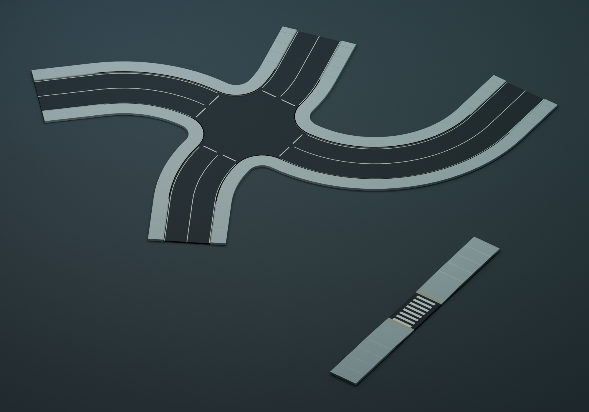
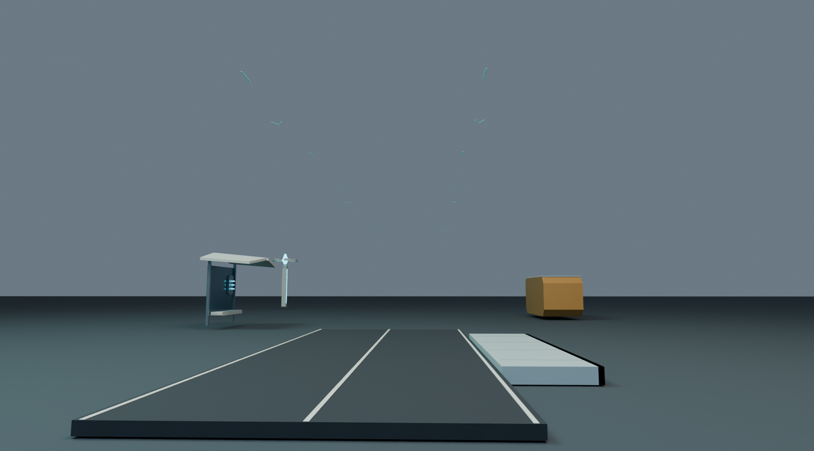
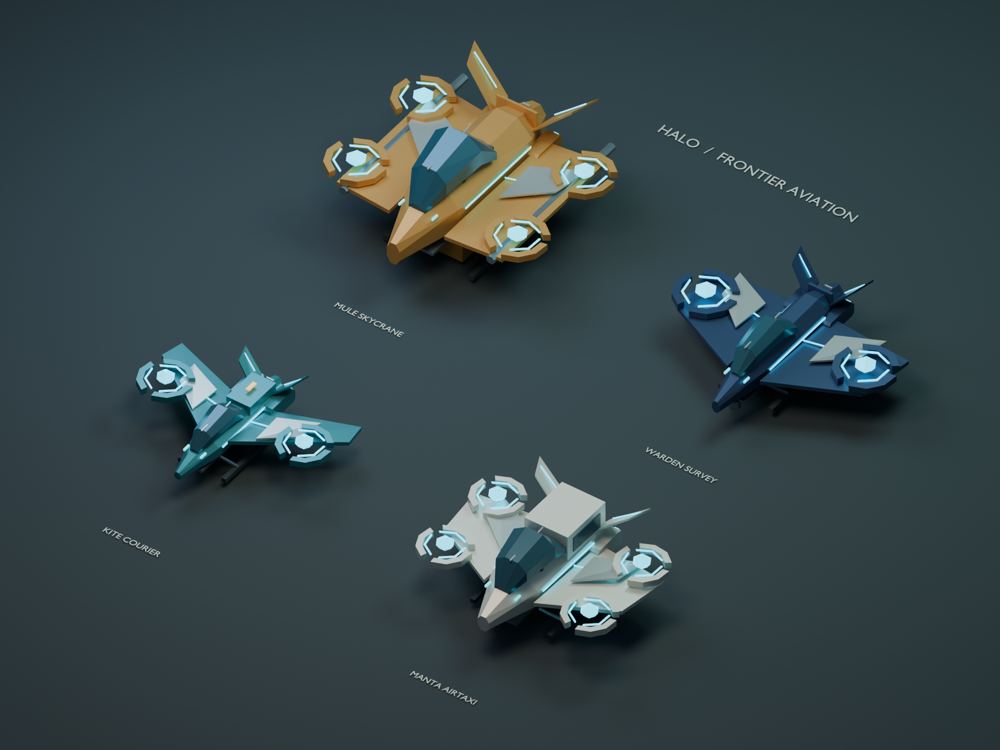
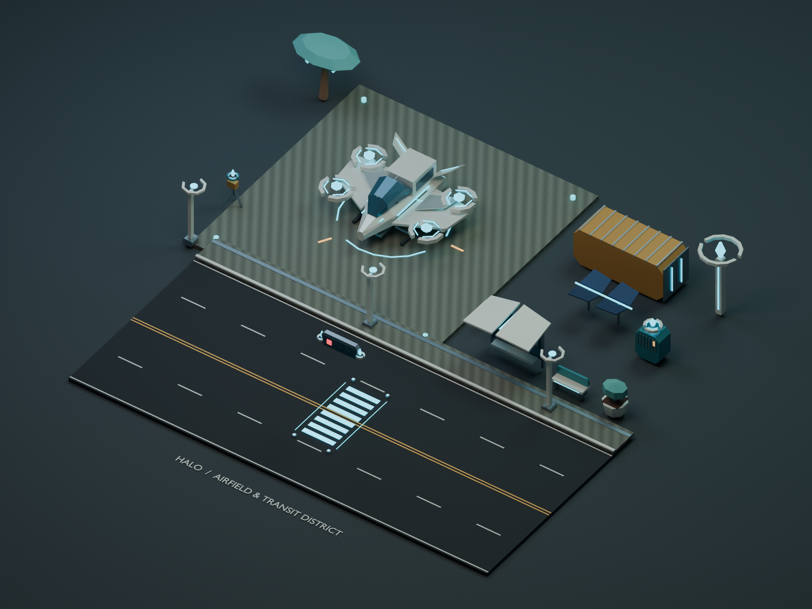
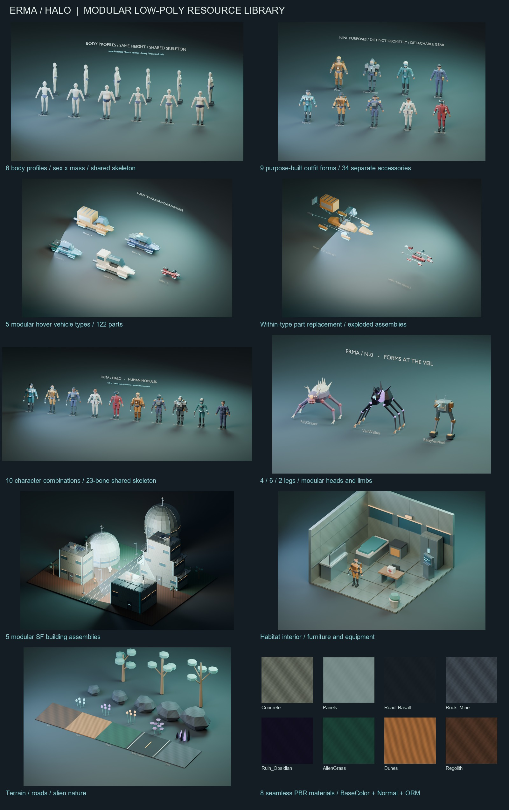

# 에르마 · 헤일로 Blender 리소스

세계관에 맞춘 조립식 로우 폴리 그래픽 팩입니다. 모든 작업 파일은 이 Resource 폴더 안에 있습니다.

**제작 원칙은 디테일 우선입니다.** 필요한 형상과 기능 디테일을 먼저 만든 뒤, 외부 표면을 보존하며 불필요한 면을 정리합니다. 500삼각형은 파트별 납품 상한이며 최소 폴리곤 제작 목표가 아닙니다. [제작 파이프라인](Documentation/MODELING_PIPELINE_ko.md) · [이전/상세 원본/최적화 비교](Preview/23_detail_pipeline_comparison.png)

- **2,293개 독립 메시 파트**: 인체·의복·액세서리 854 / 몹 63 / 건축·환경 91 / 차량 133 / 비행체 90 / 도시·도로·야외 확장 137 / 통행로 확장 497 / 도로계획 428. 기존 인체·의복 호환 파트 199개를 포함합니다.
- **파트당 최대 492삼각형**: 삼각형 변환 후에도 요청한 500개 이하
- **체형 6종**, 목적별 의복 **9종 × 6체형**, 독립 액세서리 **34개**
- **인물 조립 예제 10개**, 몹 3계열·머리 교체형 포함 **6개**, 건물 예제 **10개**, 차량 5종의 A/B 예제 **10개**, 비행체 4종의 A/B 예제 **8개**, 도시·도로·야외 프롭 **34종**
- 공통 인체와 3개 몹 리그에 **각 15개 스켈레탈 클립**, 압력문에 개폐 2개, 차량에 타입별 10~11개, 비행체에 타입별 **12개**
- 512×512 반복 PBR 재질 **8세트·PNG 24개**
- **GLB 2,575개**, Blender 편집 원본, 조립·본·클립·블렌딩·통행로 접속 JSON, 검증 결과와 렌더 미리보기

시작 파일은 [Blender 원본](Source/Erma_Resource_Library.blend)입니다. 기본 Scene은 `16_Transit_Connected_Example` 통행로 조립 예제이며, Scene 메뉴에서 기존 인물·몹·주거 구역과 도로·프롭·비행체 예제로 이동할 수 있습니다.

[상세 사용·조립 안내](Documentation/README_ko.md) · [애니메이션 조합 안내](Documentation/ANIMATION_GUIDE_ko.md) · [조합 데이터](Documentation/assembly_recipes.json) · [애니메이션 블렌딩 데이터](Documentation/animation_blending.json)

[캐릭터 디테일 개선·조립 규칙](Documentation/CHARACTER_DETAIL_ko.md) · [체형·의복·액세서리 설계](Documentation/CHARACTER_DESIGN_ko.md) · [차량 조립 안내](Documentation/VEHICLES_ko.md)

[비행체·도시·도로·야외 프롭 안내](Documentation/AIR_CITY_ko.md) · [비행체 조합](Documentation/aircraft_assemblies.json) · [배경 조합](Documentation/scenery_assemblies.json)

## 도로·보행로·비행 안내 확장 — 2026-10-22

**도로 45종·보행로 55종·비행 안내 12종**, 페인트 전용 3종을 포함한 총 115개 조립 모듈을 추가했습니다. 독립 메시 497개는 파트당 최대 288삼각형이며 `Export/Transit`에 조립 GLB와 개별 파트를 모두 저장했습니다. 2·4·6차선의 곡선·둥근 모서리 교차로·폭 전환부, 별도 보도·경사로·횡단 연결부를 접속점으로 조립할 수 있습니다. 하늘의 안내는 중앙 5m를 비우고 약 3.5cm 두께의 짧은 양측 표식만 사용합니다.

[통행로 조립 안내](Documentation/TRANSIT_KIT_ko.md) · [접속 규격](Documentation/transit_modules.json) · [연결 예제 배치](Documentation/transit_layout_example.json)





이번 통행로 확장은 Blender 원본·GLB·조립 정보까지 제작한 상태입니다. 아래의 기존 게임 연결 기록과 별개로, **새 통행로의 Runtime 캐시 등록·월드 배치·기존 비행 경로 표시 교체는 별도 개발 작업**입니다. 이번 작업은 게임 코드와 Runtime 캐시를 변경하지 않았습니다.

## 비행체·배경 확장 — 2026-10-22

운송기·에어택시·화물 인양기·탐사기와 2/4/6차선 도로, 교차로, 가로등·신호등·정류장, 전력·물류 시설, 탐사 장비·유적·외계 식생을 추가했습니다. **새 파트 219개는 최대 464삼각형**이며, 완성 예제와 개별 교체 파트를 모두 GLB로 저장했습니다. 기존 팩의 재질·미터 단위·공통 조립 원점을 따릅니다.

디자인 수정본은 기계식 로터를 분절된 부상 링·발광 코어로 교체했습니다. 차량 신호기는 지지대 없이 공중 5.25m에 뜨고, 보행자 안내는 바닥 홀로그램만 사용합니다. 비접촉 충전기·분절형 조명·통신 배열·정류장도 같은 미래형 조형으로 맞췄습니다. `13_Field_Tech_Details`와 `Preview/17_field_tech_details.png`에서 가까이 볼 수 있습니다.





새 리소스의 게임 연결은 아래 2026-10-22 항목을 따릅니다. 제작 원본과 조립·검증 데이터는 유지합니다.



제작 당시에는 게임 코드 연결을 수행하지 않았습니다. `Tools`는 Blender 제작·검증용 원본 도구입니다.

## 게임 연결 — 2026-10-21

게임은 `Runtime/game-assets.bin`의 변환 캐시를 읽습니다. 원본 GLB와 Blender 파일은 유지합니다.
변환 도구는 저장소 루트의 `tools/pack-resources.mjs`이며 외부 npm 패키지 없이 Node.js 18 이상에서 실행합니다.

```text
node tools/pack-resources.mjs
node tools/pack-resources.mjs --check
node tools/check-resource-pack.mjs
```

첫 명령은 런타임 캐시와 원본 SHA-256·모델 매핑을 담은 `Runtime/manifest.json`을 생성합니다.
두 번째는 캐시·원본 해시가 일치하는지 검사하며 파일을 변경하지 않습니다. 게임 빌드/실행은 아닙니다.
세 번째는 바이너리를 독립적으로 읽어 해시·정점·법선·가중치·소켓·지면·클립 경계를 검사합니다.
Visual Studio 프로젝트는 빌드 후 두 파일을 실행 파일 옆 `Resource/Runtime`에 복사합니다.
게임 실행에 Node.js·Blender·GLB 파서가 필요한 것은 아닙니다.

인물·차량·몹의 스킨은 4개 가중치와 최대 32개 본으로 출력하고, 선택한 GLB 클립을 30Hz 팔레트로 캐싱합니다.
인체는 23본을 유지하며 이동·상체 조준을 결합합니다. 바이크 자세는 Jump_Air 하체와 Aim_Base 상체를
조합한 런타임용 Ride 포즈입니다. 리소스의 별도 탑승 클립을 재생한다고 주장하지 않습니다.
BaseColor는 UV 위치에서 정점색으로 샘플링하며, 표면 종류와 독립 팔레트를 기존 조명 경로에 연결합니다.
Normal/ORM 텍스처의 픽셀 단위 PBR 샘플링과 모든 GLB 확장 기능을 지원하는 범용 glTF 뷰어는 아닙니다.
지면은 상향 면을 추출해 높이 0에 놓고, 건물은 원래 수평 비율·실측 높이에 맞춥니다.
게임의 빌드·실제 화면·장시간 플레이 검증은 사용자 확인 대기입니다.

## 게임 연결 확장 — 2026-10-22

비행체 8개와 배경 조립체 34개, 차량 신호 상태 2개를 추가해 런타임 캐시는 122항목입니다.
`node tools/pack-resources.mjs`로 재생성하며 기존 캐시 형식과 원본 미터 비율을 유지합니다.
비행체의 17본·12클립을 저장하고, 게임의 순항에는 착륙 장치 수납 자세를 결합합니다.

게임에는 독립 항공 회랑의 주변 비행 교통과 도시별 착륙장/주기 기체, 도시·광산 주변 시설을 배치했습니다.
배경 34종 중 29종을 현재 사용하며 규격이 맞지 않는 교차로/곡선 모듈 등은 캐시와 도감에 준비합니다.
공중 차량 신호기와 바닥 보행 홀로그램은 게임 신호 상태를 따릅니다. 기존 퀘스트·바이크 통로는 배치에서 보호합니다.

캐시 일치·독립 바이너리 검사는 통과했습니다. 실제 게임 빌드·플레이·프레임 레이트 확인은 아직 하지 않았습니다.
상세 적용 범위와 남은 확인은 저장소 루트의 `GAME_DOCUMENTATION.md`에 기록합니다.

## 도로계획 메시 — 2026-10-23

요청서의 P0/P1을 도로·보도·램프·고가·구조물 88개 모듈, 428개 독립 파트로 제작했습니다. [독립 Blender 원본](Source/RoadPlan_Modules.blend) · [제작·게임 통합 안내](Documentation/ROAD_PLAN_ko.md) · [포트·치수 JSON](Documentation/road_plan_modules.json). 게임 코드와 Runtime 캐시는 이 모델링 작업에서 수정하지 않았습니다.
